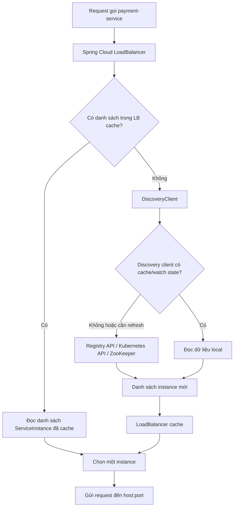

# Tối ưu bộ đệm và đánh đổi với độ trễ lan truyền

Service discovery thường được gọi lặp lại bởi nhiều consumer. Nếu mỗi request nghiệp vụ đều truy vấn trực tiếp Eureka, Consul, ZooKeeper hoặc Kubernetes API để lấy danh sách instance, registry sẽ chịu tải lớn và trở thành một dependency trên đường xử lý nóng. Bộ đệm giúp giảm số lần tra cứu, giảm độ trễ và cho phép ứng dụng tiếp tục sử dụng dữ liệu gần đây khi registry tạm thời chậm.

Đổi lại, cache có thể giữ hostname, IP, port, metadata hoặc trạng thái instance đã cũ. Khi instance mới được đăng ký, instance cũ bị dừng hoặc health thay đổi, consumer có thể tiếp tục nhìn thấy dữ liệu cũ cho đến khi các lớp cache được làm mới. Tối ưu discovery vì vậy là bài toán cân bằng giữa **tải registry**, **độ trễ lan truyền thay đổi** và **khả năng phục vụ khi registry gặp sự cố**.

Trong module `SPRING_CLOUD_SERVICE_DISCOVERY`, `DiscoveryClient` cung cấp abstraction tra cứu instance theo service ID; registry implementation và Spring Cloud LoadBalancer quyết định cách lấy, cache và chọn instance. Bài học này phân tích các lớp cache, cách đặt TTL/refresh, xử lý dữ liệu cũ và phương pháp đo để chọn cấu hình phù hợp.

## 1. Vì sao cần cache kết quả discovery?

Giả sử `order-service` gửi hàng nghìn request mỗi giây đến `payment-service`. Danh sách instance của payment thường thay đổi chậm hơn rất nhiều so với tần suất request nghiệp vụ. Nếu mỗi request đều gọi registry để lấy danh sách instance, số lượng request discovery có thể tăng theo số request nghiệp vụ.

Cache cho phép consumer lưu tạm danh sách instance trong một khoảng thời gian. Các request tiếp theo dùng danh sách đã có thay vì truy vấn lại registry. Điều này có một số lợi ích:

- Giảm request đọc registry và giảm tải CPU, network cùng connection của registry.
- Giảm thời gian tra cứu service trong đường xử lý request.
- Hạn chế tác động khi registry tạm thời chậm hoặc mất kết nối.
- Giảm số lần tạo kết nối và xử lý metadata lặp lại.
- Tạo cơ hội gom nhiều lần tra cứu cùng service thành một lần cập nhật.

Tuy nhiên, cache không làm instance trở nên khỏe mạnh hơn. Nếu một địa chỉ đã chết vẫn nằm trong cache, load balancer có thể tiếp tục chọn nó. Vì vậy, cache phải được thiết kế cùng timeout, retry có giới hạn, health filtering và cơ chế cập nhật registry.

## 2. Những lớp cache trong service discovery

Trong một ứng dụng Spring Cloud, dữ liệu discovery có thể được lưu ở nhiều lớp. Không nên chỉ nhìn một TTL rồi kết luận toàn hệ thống sẽ nhìn thấy thay đổi sau đúng khoảng thời gian đó.

| Lớp | Dữ liệu có thể được giữ | Ví dụ cơ chế | Hệ quả khi dữ liệu cũ |
|---|---|---|---|
| Registry/cluster | Catalog hoặc registry state trên node server. | Eureka peer registry, Consul catalog, Kubernetes API objects, ZooKeeper znodes. | Các registry node có thể tạm thời chưa hội tụ hoặc bản ghi chưa được cập nhật. |
| Discovery client | Danh sách service/instance đã tải về ứng dụng. | Eureka local registry cache, Consul query/watch state, ZooKeeper watcher state, Kubernetes discovery client. | Consumer vẫn đọc được danh sách cũ hoặc danh sách chưa đầy đủ. |
| Spring Cloud LoadBalancer | Danh sách `ServiceInstance` theo service ID. | `LoadBalancerCacheManager`, `CachingServiceInstanceListSupplier`. | Instance đã bị xóa ở discovery client vẫn có thể xuất hiện trong danh sách được cache. |
| DNS resolver | Bản ghi hostname → IP. | CoreDNS, OS resolver, JVM DNS cache, DNS cache trong runtime. | Hostname có thể tiếp tục trỏ đến IP cũ sau khi DNS record thay đổi. |
| HTTP client/connection pool | Kết nối TCP/TLS đã thiết lập, DNS result hoặc route liên quan. | Keep-alive, connection pool, proxy, service mesh. | Request có thể tiếp tục dùng connection đến instance cũ dù danh sách discovery đã đổi. |
| Cache nghiệp vụ tự viết | URI, `ServiceInstance` hoặc kết quả chọn instance. | `@Cacheable`, map trong bộ nhớ, Redis. | Có thể tạo thêm một lớp stale data ngoài các cache của framework. |

Ví dụ, Eureka client có local registry cache; Spring Cloud LoadBalancer có thể cache danh sách instance; HTTP client có thể giữ connection pool. Khi một instance bị deregister, mỗi lớp có thể nhận thay đổi ở thời điểm khác nhau.

### 2.1. Cache không đồng nghĩa với registry replication

Registry replication đồng bộ trạng thái giữa các node registry. Discovery client cache giữ dữ liệu ở phía ứng dụng. LoadBalancer cache giữ danh sách dùng cho việc chọn instance. Ba cơ chế này giải quyết các vấn đề khác nhau và có thể cùng tồn tại.

Giảm TTL của LoadBalancer không làm peer replication của Eureka nhanh hơn. Tăng tần suất fetch registry của Eureka cũng không xóa ngay DNS cache hoặc connection pool. Khi điều tra độ trễ lan truyền, phải xác định lớp nào đang giữ dữ liệu cũ.

## 3. Luồng dữ liệu khi tra cứu instance

Một request sử dụng service ID có thể đi qua các lớp như sau:



Sơ đồ mô tả các lớp khái niệm; implementation cụ thể có thể gộp cache hoặc dùng watch/event thay cho polling. Một số provider đã trả về dữ liệu cache từ client, sau đó LoadBalancer tiếp tục cache danh sách đó.

## 4. TTL và refresh interval là hai khái niệm khác nhau

**TTL (time to live)** là thời gian một mục cache được xem là còn hiệu lực trước khi cần làm mới hoặc bị loại bỏ. **Refresh interval** là chu kỳ client chủ động tải hoặc đồng bộ dữ liệu mới. Hai giá trị có thể nằm ở hai lớp khác nhau.

Ví dụ:

- Eureka client tải registry theo chu kỳ `eureka.client.registry-fetch-interval-seconds`.
- Spring Cloud LoadBalancer có TTL riêng cho cache danh sách `ServiceInstance`.
- DNS resolver sử dụng TTL của bản ghi và chính sách cache riêng của runtime.
- Consul có thể dùng blocking query/watch để chờ index thay đổi thay vì chỉ polling theo chu kỳ cố định.
- ZooKeeper client có thể dùng watcher để nhận thông báo thay đổi và đọc lại dữ liệu sau event hoặc reconnect.

TTL ngắn giúp dữ liệu được làm mới thường xuyên hơn nhưng tăng tải và số lần tính toán. TTL dài giảm tải nhưng kéo dài thời gian giữ dữ liệu cũ. Refresh event-driven có thể giảm polling nhưng vẫn cần xử lý reconnect, resync và trạng thái khi watcher bị gián đoạn.

### 4.1. Ví dụ cấu hình Eureka registry fetch

```yaml
eureka:
  client:
    registry-fetch-interval-seconds: 15
```

Giá trị trên minh họa consumer làm mới registry thường xuyên hơn so với chu kỳ mặc định thường gặp. Nó tác động đến local registry cache của Eureka client, không phải TTL của Spring Cloud LoadBalancer cache. Khi thay đổi, hãy cân nhắc số lượng client và số registry node vì mọi consumer có thể tăng tần suất fetch cùng lúc.

### 4.2. Ví dụ cấu hình Spring Cloud LoadBalancer cache

```yaml
spring:
  cloud:
    loadbalancer:
      cache:
        enabled: true
        ttl: 5s
        capacity: 256
```

`ttl` điều khiển thời gian giữ mục cache của LoadBalancer; `capacity` giới hạn số mục cache. Giá trị ví dụ `5s` là một lựa chọn minh họa, không phải cấu hình tối ưu chung. Tên thuộc tính và cache implementation cần được đối chiếu với release train Spring Cloud đang dùng.

Spring Cloud LoadBalancer có thể sử dụng cache implementation mặc định hoặc Caffeine nếu dependency tương ứng có trên classpath. Cần xác minh implementation thực tế và cấu hình được áp dụng trong application context; không giả định chỉ thêm dependency là mọi cache sẽ có cùng hành vi.

### 4.3. TTL không phải thời gian hội tụ được bảo đảm

TTL chỉ nói về hiệu lực của một cache entry. Thay đổi vẫn có thể đến muộn do registry replication, refresh scheduling, request timeout, retry, DNS cache hoặc connection pool. TTL 5 giây ở LoadBalancer không đảm bảo consumer ngừng gọi instance cũ sau 5 giây nếu discovery client vẫn trả danh sách cũ trong 30 giây.

## 5. Đánh đổi giữa cache TTL và độ trễ lan truyền

Một cache có TTL ngắn thường giảm thời gian giữ dữ liệu cũ. Tuy nhiên, mỗi lần cache hết hạn có thể phát sinh một lần truy vấn mới. Khi số service và số consumer lớn, giảm TTL đồng loạt có thể làm registry chịu tải tăng mạnh.

| TTL | Tải tra cứu | Khả năng giữ dữ liệu cũ | Phù hợp khi |
|---|---|---|---|
| Rất ngắn | Cao hơn | Thấp hơn nếu lớp upstream cũng cập nhật nhanh | Endpoint thay đổi thường xuyên và yêu cầu hội tụ nhanh. |
| Trung bình | Cân bằng | Chấp nhận được theo SLA | Phần lớn hệ thống microservice có tần suất thay đổi vừa phải. |
| Dài | Thấp hơn | Cao hơn | Endpoint ổn định, registry có giới hạn tải hoặc có cơ chế failover khác. |
| Không cache | Có thể rất cao | Ít stale do chính lớp này, nhưng phụ thuộc cache upstream | Chẩn đoán hoặc hệ thống rất nhỏ; không mặc định phù hợp production. |

Không nên chọn TTL chỉ dựa trên mong muốn “càng ngắn càng tốt”. Hãy xác định thời gian tối đa chấp nhận được để consumer nhìn thấy instance mới và ngừng chọn instance đã rời hệ thống, sau đó phân bổ ngân sách thời gian cho từng lớp.

## 6. Ước lượng độ trễ nhìn thấy thay đổi

Với một thay đổi registration, thời gian consumer nhìn thấy dữ liệu mới có thể phân rã thành các đoạn:

\[
T_{visible} \approx T_{registry} + T_{client} + T_{loadbalancer} + T_{dns/connection}
\]

Trong đó:

- (T_{registry}): thời gian registry nhận và truyền thay đổi đến node mà consumer truy cập.
- (T_{client}): thời gian discovery client nhận hoặc tải lại dữ liệu.
- (T_{loadbalancer}): thời gian LoadBalancer cache hết hạn, refresh hoặc nhận danh sách mới.
- (T_{dns/connection}): thời gian DNS cache và connection reuse ngừng dùng địa chỉ cũ, nếu request path có các lớp này.

Đây là mô hình phân tích. Các đoạn có thể chạy song song, chồng lấp hoặc không áp dụng; không nên coi phép cộng là SLA chính xác cho mọi implementation.

Với polling interval (I), nếu thời điểm thay đổi phân bố ngẫu nhiên trong chu kỳ thì độ trễ chờ lần poll kế tiếp thường nằm trong khoảng gần (0) đến (I), với giá trị trung bình xấp xỉ (I/2), chưa tính thời gian request và xử lý. Nếu nhiều lớp polling nối tiếp nhau, độ trễ xấu nhất có thể tăng gần bằng tổng các chu kỳ tương ứng.

Ví dụ minh họa:

| Lớp | Chu kỳ/TTL | Độ trễ chờ tối đa gần đúng |
|---|---:|---:|
| Registry replication | 2 giây | 2 giây |
| Eureka client fetch | 15 giây | 15 giây |
| LoadBalancer cache | 5 giây | 5 giây |

Nếu các lớp nối tiếp và không có event invalidation, tổng thời gian chờ có thể xấp xỉ 22 giây cộng thời gian xử lý. Thực tế có thể thấp hơn do các chu kỳ chồng lấp hoặc cao hơn do retry, lỗi mạng và scheduler delay.

## 7. Tối ưu cache theo từng discovery provider

### 7.1. Eureka

Eureka client thường giữ registry cache cục bộ và định kỳ fetch registry. Những điểm cần cân nhắc:

- `registry-fetch-interval-seconds` ảnh hưởng tần suất client tải registry.
- Peer replication ảnh hưởng thời điểm node mà client đọc có dữ liệu mới.
- Lease renewal và eviction ảnh hưởng thời điểm instance chết được loại khỏi server registry.
- Spring Cloud LoadBalancer có cache riêng nếu được bật.
- Client có thể giữ dữ liệu cũ trong lúc server không truy cập được; cần kiểm tra hành vi của phiên bản và cấu hình.

Không giảm registry fetch interval xuống quá thấp khi có hàng trăm hoặc hàng nghìn client mà chưa đo tải server. Nếu cần giảm thời gian thấy thay đổi, hãy kiểm tra cả lease/eviction, peer replication và LoadBalancer cache thay vì chỉ sửa một thuộc tính.

### 7.2. Consul

Consul hỗ trợ truy vấn có index và blocking query để client chờ catalog thay đổi. Cách này có thể giảm polling ngắn liên tục: client gửi index hiện tại và chờ đến khi index thay đổi hoặc timeout. Spring Cloud Consul có các cơ chế watch/catalog refresh tùy phiên bản và cấu hình.

Các điểm cần cân nhắc:

- Watch delay/timeout quyết định nhịp phát hiện và tải query.
- Agent/server và catalog consistency ảnh hưởng dữ liệu được trả về.
- Health query có thể chỉ lấy instance passing; điều này ảnh hưởng số instance trong cache.
- Cache của LoadBalancer vẫn có thể giữ danh sách cũ sau khi watch đã nhận thay đổi.
- Khi reconnect hoặc watch bị lỗi, client cần tái đồng bộ dữ liệu đầy đủ thay vì chỉ dựa vào event cuối cùng.

Blocking query không loại bỏ độ trễ hoàn toàn. Nó giảm polling không cần thiết, nhưng vẫn phụ thuộc thời gian cập nhật catalog, xử lý query, reconnect và cache downstream.

### 7.3. ZooKeeper

ZooKeeper watcher cung cấp thông báo khi znode liên quan thay đổi. Event thường chỉ là tín hiệu để client đọc lại dữ liệu; watcher không phải một log sự kiện bền vững để consumer có thể bỏ qua mọi lần đồng bộ.

Khi session hết hạn hoặc client reconnect, cần thiết lập watcher lại và đọc trạng thái hiện tại. Nếu ứng dụng chỉ xử lý event mà không resync sau reconnect, cache có thể bỏ lỡ thay đổi xảy ra trong khoảng mất kết nối.

Thiết kế tốt thường kết hợp watcher để phát hiện nhanh và một lần đọc lại trạng thái đầy đủ khi khởi động/reconnect. Nếu phía Spring Cloud Zookeeper hoặc Curator có cache riêng, cần đo độ trễ từ znode update đến `DiscoveryClient` và LoadBalancer.

### 7.4. Kubernetes Discovery

Spring Cloud Kubernetes có thể theo dõi hoặc đọc Service, Endpoints/EndpointSlices qua Kubernetes API tùy phiên bản và cấu hình. Kubernetes cũng có DNS record với TTL và cache ở resolver.

Nếu dùng ClusterIP DNS, DNS name thường ổn định trong khi danh sách backend thay đổi ở Service dataplane. Nếu dùng headless Service, DNS có thể trả nhiều Pod IP và resolver/client cache có thể giữ IP cũ. Nếu dùng DiscoveryClient, cache/watcher của integration và LoadBalancer cache có thể tạo thêm độ trễ.

Hãy chọn rõ request path: gọi Service DNS để Kubernetes cân bằng traffic, hoặc lấy Pod endpoint qua DiscoveryClient để Spring Cloud LoadBalancer chọn. Nếu dùng cả hai lớp, việc giảm TTL một bên không đảm bảo endpoint cuối cùng được chọn đã đổi.

## 8. TTL, health check và trạng thái instance

Cache freshness và health là hai thuộc tính khác nhau. Một cache mới có thể chứa instance vừa bị lỗi sau khi dữ liệu được tải; một cache cũ có thể chứa instance vẫn đang khỏe mạnh. Không thể dùng TTL thay cho health check.

Một số nguyên tắc:

- Health check cần phản ánh khả năng nhận request, không chỉ trạng thái tiến trình còn sống.
- Discovery query nên loại instance không passing/không ready nếu yêu cầu nghiệp vụ cần điều đó.
- Cache cần được làm mới khi health status đổi, nhưng không phải implementation nào cũng hỗ trợ invalidation tức thời.
- Request đến instance đã lỗi vẫn cần timeout và retry có giới hạn.
- Circuit breaker có thể giảm request lặp đến instance/dependency đang lỗi; nó không tự xóa bản ghi khỏi registry.

Nếu một instance bị kill đột ngột, thời gian loại bỏ có thể gồm failure detection/lease, registry update, discovery refresh và LoadBalancer cache expiry. Khi shutdown có kiểm soát, deregistration/readiness drain có thể rút ngắn thời gian consumer tiếp tục chọn instance.

## 9. Cache stampede và tải tăng đột biến

Cache stampede xảy ra khi nhiều request cùng lúc phát hiện một cache entry hết hạn và đồng loạt truy vấn registry để làm mới. Với nhiều service và nhiều replica consumer, hiện tượng này có thể tạo một đợt tải lớn đúng lúc registry đang chịu áp lực.

Các biện pháp giảm stampede:

1. **Single-flight/coalescing:** chỉ cho một request làm mới một key; các request khác chờ kết quả chung.
2. **Jitter TTL:** thêm độ lệch ngẫu nhiên nhỏ để các instance consumer không hết hạn cùng thời điểm.
3. **Refresh sớm:** làm mới nền trước khi cache hết hạn nếu thư viện hỗ trợ.
4. **Stale-while-revalidate:** tiếp tục dùng dữ liệu gần đây trong lúc làm mới, nếu mức rủi ro stale được chấp nhận.
5. **Backoff và giới hạn concurrency:** tránh retry dồn dập khi registry không phản hồi.
6. **Giới hạn kích thước cache:** tránh giữ vô hạn service ID hoặc metadata không còn sử dụng.

Stale-while-revalidate cần thận trọng với endpoint vừa bị thu hồi vì lý do bảo mật hoặc instance đã bị cô lập. Không nên tiếp tục dùng dữ liệu stale vô thời hạn chỉ để tăng availability.

## 10. Cache key và phạm vi dữ liệu

Cache key phải đại diện đúng dữ liệu được cache. Với danh sách instance, key thường cần bao gồm service ID và mọi ngữ cảnh có thể làm thay đổi kết quả, chẳng hạn namespace, region, tenant hoặc query filter.

Nếu hai consumer ở hai zone có chính sách chọn instance khác nhau nhưng dùng chung một cache key chỉ gồm service ID, kết quả lọc của consumer này có thể bị dùng nhầm cho consumer kia. Tương tự, không cache danh sách đã lọc theo version dưới key chung nếu các caller có yêu cầu API compatibility khác nhau.

Một số nguyên tắc:

- Cache danh sách ứng viên ở lớp discovery/load balancer; thực hiện lựa chọn instance theo request ở lớp phù hợp.
- Không cache một instance được chọn duy nhất quá lâu nếu load balancing cần phân phối qua nhiều instance.
- Đưa namespace/zone/filter vào key nếu chúng ảnh hưởng danh sách trả về.
- Xóa hoặc giới hạn entry khi service ID không còn tồn tại.
- Tránh dùng mutable object làm cache key hoặc giữ reference có thể bị sửa sau khi cache.

## 11. Cấu hình cache trong Spring Cloud LoadBalancer

Một cấu hình tham khảo:

```yaml
spring:
  cloud:
    loadbalancer:
      cache:
        enabled: true
        ttl: 5s
        capacity: 512
```

Trong môi trường có nhiều service ID hoặc discovery data ít thay đổi, cache có thể giảm số lần gọi discovery client. Khi service instance thay đổi thường xuyên, TTL ngắn hơn có thể phù hợp hơn nhưng cần đo registry load.

Nếu cần tắt cache để kiểm tra hành vi discovery trực tiếp, có thể đặt:

```yaml
spring:
  cloud:
    loadbalancer:
      cache:
        enabled: false
```

Chỉ tắt cache LoadBalancer không đồng nghĩa toàn hệ thống không còn cache. Eureka local registry, Consul watch state, ZooKeeper watcher state, Kubernetes client cache, DNS resolver và connection pool vẫn có thể giữ dữ liệu. Đây là kỹ thuật hữu ích để khoanh vùng một lớp cache, không phải biện pháp mặc định cho production.

Tên thuộc tính, giá trị mặc định, cache implementation và hành vi invalidation phụ thuộc release train Spring Cloud. Kiểm tra tài liệu đúng phiên bản trước khi đưa cấu hình vào môi trường thật.

## 12. Ví dụ lựa chọn TTL theo mục tiêu vận hành

Giả sử yêu cầu hệ thống là consumer ngừng chọn instance đã deregister trong vòng 10 giây ở điều kiện bình thường. Có ba lớp polling/cache nối tiếp:

| Lớp | Cấu hình mục tiêu minh họa | Ngân sách độ trễ |
|---|---:|---:|
| Registry/client update | 4 giây | 4 giây |
| LoadBalancer cache | 3 giây | 3 giây |
| DNS/connection reuse còn áp dụng | 2 giây | 2 giây |
| Dự phòng scheduler/network | 1 giây | 1 giây |

Tổng ngân sách minh họa là 10 giây. Đây không phải công thức đảm bảo vì các lớp có thể chồng lấp hoặc phát sinh retry. Cần đo p95/p99 từ lúc deregister đến request cuối cùng được gửi đến instance đó.

Nếu đo thấy p99 là 18 giây, không nên chỉ giảm TTL LoadBalancer từ 3 giây xuống 1 giây. Cần xác định đoạn nào chiếm nhiều thời gian: registry lease/replication, client refresh, LoadBalancer cache, DNS TTL hay connection pool.

## 13. Đo lường hiệu quả cache

Để tối ưu có cơ sở, theo dõi các chỉ số sau:

- Số lần `DiscoveryClient.getInstances` được gọi theo service ID.
- Cache hit/miss, eviction và số entry trong LoadBalancer cache nếu implementation cung cấp metrics.
- Số request đến Eureka/Consul/Kubernetes API và latency của các request đó.
- Thời gian từ register/deregister/status change đến khi consumer nhìn thấy thay đổi.
- Tỷ lệ request lỗi do connection refused, timeout hoặc host không phân giải được.
- Tỷ lệ retry và số lần circuit breaker mở.
- Tuổi dữ liệu cache hoặc thời điểm lần refresh gần nhất nếu có thể quan sát.
- Số instance trong registry so với số instance mà consumer nhìn thấy.

Nên đo riêng theo service, consumer và zone. Một số service ít thay đổi nhưng có lưu lượng lớn; service khác thay đổi nhiều nhưng ít request. Dùng một TTL chung cho mọi service có thể không tối ưu.

### 13.1. Đo độ trễ lan truyền bằng mốc thời gian

Trong staging, ghi các mốc:

1. Provider gửi register/deregister hoặc health status thay đổi.
2. Registry chấp nhận thay đổi.
3. Peer registry (nếu có) phản ánh thay đổi.
4. Discovery client của consumer nhận dữ liệu mới.
5. LoadBalancer cache thay đổi danh sách.
6. Request đầu tiên sử dụng danh sách mới và request cuối cùng còn chọn instance cũ.

Lặp lại nhiều lần ở các tải khác nhau và tính p50/p95/p99. Một lần đo thành công không đủ để đặt SLA, đặc biệt khi registry có nhiều node hoặc consumer phân bố ở nhiều zone.

## 14. Kiểm thử tình huống cache và lỗi registry

Một bộ kiểm thử staging nên bao gồm:

- **Thêm instance:** đo thời gian consumer bắt đầu nhìn thấy instance mới.
- **Deregister có kiểm soát:** đo thời gian consumer ngừng chọn instance.
- **Kill đột ngột:** đo thời gian phát hiện lỗi, eviction và refresh.
- **Thay đổi metadata:** xác nhận version/zone mới được consumer nhìn thấy.
- **Registry tạm mất kết nối:** xác định cache tiếp tục phục vụ được bao lâu và hành vi khi hết TTL.
- **Cache stampede:** cho nhiều consumer cùng hết hạn cache và đo tải registry.
- **DNS record thay đổi:** đo thời gian resolver và client ngừng dùng IP cũ.
- **Consumer reconnect:** xác nhận cache được resync sau khi mất kết nối/watch/session.
- **Không còn instance khỏe mạnh:** xác nhận ứng dụng trả lỗi/fallback đúng và không retry vô hạn.

Các bài test cần giới hạn tải và chạy trong môi trường kiểm thử. Không restart registry hoặc kill hàng loạt instance production chỉ để quan sát cache behavior.

## 15. Các lỗi thường gặp khi tối ưu cache

| Hiện tượng | Nguyên nhân có thể | Cách xử lý |
|---|---|---|
| Registry chịu tải cao sau khi giảm TTL | Nhiều consumer refresh đồng loạt. | Tăng TTL hợp lý, thêm jitter/coalescing và đo tải. |
| Instance cũ vẫn được gọi dù đã deregister | LoadBalancer hoặc discovery client cache chưa hết hạn. | Đo từng lớp, cấu hình TTL/refresh và invalidation phù hợp. |
| TTL LoadBalancer ngắn nhưng vẫn stale | Cache upstream như Eureka registry hoặc DNS chưa cập nhật. | Kiểm tra cache và refresh ở mọi lớp trước đó. |
| Consumer tiếp tục gọi instance cũ sau khi DNS đổi | DNS resolver/JVM cache hoặc connection pool giữ địa chỉ cũ. | Kiểm tra TTL, DNS cache policy và connection lifecycle. |
| Tất cả consumer cùng query registry một lúc | Cache stampede khi TTL đồng bộ. | Jitter, single-flight, refresh nền và backoff. |
| Cache giữ instance không khỏe mạnh | Danh sách discovery không lọc health hoặc health update chậm. | Dùng health-aware discovery, readiness và timeout/retry. |
| Tắt LoadBalancer cache nhưng dữ liệu vẫn cũ | Một lớp cache khác vẫn hoạt động. | Kiểm tra Eureka, Consul, ZooKeeper, Kubernetes, DNS và HTTP client. |
| Cache theo service ID trả sai zone | Key không bao gồm zone/filter hoặc cache đã lọc được chia sẻ sai. | Đưa ngữ cảnh lọc vào key hoặc cache danh sách ứng viên chưa lọc. |
| Retry làm tăng tải khi registry lỗi | Không có backoff/jitter hoặc retry vô hạn. | Giới hạn retry, exponential backoff và circuit breaker. |
| Tăng refresh nhưng latency không giảm | Độ trễ nằm ở replication, lease, DNS hoặc connection reuse. | Đo timestamp từng giai đoạn thay vì tiếp tục giảm chu kỳ. |

## 16. Nguyên tắc lựa chọn trong production

- Xác định SLA cho thời gian nhìn thấy instance mới và thời gian ngừng chọn instance đã rời hệ thống.
- Liệt kê tất cả lớp cache: registry, discovery client, LoadBalancer, DNS, HTTP client và cache tự viết.
- Chọn TTL riêng theo đặc tính service và mức chấp nhận stale data.
- Tránh giảm đồng loạt polling interval khi chưa đo tải registry.
- Ưu tiên watch/blocking query khi provider hỗ trợ và vẫn thiết kế resync sau reconnect.
- Dùng jitter/coalescing để giảm cache stampede.
- Không cache một instance được chọn duy nhất quá lâu nếu cần load balance qua nhiều replica.
- Kết hợp health/readiness với cache; không coi TTL là health signal.
- Dùng timeout, retry có giới hạn, backoff và circuit breaker để chịu được stale endpoint.
- Theo dõi cache hit/miss, registry request rate, stale endpoint errors và p95/p99 propagation delay.
- Kiểm thử add/remove instance, registry outage, reconnect và DNS change trước khi phát hành cấu hình mới.
- Đối chiếu tên thuộc tính và default với đúng phiên bản Spring Cloud, Eureka, Consul, ZooKeeper hoặc Kubernetes integration.

## Kết luận

Cache giúp giảm tải registry và độ trễ tra cứu nhưng tạo ra một khoảng thời gian consumer có thể nhìn thấy dữ liệu cũ. Độ trễ đó không chỉ do TTL của Spring Cloud LoadBalancer mà còn có thể đến từ registry replication, discovery client cache, DNS resolver và connection pool. Vì vậy, tối ưu cần xem toàn bộ đường dữ liệu thay vì điều chỉnh một thuộc tính đơn lẻ.

Hãy xác định ngân sách độ trễ hội tụ, đo từng lớp bằng timestamp và metrics, sau đó chọn TTL/refresh phù hợp với tần suất thay đổi cùng tải registry. Kết hợp cache với watch/resync, jitter, timeout, retry có giới hạn, health filtering và circuit breaker để cân bằng hiệu năng với độ mới của dữ liệu và khả năng phục vụ khi registry gặp sự cố.
