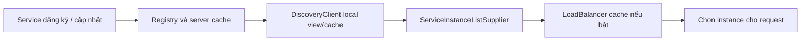
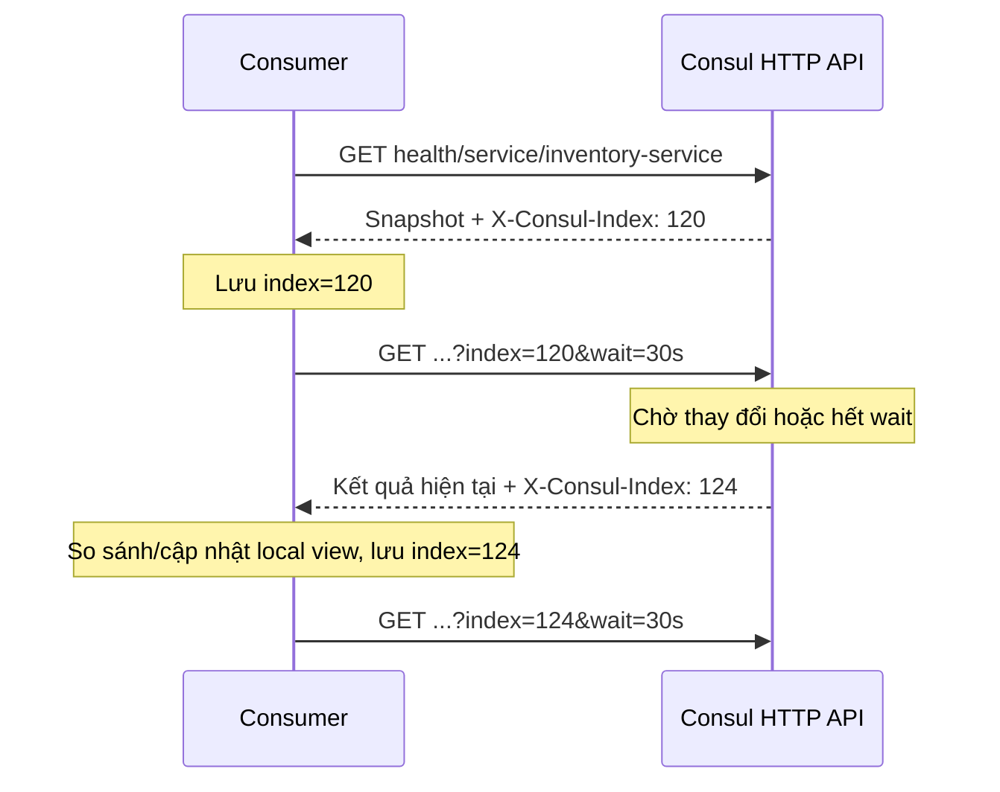

# Chi phí tải đầy đủ, cập nhật chênh lệch và theo dõi thay đổi

Service discovery cần phân phối danh sách service instance tới các consumer. Khi registry có ít instance, việc tải toàn bộ danh sách theo chu kỳ khá đơn giản. Khi có hàng trăm hoặc hàng nghìn consumer và registry lớn, tải lại toàn bộ dữ liệu ở mỗi chu kỳ sẽ tốn băng thông, CPU và bộ nhớ. Các cơ chế delta update và watch giúp giảm chi phí bằng cách chỉ xử lý thay đổi hoặc chờ tới khi trạng thái có biến động.

Trong Spring Cloud, cách đồng bộ phụ thuộc implementation của `DiscoveryClient`. Eureka client giữ registry cache cục bộ và thường nhận delta giữa các lần fetch. Consul hỗ trợ blocking query và streaming ở tầng HTTP API; Spring Cloud Consul còn có Catalog Watch để theo dõi thay đổi danh sách service. Spring Cloud LoadBalancer có thể bổ sung một lớp cache danh sách instance nữa.

## 1. Đường đi của dữ liệu discovery

Consumer không nhất thiết hỏi registry cho từng request nghiệp vụ. Dữ liệu thường đi qua nhiều lớp:



Một thay đổi như thêm instance, đổi metadata hoặc chuyển trạng thái health cần lan truyền qua các lớp này. Vì thế, thời gian nhìn thấy thay đổi phụ thuộc vào:

1. Thời gian producer gửi registration, heartbeat hoặc deregistration.
2. Thời gian registry ghi nhận thay đổi và làm mới response/cache.
3. Cách consumer đồng bộ: tải snapshot định kỳ, nhận delta hoặc theo dõi bằng watch.
4. Cache của DiscoveryClient và cache của LoadBalancer.
5. Bộ lọc instance, zone, health và thuật toán chọn endpoint.

Phân biệt ba khái niệm:

- **Full snapshot:** tải toàn bộ danh sách service/instance ở thời điểm truy vấn.
- **Delta update:** chỉ tải các thay đổi kể từ một mốc đồng bộ trước đó, rồi áp dụng vào bản sao cục bộ.
- **Watch / blocking query:** giữ request chờ tới khi dữ liệu được thay đổi hoặc hết thời gian chờ; tùy API, response có thể là snapshot mới hoặc luồng sự kiện.

Watch không mặc nhiên có nghĩa payload chỉ chứa delta. Cần xem hợp đồng của endpoint cụ thể.

## 2. Chi phí của full registry fetch

Full fetch đơn giản về mặt logic: client yêu cầu registry trả toàn bộ service và instance, sau đó thay hoặc tái tạo local view. Cách này hữu ích khi client khởi động lần đầu, khi cần đồng bộ lại sau sai lệch, hoặc khi cơ chế delta không được sử dụng.

Nhưng nếu tất cả consumer tải full snapshot theo chu kỳ, cùng một dữ liệu không đổi có thể được truyền đi lặp lại. Chi phí tăng theo số consumer và kích thước registry.

Các khoản chi phí chính:

| Tài nguyên | Chi phí khi tải đầy đủ thường xuyên |
|---|---|
| Băng thông | Mỗi consumer nhận toàn bộ payload dù chỉ một instance thay đổi |
| CPU registry | Tạo, lọc, serialize và nén payload lớn; nhiều request đồng thời tạo tải đột biến |
| CPU consumer | Parse JSON/XML, tạo object và thay thế local registry view |
| Bộ nhớ consumer | Giữ danh sách instance và các cấu trúc metadata trong mỗi process |
| Độ trễ | Payload lớn và nhiều client cùng fetch có thể kéo dài thời gian phản hồi |
| Khả năng mở rộng | Chi phí tăng theo số consumer, số instance và tần suất fetch |

### 2.1. Ước lượng lưu lượng

Có thể ước lượng sơ bộ lưu lượng full fetch bằng:

\[
R_{full} \approx \frac{C \times S}{T}
\]

Trong đó:

- `C`: số consumer đang fetch registry.
- `S`: kích thước payload full snapshot sau khi serialize, trước hoặc sau nén tùy số liệu đo.
- `T`: chu kỳ fetch tính bằng giây.
- `R_full`: lưu lượng trung bình gần đúng, chưa tính overhead HTTP, retry, replication và request burst.

Ví dụ, 300 consumer cùng tải payload 2 MB mỗi 30 giây:

\[
R_{full} \approx \frac{300 \times 2\ MB}{30\ s} = 20\ MB/s
\]

Đây là mức trung bình lý tưởng; nếu các client khởi động cùng lúc hoặc lịch fetch trùng pha, tải đỉnh có thể cao hơn nhiều. Nếu registry có 10.000 instance, full snapshot có thể lớn đáng kể dù mỗi service chỉ có một vài metadata field.

Full fetch vẫn cần thiết trong một số thời điểm. Mục tiêu tối ưu không phải loại bỏ nó hoàn toàn, mà là tránh tải lại toàn bộ khi client chỉ cần vài thay đổi nhỏ.

## 3. Eureka: full fetch ban đầu, delta cho các chu kỳ sau

Eureka client tải registry từ server và lưu bản sao trong bộ nhớ cục bộ. Theo luồng thông thường:

1. Khi client khởi tạo, nó cần lấy full registry để có trạng thái nền.
2. Những lần đồng bộ tiếp theo lấy delta kể từ lần fetch trước.
3. Client áp dụng các thay đổi vào local registry cache.
4. Client kiểm tra tính nhất quán của dữ liệu sau khi áp dụng delta.
5. Nếu phát hiện lệch hoặc reconciliation thất bại, client tải lại full registry để đồng bộ.

Delta có thể gồm instance mới, instance bị xóa hoặc thay đổi thông tin/trạng thái. Vì server giữ delta trong một khoảng thời gian, cùng một thay đổi có thể xuất hiện trong nhiều response delta. Eureka client xử lý việc nhận lặp để local view không bị nhân đôi.

### 3.1. Các thuộc tính quan trọng

Spring Cloud Netflix 5.1.0 công bố các mặc định liên quan:

| Thuộc tính | Mặc định | Ý nghĩa |
|---|---:|---|
| `eureka.client.fetch-registry` | `true` | Client có tải registry từ Eureka Server hay không |
| `eureka.client.registry-fetch-interval-seconds` | `30` | Chu kỳ fetch registry |
| `eureka.client.disable-delta` | `false` | Khi `false`, client dùng delta; khi `true`, client lấy full registry thay cho delta |
| `eureka.client.log-delta-diff` | `false` | Ghi log khác biệt khi reconciliation thất bại và client phải tải full registry |
| `eureka.client.g-zip-content` | `true` | Yêu cầu nén payload nếu server hỗ trợ |
| `eureka.server.response-cache-update-interval-ms` | `30000` | Chu kỳ cập nhật response cache phía server |
| `eureka.server.use-read-only-response-cache` | `true` | Sử dụng read-only response cache |
| `eureka.server.retention-time-in-m-s-in-delta-queue` | `180000` | Thời gian giữ thay đổi trong delta queue |

Ví dụ giữ cơ chế delta mặc định và ghi rõ chu kỳ fetch:

```yaml
eureka:
  client:
    fetch-registry: true
    registry-fetch-interval-seconds: 30
    disable-delta: false
    log-delta-diff: false
    g-zip-content: true

  server:
    response-cache-update-interval-ms: 30000
    use-read-only-response-cache: true
```

`log-delta-diff` hữu ích khi điều tra sai lệch registry; không cần bật thường trực nếu log diff lớn và không phục vụ mục tiêu vận hành. `disable-delta: true` buộc client tải full registry ở các chu kỳ fetch. Chỉ nên dùng để chẩn đoán hoặc trong tình huống đặc biệt đã đo tải, vì nó làm tăng dữ liệu truyền và công việc parse ở tất cả consumer.

### 3.2. Khi nào Eureka cần tải full registry lần nữa?

Client có thể phải tải full registry khi:

- Khởi động lần đầu và chưa có local registry view.
- Delta response không thể áp dụng hoặc reconciliation phát hiện client lệch với server.
- Cấu hình `disable-delta` bật.
- Local state bị mất hoặc client cần xây dựng lại bản sao sau lỗi đồng bộ.

Full resync là cơ chế phục hồi tính đúng đắn. Không nên tắt reconciliation hoặc bỏ qua lỗi delta để tiết kiệm băng thông; local cache sai có thể khiến consumer gọi instance đã bị xóa hoặc không thấy instance mới.

### 3.3. Delta nhỏ hơn full snapshot như thế nào?

Giả sử registry có 5.000 instance nhưng một chu kỳ chỉ có 12 thay đổi. Full fetch phải truyền dữ liệu mô tả gần như toàn bộ 5.000 instance; delta chỉ cần biểu diễn 12 thay đổi cùng thông tin điều khiển/reconciliation. Khi tỷ lệ thay đổi thấp hơn nhiều so với kích thước registry, delta giảm mạnh băng thông và CPU.

Ước lượng đơn giản:

\[
R_{delta} \approx \frac{C \times D}{T}
\]

Trong đó `D` là kích thước delta trung bình. Nếu full snapshot 2 MB nhưng delta trung bình 40 KB, với cùng 300 consumer và chu kỳ 30 giây:

\[
R_{delta} \approx \frac{300 \times 40\ KB}{30\ s} = 0.4\ MB/s
\]

Đây là ví dụ minh họa, không phải benchmark Eureka. Khi thay đổi xảy ra liên tục hoặc nhiều instance cùng được cập nhật, delta có thể lớn gần bằng full snapshot; client vẫn cần khả năng full resync.

## 4. Consul: blocking query và Catalog Watch

Consul cung cấp các API Catalog và Health để đọc service/node/check. Nhiều endpoint hỗ trợ blocking query: client gửi index của kết quả trước đó và yêu cầu Consul chờ tới khi dữ liệu có thay đổi hoặc hết thời gian `wait`.

Khác với polling liên tục, blocking query không cần client hỏi lại sau mỗi vài trăm mili giây khi không có thay đổi. Khi request được trả về, client đọc `X-Consul-Index` mới và dùng nó cho lần truy vấn tiếp theo.

### 4.1. Cách hoạt động của blocking query



Ví dụ truy vấn danh sách instance và health state:

```bash
curl -i \
  "http://localhost:8500/v1/health/service/inventory-service?index=120&wait=30s"
```

Response chứa header `X-Consul-Index`. Client lưu giá trị đó và gửi lại trong tham số `index` ở lần tiếp theo. Khi có thay đổi, request được đánh thức sớm; nếu không có thay đổi, nó có thể đợi tới khi hết thời gian chờ.

Blocking query thường trả kết quả hiện tại của resource được hỏi, không phải một danh sách delta giống Eureka. Nếu client cần tính thay đổi, nó so sánh snapshot cũ với snapshot mới hoặc cập nhật materialized view theo hợp đồng của API.

### 4.2. Các trường hợp blocking query trả về dù không có thay đổi

Response của blocking query không bảo đảm rằng dữ liệu đã thay đổi. Request cũng có thể kết thúc vì hết `wait`, thao tác ghi idempotent hoặc các điều kiện triển khai khác. Vì vậy, client không được coi mọi response là một sự kiện service đã thay đổi.

HashiCorp lưu ý một số điểm khi tự triển khai vòng lặp blocking query:

- Nếu index trả về nhỏ hơn index trước, reset index về `0` và bắt đầu lại; restore snapshot hoặc thay đổi cách Consul tạo index có thể khiến index đi lùi.
- Kiểm tra index sau response có giá trị hợp lệ và lớn hơn 0; index không hợp lệ có thể khiến client rơi vào busy loop.
- Giới hạn tốc độ nếu dữ liệu thay đổi liên tục. Watch loop không được tạo vòng gọi dồn dập khi hệ thống đang có sự cố.
- Đặt timeout HTTP của client lớn hơn `wait` và có khoảng dự phòng cho network latency.

Consul cho phép `wait` tối đa 10 phút; mặc định nếu không truyền là 5 phút. Giá trị thực tế nên phù hợp với mục tiêu cập nhật và timeout của HTTP client.

### 4.3. Consul Catalog Watch trong Spring Cloud Consul

Spring Cloud Consul có `Consul Catalog Watch`. Watch này thực hiện blocking HTTP call để phát hiện thay đổi trong danh sách service của Catalog. Khi có dữ liệu service mới, nó phát một `HeartbeatEvent` để các thành phần quan tâm có thể phản ứng.

Các thuộc tính hiện hành:

| Thuộc tính | Mặc định | Ý nghĩa |
|---|---:|---|
| `spring.cloud.consul.discovery.catalog-services-watch-delay` | `1000` ms | Khoảng delay giữa lần gọi watch trước và lần tiếp theo |
| `spring.cloud.consul.discovery.catalog-services-watch-timeout` | `2` giây | Thời gian blocking tối đa cho một lần watch |

Ví dụ:

```yaml
spring:
  cloud:
    consul:
      discovery:
        catalog-services-watch-delay: 1000
        catalog-services-watch-timeout: 2
```

Catalog Watch theo dõi danh sách service trong Catalog; không nên hiểu nó là delta feed đầy đủ cho mọi instance hoặc mọi health check. Nếu cần theo dõi thay đổi của instance cụ thể, endpoint Health như `/v1/health/service/{service}` có hỗ trợ blocking query. Cũng cần phân biệt `spring.cloud.consul.config.watch.*`: đó là watch thay đổi dữ liệu Consul KV cho Config, không phải Catalog Watch của service discovery.

### 4.4. Consul streaming

Consul có streaming backend từ phiên bản 1.10 cho các endpoint hỗ trợ. Khi dùng query có `index` hoặc `cached` trên endpoint tương thích, Consul có thể dùng streaming thay cho long polling truyền thống. Server phát các change event; client đăng ký theo dõi và xây dựng materialized view cục bộ.

Streaming có thể giảm lượng dữ liệu trao đổi so với liên tục nhận snapshot qua long polling, nhưng không phải mọi endpoint hoặc mọi client integration đều sử dụng streaming tự động. Kiểm tra `X-Consul-Query-Backend` trong response khi cần xác định backend thực tế. Không giả định Spring Cloud Consul Catalog Watch đang nhận một luồng streaming cho từng instance.

## 5. So sánh full fetch, delta và watch

| Tiêu chí | Full snapshot | Delta update | Watch / blocking query |
|---|---|---|---|
| Dữ liệu trả về | Toàn bộ trạng thái resource | Chỉ các thay đổi kể từ mốc trước | Tùy API: snapshot mới hoặc change events |
| Chi phí khi ít thay đổi | Cao nếu lặp lại thường xuyên | Thấp | Thấp hơn polling dày vì request chờ |
| Khởi tạo local view | Trực tiếp từ snapshot | Cần full snapshot nền trước | Thường cần snapshot ban đầu hoặc materialized view |
| Phục hồi khi lệch | Tải lại toàn bộ | Reconciliation rồi fallback full | Lấy snapshot mới hoặc reset index/restart watch |
| Độ trễ | Phụ thuộc chu kỳ fetch và cache | Phụ thuộc chu kỳ fetch delta và cache | Có thể phản ứng khi thay đổi được phát hiện, cộng độ trễ xử lý |
| Độ phức tạp client | Thấp | Trung bình: áp dụng đúng thứ tự và xử lý lặp | Cao hơn: giữ index, timeout, retry, reset và rate limit |
| Ví dụ | Eureka initial/full registry fetch | Eureka delta fetch | Consul blocking query / streaming |

Không có cơ chế nào tốt nhất cho mọi tình huống. Full snapshot dễ khôi phục và đơn giản; delta tiết kiệm khi thay đổi ít; watch hiệu quả khi cần theo dõi thay đổi mà không muốn polling dày. Hệ thống thường kết hợp nhiều cách: full snapshot ban đầu, delta hoặc watch trong vận hành, full resync khi phát hiện lệch.

## 6. Cache nhiều lớp và độ trễ cập nhật

Ngay cả khi registry đã cập nhật, consumer có thể vẫn dùng dữ liệu cũ do cache ở các tầng khác nhau:

| Lớp | Ví dụ | Tác động |
|---|---|---|
| Registry server | Eureka response cache; Consul agent/catalog cache | Server có thể chưa phục vụ ngay dữ liệu vừa ghi |
| DiscoveryClient | Eureka local registry cache | Lookup trong process đọc bản sao cục bộ |
| LoadBalancer | `CachingServiceInstanceListSupplier` | Danh sách instance có thể cũ thêm một khoảng TTL |
| DNS / proxy / client connection | DNS TTL, connection pool, proxy cache | Endpoint hoặc connection cũ có thể tiếp tục được dùng |

Spring Cloud LoadBalancer mặc định có cache TTL `35s`. Tài liệu khuyến nghị tắt cache LoadBalancer nếu DiscoveryClient đã cache dữ liệu, ví dụ EurekaDiscoveryClient, để tránh double caching:

```yaml
spring:
  cloud:
    loadbalancer:
      cache:
        enabled: false
```

Không tắt cache chỉ dựa trên giả định. Hãy xác nhận DiscoveryClient đang dùng có cache hay không. Với Consul, `getInstances` và cách query Health API có thể khác với Eureka local registry cache; LoadBalancer cache có thể hữu ích nếu DiscoveryClient không cache.

Độ trễ end-to-end không phải lúc nào cũng bằng tổng TTL của mọi lớp vì các chu kỳ có thể chạy song song và lệch pha. Tuy nhiên, nhiều cache nối tiếp có thể khiến instance cũ tồn tại lâu hơn dự kiến. Khi cần giảm độ trễ, đo từng lớp trước khi chỉnh đồng loạt các interval.

## 7. Theo dõi thay đổi trong ứng dụng

Muốn biết discovery đã cập nhật đúng lúc hay chưa, cần quan sát cả dữ liệu lẫn thời điểm đồng bộ.

### 7.1. Số liệu phía Eureka

Thu thập hoặc ghi log các thông tin:

- Tổng số application và instance trong local registry.
- Số lần fetch delta và full fetch.
- Kích thước response, thời gian request và thời gian deserialize/apply delta.
- Số lần reconciliation thất bại và full resync sau mismatch.
- Thời điểm fetch thành công gần nhất và tuổi của local registry cache.
- Số lần server response cache được làm mới nếu metric/log hiện có.

`eureka.client.log-delta-diff=true` có thể hữu ích trong một giai đoạn chẩn đoán để ghi khác biệt khi delta reconciliation thất bại. Sau khi tìm ra nguyên nhân, đánh giá lại mức log để tránh ghi quá nhiều dữ liệu.

### 7.2. Số liệu phía Consul

Theo dõi:

- Thời gian blocking query, số lần query trả do index thay đổi và số lần trả do timeout.
- Giá trị `X-Consul-Index` gần nhất; cảnh báo nếu index đi lùi hoặc không hợp lệ.
- Số lần Catalog Watch phát `HeartbeatEvent`.
- Số service và instance trong Catalog/Health API.
- Tình trạng cache và agent/server được truy vấn.
- Lỗi ACL, timeout, retry hoặc rate limit trong watch loop.

Đừng coi một `HeartbeatEvent` là bằng chứng mọi instance đã đổi. Đối chiếu lại service list hoặc health result cần thiết.

### 7.3. Số liệu LoadBalancer

Ở tầng LoadBalancer, theo dõi:

- Số instance mà `ServiceInstanceListSupplier` trả về cho từng service ID.
- Tuổi của cache list nếu supplier dùng caching.
- Số lần chọn instance thất bại vì không có instance.
- Phân bố request theo instance/zone và tỷ lệ lỗi theo endpoint.

Tránh dùng instance ID hoặc request ID làm metric label có cardinality không giới hạn. Dùng service ID và nhóm lỗi có tập giá trị nhỏ; chi tiết endpoint có thể ghi trong trace/log có kiểm soát.

## 8. Tuning chu kỳ và kích thước dữ liệu

Trước khi thay đổi, đo kích thước registry, số consumer, tần suất thay đổi và mục tiêu propagation. Các nguyên tắc:

1. Giữ delta bật với Eureka trong cấu hình thông thường; không ép full fetch mỗi chu kỳ nếu không có lý do.
2. Không giảm `registry-fetch-interval-seconds` quá thấp chỉ để làm dashboard thay đổi nhanh hơn; nhiều consumer có thể tạo tải request lớn.
3. Duy trì nén payload nếu server/client hỗ trợ và registry lớn.
4. Chỉ tăng `response-cache-update-interval-ms` hoặc thay delta retention sau khi hiểu ảnh hưởng tới độ mới dữ liệu và recovery.
5. Với Consul, dùng blocking query/watch thay vì vòng polling ngắn liên tục khi endpoint hỗ trợ.
6. Đặt HTTP timeout lớn hơn thời gian `wait` của blocking query và xử lý reconnect có backoff.
7. Rate-limit watch loop khi có thay đổi liên tục để tránh busy loop.
8. Hạn chế metadata không cần thiết; metadata lặp lại trên hàng nghìn instance làm tăng kích thước snapshot và delta.
9. Tránh cache trùng giữa DiscoveryClient và LoadBalancer; chọn nơi chịu trách nhiệm cache rõ ràng.
10. Giữ full resync/reconciliation làm đường phục hồi khi local state không còn đáng tin.

### 8.1. Ví dụ cấu hình Eureka thiên về delta

```yaml
eureka:
  client:
    fetch-registry: true
    registry-fetch-interval-seconds: 30
    disable-delta: false
    g-zip-content: true
    log-delta-diff: false

spring:
  cloud:
    loadbalancer:
      cache:
        enabled: false
```

Ví dụ này giả định Eureka Client đã cache registry cục bộ. Nếu một DiscoveryClient khác không có cache, không áp dụng máy móc `cache.enabled: false` cho toàn bộ ứng dụng.

### 8.2. Ví dụ cấu hình Consul Catalog Watch

```yaml
spring:
  cloud:
    consul:
      discovery:
        catalog-services-watch-delay: 1000
        catalog-services-watch-timeout: 2
```

Đây là giá trị mặc định được ghi rõ để dễ quan sát. Không cần hạ delay xuống vài mili giây để có cảm giác realtime; blocking query vốn chờ thay đổi hoặc hết timeout. Nếu dùng trực tiếp Consul API, ưu tiên giữ index từ response và chọn `wait` phù hợp với timeout HTTP.

## 9. Kiểm thử chi phí và độ trễ

Có thể kiểm thử bằng một registry và nhiều consumer trong môi trường development/staging:

1. Tạo registry với số lượng service/instance đại diện cho môi trường thật.
2. Đo kích thước full snapshot và response delta ở các mức thay đổi khác nhau.
3. Khởi động nhiều consumer đồng thời để quan sát burst load và thời gian đồng bộ ban đầu.
4. Thêm một instance, cập nhật metadata, chuyển health state và deregister một instance.
5. Ghi thời điểm registry nhận thay đổi, consumer nhìn thấy thay đổi và LoadBalancer ngừng/chuyển chọn instance cũ.
6. Với Eureka, thử delta bình thường, `disable-delta=true` trong môi trường test và tình huống reconciliation cần full resync.
7. Với Consul, thử blocking query không có thay đổi, có thay đổi, hết wait và index reset.
8. Thử mất mạng ngắn, restart agent/server và kiểm tra local cache có tự phục hồi không.
9. So sánh băng thông, CPU, heap, request rate và p95/p99 thời gian propagation.

Không benchmark chỉ bằng một lần thêm instance. Chạy cả tình huống registry yên tĩnh, thay đổi bình thường và thay đổi hàng loạt trong lúc triển khai.

### 9.1. Các mốc thời gian nên ghi

| Mốc | Ý nghĩa |
|---|---|
| `T0` | Producer bắt đầu gửi registration/update |
| `T1` | Registry ghi nhận thay đổi |
| `T2` | Response cache hoặc watch phát hiện thay đổi |
| `T3` | DiscoveryClient local view được cập nhật |
| `T4` | LoadBalancer supplier/cache nhìn thấy danh sách mới |
| `T5` | Request đầu tiên sử dụng endpoint mới hoặc ngừng dùng endpoint cũ |

Đo `T1-T0`, `T3-T1`, `T4-T3` và `T5-T4` để biết lớp nào gây trễ. Đồng bộ đồng hồ giữa các máy hoặc dùng trace/correlation timestamp có cùng nguồn thời gian.

## 10. Lỗi thường gặp

| Hiện tượng | Nguyên nhân | Cách xử lý |
|---|---|---|
| Eureka client luôn tải payload lớn | `disable-delta=true` hoặc delta reconciliation liên tục thất bại | Kiểm tra cấu hình, log delta diff, kết nối và local registry consistency |
| Eureka client thiếu instance sau delta | Mất kết nối, delta queue không còn đủ hoặc reconciliation mismatch | Để client full resync; điều tra network và response cache |
| Delta response có instance lặp | Server giữ delta trong retention window | Để Eureka client xử lý idempotent; không tự append vào list mà không kiểm tra identity |
| Consumer thấy thay đổi chậm | Registry cache, fetch interval hoặc LoadBalancer cache | Ghi timestamp ở từng lớp; điều chỉnh đúng lớp gây trễ |
| Consul watch liên tục trả response | `wait` quá ngắn, index không được giữ hoặc dữ liệu thay đổi liên tục | Dùng `X-Consul-Index` đúng cách, tăng wait phù hợp và rate-limit khi churn |
| Consul watch không thấy thay đổi | Query sai endpoint/resource, index không hợp lệ hoặc quyền ACL lọc dữ liệu | Kiểm tra endpoint, header/index, ACL và datacenter/namespace |
| Consul Catalog Watch chạy nhưng instance list chưa đổi | Catalog service list khác với health service instance data | Đối chiếu `/v1/catalog/services` và `/v1/health/service/{name}` |
| CPU tăng mạnh trong watch loop | Blocking query bị biến thành polling dày hoặc index reset sai | Tránh busy loop; kiểm tra index và backoff/rate limit |
| LoadBalancer tiếp tục chọn instance cũ | Cache supplier chưa hết TTL hoặc có cache trùng | Kiểm tra supplier chain, cache TTL và DiscoveryClient cache |

## 11. Checklist vận hành

- [ ] Đã xác định DiscoveryClient đang dùng và cơ chế đồng bộ của implementation đó.
- [ ] Có full snapshot ban đầu để tạo local view đáng tin cậy.
- [ ] Eureka dùng delta trong vận hành thông thường và có cơ chế reconciliation/full resync.
- [ ] Đã đo kích thước full snapshot, delta và số consumer.
- [ ] Không ép full fetch ở mọi chu kỳ nếu delta đủ tin cậy.
- [ ] Đã hiểu Consul Catalog Watch theo dõi service catalog, còn Health API trả instance/health state.
- [ ] Blocking query giữ và gửi lại `X-Consul-Index`; có xử lý index đi lùi và timeout.
- [ ] Watch loop có timeout, retry/backoff và rate limit phù hợp.
- [ ] Đã phân biệt Consul Config Watch với Consul Catalog Watch.
- [ ] Đã kiểm tra cache DiscoveryClient và LoadBalancer để tránh double caching.
- [ ] Có metric/log cho full fetch, delta, reconciliation, watch, cache age và instance count.
- [ ] Đã thử nghiệm startup, thay đổi nhỏ, thay đổi hàng loạt, mất mạng và full resync.
- [ ] Có số liệu propagation end-to-end thay vì chỉ nhìn dashboard registry.

## Tài liệu tham khảo

- [Spring Cloud Netflix 5.1.0 — Configuration Properties (`disable-delta`, `registry-fetch-interval-seconds`, response cache)](https://docs.spring.io/spring-cloud-netflix/reference/configprops.html)
- [Netflix Eureka — Understanding Client/Server Communication: Fetch Registry and Time Lag](https://github.com/Netflix/eureka/wiki/Understanding-eureka-client-server-communication)
- [Spring Cloud Consul 5.1.0 — Consul Catalog Watch](https://docs.spring.io/spring-cloud-consul/reference/discovery.html)
- [Spring Cloud Consul — Common Application Properties](https://docs.spring.io/spring-cloud-consul/docs/current/reference/html/appendix.html)
- [HashiCorp Consul — Blocking Queries](https://developer.hashicorp.com/consul/api-docs/features/blocking)
- [HashiCorp Consul — Health API](https://developer.hashicorp.com/consul/api-docs/health)
- [HashiCorp Consul — Catalog API](https://developer.hashicorp.com/consul/api-docs/catalog)
- [Spring Cloud Commons 5.1.0 — LoadBalancer Cache Configuration](https://docs.spring.io/spring-cloud-commons/reference/spring-cloud-commons/loadbalancer.html)
