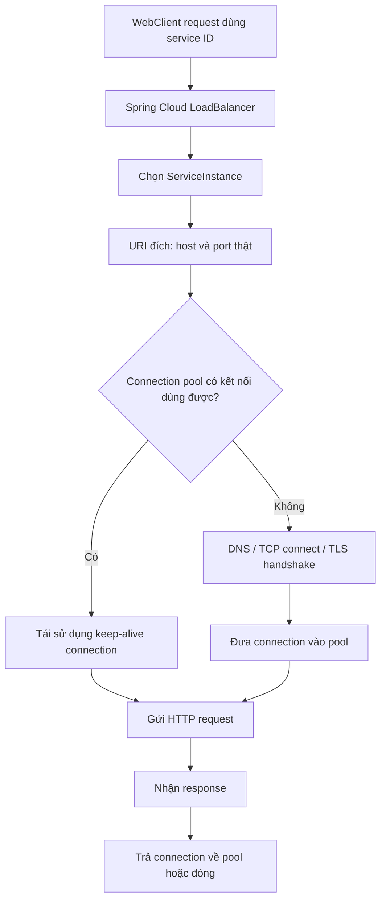

# Điều chỉnh kết nối HTTP, timeout và tài nguyên client

Trong service discovery, LoadBalancer tìm một instance phù hợp rồi HTTP client gửi request đến địa chỉ của instance đó. Hiệu năng và độ ổn định của lời gọi phụ thuộc không chỉ vào thuật toán cân bằng tải mà còn vào connection pool, keep-alive, timeout, giới hạn concurrency và vòng đời tài nguyên của HTTP client.

Nếu mỗi request tạo một HTTP client mới, ứng dụng sẽ liên tục mở socket và thực hiện TCP/TLS handshake. Nếu pool quá nhỏ, request phải chờ kết nối; nếu pool hoặc hàng đợi quá lớn, ứng dụng có thể giữ quá nhiều socket và request đang chờ khi provider chậm. Timeout đặt sai có thể khiến thread/reactive pipeline bị giữ lâu hoặc retry tạo thêm tải lên một hệ thống đang quá tải.

Bài này tập trung vào cách cấu hình và đo lường HTTP client trong Spring Cloud, đặc biệt với WebClient và Reactor Netty. Các nguyên tắc tương tự áp dụng cho RestClient, RestTemplate và HTTP client dựa trên Apache HttpClient hoặc JDK HttpClient, nhưng tên thuộc tính và API cấu hình sẽ khác nhau.

## 1. Luồng kết nối HTTP sau khi LoadBalancer chọn instance

Consumer thường gọi bằng service ID:

```text
http://inventory-service/api/items/42
```

Spring Cloud LoadBalancer lấy danh sách instance từ discovery provider, chọn một instance rồi thay URI đích bằng host và port thật. HTTP connector sau đó tìm một kết nối phù hợp trong pool hoặc tạo kết nối mới.



Có hai cơ chế cache độc lập:

- **Discovery/LoadBalancer cache** lưu danh sách instance của service.
- **HTTP connection pool** lưu các kết nối TCP/TLS đến địa chỉ instance đã chọn.

Khi registry loại một instance, LoadBalancer có thể ngừng chọn instance đó sau khi dữ liệu discovery được cập nhật. Tuy nhiên, connection pool vẫn có thể còn kết nối idle đến địa chỉ cũ cho đến khi connection bị đóng hoặc hết hạn. Vì vậy, cần cấu hình cả freshness của discovery lẫn vòng đời connection.

## 2. Vì sao nên tái sử dụng HTTP client và connection pool?

Thiết lập một kết nối mới có thể gồm nhiều bước:

1. Phân giải DNS nếu host là hostname.
2. Thiết lập TCP connection.
3. Thực hiện TLS handshake nếu dùng HTTPS.
4. Thương lượng HTTP protocol và gửi request.
5. Nhận response rồi đóng hoặc giữ connection để tái sử dụng.

Connection pool giúp giảm chi phí lặp lại các bước TCP/TLS. Với HTTP/1.1, keep-alive cho phép nhiều request lần lượt sử dụng lại cùng connection. Với HTTP/2, nhiều stream có thể multiplex trên một connection, nên số connection không tương đương trực tiếp với số request đồng thời.

Không tạo `WebClient`, `HttpClient`, `RestClient` hoặc `RestTemplate` mới trong mỗi lần gọi. Hãy quản lý chúng như singleton bean hoặc resource dùng chung có lifecycle rõ ràng. Client dùng chung giúp tái sử dụng pool, DNS resolver, event loop và TLS context.

## 3. Phân biệt các loại timeout

Không có một timeout duy nhất bao phủ mọi giai đoạn của HTTP request. Cần phân biệt ít nhất các loại sau:

| Timeout | Giới hạn giai đoạn | Khi hết hạn thường có nghĩa |
| --- | --- | --- |
| DNS resolution timeout | Phân giải hostname thành địa chỉ IP | Không tìm được địa chỉ trong thời gian cho phép |
| Connection acquire timeout | Chờ lấy connection từ pool | Pool hết connection khả dụng hoặc hàng đợi bị nghẽn |
| Connect timeout | Thiết lập TCP connection đến host/port | Không mở được kết nối trong thời gian cho phép |
| TLS handshake timeout | Thương lượng TLS sau khi TCP kết nối | Không hoàn tất xác thực/handshake đúng hạn |
| Response timeout | Chờ dữ liệu response theo semantics của HTTP client | Provider không gửi dữ liệu tiếp theo trong thời gian quy định |
| Read timeout | Chờ dữ liệu đọc từ socket | Không có dữ liệu đọc trong khoảng thời gian cho phép |
| Write timeout | Gửi dữ liệu qua socket | Việc ghi bị nghẽn quá thời gian cho phép |
| End-to-end deadline | Toàn bộ thao tác ở tầng ứng dụng | Tổng thời gian request vượt ngân sách đã đặt |

Tên và semantics cụ thể phụ thuộc HTTP client. Ví dụ, `HttpClient.responseTimeout` của Reactor Netty là giới hạn giữa các lần đọc mạng trong quá trình nhận response, không phải lúc nào cũng tương đương tổng thời gian từ lúc subscribe đến khi body hoàn tất. Dùng thêm deadline ở tầng reactive nếu cần giới hạn toàn bộ operation.

### Ngân sách timeout theo chuỗi gọi

Timeout của downstream phải nằm trong deadline của request inbound. Ví dụ gateway cho phép 2 giây, `checkout-service` gọi inventory rồi payment tuần tự, thì mỗi downstream không thể tùy ý chờ 2 giây.

Một ngân sách minh họa:

| Giai đoạn | Ngân sách ví dụ |
| --- | ---: |
| Chờ connection pool | 100 ms |
| TCP connect | 300 ms |
| TLS handshake | 300 ms |
| Chờ response/body | 900 ms |
| Xử lý và dự phòng | 300 ms |
| Tổng deadline outbound | 1.900 ms |

Các giá trị chỉ để minh họa. Hãy đo latency thực tế, phân biệt p50/p95/p99 và để deadline outbound nhỏ hơn deadline inbound để còn thời gian xử lý lỗi, serialize response và trả kết quả.

## 4. Cấu hình WebClient với Reactor Netty

Với ứng dụng reactive, WebClient thường dùng Reactor Netty làm connector. Có thể tạo `ConnectionProvider` để quản lý pool, `HttpClient` để cấu hình TCP/TLS/response timeout, rồi gắn vào `ReactorClientHttpConnector`.

```java
import java.time.Duration;

import io.netty.channel.ChannelOption;
import org.springframework.cloud.client.loadbalancer.LoadBalanced;
import org.springframework.context.annotation.Bean;
import org.springframework.context.annotation.Configuration;
import org.springframework.http.client.reactive.ReactorClientHttpConnector;
import org.springframework.web.reactive.function.client.WebClient;
import reactor.netty.http.client.HttpClient;
import reactor.netty.resources.ConnectionProvider;

@Configuration
public class OutboundHttpConfiguration {

    @Bean(destroyMethod = "dispose")
    ConnectionProvider discoveryConnectionProvider() {
        return ConnectionProvider.builder("discovery-http")
                .maxConnections(200)
                .pendingAcquireMaxCount(400)
                .pendingAcquireTimeout(Duration.ofSeconds(2))
                .maxIdleTime(Duration.ofSeconds(25))
                .maxLifeTime(Duration.ofMinutes(5))
                .evictInBackground(Duration.ofSeconds(30))
                .metrics(true)
                .build();
    }

    @Bean
    HttpClient discoveryHttpClient(ConnectionProvider discoveryConnectionProvider) {
        return HttpClient.create(discoveryConnectionProvider)
                .option(ChannelOption.CONNECT_TIMEOUT_MILLIS, 2_000)
                .responseTimeout(Duration.ofSeconds(3));
    }

    @Bean
    @LoadBalanced
    WebClient.Builder loadBalancedWebClientBuilder(HttpClient discoveryHttpClient) {
        return WebClient.builder()
                .clientConnector(
                        new ReactorClientHttpConnector(discoveryHttpClient));
    }
}
```

Trong ví dụ:

- `maxConnections` giới hạn số connection trong mỗi connection pool.
- `pendingAcquireMaxCount` giới hạn số yêu cầu đang chờ lấy connection.
- `pendingAcquireTimeout` giới hạn thời gian chờ pool cấp connection.
- `maxIdleTime` giới hạn thời gian connection không hoạt động được giữ trong pool.
- `maxLifeTime` giới hạn tuổi thọ tối đa của connection.
- `evictInBackground` bật việc dọn connection hết hạn theo chu kỳ.
- `CONNECT_TIMEOUT_MILLIS` giới hạn TCP connect.
- `responseTimeout` giới hạn khoảng chờ dữ liệu response theo semantics của Reactor Netty.
- `metrics(true)` bật metrics của connection provider khi tích hợp Micrometer phù hợp.

`@LoadBalanced` vẫn cần thiết để service ID trong URI được Spring Cloud LoadBalancer phân giải. Việc tùy chỉnh connector không thay thế discovery filter. Kiểm tra cấu hình thực tế trong đúng phiên bản Spring Boot/Spring Cloud/Reactor Netty vì một số API và property có thể thay đổi giữa release.

`ConnectionProvider` là resource cần được dispose khi ứng dụng dừng. Không dispose sau mỗi request; bean ở ví dụ được đóng bởi Spring thông qua `destroyMethod`. Nếu dùng global Reactor Netty resources mặc định, cần hiểu resource ownership trước khi tự dispose vì nhiều client có thể dùng chung chúng.

## 5. Cấu hình qua Spring Boot properties

Spring Boot cung cấp một số property cho Reactor Netty pool. Ví dụ:

```yaml
spring:
  reactor:
    netty:
      pool:
        max-connections: 200
        max-idle-time: 25s
        max-life-time: 5m
        max-pending-acquire: 400
        pending-acquire-timeout: 2s
        eviction-interval: 30s
        metrics: true
```

Các property này áp dụng cho resource/pool do auto-configuration quản lý theo phiên bản Spring Boot. Nếu tự tạo `ConnectionProvider` trong code, property auto-config không nhất thiết tự áp dụng vào provider tự tạo. Tránh cấu hình cùng một pool ở cả YAML và Java mà không xác định rõ bean nào thực sự được dùng.

Nếu cần pool khác nhau cho từng nhóm downstream, có thể tạo nhiều `ConnectionProvider`/HTTP client và gắn đúng client vào WebClient tương ứng. Việc này tăng số pool và socket, nên chỉ làm khi có lý do như SLA, traffic profile hoặc yêu cầu bảo mật khác nhau.

## 6. Chọn kích thước connection pool

Pool quá nhỏ làm request chờ; pool quá lớn có thể làm provider, consumer hoặc hệ điều hành cạn tài nguyên. Hãy sizing dựa trên concurrency và thời gian giữ connection thay vì chọn một con số tùy ý.

Một ước lượng ban đầu có thể dùng định luật Little:

\[
L = \lambda \times W
\]

Trong đó:

- \(L\): số request trung bình đang đồng thời xử lý.
- \(\lambda\): throughput (request/giây).
- \(W\): thời gian xử lý trung bình (giây).

Ví dụ downstream nhận 300 request/giây và thời gian giữ connection trung bình 200 ms:

\[
L = 300 \times 0.2 = 60
\]

Nhu cầu trung bình khoảng 60 request đang xử lý. Có thể thử pool lớn hơn mức này để có headroom cho burst, nhưng phải load test với p95/p99, số replica, số service đích và giới hạn file descriptor/socket.

Lưu ý:

- Với HTTP/1.1, pool size thường liên quan trực tiếp hơn đến số request đồng thời đang chờ response.
- Với HTTP/2, một connection có thể mang nhiều stream; giới hạn stream và khả năng multiplex của server cũng ảnh hưởng concurrency.
- Một pool có thể có nhóm connection theo từng remote address. Trong service discovery, mỗi instance có thể tạo một pool key riêng.
- Nếu có nhiều service ID và nhiều instance, tổng số socket có thể lớn hơn `maxConnections` nhìn từ toàn ứng dụng.
- Tính cả số replica của consumer: 200 connection mỗi Pod nhân với 20 Pod có thể tạo đến hàng nghìn connection đến upstream.

Hãy bắt đầu với giới hạn bảo thủ, quan sát pool metrics và tăng dần theo kết quả kiểm thử. Không tăng pool chỉ để che giấu provider xử lý chậm.

## 7. Hàng đợi chờ connection và backpressure

Khi mọi connection trong pool đang bận, request mới có thể chờ trong pending acquire queue. Nếu hàng đợi không giới hạn, một upstream chậm có thể làm consumer tích tụ nhiều request, giữ bộ nhớ và làm tăng latency.

Nên đặt cả hai giới hạn:

- `pendingAcquireMaxCount`: tối đa bao nhiêu request được phép chờ connection.
- `pendingAcquireTimeout`: một request được phép chờ pool trong bao lâu.

Khi vượt giới hạn, request nên thất bại sớm với lỗi có thể quan sát thay vì chờ vô hạn. Ở tầng Reactor, cũng giới hạn concurrency khi fan-out đến nhiều service:

```java
Flux<ItemResponse> responses = itemIds
        .flatMap(inventoryClient::getItem, 32);
```

Tham số `32` giới hạn số publisher con được subscribe đồng thời trong ví dụ này. Chọn concurrency theo pool size, SLA và khả năng provider. Một giới hạn pool không thay thế backpressure ở tầng ứng dụng.

## 8. Điều chỉnh keep-alive và tuổi thọ connection

HTTP keep-alive cho phép tái sử dụng connection sau khi response hoàn tất. Điều này giảm TCP/TLS handshake, nhưng connection idle có thể bị server, load balancer hoặc firewall đóng trước khi client biết.

Các nguyên tắc:

- Đặt `maxIdleTime` của client nhỏ hơn hoặc bằng idle timeout của server/load balancer ở phía trước nếu có thể biết giá trị đó.
- Dùng `maxLifeTime` để xoay vòng connection lâu năm, tránh giữ một connection qua nhiều thay đổi hạ tầng.
- Bật background eviction để connection hết hạn được dọn ngay cả khi pool ít request.
- Theo dõi lỗi `connection reset`, `broken pipe` hoặc lỗi reuse connection sau thời gian idle.
- Đảm bảo provider/load balancer có idle timeout tương thích với client.

Ví dụ, nếu ingress đóng connection idle sau 60 giây, client có thể đặt `maxIdleTime` thấp hơn khoảng này, chẳng hạn 25–30 giây. Giá trị chính xác cần dựa trên topology thật; đừng giả định mọi proxy đều có cùng idle timeout.

`maxLifeTime` không phải timeout của một request. Nó giới hạn tuổi thọ connection trong pool; request đang chạy không nên bị cắt chỉ vì connection đạt tuổi tối đa nếu client xử lý lifecycle đúng.

## 9. Connect, TLS và response timeout

### Connect timeout

Connect timeout bảo vệ giai đoạn thiết lập TCP. Nếu instance được chọn đã bị xóa khỏi registry hoặc địa chỉ quảng bá không thể truy cập, connect timeout giúp consumer không chờ quá lâu.

```java
HttpClient httpClient = HttpClient.create(provider)
        .option(ChannelOption.CONNECT_TIMEOUT_MILLIS, 2_000);
```

Connect timeout không thay thế timeout DNS hoặc TLS handshake. Nếu host là DNS name, cần xem xét resolver timeout/retry của HTTP client và môi trường mạng.

### TLS handshake timeout

Với HTTPS, cấu hình handshake timeout riêng nếu cần:

```java
HttpClient secureClient = HttpClient.create(provider)
        .secure(ssl -> ssl.handshakeTimeout(Duration.ofSeconds(5)));
```

Không tắt certificate verification để khắc phục handshake chậm hoặc lỗi trust. Hãy kiểm tra certificate chain, hostname/SNI, truststore và đồng hồ hệ thống.

### Response timeout và deadline toàn request

```java
Mono<ItemResponse> response = webClient.get()
        .uri("http://inventory-service/api/items/{id}", itemId)
        .retrieve()
        .bodyToMono(ItemResponse.class)
        .timeout(Duration.ofSeconds(4));
```

`Mono.timeout` ở ví dụ giới hạn thời gian chờ toàn bộ publisher từ lúc subscribe đến khi hoàn tất. Còn `HttpClient.responseTimeout` kiểm soát khoảng chờ response ở tầng Reactor Netty. Có thể dùng cả hai: response timeout để phát hiện upstream ngừng gửi dữ liệu, deadline để giới hạn tổng thời gian operation.

Nếu dùng `ReadTimeoutHandler`/`WriteTimeoutHandler` của Netty, cần hiểu đây là timeout hoạt động ở tầng socket/channel. Không thêm nhiều timeout chồng lấn mà không xác định lỗi nào sẽ phát ra trước; điều đó làm log và xử lý retry khó dự đoán.

## 10. Timeout cho từng service và từng loại request

Không phải downstream nào cũng có cùng SLA. Ví dụ:

| Downstream | Mục đích | Timeout minh họa |
| --- | --- | ---: |
| `inventory-service` | Đọc thông tin tồn kho | 800 ms |
| `pricing-service` | Tính giá và khuyến mãi | 1.200 ms |
| `payment-service` | Tạo giao dịch thanh toán | 2.000 ms |
| External tax API | Gọi nhà cung cấp ngoài | 2.500 ms |

Các con số là ví dụ để minh họa việc tách SLA. Một số ứng dụng có thể dùng một HTTP client chung với timeout per request; ứng dụng khác tạo client riêng cho nhóm service có chính sách khác nhau.

Ví dụ timeout ở tầng WebClient call:

```java
public Mono<ItemResponse> getItem(String itemId) {
    return webClient.get()
            .uri("http://inventory-service/api/items/{id}", itemId)
            .retrieve()
            .bodyToMono(ItemResponse.class)
            .timeout(Duration.ofMillis(800));
}
```

Timeout per request không nhất thiết thay đổi connection pool. Nó giới hạn thời gian operation ở tầng reactive; các timeout TCP/TLS/pool vẫn cần cấu hình riêng.

## 11. Kết hợp timeout với retry và circuit breaker

Retry không phải cách thay thế timeout. Nếu mỗi lần thử có timeout dài và số lần retry lớn, tổng latency có thể vượt deadline của request inbound.

Ví dụ một policy an toàn hơn:

- Timeout mỗi lần gọi: 500 ms.
- Tối đa một lần retry cho lỗi transient.
- Backoff có jitter: 50–100 ms.
- Tổng deadline outbound: 1.2 giây.
- Circuit breaker ngăn gọi liên tục khi provider lỗi kéo dài.

Chỉ retry khi thao tác an toàn. GET thường idempotent theo semantics HTTP; POST thanh toán hoặc tạo đơn không nên retry nếu chưa có idempotency key và cơ chế chống xử lý trùng.

Với Spring Cloud LoadBalancer, retry có thể chọn instance khác tùy cấu hình. Cần phân biệt retry do HTTP client, retry của Reactor operator, retry của Spring Cloud LoadBalancer và retry ở gateway. Nếu nhiều tầng đều retry, một request có thể nhân thành nhiều lần gọi đến provider.

Khi nhận `Retry-After`, cân nhắc tuân thủ header của provider. Dùng backoff có jitter để các replica không cùng retry vào một thời điểm.

## 12. Xử lý instance bị thay thế trong discovery

Giả sử LoadBalancer chọn `inventory-service` instance A. Trong lúc đó, instance A bị deregister hoặc Pod bị thay thế:

1. Discovery cache có thể vẫn giữ instance A cho đến lần refresh tiếp theo.
2. Connection pool có thể còn connection idle đến A.
3. Request mới có thể được gửi đến A và gặp connection refused/reset.
4. Consumer cần xử lý lỗi, làm mới lựa chọn theo policy và có thể retry sang instance khác nếu request an toàn.
5. Pool connection cũ cần được đóng/evict theo idle/lifetime policy.

Điều này cho thấy ba timeout/cache cần phối hợp:

- Discovery cache refresh interval quyết định thời gian instance cũ còn được nhìn thấy.
- HTTP pool idle/lifetime quyết định thời gian connection cũ còn được giữ.
- Request timeout/retry quyết định mức ảnh hưởng khi request gặp instance vừa mất.

Không nên đặt `maxIdleTime` rất dài nếu instance thay đổi thường xuyên và upstream có thể đóng connection mà client không biết. Cũng không nên đặt quá ngắn khiến mọi request đều phải TCP/TLS handshake.

## 13. Giới hạn tài nguyên ngoài connection pool

HTTP client còn sử dụng nhiều tài nguyên khác:

| Tài nguyên | Rủi ro khi không giới hạn | Hướng điều chỉnh |
| --- | --- | --- |
| File descriptors/socket | Quá nhiều connection đến nhiều instance | Giới hạn pool, số replica và số upstream |
| Pending request queue | Bộ nhớ tăng khi provider chậm | Giới hạn pending acquire và concurrency |
| Event loop threads | Blocking operation làm nghẽn event loop | Không gọi blocking API trên event loop; chuyển tác vụ blocking sang scheduler phù hợp |
| Direct/off-heap memory | Buffer mạng tăng theo số request/connection | Giới hạn concurrency, response size và theo dõi memory |
| DNS resolver | Nhiều lookup hoặc DNS chậm | Tái sử dụng client/resolver, theo dõi DNS và cache policy |
| TLS CPU | Handshake liên tục tiêu tốn CPU | Tái sử dụng connection, cấu hình TLS đúng và theo dõi handshake rate |
| Response body | Buffer response lớn gây áp lực heap/direct memory | Stream body khi phù hợp, giới hạn payload và giải phóng body đúng cách |

Với WebClient, tránh gọi `.block()` trên event-loop thread. Nếu phải tích hợp một thư viện blocking, chuyển sang scheduler phù hợp và giới hạn số worker. Không dùng `boundedElastic` như nơi chứa công việc không giới hạn; vẫn cần kiểm soát concurrency.

## 14. Dùng RestClient hoặc RestTemplate

Với ứng dụng imperative, có thể dùng `RestClient` (Spring Framework 6.1+) hoặc `RestTemplate` ở dự án hiện hữu. Các nguyên tắc vẫn giống nhau:

- Dùng builder/client singleton thay vì tạo mới cho từng request.
- Cấu hình pooling ở HTTP request factory/underlying client.
- Đặt connect, connection-request, response/read và overall timeout theo API hỗ trợ.
- Dùng `@LoadBalanced` builder/interceptor tương ứng của Spring Cloud nếu gọi service ID.
- Đóng resource khi ứng dụng dừng nếu underlying client yêu cầu.

Ví dụ minh họa với Apache HttpClient 5 và `RestClient` cần cấu hình `PoolingHttpClientConnectionManager`, `RequestConfig` và request factory. Tên class/property phụ thuộc phiên bản Apache HttpClient và Spring Framework; không trộn API của HttpClient 4 với HttpClient 5.

Không nên chuyển sang RestTemplate chỉ để tránh cấu hình Reactor Netty nếu ứng dụng đã dùng reactive stack. Hãy chọn client theo mô hình xử lý của ứng dụng và khả năng vận hành của đội ngũ.

## 15. Quan sát connection pool và HTTP client

Chỉ số nên theo dõi:

| Metric/đại lượng | Điều nó cho biết |
| --- | --- |
| Active connections | Số connection đang được sử dụng |
| Idle connections | Số connection đang chờ tái sử dụng |
| Pending connections/acquires | Số request đang chờ lấy connection |
| Max connections | Giới hạn pool hiện tại |
| Pending acquire time | Thời gian chờ connection |
| Connect duration | Thời gian mở TCP connection |
| TLS handshake duration | Chi phí thiết lập TLS |
| Response time | Thời gian chờ/nhận response theo instrumentation |
| Connection errors | Reset, refused, timeout hoặc lỗi reuse |
| Pool eviction | Số connection bị loại do idle/lifetime |

Reactor Netty có thể xuất metrics cho connection provider khi bật metrics và tích hợp Micrometer. Tên metric cụ thể phụ thuộc version; hãy kiểm tra endpoint Actuator `/actuator/metrics` hoặc hệ thống telemetry của ứng dụng thay vì hard-code tên từ một release khác.

Không gắn raw instance ID hoặc địa chỉ ephemeral làm metric tag nếu cardinality tăng cao. Có thể dùng service ID/provider/environment làm tag giới hạn, còn địa chỉ cụ thể để trong log/trace khi cần điều tra.

## 16. Quy trình tuning bằng kiểm thử tải

Không điều chỉnh pool chỉ bằng cảm giác. Có thể tiến hành theo chu trình:

1. Đo baseline: throughput, p50/p95/p99 latency, error rate, CPU, memory và số socket.
2. Quan sát pool: active/idle/pending connections và thời gian acquire.
3. Nếu pending acquire cao nhưng provider vẫn còn năng lực, thử tăng pool/concurrency có kiểm soát.
4. Nếu response latency cao và provider CPU/queue đã bão hòa, tăng pool có thể làm tình hình xấu hơn; cần giảm concurrency hoặc tối ưu provider.
5. Nếu lỗi xuất hiện sau thời gian idle, kiểm tra keep-alive và `maxIdleTime` so với proxy/server idle timeout.
6. Nếu request treo lâu, phân tích riêng acquire, connect, TLS, response và overall deadline.
7. Thử khi một instance bị remove/restart để quan sát stale discovery và stale connection.
8. Chạy lại tải ở nhiều replica consumer để xác nhận tổng connection không vượt giới hạn upstream.

Thử nghiệm nên có cả tải ổn định và burst. Với service discovery, cần test scale-out/scale-in để xem pool tạo và thu hồi connection theo instance mới/cũ ra sao.

## 17. Lỗi thường gặp

| Triệu chứng | Nguyên nhân có thể | Cách xử lý |
| --- | --- | --- |
| Latency cao dù provider phản hồi nhanh | Request chờ connection trong pool | Theo dõi pending acquire, pool size và concurrency |
| `PoolAcquireTimeoutException` | Pool hết connection hoặc pending queue quá tải | Kiểm tra response body có được consume/release, giới hạn concurrency và sizing pool |
| `ConnectTimeoutException` | Instance không truy cập được, route/firewall hoặc connect timeout quá thấp | Kiểm tra địa chỉ instance, network và connect timing |
| Lỗi sau khi connection idle lâu | Proxy/server đã đóng keep-alive connection | Giảm max idle time, bật eviction và kiểm tra timeout của upstream |
| Nhiều lỗi TLS handshake | Certificate, truststore, SNI hoặc handshake timeout | Kiểm tra TLS chain và hostname; không tắt xác thực |
| CPU tăng do nhiều handshake | Tạo client/connection mới quá thường xuyên | Tái sử dụng client và connection pool |
| Bộ nhớ tăng khi upstream chậm | Pending queue/concurrency không giới hạn hoặc body lớn | Giới hạn pending acquire, concurrency và response size |
| Một Pod tạo quá nhiều socket | Pool limit nhân với nhiều service/instance/replica | Tính tổng socket toàn deployment và tách pool có chủ đích |
| Request vượt deadline gateway | Timeout từng downstream và retry cộng dồn | Thiết kế ngân sách end-to-end và giới hạn retry |
| Request lặp gây tạo đơn/thanh toán trùng | Retry thao tác không idempotent | Dùng idempotency key và chỉ retry theo semantics an toàn |

## 18. Checklist triển khai

- [ ] HTTP client và connection pool được tạo một lần, tái sử dụng qua các request.
- [ ] WebClient gọi service ID dùng builder `@LoadBalanced`.
- [ ] Connection pool có giới hạn max connections và pending acquire.
- [ ] Có acquire timeout, connect timeout và response timeout riêng.
- [ ] Có overall deadline cho toàn bộ outbound operation.
- [ ] TLS handshake và certificate validation được cấu hình đúng.
- [ ] `maxIdleTime` tương thích với idle timeout của upstream/proxy.
- [ ] `maxLifeTime` và background eviction được cân nhắc theo vòng đời instance.
- [ ] Pool sizing tính đến throughput, latency, HTTP version và số replica.
- [ ] Có backpressure/concurrency limit khi fan-out.
- [ ] Retry giới hạn, có backoff/jitter và chỉ áp dụng cho thao tác an toàn.
- [ ] Discovery cache và connection pool được xem là hai cơ chế riêng.
- [ ] Resource custom được dispose đúng lifecycle; không dispose shared global resource tùy tiện.
- [ ] Metrics theo dõi active/idle/pending, acquire latency, connect errors và response latency.
- [ ] Load test bao gồm burst, provider chậm, instance bị remove và scale-out/scale-in.

HTTP client tốt trong hệ thống service discovery phải cân bằng giữa tái sử dụng và giới hạn tài nguyên. Connection pool giảm chi phí TCP/TLS nhưng cần giới hạn connection, pending queue và tuổi thọ; timeout cần được tách theo từng giai đoạn và nằm trong deadline của request; retry phải có giới hạn và phù hợp với tính idempotent. Khi đo pool metrics cùng latency và lỗi theo instance, đội vận hành có thể phân biệt vấn đề ở discovery, connection acquisition, network hay chính provider để điều chỉnh đúng điểm nghẽn.
