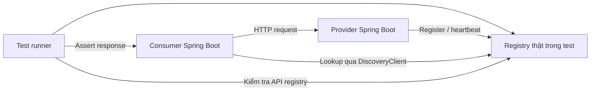

# Kiểm thử đăng ký thực với Eureka, Consul hoặc Zookeeper

Một bài kiểm thử service discovery chỉ có giá trị tích hợp khi ứng dụng thực sự đăng ký vào registry đang chạy, registry lưu được bản ghi và consumer có thể tìm lại instance đó. Mock `DiscoveryClient` chỉ kiểm tra logic của code gọi mock; `SimpleDiscoveryClient` chỉ đọc cấu hình tĩnh. Hai cách này không chứng minh Eureka, Consul hoặc ZooKeeper nhận đăng ký, duy trì trạng thái và loại bỏ instance đúng vòng đời.

Trong module `SPRING_CLOUD_SERVICE_DISCOVERY`, cần kiểm tra toàn bộ luồng từ provider đến registry rồi từ consumer trở lại provider. Bài học này hướng dẫn dựng registry cô lập cho test, xác minh bằng API riêng của registry và Spring Cloud `DiscoveryClient`, kiểm tra request đến endpoint thật, đồng thời kiểm thử deregistration, health và các lỗi kết nối thường gặp.

## 1. Phân biệt unit test và integration test

| Loại kiểm thử | Thành phần được dùng | Có xác minh đăng ký thật không? | Mục đích |
|---|---|---|---|
| Unit test | Mock `DiscoveryClient`, mock `ServiceRegistry`. | Không. | Kiểm tra logic xử lý danh sách instance và nhánh lỗi. |
| Configuration test | `ApplicationContextRunner`, property binding, auto-configuration. | Không nhất thiết. | Kiểm tra bean, property và điều kiện auto-configuration. |
| Integration test | Ứng dụng Spring + Eureka/Consul/ZooKeeper thật. | Có. | Kiểm tra register, renew, lookup và deregister qua registry. |
| End-to-end test | Provider, registry, consumer và request nghiệp vụ chạy cùng nhau. | Có. | Kiểm tra cả control plane lẫn data plane. |

Một bài test có thể dùng mock ở tầng khác, nhưng phần cần chứng minh registration phải đi qua implementation discovery thật. Không thay registry bằng `@MockBean DiscoveryClient` hoặc cấu hình `SimpleDiscoveryClient` rồi kết luận Eureka/Consul/ZooKeeper hoạt động.

## 2. Kiến trúc test cô lập

Mỗi lượt kiểm thử nên có registry riêng hoặc namespace riêng, service ID riêng và instance ID duy nhất. Không dùng registry production hoặc registry dùng chung với môi trường staging có workload khác.



Registry có thể chạy trong Testcontainers hoặc trong một tiến trình test riêng. Eureka Server có thể được khởi động cùng test bằng `@EnableEurekaServer`; Consul và ZooKeeper thường thuận tiện khi chạy container. Các container test phải được dừng sau test để xóa trạng thái đăng ký và tránh rò rỉ tài nguyên.

### 2.1. Các nguyên tắc quan trọng

- Dùng phiên bản Spring Boot và Spring Cloud tương thích theo Spring Cloud release train/BOM của dự án.
- Chỉ đưa discovery starter cần thiết vào từng test application. Nếu classpath đồng thời có nhiều registry client, composite discovery có thể làm test dùng nhầm implementation.
- Dùng `server.port=0` hoặc port được cấp riêng để tránh xung đột giữa các test.
- Tạo service name và instance ID duy nhất cho từng test run.
- Chờ điều kiện bằng Awaitility hoặc polling có timeout; không dùng `Thread.sleep()` cố định để giả định đăng ký đã hoàn tất.
- Kiểm tra cả registry API gốc và `DiscoveryClient` của consumer.
- Nếu kiểm tra health check chủ động, bảo đảm health checker thực sự truy cập được provider từ network namespace của nó.
- Đóng application context để kích hoạt deregistration/session cleanup, sau đó chờ registry phản ánh trạng thái mới.
- Test phải có timeout tổng thể và log hữu ích khi chờ đăng ký thất bại.

## 3. Dependency kiểm thử

Các dependency phổ biến dưới đây cần được quản lý phiên bản bằng BOM tương thích với dự án:

```xml
<dependencies>
    <dependency>
        <groupId>org.springframework.boot</groupId>
        <artifactId>spring-boot-starter-test</artifactId>
        <scope>test</scope>
    </dependency>
    <dependency>
        <groupId>org.awaitility</groupId>
        <artifactId>awaitility</artifactId>
        <scope>test</scope>
    </dependency>
    <dependency>
        <groupId>org.testcontainers</groupId>
        <artifactId>junit-jupiter</artifactId>
        <scope>test</scope>
    </dependency>
    <dependency>
        <groupId>org.testcontainers</groupId>
        <artifactId>testcontainers</artifactId>
        <scope>test</scope>
    </dependency>
</dependencies>
```

Thêm đúng một starter discovery cho từng test suite, ví dụ `spring-cloud-starter-netflix-eureka-client`, `spring-cloud-starter-consul-discovery` hoặc `spring-cloud-starter-zookeeper-discovery`. Test Eureka Server cần thêm `spring-cloud-starter-netflix-eureka-server` trong test application. Không ghim phiên bản starter rời rạc ngoài Spring Cloud BOM.

Testcontainers cần Docker hoặc runtime container tương thích. Nếu CI không có Docker, có thể chạy registry như service test riêng trong pipeline, nhưng vẫn phải xác nhận test đang kết nối đến registry thật chứ không chuyển sang mock.

## 4. Bộ bước kiểm tra chung cho mọi registry

Một integration test đăng ký thực nên kiểm tra theo trình tự:

1. Khởi động registry và đợi endpoint sẵn sàng.
2. Khởi động provider Spring Boot với service name, instance ID và địa chỉ/port riêng.
3. Chờ registry nhận registration.
4. Đọc registry bằng API hoặc công cụ native để xác minh service name, instance ID, host, port và trạng thái.
5. Khởi động consumer kết nối cùng registry.
6. Gọi `DiscoveryClient.getInstances(serviceId)` và xác minh consumer nhìn thấy instance.
7. Gửi request đến endpoint provider qua địa chỉ `ServiceInstance` hoặc qua Spring Cloud LoadBalancer.
8. Đóng provider một cách có kiểm soát và chờ registration bị xóa hoặc chuyển trạng thái theo cơ chế registry.
9. Xác minh consumer không còn chọn instance đã deregister sau khi dữ liệu discovery/cache hội tụ.

Không kiểm tra chỉ bằng HTTP status của registry. Registry có thể trả `200 OK` trong khi service chưa được đăng ký. Cũng không chỉ kiểm tra `DiscoveryClient` trên chính provider vì local state của client có thể khác dữ liệu mà registry lưu hoặc consumer khác nhìn thấy.

## 5. Kiểm thử thật với Consul và Testcontainers

Consul thuận tiện cho integration test vì có thể chạy agent ở chế độ dev trong container riêng. Chế độ dev chỉ phù hợp test cục bộ; không dùng cho production vì cấu hình bảo mật và độ bền dữ liệu khác môi trường thật.

### 5.1. Khởi động Consul container

Ví dụ dùng `GenericContainer`:

```java
import org.junit.jupiter.api.Test;
import org.springframework.boot.test.context.SpringBootTest;
import org.springframework.boot.test.web.server.LocalServerPort;
import org.springframework.cloud.client.ServiceInstance;
import org.springframework.web.client.RestTemplate;
import org.springframework.cloud.client.discovery.DiscoveryClient;
import org.springframework.test.context.DynamicPropertyRegistry;
import org.springframework.test.context.DynamicPropertySource;
import org.testcontainers.containers.GenericContainer;
import org.testcontainers.utility.DockerImageName;
import org.testcontainers.junit.jupiter.Container;
import org.testcontainers.junit.jupiter.Testcontainers;

import static org.assertj.core.api.Assertions.assertThat;
import static org.awaitility.Awaitility.await;
import static java.util.concurrent.TimeUnit.SECONDS;

@Testcontainers
@SpringBootTest(webEnvironment = SpringBootTest.WebEnvironment.RANDOM_PORT)
class ConsulRegistrationIT {

    private static final String SERVICE_ID = "payment-registration-it";
    private static final String INSTANCE_ID = "payment-registration-it-01";

    @Container
    static final GenericContainer<?> CONSUL =
            new GenericContainer<>(DockerImageName.parse("hashicorp/consul:1.18"))
                    .withCommand("agent", "-dev", "-client=0.0.0.0")
                    .withExposedPorts(8500);

    @DynamicPropertySource
    static void consulProperties(DynamicPropertyRegistry registry) {
        registry.add("spring.application.name", () -> SERVICE_ID);
        registry.add("spring.cloud.consul.host", CONSUL::getHost);
        registry.add("spring.cloud.consul.port", () -> CONSUL.getMappedPort(8500));
        registry.add("spring.cloud.consul.discovery.register", () -> true);
        registry.add("spring.cloud.consul.discovery.service-name", () -> SERVICE_ID);
        registry.add("spring.cloud.consul.discovery.instance-id", () -> INSTANCE_ID);
        registry.add("spring.cloud.consul.discovery.register-health-check", () -> false);
        registry.add("spring.cloud.consul.discovery.query-passing", () -> false);
    }

    @LocalServerPort
    int applicationPort;

    @org.springframework.beans.factory.annotation.Autowired
    DiscoveryClient discoveryClient;

    @Test
    void registersInConsulAndIsVisibleToDiscoveryClient() {
        await().atMost(30, SECONDS).untilAsserted(() -> {
            var instances = discoveryClient.getInstances(SERVICE_ID);
            assertThat(instances)
                    .anySatisfy(instance -> {
                        assertThat(instance.getInstanceId()).isEqualTo(INSTANCE_ID);
                        assertThat(instance.getPort()).isEqualTo(applicationPort);
                    });
        });

        ServiceInstance instance = discoveryClient.getInstances(SERVICE_ID).stream()
                .filter(candidate -> INSTANCE_ID.equals(candidate.getInstanceId()))
                .findFirst()
                .orElseThrow();

        assertThat(instance.getUri().getScheme()).isIn("http", "https");
        assertThat(instance.getHost()).isNotBlank();
    }
}
```

Đây là skeleton cho provider test application có web server và Consul discovery starter. `register-health-check=false` tách bài kiểm tra registration khỏi active health check; `query-passing=false` giúp test đọc catalog không phụ thuộc một check đang passing. Tên thuộc tính phải được xác nhận theo phiên bản Spring Cloud Consul của dự án.

### 5.2. Xác minh bằng Consul Catalog API

`DiscoveryClient` là góc nhìn của consumer. Để chứng minh Consul thực sự lưu registration, hãy gọi API native:

```java
import com.fasterxml.jackson.databind.JsonNode;
import org.springframework.web.client.RestTemplate;

String consulUrl = "http://" + CONSUL.getHost() + ":" + CONSUL.getMappedPort(8500);
JsonNode[] records = new RestTemplate().getForObject(
        consulUrl + "/v1/catalog/service/" + SERVICE_ID,
        JsonNode[].class);

assertThat(records).isNotNull().isNotEmpty();
assertThat(records[0].path("ServiceID").asText()).isEqualTo(INSTANCE_ID);
assertThat(records[0].path("ServicePort").asInt()).isEqualTo(applicationPort);
```

API Catalog trả dữ liệu registration, còn `/v1/health/service/{service}` trả thông tin kèm health checks. Nếu bài test cần chứng minh service được coi là passing, hãy cấu hình active health check phù hợp và xác minh bằng health API thay vì chỉ dùng Catalog API.

### 5.3. Kiểm thử active health check riêng

Khi Consul agent thực hiện HTTP check, agent phải truy cập được provider. Nếu Consul chạy trong container còn provider chạy trên host, `localhost` bên trong container không phải host của provider. Cần dùng host gateway được Testcontainers hỗ trợ, hoặc đặt cả provider và Consul vào cùng Docker network với network alias.

Một bài test health nên:

1. Đăng ký provider với health-check URL thật.
2. Xác nhận agent gọi được endpoint và trạng thái chuyển sang passing.
3. Làm endpoint trả trạng thái lỗi hoặc dừng provider trong môi trường test.
4. Chờ health API chuyển sang critical/non-passing.
5. Kiểm tra consumer có lọc instance không passing theo cấu hình `query-passing` hay không.

Không kết luận health check hoạt động chỉ vì provider gọi được `localhost/actuator/health`; probe phải chạy từ đúng Consul agent.

## 6. Kiểm thử thật với ZooKeeper

ZooKeeper Discovery dùng znode để lưu service registration. Testcontainers có thể chạy một ZooKeeper server cô lập cho từng suite.

### 6.1. Khởi động ZooKeeper

```java
import org.testcontainers.containers.GenericContainer;
import org.testcontainers.utility.DockerImageName;
import org.testcontainers.junit.jupiter.Container;
import org.testcontainers.junit.jupiter.Testcontainers;
import org.testcontainers.containers.wait.strategy.Wait;

@Testcontainers
class ZookeeperRegistrationIT {

    @Container
    static final GenericContainer<?> ZOOKEEPER =
            new GenericContainer<>(DockerImageName.parse("zookeeper:3.9"))
                    .withExposedPorts(2181)
                    .waitingFor(Wait.forListeningPort());
}
```

Container expose client port `2181`. Trong test, lấy host và mapped port từ container; không hard-code port host vì Testcontainers thường ánh xạ sang một port ngẫu nhiên.

### 6.2. Cấu hình provider đăng ký

```java
private static final String SERVICE_ID = "payment-zk-it";
private static final String INSTANCE_ID = "payment-zk-it-01";
private static final String ROOT = "/integration-test/services";

@DynamicPropertySource
static void zookeeperProperties(DynamicPropertyRegistry registry) {
    registry.add("spring.application.name", () -> SERVICE_ID);
    registry.add("spring.cloud.zookeeper.connect-string",
            () -> ZOOKEEPER.getHost() + ":" + ZOOKEEPER.getMappedPort(2181));
    registry.add("spring.cloud.zookeeper.discovery.enabled", () -> true);
    registry.add("spring.cloud.zookeeper.discovery.register", () -> true);
    registry.add("spring.cloud.zookeeper.discovery.root", () -> ROOT);
    registry.add("spring.cloud.zookeeper.discovery.instance-id", () -> INSTANCE_ID);
    registry.add("spring.cloud.zookeeper.discovery.instance-host", () -> "127.0.0.1");
}
```

Provider và consumer phải dùng cùng `connect-string` và `root`. `instance-host` trong ví dụ chỉ phù hợp khi consumer chạy trên cùng host/network namespace với provider test. Nếu provider nằm trong container riêng, hãy công bố địa chỉ network alias hoặc IP mà consumer thực sự truy cập được.

### 6.3. Xác minh znode và ServiceInstance

Với root `/integration-test/services`, service ID `payment-zk-it` và instance ID `payment-zk-it-01`, đường dẫn registration thường có dạng:

```text
/integration-test/services/payment-zk-it/payment-zk-it-01
```

Có thể kiểm tra bằng Curator client được Spring Cloud Zookeeper cấu hình:

```java
import org.apache.curator.framework.CuratorFramework;
import org.apache.zookeeper.data.Stat;

@org.springframework.beans.factory.annotation.Autowired
CuratorFramework curatorFramework;

String path = ROOT + "/" + SERVICE_ID + "/" + INSTANCE_ID;
Stat stat = curatorFramework.checkExists().forPath(path);

assertThat(stat).isNotNull();
assertThat(stat.getEphemeralOwner()).isNotZero();
```

`ephemeralOwner` khác `0` xác nhận node là ephemeral znode gắn với session. Cấu trúc path và payload cần được đối chiếu với phiên bản Spring Cloud Zookeeper đang dùng; nếu implementation thêm namespace hoặc encoding riêng, hãy đọc path thực tế thay vì giả định.

Tiếp theo, kiểm tra góc nhìn Spring Cloud:

```java
await().atMost(30, SECONDS).untilAsserted(() ->
        assertThat(discoveryClient.getInstances(SERVICE_ID))
                .anySatisfy(instance ->
                        assertThat(instance.getInstanceId()).isEqualTo(INSTANCE_ID))
);
```

Để kiểm tra deregistration, đóng provider context/session và chờ znode biến mất. Không chỉ kiểm tra ngay sau lệnh `close()` vì ZooKeeper session cleanup và watcher notification có thể bất đồng bộ.

## 7. Kiểm thử thật với Eureka

Eureka Server có thể được khởi động trong test application riêng bằng `@EnableEurekaServer`. Provider và consumer là hai Spring application context độc lập, cùng trỏ đến địa chỉ server được cấp khi test khởi động.

### 7.1. Test Eureka Server

```java
import org.springframework.boot.autoconfigure.SpringBootApplication;
import org.springframework.cloud.netflix.eureka.server.EnableEurekaServer;

@SpringBootApplication
@EnableEurekaServer
class EurekaTestServerApplication {
}
```

Khởi động server bằng `@SpringBootTest`:

```java
import org.springframework.boot.test.context.SpringBootTest;
import org.springframework.boot.test.web.server.LocalServerPort;
import org.springframework.test.context.TestPropertySource;

@SpringBootTest(
    classes = EurekaTestServerApplication.class,
    webEnvironment = SpringBootTest.WebEnvironment.RANDOM_PORT,
    properties = {
        "spring.application.name=eureka-test-server",
        "eureka.client.register-with-eureka=false",
        "eureka.client.fetch-registry=false"
    }
)
class EurekaRegistrationIT {

    @LocalServerPort
    int eurekaPort;
}
```

Server test không đăng ký chính nó và không cần fetch registry của peer. Trong test thực tế, server và client phải dùng cùng scheme, context path và security configuration.

### 7.2. Khởi động provider client trỏ đến server test

Có thể dùng `SpringApplicationBuilder` để mở provider context sau khi đã biết `eurekaPort`:

```java
import org.springframework.boot.WebApplicationType;
import org.springframework.boot.builder.SpringApplicationBuilder;
import org.springframework.context.ConfigurableApplicationContext;

ConfigurableApplicationContext providerContext =
        new SpringApplicationBuilder(PaymentTestApplication.class)
                .web(WebApplicationType.SERVLET)
                .properties(
                    "server.port=0",
                    "spring.application.name=payment-eureka-it",
                    "eureka.client.service-url.defaultZone=http://localhost:" + eurekaPort + "/eureka/",
                    "eureka.client.register-with-eureka=true",
                    "eureka.client.fetch-registry=true",
                    "eureka.instance.instance-id=payment-eureka-it-01"
                )
                .run();
```

`PaymentTestApplication` là test application có web server và Eureka Client starter. `server.port=0` yêu cầu cấp port động; cần xác minh instance record trong Eureka chứa port thực tế sau khi web server khởi động. Nếu ứng dụng test không tự cập nhật port được cấp, hãy truyền port test tường minh hoặc cấu hình `EurekaInstanceConfigBean` phù hợp với cách khởi động.

Giữ `providerContext` để đóng trong `finally`, `@AfterEach` hoặc `try-with-resources`. Việc đóng context là một phần của test deregistration; không để client chạy nền sau khi test kết thúc.

### 7.3. Chờ registration và kiểm tra REST API

Eureka REST API có thể được dùng để xác minh server đã lưu instance. Ví dụ:

```java
import org.springframework.web.client.RestTemplate;

import static org.awaitility.Awaitility.await;
import static java.util.concurrent.TimeUnit.SECONDS;

String registryUrl = "http://localhost:" + eurekaPort;
RestTemplate restTemplate = new RestTemplate();

await().atMost(30, SECONDS).untilAsserted(() -> {
    String body = restTemplate.getForObject(
            registryUrl + "/eureka/apps/PAYMENT-EUREKA-IT",
            String.class);
    assertThat(body).contains("payment-eureka-it-01");
});
```

Response representation phụ thuộc `Accept` header và phiên bản Eureka. Có thể yêu cầu JSON rồi parse `instanceId`, `hostName`, `ipAddr`, `port` và `status` thay vì chỉ tìm chuỗi. Test nên kiểm tra đúng instance ID và port, tránh trường hợp service name có bản ghi cũ từ test khác.

### 7.4. Kiểm tra qua consumer DiscoveryClient

Khởi động một consumer context riêng với cùng `defaultZone`, bật `fetch-registry` và tắt `register-with-eureka` nếu consumer không cần tự đăng ký. Sau đó lấy `DiscoveryClient` từ consumer context và chờ:

```java
try (ConfigurableApplicationContext consumerContext =
        new SpringApplicationBuilder(ConsumerTestApplication.class)
                .web(WebApplicationType.NONE)
                .properties(
                    "spring.application.name=consumer-eureka-it",
                    "eureka.client.service-url.defaultZone=http://localhost:" + eurekaPort + "/eureka/",
                    "eureka.client.register-with-eureka=false",
                    "eureka.client.fetch-registry=true",
                    "eureka.client.registry-fetch-interval-seconds=1"
                )
                .run()) {

    DiscoveryClient consumerDiscoveryClient =
            consumerContext.getBean(DiscoveryClient.class);

    await().atMost(30, SECONDS).untilAsserted(() ->
            assertThat(consumerDiscoveryClient.getInstances("payment-eureka-it"))
                    .anySatisfy(instance ->
                            assertThat(instance.getInstanceId())
                                    .isEqualTo("payment-eureka-it-01"))
    );
}
```

Đây là kiểm tra quan trọng: server đã nhận registration và consumer đã fetch được registry. Không chỉ đọc API từ server rồi kết luận consumer chắc chắn đã cập nhật cache.

## 8. Kiểm tra request nghiệp vụ đến instance thật

Sau khi consumer lấy được `ServiceInstance`, cần xác minh endpoint thực tế có thể nhận request. Với test provider có endpoint `/test/ping`, có thể gọi trực tiếp URI được discovery trả về:

```java
import org.springframework.cloud.client.ServiceInstance;
import org.springframework.web.client.RestTemplate;

ServiceInstance instance = consumerDiscoveryClient
        .getInstances("payment-service")
        .stream()
        .filter(candidate -> "payment-it-01".equals(candidate.getInstanceId()))
        .findFirst()
        .orElseThrow();

String response = new RestTemplate().getForObject(
        instance.getUri().resolve("/test/ping"),
        String.class);

assertThat(response).isEqualTo("payment-ok");
```

Hoặc gọi service ID qua client có `@LoadBalanced` để kiểm tra cả bước chọn instance. Hai kiểm tra có mục tiêu khác nhau:

- Gọi trực tiếp `instance.getUri()` xác minh host/port mà discovery trả về có thể truy cập.
- Gọi URI logic `http://payment-service/...` qua LoadBalancer xác minh service ID được phân giải và instance được chọn.

Nếu test chạy trong Docker network hoặc Kubernetes, provider phải công bố địa chỉ mà consumer test truy cập được. Địa chỉ `localhost` chỉ phù hợp khi provider và consumer cùng network namespace.

## 9. Kiểm thử deregistration và vòng đời instance

Một integration test nên chứng minh bản ghi được loại bỏ khi provider dừng có kiểm soát.

### 9.1. Eureka

Khi Eureka Client shutdown đúng cách, client có thể gửi cancel registration. Đóng provider context, sau đó chờ Eureka API không còn instance ID đó. Nếu client bị kill cưỡng bức, việc loại bỏ có thể phụ thuộc lease expiration và eviction; đó là một kịch bản failure-detection riêng, không giống graceful deregistration.

### 9.2. Consul

Spring Cloud Consul có thể deregister service khi application context dừng hoặc agent xử lý registration lifecycle. Đóng provider context và kiểm tra Catalog/Health API sau khi chờ hội tụ. Nếu service được đăng ký bằng TTL hoặc active check, xác minh trạng thái check và bản ghi service theo đúng semantics của cấu hình.

### 9.3. ZooKeeper

Service registration thường sử dụng ephemeral znode. Khi session kết thúc hoặc hết hạn, znode bị xóa. Đóng context sẽ đóng client/session theo lifecycle integration; chờ znode biến mất và xác minh qua Curator hoặc `DiscoveryClient`.

Không dùng một lần đọc ngay sau `close()` làm assertion duy nhất. Registry, session và cache consumer có thể cập nhật bất đồng bộ.

## 10. Kiểm thử health và trạng thái instance

Health semantics khác nhau giữa các registry:

| Registry | Cơ chế cần kiểm tra | Bài test phù hợp |
|---|---|---|
| Eureka | Client heartbeat/lease và status được client công bố. | Xác minh register, renew, status update và cancel; không mặc định server chủ động HTTP probe từng provider. |
| Consul | Agent health check, TTL check hoặc check type đã cấu hình. | Kiểm tra passing → critical khi endpoint lỗi/TTL không được renew; kiểm tra query-passing. |
| ZooKeeper | Ephemeral node gắn với session và trạng thái kết nối/session. | Ngắt session hoặc đóng client, xác minh node tồn tại trong thời gian session còn hiệu lực và biến mất sau khi hết hạn. |

Để kiểm tra Consul active HTTP check, Consul agent phải truy cập được provider endpoint. Với ZooKeeper, mất TCP tạm thời chưa chắc làm session hết hạn ngay. Với Eureka, heartbeat chậm hoặc mất kết nối không đồng nghĩa instance đã bị xóa tức thì. Test phải chờ theo timeout/lease đã cấu hình và xác nhận trạng thái từ registry.

## 11. Kiểm thử lỗi và điều kiện biên

Sau happy path, nên thêm các trường hợp:

- **Sai registry URL/port:** provider không đăng ký được và log chỉ ra lỗi kết nối.
- **Registry dừng sau khi provider đăng ký:** xác minh hành vi retry/renew và dữ liệu cache của consumer.
- **Instance ID trùng:** xác minh hành vi registry và đảm bảo test không để hai provider ghi cùng bản ghi.
- **Advertised host sai:** registry có record nhưng consumer không kết nối được; test phải phát hiện qua data-plane request.
- **Port sai:** API registry có thể chứa port không đúng; assertion trên `ServiceInstance.getPort()` phải bắt được.
- **Consul health check critical:** service có record nhưng không passing; consumer có lọc theo `query-passing` hay không.
- **ZooKeeper session hết hạn:** ephemeral node biến mất và provider đăng ký lại với session mới.
- **Eureka heartbeat/lease:** phân biệt graceful cancel với provider mất kết nối đột ngột.
- **Không có instance:** consumer xử lý danh sách rỗng mà không phát sinh lỗi null hoặc retry vô hạn.
- **Cache chưa hội tụ:** đo thời gian consumer ngừng nhìn thấy instance cũ sau deregistration.
- **ACL/RBAC từ chối:** kiểm tra provider/consumer nhận lỗi xác thực/ủy quyền rõ ràng.

Các test làm gián đoạn mạng, dừng registry hoặc hết hạn session nên chạy trên container/namespace cô lập. Không thao tác trên registry dùng chung hoặc production.

## 12. Chờ đăng ký bất đồng bộ đúng cách

Registration và discovery cache thường không đồng bộ tức thì. Dùng Awaitility để chờ một điều kiện có ý nghĩa:

```java
await()
    .atMost(30, SECONDS)
    .pollInterval(200, java.util.concurrent.TimeUnit.MILLISECONDS)
    .untilAsserted(() -> {
        assertThat(discoveryClient.getInstances("payment-service"))
                .anySatisfy(instance ->
                        assertThat(instance.getInstanceId())
                                .isEqualTo("payment-it-01"));
    });
```

Tránh:

```java
Thread.sleep(5000);
assertThat(discoveryClient.getInstances("payment-service")).isNotEmpty();
```

`Thread.sleep` cố định có thể quá ngắn trên CI chậm hoặc lãng phí thời gian trên máy nhanh. Awaitility dừng ngay khi điều kiện đạt và tạo lỗi timeout dễ chẩn đoán nếu registration không xuất hiện.

Timeout cần phù hợp với heartbeat, fetch interval, watch delay và retry của registry đang dùng. Nếu test chỉ chờ 1 giây trong khi Eureka fetch interval là 30 giây, test có thể thất bại dù hệ thống hoạt động đúng theo cấu hình.

## 13. Tránh test flaky và rò rỉ registration

- Dùng service ID và instance ID riêng theo test class hoặc test run.
- Không chạy song song hai test dùng chung ID trong cùng registry.
- Tắt hoặc cấu hình phù hợp health check khi test chỉ tập trung vào registration.
- Khi test health, bảo đảm agent thật sự truy cập được endpoint và dùng timeout thực tế.
- Đóng mọi `ConfigurableApplicationContext`, client session và container trong `finally`/JUnit lifecycle.
- Chờ deregistration hoặc ephemeral node cleanup trước khi tái sử dụng service ID.
- Không dùng registry external dùng chung giữa developer và CI.
- Ghi log registry URL, service ID, instance ID, host/port và trạng thái nhưng không log token/password.
- Ghim image tag container để test có thể tái lập; cập nhật tag có chủ đích.
- Dùng Testcontainers wait strategy để xác nhận registry sẵn sàng trước khi khởi động provider.
- Không dùng `@DirtiesContext` như cách duy nhất để xóa record nếu client shutdown không gửi deregistration; hãy kiểm tra registry thực tế.

## 14. Checklist hoàn thành integration test

- Registry thật đã khởi động và readiness được xác nhận.
- Provider dùng discovery starter thật, không phải `SimpleDiscoveryClient` hay mock.
- Provider có service name và instance ID duy nhất.
- Registry-native API hiển thị đúng instance ID, host và port.
- Consumer context riêng kết nối đến cùng registry.
- Consumer `DiscoveryClient` trả về instance đã đăng ký.
- Request đến provider thành công qua URI vật lý hoặc LoadBalancer.
- Health/status được xác minh theo đúng cơ chế của registry.
- Graceful shutdown làm registration bị xóa hoặc chuyển trạng thái như mong đợi.
- Test failure path bao gồm sai host/port, registry unavailable hoặc ACL/RBAC nếu có yêu cầu.
- Test dùng Awaitility với timeout có chủ đích, không dùng sleep tùy tiện.
- Container/context/session được dọn dẹp và test không để lại registration.
- CI có runtime registry thật và không tự động chuyển sang mock khi Docker không sẵn sàng.

## Kết luận

Kiểm thử đăng ký thực cần có registry thật, provider thật và consumer thật. Xác minh ở ba điểm: registry-native API đã lưu đúng instance; `DiscoveryClient` của consumer nhìn thấy instance; request data-plane đến địa chỉ được công bố thành công. Sau đó kiểm tra deregistration, health/session và các trường hợp lỗi để xác nhận vòng đời registration.

Eureka có thể được kiểm thử bằng server test riêng và các client context độc lập; Consul và ZooKeeper có thể chạy cô lập bằng Testcontainers. Dùng service/instance ID duy nhất, chờ bất đồng bộ bằng Awaitility, kiểm tra cả control plane lẫn data plane và dọn dẹp sau test. Như vậy, bài kiểm thử mới chứng minh được integration với registry thực thay vì chỉ chứng minh code hoạt động với một danh sách giả.

## Tài liệu tham khảo

- [Spring Cloud Netflix — Eureka Server and Client](https://docs.spring.io/spring-cloud-netflix/reference/spring-cloud-netflix.html)
- [Spring Cloud Consul — Service Discovery](https://docs.spring.io/spring-cloud-consul/reference/discovery.html)
- [Spring Cloud Zookeeper — Service Discovery](https://docs.spring.io/spring-cloud-zookeeper/reference/discovery.html)
- [Testcontainers for Java](https://java.testcontainers.org/)
- [Awaitility](https://github.com/awaitility/awaitility)
