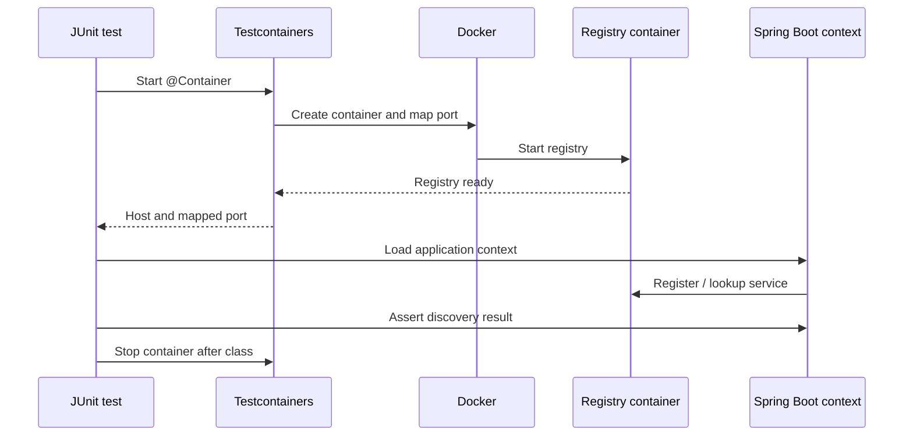

# Dùng Testcontainers và cổng động cho môi trường kiểm thử cô lập

Service discovery thường phụ thuộc vào registry như Eureka, Consul hoặc ZooKeeper. Nếu integration test kết nối tới registry dùng chung trên máy developer hoặc trong CI, kết quả có thể phụ thuộc dữ liệu cũ, cổng đang được sử dụng, trạng thái dịch vụ bên ngoài hoặc thứ tự chạy test.

Testcontainers giúp khởi động registry thật trong container dành riêng cho test. Thay vì giả lập toàn bộ giao thức discovery, test có thể kiểm tra cách Spring Cloud client kết nối, đăng ký và tra cứu instance với registry đang chạy. Cổng container được ánh xạ động sang một cổng host còn trống; test lấy địa chỉ thực tế từ Testcontainers rồi đưa vào Spring Boot bằng `@DynamicPropertySource`.

## 1. Vì sao cần môi trường kiểm thử cô lập?

Một integration test discovery cần kiểm tra nhiều thành phần cùng hoạt động:

- Ứng dụng Spring Boot khởi động discovery client.
- Registry nhận đăng ký service hoặc cung cấp dữ liệu instance.
- Client tra cứu theo service ID.
- Host và port được công bố có thể được đọc lại chính xác.
- Registration được gỡ bỏ khi application context đóng.
- Các test không làm nhiễu dữ liệu của nhau.

Dùng registry dùng chung có thể gây ra các lỗi khó tái hiện:

| Rủi ro | Hậu quả |
|---|---|
| Registry còn registration từ lần chạy trước | Test nhận nhầm instance cũ |
| Hai test dùng cùng service ID | Kết quả phụ thuộc thứ tự hoặc chạy song song |
| Cổng mặc định đã bị chiếm | Test không khởi động được hoặc kết nối nhầm tiến trình |
| Registry không chạy trong CI | Test thất bại dù code không thay đổi |
| Phiên bản registry trên máy khác nhau | Kết quả giữa developer và CI không nhất quán |
| Test không dọn registration | Dữ liệu rác ảnh hưởng các test tiếp theo |

Môi trường cô lập nên có registry riêng cho test, phiên bản image được pin, cổng host động, dữ liệu dùng một lần và lifecycle được quản lý tự động.

## 2. Testcontainers hoạt động như thế nào?

Testcontainers điều khiển Docker từ test JVM. Khi test bắt đầu, thư viện kéo image nếu cần, tạo container, mở cổng và chờ service trong container sẵn sàng. Khi test kết thúc, container được dừng và xóa theo lifecycle đã khai báo.

Luồng cơ bản:



Testcontainers không thay thế JUnit hoặc Spring Test. Nó cung cấp dependency thật ở dạng container để test có thể chạy nhất quán hơn trên máy developer và CI có Docker.

## 3. Thêm dependency

Dự án cần discovery starter tương ứng với registry được kiểm thử. Ví dụ dùng Consul:

```xml
<dependency>
    <groupId>org.springframework.cloud</groupId>
    <artifactId>spring-cloud-starter-consul-discovery</artifactId>
</dependency>
```

Thêm Testcontainers JUnit Jupiter trong test scope:

```xml
<dependency>
    <groupId>org.testcontainers</groupId>
    <artifactId>junit-jupiter</artifactId>
    <scope>test</scope>
</dependency>
```

Testcontainers nên được quản lý phiên bản qua BOM trong dependency management:

```xml
<dependencyManagement>
    <dependencies>
        <dependency>
            <groupId>org.testcontainers</groupId>
            <artifactId>testcontainers-bom</artifactId>
            <version>${testcontainers.version}</version>
            <type>pom</type>
            <scope>import</scope>
        </dependency>
    </dependencies>
</dependencyManagement>
```

`testcontainers.version` cần được khai báo bằng phiên bản đã chọn và đồng bộ trong dự án. Cũng cần có `spring-boot-starter-test` để sử dụng Spring Test, JUnit Jupiter và AssertJ. Ví dụ dưới đây dùng Awaitility để chờ registry hội tụ; có thể khai báo dependency Awaitility riêng nếu dependency test hiện tại chưa cung cấp.

## 4. Khởi chạy Consul với cổng host động

Ví dụ sau tạo Consul agent đơn node ở chế độ dev. Chế độ dev phù hợp cho test cục bộ vì không cần dựng cluster; dữ liệu của container sẽ bị xóa khi container dừng.

```java
import org.testcontainers.containers.GenericContainer;
import org.testcontainers.containers.wait.strategy.Wait;
import org.testcontainers.junit.jupiter.Container;
import org.testcontainers.junit.jupiter.Testcontainers;
import org.testcontainers.utility.DockerImageName;

@Testcontainers
class ConsulContainerSupport {

    static final int CONSUL_HTTP_PORT = 8500;

    @Container
    static final GenericContainer<?> CONSUL =
        new GenericContainer<>(
            DockerImageName.parse("hashicorp/consul:1.20.1")
        )
        .withCommand("agent", "-dev", "-client=0.0.0.0")
        .withExposedPorts(CONSUL_HTTP_PORT)
        .waitingFor(
            Wait.forHttp("/v1/status/leader")
                .forPort(CONSUL_HTTP_PORT)
                .forStatusCode(200)
        );
}
```

Các điểm cần hiểu:

- `withExposedPorts(8500)` yêu cầu Docker publish cổng HTTP của container ra host.
- Testcontainers chọn một cổng host còn trống; không cố định cổng host là 8500.
- `getHost()` trả về host mà test JVM dùng để truy cập container.
- `getMappedPort(8500)` trả về cổng host được ánh xạ cho cổng 8500 bên trong container.
- Wait strategy đợi HTTP API sẵn sàng trước khi Spring context kết nối.

Không gọi `getMappedPort` trước khi container đã khởi động. Không giả định host luôn là `localhost`; trong môi trường Docker remote hoặc CI, host có thể khác. Image nên được pin theo phiên bản cụ thể để tránh test thay đổi hành vi khi tag mới được phát hành.

## 5. Truyền địa chỉ động vào Spring Boot

Dùng `@DynamicPropertySource` để đăng ký các property được tính từ container đang chạy:

```java
import org.springframework.test.context.DynamicPropertyRegistry;
import org.springframework.test.context.DynamicPropertySource;

static final int CONSUL_HTTP_PORT = 8500;

@DynamicPropertySource
static void consulProperties(DynamicPropertyRegistry registry) {
    registry.add("spring.cloud.consul.host", CONSUL::getHost);
    registry.add(
        "spring.cloud.consul.port",
        () -> CONSUL.getMappedPort(CONSUL_HTTP_PORT)
    );
}
```

Supplier chỉ được đánh giá khi Spring cần property. Vì vậy container phải được khởi động trước khi application context sử dụng các giá trị này. Với JUnit Jupiter và static `@Container`, Testcontainers quản lý container ở phạm vi class; hãy dùng mẫu tích hợp Spring Testcontainers tương thích với phiên bản thư viện trong dự án.

Có thể thêm các property dành riêng cho test:

```java
@DynamicPropertySource
static void discoveryProperties(DynamicPropertyRegistry registry) {
    registry.add("spring.cloud.consul.host", CONSUL::getHost);
    registry.add(
        "spring.cloud.consul.port",
        () -> CONSUL.getMappedPort(8500)
    );
    registry.add(
        "spring.cloud.consul.discovery.register",
        () -> true
    );
    registry.add(
        "spring.cloud.consul.discovery.register-health-check",
        () -> false
    );
}
```

Trong ví dụ, health check chủ động được tắt để test tập trung vào registration và lookup, tránh việc Consul container không thể gọi endpoint HTTP của ứng dụng đang chạy trong host test process. Thuộc tính này cần được xác nhận với phiên bản Spring Cloud Consul của dự án. Nếu test health check, hãy cấu hình địa chỉ mà Consul container thực sự truy cập được, không dùng localhost của container làm địa chỉ host application.

## 6. Integration test đăng ký service và tra cứu instance

Ví dụ test ứng dụng provider có tên `inventory-service`. Spring Boot khởi động web server trên cổng ngẫu nhiên; Consul chạy trong container với cổng HTTP host động.

```java
import java.time.Duration;

import org.junit.jupiter.api.Test;
import org.springframework.beans.factory.annotation.Autowired;
import org.springframework.boot.test.context.SpringBootTest;
import org.springframework.boot.test.web.server.LocalServerPort;
import org.springframework.cloud.client.ServiceInstance;
import org.springframework.cloud.client.discovery.DiscoveryClient;
import org.springframework.test.annotation.DirtiesContext;
import org.springframework.test.context.DynamicPropertyRegistry;
import org.springframework.test.context.DynamicPropertySource;
import org.testcontainers.containers.GenericContainer;
import org.testcontainers.containers.wait.strategy.Wait;
import org.testcontainers.junit.jupiter.Container;
import org.testcontainers.junit.jupiter.Testcontainers;
import org.testcontainers.utility.DockerImageName;

import static org.assertj.core.api.Assertions.assertThat;
import static org.awaitility.Awaitility.await;

@Testcontainers
@DirtiesContext(classMode = DirtiesContext.ClassMode.AFTER_CLASS)
@SpringBootTest(
    webEnvironment = SpringBootTest.WebEnvironment.RANDOM_PORT,
    properties = {
        "spring.application.name=inventory-service",
        "spring.cloud.consul.discovery.register=true",
        "spring.cloud.consul.discovery.register-health-check=false"
    }
)
class ConsulDiscoveryIntegrationTest {

    private static final int CONSUL_HTTP_PORT = 8500;

    @Container
    static final GenericContainer<?> CONSUL =
        new GenericContainer<>(
            DockerImageName.parse("hashicorp/consul:1.20.1")
        )
        .withCommand("agent", "-dev", "-client=0.0.0.0")
        .withExposedPorts(CONSUL_HTTP_PORT)
        .waitingFor(
            Wait.forHttp("/v1/status/leader")
                .forPort(CONSUL_HTTP_PORT)
                .forStatusCode(200)
        );

    @DynamicPropertySource
    static void consulProperties(DynamicPropertyRegistry registry) {
        registry.add("spring.cloud.consul.host", CONSUL::getHost);
        registry.add(
            "spring.cloud.consul.port",
            () -> CONSUL.getMappedPort(CONSUL_HTTP_PORT)
        );
    }

    @Autowired
    DiscoveryClient discoveryClient;

    @LocalServerPort
    int applicationPort;

    @Test
    void registersInventoryInstance() {
        await()
            .atMost(Duration.ofSeconds(20))
            .untilAsserted(() -> {
                java.util.List<ServiceInstance> instances =
                    discoveryClient.getInstances("inventory-service");

                assertThat(instances).isNotEmpty();
                assertThat(instances)
                    .anyMatch(instance ->
                        instance.getPort() == applicationPort
                    );
            });
    }
}
```

Test xác nhận hai điều:

1. Registry trả về ít nhất một instance dưới service ID `inventory-service`.
2. Port được công bố trùng với cổng HTTP ngẫu nhiên mà Spring Boot thực sự mở.

Import `org.springframework.boot.test.web.server.LocalServerPort` dùng cho Spring Boot 3; ở một số phiên bản Spring Boot 2, annotation này nằm trong package `org.springframework.boot.web.server`. Nếu ứng dụng không nằm trong package scan của test, chỉ rõ lớp cấu hình bằng thuộc tính `classes` của `@SpringBootTest`.

Điều kiện thứ hai phát hiện lỗi cấu hình thường gặp: ứng dụng lắng nghe một cổng nhưng registration lại công bố cổng mặc định hoặc cổng cũ. Nếu phiên bản Spring Cloud Consul hoặc cấu hình server port không tự ánh xạ đúng cổng random, test sẽ thất bại và giúp phát hiện sai lệch sớm.

`register-health-check=false` trong ví dụ chỉ dành cho test registration/lookup. Một bài test health check riêng nên bật check và cấu hình endpoint có thể truy cập từ Consul container, sau đó kiểm tra trạng thái passing.

## 7. Chờ eventual consistency thay vì Thread.sleep

Service registration không nhất thiết xuất hiện ngay khi application context vừa khởi động. Client có thể đăng ký bất đồng bộ, registry cần xử lý request và discovery client có thể cập nhật cache sau đó.

Không nên viết:

```java
Thread.sleep(5000);
assertThat(discoveryClient.getInstances("inventory-service"))
    .isNotEmpty();
```

Cách này chờ một khoảng cố định dù registry có thể sẵn sàng sớm hơn hoặc chậm hơn. Dùng Awaitility để chờ điều kiện cần đạt:

```java
await()
    .atMost(Duration.ofSeconds(20))
    .pollInterval(Duration.ofMillis(250))
    .untilAsserted(() ->
        assertThat(
            discoveryClient.getInstances("inventory-service")
        ).isNotEmpty()
    );
```

Đặt timeout hữu hạn để test không treo vô hạn. Nếu điều kiện không đạt, kiểm tra log provider, registry container, service ID, host/port và quyền đăng ký. Khi test phụ thuộc nhiều tầng cache, timeout nên dựa trên chu kỳ refresh và SLA của môi trường kiểm thử.

## 8. Kiểm tra registration qua HTTP API

Ngoài DiscoveryClient, có thể gọi API của registry để kiểm tra dữ liệu ở phía server. Với Consul:

```java
String consulUrl = "http://" + CONSUL.getHost()
    + ":" + CONSUL.getMappedPort(8500);

var response = java.net.http.HttpClient.newHttpClient()
    .send(
        java.net.http.HttpRequest.newBuilder(
            java.net.URI.create(
                consulUrl + "/v1/health/service/inventory-service"
            )
        ).GET().build(),
        java.net.http.HttpResponse.BodyHandlers.ofString()
    );

assertThat(response.statusCode()).isEqualTo(200);
assertThat(response.body()).contains("inventory-service");
```

Đây là kiểm tra bổ sung ở tầng registry API. Không nên chỉ kiểm tra JSON có chứa chuỗi service name rồi kết luận toàn bộ instance hợp lệ; nếu cần, deserialize response và kiểm tra service ID, address, port, tags và health checks cụ thể.

Hai góc nhìn trả lời hai câu hỏi khác nhau:

- HTTP API cho biết registry đang lưu dữ liệu gì.
- DiscoveryClient cho biết consumer Spring Cloud nhìn thấy instance nào.

Nếu registry API có instance nhưng DiscoveryClient không trả về, hãy kiểm tra discovery configuration, query-passing/filter, cache và namespace.

## 9. Kiểm thử deregistration và lifecycle

Một integration test khác có thể xác minh registration biến mất sau khi provider context đóng. Có thể dùng application context riêng được tạo và đóng trong test, hoặc kiểm tra API registry sau khi context bị đóng.

Các điều cần kiểm tra:

1. Provider đăng ký đúng service ID và instance ID.
2. Registry nhìn thấy host/port mà provider công bố.
3. Consumer lấy được instance bằng DiscoveryClient.
4. Khi provider đóng bình thường, registration được deregister nếu cấu hình bật deregistration.
5. Sau khi cache/registry hội tụ, instance không còn xuất hiện trong lookup.
6. Test cleanup không xóa registration thuộc test khác.

Deregistration và cache refresh có thể có độ trễ. Dùng Awaitility để chờ danh sách instance không còn ID cần kiểm tra. Không yêu cầu instance list phải rỗng nếu test khác hoặc provider khác vẫn đang đăng ký cùng service ID.

Với Eureka, cần phân biệt client shutdown/deregister với việc lease hết hạn. Với ZooKeeper, cần phân biệt close session bình thường với session expiration và ephemeral znode cleanup. Với Kubernetes, vòng đời Service/EndpointSlice do control plane quản lý; test cần xác định đang kiểm tra DNS, Kubernetes API hay Spring Cloud Kubernetes DiscoveryClient.

## 10. Test scope và tránh nhiễm chéo

Testcontainers cô lập registry process, nhưng test vẫn có thể nhiễm dữ liệu nếu nhiều test dùng chung một container hoặc service ID.

Một số nguyên tắc:

- Dùng service ID hoặc instance ID riêng cho từng test khi cần đăng ký nhiều service.
- Dọn registration do test tạo ra sau khi xác minh.
- Nếu static container dùng chung cho một class, hiểu rằng dữ liệu registry tồn tại giữa các method trong class.
- Nếu cần container mới cho từng test method, dùng instance-level `@Container`; đổi lại thời gian chạy sẽ tăng.
- Không chạy song song các test ghi cùng service ID nếu chưa có cơ chế phân biệt instance.
- Không dựa vào thứ tự test để tạo hoặc xóa registration.
- Dùng `@DirtiesContext` khi Spring Test context cache có thể giữ context lâu hơn lifecycle của static container.
- Tránh bật container reuse trong CI nếu cần dữ liệu sạch cho từng lần chạy.

Một test nên sở hữu dữ liệu nó tạo ra. Nếu dùng chung service ID, instance ID phải duy nhất và cleanup chỉ được xóa đúng registration của test đó.

## 11. Dùng Testcontainers với Eureka hoặc ZooKeeper

Cùng một nguyên tắc có thể áp dụng cho các registry khác:

- Khởi chạy registry container với image/version cố định.
- Expose cổng nội bộ của registry bằng `withExposedPorts`.
- Đợi API hoặc cổng registry sẵn sàng.
- Lấy host qua `getHost()` và host port qua `getMappedPort(containerPort)`.
- Đưa địa chỉ động vào property Spring Cloud bằng `@DynamicPropertySource`.
- Xác minh registration/lookup qua DiscoveryClient và API của provider nếu có.

Ví dụ với Eureka, property endpoint được tạo từ địa chỉ động:

```java
registry.add(
    "eureka.client.service-url.defaultZone",
    () -> "http://" + EUREKA.getHost()
        + ":" + EUREKA.getMappedPort(8761) + "/eureka/"
);
```

Với ZooKeeper, property connect string dùng host và mapped client port:

```java
registry.add(
    "spring.cloud.zookeeper.connect-string",
    () -> ZOOKEEPER.getHost()
        + ":" + ZOOKEEPER.getMappedPort(2181)
);
```

Các đoạn trên minh họa cách truyền endpoint động; image, command, readiness check, security và dependency container phải theo cách đóng gói của registry và phiên bản thư viện đang dùng. Không dùng cổng mặc định của host thay cho mapped port.

## 12. Cổng động cho cả registry và ứng dụng

Có hai cổng khác nhau cần phân biệt:

| Cổng | Ai cấp? | Cách lấy |
|---|---|---|
| Container port | Registry image lắng nghe bên trong container | Biết từ cấu hình image, ví dụ 8500 |
| Mapped host port | Docker/Testcontainers ánh xạ ra host | `container.getMappedPort(8500)` |
| Application random port | Spring Boot embedded server chọn khi `server.port=0` hoặc `RANDOM_PORT` | `@LocalServerPort` |

Không giả định container port và mapped host port giống nhau. Ví dụ Consul nghe 8500 trong container nhưng được ánh xạ ra host port 49172. Test JVM phải kết nối tới host và port 49172; một container khác trong cùng Docker network có thể dùng network alias và port nội bộ 8500.

Nếu provider chạy trong test JVM, registry thường gọi provider qua địa chỉ host mà provider đăng ký. Nếu registry cần chủ động gọi health endpoint trên host, phải cấu hình host reachability từ container, chẳng hạn cơ chế expose host port được Testcontainers hỗ trợ hoặc một test network phù hợp. Không dùng `localhost` theo suy đoán vì localhost có ý nghĩa khác nhau trong từng network namespace.

## 13. Chạy trong CI

Testcontainers cần Docker-compatible runtime. CI phải cấp Docker daemon hoặc môi trường tương thích và cho phép test process truy cập.

Trước khi đưa test vào pipeline:

- Pin registry image theo version hoặc digest.
- Kiểm tra CI có Docker socket/daemon và quyền cần thiết.
- Cấp đủ thời gian để pull image lần đầu.
- Không phụ thuộc cổng host cố định.
- Thu thập container logs khi test thất bại.
- Dùng timeout rõ ràng cho readiness và eventual consistency.
- Giới hạn parallelism nếu máy CI thiếu CPU/memory.
- Không dùng registry thật hoặc credential production trong test.
- Dọn container và network sau khi test kết thúc.
- Cân nhắc cache image ở CI để giảm thời gian pull, nhưng vẫn kiểm soát version.

Nếu Docker không khả dụng, integration test dùng Testcontainers cần fail rõ ràng hoặc được phân loại theo profile/tag test riêng. Không âm thầm bỏ qua test bắt buộc rồi coi pipeline là đã kiểm tra discovery.

## 14. Troubleshooting

| Hiện tượng | Nguyên nhân có thể | Hướng xử lý |
|---|---|---|
| Container không khởi động | Docker daemon không truy cập được hoặc image lỗi | Kiểm tra Docker runtime, image và container logs |
| Wait strategy timeout | Registry chưa sẵn sàng hoặc endpoint check sai | Kiểm tra command, port nội bộ và readiness path |
| Spring Boot kết nối nhầm cổng | Dùng container port thay mapped host port | Dùng `getHost()` và `getMappedPort()` |
| getMappedPort báo lỗi | Gọi trước khi container start | Chỉ đọc mapped port sau khi container đã chạy |
| Placeholder host/port rỗng | Dynamic property chưa được đăng ký đúng | Kiểm tra `@DynamicPropertySource` là static và context dùng class đó |
| Registry API có service nhưng DiscoveryClient trả rỗng | Filter, namespace, cache hoặc service ID sai | Đối chiếu cấu hình discovery và API response |
| Port registration không khớp | App random port chưa được công bố đúng | So sánh `@LocalServerPort` với `ServiceInstance.getPort()` |
| Test lúc pass lúc fail | Chờ cố định, registry chưa hội tụ hoặc test dùng chung ID | Dùng Awaitility và ID riêng |
| Test chạy local nhưng fail ở CI | Docker permissions, DNS hoặc image pull | Kiểm tra runtime CI và container logs |
| Test khác làm mất registration | Cleanup quá rộng hoặc service ID dùng chung | Cleanup đúng instance ID và cô lập dữ liệu |
| Context dùng container đã dừng | Spring context cache vượt lifecycle container | Điều chỉnh scope container hoặc dùng `@DirtiesContext` |

Khi test thất bại, kiểm tra theo thứ tự: container có chạy không, readiness đã pass chưa, host/mapped port có đúng không, Spring property có được nạp không, registry API có registration không, rồi mới kiểm tra DiscoveryClient và LoadBalancer.

## 15. Checklist cho integration test discovery

1. Registry chạy trong Testcontainers với image được pin.
2. Test không phụ thuộc registry bên ngoài hoặc dữ liệu developer.
3. Container expose cổng nội bộ và host port được ánh xạ động.
4. Test dùng `getHost()` và `getMappedPort()` sau khi container start.
5. Spring Boot nhận endpoint qua `@DynamicPropertySource`.
6. Registry readiness được kiểm tra trước khi Spring context kết nối.
7. Ứng dụng dùng cổng random khi test cần kiểm tra provider port.
8. Test xác minh service ID, host, port và instance list.
9. Eventual consistency được xử lý bằng Awaitility với timeout hữu hạn.
10. Health check được bật/tắt có chủ đích theo mục tiêu test.
11. Registration được cleanup đúng phạm vi.
12. Parallel test không ghi đè hoặc xóa dữ liệu của nhau.
13. Spring context cache không giữ tham chiếu tới container đã dừng.
14. CI có Docker-compatible runtime và thu thập logs khi lỗi.
15. Không dùng secret hoặc registry production trong test.

Testcontainers cung cấp registry thật trong một môi trường dùng riêng cho test; cổng động giúp tránh xung đột và làm test độc lập với cấu hình máy. Kết hợp `@DynamicPropertySource`, Spring Boot random port và Awaitility giúp xác minh registration/lookup theo thời gian thực, đồng thời phát hiện sai lệch host hoặc port mà mock đơn thuần không thể kiểm tra.
