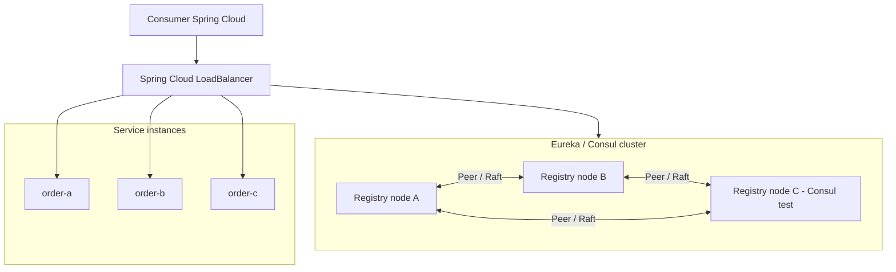

# Kiểm thử mất sổ đăng ký, mất peer và instance chết đột ngột

Service discovery chỉ đáng tin cậy khi hệ thống vẫn xử lý đúng lúc registry hoặc một phần workload gặp sự cố. Một Eureka Server có thể ngừng hoạt động, một peer có thể mất kết nối, cụm Consul có thể mất quorum, hoặc một service instance có thể bị kill mà không kịp deregister. Những tình huống này tác động khác nhau tới registration, health state, cache của consumer và khả năng chọn instance của Spring Cloud LoadBalancer.

Kiểm thử fault scenario cần xác minh cả quá trình lỗi lẫn quá trình phục hồi. Không chỉ kiểm tra registry có trả lỗi hay không; cần kiểm tra consumer còn gọi được instance khỏe, dữ liệu stale được xử lý theo policy, cảnh báo được phát và registry hội tụ sau khi thành phần trở lại. Bài học này xây dựng test matrix, cách fault injection và tiêu chí chấp nhận cho Eureka, Consul và ứng dụng Spring Cloud.

## 1. Mục tiêu và phạm vi kiểm thử

Ba nhóm sự cố chính:

1. **Mất registry:** consumer hoặc provider không thể kết nối tới registry service. Cần kiểm tra lookup, registration, heartbeat, cache và hành vi khi registry phục hồi.
2. **Mất peer:** một node trong cụm registry không thể giao tiếp với peer khác. Cần kiểm tra replication, quorum, khả năng đọc/ghi và hội tụ dữ liệu.
3. **Instance chết đột ngột:** process hoặc container bị kill mà không chạy shutdown hook/deregistration. Cần kiểm tra health check, lease expiration, eviction và việc consumer ngừng chọn endpoint đã chết.

Các kiểm thử phải trả lời được:

- Consumer có tiếp tục gọi các instance còn khỏe khi registry tạm thời mất kết nối không?
- Consumer có phân biệt empty result với lỗi truy vấn registry không?
- Snapshot cache có tuổi tối đa và stale fallback policy rõ ràng không?
- Instance chết có bị loại khỏi tập ứng viên trong thời gian chấp nhận được không?
- Peer hoặc registry phục hồi có đồng bộ lại registration mà không tạo bản ghi trùng không?
- Metrics, logs và alerts có mô tả đúng nguyên nhân và phạm vi lỗi không?

## 2. Chuẩn bị môi trường kiểm thử

### 2.1. Topology tối thiểu

Đối với Eureka, nên có ít nhất hai server peer và hai hoặc ba service instance. Với Consul, nên dùng cụm ba server để kiểm tra cả tình huống mất một server vẫn còn quorum và tình huống mất quorum. Chạy một server duy nhất không thể mô phỏng đầy đủ hành vi peer/quorum.



Topology minh họa có thể tách registry peer và provider thành container hoặc process riêng. Với Consul, client thường kết nối tới Consul Agent; Agent giao tiếp với server cluster. Nên có ít nhất một Agent cạnh provider và một Agent cạnh consumer nếu muốn kiểm tra riêng sự cố Agent với sự cố server.

### 2.2. Ghi baseline trước khi tạo lỗi

Trước mỗi test, ghi lại:

- Số replica mong muốn, số registration và số instance healthy.
- Service ID, instance ID, host/port và metadata zone/cluster.
- Registry leader/peer state hoặc trạng thái Consul Raft.
- Chu kỳ heartbeat, lease expiration, health-check interval và eviction interval.
- Discovery refresh interval, LoadBalancer cache TTL, DNS TTL và request timeout.
- Tỷ lệ request thành công, 5xx, timeout và latency.
- Metrics/alerts hiện tại để phân biệt lỗi do test với cảnh báo đã tồn tại.

Không bắt đầu fault injection khi baseline chưa ổn định. Nếu có instance unhealthy từ trước, kết quả kiểm thử sẽ không chỉ ra được tác động của lỗi vừa tạo.

### 2.3. Chọn nơi chạy test

Ưu tiên theo thứ tự:

- Unit test với fake `DiscoveryClient` để kiểm tra logic empty/error/stale.
- Integration test với Testcontainers hoặc Docker Compose để kiểm tra registry thật.
- Fault injection qua Toxiproxy, Docker network hoặc công cụ chaos trong môi trường staging.
- Production game day chỉ khi có phê duyệt vận hành, blast radius giới hạn, traffic guard và rollback plan riêng.

Không chạy lệnh dừng registry, cắt network hoặc kill process trên môi trường production chỉ để thử theo ví dụ trong bài. Dùng tên container, network và service test riêng; xác nhận đúng target trước khi tạo lỗi.

## 3. Thiết kế test case và tiêu chí chung

Mỗi test nên có cấu trúc:

1. **Given:** topology và trạng thái khỏe ban đầu đã được xác nhận.
2. **When:** tạo một lỗi duy nhất, ví dụ stop một registry peer hoặc kill một provider.
3. **Then:** kiểm tra registry, DiscoveryClient, LoadBalancer, request outcome và alert.
4. **Recover:** khôi phục network/process/node bị lỗi.
5. **Converge:** chờ registry, cache và consumer cập nhật.
6. **Assert:** xác nhận trạng thái cuối, không còn ghost registration và không có duplicate instance.

| Nhóm | Fault injection | Assertion quan trọng |
| --- | --- | --- |
| Registry outage | Dừng toàn bộ registry hoặc chặn đường consumer/provider tới registry | Request đang chạy và cache hiện có xử lý theo policy; lỗi lookup mới được phân loại là unavailable. |
| Một Eureka peer down | Dừng một peer hoặc chặn traffic peer replication | Peer còn lại phục vụ theo topology; dữ liệu hội tụ sau khi peer quay lại. |
| Consul mất một server | Dừng một trong ba server | Cụm còn quorum; đọc/ghi tiếp tục theo thiết kế và leader được bầu lại nếu cần. |
| Consul mất quorum | Dừng đủ server để không còn đa số | Không giả định ghi được; client nhận lỗi hoặc stale read theo consistency mode đã chọn. |
| Instance crash | SIGKILL process/container | Health/lease phát hiện instance chết; consumer ngừng chọn endpoint trong thời gian chấp nhận được. |
| Consumer mất registry access | Chặn riêng đường consumer tới registry | Phân biệt local cache với refresh thành công; không xóa snapshot hợp lệ chỉ vì refresh lỗi. |
| Provider mất registry access | Chặn riêng đường provider tới registry | Provider vẫn có thể chạy nhưng registration/heartbeat có thể stale; khi kết nối lại cần đăng ký/renew đúng. |

## 4. Kiểm thử mất toàn bộ registry

### 4.1. Mục tiêu

Mô phỏng consumer không thể truy cập registry trong khi provider có thể vẫn đang chạy. Cần phân biệt hai đường giao tiếp:

- Consumer tới registry để lấy danh sách service.
- Consumer tới provider để gửi request.

Nếu chỉ chặn đường consumer tới registry, request tới instance đã biết có thể tiếp tục hoạt động nhờ cache. Nếu chặn cả đường consumer tới provider, request sẽ thất bại vì network, không phải vì discovery. Hai fault này phải được kiểm thử riêng.

### 4.2. Các bước thực hiện

1. Khởi động registry, provider `order-a` và `order-b`, consumer.
2. Chờ cả hai provider đăng ký và health passing.
3. Gọi consumer liên tục và ghi lại instance được chọn.
4. Chặn kết nối từ consumer tới registry hoặc dừng registry trong môi trường test.
5. Tiếp tục gọi consumer trong khoảng ngắn đã định.
6. Kiểm tra local registry cache, snapshot age, lỗi refresh và request outcome.
7. Khởi động lại registry hoặc mở network.
8. Xác nhận registration/heartbeat và discovery cache hội tụ.

Ví dụ Docker Compose với container test có tên riêng:

```bash
# Dừng registry trong môi trường test
docker compose stop eureka-a eureka-b

# Khôi phục registry
docker compose start eureka-a eureka-b
```

Để cô lập riêng consumer mà không dừng server, có thể đặt Toxiproxy giữa consumer và registry hoặc áp dụng network rule trên test network. Toxiproxy cho phép tạo latency, timeout hoặc cắt kết nối có kiểm soát; cần reset proxy sau test.

### 4.3. Assertion

- Lần refresh registry mới phải được ghi nhận là lỗi kết nối, không biến thành empty list.
- Nếu ứng dụng có stale fallback, chỉ dùng snapshot cũ trong stale TTL đã cấu hình.
- Snapshot age tăng trong lúc refresh thất bại; metric/alert observer down hoặc registry unavailable được phát.
- Request tới provider còn khỏe tiếp tục hoạt động nếu network provider path vẫn thông.
- Khi registry phục hồi, lookup/refresh thành công và snapshot mới thay thế snapshot cũ.
- Không còn cảnh báo sau khi trạng thái phục hồi và dữ liệu đã hội tụ.

Với Eureka, client thường giữ local registry cache; do đó `DiscoveryClient.getInstances()` có thể vẫn trả danh sách trong lúc Eureka Server không truy cập được. Điều đó không chứng minh server đang khỏe hoặc dữ liệu vừa được refresh. Test phải quan sát thời điểm fetch registry thành công gần nhất.

Với Consul, phân biệt việc mất HTTP API/Agent với việc mất toàn bộ server cluster. Nếu consumer truy vấn qua local Agent, Agent có thể vẫn hoạt động trong khi không thể cập nhật server; hành vi query phụ thuộc endpoint và consistency mode.

## 5. Kiểm thử mất một Eureka peer

### 5.1. Mục tiêu

Eureka Server peer trao đổi registry để các node có góc nhìn gần nhất về registration. Khi một peer mất kết nối, cần xác minh peer còn lại vẫn phục vụ client theo cấu hình, registration mới được xử lý ra sao và dữ liệu hội tụ khi peer quay lại.

### 5.2. Fault injection

Có thể dừng một peer trong Docker Compose:

```bash
docker compose stop eureka-b
```

Hoặc chặn riêng lưu lượng giữa hai peer bằng Toxiproxy/network rule để mô phỏng partition một chiều và hai chiều. Dừng container và partition mạng là hai kịch bản khác nhau: dừng container làm node biến mất, còn partition có thể khiến cả hai phía vẫn chạy nhưng không trao đổi được.

Trong khi `eureka-b` down:

1. Kiểm tra client có URL của cả hai Eureka Server hay chỉ một URL.
2. Kiểm tra client đang gửi heartbeat/fetch tới endpoint nào.
3. Tạo registration mới hoặc scale provider lên một instance trong test.
4. Truy vấn REST API/Dashboard của peer còn lại và quan sát registry.
5. Khởi động lại `eureka-b`, kiểm tra peer replication và dữ liệu trùng.

### 5.3. Assertion

- Client có thể kết nối tới peer còn sống nếu URL/failover được cấu hình đúng.
- Không giả định registration mới xuất hiện đồng thời trên mọi peer trong lúc partition.
- Sau khi peer quay lại, registry hội tụ trong giới hạn đã định và không giữ registration trùng.
- Heartbeat/lease của instance khỏe được xử lý đúng; instance đã chết không được giữ vô hạn chỉ vì peer recovery.
- Cảnh báo peer down/replication bất thường được phát và resolve sau recovery.

Eureka self-preservation có thể trì hoãn eviction khi renewal rate giảm dưới ngưỡng. Không tắt self-preservation chỉ để test peer loss trong production. Trong môi trường test cô lập, có thể cấu hình thời gian lease/renewal phù hợp để rút ngắn thời gian kiểm thử, nhưng phải ghi rõ khác biệt so với production.

## 6. Kiểm thử Consul peer loss và quorum

### 6.1. Phân biệt mất một server với mất quorum

Consul server dùng Raft consensus để duy trì state. Cụm cần đa số server (quorum) để commit thay đổi. Với ba server, quorum là hai:

| Cụm | Số server còn hoạt động | Kết quả dự kiến |
| --- | ---: | --- |
| 3 server, mất 1 | 2 | Vẫn còn quorum; cụm có thể tiếp tục hoạt động sau khi leader ổn định. |
| 3 server, mất 2 | 1 | Mất quorum; không thể commit thay đổi mới cho tới khi quorum phục hồi. |
| 5 server, mất 2 | 3 | Vẫn còn quorum. |
| 5 server, mất 3 | 2 | Mất quorum. |

Đây là số liệu quorum cơ bản; kết quả cụ thể còn phụ thuộc membership hiện tại, trạng thái leader và thời điểm fault xảy ra. Không dùng cụm hai server để kiểm tra HA: mất một server là mất đa số.

### 6.2. Kiểm thử mất một server

1. Khởi động ba Consul server và xác nhận có leader, peers ổn định.
2. Đăng ký một số service instance và kiểm tra Health API.
3. Dừng một server hoặc partition nó khỏi hai server còn lại.
4. Kiểm tra leader election nếu node bị lỗi là leader.
5. Thực hiện registration/update và health query theo consistency mode của client.
6. Khởi động lại server và xác nhận nó bắt kịp Raft log/state.

Ví dụ trong test cluster:

```bash
docker compose stop consul-3
docker compose start consul-3
```

### 6.3. Kiểm thử mất quorum

Trong môi trường test ba server, dừng hai server:

```bash
docker compose stop consul-2 consul-3
```

Kiểm tra các thao tác ghi/registration thất bại hoặc không được commit khi quorum mất. Các truy vấn đọc có thể có hành vi khác nhau theo endpoint, leader/follower và consistency mode; không khẳng định mọi read đều thất bại. Nếu dùng `stale` read, cần xác minh dữ liệu có thể cũ và không dùng nó làm bằng chứng state mới nhất.

Khôi phục server:

```bash
docker compose start consul-2 consul-3
```

Sau recovery, kiểm tra leader/quorum, Raft peer state, Catalog và Health API. Đảm bảo registrations từ các Agent được đồng bộ hoặc đăng ký lại đúng cách.

### 6.4. Assertion

- Mất một server trong cụm ba node không làm mất quorum lâu dài.
- Mất quorum làm thao tác ghi không được coi là thành công nếu chưa commit.
- Client phân biệt lỗi truy vấn với kết quả empty.
- Khi quorum phục hồi, leader/peer state ổn định và service catalog hội tụ.
- Không có duplicate service ID/registration do client retry đăng ký nhiều lần.
- Agent và health check không bị nhầm với server consensus: Agent có thể còn chạy trong khi server cluster không có quorum.

## 7. Kiểm thử instance chết đột ngột

### 7.1. Vì sao phải dùng kill đột ngột?

Khi ứng dụng dừng graceful, shutdown hook có thể deregister khỏi registry trước khi process kết thúc. Điều này không mô phỏng được sự cố như OOM kill, crash JVM, container runtime kill hoặc node mất điện.

Để kiểm thử phát hiện crash, cần tạo tình huống process không chạy shutdown hook. Trong môi trường container test:

```bash
docker kill --signal=KILL order-service-a
```

`SIGKILL` không cho ứng dụng thời gian gọi deregistration hoặc flush log. Nếu dùng Kubernetes, có thể xóa Pod với grace period bằng 0 trong namespace test hoặc kill process bên trong container. Các thao tác này chỉ dùng trên workload thử nghiệm.

### 7.2. Kiểm thử với Consul

Nếu Consul Agent thực hiện HTTP/TCP health check tới provider, sau khi process chết check sẽ chuyển sang critical sau lần kiểm tra thất bại. Consumer bật `query-passing` hoặc `spring.cloud.consul.discovery.query-passing=true` sẽ loại instance khỏi danh sách passing sau khi trạng thái được cập nhật.

Kiểm tra:

1. Instance còn trong Catalog hay đã deregister.
2. Health API không lọc và `?passing` khác nhau như thế nào.
3. Thời gian từ kill tới trạng thái critical.
4. Thời gian từ critical tới khi DiscoveryClient/LoadBalancer ngừng chọn instance.
5. Nếu cấu hình `deregister_critical_service_after`, thời gian deregistration có đúng như dự kiến không.

Lưu ý: check critical không đồng nghĩa Catalog entry bị xóa ngay. `query-passing` chỉ lọc kết quả; chính sách deregistration là cơ chế riêng.

### 7.3. Kiểm thử với Eureka

Khi process chết mà không deregister, Eureka Server tiếp tục giữ registration cho tới khi lease hết hạn và eviction được thực hiện. Thời gian phụ thuộc:

- `eureka.instance.lease-renewal-interval-in-seconds`.
- `eureka.instance.lease-expiration-duration-in-seconds`.
- `eureka.server.eviction-interval-timer-in-ms`.
- Renewal threshold và self-preservation mode.
- Registry fetch/cache của Eureka Client và cache của LoadBalancer.

Vì vậy, không khẳng định instance phải biến mất đúng một mốc cố định như 90 giây. Self-preservation có thể tạm ngừng eviction khi renewal rate thấp; đây là hành vi cần được quan sát trong test chứ không phải test bị lỗi.

Kiểm tra consumer có loại instance không phục vụ khỏi danh sách chọn hay không, và request có retry/fallback sang replica khác không. Sau khi lease hết hạn và eviction được phép, xác nhận registration cũ được loại khỏi registry.

### 7.4. Kiểm thử trên Kubernetes

Phân biệt:

- Container process crash nhưng Pod/Node vẫn hoạt động: kubelet có thể restart container; readiness thất bại và EndpointSlice cập nhật theo vòng đời Pod.
- Pod bị xóa: Pod termination và EndpointSlice thay đổi theo controller; `preStop`/graceful shutdown phụ thuộc cách xóa.
- Node mất mạng hoặc tắt đột ngột: control plane cần thời gian phát hiện node NotReady và xử lý Pod/endpoint; hành vi khác với xóa Pod bình thường.

Không dùng một test `kubectl delete pod` graceful để kết luận đã kiểm thử sudden process death. Cần test riêng crash container, Pod deletion và node/network partition nếu các tình huống đó nằm trong threat model.

## 8. Kiểm tra tác động tới consumer và LoadBalancer

Registry có thể đã loại instance nhưng consumer vẫn giữ cache; hoặc registry đã lỗi nhưng consumer vẫn có snapshot cũ. Vì vậy, assertion phải đi qua cả ba lớp:

1. **Registry:** service/instance status và health state thực tế.
2. **DiscoveryClient:** danh sách instance mà ứng dụng consumer nhìn thấy và tuổi snapshot.
3. **LoadBalancer/request:** instance được chọn, request thành công/thất bại và fallback behavior.

Một cách kiểm tra request routing là provider trả header hoặc body có instance ID:

```java
@RestController
public class InstanceController {

    @Value("${INSTANCE_ID:local-instance}")
    private String instanceId;

    @GetMapping("/whoami")
    public Map<String, String> whoami() {
        return Map.of("instanceId", instanceId);
    }
}
```

Consumer test gọi logical service name nhiều lần và ghi lại instance ID. Sau khi một instance bị kill và discovery hội tụ, test không được thấy ID đó trong các request mới, ngoại trừ request đang bay hoặc kết nối cũ đã được chấp nhận trong drain window được định nghĩa.

Không dùng thứ tự round-robin cố định làm assertion nếu danh sách instance thay đổi hoặc thuật toán LoadBalancer khác. Kiểm tra tập instance hợp lệ và số request lỗi trong một cửa sổ thay vì giả định request thứ N phải tới replica cụ thể.

## 9. Ví dụ kiểm thử tích hợp với Awaitility

Ví dụ minh họa kiểm tra một instance bị loại khỏi danh sách sau khi health state thay đổi. Test cần khởi động registry và provider thật trong fixture; `markUnhealthy` là thao tác test-specific để làm health check thất bại.

Assertion này chỉ đúng khi discovery query áp dụng health filter tương ứng: với Consul, bật `spring.cloud.consul.discovery.query-passing=true`; với Eureka, xác minh client chỉ trả instance có trạng thái được chấp nhận; với Kubernetes, dùng Service endpoint Ready. Nếu Consul không bật `query-passing`, registration có thể vẫn xuất hiện trong kết quả dù check đã critical.

```java
import static org.assertj.core.api.Assertions.assertThat;

import java.time.Duration;

import org.awaitility.Awaitility;
import org.junit.jupiter.api.Test;
import org.springframework.beans.factory.annotation.Autowired;
import org.springframework.cloud.client.ServiceInstance;
import org.springframework.cloud.client.discovery.DiscoveryClient;

class DiscoveryFailureIntegrationTest {

    @Autowired
    DiscoveryClient discoveryClient;

    @Autowired
    TestServiceControl serviceControl;

    @Test
    void unhealthyInstanceIsEventuallyExcluded() {
        String serviceId = "order-service";
        String failedInstanceId = "order-a";

        assertThat(discoveryClient.getInstances(serviceId))
                .extracting(ServiceInstance::getInstanceId)
                .contains(failedInstanceId);

        serviceControl.markUnhealthy(failedInstanceId);

        Awaitility.await()
                .atMost(Duration.ofSeconds(45))
                .pollInterval(Duration.ofSeconds(1))
                .untilAsserted(() -> {
                    assertThat(discoveryClient.getInstances(serviceId))
                            .extracting(ServiceInstance::getInstanceId)
                            .doesNotContain(failedInstanceId);
                });
    }
}
```

Đây là khung minh họa, không phải test có thể chạy nguyên trạng: `TestServiceControl`, container lifecycle và `getInstanceId()` cần được cung cấp theo registry/client đang dùng; không phải mọi `ServiceInstance` implementation đều trả instance ID theo cùng cách. Với Eureka, thời gian chờ cần tính theo lease/eviction/cache và self-preservation. Với Consul, thời gian chờ cần tính theo health check interval và query/cache. Đặt timeout từ cấu hình test thực tế, không sao chép máy móc 45 giây.

Nếu test kiểm tra mất registry, hãy assert exception/refresh error hoặc snapshot policy tương ứng. Đừng assert `getInstances()` luôn ném exception: một số discovery client đọc local cache và vẫn trả danh sách trong lúc refresh nền thất bại.

## 10. Test matrix chi tiết

| ID | Kịch bản | Fault injection | Kết quả mong đợi | Phục hồi cần xác minh |
| --- | --- | --- | --- | --- |
| REG-01 | Mất toàn bộ registry | Stop server cluster hoặc chặn consumer-to-registry | Lookup mới báo lỗi/đánh dấu stale theo policy; request dùng snapshot hợp lệ nếu được phép | Registry lên lại, refresh thành công, snapshot mới thay thế snapshot cũ. |
| REG-02 | Provider không kết nối registry | Chặn provider-to-registry | Provider có thể vẫn chạy; heartbeat/registration không cập nhật | Provider reconnect và registration/heartbeat hội tụ, không tạo duplicate. |
| EUR-01 | Eureka mất một peer | Stop peer B | Peer A còn phục vụ theo cấu hình; replication có thể trễ | B quay lại và đồng bộ registry. |
| EUR-02 | Eureka partition hai peer | Chặn traffic peer hai chiều | Quan sát khác biệt registry và renewal; không giả định strong consistency | Partition mở lại, peer hội tụ, stale registration được xử lý. |
| CON-01 | Consul mất một trong ba server | Stop một server | Còn quorum; leader/queries ổn định lại | Server quay lại và bắt kịp Raft state. |
| CON-02 | Consul mất quorum | Stop hai trong ba server | Write không được coi là committed; read phụ thuộc consistency mode | Quorum phục hồi, leader và catalog ổn định. |
| INS-01 | Provider SIGKILL | Kill process/container | Health/lease phát hiện instance chết; consumer ngừng chọn sau thời gian hội tụ | Instance mới đăng ký; không còn ghost record. |
| INS-02 | Provider mất network | Chặn agent/registry hoặc consumer/provider path theo từng test | Phân biệt health failure với network failure | Mở network, health passing và lookup phục hồi. |
| INS-03 | Kubernetes node mất kết nối | Partition node test | Node/Pod readiness và endpoint thay đổi theo controller timeout | Node trở lại hoặc Pod được thay thế; EndpointSlice hội tụ. |
| CLI-01 | Consumer mất registry access | Chặn consumer-to-registry | Cache/freshness policy hoạt động; telemetry ghi refresh error | Refresh thành công và LoadBalancer dùng danh sách mới. |

## 11. Metrics, logs và alert cần xác minh

Trong mỗi fault scenario, thu thập tối thiểu:

| Tín hiệu | Câu hỏi cần trả lời |
| --- | --- |
| Healthy/registered instance count | Registry có registration nhưng không có instance healthy, hay hoàn toàn không có registration? |
| Discovery lookup outcome | Lookup thành công non-empty, empty hay error? |
| Snapshot age / last successful refresh | Consumer đang dùng dữ liệu mới hay stale? |
| Registry peer/leader/quorum state | Mất một peer hay mất quorum toàn cụm? |
| Health check/lease state | Instance chết đã được phát hiện chưa? |
| LoadBalancer selected instance | Consumer còn chọn instance đã chết không? |
| Request 5xx/timeout và latency | Người dùng có bị ảnh hưởng trong thời gian fault không? |
| Recovery duration | Bao lâu từ lúc khôi phục tới khi discovery và request bình thường? |

Log cần có service ID, instance ID không nhạy cảm, registry node, outcome, timestamp và correlation ID. Không log token, URL chứa credential hoặc toàn bộ header. Dùng alert riêng cho registry unavailable, peer/quorum degraded, zero healthy instances, stale snapshot và instance crash để người trực nhận đúng nguyên nhân.

## 12. Tiêu chí chấp nhận và ngân sách thời gian

Không có một thời gian phát hiện cố định cho mọi registry. Hãy tính ngân sách từ cấu hình thật:

```text
Detection time
  = health-check / lease detection
  + eviction or controller interval
  + registry propagation
  + client refresh / cache TTL
  + LoadBalancer or DNS cache
```

Đây là mô hình ngân sách để xác định các thành phần cần đo, không phải phép cộng chính xác trong mọi implementation; một số giai đoạn chạy song song. Dùng timestamp trong test để đo thời gian thực tế từ fault injection tới lúc consumer ngừng chọn endpoint lỗi.

Ví dụ tiêu chí có thể đặt cho staging:

- Mất một Eureka peer: client tiếp tục discovery qua peer còn sống trong giới hạn failover đã định.
- Mất một Consul server trong cụm ba node: quorum được duy trì và thao tác registry phục hồi sau leader transition.
- Mất quorum Consul: ứng dụng nhận biết write/query failure theo consistency mode; không báo thành empty result giả.
- Instance crash: consumer ngừng chọn endpoint chết trong thời gian tối đa đã thống nhất với SLO.
- Registry outage: request tới provider đang khỏe tiếp tục theo stale policy; stale snapshot hết TTL không được dùng.
- Recovery: không còn duplicate registration hoặc ghost endpoint sau khi các interval/cache đã hội tụ.
- Monitoring: alert đúng loại sự cố và resolve sau khi registry, provider và telemetry phục hồi.

Đưa ngưỡng cụ thể vào test configuration hoặc SLO document của hệ thống. Không dùng cùng một ngưỡng cho Eureka lease 90 giây, Consul HTTP check 10 giây và Kubernetes node-failure detection.

## 13. Quy trình recovery và cleanup sau test

Sau mỗi fault injection:

1. Khôi phục network rule, Toxiproxy hoặc container đã dừng.
2. Xác nhận registry server/peer/leader trở lại trạng thái ổn định.
3. Xác nhận provider còn sống gửi heartbeat hoặc đăng ký lại.
4. Kiểm tra health check trở lại passing/Ready.
5. Kiểm tra Catalog, Eureka registry hoặc EndpointSlice không còn instance giả/trùng.
6. Xác nhận consumer refresh snapshot và LoadBalancer không chọn endpoint đã chết.
7. Xác nhận request error rate trở về baseline.
8. Xác nhận alert resolved và không còn silence/test annotation tồn đọng.
9. Xóa container, network và dữ liệu test theo teardown của fixture.

Nếu registry lưu state persistent, dùng data volume riêng cho test. Không xóa volume dùng chung hoặc volume có dữ liệu ngoài phạm vi test. Test phải idempotent để chạy lại mà không để lại registration hoặc container cũ ảnh hưởng kết quả.

## 14. Những lỗi thường gặp khi kiểm thử fault

| Lỗi kiểm thử | Vì sao sai | Cách cải thiện |
| --- | --- | --- |
| Chỉ dừng một Eureka Server rồi kết luận đã test mất registry | Peer còn lại vẫn phục vụ; đây là peer loss, không phải full outage | Tách test peer loss và toàn bộ registry outage. |
| Dùng Consul một server để test quorum | Một node không thể mô phỏng majority/failover thực tế | Dùng ba server trong test cluster. |
| Dùng `docker stop` để mô phỏng crash đột ngột | Stop thường gửi SIGTERM và cho phép graceful shutdown | Dùng SIGKILL trong môi trường cô lập khi cần mô phỏng process chết bất ngờ. |
| Chỉ kiểm tra registry API | Không biết consumer cache/LoadBalancer còn chọn instance cũ hay không | Kiểm tra registry, DiscoveryClient và request routing. |
| Assert mọi lookup đều exception khi registry down | Client có thể trả local cache | Assert refresh error, snapshot age và policy thay vì giả định một API behavior. |
| Assert instance chết biến mất ngay | Health interval, lease, eviction và cache tạo độ trễ | Đo convergence time theo cấu hình thực tế. |
| Tắt self-preservation để test nhanh rồi quên bật lại | Làm thay đổi behavior production và che rủi ro | Dùng profile test riêng; khôi phục config sau test. |
| Không khôi phục network fault sau test | Các test sau chạy trên topology lỗi | Dùng teardown/finally và xác minh proxy/network state. |
| Không kiểm tra alert và recovery | Chỉ biết hệ thống lỗi, không biết vận hành có phát hiện và phục hồi đúng không | Kiểm thử metrics, alerts, resolved state và runbook. |

## 15. Checklist trước khi đưa vào CI/staging

- Test fixture có registry topology đúng: hai Eureka peer hoặc ba Consul server nếu cần kiểm tra quorum.
- Có ít nhất hai provider instance và một consumer để quan sát lựa chọn.
- Baseline health/registration/request được xác nhận trước fault injection.
- Fault injection có phạm vi đúng container/network test.
- Có timeout tổng và điều kiện dừng test; không để fault treo vô hạn.
- Tách full registry outage, peer loss, quorum loss và provider crash thành test case riêng.
- Assertions kiểm tra registry, DiscoveryClient, LoadBalancer và request outcome.
- Test tính đến cache, lease, health-check interval, eviction và self-preservation.
- Có recovery assertion, duplicate/ghost registration check và teardown.
- Metrics/alerts được xác minh, không chỉ log.
- Không dùng secret thật hoặc dữ liệu production trong test.

## 16. Ghi nhớ

- Mất toàn bộ registry, mất một peer và instance chết đột ngột là ba fault khác nhau; cần test riêng.
- Eureka client có local registry cache; mất server không đồng nghĩa mọi lookup lập tức trả lỗi hoặc empty.
- Consul cần quorum Raft để commit thay đổi; với ba server, mất một node vẫn còn quorum, mất hai node thì mất quorum.
- Instance chết đột ngột không chạy deregistration; Consul health check hoặc Eureka lease/eviction phát hiện theo thời gian cấu hình.
- Eureka self-preservation có thể trì hoãn eviction; không lấy mốc lease đơn lẻ làm thời gian biến mất chắc chắn.
- Kubernetes process crash, Pod deletion và node partition có vòng đời khác nhau.
- Đo tác động ở registry, DiscoveryClient, LoadBalancer và request thực tế; kiểm tra cả recovery và stale/duplicate cleanup.
- Fault injection chỉ chạy trong môi trường được cô lập, có baseline, rollback và teardown rõ ràng.

## Tài liệu tham khảo

- [Spring Cloud Netflix: Eureka Client và Server](https://docs.spring.io/spring-cloud-netflix/reference/spring-cloud-netflix.html)
- [Consul: Consensus and Raft](https://developer.hashicorp.com/consul/docs/architecture/consensus)
- [Consul: Health API](https://developer.hashicorp.com/consul/api-docs/health)
- [Testcontainers for Java](https://java.testcontainers.org/)
- [Toxiproxy](https://github.com/Shopify/toxiproxy)
- [Kubernetes: Pod Lifecycle](https://kubernetes.io/docs/concepts/workloads/pods/pod-lifecycle/)
