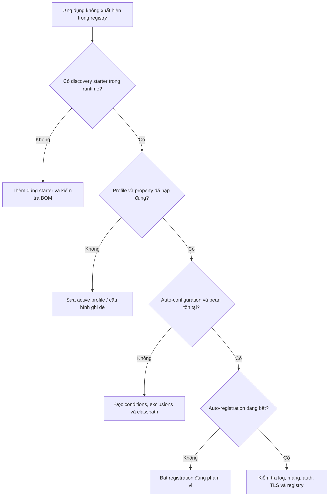

# Ứng dụng không đăng ký: kiểm tra starter, profile và tự cấu hình

Khi một ứng dụng Spring Boot khởi động nhưng không xuất hiện trong Eureka, Consul hoặc ZooKeeper, nguyên nhân thường nằm ở một trong bốn lớp: dependency discovery không có trong runtime classpath; profile đang chạy không nạp cấu hình mong đợi; auto-configuration bị điều kiện hóa hoặc bị loại trừ; hoặc cơ chế đăng ký đã bị tắt. Nếu các lớp này đều đúng, mới chuyển sang kiểm tra kết nối registry, xác thực và địa chỉ instance được quảng bá.

Điều quan trọng là phân biệt **không có discovery client** với **có discovery client nhưng đăng ký thất bại**. Trường hợp đầu thường không có bean hoặc auto-configuration tương ứng. Trường hợp sau thường có log gửi request, lỗi kết nối/401/403 hoặc bản ghi xuất hiện nhưng ở trạng thái health không đạt.

## Quy trình chẩn đoán nhanh

Đi theo thứ tự sau để khoanh vùng lỗi mà không thay đổi nhiều cấu hình cùng lúc:

1. Xác nhận đúng ứng dụng và đúng profile đang chạy.
2. Kiểm tra starter discovery có nằm trong runtime classpath và executable artifact hay không.
3. Kiểm tra `spring.application.name` và các property bật discovery/registration.
4. Xem Condition Evaluation Report để biết auto-configuration nào match hoặc bị loại.
5. Xác nhận các bean `DiscoveryClient`, `ServiceRegistry` và auto-registration có được tạo.
6. Tìm log registration và lỗi kết nối, authentication, TLS hoặc ACL.
7. Kiểm tra bản ghi và địa chỉ instance trực tiếp trên registry.



Không nên sửa nhiều property cùng lúc. Mỗi lần chỉ thay một nguyên nhân giả định, khởi động lại và xác nhận thay đổi trong log hoặc registry.

## 1. Kiểm tra đúng starter discovery

Spring Cloud không tự cung cấp kết nối tới mọi registry chỉ vì ứng dụng có dependency `spring-cloud-commons`. Cần thêm starter của nhà cung cấp mà ứng dụng sử dụng. Ví dụ:

| Registry | Starter phổ biến |
|---|---|
| Eureka | `spring-cloud-starter-netflix-eureka-client` |
| Consul | `spring-cloud-starter-consul-discovery` |
| ZooKeeper | `spring-cloud-starter-zookeeper-discovery` |

Ví dụ dependency Maven cho Eureka client:

```xml
<dependency>
    <groupId>org.springframework.cloud</groupId>
    <artifactId>spring-cloud-starter-netflix-eureka-client</artifactId>
</dependency>
```

Ví dụ dependency Maven cho Consul:

```xml
<dependency>
    <groupId>org.springframework.cloud</groupId>
    <artifactId>spring-cloud-starter-consul-discovery</artifactId>
</dependency>
```

Ví dụ dependency Maven cho ZooKeeper:

```xml
<dependency>
    <groupId>org.springframework.cloud</groupId>
    <artifactId>spring-cloud-starter-zookeeper-discovery</artifactId>
</dependency>
```

Không thêm cả ba starter chỉ để thử vận may. Chọn registry mà môi trường triển khai thực sự dùng. Nếu nhiều discovery implementation cùng nằm trên classpath, cần kiểm tra các auto-configuration và client được kích hoạt để tránh cấu hình mơ hồ hoặc kết nối nhầm hệ thống.

### Kiểm tra dependency trong Maven

Chạy dependency tree và tìm artifact tương ứng:

```bash
./mvnw dependency:tree -Dincludes=org.springframework.cloud
```

Trên Windows có thể dùng:

```powershell
.\mvnw.cmd dependency:tree -Dincludes=org.springframework.cloud
```

Kiểm tra starter không bị khai báo với scope `test` hoặc `provided`, không bị loại bởi `exclusion`, và module chạy ứng dụng thực sự nhận dependency. Một starter chỉ có trong module khác của multi-module build không tự động xuất hiện trong runtime classpath của service này.

### Kiểm tra dependency trong Gradle

```bash
./gradlew dependencies --configuration runtimeClasspath
./gradlew dependencyInsight --dependency spring-cloud-starter-netflix-eureka-client --configuration runtimeClasspath
```

Thay tên dependency trong `dependencyInsight` nếu ứng dụng dùng Consul hoặc ZooKeeper. Kiểm tra dependency có trong `runtimeClasspath`, không chỉ `testRuntimeClasspath`.

### Kiểm tra executable JAR

Có thể dependency xuất hiện trong IDE nhưng không được đóng gói vào artifact đang chạy, đặc biệt khi build nhầm module hoặc dùng cấu hình packaging riêng. Với Spring Boot executable JAR, kiểm tra thư viện dưới `BOOT-INF/lib`:

```bash
jar tf target/inventory-service.jar | grep -i eureka
```

Trên Windows PowerShell:

```powershell
jar tf target\inventory-service.jar | Select-String -Pattern "eureka|consul|zookeeper"
```

Nếu artifact không chứa starter/provider library, xác minh lệnh build, module đích, profile build và cấu hình plugin đóng gói.

## 2. Kiểm tra Spring Cloud BOM và phiên bản

Starter có thể được khai báo đúng nhưng phiên bản Spring Boot và Spring Cloud không tương thích. Khi đó, auto-configuration có thể lỗi lúc khởi động, thiếu class/method hoặc bị điều kiện classpath không match như mong đợi.

Quản lý phiên bản Spring Cloud bằng BOM tương thích với dòng Spring Boot của dự án thay vì tự chọn phiên bản cho từng starter:

```xml
<dependencyManagement>
    <dependencies>
        <dependency>
            <groupId>org.springframework.cloud</groupId>
            <artifactId>spring-cloud-dependencies</artifactId>
            <version>${spring-cloud.version}</version>
            <type>pom</type>
            <scope>import</scope>
        </dependency>
    </dependencies>
</dependencyManagement>
```

Xác nhận `spring-cloud.version` thuộc release train hỗ trợ phiên bản Spring Boot đang dùng theo compatibility matrix chính thức. Đừng chữa lỗi bằng cách nâng riêng một thư viện Netflix Eureka hoặc Spring Cloud Commons mà bỏ qua BOM; việc trộn phiên bản có thể làm điều kiện auto-configuration hoặc API không còn tương thích.

Các dấu hiệu cần tìm trong log/build:

- `NoSuchMethodError` hoặc `ClassNotFoundException` trong package `org.springframework.cloud` hoặc `com.netflix.discovery`.
- Cảnh báo phiên bản Spring Boot/Spring Cloud không tương thích.
- Nhiều phiên bản khác nhau của cùng một artifact trong dependency tree.
- Starter có mặt nhưng thư viện provider bị exclude hoặc bị thay bằng phiên bản không tương thích.

## 3. Xác nhận profile thực sự đang chạy

Spring Boot có thể nạp `application.yml`, `application-{profile}.yml` và các nguồn cấu hình ngoài như biến môi trường, command-line argument hoặc config server. Một profile khác với dự kiến có thể ghi đè cấu hình discovery.

Ví dụ cấu hình mặc định:

```yaml
spring:
  application:
    name: inventory-service
```

Ví dụ cấu hình riêng cho profile `docker` trong `application-docker.yml`:

```yaml
spring:
  cloud:
    discovery:
      enabled: true
    service-registry:
      auto-registration:
        enabled: true

eureka:
  client:
    register-with-eureka: true
    fetch-registry: true
    service-url:
      defaultZone: http://eureka-server:8761/eureka/
```

Kích hoạt profile bằng biến môi trường hoặc tham số khởi động:

```bash
java -jar inventory-service.jar --spring.profiles.active=docker
```

Hoặc:

```text
SPRING_PROFILES_ACTIVE=docker
```

Trong Docker Compose/Kubernetes, kiểm tra giá trị environment thực tế của container/pod. Đừng chỉ nhìn file YAML trong repository: command-line argument, environment variable, external config hoặc profile group có thể làm giá trị runtime khác với file đang đọc.

### Những nguồn ghi đè thường bị bỏ sót

- `SPRING_PROFILES_ACTIVE` hoặc `--spring.profiles.active` chọn profile khác.
- `SPRING_CLOUD_DISCOVERY_ENABLED=false` tắt discovery ở cấp Spring Cloud.
- `SPRING_CLOUD_SERVICE_REGISTRY_AUTO_REGISTRATION_ENABLED=false` tắt tự đăng ký chung.
- `EUREKA_CLIENT_REGISTER_WITH_EUREKA=false` tắt đăng ký Eureka dù vẫn có thể fetch registry.
- `EUREKA_CLIENT_ENABLED=false` có thể tắt Eureka client auto-configuration ở các phiên bản hỗ trợ property này.
- Cấu hình `spring.cloud.consul.discovery.register=false` hoặc `spring.cloud.zookeeper.discovery.register=false` tắt đăng ký ở provider tương ứng.
- Config server, Kubernetes ConfigMap/Secret hoặc command line ghi đè giá trị trong `application.yml`.

Kiểm tra profile active trong log khởi động hoặc Actuator `env`/`configprops` nếu đã expose an toàn. Các endpoint này có thể chứa thông tin nhạy cảm; chỉ bật trên mạng quản trị và che credential trước khi chia sẻ output.

## 4. Kiểm tra tên ứng dụng và các cờ registration

`spring.application.name` là tên logic thường được dùng làm service ID mặc định. Nếu thiếu, registry có thể hiển thị tên mặc định như `application`, khiến người vận hành tìm nhầm service.

```yaml
spring:
  application:
    name: inventory-service
```

Xác nhận chính xác tên trong registry, kể cả khác biệt chữ hoa/thường hoặc quy tắc chuẩn hóa tên của provider. Với Eureka, application name thường được hiển thị dưới dạng uppercase trên dashboard; điều này không nhất thiết có nghĩa đăng ký thất bại.

### Các cờ có thể tắt registration

| Property | Phạm vi | Tác động |
|---|---|---|
| `spring.cloud.discovery.enabled=false` | Spring Cloud discovery nói chung | Tắt các discovery client auto-configuration liên quan theo phiên bản |
| `spring.cloud.service-registry.auto-registration.enabled=false` | Tự động đăng ký service chung | Ngăn lifecycle auto-registration; discovery client có thể vẫn tồn tại |
| `eureka.client.register-with-eureka=false` | Eureka | Không đăng ký instance này; có thể vẫn fetch registry nếu `fetch-registry=true` |
| `spring.cloud.consul.discovery.register=false` | Consul | Không tự đăng ký service với Consul |
| `spring.cloud.zookeeper.discovery.register=false` | ZooKeeper | Không tự đăng ký service với ZooKeeper |

Đừng nhầm `register-with-eureka=false` với `fetch-registry=false`: cờ đầu tắt đăng ký instance local, cờ sau tắt tải danh sách service từ Eureka. Một ứng dụng consumer có thể cần fetch registry nhưng không cần tự đăng ký.

### Cấu hình Eureka client tối thiểu

```yaml
spring:
  application:
    name: inventory-service
  cloud:
    discovery:
      enabled: true
    service-registry:
      auto-registration:
        enabled: true

eureka:
  client:
    register-with-eureka: true
    fetch-registry: true
    service-url:
      defaultZone: http://eureka-server:8761/eureka/
```

### Cấu hình Consul discovery tối thiểu

```yaml
spring:
  application:
    name: inventory-service
  cloud:
    consul:
      host: consul-agent
      port: 8500
      discovery:
        enabled: true
        register: true
```

### Cấu hình ZooKeeper discovery tối thiểu

```yaml
spring:
  application:
    name: inventory-service
  cloud:
    zookeeper:
      connect-string: zk-1:2181,zk-2:2181,zk-3:2181
      discovery:
        enabled: true
        register: true
```

Các ví dụ trên dùng property phổ biến của Spring Cloud. Tên property và default có thể khác theo release train; xác nhận bằng `spring-configuration-metadata.json`, `configprops` hoặc reference của phiên bản starter thực tế.

## 5. Kiểm tra auto-configuration có được kích hoạt không

Spring Boot tạo bean từ auto-configuration khi các điều kiện về classpath, property, bean hiện có và môi trường đều thỏa mãn. Có starter trong dependency tree chưa đủ để kết luận auto-configuration đã chạy.

### Bật Condition Evaluation Report

Khởi động ứng dụng với `--debug` để in báo cáo điều kiện auto-configuration:

```bash
java -jar inventory-service.jar --debug
```

Trong log, tìm các mục liên quan đến `EurekaClientAutoConfiguration`, Consul discovery, ZooKeeper discovery, `DiscoveryClient` và service registry. Báo cáo cho biết auto-configuration nào match, không match và điều kiện nào bị thiếu.

Có thể bật log chi tiết hơn trong môi trường local:

```yaml
logging:
  level:
    org.springframework.boot.autoconfigure: DEBUG
    org.springframework.cloud.client: DEBUG
    org.springframework.cloud.netflix.eureka: DEBUG
    org.springframework.cloud.consul: DEBUG
    org.springframework.cloud.zookeeper: DEBUG
```

Không cần bật toàn bộ DEBUG trong production trong thời gian dài. Log quá chi tiết có thể làm tăng dung lượng, ảnh hưởng hiệu năng hoặc để lộ URL/metadata nhạy cảm.

### Dùng Actuator conditions và beans

Khi có Spring Boot Actuator, endpoint `conditions` giúp xem các điều kiện auto-configuration và endpoint `beans` cho biết bean nào đã được tạo. Ví dụ cấu hình exposure trong môi trường chẩn đoán:

```yaml
management:
  endpoints:
    web:
      exposure:
        include: health,info,conditions,beans,configprops
```

Chỉ expose các endpoint chẩn đoán trên mạng quản trị được bảo vệ. `env`, `configprops` và `beans` có thể tiết lộ cấu hình, tên class, URL và metadata; không mở chúng công khai hoặc gửi output chưa được rà soát.

Trong `/actuator/conditions`, tìm provider auto-configuration và đọc phần `negativeMatches`/message để xác định điều kiện bị thiếu. Ví dụ thường gặp là class provider không có trong classpath, property đặt `false`, hoặc một bean khác khiến cấu hình mặc định lùi lại.

## 6. Xác nhận discovery bean và auto-registration bean

Nếu auto-configuration đã match, kiểm tra Spring context có tạo các bean discovery cần thiết không. Có thể dùng Actuator `beans` hoặc log khởi động để xác nhận.

Các kiểu bean thường hữu ích:

| Bean/type | Vai trò |
|---|---|
| `DiscoveryClient` | Tra cứu danh sách instance theo service ID |
| `ServiceRegistry` | Đăng ký, hủy đăng ký hoặc thay đổi trạng thái instance |
| `AutoServiceRegistration` | Tích hợp lifecycle để tự đăng ký service khi ứng dụng khởi động |
| `EurekaClient` | Client API riêng của Eureka, khi dùng Eureka |

Có thể thêm đoạn kiểm tra tạm thời trong một `ApplicationRunner` ở môi trường local:

```java
import org.springframework.boot.ApplicationRunner;
import org.springframework.context.ApplicationContext;
import org.springframework.context.annotation.Bean;
import org.springframework.context.annotation.Configuration;
import org.springframework.cloud.client.discovery.DiscoveryClient;
import org.springframework.cloud.client.serviceregistry.AutoServiceRegistration;
import org.springframework.cloud.client.serviceregistry.ServiceRegistry;

@Configuration
class DiscoveryDiagnosticsConfiguration {
    @Bean
    ApplicationRunner reportDiscoveryBeans(ApplicationContext context) {
        return args -> {
            System.out.println("DiscoveryClient beans: " +
                context.getBeansOfType(DiscoveryClient.class).keySet());
            System.out.println("ServiceRegistry beans: " +
                context.getBeansOfType(ServiceRegistry.class).keySet());
            System.out.println("AutoServiceRegistration beans: " +
                context.getBeansOfType(AutoServiceRegistration.class).keySet());
        };
    }
}
```

Đây là công cụ chẩn đoán tạm thời; không nhất thiết mọi provider/version đều tạo cùng tập bean. Xóa hoặc giới hạn cấu hình này sau khi điều tra. Có `DiscoveryClient` chưa chắc có `AutoServiceRegistration`: ứng dụng có thể chỉ tra cứu service mà không tự đăng ký.

### `@EnableDiscoveryClient` có bắt buộc không?

Trong các phiên bản Spring Cloud hiện đại, discovery client thường được auto-configure khi starter provider có mặt; `@EnableDiscoveryClient` thường không còn là điều kiện bắt buộc. Annotation này không thể thay thế starter hoặc sửa một auto-configuration bị loại trừ. Với codebase cũ, kiểm tra tài liệu của release train đang dùng trước khi xóa hoặc thêm annotation.

## 7. Tìm property hoặc code đã vô hiệu hóa auto-configuration

Auto-configuration có thể bị tắt bởi property, exclusion hoặc cấu hình tùy chỉnh:

- `spring.cloud.discovery.enabled=false` trong file profile hoặc environment.
- `spring.cloud.service-registry.auto-registration.enabled=false` ngăn tự đăng ký chung.
- Provider property như `eureka.client.register-with-eureka=false`, `spring.cloud.consul.discovery.register=false` hoặc `spring.cloud.zookeeper.discovery.register=false`.
- `spring.autoconfigure.exclude` loại auto-configuration khỏi context.
- `exclude` trong `@SpringBootApplication` hoặc `@EnableAutoConfiguration`.
- `@Profile` khiến cấu hình discovery tùy chỉnh không được nạp ở profile hiện tại.
- `@ConditionalOnProperty` trong cấu hình nội bộ trả về false.

Ví dụ exclusion trong YAML:

```yaml
spring:
  autoconfigure:
    exclude:
      - org.springframework.cloud.netflix.eureka.EurekaClientAutoConfiguration
```

Đây chỉ là ví dụ minh họa cho cơ chế exclusion; tên class cụ thể phụ thuộc phiên bản và không nên thêm exclusion này nếu mục tiêu là bật Eureka. Nếu thấy class discovery xuất hiện trong danh sách excluded auto-configurations, bỏ exclusion tương ứng hoặc điều chỉnh cấu hình theo mục đích.

Kiểm tra cả annotation và cấu hình trong module ứng dụng, thư viện nội bộ và profile riêng. Một cấu hình Java được import gián tiếp có thể đặt property hoặc định nghĩa bean thay thế dù `application.yml` trông đúng.

## 8. Kiểm tra profile và property runtime một cách có hệ thống

Khi đã xác định profile, so sánh property hiệu lực với property mong muốn. Có thể dùng `/actuator/env/{property}` hoặc `/actuator/configprops` trong môi trường được bảo vệ; giá trị nhạy cảm thường bị che nhưng vẫn cần rà soát output.

Các property cần kiểm tra:

| Property | Cần xác nhận |
|---|---|
| `spring.application.name` | Không rỗng và đúng service ID mong muốn |
| `spring.cloud.discovery.enabled` | Không bị tắt ở global scope |
| `spring.cloud.service-registry.auto-registration.enabled` | Không bị tắt nếu cần auto-registration |
| `eureka.client.register-with-eureka` | `true` nếu ứng dụng cần đăng ký với Eureka |
| `eureka.client.enabled` | Không bị đặt `false` nếu Eureka client auto-configuration cần hoạt động |
| `spring.cloud.consul.discovery.register` | `true` nếu ứng dụng cần đăng ký với Consul |
| `spring.cloud.zookeeper.discovery.register` | `true` nếu ứng dụng cần đăng ký với ZooKeeper |
| Provider endpoint/connect string | Hostname, port, scheme và context path đúng từ network runtime |

Đừng kết luận dựa trên một dòng trong `application.yml`. Property source có độ ưu tiên khác nhau; command-line argument và environment thường có thể ghi đè file cấu hình. Kiểm tra origin/property source trong Actuator hoặc in cấu hình không nhạy cảm ở lúc startup.

## 9. Nếu bean tồn tại nhưng vẫn không đăng ký

Khi `DiscoveryClient` và `AutoServiceRegistration` đã được tạo, vấn đề thường chuyển từ auto-configuration sang registration lifecycle hoặc giao tiếp với registry.

### Kiểm tra log registration

Tìm các thông báo về:

- Service registration bắt đầu và hoàn tất.
- URL registry mà client đang gọi.
- Retry, timeout, connection refused hoặc DNS resolution failure.
- HTTP `401`/`403` do credential, role hoặc ACL.
- TLS handshake/certificate validation failure.
- Instance address/port không hợp lệ.

Không phải provider nào cũng đăng ký ngay tại cùng một thời điểm trong startup. Một số tích hợp đăng ký qua lifecycle event sau khi application context hoặc web server sẵn sàng. Đừng đánh giá lỗi chỉ vì dashboard chưa hiển thị service trong vài mili giây đầu; hãy chờ theo timeout/retry của client và xác nhận log cuối cùng.

### Kiểm tra địa chỉ instance được quảng bá

Registry có thể nhận được registration nhưng consumer không gọi được instance nếu địa chỉ quảng bá sai. Kiểm tra host, port, scheme và metadata được lưu trên registry:

- Trong Docker Compose, không quảng bá `localhost` nếu consumer ở container khác.
- Trong Kubernetes, kiểm tra pod IP, service DNS hoặc hostname mà consumer thực sự truy cập được.
- Nếu chạy sau NAT hoặc nhiều network interface, cấu hình advertised address phù hợp.
- Kiểm tra `server.port` và port instance đăng ký; đừng nhầm host port với container port.

Đây là lỗi khác với việc không có registration. Nếu registry có bản ghi nhưng request không tới được provider, tập trung vào advertised address và network path.

### Phân biệt không đăng ký với health check không passing

Một service có thể đã đăng ký nhưng health check đang `critical` hoặc `OUT_OF_SERVICE`, nên không xuất hiện trong truy vấn chỉ lấy instance khỏe mạnh. Kiểm tra cả catalog/registry record và health status trước khi kết luận đăng ký thất bại.

## 10. Kiểm tra trực tiếp trên registry

### Eureka

Kiểm tra danh sách application từ môi trường có thể truy cập Eureka Server:

```bash
curl -H "Accept: application/json" http://eureka-server:8761/eureka/apps
```

Nếu Eureka được bảo vệ bằng Basic Auth, dùng cơ chế credential an toàn phù hợp và không lưu mật khẩu vào shell history. Kiểm tra application name, instance ID, host, port và trạng thái instance.

### Consul

Kiểm tra service đã đăng ký trên Consul Agent:

```bash
curl http://consul-agent:8500/v1/agent/services
```

Kiểm tra health state của service:

```bash
curl "http://consul-agent:8500/v1/health/service/inventory-service"
```

Nếu Consul ACL được bật, thêm token qua header theo chính sách secret của môi trường. Không ghi token vào lệnh được lưu trong history hoặc output chia sẻ.

### ZooKeeper

Với Spring Cloud Zookeeper, service thường được biểu diễn bằng các znode dưới root discovery được cấu hình. Có thể dùng ZooKeeper CLI để kiểm tra path tương ứng, ví dụ:

```text
ls /services
ls /services/inventory-service
```

Root path có thể thay đổi theo `spring.cloud.zookeeper.discovery.root` hoặc namespace/chroot của ensemble. Kiểm tra đúng path cấu hình; không giả định mọi ứng dụng dùng `/services`.

## 11. Bảng triệu chứng và nguyên nhân

| Triệu chứng | Nguyên nhân thường gặp | Hướng xử lý đầu tiên |
|---|---|---|
| Không có `DiscoveryClient` bean | Thiếu starter, auto-config không match hoặc bị exclude | Kiểm tra runtime dependency và `/actuator/conditions` |
| Có `DiscoveryClient` nhưng không có `AutoServiceRegistration` | Registration bị tắt hoặc provider chỉ dùng cho discovery | Kiểm tra global auto-registration và provider property |
| Registry hiển thị tên `APPLICATION` | Thiếu `spring.application.name` | Đặt service ID rõ ràng và xác minh registration mới |
| Chỉ local profile đăng ký | Profile triển khai không nạp property hoặc có override | Kiểm tra `SPRING_PROFILES_ACTIVE` và property origin |
| Eureka Client không gửi request | `register-with-eureka=false` hoặc Eureka client bị disable | Kiểm tra property hiệu lực và conditions |
| Consul/ZooKeeper không có service | `discovery.register=false` hoặc client integration chưa bật | Kiểm tra provider property và log auto-registration |
| Log có connection refused/timeout | Sai hostname/port, registry chưa sẵn sàng hoặc network policy chặn | Kiểm tra DNS và kết nối từ runtime của ứng dụng |
| Log có 401/403 | Sai credential, ACL hoặc role | Xác minh token/user và quyền đăng ký |
| Registry có record nhưng consumer không gọi được | Advertised address/port sai hoặc health critical | Kiểm tra instance metadata, health check và network |
| Service xuất hiện rồi biến mất | Heartbeat, lease, TTL hoặc deregistration/health lifecycle lỗi | Kiểm tra heartbeat, agent logs và health status |

## 12. Checklist xử lý theo môi trường

**Local IDE**

1. Chọn đúng Run Configuration và active profile.
2. Kiểm tra runtime classpath của module đang chạy.
3. Bật `--debug` và đọc Condition Evaluation Report.
4. Xác nhận `spring.application.name` và registration property.
5. Kiểm tra registry local có nhận registration hay không.

**Docker Compose**

1. Xác nhận container có starter trong executable JAR.
2. Kiểm tra environment và profile thực tế bên trong container.
3. Dùng service name của Compose cho registry hostname, không dùng `localhost`.
4. Kiểm tra registry health và thứ tự khởi động; ứng dụng vẫn cần retry.
5. Xác minh advertised address truy cập được từ container consumer.

**Kubernetes**

1. Kiểm tra image được build từ đúng module và profile.
2. Kiểm tra ConfigMap, Secret, env và args của Deployment.
3. Xác nhận NetworkPolicy, DNS và Service/Pod address.
4. Kiểm tra registry credentials và TLS truststore.
5. Đối chiếu registration với Pod lifecycle và readiness.

## Kết luận

Khi ứng dụng không đăng ký vào Eureka, Consul hoặc ZooKeeper, hãy kiểm tra từ dependency tới runtime theo thứ tự: đúng starter trong runtime classpath, đúng Spring Cloud BOM, đúng active profile và property hiệu lực, auto-configuration đã match, discovery/registration bean đã được tạo và cờ đăng ký đang bật. Nếu các điều kiện đó đều đúng, chuyển sang log registration, network, authentication, TLS, advertised address và health status trên registry. Cách phân lớp này giúp xác định chính xác ứng dụng chưa khởi tạo discovery client, đã tắt auto-registration hay đã gửi request nhưng registry từ chối.
