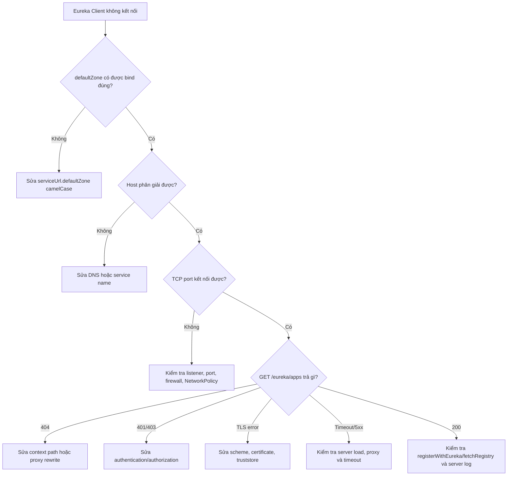

# Eureka không kết nối do sai `defaultZone` hoặc đường dẫn `/eureka/`

## 1. Dấu hiệu và phạm vi sự cố

Khi Spring Cloud Eureka Client không kết nối được Eureka Server, ứng dụng có thể khởi động nhưng liên tục ghi log lỗi đăng ký, heartbeat hoặc tải registry. Dashboard Eureka không thấy instance mới, `DiscoveryClient` trả danh sách rỗng hoặc consumer không tìm được service.

Hai nguyên nhân cấu hình thường gặp là:

1. `eureka.client.serviceUrl.defaultZone` không được bind đúng, đặc biệt do viết sai key `defaultZone` hoặc đặt nhầm cấu trúc YAML.
2. URL trỏ sai host, port, scheme hoặc context path. Với cấu hình mặc định, Eureka REST endpoint nằm dưới `/eureka/`; client cần URL cơ sở đúng để gọi các API như `/eureka/apps`.

Không nên kết luận ngay rằng Eureka Server bị hỏng. Hãy kiểm tra cấu hình thực tế mà client đã nạp, sau đó kiểm tra DNS, kết nối TCP, giao thức HTTP/HTTPS và endpoint REST từ chính môi trường chạy client.

## 2. Cấu hình `defaultZone` đúng

### 2.1. Cấu hình YAML chuẩn

Ví dụ một Eureka Client chạy trong cùng Docker/Kubernetes network với Eureka Server:

```yaml
spring:
  application:
    name: order-service

eureka:
  client:
    serviceUrl:
      defaultZone: http://eureka-server:8761/eureka/
    registerWithEureka: true
    fetchRegistry: true
```

Trong đó:

- `spring.application.name` là service ID mặc định của ứng dụng.
- `serviceUrl` là map URL theo availability zone của Eureka.
- `defaultZone` là key fallback mà client sử dụng khi không có zone preference phù hợp.
- `registerWithEureka` cho phép đăng ký instance của ứng dụng.
- `fetchRegistry` cho phép tải registry để tìm service khác.

Với cấu hình mặc định, URL nên có dạng `http://<host>:<port>/eureka/`, trong đó `host` và `port` phải truy cập được từ client. Nếu Eureka Server dùng context path hoặc reverse proxy path riêng, URL phải phản ánh đúng đường dẫn bên ngoài mà client truy cập.

### 2.2. Cấu hình trong `application.properties`

```properties
spring.application.name=order-service
eureka.client.serviceUrl.defaultZone=http://eureka-server:8761/eureka/
eureka.client.registerWithEureka=true
eureka.client.fetchRegistry=true
```

Hãy dùng cùng một cách đặt tên thuộc tính trong toàn dự án để dễ kiểm tra. Spring Boot hỗ trợ relaxed binding cho tên thuộc tính bean như `serviceUrl`/`service-url`, nhưng key `defaultZone` là một trường hợp đặc biệt vì nó là key của map.

## 3. Lỗi rất dễ mắc: viết sai chữ hoa trong `defaultZone`

`serviceUrl` có kiểu `Map<String, String>`. Vì vậy, `defaultZone` là **map key có phân biệt chữ hoa/chữ thường**. Spring Cloud Netflix yêu cầu giữ nguyên camelCase `defaultZone`; key `default-zone` hoặc `defaultzone` không tương đương.

| Cấu hình | Kết quả |
|---|---|
| `serviceUrl.defaultZone` | Đúng key mặc định |
| `serviceUrl.default-zone` | Sai: đây không phải key `defaultZone` |
| `serviceUrl.defaultzone` | Sai: chữ `Z` bị mất |
| `serviceUrl.DEFAULTZONE` | Sai: map key khác chữ hoa/thường |

Ví dụ sai thường gặp:

```yaml
eureka:
  client:
    serviceUrl:
      default-zone: http://eureka-server:8761/eureka/
```

Sửa thành:

```yaml
eureka:
  client:
    serviceUrl:
      defaultZone: http://eureka-server:8761/eureka/
```

Không áp dụng quy tắc kebab-case thông thường của Spring Boot cho map key này. Tài liệu Spring Cloud Netflix ghi rõ `defaultZone` phải giữ camelCase vì `serviceUrl` là `Map<String, String>`.

## 4. Bẫy khi cấu hình bằng environment variable

Đây là nguyên nhân khó phát hiện trong Docker/Kubernetes. Spring Boot lower-case tên map key khi bind giá trị từ environment variables. Vì vậy, biến:

```text
EUREKA_CLIENT_SERVICEURL_DEFAULTZONE=http://eureka-server:8761/eureka/
```

có thể tạo map key `defaultzone`, trong khi Eureka cần key `defaultZone`. Giá trị URL nhìn có vẻ đúng nhưng client vẫn không dùng được như mong đợi.

### 4.1. Cách khuyến nghị: dùng file cấu hình được mount

Đặt cấu hình chính xác trong `application.yml` hoặc file profile được mount vào container:

```yaml
eureka:
  client:
    serviceUrl:
      defaultZone: ${EUREKA_SERVER_URL:http://eureka-server:8761/eureka/}
```

Ở đây environment variable chỉ cung cấp **giá trị URL**; key `defaultZone` vẫn được giữ nguyên trong YAML. Ví dụ khai báo:

```text
EUREKA_SERVER_URL=http://eureka-server:8761/eureka/
```

### 4.2. Dùng `SPRING_APPLICATION_JSON`

Nếu cần truyền toàn bộ cấu trúc bằng environment variable, có thể dùng JSON để giữ đúng chữ hoa của map key:

```bash
SPRING_APPLICATION_JSON='{"eureka":{"client":{"serviceUrl":{"defaultZone":"http://eureka-server:8761/eureka/"}}}}' \
  java -jar order-service.jar
```

Trong Kubernetes Deployment:

```yaml
env:
  - name: SPRING_APPLICATION_JSON
    value: '{"eureka":{"client":{"serviceUrl":{"defaultZone":"http://eureka-server:8761/eureka/"}}}}'
```

Không đặt credential thật trong JSON hoặc manifest được commit vào repository. Dùng Secret hoặc hệ thống quản lý secret phù hợp.

### 4.3. Kiểm tra map key sau khi bind

Nếu nghi ngờ environment variable đã tạo key sai, kiểm tra cấu hình thực tế của ứng dụng:

- Dùng Actuator `env` để xem property source nào cung cấp giá trị.
- Dùng Actuator `configprops` để kiểm tra `EurekaClientConfigBean` đã nhận map URL nào.
- Nếu cần, log danh sách URL từ `EurekaClientConfig` ở startup; che username/password nếu URL có credentials.

Chỉ expose `/actuator/env` và `/actuator/configprops` trong môi trường quản trị được bảo vệ. Các endpoint này có thể tiết lộ thông tin cấu hình nhạy cảm.

## 5. Đường dẫn `/eureka/` và REST API khác dashboard

Với Eureka Server mặc định:

| URL | Vai trò |
|---|---|
| `http://eureka-server:8761/` | Trang dashboard/web UI |
| `http://eureka-server:8761/eureka/` | URL cơ sở mà Eureka Client cấu hình trong `defaultZone` |
| `http://eureka-server:8761/eureka/apps` | REST API dùng để đọc danh sách application trong registry |
| `http://eureka-server:8761/eureka/apps/ORDER-SERVICE` | REST API đọc thông tin một application |

Không cấu hình URL dashboard `/` làm `defaultZone`. Client cần endpoint REST, thường là `/eureka/`.

### 5.1. Đúng host, port, scheme và path

Ví dụ đúng:

```text
http://eureka-server:8761/eureka/
```

Các lỗi thường gặp:

```text
http://eureka-server:8761/             # Thiếu /eureka/
http://eureka-server:8080/eureka/      # Có thể sai port nếu server không chạy ở 8080
https://eureka-server:8761/eureka/     # Sai scheme nếu server chỉ bật HTTP
http://localhost:8761/eureka/         # Sai khi localhost là container/pod của client
http://eureka-server:8761/eureka       # Nên dùng URL chuẩn có dấu / cuối
```

URL có dấu `/` cuối là dạng chuẩn trong tài liệu Spring Cloud Netflix. Khi thiếu dấu `/`, cách ghép path của HTTP client/proxy có thể tạo URL không như dự định; hãy dùng dạng chuẩn và xác minh request thực tế.

### 5.2. Phân biệt dashboard với REST API

Mở được dashboard ở `/` không chứng minh REST API ở `/eureka/apps` truy cập được. Ngược lại, dashboard có thể bị chặn bởi proxy/auth trong khi REST API được phép cho client. Luôn kiểm tra đúng API path.

Nếu dùng reverse proxy hoặc Ingress:

- Xác minh proxy có forward prefix `/eureka/` tới Eureka Server.
- Kiểm tra rewrite rule có xóa hoặc thêm nhầm path segment.
- Đảm bảo proxy không chuyển `POST`/`PUT`/`DELETE` của Eureka thành method khác.
- Kiểm tra redirect HTTP sang HTTPS và `Location` header.
- Kiểm tra authentication/authorization cho REST API, không chỉ trang dashboard.

Nếu server dùng context path tùy chỉnh, hãy xác định URL bên ngoài mà client nhìn thấy. Ví dụ nếu proxy public API dưới `/registry/eureka/`, `defaultZone` phải trỏ tới đúng prefix đó theo cấu hình rewrite.

## 6. Phân biệt lỗi theo thông báo và HTTP status

| Dấu hiệu trong log / response | Nguyên nhân thường gặp | Hướng kiểm tra |
|---|---|---|
| `UnknownHostException` | Hostname Eureka không phân giải được | DNS/service name, namespace, search domain |
| `ConnectException: Connection refused` | Không có tiến trình lắng nghe ở host/port hoặc sai port mapping | Trạng thái server, Service port, firewall |
| `No route to host` | Routing/network policy/firewall chặn đường đi | Network route, NetworkPolicy, security group |
| `SocketTimeoutException: connect timed out` | TCP handshake không hoàn tất | Firewall, server overload, sai địa chỉ |
| Read/socket timeout | Server/proxy không trả response kịp hoặc kết nối bị treo | Server logs, proxy, registry load, read timeout |
| HTTP `404` | Sai context path, thiếu `/eureka/` hoặc proxy rewrite sai | Kiểm tra `/eureka/apps` và route mapping |
| HTTP `401` | Thiếu hoặc sai thông tin xác thực | Basic auth, credential source, Secret |
| HTTP `403` | Đã xác thực nhưng không được phép truy cập | Security filter/authorization rule |
| HTTP `301`/`302` | Redirect, thường do HTTP/HTTPS hoặc proxy path | `Location` header, scheme và forwarded headers |
| `SSLHandshakeException` | Truststore/certificate/hostname hoặc protocol TLS không khớp | Certificate chain, SAN, truststore và URL scheme |
| Client liên tục thử server URL khác | Một hoặc nhiều URL trong `defaultZone` không truy cập được | Kiểm tra từng URL trong danh sách |
| Dashboard có server nhưng không có client | Client chưa register, sai URL hoặc registration bị từ chối | Client log, server log và REST API |

Không dùng retry để che lỗi `404`, `401`, `403`, DNS sai hoặc certificate không hợp lệ. Sửa cấu hình hoặc quyền trước khi thử lại.

## 7. Kiểm tra từ chính môi trường chạy client

Một URL có thể truy cập được từ laptop nhưng không truy cập được từ container/pod. Lệnh kiểm tra phải chạy trong cùng network namespace hoặc môi trường tương đương với client.

### 7.1. Kiểm tra DNS

Trong Linux container:

```bash
getent hosts eureka-server
```

Nếu không có `getent`, dùng `nslookup` hoặc công cụ DNS có sẵn. Với Kubernetes, kiểm tra Service và namespace:

```bash
kubectl get svc -n platform eureka-server
kubectl get endpoints -n platform eureka-server
```

Nếu client ở namespace khác, dùng DNS đầy đủ, ví dụ:

```text
eureka-server.platform.svc.cluster.local
```

Tên DNS thực tế phụ thuộc tên Service, namespace và cluster domain.

### 7.2. Kiểm tra TCP port

```bash
nc -vz eureka-server 8761
```

Nếu DNS đúng nhưng TCP thất bại, kiểm tra server listener, Service `port`/`targetPort`, container port, firewall và NetworkPolicy. Không chuyển sang sửa `/eureka/` khi TCP còn chưa kết nối được.

### 7.3. Kiểm tra đúng REST endpoint

```bash
curl -i \
  -H 'Accept: application/json' \
  http://eureka-server:8761/eureka/apps
```

Khi server yêu cầu Basic authentication, dùng credential được cấp qua secret/runtime environment, không ghi password thật vào file hoặc shell history:

```bash
curl -i \
  -u "$EUREKA_USERNAME:$EUREKA_PASSWORD" \
  -H 'Accept: application/json' \
  http://eureka-server:8761/eureka/apps
```

Response `200` cho thấy REST API có thể đọc được từ vị trí kiểm tra. Nếu nhận `401`/`403`, xử lý xác thực/quyền; nếu `404`, kiểm tra path/proxy; nếu timeout, quay lại kiểm tra network và server load.

Với Kubernetes, có thể chạy các lệnh trong Pod client nếu image có công cụ tương ứng:

```bash
kubectl exec -n payments deploy/order-service -- \
  curl -i -H 'Accept: application/json' \
  http://eureka-server.platform.svc.cluster.local:8761/eureka/apps
```

Nếu image ứng dụng không có `curl`, dùng ephemeral debug container hoặc Pod kiểm tra trong cùng namespace/network policy. Không kết luận từ một máy khác có network khác.

## 8. Kiểm tra cấu hình server và client

### 8.1. Eureka Server

Một Eureka Server độc lập thường có cấu hình:

```yaml
server:
  port: 8761

eureka:
  client:
    registerWithEureka: false
    fetchRegistry: false
```

Server standalone thường không cần tự đăng ký và fetch registry của chính nó. Nếu chạy cụm peer-aware, cấu hình URL peer theo topology thay vì áp dụng máy móc hai cờ này cho mọi node.

Đảm bảo ứng dụng có `@EnableEurekaServer` và dependency `spring-cloud-starter-netflix-eureka-server` phù hợp với release train đang dùng. Kiểm tra server log để xác nhận ứng dụng đã khởi động và REST endpoint được map đúng.

### 8.2. Eureka Client

Client thông thường cần:

```yaml
eureka:
  client:
    registerWithEureka: true
    fetchRegistry: true
    serviceUrl:
      defaultZone: http://eureka-server:8761/eureka/
```

Không copy cấu hình standalone server (`registerWithEureka: false`, `fetchRegistry: false`) sang client nghiệp vụ nếu client cần tự đăng ký và khám phá service khác.

### 8.3. Kiểm tra dependency và cờ tắt discovery

Xác minh client có dependency `spring-cloud-starter-netflix-eureka-client` và không vô tình tắt discovery bằng:

```yaml
eureka:
  client:
    enabled: false

spring:
  cloud:
    discovery:
      enabled: false
```

Các thuộc tính này có thể được đặt trong profile hoặc config server khác với file bạn đang xem. Kiểm tra property source cuối cùng, không chỉ file `application.yml` trong source code.

## 9. Cấu hình theo môi trường

### 9.1. Local development

Nếu Eureka Server chạy trực tiếp trên cùng máy:

```yaml
eureka:
  client:
    serviceUrl:
      defaultZone: http://localhost:8761/eureka/
```

### 9.2. Docker Compose

Nếu client và server chạy ở hai container khác nhau trong cùng Docker network, dùng service name:

```yaml
eureka:
  client:
    serviceUrl:
      defaultZone: http://eureka-server:8761/eureka/
```

`localhost` bên trong container client trỏ về chính container client, không phải container Eureka Server.

### 9.3. Kubernetes

Nếu Eureka Server được expose qua Kubernetes Service `eureka-server` trong namespace `platform`:

```yaml
eureka:
  client:
    serviceUrl:
      defaultZone: http://eureka-server.platform.svc.cluster.local:8761/eureka/
```

Kiểm tra Service port và targetPort, endpoint của Service, DNS cluster và NetworkPolicy. Nếu dùng Ingress/Gateway, dùng hostname/path mà Pod client có thể truy cập; không mặc định public URL truy cập được từ bên trong cluster.

## 10. Quy trình xử lý sự cố theo thứ tự

Thực hiện lần lượt để khoanh vùng chính xác:

1. **Xác nhận client đang bật:** kiểm tra starter, `eureka.client.enabled` và `spring.cloud.discovery.enabled`.
2. **Xác nhận `defaultZone`:** giữ đúng key camelCase trong map `serviceUrl`; kiểm tra profile, config server, environment và command-line override.
3. **Xác nhận URL cuối cùng:** scheme, host, port, path `/eureka/` và dấu `/` cuối.
4. **Kiểm tra DNS từ client:** hostname có phân giải về địa chỉ mong muốn không?
5. **Kiểm tra TCP:** client có mở kết nối tới đúng port không?
6. **Kiểm tra REST API:** gọi `GET /eureka/apps` từ chính container/pod của client.
7. **Phân loại HTTP/TLS:** 404 là path/proxy; 401/403 là auth; SSL exception là TLS; timeout là network/server load.
8. **Kiểm tra server log:** Eureka Server có nhận request, từ chối hay lỗi khi xử lý không?
9. **Kiểm tra đăng ký:** client có log register thành công và server dashboard/API có thấy application không?
10. **Kiểm tra registry fetch:** consumer có tải registry và `DiscoveryClient.getInstances()` có trả instance không?

Không thay nhiều biến cùng lúc. Sau mỗi thay đổi, restart hoặc refresh đúng thành phần, ghi lại log và response để biết thay đổi nào giải quyết được lỗi.

## 11. Ví dụ log và cách đọc

| Log/dấu hiệu | Diễn giải | Hành động |
|---|---|---|
| `Cannot execute request on any known server` | Không URL server nào trong cấu hình khả dụng | Kiểm tra map `defaultZone` và từng endpoint |
| `UnknownHostException: eureka-server` | DNS name không phân giải | Kiểm tra service name, namespace và DNS |
| `Connection refused` | Host tới được nhưng port không có listener hoặc bị reject | Kiểm tra server port, Service targetPort và listener |
| `404` từ `/eureka/apps` | REST context path không đúng hoặc proxy rewrite sai | Kiểm tra base path `/eureka/` |
| `401 Unauthorized` | Server yêu cầu xác thực | Cấu hình credential đúng và lưu trong Secret |
| `SSLHandshakeException` | TLS handshake/trust thất bại | Kiểm tra scheme, certificate SAN, CA và truststore |
| Client đăng ký được nhưng không fetch được registry | Có thể tách biệt quyền/endpoint hoặc `fetchRegistry` bị tắt | Kiểm tra cấu hình fetch và REST read API |

Thông báo log thay đổi theo Eureka client/HTTP transport. Hãy đọc exception gốc và URL thực tế đã được gọi; không chỉ dựa vào dòng log tổng quát ở cuối stack trace.

## 12. Sơ đồ quyết định nhanh



## 13. Checklist xác nhận đã khắc phục

- [ ] Client dùng đúng `spring-cloud-starter-netflix-eureka-client` và discovery không bị tắt.
- [ ] `serviceUrl.defaultZone` giữ đúng chữ hoa `Z`.
- [ ] Không để environment variable làm map key thành `defaultzone`; dùng YAML/profile hoặc `SPRING_APPLICATION_JSON` khi cần.
- [ ] URL có scheme, hostname, port và `/eureka/` đúng với endpoint thực tế.
- [ ] Hostname phân giải được từ container/pod client.
- [ ] TCP port truy cập được từ client.
- [ ] `GET /eureka/apps` trả response mong đợi.
- [ ] HTTP/HTTPS, Basic auth, certificate và truststore đúng.
- [ ] Proxy/Ingress giữ đúng path và HTTP methods.
- [ ] Eureka Server log nhận request và không từ chối registration.
- [ ] Client log cho thấy registration/fetch thành công.
- [ ] Instance xuất hiện trong Eureka dashboard/API và consumer nhìn thấy qua DiscoveryClient.

## 14. Kết luận

Khi Eureka Client không kết nối được, hãy kiểm tra `eureka.client.serviceUrl.defaultZone` trước. Key `defaultZone` phải giữ đúng camelCase vì là key của map; environment variable có thể làm key bị lower-case thành `defaultzone`. Tiếp theo, xác minh URL cơ sở trỏ đúng Eureka REST endpoint `/eureka/`, không phải dashboard `/`, và host/port/scheme phải truy cập được từ chính môi trường client.

Thực hiện chẩn đoán theo thứ tự cấu hình hiệu lực → DNS → TCP → `GET /eureka/apps` → authentication/TLS/proxy → registration/fetch. Cách này giúp phân biệt lỗi bind property, sai đường dẫn và lỗi network thay vì tăng retry hoặc thay timeout một cách thiếu căn cứ.

## Tài liệu tham khảo

- [Spring Cloud Netflix – Service Discovery: Eureka Clients](https://docs.spring.io/spring-cloud-netflix/reference/spring-cloud-netflix.html)
- [Spring Cloud Netflix – Configuration Properties](https://docs.spring.io/spring-cloud-netflix/reference/configprops.html)
- [Spring Boot – Externalized Configuration](https://docs.spring.io/spring-boot/reference/features/external-config.html)
- [Netflix Eureka – REST Operations](https://github.com/Netflix/eureka/wiki/Eureka-REST-operations)
