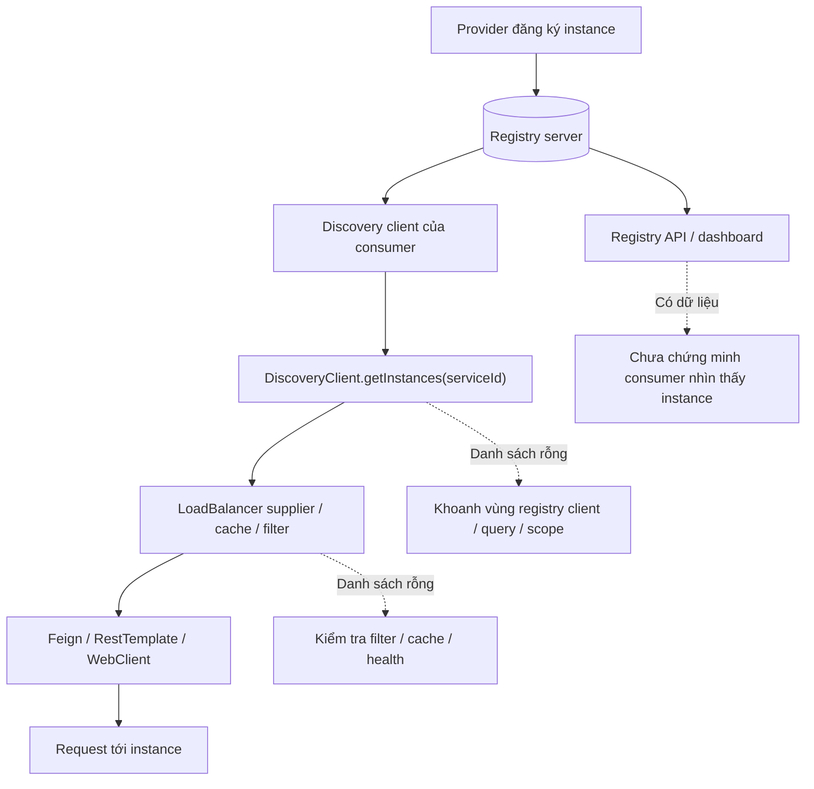

# Danh sách instance rỗng dù sổ đăng ký còn dữ liệu

Một service có thể vẫn xuất hiện trong giao diện quản trị hoặc API của registry, nhưng consumer gọi `DiscoveryClient.getInstances(serviceId)` lại nhận danh sách rỗng. Điều này không nhất thiết có nghĩa provider chưa đăng ký. Dữ liệu có thể đang nằm ở registry khác, namespace khác, root path khác, ở trạng thái health không được query chấp nhận, hoặc consumer chưa đồng bộ/cache đúng dữ liệu. Một lớp khác cũng có thể lọc instance sau khi DiscoveryClient đã trả về.

Cách chẩn đoán hiệu quả là so sánh dữ liệu qua từng lớp: registry server, discovery client của consumer, danh sách instance mà LoadBalancer sử dụng và request thực tế. Không xóa registration hoặc restart toàn bộ hệ thống trước khi xác định lớp nào đang làm mất instance.

## 1. Hiểu chính xác lỗi đang xảy ra ở lớp nào

Trong Spring Cloud, có ít nhất bốn góc nhìn cần phân biệt:

1. **Registry server:** dữ liệu đăng ký được lưu trên Eureka, Consul, ZooKeeper hoặc Kubernetes API.
2. **DiscoveryClient:** consumer truy vấn service ID và nhận danh sách `ServiceInstance`.
3. **Spring Cloud LoadBalancer:** có thể nhận danh sách từ DiscoveryClient rồi tiếp tục áp dụng cache, health check, zone hoặc custom filter.
4. **HTTP client:** Feign, RestTemplate hoặc WebClient thực hiện request tới instance đã chọn.

Sơ đồ luồng:



Registry UI vẫn hiển thị `inventory-service` nhưng consumer không tìm thấy instance. Có thể Consul catalog còn registration, trong khi health query chỉ trả instance passing; hoặc consumer đang kết nối Consul cluster/namespace khác.

Cần ghi lại chính xác biểu hiện:

- `getServices()` có chứa service ID không?
- `getInstances(serviceId)` có rỗng không?
- Registry API trả về service và instance nào?
- LoadBalancer có còn instance sau khi áp dụng filter không?
- Lỗi chỉ xảy ra ở một consumer hay tất cả consumer?

## 2. Bước đầu tiên: xác minh service ID

Service ID là khóa logic mà consumer dùng để tra cứu. Một sai lệch nhỏ trong tên có thể khiến lookup không khớp.

Ví dụ provider đăng ký:

```yaml
spring:
  application:
    name: inventory-service
```

Consumer gọi:

```java
discoveryClient.getInstances("inventory-service");
```

Các lỗi thường gặp:

- Consumer dùng `inventory`, provider đăng ký `inventory-service`.
- Một môi trường dùng `inventory-service`, môi trường khác dùng `inventory-service-v2`.
- Có cấu hình override tên service ở provider.
- Consumer truyền tên từ property sai profile hoặc sai nguồn cấu hình.
- Tên service có khoảng trắng, ký tự thừa hoặc khác cách chuẩn hóa của registry.
- Feign client dùng một service ID khác với service name thực tế.

Không nên giả định mọi registry chuẩn hóa chữ hoa/thường giống nhau. Eureka thường biểu diễn application name theo dạng uppercase trong giao diện/API, trong khi consumer có thể dùng service ID dạng khác. Hãy so sánh tên logic mà Spring Cloud client sử dụng với tên application/service thực tế trong API của provider.

Ví dụ kiểm tra nhanh:

```java
String serviceId = "inventory-service";

log.info("Lookup serviceId='{}'", serviceId);
log.info("Discovered services={}", discoveryClient.getServices());

List<ServiceInstance> instances =
    discoveryClient.getInstances(serviceId);

log.info("Instance count for {}: {}", serviceId, instances.size());
```

Trong log chẩn đoán, ghi service ID và số lượng instance; tránh ghi token, password hoặc thông tin nhạy cảm trong metadata.

## 3. Xác minh consumer kết nối đúng registry

Registry dashboard có dữ liệu không chứng minh consumer đang truy vấn đúng server. Một môi trường có thể có nhiều registry endpoint:

- Dev, test, staging và production.
- Nhiều Eureka cluster hoặc Consul datacenter.
- Nhiều Consul namespace/partition.
- Nhiều ZooKeeper ensemble hoặc root path.
- Nhiều Kubernetes cluster/context.

Kiểm tra cấu hình runtime thực tế, không chỉ file YAML trong repository. Spring profiles, environment variables, Config Server, command-line arguments và secret injection có thể override giá trị trong `application.yml`.

Ví dụ Eureka:

```yaml
eureka:
  client:
    service-url:
      defaultZone: http://eureka.internal:8761/eureka/
    fetch-registry: true
```

Ví dụ Consul:

```yaml
spring:
  cloud:
    consul:
      host: consul.internal
      port: 8500
      discovery:
        enabled: true
```

Ví dụ ZooKeeper:

```yaml
spring:
  cloud:
    zookeeper:
      connect-string: zk-1.internal:2181,zk-2.internal:2181,zk-3.internal:2181
      discovery:
        enabled: true
        root: /services
```

Nếu registry UI được mở ở `eureka-a.internal` nhưng consumer cấu hình `eureka-b.internal`, dữ liệu hai nơi có thể khác nhau. Kiểm tra DNS, port, TLS, authentication, namespace, datacenter và root path của chính consumer đang lỗi.

## 4. Kiểm tra DiscoveryClient đang được Spring inject

Ứng dụng có thể đang sử dụng implementation khác với dự kiến. Ví dụ dependency discovery provider bị thiếu, discovery bị tắt theo profile, hoặc ứng dụng đang dùng `SimpleDiscoveryClient` thay vì Eureka/Consul/ZooKeeper client.

Có thể log implementation được inject:

```java
import org.slf4j.Logger;
import org.slf4j.LoggerFactory;
import org.springframework.cloud.client.discovery.DiscoveryClient;
import org.springframework.stereotype.Component;

@Component
public class DiscoveryDiagnostics {

    private static final Logger log =
        LoggerFactory.getLogger(DiscoveryDiagnostics.class);

    private final DiscoveryClient discoveryClient;

    public DiscoveryDiagnostics(DiscoveryClient discoveryClient) {
        this.discoveryClient = discoveryClient;
    }

    public void inspect(String serviceId) {
        log.info(
            "DiscoveryClient implementation: {}",
            discoveryClient.getClass().getName()
        );

        log.info(
            "DiscoveryClient description: {}",
            discoveryClient.description()
        );

        log.info(
            "Known service IDs: {}",
            discoveryClient.getServices()
        );

        var instances = discoveryClient.getInstances(serviceId);
        log.info(
            "Instances for serviceId '{}': {}",
            serviceId,
            instances.size()
        );

        instances.forEach(instance -> log.info(
            "Instance serviceId={}, host={}, port={}, secure={}, uri={}",
            instance.getServiceId(),
            instance.getHost(),
            instance.getPort(),
            instance.isSecure(),
            instance.getUri()
        ));
    }
}
```

Nếu ứng dụng có `CompositeDiscoveryClient`, implementation ngoài cùng có thể là composite. Khi đó cần kiểm tra các delegate và thứ tự ưu tiên của từng discovery client. Không nên kết luận chỉ từ tên class wrapper.

Các điểm cần xác minh:

- Dependency discovery starter của provider đang dùng có mặt trong runtime classpath.
- Discovery integration được bật.
- Consumer không vô tình dùng profile cấu hình cho local/simple discovery.
- Không có nhiều DiscoveryClient cùng hoạt động với thứ tự không mong muốn.
- Service ID được tra cứu qua đúng client và đúng provider.

Trong một số phiên bản Spring Cloud, có thể tắt discovery integration bằng cấu hình chung. Nếu `spring.cloud.discovery.enabled` hoặc thuộc tính enable của provider bị đặt `false`, registry có dữ liệu nhưng client không thực hiện lookup như mong đợi. Kiểm tra effective configuration của process.

## 5. Phân biệt getServices() và getInstances()

Hai phương thức có mục đích khác nhau:

| API | Ý nghĩa | Cách đọc kết quả |
|---|---|---|
| `getServices()` | Danh sách service ID mà client nhìn thấy | Dùng để chẩn đoán discovery scope |
| `getInstances(serviceId)` | Instance thuộc một service ID cụ thể | Dùng để xác định đích gọi |

Một số tình huống:

- `getServices()` rỗng và `getInstances()` rỗng: nghi ngờ client chưa kết nối, discovery bị tắt, registry cache chưa tải hoặc scope không đúng.
- `getServices()` có service ID nhưng `getInstances()` rỗng: kiểm tra service ID, query filter, health state, namespace và dữ liệu instance.
- `getInstances()` có dữ liệu nhưng Feign báo không có instance: kiểm tra LoadBalancer supplier, cache và filter phía sau DiscoveryClient.

Không gọi `getServices()` liên tục trong request nghiệp vụ chỉ để tìm service ID. Dùng service ID đã biết và gọi trực tiếp `getInstances(serviceId)` hoặc dùng Feign client theo tên dịch vụ.

## 6. Kiểm tra host, port và endpoint được đăng ký

Registry có thể hiển thị service record nhưng endpoint chứa host hoặc port sai. Một số giao diện quản trị hiển thị service name ngay cả khi không có instance hợp lệ.

Với từng instance, kiểm tra:

- Service ID và instance ID.
- Host/IP được quảng bá.
- Port và protocol.
- Scheme HTTP/HTTPS.
- Metadata và zone.
- Health/status.
- Thời gian đăng ký, heartbeat hoặc cập nhật cuối.
- Instance có bị đánh dấu draining, terminating hoặc out of service không.

Ví dụ instance cần được công bố:

```text
serviceId: inventory-service
instanceId: inventory-node-a
host: 10.10.2.15
port: 8081
scheme: http
status: UP
```

Host và port không phải lý do duy nhất khiến `getInstances()` rỗng. Một số DiscoveryClient vẫn trả instance có địa chỉ không thể kết nối; lỗi kết nối sẽ xuất hiện ở bước gọi HTTP. Tuy nhiên, host/port thiếu hoặc dữ liệu registration không hợp lệ có thể khiến provider không tạo được instance như dự kiến.

## 7. Kiểm tra health filter và trạng thái instance

Registry có thể còn dữ liệu đăng ký nhưng query chỉ trả instance thỏa điều kiện health.

Cần phân biệt:

- **Registered:** record tồn tại trong registry.
- **Healthy/Passing:** health check hiện được đánh giá đạt.
- **Discoverable:** query của consumer cho phép trả instance đó.
- **Reachable:** consumer có thể kết nối tới endpoint.
- **Ready:** ứng dụng sẵn sàng xử lý request nghiệp vụ.

Một instance tồn tại không có nghĩa nó đang passing hoặc được phép đưa vào kết quả lookup.

### Consul: query-passing

Consul có catalog API và health API. Catalog có thể hiển thị service registration trong khi health query với `passing=true` loại instance có check warning/critical.

Kiểm tra hai endpoint:

```bash
curl "http://consul.internal:8500/v1/catalog/service/inventory-service"
curl "http://consul.internal:8500/v1/health/service/inventory-service"
curl "http://consul.internal:8500/v1/health/service/inventory-service?passing=true"
```

Nếu API không bật ACL, có thể gọi trực tiếp như ví dụ. Khi bật ACL, gửi token qua header `X-Consul-Token` từ secret store; không ghi token thật trong shell history hoặc log.

Nếu query `passing=true` trả mảng rỗng nhưng health API không filter vẫn có instance, kiểm tra health check, check output, địa chỉ check và thời điểm cập nhật. Trong Spring Cloud Consul, thuộc tính `spring.cloud.consul.discovery.query-passing` có thể khiến discovery chỉ trả instance passing; kiểm tra giá trị effective và mặc định của phiên bản đang dùng.

### Eureka: status và fetch registry

Eureka thường lưu trạng thái instance như `UP`, `DOWN`, `STARTING` hoặc `OUT_OF_SERVICE`. Dashboard có thể hiển thị application nhưng consumer không nhận instance mong đợi nếu instance không ở trạng thái được sử dụng hoặc client cache chưa cập nhật.

Kiểm tra:

- Provider có thực sự đăng ký instance dưới application name mong đợi?
- Instance status có phải `UP`?
- Eureka client có fetch registry không?
- Consumer đang đọc cache nào và lần fetch gần nhất khi nào?
- Có cấu hình filter hoặc custom EurekaClient làm thay đổi kết quả không?

Các thuộc tính cơ bản:

```yaml
eureka:
  client:
    register-with-eureka: true
    fetch-registry: true
    registry-fetch-interval-seconds: 30
```

`register-with-eureka` điều khiển việc client đăng ký chính nó; `fetch-registry` điều khiển việc tải registry phục vụ lookup. Một ứng dụng chỉ làm consumer vẫn cần fetch registry. Đừng nhầm `register-with-eureka: false` với việc tắt discovery hoàn toàn.

### ZooKeeper: root path và session

Spring Cloud Zookeeper Discovery thường tổ chức registration dưới root path, ví dụ `/services`. Nếu provider ghi vào một root path còn consumer đọc root path khác, ZooKeeper vẫn có dữ liệu nhưng consumer không thấy service.

Kiểm tra:

- `spring.cloud.zookeeper.connect-string`.
- `spring.cloud.zookeeper.discovery.enabled`.
- `spring.cloud.zookeeper.discovery.root`.
- Service name và nhánh znode tương ứng.
- ACL đọc trên root và các node con.
- Client session, reconnect và ephemeral node lifecycle.

Ví dụ kiểm tra bằng ZooKeeper CLI:

```text
ls /services
ls /services/inventory-service
```

Đường dẫn thực tế phụ thuộc root đã cấu hình. Session còn tồn tại không chứng minh registration đúng root hoặc consumer có quyền đọc.

### Kubernetes: Service và EndpointSlice

Kubernetes Service có thể tồn tại và DNS vẫn phân giải được ClusterIP, trong khi EndpointSlice không có endpoint Ready. Discovery client dựa trên Kubernetes API có thể lọc endpoint chưa sẵn sàng hoặc chỉ đọc namespace được cấu hình.

Kiểm tra:

```bash
kubectl get svc inventory-service -n shop
kubectl get pods -n shop -l app=inventory -o wide
kubectl get endpointslices -n shop \
  -l kubernetes.io/service-name=inventory-service
kubectl describe svc inventory-service -n shop
```

Nếu EndpointSlice không có địa chỉ hoặc endpoint `ready: false`, kiểm tra Service selector, Pod labels, readiness probe và targetPort. Nếu dùng Spring Cloud Kubernetes, kiểm tra namespace discovery, RBAC và cấu hình có bao gồm endpoint chưa ready hay không theo phiên bản.

## 8. Kiểm tra namespace, partition, datacenter và root path

Registry có thể phân vùng dữ liệu theo phạm vi. Consumer đọc đúng registry server nhưng vẫn không nhìn thấy service nếu scope khác.

| Provider | Phạm vi cần đối chiếu |
|---|---|
| Eureka | Cluster/region/zone, service URL, application name |
| Consul | Datacenter, namespace, partition, ACL token và service name |
| ZooKeeper | Ensemble, chroot/root path, service znode và ACL |
| Kubernetes | Cluster context, namespace, Service, EndpointSlice và RBAC |

Ví dụ Consul: service được đăng ký trong namespace `payments`, nhưng consumer query namespace mặc định. Catalog của operator có thể hiển thị service khi chọn namespace đúng, trong khi consumer không có quyền hoặc không query namespace đó.

Ví dụ Kubernetes: provider Service nằm trong namespace `shop`, nhưng consumer discovery chỉ quét namespace `fulfillment`. Nếu consumer gọi bằng DNS đầy đủ, nó có thể vẫn kết nối được; còn DiscoveryClient chỉ thấy service trong scope được cấu hình.

Không dùng dữ liệu UI ở một namespace/partition để suy luận consumer có cùng scope. Luôn ghi nhận scope thực tế của cả provider và consumer.

## 9. Kiểm tra quyền đọc và lỗi bị che bởi abstraction

Registry API có thể cho operator quyền đọc toàn catalog, trong khi consumer dùng token hạn chế. UI của operator hiển thị service nhưng consumer bị 403 hoặc chỉ thấy một phần dữ liệu.

Kiểm tra:

- Token/credential runtime của consumer.
- ACL policy, namespace policy hoặc RBAC.
- Consumer có quyền đọc service/instance cụ thể không?
- Client log có 401/403, `NOAUTH`, `Forbidden` hoặc lỗi deserialize không?
- Có proxy/gateway giữa client và registry đang lọc response không?

Một số integration có thể log lỗi và trả danh sách rỗng trong một đường xử lý, trong khi đường khác ném exception. Vì vậy, đừng chỉ nhìn kết quả list; hãy xem log registry client và HTTP status.

Nguyên tắc quyền:

- Provider cần quyền đăng ký service thuộc phạm vi sở hữu.
- Consumer cần quyền đọc đúng service và namespace.
- Operator có thể cần quyền rộng hơn nhưng không dùng credential operator trong runtime.
- ZooKeeper consumer cần ACL `READ` trên path phù hợp; provider cần quyền ghi theo lifecycle.
- Kubernetes consumer cần `get/list/watch` đúng resource và namespace.

## 10. Kiểm tra cache và thời điểm đồng bộ

Registry server có thể đã cập nhật nhưng consumer vẫn giữ cache cũ. Điều này thường xảy ra khi instance vừa đăng ký, vừa được deregister hoặc health state vừa thay đổi.

Các tầng cache có thể có:

- Eureka client registry snapshot.
- Discovery provider cache hoặc watch state.
- Spring Cloud LoadBalancer `ServiceInstanceListSupplier` cache.
- Health check supplier cache.
- DNS cache nếu gọi qua hostname.
- Cache tùy chỉnh trong ứng dụng.

Hãy xác định cache nào đang hoạt động và refresh interval/TTL của từng tầng. Không xóa cache tùy tiện trước khi thu thập dữ liệu, vì sẽ làm mất dấu hiệu về độ trễ đồng bộ.

Với Eureka, kiểm tra `registry-fetch-interval-seconds` và log fetch. Với Consul, kiểm tra blocking query/watch và query cache nếu được bật. Với ZooKeeper, kiểm tra watcher/session và cách integration cập nhật child nodes. Với Kubernetes, kiểm tra watch/list API, informer state và resourceVersion qua log/metrics của client nếu có.

## 11. DiscoveryClient có instance nhưng LoadBalancer lại rỗng

Nếu đoạn code trực tiếp trả về instance:

```java
List<ServiceInstance> instances =
    discoveryClient.getInstances("inventory-service");
```

nhưng Feign hoặc `@LoadBalanced RestTemplate` báo không có instance, lỗi nằm sau DiscoveryClient hoặc trong cấu hình client.

Kiểm tra:

- Feign `name`/service ID có khớp không.
- Có thuộc tính `url` cố định khiến Feign bỏ qua discovery không.
- LoadBalancer dependency và auto-configuration có hoạt động không.
- `ServiceInstanceListSupplier` có filter health/zone/hint không.
- Cache của LoadBalancer có giữ danh sách rỗng từ thời điểm registry chưa sẵn sàng không.
- Custom supplier hoặc filter có loại tất cả instance không.
- Có cấu hình per-client làm thay đổi danh sách không.

Bảng phân biệt:

| DiscoveryClient | LoadBalancer | Hướng điều tra |
|---|---|---|
| Rỗng | Rỗng | Registry client, scope, query, health, cache |
| Có instance | Rỗng | Supplier, health filter, zone/hint, cache |
| Có instance | Có instance | Kiểm tra endpoint, network và HTTP client |
| Không gọi DiscoveryClient | Rỗng | URL cố định, client config hoặc LoadBalancer setup |

Không nên thay registry hoặc đăng ký lại provider nếu `DiscoveryClient` đã trả instance chính xác. Tập trung vào supplier/filter và client đang thực hiện request.

## 12. Checklist chẩn đoán theo thứ tự

Thực hiện tuần tự để tránh thay đổi nhiều yếu tố cùng lúc:

1. Ghi lại service ID consumer đang tra cứu.
2. Ghi lại profile và effective registry endpoint của consumer.
3. Kiểm tra `DiscoveryClient` implementation thực tế.
4. So sánh `getServices()` và `getInstances(serviceId)`.
5. Truy vấn registry API bằng cùng endpoint, namespace và credential với consumer.
6. Kiểm tra registration, instance ID, host, port và health/status.
7. Kiểm tra query filter như Consul `passing=true`.
8. Đối chiếu namespace, partition, datacenter hoặc ZooKeeper root path.
9. Kiểm tra ACL/RBAC và log 401/403/NOAUTH.
10. Kiểm tra cache, refresh interval, watch và thời điểm đăng ký.
11. Nếu DiscoveryClient có instance, kiểm tra LoadBalancer supplier/cache/filter.
12. Cuối cùng mới kiểm tra kết nối tới host/port đã chọn.

Ghi kết quả theo từng lớp:

| Lớp | Bằng chứng cần lưu |
|---|---|
| Registry API | Service ID, instance ID, trạng thái, namespace và response |
| DiscoveryClient | Implementation, `getServices()`, `getInstances()` |
| LoadBalancer | Supplier, filter, instance list và cache |
| Network | DNS, route, port, TLS và kết quả kết nối |
| Application | Feign/HTTP client config, lỗi và thời điểm request |

## 13. Ma trận hiện tượng và nguyên nhân

| Hiện tượng | Nguyên nhân có thể | Kiểm tra ưu tiên |
|---|---|---|
| Registry UI có service, `getServices()` rỗng | Consumer đọc sai registry, client chưa bật hoặc fetch chưa hoàn tất | Effective endpoint, DiscoveryClient implementation, fetch log |
| `getServices()` có tên nhưng `getInstances()` rỗng | Sai service ID hoặc query filter loại instance | Tên service, health/status, query parameters |
| Consul catalog có dữ liệu, health query rỗng | Health check critical/warning và `passing=true` | Consul health API, check output, query-passing |
| Eureka dashboard có application, consumer không có instance | Status không được chọn, fetch registry tắt hoặc cache cũ | Instance status, fetch-registry, fetch interval |
| ZooKeeper có znode nhưng client rỗng | Khác root path, ensemble hoặc ACL | connect-string, root, `ls` path và ACL |
| Kubernetes Service tồn tại nhưng không có instance | EndpointSlice rỗng/chưa ready, selector hoặc namespace sai | Pod labels, readiness, EndpointSlice, RBAC |
| DiscoveryClient có instance nhưng Feign báo no instances | LoadBalancer supplier/filter/cache hoặc client name | Supplier chain, service ID, Feign URL |
| Chỉ một consumer bị lỗi | Config/profile/credential/cache riêng của consumer | So sánh effective config và identity với consumer khỏe |
| Sau rollout mới xuất hiện lỗi | Service name, health, port hoặc cache chưa hội tụ | Registration mới, readiness và refresh lag |
| Lỗi chập chờn | Instance flapping, network partition, cache hoặc health check | Timestamp, heartbeat/session, health event và request trace |

## 14. Những thao tác không nên làm trước khi khoanh vùng

- Không xóa toàn bộ catalog hoặc znode root.
- Không xóa registration của tất cả replica khi chỉ một consumer bị lỗi.
- Không tắt health filter để ép instance xuất hiện mà chưa hiểu vì sao check fail.
- Không cấp token quản trị toàn quyền cho consumer để “thử nhanh”.
- Không tắt TLS hoặc ACL để loại trừ lỗi xác thực.
- Không tăng timeout vô hạn hoặc retry liên tục.
- Không restart đồng loạt registry và toàn bộ provider trước khi thu thập log/API response.
- Không sửa service ID tùy tiện ở một phía mà không đối chiếu tên đăng ký thực tế.

Nếu cần thử một thay đổi, hãy thay một biến mỗi lần, ghi lại kết quả trước/sau và có phương án rollback.

## 15. Checklist phòng ngừa

1. Chuẩn hóa service ID và kiểm tra effective configuration theo profile.
2. Dùng cùng registry endpoint, namespace/partition/root path theo thiết kế.
3. Bật discovery và fetch registry đúng vai trò consumer.
4. Provider công bố instance ID, host và port hợp lệ.
5. Health check phản ánh đúng readiness và được query theo chủ đích.
6. ACL/RBAC cho phép consumer đọc đúng phạm vi cần thiết.
7. Theo dõi registry API error, client fetch, cache refresh và instance count.
8. Đặt timeout/retry có giới hạn; xử lý eventual consistency.
9. Kiểm tra DiscoveryClient trực tiếp trước khi debug LoadBalancer.
10. Kiểm tra LoadBalancer supplier/filter nếu DiscoveryClient có dữ liệu.
11. Có runbook đối chiếu registry API với kết quả từ consumer.
12. Ghi log service ID, instance count và trạng thái an toàn mà không lộ secret.

Danh sách instance rỗng dù registry còn dữ liệu thường xuất phát từ sai lệch giữa góc nhìn của registry và consumer: khác service ID, endpoint, namespace/root, credential, health filter hoặc cache. Bằng cách kiểm tra lần lượt registry API, DiscoveryClient, LoadBalancer và network, ta xác định được lớp làm mất instance mà không phá dữ liệu đăng ký hợp lệ.
