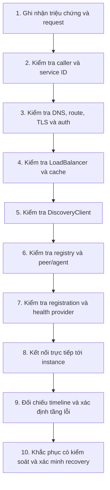

# Quy trình thu thập bằng chứng và khoanh vùng từng chặng

Khi một service call thất bại, nguyên nhân có thể nằm ở caller, cấu hình tên service, DNS/network, Spring Cloud LoadBalancer, `DiscoveryClient`, registry, health check hoặc chính provider. Nếu thay đổi cấu hình ngay khi thấy lỗi, ta có thể làm mất dấu vết và sửa nhầm tầng. Một quy trình troubleshooting tốt phải thu thập bằng chứng trước, xác định chặng đầu tiên có kết quả sai, rồi mới thay đổi đúng thành phần.

Trong Spring Cloud Service Discovery, cần phân biệt **control plane** (đăng ký, heartbeat, health check, registry query và cập nhật danh sách instance) với **data plane** (kết nối HTTP/gRPC thực tế từ consumer tới provider). Registry có thể khỏe nhưng provider không truy cập được; ngược lại, registry tạm thời không truy cập được nhưng consumer vẫn gọi được instance từ cache. Bài học này xây dựng quy trình điều tra từng chặng, cách lưu bằng chứng, lệnh kiểm tra an toàn và cách kết luận có căn cứ cho Eureka, Consul và Kubernetes.

## 1. Nguyên tắc điều tra

Trước khi khoanh vùng, thống nhất một số nguyên tắc:

- **Bắt đầu từ một request cụ thể:** ghi service ID, thời điểm, caller, môi trường, endpoint logic, HTTP method, status/exception và trace ID.
- **Đi theo đường request:** caller → LoadBalancer → DiscoveryClient → registry/cache → instance được chọn → network → provider.
- **Tách control plane và data plane:** kiểm tra registry query riêng với việc kết nối tới host/port của provider.
- **So sánh cùng thời điểm:** log, metric, registry state và deployment event phải có timestamp và timezone thống nhất.
- **Giữ nguyên bằng chứng gốc:** lưu response status, header cần thiết, log liên quan và cấu hình đã loại secret; không chỉ ghi lại kết luận.
- **Thay đổi từng yếu tố:** sau mỗi thay đổi, lặp lại cùng một phép kiểm tra để biết thay đổi nào tạo ra khác biệt.
- **Không che lỗi bằng fallback tùy tiện:** empty result, stale snapshot, lỗi kết nối, 401/403 và provider timeout là những trạng thái khác nhau.

Không đưa token, password, private key, cookie hoặc URL có userinfo vào log/ticket. Redact trước khi chia sẻ bằng chứng; giữ bản gốc chỉ trong hệ thống incident có quyền truy cập phù hợp.

## 2. Sơ đồ khoanh vùng theo từng chặng



Mỗi chặng cần trả lời một câu hỏi có thể kiểm chứng:

| Chặng | Câu hỏi | Bằng chứng quyết định |
| --- | --- | --- |
| Caller | Request nào lỗi, từ đâu, vào lúc nào? | Trace ID, log caller, route và timestamp. |
| Service ID | Caller đang tìm đúng logical service không? | `spring.application.name`, URL logical, service ID trong log. |
| DNS/network/TLS/auth | Caller có tới được registry và provider không? | DNS result, TCP/TLS handshake, HTTP status. |
| LoadBalancer | Supplier trả danh sách nào và chọn instance nào? | Log chọn instance, supplier/cache config, host/port thực tế. |
| DiscoveryClient | Client nhìn thấy instance nào? | `getServices()`, `getInstances()`, refresh status và snapshot age. |
| Registry | Registry có registration/health state nào? | Eureka app/instance hoặc Consul Catalog/Health API. |
| Provider | Instance có đăng ký đúng và healthy không? | Startup log, instance ID, readiness/health check. |
| Data plane | Consumer có kết nối và gọi được instance đã chọn không? | Kết nối trực tiếp, response/status, server access log. |
| Recovery | Sau thay đổi, dữ liệu và request đã hội tụ chưa? | Snapshot mới, instance selection mới, error rate trở về baseline. |

## 3. Chặng 1 — Ghi nhận triệu chứng và đóng khung phạm vi

Trước hết, ghi lại thông tin tối thiểu cho một lần lỗi:

| Trường | Ví dụ | Vì sao cần |
| --- | --- | --- |
| Thời điểm | `2026-11-24T10:15:32Z` | Đối chiếu log và event trên nhiều node. |
| Caller | `order-api`, namespace `shop` | Xác định cấu hình và network namespace cần kiểm tra. |
| Service ID | `payment-service` | Đối chiếu với tên registration trong registry. |
| Operation | `POST /payments` | Phân biệt endpoint nghiệp vụ với health/discovery endpoint. |
| Kết quả | HTTP 503, timeout, empty list hoặc exception | Chọn nhánh điều tra đúng. |
| Instance được chọn | `payment-b`, `10.0.4.12:8080` | Biết LoadBalancer đã chọn endpoint nào. |
| Trace/correlation ID | `trace-...` | Nối log caller, provider và gateway. |
| Phạm vi ảnh hưởng | Một caller, một zone hay mọi caller | Phân biệt lỗi cục bộ với lỗi chung. |

### 3.1. Xác định phạm vi

Đặt các câu hỏi sau trước khi thay đổi:

1. Chỉ một request lỗi hay mọi request tới service đều lỗi?
2. Chỉ một consumer gặp lỗi hay mọi consumer cùng gặp?
3. Chỉ một instance/zone lỗi hay tất cả instance đều lỗi?
4. Lỗi bắt đầu sau deploy, scale, đổi config, rotate certificate/token hay thay đổi network nào?
5. Lỗi xuất hiện ở lookup discovery, chọn instance hay sau khi đã kết nối tới provider?

Nếu một consumer lỗi nhưng consumer khác cùng service vẫn gọi được, ưu tiên kiểm tra cấu hình/cache/network của consumer lỗi. Nếu mọi consumer cùng thấy registry empty, kiểm tra registration/health/provider và registry. Nếu discovery trả instance nhưng chỉ một endpoint timeout, điều tra instance đó và đường network tới nó.

### 3.2. Tạo timeline

Ghi một timeline duy nhất theo UTC hoặc timezone đã thống nhất:

```text
10:12:00  Provider payment-b bắt đầu rollout
10:12:08  Readiness của payment-b chuyển NotReady
10:12:15  Consul check payment-b chuyển critical
10:12:21  Consumer order-api vẫn chọn payment-b
10:12:22  Request nhận connect timeout
10:12:35  Discovery cache refresh thành công
10:12:37  Consumer bắt đầu chọn payment-a
10:13:10  Error rate trở về baseline
```

Các mốc trong ví dụ chỉ minh họa. Timeline giúp phát hiện độ trễ giữa readiness, registry, cache và LoadBalancer; không kết luận rằng một thành phần sai chỉ dựa trên một log riêng lẻ.

## 4. Chặng 2 — Xác minh caller và service ID

Kiểm tra caller đang gọi logical name hay URL cố định.

Ví dụ URL đi qua Spring Cloud LoadBalancer:

```java
restTemplate.getForObject(
        "http://payment-service/api/payments",
        PaymentResponse.class
);
```

Ở đây `payment-service` là service ID. Nếu caller gọi URL cố định như `http://10.0.4.12:8080/...`, discovery và LoadBalancer có thể hoàn toàn không tham gia.

Kiểm tra cấu hình caller:

```yaml
spring:
  application:
    name: order-api
```

Đoạn YAML chỉ minh họa tên ứng dụng. Ghi lại profile đang active, config source và các biến môi trường có thể override `application.yml`; không thay đổi retry policy chỉ để điều tra naming.

Đối chiếu:

- `spring.application.name` của provider.
- Tên service được provider đăng ký trong Eureka/Consul/Kubernetes.
- Service ID mà consumer đưa vào `DiscoveryClient` hoặc URL logical.
- Namespace, region, zone, datacenter và label filter nếu có.
- Quy tắc chuẩn hóa tên của registry; tránh tự giả định tên có dấu gạch, dấu chấm hoặc chữ hoa sẽ được ánh xạ giống nhau.

Nếu service ID sai, sửa tên hoặc cấu hình registration. Không thay timeout, cache TTL hoặc network rule để chữa một lỗi naming.

## 5. Chặng 3 — Kiểm tra DNS, network, TLS và quyền truy cập

Registry query và request tới provider có thể dùng hostname, port và network path khác nhau. Chạy kiểm tra từ đúng môi trường của caller — cùng Pod/container/VM và network namespace — thay vì từ laptop quản trị.

### 5.1. DNS

Trong Linux container:

```bash
getent ahosts consul.internal.example
nslookup eureka.internal.example
```

Trong Kubernetes, kiểm tra DNS service và namespace:

```bash
kubectl exec -n shop deploy/order-api -- \
  nslookup payment-service.shop.svc.cluster.local
```

Nếu DNS trả IP khác dự kiến, kiểm tra record, search domain, CoreDNS, resolver cache và TTL. `localhost` bên trong container là chính container đó, không phải máy host hoặc container registry khác.

### 5.2. TCP và route

```bash
nc -vz consul.internal.example 8500
nc -vz eureka.internal.example 8761
nc -vz 10.0.4.12 8080
```

Kết quả `succeeded` chỉ xác nhận TCP handshake, không chứng minh API, TLS, authentication hoặc provider nghiệp vụ hoạt động. Nếu timeout, kiểm tra route, firewall, NetworkPolicy, security group và listener. Nếu connection refused, xác minh đúng host/port và process đang lắng nghe.

### 5.3. TLS và certificate

```bash
openssl s_client \
  -connect eureka.internal.example:8761 \
  -servername eureka.internal.example \
  -brief
```

Kiểm tra certificate chain, SAN/hostname, expiration, truststore và mTLS client certificate nếu được yêu cầu. Không tắt certificate validation để “thử cho chạy”; điều đó làm mất bằng chứng và hạ bảo mật.

### 5.4. HTTP status và authentication

Gửi request không chứa secret trong URL:

```bash
curl -sS -D - -o /dev/null \
  "https://consul.internal.example/v1/status/leader"
```

Nếu endpoint cần ACL, truyền token qua header từ secret source và không bật `-v`/`--trace` khi thu thập log. Phân loại:

| Kết quả | Ý nghĩa cần kiểm tra |
| --- | --- |
| `200` | API trả lời; tiếp tục kiểm tra payload và freshness. |
| `401` | Thiếu hoặc sai authentication. |
| `403` | Danh tính tới được endpoint nhưng không đủ quyền. |
| `404` | Sai path/context path/API version hoặc resource không tồn tại. |
| `429` | Rate limit; kiểm tra `Retry-After` và tần suất query. |
| `5xx` | Registry/proxy có lỗi; kiểm tra server log và peer/quorum. |
| Timeout/reset | DNS, route, firewall, overload hoặc connection pool. |

HTTP 200 từ health endpoint của registry không chứng minh service instance healthy. Phải kiểm tra API đúng mục đích và trạng thái trong payload.

## 6. Chặng 4 — Kiểm tra Spring Cloud LoadBalancer

Sau khi biết caller dùng logical service ID, xác định LoadBalancer có thực sự được gọi không.

Kiểm tra:

- HTTP client có bean `@LoadBalanced` hoặc integration LoadBalancer tương ứng không?
- Dependency `spring-cloud-starter-loadbalancer` và release train có tương thích không?
- Có custom `ServiceInstanceListSupplier`, zone preference, health filter hoặc retry supplier không?
- Cache của LoadBalancer có được bật không, TTL là bao nhiêu và có chồng lên cache DiscoveryClient không?
- Có cấu hình per-service qua `@LoadBalancerClient` làm một service có behavior khác service còn lại không?
- Request đang dùng logical URI hay URL cố định?

### 6.1. Bật log có chọn lọc

Trong môi trường kiểm thử hoặc cửa sổ điều tra được kiểm soát, có thể tăng log cho package liên quan:

```yaml
logging:
  level:
    org.springframework.cloud.loadbalancer: DEBUG
    org.springframework.cloud.client.discovery: DEBUG
```

Tên logger và mức log chi tiết có thể thay đổi theo phiên bản. Bật DEBUG tạm thời, giới hạn thời gian và rà soát output trước khi chia sẻ; không bật wire logging toàn bộ header/body nếu chưa có redaction.

### 6.2. Đối chiếu danh sách và instance được chọn

Ghi lại ba giá trị:

1. Danh sách `ServiceInstance` từ DiscoveryClient.
2. Danh sách sau supplier/filter của LoadBalancer.
3. Instance cuối cùng được chọn cho request.

Nếu DiscoveryClient trả `payment-a`, `payment-b` nhưng supplier chỉ giữ `payment-b`, kiểm tra zone/health filter. Nếu supplier trả hai instance nhưng request luôn tới `payment-b`, kiểm tra thuật toán chọn, retry và connection pool. Nếu instance được chọn là đúng nhưng kết nối timeout, chuyển sang chặng network/provider.

Không giả định round-robin sẽ luân phiên tuyệt đối theo từng request khi có retry, cache, concurrency hoặc thuật toán khác. Bằng chứng cần là instance ID/host thực tế và lý do chọn nếu có.

## 7. Chặng 5 — Kiểm tra DiscoveryClient

Gọi trực tiếp abstraction `DiscoveryClient` để tách vấn đề LoadBalancer khỏi registry lookup:

```java
import org.springframework.cloud.client.discovery.DiscoveryClient;
import org.springframework.stereotype.Component;

@Component
public class DiscoveryDiagnostics {

    private final DiscoveryClient discoveryClient;

    public DiscoveryDiagnostics(DiscoveryClient discoveryClient) {
        this.discoveryClient = discoveryClient;
    }

    public void inspect(String serviceId) {
        System.out.println("services=" + discoveryClient.getServices());
        discoveryClient.getInstances(serviceId).forEach(instance ->
                System.out.printf(
                        "service=%s host=%s port=%d secure=%s metadata=%s%n",
                        instance.getServiceId(),
                        instance.getHost(),
                        instance.getPort(),
                        instance.isSecure(),
                        sanitizeMetadata(instance.getMetadata())
                )
        );
    }

    private Map<String, String> sanitizeMetadata(Map<String, String> metadata) {
        // Chỉ trả allowlist key không nhạy cảm; không dump metadata nguyên bản.
        return Map.of(
                "zone", metadata.getOrDefault("zone", "unknown"),
                "version", metadata.getOrDefault("version", "unknown")
        );
    }
}
```

Đây là code chẩn đoán minh họa; bổ sung import `java.util.Map` và bảo đảm endpoint/chức năng gọi `inspect` chỉ dành cho vận hành nội bộ. Không expose host, metadata hoặc topology nhạy cảm cho người dùng công khai.

Diễn giải kết quả:

- `getServices()` không có service ID: client không thấy service đó; kiểm tra nguồn discovery, namespace và registration.
- `getServices()` có service nhưng `getInstances()` rỗng: service tồn tại nhưng không có instance phù hợp hoặc filter loại hết.
- Danh sách có instance nhưng địa chỉ sai: kiểm tra provider registration, advertised address, NAT/container network và metadata.
- Method ném exception: giữ exception type/status; điều tra registry endpoint, TLS, ACL/RBAC và client implementation.
- Danh sách có vẻ hợp lệ nhưng cũ: kiểm tra thời điểm refresh thành công, cache và registry peer state.

Lưu ý: một số DiscoveryClient đọc local cache. Lệnh gọi local hoàn tất không chứng minh registry vừa được truy vấn thành công. Cần metric/log riêng cho lần refresh gần nhất và tuổi snapshot.

## 8. Chặng 6 — Kiểm tra registry theo implementation

### 8.1. Eureka

Kiểm tra cấu hình client:

```yaml
eureka:
  client:
    service-url:
      defaultZone: ${EUREKA_SERVER_URL}
    register-with-eureka: true
    fetch-registry: true
```

Kiểm tra các điểm:

1. `defaultZone` có đúng URL, scheme, port và `/eureka/` context path không?
2. Provider có đăng ký đúng `spring.application.name` và instance ID không?
3. Eureka Dashboard hoặc REST API có application/instance đó không?
4. Instance status là `UP`, `OUT_OF_SERVICE` hay trạng thái khác?
5. Heartbeat/lease có được gia hạn không?
6. Nếu nhiều peer, các peer có kết nối và replication ổn định không?
7. Self-preservation có đang trì hoãn eviction không?
8. Consumer có fetch registry mới hay vẫn dùng local cache?

REST API thường có endpoint dạng:

```text
GET https://eureka.internal.example/eureka/apps
GET https://eureka.internal.example/eureka/apps/PAYMENT-SERVICE
```

Path thực tế phụ thuộc context path và cấu hình server. Gửi request với header `Accept` phù hợp và xác thực theo môi trường. Không paste response chứa thông tin nội bộ/credential vào ticket công khai.

### 8.2. Consul

Consul có Catalog API để xem registration và Health API để xem check state. Dùng các endpoint phù hợp:

```bash
# Service registrations trong Catalog
curl -sS "http://consul.internal.example:8500/v1/catalog/service/payment-service"

# Service instances kèm health checks
curl -sS "http://consul.internal.example:8500/v1/health/service/payment-service"

# Chỉ trả instance có mọi check liên quan passing
curl -sS "http://consul.internal.example:8500/v1/health/service/payment-service?passing"

# Trạng thái leader và peers của Consul server cluster
curl -sS "http://consul.internal.example:8500/v1/status/leader"
curl -sS "http://consul.internal.example:8500/v1/status/peers"
```

Nếu bật ACL, thêm `X-Consul-Token` từ secret source; không đặt token trong query string hoặc log. Các câu hỏi cần trả lời:

- Catalog có service ID và instance đúng không?
- Health API cho biết check nào `warning`/`critical`?
- `?passing` có trả empty vì filter health không?
- Node check có làm tất cả service trên node bị ảnh hưởng không?
- Consul Agent có đăng ký/check đúng địa chỉ và port không?
- Server cluster có leader/quorum ổn định không?
- Consumer query tới Agent, server hay proxy nào; consistency/cache mode nào đang dùng?

Catalog còn registration không có nghĩa instance khỏe. Check critical cũng không nhất thiết xóa Catalog entry ngay; cần phân biệt health filter với deregistration policy.

### 8.3. Kubernetes

Kiểm tra Service, Pod và EndpointSlice:

```bash
kubectl get service payment-service -n shop
kubectl get pods -n shop -l app=payment-service -o wide
kubectl get endpointslice -n shop \
  -l kubernetes.io/service-name=payment-service
kubectl describe service payment-service -n shop
```

Đọc trạng thái Pod và readiness:

```bash
kubectl describe pod <pod-name> -n shop
kubectl logs <pod-name> -n shop --since=15m
```

Diễn giải:

- Service không tồn tại: sai tên/namespace hoặc deployment manifest chưa apply.
- Service có nhưng EndpointSlice rỗng: selector/label không khớp hoặc không có Pod Ready.
- EndpointSlice có endpoint nhưng request timeout: kiểm tra port, targetPort, NetworkPolicy, CNI, node route và app listener.
- Pod Running nhưng Ready false: đọc readiness probe và container log.
- Spring Cloud Kubernetes DiscoveryClient không đọc được Service/EndpointSlice: kiểm tra ServiceAccount, Role/ClusterRole và quyền `get/list/watch` phù hợp.

Kiểm tra RBAC từ danh tính workload:

```bash
kubectl auth can-i list services \
  --as=system:serviceaccount:shop:order-api -n shop

kubectl auth can-i list endpointslices \
  --as=system:serviceaccount:shop:order-api -n shop
```

Không cấp `cluster-admin` để chữa lỗi discovery nếu chỉ thiếu quyền đọc một namespace.

## 9. Chặng 7 — Kiểm tra provider registration và health

Khi registry không có instance hoặc trả địa chỉ sai, chuyển sang provider.

Kiểm tra theo thứ tự:

1. Process/container có chạy và mở đúng port không?
2. Startup log có ghi registration thành công hay lỗi không?
3. Service ID, instance ID, host, port, scheme và metadata có đúng không?
4. Địa chỉ được quảng bá có thể định tuyến từ consumer không?
5. Health check gọi đúng path, port, protocol và có timeout hợp lý không?
6. Readiness có phản ánh khả năng nhận traffic, hay chỉ phản ánh JVM đang chạy?
7. Có nhiều registration trùng instance ID hoặc ghost registration từ deployment cũ không?

Với Spring Boot Actuator, kiểm tra endpoint readiness từ đúng network mà health checker sử dụng:

```bash
curl -i http://payment-a:8080/actuator/health/readiness
```

Endpoint có thể không được expose hoặc path khác tùy cấu hình. Không công khai health detail chứa database URL, credentials hoặc thông tin hạ tầng. Một health check passing chỉ chứng minh các điều kiện được check đã đạt, không đảm bảo mọi nghiệp vụ đều hoạt động.

### 9.1. Địa chỉ quảng bá sai

Các lỗi phổ biến:

- Provider đăng ký `localhost` nhưng consumer ở container khác.
- Provider đăng ký IP container chỉ có thể truy cập trong một Docker network.
- Pod IP được đưa vào registry ngoài cụm nhưng VM không có route tới Pod CIDR.
- NAT/load balancer làm host/port bên ngoài khác host/port nội bộ.
- Instance metadata khai báo sai zone hoặc cluster, khiến supplier lọc nhầm.

So sánh `host:port` trong registry với địa chỉ thực tế từ góc nhìn consumer. Không chỉ kiểm tra từ chính provider vì self-connect có thể hoạt động trong khi consumer không có route.

## 10. Chặng 8 — Kiểm tra data plane tới instance đã chọn

Sau khi đã biết host/port được LoadBalancer chọn, gọi trực tiếp instance từ consumer network:

```bash
curl -sS -o /dev/null -w \
  "http_code=%{http_code} connect=%{time_connect}s total=%{time_total}s\n" \
  "http://10.0.4.12:8080/actuator/health"
```

Lệnh này đo kết nối và HTTP response. Chọn một endpoint health được phép truy cập; không dùng endpoint nghiệp vụ có side effect để thử kết nối.

Nếu kết nối trực tiếp thành công nhưng request qua logical service name thất bại, ưu tiên kiểm tra LoadBalancer, cache, retry, URL rewrite và client configuration. Nếu kết nối trực tiếp cũng thất bại, điều tra provider listener, firewall, NetworkPolicy, route, TLS và readiness.

Nếu chỉ một instance lỗi, tạm loại instance khỏi traffic theo quy trình vận hành đã phê duyệt rồi điều tra instance đó. Không xóa registration bằng tay trước khi ghi lại instance ID, health state và thời điểm; thao tác thủ công có thể làm mất bằng chứng hoặc bị provider đăng ký lại ngay.

## 11. Chặng 9 — Đối chiếu log, metric và trace

### 11.1. Log cần thu thập

Thu thập một cửa sổ thời gian bao gồm trước, trong và sau lỗi:

- Caller: logical URL, service ID, trace ID, exception class, status và duration.
- LoadBalancer: danh sách/supplier result, instance được chọn và retry decision nếu có.
- DiscoveryClient: lookup outcome, registry endpoint, refresh success/failure và cache age nếu instrumentation có.
- Registry: registration, heartbeat/lease, health transition, peer/leader/quorum và authentication failure.
- Provider: startup, registration, readiness, request access log và shutdown/crash.
- Hạ tầng: DNS, ingress/gateway, firewall/network policy, container restart và deployment event.

Không bật log toàn bộ header/body theo mặc định. Che `Authorization`, `X-Consul-Token`, cookie, password và query token trước khi export log.

### 11.2. Metric nên đối chiếu

| Metric/tín hiệu | Dùng để xác định |
| --- | --- |
| Registered instance count | Provider có đăng ký hay không. |
| Healthy/Ready instance count | Bao nhiêu instance được phép nhận traffic. |
| Discovery lookup outcome (non-empty/empty/error) | Lookup thành công, empty hay lỗi. |
| Last successful refresh / snapshot age | Consumer đang dùng dữ liệu mới hay stale. |
| LoadBalancer selected instance | Instance nào được chọn thực tế. |
| Request 5xx, timeout, latency | Ảnh hưởng tới data plane và người dùng. |
| Eureka renewal/eviction hoặc Consul check state | Registry đang nhận heartbeat và health update ra sao. |
| Kubernetes Pod Ready/EndpointSlice | Control plane có endpoint sẵn sàng không. |

Tên metric phụ thuộc implementation, Spring Boot/Micrometer version và exporter. Chuẩn hóa metric contract của tổ chức thay vì giả định mọi release có cùng metric name.

### 11.3. Trace và correlation

Dùng cùng trace/correlation ID để nối caller và provider. Registry query nền có thể không nằm trong trace của request; khi đó đối chiếu timestamp, service ID và instance ID giữa trace với log discovery observer. Không thêm token, raw URL có secret hoặc dữ liệu cá nhân vào span tag/baggage.

## 12. Ma trận khoanh vùng nhanh

| Bằng chứng đầu tiên sai | Nhóm nguyên nhân có khả năng | Chặng tiếp theo |
| --- | --- | --- |
| Caller dùng sai service ID hoặc URL cố định | Naming/caller configuration | Chặng 2 và cấu hình client. |
| Không resolve được registry hostname | DNS/network | Chặng 3; kiểm tra resolver và route. |
| Registry trả 401/403 | Authentication/ACL/RBAC | Chặng 3 và security policy. |
| DiscoveryClient trả empty, registry query cũng empty | Registration/health filter/namespace | Chặng 6 và 7. |
| Registry có healthy instance nhưng DiscoveryClient empty | Client config, namespace filter, cache hoặc implementation | Chặng 5 và 6. |
| DiscoveryClient có instance nhưng LoadBalancer supplier rỗng | Supplier/zone/health filter | Chặng 4. |
| LoadBalancer chọn host sai hoặc cũ | Stale cache, metadata, registration hoặc supplier | Chặng 4, 6 và 7. |
| Host/port đúng nhưng TCP timeout | Data-plane network/provider | Chặng 3 và 8. |
| TCP thành công nhưng HTTP 5xx | Provider/dependency/business path | Chặng 7, 8 và provider log. |
| Registry peer/leader/quorum bất thường | Control plane registry | Chặng 6 và recovery của registry. |
| Chỉ một consumer lỗi, consumer khác bình thường | Consumer-specific config/cache/network | So sánh chặng 2–5 giữa hai consumer. |

Quy tắc khoanh vùng: tìm **chặng đầu tiên mà bằng chứng không còn khớp với kỳ vọng**. Ví dụ, registry trả đúng hai instance healthy nhưng DiscoveryClient chỉ thấy một thì lỗi nằm giữa registry và client/filter; không cần bắt đầu bằng việc restart provider.

## 13. Mẫu gói bằng chứng cho một incident

Có thể dùng mẫu sau trong ticket nội bộ:

```text
Incident ID:
Service ID:
Environment / cluster / namespace / zone:
Caller:
First observed at (UTC):
Last observed at (UTC):
Trace / correlation ID:
Expected healthy instances:
Observed registered / healthy instances:
Discovery outcome: NON_EMPTY / EMPTY / ERROR / STALE
Registry type and endpoint name (no credentials):
Last successful registry refresh:
Snapshot age:
LoadBalancer selected host:port / instance ID:
Direct provider connectivity result:
HTTP status / exception class:
Relevant deployment/config/network changes:
Evidence links (restricted access):
Current hypothesis:
Evidence supporting the hypothesis:
Evidence contradicting the hypothesis:
Next controlled check:
Recovery verification:
```

Tách **quan sát** khỏi **giả thuyết**. Ví dụ “Consul Health API `?passing` trả 0 entry lúc 10:15 UTC” là quan sát; “database làm tất cả provider unhealthy” là giả thuyết cần check state và provider log xác nhận.

## 14. Thay đổi và xác minh sau khi khoanh vùng

Khi đã xác định tầng lỗi, thực hiện theo trình tự:

1. Ghi lại cấu hình/metric/log trước thay đổi.
2. Chọn một thay đổi nhỏ nhất có thể kiểm chứng, ví dụ sửa service ID, ACL policy, advertised address hoặc health-check path.
3. Áp dụng trên một instance/canary hoặc môi trường staging nếu có thể.
4. Lặp lại đúng request và phép kiểm tra đã tạo bằng chứng ban đầu.
5. Xác nhận lookup, supplier, instance selection và data-plane request đều đúng.
6. Theo dõi error rate, latency, healthy count và registry state trong một khoảng đủ dài.
7. Nếu kết quả xấu hơn, rollback thay đổi và ghi nhận kết quả.

Không restart đồng thời consumer, provider và registry khi chưa có giả thuyết. Restart nhiều thành phần cùng lúc có thể tạm thời làm lỗi biến mất nhưng xóa dấu vết nguyên nhân và gây thêm outage.

### 14.1. Tiêu chí kết thúc điều tra

Chỉ đóng incident khi có bằng chứng:

- Root cause được xác định hoặc giới hạn rõ tới thành phần chịu trách nhiệm.
- Registration và health state phù hợp với trạng thái thực tế của provider.
- Consumer lấy được danh sách instance mới và LoadBalancer chọn đúng endpoint.
- Request data plane thành công từ network của consumer.
- Cache/snapshot stale đã được làm mới hoặc hết hạn theo policy.
- Alert đã resolve; metric và error rate trở lại baseline.
- Không còn ghost registration, duplicate instance hoặc credential/network workaround tạm thời chưa được xử lý.
- Có action item và owner nếu cần sửa triệt để sau incident.

## 15. Những sai lầm thường gặp

| Sai lầm | Vì sao gây khó điều tra | Cách làm tốt hơn |
| --- | --- | --- |
| Restart mọi thành phần ngay khi có lỗi | Mất trạng thái và timeline ban đầu | Thu thập snapshot, log, metric trước; restart đúng tầng sau khi có giả thuyết. |
| Coi empty list là registry outage | Nhầm registration/health filter với kết nối | Kiểm tra HTTP status, payload và registry state trực tiếp. |
| Coi local cache là dữ liệu mới | DiscoveryClient có thể trả snapshot cũ khi refresh lỗi | Ghi last-success timestamp và snapshot age. |
| Chỉ kiểm tra Eureka/Consul Dashboard | Không biết consumer cache và LoadBalancer đã cập nhật chưa | Kiểm tra cả DiscoveryClient và instance được chọn. |
| Chỉ ping host | ICMP không xác nhận TCP port, TLS hoặc HTTP API | Kiểm tra DNS, TCP, TLS và endpoint đúng. |
| Test từ laptop thay vì consumer network | Kết quả DNS/route khác với Pod/container thực tế | Chạy kiểm tra từ cùng network namespace của caller. |
| Bật wire log toàn bộ | Có thể lộ token, cookie và payload | Dùng log chọn lọc, allowlist và redaction. |
| Sửa nhiều cấu hình cùng lúc | Không biết thay đổi nào khắc phục hoặc làm lỗi nặng hơn | Thay một yếu tố và lặp lại phép kiểm tra. |
| Xóa registration thủ công trước khi ghi nhận | Mất bằng chứng và provider có thể đăng ký lại | Lưu instance ID, health state và timeline trước thao tác. |

## 16. Checklist thực hành

- [ ] Ghi thời điểm UTC, caller, service ID, trace ID và triệu chứng chính xác.
- [ ] Xác định phạm vi: một request, một consumer, một instance, một zone hay toàn service.
- [ ] Xác nhận caller dùng logical service name và đúng service ID.
- [ ] Kiểm tra DNS, TCP, TLS và authentication từ đúng network của caller.
- [ ] Xác minh request có đi qua Spring Cloud LoadBalancer không.
- [ ] Ghi danh sách DiscoveryClient và danh sách sau supplier/filter.
- [ ] Kiểm tra registry Catalog/Health API hoặc Eureka app/instance status.
- [ ] Kiểm tra provider registration, advertised address, readiness và health check.
- [ ] Kết nối trực tiếp tới host/port được chọn từ consumer network.
- [ ] Đối chiếu log, metric, trace và deployment/network timeline.
- [ ] Ghi rõ quan sát, giả thuyết, bằng chứng ủng hộ và bằng chứng phản bác.
- [ ] Thực hiện một thay đổi có kiểm soát rồi xác minh recovery ở mọi chặng.
- [ ] Redact credential và bảo vệ quyền truy cập gói bằng chứng.

## 17. Ghi nhớ

- Điều tra theo đường đi thực tế: caller → LoadBalancer → DiscoveryClient → registry/cache → provider → network/data plane.
- Phân biệt control plane với data plane; registry query thành công không chứng minh provider có thể được gọi.
- Empty result, stale snapshot, connection failure và 401/403 là những kết quả khác nhau.
- Bằng chứng phải có timestamp, service ID, instance ID, trace/correlation ID và nguồn quan sát.
- Chạy DNS/TCP/TLS/HTTP test từ đúng network namespace của consumer.
- So sánh registry, DiscoveryClient, supplier sau filter và instance cuối cùng được LoadBalancer chọn.
- Tìm chặng đầu tiên có bằng chứng sai; chỉ thay đổi một yếu tố rồi lặp lại phép kiểm tra.
- Không log credential hoặc dump metadata/header nhạy cảm khi thu thập bằng chứng.

## Tài liệu tham khảo

- [Spring Cloud Commons: DiscoveryClient và ServiceRegistry](https://docs.spring.io/spring-cloud-commons/reference/spring-cloud-commons/common-abstractions.html)
- [Spring Cloud LoadBalancer](https://docs.spring.io/spring-cloud-commons/reference/spring-cloud-commons/loadbalancer.html)
- [Spring Cloud Netflix: Eureka](https://docs.spring.io/spring-cloud-netflix/reference/spring-cloud-netflix.html)
- [Spring Cloud Consul: Discovery](https://docs.spring.io/spring-cloud-consul/reference/discovery.html)
- [Consul HTTP API: Health](https://developer.hashicorp.com/consul/api-docs/health)
- [Kubernetes: Service và EndpointSlices](https://kubernetes.io/docs/concepts/services-networking/service/)
