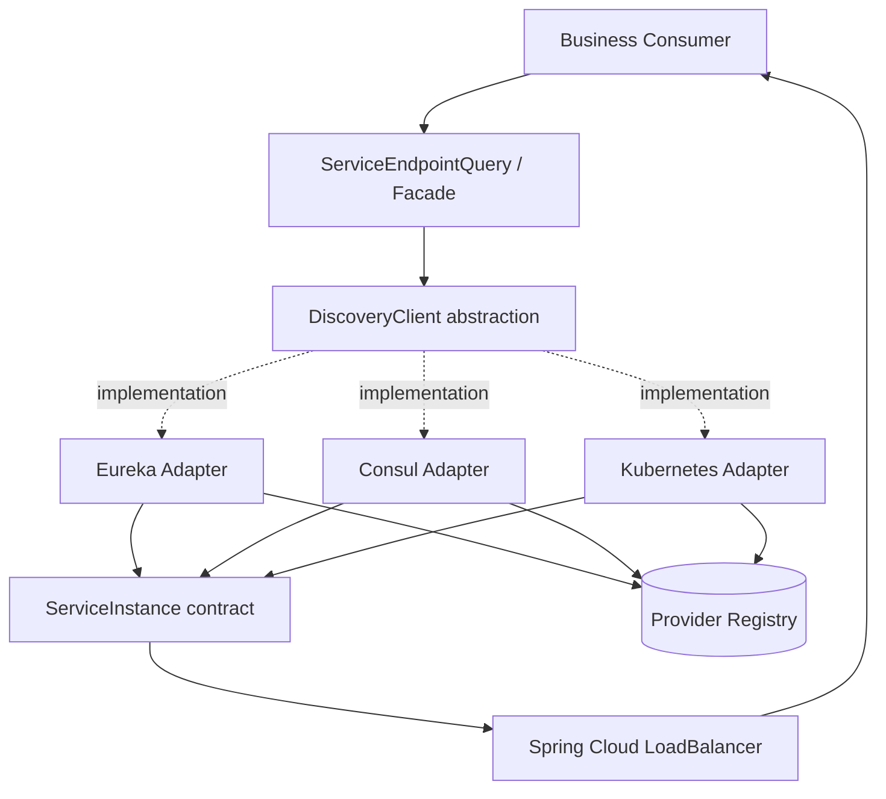

# Triển khai hợp đồng truy vấn và ánh xạ `ServiceInstance`

## 1. Vì sao cần một hợp đồng truy vấn chung?

Một ứng dụng có thể chuyển từ Eureka sang Consul, ZooKeeper hoặc Kubernetes mà không muốn sửa toàn bộ code gọi service. Nếu business code trực tiếp đọc `EurekaClient`, `ConsulClient`, Curator object hoặc Kubernetes API model, mỗi lần đổi registry sẽ kéo theo thay đổi ở nhiều tầng.

Spring Cloud Commons cung cấp một lớp abstraction để tách consumer khỏi registry cụ thể:

- `DiscoveryClient` định nghĩa cách đọc danh sách service và instance.
- `ServiceInstance` chuẩn hóa thông tin endpoint của một instance.
- `ServiceRegistry` định nghĩa thao tác đăng ký/hủy đăng ký instance.
- `Registration` đại diện dữ liệu đăng ký cụ thể của provider.
- Spring Cloud LoadBalancer sử dụng danh sách instance để chọn đích cho request.

Hợp đồng này cho phép consumer dùng chung một cách truy vấn, nhưng không làm mọi registry có dữ liệu giống hệt nhau. Host, port, metadata, health, zone và định danh instance vẫn có thể được biểu diễn khác nhau theo provider. Vì vậy, cần quy định rõ cách ánh xạ dữ liệu và giới hạn của hợp đồng trước khi chuyển đổi registry.

## 2. Phân biệt hợp đồng đọc và hợp đồng ghi

`DiscoveryClient` và `ServiceRegistry` phục vụ hai hướng khác nhau:

| Abstraction | Vai trò | Thao tác tiêu biểu |
|---|---|---|
| `DiscoveryClient` | Consumer đọc service registry | `getServices()`, `getInstances(serviceId)`, `probe()` |
| `ServiceInstance` | Biểu diễn endpoint trả về cho consumer | Service ID, instance ID, host, port, URI, secure flag, metadata |
| `ServiceRegistry` | Provider/application đăng ký hoặc hủy đăng ký | `register(registration)`, `deregister(registration)` |
| `Registration` | Dữ liệu đăng ký theo provider | `EurekaRegistration`, `ConsulRegistration`, `ZookeeperRegistration` |
| `LoadBalancer` | Chọn một instance cho request | Chọn endpoint từ danh sách `ServiceInstance` |

`DiscoveryClient` là hợp đồng truy vấn, không phải API đăng ký. `ServiceRegistry` là hợp đồng đăng ký, nhưng đối tượng `Registration` vẫn phụ thuộc provider. Không ép business code phải tạo `EurekaRegistration` hoặc `ConsulRegistration` nếu ứng dụng chỉ cần tìm endpoint.

Khi starter discovery tương ứng có trên classpath, Spring Cloud thường tự cấu hình `DiscoveryClient` và auto-registration. Với các phiên bản hiện hành, `@EnableDiscoveryClient` không còn bắt buộc trong nhiều trường hợp. Chỉ tắt auto-registration hoặc gọi `ServiceRegistry` thủ công khi lifecycle của ứng dụng thực sự cần tự điều khiển.

## 3. Hợp đồng `DiscoveryClient`

Blocking `DiscoveryClient` của Spring Cloud Commons có các phương thức đọc chính:

```java
package org.springframework.cloud.client.discovery;

import java.util.List;

import org.springframework.cloud.client.ServiceInstance;
import org.springframework.core.Ordered;

public interface DiscoveryClient extends Ordered {

    String description();

    List<ServiceInstance> getInstances(String serviceId);

    List<String> getServices();

    default void probe() {
        getServices();
    }
}
```

Ý nghĩa:

- `getServices()` trả về các service ID mà implementation hiện tại biết.
- `getInstances(serviceId)` trả về danh sách instance được đăng ký cho service ID đó.
- `description()` mô tả implementation, thường dùng trong health indicator.
- `probe()` kiểm tra khả năng discovery client thực hiện truy vấn; mặc định gọi `getServices()`, nhưng implementation có thể override bằng thao tác nhẹ hơn.
- `getOrder()` đến từ `Ordered`, dùng khi có nhiều discovery client.

Đây là hợp đồng blocking. Nếu ứng dụng WebFlux cần discovery reactive, sử dụng `ReactiveDiscoveryClient` thay vì gọi blocking client trên event-loop thread. Không tự bọc một lời gọi blocking bằng `Mono.just(discoveryClient.getInstances(...))` rồi cho rằng thao tác đã trở thành non-blocking; lời gọi vẫn chạy ngay trên thread hiện tại.

### 3.1. Quy ước đầu vào

Hợp đồng truy vấn của ứng dụng nên quy định:

1. `serviceId` không được null, rỗng hoặc chỉ chứa khoảng trắng.
2. Tên service phải theo quy ước canonical của hệ thống, ví dụ `payment-service`.
3. Không truyền host, IP hoặc URL instance vào tham số `serviceId`.
4. Nếu cần phân biệt namespace, region hoặc tenant, phải có quy ước riêng; `DiscoveryClient.getInstances(serviceId)` chỉ nhận một service ID, không có tham số filter chuẩn.
5. Không tự đổi chữ hoa/chữ thường nếu chưa thống nhất với cách provider đăng ký service ID.

Service ID là tên logic dùng để tìm một nhóm instance. Nó không phải instance ID và không phải địa chỉ mạng.

### 3.2. Quy ước đầu ra

Với một lần gọi `getInstances(serviceId)`:

- Danh sách rỗng có nghĩa là client hiện không biết instance nào cho service ID đó.
- Lỗi kết nối hoặc lỗi truy vấn registry cần được biểu diễn bằng exception/health state phù hợp, không biến thành danh sách rỗng một cách âm thầm.
- Hợp đồng trả về `List`; ứng dụng nên kỳ vọng danh sách không null. Nếu custom implementation trả null, xem đó là vi phạm hợp đồng và ghi nhận lỗi.
- Không giả định thứ tự phần tử ổn định hoặc phần tử đầu tiên là instance tốt nhất.
- Kết quả là góc nhìn tại thời điểm truy vấn; registry/cache có thể trễ so với trạng thái mạng thực tế.
- Không giả định mọi provider hỗ trợ pagination, filter metadata hoặc trả health status trong cùng API.

Phân biệt hai tình huống quan trọng:

| Kết quả | Ý nghĩa | Hành vi consumer |
|---|---|---|
| Danh sách rỗng | Không có instance được biết tại thời điểm truy vấn | Trả lỗi service unavailable hoặc chờ theo chính sách nghiệp vụ |
| Exception khi truy vấn | Registry/client không thể hoàn thành thao tác | Ghi nhận lỗi discovery, áp dụng timeout/retry/fallback có kiểm soát |

Nếu adapter bắt mọi exception rồi trả `List.of()`, hệ thống sẽ không phân biệt được “service chưa đăng ký” với “registry đang hỏng”. Điều này làm health check, alert và điều tra sự cố sai lệch.

### 3.3. `SimpleDiscoveryClient` cho môi trường tĩnh

Nếu không có registry-backed `DiscoveryClient` trên classpath, Spring Cloud có thể dùng `SimpleDiscoveryClient`, lấy danh sách instance từ cấu hình. Cách này hữu ích cho local development, integration test hoặc hệ thống có endpoint tĩnh:

```yaml
spring:
  cloud:
    discovery:
      client:
        simple:
          instances:
            payment-service:
              - uri: http://localhost:8081
              - uri: http://localhost:8082
            inventory-service:
              - uri: http://localhost:8091
```

`SimpleDiscoveryClient` vẫn trả `ServiceInstance`, nên consumer và LoadBalancer có thể dùng cùng hợp đồng. Tuy nhiên, danh sách này không tự cập nhật khi instance scale, restart hoặc đổi IP; chỉ dùng khi tính tĩnh của endpoint phù hợp với môi trường.

## 4. Hợp đồng `ServiceInstance`

`org.springframework.cloud.client.ServiceInstance` là mô hình endpoint chung. Các getter quan trọng:

| Phương thức | Ý nghĩa | Lưu ý khi ánh xạ |
|---|---|---|
| `getServiceId()` | Service ID logic | Dùng cùng quy ước với `getServices()` |
| `getInstanceId()` | ID duy nhất của instance nếu provider cung cấp | Có thể null; cần kiểm tra uniqueness theo service |
| `getHost()` | Hostname hoặc IP để kết nối | Phải truy cập được từ network của consumer |
| `getPort()` | Port của instance | Với HTTP/TCP cần kiểm tra trong khoảng 1–65535 |
| `isSecure()` | Endpoint có dùng HTTPS hay không | Phải nhất quán với scheme và port đã chọn |
| `getUri()` | URI endpoint | Ưu tiên dùng URI do implementation cung cấp |
| `getScheme()` | Scheme nếu implementation có cung cấp | Default method có thể trả null |
| `getMetadata()` | Map key/value metadata | Có thể null hoặc thiếu key; không chứa secret |

Trong API hiện hành, `getInstanceId()` và `getScheme()` là default method có thể trả null. Không được viết code giả định hai giá trị này luôn có mặt. `getMetadata()` cũng cần xử lý như dữ liệu tùy chọn.

`ServiceInstance` không chuẩn hóa tất cả thông tin của registry. Ví dụ, interface không có getter chuẩn cho:

- Health status như `UP`, `OUT_OF_SERVICE`, `passing`, `critical` hoặc Kubernetes readiness.
- Lease expiration, heartbeat timestamp hoặc registry resource version.
- Region/zone riêng biệt.
- Namespace, Pod UID, node name hoặc provider-specific tags.
- API version/capability của service.

Các dữ liệu bổ sung thường được đưa vào `metadata`, hoặc được giữ trong một domain model riêng của ứng dụng.

## 5. Quy định cách tạo URI và chọn scheme

Với endpoint HTTP, consumer cần URI có scheme, host và port đúng. `ServiceInstance.getUri()` là điểm truy cập chuẩn; không ghép chuỗi URL tùy tiện từ host và port nếu implementation có quy tắc riêng.

`DefaultServiceInstance` là implementation tiện ích của Spring Cloud Commons. `getUri()` tạo URI dựa trên `isSecure()`, host và port. Khi port không hợp lệ hoặc bằng 0, helper có thể dùng port mặc định 80/443; điều này không có nghĩa mọi service thiếu port đều có thể gọi được. Adapter nên xác thực dữ liệu trước khi tạo instance.

Ví dụ kiểm tra endpoint HTTP:

```java
import java.net.URI;
import java.util.Locale;
import java.util.Set;

import org.springframework.cloud.client.ServiceInstance;

public final class HttpEndpointValidator {

    private static final Set<String> ALLOWED_SCHEMES = Set.of("http", "https");

    private HttpEndpointValidator() {
    }

    public static URI validate(ServiceInstance instance) {
        if (instance == null) {
            throw new IllegalArgumentException("ServiceInstance không được null");
        }

        if (instance.getPort() < 1 || instance.getPort() > 65535) {
            throw new IllegalArgumentException("Port không hợp lệ: " + instance.getPort());
        }

        URI uri = instance.getUri();
        if (uri == null || uri.getHost() == null || uri.getScheme() == null) {
            throw new IllegalArgumentException("ServiceInstance không có URI hợp lệ");
        }

        String scheme = uri.getScheme().toLowerCase(Locale.ROOT);
        if (!ALLOWED_SCHEMES.contains(scheme)) {
            throw new IllegalArgumentException("Scheme HTTP không được hỗ trợ: " + scheme);
        }

        if (instance.isSecure() != "https".equals(scheme)) {
            throw new IllegalArgumentException("isSecure và URI scheme không nhất quán");
        }

        return uri;
    }
}
```

Validator trên dành cho service dùng HTTP/HTTPS. Nếu hệ thống dùng gRPC, TCP hoặc scheme khác, hãy xây dựng validator theo protocol đó thay vì áp dụng danh sách scheme này cho mọi loại service.

Không tự thêm context path vào URI nếu registry không công bố path. Path nghiệp vụ thường thuộc HTTP request. Nếu service dùng base path riêng, thống nhất metadata như `context-path` hoặc cấu hình client; không giả định `ServiceInstance` luôn chứa path.

## 6. Chuẩn hóa metadata

`getMetadata()` là `Map<String, String>` để provider có thể công bố thông tin bổ sung. Một schema metadata nên có quy ước tên key và ý nghĩa ổn định:

| Key gợi ý | Ý nghĩa | Ví dụ |
|---|---|---|
| `zone` | Availability zone | `ap-southeast-1a` |
| `region` | Region triển khai | `ap-southeast-1` |
| `environment` | Môi trường | `production` |
| `api-version` | Phiên bản API | `v2` |
| `protocol` | Protocol nghiệp vụ | `http`, `https`, `grpc` |
| `contract-version` | Phiên bản schema metadata của nền tảng | `1` |
| `capability` | Khả năng mà instance cung cấp | `refund`, `capture` |
| `namespace` | Namespace hoặc logical scope | `payments` |

Quy tắc:

- Dùng key ổn định, thống nhất giữa producer và consumer.
- Giá trị là chuỗi; parse kiểu số/boolean ở adapter có kiểm tra.
- Key không bắt buộc phải có ở mọi provider; consumer cần fallback khi thiếu.
- Không đưa password, token, private key hoặc thông tin bí mật vào metadata.
- Không giả định LoadBalancer tự hiểu metadata tùy chỉnh. Nếu metadata ảnh hưởng chọn instance, cần cấu hình supplier/policy đọc nó.
- Tránh đổi nghĩa của một key đang được consumer sử dụng; thêm key mới hoặc version schema.

### 6.1. Metadata không thay thế thuộc tính chuẩn

Nếu dữ liệu đã có trường chuẩn, hãy dùng trường chuẩn:

- Dùng `getHost()` thay vì metadata `host`.
- Dùng `getPort()` thay vì metadata `port`.
- Dùng `isSecure()`/`getUri()` thay vì chỉ đọc metadata `secure`.
- Dùng `getInstanceId()` thay vì metadata `instance-id` nếu provider đã ánh xạ ID vào getter.

Metadata chỉ dành cho thông tin mở rộng hoặc thông tin không có trường chuẩn. Tránh duy trì hai nguồn có thể lệch nhau cho cùng một thuộc tính.

## 7. Ánh xạ Eureka sang `ServiceInstance`

Eureka lưu application và các `InstanceInfo`. Một instance có thể chứa:

- App name/service ID.
- Instance ID.
- Hostname và IP address.
- Non-secure port và secure port.
- Status, home/status/health URL.
- Metadata map.

Khi ánh xạ sang `ServiceInstance`:

| Eureka `InstanceInfo` | Spring `ServiceInstance` |
|---|---|
| App name | `getServiceId()` |
| Instance ID | `getInstanceId()` |
| Hostname hoặc IP theo cấu hình | `getHost()` |
| Port phù hợp với scheme được chọn | `getPort()` |
| Secure port/status cấu hình | `isSecure()` |
| Metadata map | `getMetadata()` |
| Host + port + secure flag | `getUri()` |

`prefer-ip-address`, hostname, port và secure port phải được cấu hình phù hợp với network của consumer. Địa chỉ có thể phân giải được từ Eureka Server chưa chắc phân giải được từ mọi consumer.

Eureka status như `UP`, `DOWN`, `OUT_OF_SERVICE` không phải getter chuẩn của `ServiceInstance`. Việc loại instance không khỏe phụ thuộc discovery client, health integration hoặc `ServiceInstanceListSupplier`/LoadBalancer policy. Không suy ra instance khỏe chỉ vì một `ServiceInstance` đã được trả về.

Ví dụ metadata registration:

```yaml
spring:
  application:
    name: payment-service

eureka:
  instance:
    instance-id: ${spring.application.name}:${HOSTNAME:${server.port}}
    metadata-map:
      region: ap-southeast-1
      zone: ap-southeast-1a
      api-version: v2
      contract-version: "1"
```

Metadata được công bố trong registry và consumer có thể đọc. Metadata tùy chỉnh không tự thay đổi hành vi của Eureka Client nếu không có thành phần consumer hiểu ý nghĩa key đó.

## 8. Ánh xạ Consul sang `ServiceInstance`

Consul đăng ký service instance với service name, service ID, address, port, tags, metadata và health checks. Spring Cloud Consul sử dụng Consul HTTP API để đăng ký và truy vấn.

| Consul/Spring Cloud Consul | Spring `ServiceInstance` |
|---|---|
| Service name | `getServiceId()` |
| Service ID | `getInstanceId()` |
| Address/hostname được đăng ký | `getHost()` |
| Port | `getPort()` |
| Scheme/secure metadata | `isSecure()` và URI |
| Consul `meta` | `getMetadata()` |
| Address + port + scheme | `getUri()` |

Spring Cloud Consul có thể tạo metadata như `secure`, `group` và zone theo cấu hình. Với các phiên bản hiện hành, metadata map được cấu hình bằng `spring.cloud.consul.discovery.metadata`; không dựa vào cách các phiên bản cũ chuyển tags thành metadata.

Health checks của Consul có thể đánh dấu service `passing`, `warning` hoặc `critical`. `ServiceInstance` chuẩn không có trường status; hãy dùng query/filter health phù hợp trước khi đưa instance vào danh sách cho traffic, hoặc dùng supplier có health-check policy.

Ví dụ:

```yaml
spring:
  application:
    name: payment-service
  cloud:
    consul:
      discovery:
        instance-id: ${spring.application.name}:${HOSTNAME:${server.port}}
        scheme: https
        instance-zone: ap-southeast-1a
        metadata:
          region: ap-southeast-1
          api-version: v2
          contract-version: "1"
```

Nếu đăng ký qua Consul Agent, host/address phải truy cập được từ consumer. Không giả định `localhost` hoặc IP của container luôn là địa chỉ hợp lệ đối với node khác.

## 9. Ánh xạ Kubernetes sang `ServiceInstance`

Spring Cloud Kubernetes DiscoveryClient truy vấn Kubernetes Service và các endpoint. `getServices()` trả tên Service từ `metadata.name`; `getInstances(serviceId)` trả danh sách `ServiceInstance` tương ứng với endpoint có thể khám phá.

| Kubernetes | Spring `ServiceInstance` |
|---|---|
| Service `metadata.name` | `getServiceId()` |
| Endpoint/Pod identity | `getInstanceId()` |
| Endpoint IP hoặc ExternalName host | `getHost()` |
| Port được chọn từ Service/Endpoint | `getPort()` |
| `secured`, port name hoặc secure port rules | `isSecure()` |
| Endpoint URI | `getUri()` |
| Namespace, labels, annotations, port metadata | `getMetadata()` |

Kubernetes có một số điểm đặc thù:

- Một service ID có thể xuất hiện ở nhiều namespace; `getServices()` trả tên service duy nhất, không đủ để phân biệt namespace.
- Host thường là IP endpoint/pod; `ExternalName` có thể dùng hostname.
- Nếu Service có nhiều port, port chính được chọn theo label `primary-port-name`, cấu hình `spring.cloud.kubernetes.discovery.primary-port-name`, tên `https`/`http`, rồi fallback sang port đầu tiên. Fallback cuối có thể không ổn định nếu manifest đổi thứ tự port.
- Metadata namespace/Pod labels/annotations cần được bật theo cấu hình phù hợp.
- Endpoint chưa ready thường bị loại; `include-not-ready-addresses` chỉ nên bật cho mục tiêu quan sát đặc biệt, không dùng làm nguồn traffic mặc định.

Ví dụ Service công bố metadata:

```yaml
apiVersion: v1
kind: Service
metadata:
  name: payment-service
  namespace: payments
  labels:
    primary-port-name: http
    secured: "false"
    app.kubernetes.io/name: payment-service
spec:
  selector:
    app.kubernetes.io/name: payment-service
  ports:
    - name: http
      port: 80
      targetPort: 8080
```

Ví dụ cấu hình metadata:

```yaml
spring:
  cloud:
    kubernetes:
      discovery:
        metadata:
          add-labels: true
          add-annotations: true
          add-ports: true
          add-pod-labels: true
```

Kubernetes Service và EndpointSlice là nguồn dữ liệu; Spring Cloud Kubernetes ánh xạ chúng thành `ServiceInstance`. Không lấy trực tiếp `Pod` làm service ID nếu hợp đồng của ứng dụng định danh service bằng Kubernetes Service name.

## 10. Tạo adapter ánh xạ provider model

Nếu tự triển khai `DiscoveryClient` hoặc cần chuyển một registry record nội bộ sang Spring abstraction, hãy đặt mapping trong adapter riêng. Không để business service biết cấu trúc `InstanceInfo`, Consul `HealthService` hoặc Kubernetes `EndpointAddress`.

Một model nội bộ tối giản có thể là:

```java
import java.util.Map;

public record RegistryEndpoint(
        String serviceId,
        String instanceId,
        String host,
        int port,
        boolean secure,
        Map<String, String> metadata) {
}
```

Mapper sang Spring `ServiceInstance`:

```java
import java.util.LinkedHashMap;
import java.util.Map;

import org.springframework.cloud.client.DefaultServiceInstance;
import org.springframework.cloud.client.ServiceInstance;

public final class ServiceInstanceMapper {

    public ServiceInstance toSpringInstance(RegistryEndpoint source) {
        if (source == null) {
            throw new IllegalArgumentException("RegistryEndpoint không được null");
        }
        if (source.serviceId() == null || source.serviceId().isBlank()) {
            throw new IllegalArgumentException("serviceId không được rỗng");
        }
        if (source.host() == null || source.host().isBlank()) {
            throw new IllegalArgumentException("host không được rỗng");
        }
        if (source.port() < 1 || source.port() > 65535) {
            throw new IllegalArgumentException("port không hợp lệ");
        }

        Map<String, String> metadata = source.metadata() == null
                ? new LinkedHashMap<>()
                : new LinkedHashMap<>(source.metadata());

        return new DefaultServiceInstance(
                source.instanceId(),
                source.serviceId(),
                source.host(),
                source.port(),
                source.secure(),
                metadata
        );
    }
}
```

`RegistryEndpoint` là ví dụ domain model nội bộ, không phải class của Spring Cloud. Trong adapter thực tế, mỗi provider cần một mapper từ model nguồn sang `RegistryEndpoint`; sau đó mới chuyển sang `DefaultServiceInstance`. Như vậy, business layer không bị phụ thuộc vào thư viện registry.

Nếu không cần domain model trung gian, có thể ánh xạ trực tiếp provider model sang `DefaultServiceInstance`. Chỉ thêm lớp trung gian khi nó giúp kiểm soát schema, test hoặc hỗ trợ nhiều provider.

## 11. Xây dựng facade truy vấn cho business code

Business code thường không cần biết provider cụ thể. Có thể bọc `DiscoveryClient` bằng một facade để chuẩn hóa đầu vào, kết quả và lỗi:

```java
import java.util.List;

import org.springframework.cloud.client.ServiceInstance;
import org.springframework.cloud.client.discovery.DiscoveryClient;
import org.springframework.stereotype.Component;

@Component
public class ServiceInstanceCatalog {

    private final DiscoveryClient discoveryClient;

    public ServiceInstanceCatalog(DiscoveryClient discoveryClient) {
        this.discoveryClient = discoveryClient;
    }

    public List<ServiceInstance> findInstances(String serviceId) {
        if (serviceId == null || serviceId.isBlank()) {
            throw new IllegalArgumentException("serviceId không được rỗng");
        }

        List<ServiceInstance> instances = discoveryClient.getInstances(serviceId);
        if (instances == null) {
            throw new IllegalStateException("DiscoveryClient vi phạm hợp đồng: trả null");
        }

        return List.copyOf(instances);
    }

    public List<String> findServiceIds() {
        List<String> serviceIds = discoveryClient.getServices();
        if (serviceIds == null) {
            throw new IllegalStateException("DiscoveryClient vi phạm hợp đồng: trả null");
        }

        return List.copyOf(serviceIds);
    }
}
```

Facade không nuốt exception của registry. Nếu không có instance, phương thức trả danh sách rỗng. Nếu registry không truy cập được, exception đi lên để tầng gọi quyết định fallback, retry hoặc trả lỗi phù hợp.

Không nên thêm phương thức `getFirstInstance()` rồi luôn lấy phần tử `[0]`. Thứ tự instance không phải hợp đồng chọn tải. Khi cần gửi request, dùng Spring Cloud LoadBalancer.

## 12. Để LoadBalancer chọn instance

`DiscoveryClient` trả danh sách instance; nó không phải thuật toán cân bằng tải. Spring Cloud LoadBalancer dùng `ServiceInstanceListSupplier` và `ReactorLoadBalancer`/blocking load balancer để chọn instance theo cấu hình.

Ví dụ với `RestTemplate`:

```java
import org.springframework.cloud.client.loadbalancer.LoadBalanced;
import org.springframework.context.annotation.Bean;
import org.springframework.context.annotation.Configuration;
import org.springframework.web.client.RestTemplate;

@Configuration
public class HttpClientConfiguration {

    @Bean
    @LoadBalanced
    RestTemplate loadBalancedRestTemplate() {
        return new RestTemplate();
    }
}
```

Consumer gọi service bằng logical service ID:

```java
import org.springframework.stereotype.Service;
import org.springframework.web.client.RestTemplate;

@Service
public class PaymentClient {

    private final RestTemplate restTemplate;

    public PaymentClient(RestTemplate restTemplate) {
        this.restTemplate = restTemplate;
    }

    public PaymentResponse getPayment(String paymentId) {
        return restTemplate.getForObject(
                "http://payment-service/api/payments/{id}",
                PaymentResponse.class,
                paymentId
        );
    }
}
```

Ứng dụng cần dependency Spring Cloud LoadBalancer tương ứng và quản lý phiên bản bằng Spring Cloud BOM phù hợp với Spring Boot. Khi dùng `@LoadBalanced`, không tự phân giải `payment-service` thành IP trước khi gọi; LoadBalancer cần nhận logical service ID để chọn instance.

Nếu cần chiến lược theo zone, metadata, weight hoặc API version, cấu hình `ServiceInstanceListSupplier`/LoadBalancer policy tương ứng. Metadata chỉ có tác dụng khi supplier/strategy đọc và áp dụng nó.

## 13. Thiết kế hợp đồng truy vấn mở rộng

`DiscoveryClient.getInstances(serviceId)` chỉ có một tham số service ID. Nó không chuẩn hóa filter, pagination, namespace, zone hoặc health criteria. Nếu sản phẩm cần truy vấn nâng cao, tạo một interface riêng của ứng dụng thay vì kỳ vọng mọi provider đều hỗ trợ cùng khả năng.

Ví dụ hợp đồng mở rộng:

```java
import java.util.List;
import java.util.Map;

public interface ServiceEndpointQuery {

    List<ServiceEndpoint> find(ServiceQuery query);
}

public record ServiceQuery(
        String serviceId,
        String region,
        String zone,
        Map<String, String> requiredMetadata) {
}

public record ServiceEndpoint(
        String serviceId,
        String instanceId,
        String host,
        int port,
        String scheme,
        Map<String, String> metadata) {
}
```

Interface này là hợp đồng thuộc ứng dụng, không phải API có sẵn của Spring Cloud. Adapter có thể dùng `DiscoveryClient` để lấy snapshot rồi áp dụng filter local, hoặc dùng API provider-specific nếu cần server-side filtering. Hãy ghi rõ khác biệt vì lọc local sau khi tải toàn bộ registry có thể tốn bộ nhớ và không có pagination.

### 13.1. Quy tắc khi thêm filter

- `serviceId` là điều kiện bắt buộc.
- `region`/`zone` là điều kiện tùy chọn; instance thiếu metadata không tự động được coi là cùng zone.
- `requiredMetadata` chỉ khớp khi key tồn tại và value đúng theo quy ước.
- Health criteria phải được xử lý riêng vì `ServiceInstance` không có status chuẩn.
- Nếu provider không hỗ trợ một filter, trả kết quả theo semantics đã công bố hoặc báo capability không hỗ trợ; không âm thầm bỏ điều kiện.
- Nếu filter được áp dụng local, ghi nhận số instance trước và sau lọc để quan sát.

## 14. Tính tương thích khi chuyển registry

Đổi provider không chỉ là thay dependency. Cần kiểm tra hợp đồng dữ liệu trước khi chuyển traffic:

| Hạng mục | Câu hỏi cần trả lời |
|---|---|
| Service ID | Provider mới có giữ nguyên tên logic mà consumer gọi không? |
| Instance ID | Có duy nhất giữa các replica và ổn định khi retry registration không? |
| Host | Consumer có truy cập được địa chỉ được công bố không? |
| Port | Port là port nghiệp vụ, management hay port của Service/proxy? |
| Scheme | HTTPS có được ánh xạ đúng vào `isSecure()`/URI không? |
| Metadata | Key/value có cùng tên và cùng ý nghĩa không? |
| Health | Instance unhealthy có bị loại khỏi danh sách chọn traffic không? |
| Namespace/zone | Có giữ được phạm vi và ưu tiên topology không? |
| Freshness | Cache/refresh interval và propagation delay có đáp ứng SLO không? |
| Error semantics | Empty list và registry unavailable có được phân biệt không? |

Một quy trình migration có thể gồm:

1. Định nghĩa schema service ID, instance ID, URI và metadata độc lập với provider.
2. Viết mapper/adapter cho provider hiện tại và provider mới.
3. Chạy contract test giống nhau trên cả hai adapter.
4. Đăng ký song song trong môi trường kiểm thử hoặc giai đoạn shadow, dùng instance ID/namespace rõ ràng để tránh xung đột.
5. So sánh số lượng instance, host, port, scheme, metadata và health filtering.
6. Chuyển một nhóm consumer/canary sang provider mới.
7. Theo dõi lỗi lookup, lỗi request, propagation delay và stale instance.
8. Chuyển toàn bộ traffic khi kết quả đạt tiêu chí; sau đó mới ngừng đăng ký ở provider cũ theo kế hoạch.

Không gộp hai danh sách instance từ hai registry bằng cách so sánh host/port đơn giản. Một instance có thể được đăng ký ở cả hai registry với ID khác nhau; cần khóa hợp nhất có quy tắc rõ ràng, thường là service ID + instance ID trong cùng provider scope.

## 15. Kiểm thử contract cho từng provider

Contract test bảo đảm mọi implementation ánh xạ dữ liệu theo cùng quy tắc. Bộ test nên chạy trên fixture của Eureka, Consul, Kubernetes hoặc custom registry adapter.

| Nhóm kiểm thử | Điều kiện cần xác minh |
|---|---|
| Service identity | `getServiceId()` khớp service ID canonical |
| Instance identity | ID duy nhất; null được xử lý theo chính sách |
| Endpoint | Host và port hợp lệ, truy cập được từ consumer network |
| Scheme | `isSecure()` và URI scheme không mâu thuẫn |
| URI | Host, port, scheme được giữ đúng; không tự thêm path không được công bố |
| Metadata | Thiếu map/key không làm lỗi; key tùy chỉnh có schema nhất quán |
| Empty result | Service chưa có instance trả danh sách rỗng |
| Backend failure | Lỗi registry được giữ là lỗi, không biến thành empty result |
| Health | Instance không đạt health policy bị loại khỏi traffic selection |
| Ordering | Test không phụ thuộc thứ tự danh sách trả về |
| Freshness | Thay đổi đăng ký/hủy đăng ký được nhìn thấy trong propagation SLO |
| Compatibility | Consumer không cần import provider-specific model |

Ví dụ test mapper:

```java
import static org.junit.jupiter.api.Assertions.assertEquals;
import static org.junit.jupiter.api.Assertions.assertFalse;

import java.util.Map;

import org.junit.jupiter.api.Test;
import org.springframework.cloud.client.ServiceInstance;

class ServiceInstanceMapperTest {

    private final ServiceInstanceMapper mapper = new ServiceInstanceMapper();

    @Test
    void mapsRegistryEndpointToCommonContract() {
        RegistryEndpoint source = new RegistryEndpoint(
                "payment-service",
                "payment-pod-a",
                "10.0.1.21",
                8080,
                false,
                Map.of("zone", "zone-a", "api-version", "v2")
        );

        ServiceInstance actual = mapper.toSpringInstance(source);

        assertEquals("payment-service", actual.getServiceId());
        assertEquals("payment-pod-a", actual.getInstanceId());
        assertEquals("10.0.1.21", actual.getHost());
        assertEquals(8080, actual.getPort());
        assertFalse(actual.isSecure());
        assertEquals("http://10.0.1.21:8080", actual.getUri().toString());
        assertEquals("zone-a", actual.getMetadata().get("zone"));
    }
}
```

Test trên kiểm tra mapper minh họa; trong dự án thực tế, chạy cùng bộ contract assertions cho từng provider adapter và bổ sung case HTTPS, metadata rỗng, port sai, ID thiếu, endpoint not-ready và exception từ registry. Ví dụ dùng `record`, `Map.of` và `List.copyOf`, phù hợp Java 16+; với baseline Java cũ hơn, thay record bằng class bất biến và dùng cách tạo collection tương ứng.

## 16. Những lỗi thiết kế thường gặp

| Lỗi | Hậu quả | Cách thiết kế đúng |
|---|---|---|
| Business code inject `EurekaClient` trực tiếp | Khó đổi provider | Dùng `DiscoveryClient` cho truy vấn chung |
| Dùng `ServiceRegistry` để truy vấn | Nhầm hợp đồng ghi và đọc | Dùng `DiscoveryClient` để tìm instance |
| Luôn lấy `instances.get(0)` | Phụ thuộc thứ tự không được bảo đảm | Dùng LoadBalancer để chọn instance |
| Giả định `instanceId` luôn có giá trị | Null hoặc ID trùng gây lỗi correlation | Kiểm tra null và định nghĩa uniqueness |
| Dùng metadata thay host/port chuẩn | Dữ liệu có thể lệch | Dùng getter chuẩn, metadata cho phần mở rộng |
| Xem `ServiceInstance` có nghĩa instance healthy | Có thể gửi request tới instance lỗi | Health filter/supplier riêng |
| Biến exception thành danh sách rỗng | Che lỗi registry | Giữ riêng empty result và backend failure |
| Giả định metadata giống nhau giữa provider | Consumer lỗi khi migrate | Định nghĩa schema và mapper chung |
| Tự ghép URI không kiểm tra scheme | Gọi HTTP vào endpoint HTTPS hoặc ngược lại | Dùng `getUri()` và validate |
| Giữ instance/URI cache vĩnh viễn | Gọi endpoint cũ sau scale/rollout | Refresh theo chính sách hoặc dùng LoadBalancer |
| Dùng discovery API như query database | Kỳ vọng pagination/filter/transaction không có trong contract | Tạo application-specific query abstraction nếu cần |

## 17. Sơ đồ kiến trúc hợp đồng



Các adapter chuyển provider model thành `ServiceInstance`. Consumer dùng hợp đồng chung để đọc endpoint; LoadBalancer quyết định instance cho request. Nếu ứng dụng cần truy vấn nâng cao hơn `DiscoveryClient`, đặt interface riêng ở tầng application và triển khai adapter cho từng provider.

## 18. Checklist triển khai

- [ ] Phân biệt hợp đồng đọc `DiscoveryClient` với hợp đồng ghi `ServiceRegistry`.
- [ ] Chuẩn hóa service ID và quy tắc phân biệt chữ hoa/chữ thường.
- [ ] Quy định uniqueness và nullability của instance ID.
- [ ] Ánh xạ host, port, URI và secure flag nhất quán.
- [ ] Xác định schema metadata, key optional và version.
- [ ] Không đưa secret vào metadata.
- [ ] Phân biệt danh sách rỗng với lỗi truy vấn registry.
- [ ] Không giả định thứ tự instance hoặc tự chọn phần tử đầu.
- [ ] Để LoadBalancer chọn instance cho request.
- [ ] Xử lý health status riêng vì `ServiceInstance` không chuẩn hóa trạng thái health.
- [ ] Viết contract test chung cho Eureka, Consul, Kubernetes và custom adapter.
- [ ] Đo freshness/propagation delay và xử lý stale instance.
- [ ] Khi migration, so sánh endpoint/metadata/health trước khi chuyển traffic.
- [ ] Dùng Spring Cloud BOM để giữ phiên bản Spring Boot/Spring Cloud tương thích.

## 19. Kết luận

`DiscoveryClient` và `ServiceInstance` tạo hợp đồng truy vấn chung để consumer tìm endpoint mà không phụ thuộc trực tiếp vào Eureka, Consul hoặc Kubernetes. `ServiceRegistry` phục vụ đăng ký/hủy đăng ký, còn `LoadBalancer` chọn instance cho từng request. Ba vai trò cần được tách rõ trong kiến trúc.

Khi triển khai hoặc chuyển đổi provider, hãy chuẩn hóa service ID, instance ID, host, port, URI, secure flag và metadata; quy định rõ empty result, backend failure, health filtering và freshness. Adapter chịu trách nhiệm ánh xạ dữ liệu provider sang `ServiceInstance`, còn business code chỉ sử dụng hợp đồng chung. Contract test trên mọi provider sẽ giúp phát hiện sai lệch trước khi chuyển traffic.

## Tài liệu tham khảo

- [Spring Cloud Commons – Common Abstractions](https://docs.spring.io/spring-cloud-commons/reference/spring-cloud-commons/common-abstractions.html)
- [Spring Cloud Commons – `DiscoveryClient` source](https://github.com/spring-cloud/spring-cloud-commons/blob/main/spring-cloud-commons/src/main/java/org/springframework/cloud/client/discovery/DiscoveryClient.java)
- [Spring Cloud Commons – `ServiceInstance` source](https://github.com/spring-cloud/spring-cloud-commons/blob/main/spring-cloud-commons/src/main/java/org/springframework/cloud/client/ServiceInstance.java)
- [Spring Cloud Netflix – Eureka Clients and Metadata](https://docs.spring.io/spring-cloud-netflix/reference/spring-cloud-netflix.html)
- [Spring Cloud Consul – Service Discovery and Metadata](https://docs.spring.io/spring-cloud-consul/reference/discovery.html)
- [Spring Cloud Kubernetes – DiscoveryClient](https://docs.spring.io/spring-cloud-kubernetes/reference/discovery-client.html)
