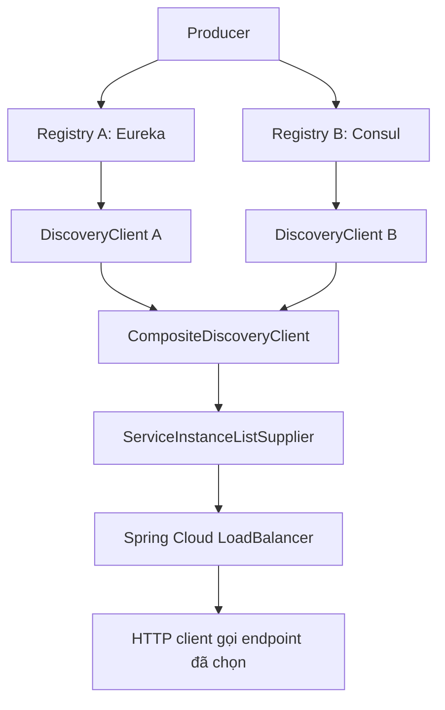

# Thiết kế thứ tự và kết hợp với các client có sẵn

Khi một hệ thống đã dùng Eureka nhưng cần chuyển sang Consul, hoặc cần bổ sung một nguồn discovery nội bộ, không nhất thiết phải thay toàn bộ code gọi service. Spring Cloud Commons chuẩn hóa các implementation bằng `DiscoveryClient` và có thể đưa nhiều client vào một composite. Tuy nhiên, thêm client vào classpath mới chỉ giải quyết việc đọc dữ liệu; kiến trúc vẫn cần quyết định registry nào có quyền ưu tiên, lúc nào cần kết hợp instance, producer đăng ký vào đâu và cách rollback khi dữ liệu giữa các nguồn chưa đồng nhất.

Thiết kế tốt bắt đầu từ mục tiêu của quá trình mở rộng. Nếu một service chỉ được sở hữu bởi một registry tại một thời điểm, thứ tự ưu tiên thường đủ. Nếu cùng một service có các instance khác nhau nằm ở nhiều registry và tất cả đều phải nhận traffic, cần một chiến lược union có kiểm soát. Nếu đang di chuyển registry, nên đọc song song để so sánh trước khi chuyển traffic và duy trì đường rollback trong thời gian chuyển đổi.

## 1. Xác định mục tiêu trước khi thêm client

Giả sử hệ thống đang dùng Eureka và muốn đưa Consul vào dần. Có thể tồn tại các tình huống khác nhau:

| Tình huống | Mục tiêu | Cách kết hợp phù hợp |
|---|---|---|
| Eureka là nguồn chính, Consul chỉ dự phòng | Chọn Consul khi Eureka không có instance phù hợp | Đặt thứ tự ưu tiên và kiểm tra fallback |
| Consul là nguồn mới, Eureka vẫn phục vụ service chưa di chuyển | Ưu tiên Consul, giữ Eureka làm nguồn dự phòng cho service còn lại | Đặt order theo giai đoạn migration; giữ cùng service ID nếu muốn fallback theo một tên |
| Một nhóm instance chỉ nằm ở Eureka, nhóm khác chỉ nằm ở Consul | Consumer cần nhìn thấy cả hai nhóm | Kết hợp instance bằng reactive composite hoặc adapter/supplier union có dedup |
| Cùng một instance được đăng ký ở cả hai registry | Hai registry đang giữ bản sao của cùng workload | Shadow-read/so sánh hoặc union có loại trùng; tránh gửi hai lần traffic tới cùng endpoint |
| Chưa tin cậy registry mới | Đo độ đầy đủ và độ trễ của dữ liệu mới | Shadow-read; không đưa kết quả mới vào routing production |

Không dùng một cấu hình `order` duy nhất để giải quyết mọi tình huống. Thứ tự ưu tiên, kết hợp instance, dual registration và shadow-read là các quyết định riêng.

## 2. Các lớp cần phân biệt

Spring Cloud có hai abstraction quan trọng:

- `DiscoveryClient` đọc service ID và `ServiceInstance` từ một nguồn.
- `ServiceRegistry` đăng ký, hủy đăng ký hoặc thay đổi trạng thái registration của một nguồn.

`CompositeDiscoveryClient` kết hợp các `DiscoveryClient` để consumer có một abstraction đọc chung. Nó không tự bảo đảm producer được đăng ký vào mọi registry. Tương tự, việc có hai `ServiceRegistry` trên classpath không tự tạo một giao dịch dual-write nguyên tử giữa hai hệ thống.

Đường đi của một request có thể hình dung như sau:



Đăng ký và tra cứu có vòng đời khác nhau. Consumer có thể đọc cả Eureka lẫn Consul trong khi producer chỉ đăng ký vào một nơi. Hoặc producer có thể dual-register trong khi consumer vẫn chỉ dùng một registry để tránh traffic bị nhân đôi.

## 3. Spring Cloud tạo composite từ các client có sẵn

`DiscoveryClient` của Spring Cloud Commons kế thừa `Ordered`. Composite auto-configuration nhận danh sách các bean `DiscoveryClient` và tạo `CompositeDiscoveryClient` làm bean `@Primary`. Vì vậy, khi ứng dụng inject `DiscoveryClient` theo type thông thường, bean được ưu tiên thường là composite; các client thành phần vẫn tồn tại để composite ủy quyền.

Ví dụ các implementation có thể cùng xuất hiện trên classpath:

- `EurekaDiscoveryClient` từ `spring-cloud-starter-netflix-eureka-client`.
- `ConsulDiscoveryClient` từ `spring-cloud-starter-consul-discovery`.
- `ZookeeperDiscoveryClient` từ starter ZooKeeper.
- `SimpleDiscoveryClient` hoặc một `DiscoveryClient` tùy chỉnh.

Không cần tự tạo composite mới chỉ để dùng đồng thời hai starter được Spring Cloud hỗ trợ. Trước khi thêm wrapper, kiểm tra bean thực tế trong application context để tránh tạo một composite lồng nhau hoặc một bean `@Primary` cạnh tranh với composite mặc định.

### 3.1. Service enumeration không đồng nghĩa với union instance

`getServices()` liệt kê service ID mà các nguồn discovery biết tới. Một service ID có thể xuất hiện trong danh sách dù các registry đang có tập instance khác nhau.

`getInstances(serviceId)` mới là dữ liệu mà LoadBalancer sử dụng. Cần xác định rõ API blocking hoặc reactive đang dùng và chính sách kết hợp của composite tương ứng. Đừng suy luận rằng vì `getServices()` tổng hợp tên service từ nhiều client nên `getInstances()` cũng luôn nối tất cả instance.

### 3.2. Composite health indicator là một chức năng khác

`DiscoveryCompositeHealthContributor` tổng hợp các `DiscoveryHealthIndicator` để báo trạng thái các integration. Nó không quyết định registry nào được ưu tiên và cũng không thay đổi danh sách instance của LoadBalancer.

Nếu registry cũ đang ngừng hoạt động trong lúc migration, composite health có thể báo một integration lỗi dù registry mới vẫn phục vụ request. Hãy định nghĩa readiness của ứng dụng theo nguồn discovery đang thực sự cần cho workload, và theo dõi tình trạng từng registry riêng. Có thể tắt composite health contributor bằng `spring.cloud.discovery.client.composite-indicator.enabled=false` nếu ứng dụng thay thế nó bằng health indicator phù hợp hơn.

## 4. Thiết kế thứ tự ưu tiên

`DiscoveryClient` dùng `Ordered`; số nhỏ hơn được ưu tiên trước. Giá trị mặc định của interface là `0`. Nếu mọi client đều giữ mặc định, không nên dựa vào thứ tự tạo bean để quyết định nguồn nào thắng. Hãy đặt order khác nhau cho các nguồn có vai trò rõ ràng.

Các thuộc tính thường dùng:

| Client | Thuộc tính |
|---|---|
| Eureka | `eureka.client.order` |
| Consul | `spring.cloud.consul.discovery.order` |
| ZooKeeper | `spring.cloud.zookeeper.discovery.order` |
| Simple | `spring.cloud.discovery.client.simple.order` |

Ví dụ khi Consul là registry mục tiêu và Eureka vẫn giữ vai trò dự phòng:

```yaml
spring:
  cloud:
    consul:
      discovery:
        enabled: true
        order: -10

eureka:
  client:
    enabled: true
    order: 0
```

Với thứ tự trên, Consul có độ ưu tiên cao hơn Eureka. Trong composite blocking, thứ tự client ảnh hưởng tới nguồn được hỏi trước; với reactive composite, cần chú ý thêm thuộc tính `order-enforced` ở phần sau vì mặc định reactive chọn nguồn trả kết quả không rỗng nhanh nhất.

Không đặt cùng order cho các registry mà thứ tự có ý nghĩa với traffic. Nếu hai client cùng order, hãy coi thứ tự giữa chúng là không được bảo đảm và thiết kế sao cho kết quả không phụ thuộc vào thứ tự đó.

## 5. Cùng một service ID ở nhiều registry

Thứ tự chỉ có ý nghĩa rõ khi các registry sử dụng service ID tương thích. Ví dụ consumer tra cứu `inventory-service`; cả Eureka và Consul cần biết tên service tương ứng hoặc phải có adapter ánh xạ alias.

Nếu registry cũ dùng `inventory-service` nhưng registry mới dùng `inventory`, composite không tự suy ra hai tên đó là cùng một service. Có thể:

- Chuẩn hóa service name trong quá trình đăng ký.
- Giữ alias tương thích ở consumer trong giai đoạn chuyển đổi.
- Viết adapter ánh xạ service ID nếu hai hệ thống bắt buộc dùng quy ước tên khác nhau.

Không đổi service ID đồng loạt khi consumer cũ vẫn tra cứu tên cũ. Hãy giữ hợp đồng tên service ổn định qua thời gian migration hoặc triển khai alias theo từng nhóm consumer.

## 6. Blocking và reactive cần cấu hình riêng

Spring Cloud Commons cung cấp cả `DiscoveryClient` blocking và `ReactiveDiscoveryClient`. Hai composite không có cùng mặc định về cách chọn instance.

### 6.1. Blocking lookup

Với ứng dụng blocking, `CompositeDiscoveryClient` sử dụng danh sách client đã được sắp theo order để điều phối lookup. Mô hình ưu tiên phù hợp khi mỗi service ID có một registry nguồn chính và các registry sau làm fallback khi nguồn trước không có instance.

Không xem lỗi kết nối tới registry là kết quả rỗng. Một client có thể ném exception khi truy vấn; thứ tự ưu tiên tự nó không phải circuit breaker và không bảo đảm mọi lỗi đều được chuyển thành fallback. Hãy kiểm tra cách implementation biểu diễn lỗi và kiểm thử tình huống timeout/exception riêng với tình huống danh sách rỗng.

### 6.2. Reactive lookup

Reactive composite mặc định trả instance từ client nhanh nhất có kết quả không rỗng. Vì vậy, `order` không bảo đảm registry có độ ưu tiên cao hơn sẽ thắng nếu client khác phản hồi nhanh hơn.

Muốn reactive lookup tuân theo order:

```yaml
spring:
  cloud:
    discovery:
      reactive:
        order-enforced: true
        combine-instances: false
```

Khi `order-enforced: true`, client ưu tiên thấp hơn chỉ được subscribe sau khi các client ưu tiên cao hơn không trả instance. Một client ưu tiên cao phản hồi chậm hoặc không kết thúc có thể trì hoãn kết quả. Tài liệu Spring Cloud Commons cũng nêu lỗi từ client đang được hỏi có thể được propagate thay vì tự động fallback.

Muốn kết hợp instance từ tất cả reactive clients:

```yaml
spring:
  cloud:
    discovery:
      reactive:
        order-enforced: false
        combine-instances: true
```

`combine-instances: true` gộp instance từ các reactive discovery client; lỗi của một client được ghi log và không ngăn kết quả từ các client khác được trả về. Nếu bật đồng thời `order-enforced: true`, các client được truy vấn theo order đã cấu hình và kết quả vẫn được kết hợp. Hãy kiểm thử thời gian chờ và hành vi lỗi với phiên bản Spring Cloud đang triển khai.

### 6.3. Bảng chọn chế độ

| Mục tiêu | `order-enforced` | `combine-instances` |
|---|---:|---:|
| Reactive ưu tiên nguồn phản hồi nhanh | `false` | `false` |
| Reactive fallback theo thứ tự | `true` | `false` |
| Reactive union các nguồn | `false` | `true` |
| Reactive union nhưng subscribe theo thứ tự | `true` | `true` |

Hai thuộc tính này áp dụng cho reactive composite. Không dùng chúng để suy luận rằng blocking `CompositeDiscoveryClient` cũng sẽ union instance.

## 7. Cấu hình consumer đọc hai registry trong giai đoạn migration

Ví dụ `order-service` chỉ đọc từ cả Consul và Eureka, không tự đăng ký vào hai nơi. Consul được ưu tiên; Eureka là nguồn dự phòng cho service chưa di chuyển:

```yaml
spring:
  application:
    name: order-service
  cloud:
    consul:
      host: ${CONSUL_HOST:localhost}
      port: ${CONSUL_PORT:8500}
      discovery:
        enabled: true
        register: false
        order: -10
    discovery:
      reactive:
        order-enforced: true
        combine-instances: false

eureka:
  client:
    enabled: true
    register-with-eureka: false
    fetch-registry: true
    order: 0
    service-url:
      defaultZone: ${EUREKA_URL:http://localhost:8761/eureka/}
```

Trong ví dụ:

- `spring.cloud.consul.discovery.register: false` tắt đăng ký producer vào Consul, nhưng vẫn giữ Consul Discovery để tra cứu.
- `eureka.client.register-with-eureka: false` tắt self-registration vào Eureka.
- `eureka.client.fetch-registry: true` giữ việc tải registry cho consumer.
- `enabled` giữ integration hoạt động; không tắt toàn bộ discovery.
- `order` đặt Consul trước Eureka.
- Reactive mode được ép theo order và không union instance.

Nếu ứng dụng chỉ dùng blocking client, các thuộc tính reactive không thay đổi cách lookup blocking. Cấu hình phải phản ánh loại HTTP client và API discovery mà ứng dụng thực sự sử dụng.

Không đặt `spring.cloud.discovery.enabled=false` nếu mục tiêu chỉ là tắt một provider; thuộc tính này có phạm vi toàn bộ discovery. Hãy dùng thuộc tính enable riêng của provider hoặc các cờ register/fetch phù hợp.

## 8. Đăng ký vào nhiều registry là một quyết định riêng

Trong lúc chuyển đổi, producer có thể cần đăng ký cùng service vào Eureka và Consul để consumer ở hai nhóm đều tìm thấy instance. Đây là dual registration/dual write. Composite discovery ở consumer không tự thực hiện việc đó.

Ví dụ cấu hình producer cho giai đoạn dual registration:

```yaml
spring:
  application:
    name: inventory-service
  cloud:
    consul:
      discovery:
        enabled: true
        register: true
        deregister: true

eureka:
  client:
    enabled: true
    register-with-eureka: true
    fetch-registry: true
    should-unregister-on-shutdown: true
```

Cấu hình này thể hiện ý định đăng ký ở cả hai integration. Trước khi rollout, xác nhận cả hai auto-registration lifecycle thực sự được tạo trong application context của phiên bản đang dùng và kiểm tra từng registry sau khi startup. Không giả định hai thao tác đăng ký là một giao dịch nguyên tử.

Spring Cloud Commons có thuộc tính toàn cục `spring.cloud.service-registry.auto-registration.enabled`. Nếu đặt `false`, auto-registration của các integration bị tắt; chỉ dùng khi chủ động quản lý đăng ký bằng code hoặc quy trình triển khai. Với dual registration có kiểm soát, có thể dùng `ServiceRegistry` của từng provider, nhưng mỗi implementation cần `Registration` đúng loại tương ứng. Không truyền `EurekaRegistration` cho `ConsulServiceRegistry` hoặc ngược lại.

### 8.1. Xử lý đăng ký một phần thành công

Giả sử Consul nhận registration nhưng Eureka timeout. Ứng dụng đang ở trạng thái chỉ một nửa được công bố. Quy trình cần quyết định:

- Retry đăng ký vào registry còn thiếu với backoff và giới hạn.
- Giữ trạng thái deployment chưa hoàn tất cho tới khi đạt điều kiện đăng ký cần thiết.
- Nếu đăng ký một nguồn là tùy chọn, ghi nhận trạng thái degraded và cảnh báo.
- Nếu rollout thất bại, deregister nguồn đã thành công hoặc giữ lại theo kế hoạch rollback.

Registration phải idempotent theo instance identity. Khi shutdown, phải deregister ở tất cả registry mà producer đã đăng ký thành công. Cần có cơ chế cleanup cho trường hợp process chết trước khi deregister.

### 8.2. Phân biệt register và fetch

| Provider | Đăng ký chính ứng dụng | Tra cứu registry |
|---|---|---|
| Eureka | `eureka.client.register-with-eureka` | `eureka.client.fetch-registry` |
| Consul | `spring.cloud.consul.discovery.register` | Consul Discovery Client được bật bằng `spring.cloud.consul.discovery.enabled` |

Đừng tắt `fetch-registry` chỉ vì consumer không muốn đăng ký chính nó. Ngược lại, producer có thể đăng ký chính mình mà không cần tải toàn bộ registry nếu nó không gọi service khác.

## 9. Chuẩn hóa identity và metadata trước khi kết hợp

Khi một service được đăng ký ở nhiều registry, tên và metadata có thể khác nhau. Trước khi đưa instance vào cùng một danh sách, thống nhất các trường:

| Trường | Quy ước nên có |
|---|---|
| Service ID | Một tên logic ổn định cho consumer |
| Logical instance ID | Một ID đại diện cùng workload qua các registry |
| Registry-native instance ID | ID riêng theo yêu cầu của từng registry, nếu cần |
| Address/port | Endpoint consumer có thể truy cập từ network của nó |
| Scheme | HTTP/HTTPS nhất quán với chính sách bảo mật |
| Zone/region | Metadata cùng tên và cùng ý nghĩa để lọc locality |
| Version | Giá trị có quy ước, ví dụ `v1`, `v2` |
| Health | Quy tắc quy đổi trạng thái về tập trạng thái được consumer hiểu |
| Tags/metadata | Schema có version, không dùng key trùng nghĩa |

Ví dụ metadata logic có thể được công bố ở cả hai registry:

```yaml
spring:
  cloud:
    consul:
      discovery:
        metadata:
          logical-instance-id: ${HOSTNAME}
          service-version: v2
          zone: ap-southeast-1a
```

Đối với Eureka, có thể đặt metadata tương ứng trong `eureka.instance.metadata-map`. Không giả định `instance-id` của Eureka và Consul tự giống nhau; hãy dùng một logical ID riêng nếu cần đối chiếu hai record.

## 10. Kết hợp instance và loại trùng

Union chỉ đúng khi mỗi instance trong danh sách đại diện cho một endpoint độc lập cần nhận traffic. Trong migration, cùng một process có thể được đăng ký vào hai registry. Nếu composite union trả cả hai record, LoadBalancer có thể xem chúng là hai instance khác nhau dù host và port giống hệt.

Hậu quả:

- Một endpoint nhận xác suất traffic cao hơn các endpoint khác.
- Metrics đếm instance bị phóng đại.
- Retry có thể chọn lại cùng một process qua record của registry còn lại.
- Health status hoặc metadata khác nhau tạo ra kết quả chọn instance khó dự đoán.

Nên xác định khóa loại trùng trước khi union:

1. Ưu tiên metadata `logical-instance-id` được tạo từ danh tính workload ổn định.
2. Nếu chưa có logical ID, có thể so sánh service ID, scheme, host và port; đây chỉ là fallback vì NAT/proxy có thể làm hai endpoint khác nhau trông giống nhau.
3. Không chỉ dùng registry-native instance ID vì cùng một process có thể có ID khác nhau ở Eureka và Consul.
4. Khi hai record cùng logical ID nhưng health hoặc address khác nhau, coi đó là dữ liệu lệch cần cảnh báo thay vì tùy tiện chọn một record.

Reactive `combine-instances` không nên được hiểu là cơ chế đồng nhất record theo logical identity. Nếu cần dedup, hãy đặt logic đó ở một lớp union mà ứng dụng kiểm soát, hoặc ở `ServiceInstanceListSupplier` trước khi LoadBalancer chọn instance.

## 11. Kết hợp theo từng service thay vì toàn cục

Thuộc tính `order` áp dụng cho cả `DiscoveryClient`, không phải một service ID riêng. Nếu muốn `inventory-service` lấy từ Consul nhưng `payment-service` vẫn lấy từ Eureka, một thứ tự global có thể không đủ.

Các lựa chọn:

- Chuẩn hóa service ID và phân phối service theo registry sao cho mỗi service chỉ tồn tại ở nguồn ưu tiên của nó.
- Tạo alias service ID trong consumer để tách hai nhóm trong thời gian migration.
- Dùng `ServiceInstanceListSupplier` tùy chỉnh theo LoadBalancer client name để lọc hoặc chọn nguồn cho từng service.
- Xây dựng một facade discovery ở tầng ứng dụng nếu cần ánh xạ service ID hoặc chính sách nguồn phức tạp.

Không tạo một `DiscoveryClient` wrapper rồi inject chính bean `DiscoveryClient` `@Primary` vào wrapper đó để lấy danh sách nguồn. Vì composite cũng nhận mọi bean `DiscoveryClient`, wrapper có thể bị đưa ngược vào composite hoặc gọi lại chính nó. Nếu viết adapter, inject rõ các client thành phần bằng qualifier hoặc dùng một abstraction riêng không đăng ký như `DiscoveryClient` bean.

## 12. Viết DiscoveryClient tùy chỉnh để thêm nguồn hiện có

Nếu tổ chức có một registry nội bộ hoặc API catalog chưa có Spring Cloud integration, có thể viết một `DiscoveryClient` adapter. Adapter cần trả về `ServiceInstance` chuẩn và khai báo order phù hợp.

Ví dụ skeleton:

```java
import java.util.List;

import org.springframework.cloud.client.ServiceInstance;
import org.springframework.cloud.client.discovery.DiscoveryClient;
import org.springframework.stereotype.Component;

@Component
class InternalCatalogDiscoveryClient implements DiscoveryClient {

    private final InternalCatalogGateway catalogGateway;

    InternalCatalogDiscoveryClient(InternalCatalogGateway catalogGateway) {
        this.catalogGateway = catalogGateway;
    }

    @Override
    public String description() {
        return "Internal service catalog";
    }

    @Override
    public List<ServiceInstance> getInstances(String serviceId) {
        return catalogGateway.findInstances(serviceId);
    }

    @Override
    public List<String> getServices() {
        return catalogGateway.findServiceIds();
    }

    @Override
    public int getOrder() {
        return 20;
    }
}
```

`InternalCatalogGateway` ở đây là adapter của ứng dụng, chịu trách nhiệm chuyển dữ liệu nguồn sang `ServiceInstance`. Giá trị `20` đặt client này sau các client có order `0` hoặc `-10`. Chọn order theo vai trò thật của nguồn, không theo tên implementation.

Với client tùy chỉnh, cần xử lý timeout, exception, empty result, service ID normalization, metadata và health semantics nhất quán. Không biến lỗi truy vấn catalog thành danh sách rỗng nếu điều đó che giấu outage của nguồn dữ liệu.

## 13. Shadow-read để kiểm tra registry mới

Shadow-read là giai đoạn consumer truy vấn cả registry cũ và mới để so sánh, nhưng chỉ dùng kết quả của nguồn đang phục vụ traffic. Đây là cách ít rủi ro để phát hiện dữ liệu thiếu hoặc metadata sai trước khi đổi order.

Đối chiếu theo từng service ID:

| Trường cần so sánh | Câu hỏi |
|---|---|
| Service count | Có service nào chỉ tồn tại ở registry cũ hoặc mới? |
| Instance count | Số instance của cùng service có khớp không? |
| Logical instance ID | Có workload nào bị thiếu hoặc trùng? |
| Address/port/scheme | Endpoint có giống và truy cập được từ consumer không? |
| Health | Trạng thái `UP`, `passing`, `critical` có được quy đổi đúng không? |
| Zone/version | Metadata có đủ để LoadBalancer lọc đúng không? |
| Freshness | Registry mới cập nhật chậm hơn registry cũ bao lâu? |

Ví dụ component kiểm tra có thể nhận hai client cụ thể qua qualifier của bean thực tế:

```java
import java.util.List;

import org.springframework.cloud.client.ServiceInstance;
import org.springframework.cloud.client.discovery.DiscoveryClient;
import org.springframework.beans.factory.annotation.Qualifier;
import org.springframework.stereotype.Component;

@Component
class RegistryShadowReader {

    private final DiscoveryClient legacyRegistry;
    private final DiscoveryClient targetRegistry;

    RegistryShadowReader(
            @Qualifier("legacyDiscoveryClient") DiscoveryClient legacyRegistry,
            @Qualifier("targetDiscoveryClient") DiscoveryClient targetRegistry) {
        this.legacyRegistry = legacyRegistry;
        this.targetRegistry = targetRegistry;
    }

    void compare(String serviceId) {
        List<ServiceInstance> oldInstances =
                legacyRegistry.getInstances(serviceId);
        List<ServiceInstance> newInstances =
                targetRegistry.getInstances(serviceId);

        // Gửi số lượng và logical IDs vào metric/log có kiểm soát.
        // Không gửi request nghiệp vụ tới cả hai tập instance.
    }
}
```

`legacyDiscoveryClient` và `targetDiscoveryClient` là tên qualifier minh họa do ứng dụng đặt cho hai adapter/bean cụ thể; không phải tên bean mặc định được bảo đảm bởi mọi starter. Hãy xác định bean name thực tế hoặc tạo wrapper có tên rõ ràng. Không inject composite `@Primary` vào cả hai field rồi nghĩ rằng đang so sánh hai registry độc lập.

Shadow-read nên được lấy mẫu hoặc giới hạn tần suất. Không gọi `getServices()` toàn bộ liên tục trên mỗi request; một số registry phải tải danh sách catalog lớn. Có thể so sánh theo batch, theo service quan trọng hoặc chạy bằng scheduled job riêng.

## 14. Cutover theo từng service và giữ rollback

Một lộ trình migration có kiểm soát:

1. **Inventory:** lập danh sách service ID, instance count, metadata, health và consumer phụ thuộc registry cũ.
2. **Chuẩn hóa:** thống nhất service name, logical instance ID, zone, version, scheme và port.
3. **Bổ sung registry mới:** triển khai Consul hoặc nguồn mới, giữ registry cũ đang phục vụ traffic.
4. **Dual-register có kiểm soát:** đăng ký producer vào registry mới và cũ nếu consumer hai nhóm cần cả hai; theo dõi partial registration.
5. **Shadow-read:** so sánh hai nguồn, chưa đổi traffic.
6. **Canary consumer:** chọn một nhóm consumer hoặc một nhóm service ID để ưu tiên registry mới.
7. **Theo dõi:** so sánh instance count, no-instance rate, connection errors, latency, health và traffic theo nguồn.
8. **Mở rộng cutover:** chuyển thêm consumer sau khi các chỉ số đạt tiêu chí.
9. **Giữ rollback window:** tiếp tục duy trì registration và quyền truy cập registry cũ.
10. **Ngừng ghi nguồn cũ:** chỉ sau khi không còn consumer production phụ thuộc.
11. **Deregister và decommission:** dọn registration cũ, thu hồi credential và gỡ dependency khi đã xác minh không còn caller.

Không chuyển tất cả service chỉ bằng cách đổi `order` toàn cục nếu một số service chưa có trong registry mới. Có thể chia rollout theo nhóm consumer, profile hoặc service ID alias.

## 15. LoadBalancer và chính sách chọn instance

`DiscoveryClient` trả danh sách instance; Spring Cloud LoadBalancer chọn một instance từ danh sách mà `ServiceInstanceListSupplier` cung cấp. Thứ tự discovery không phải thuật toán round-robin và cũng không phải weight của instance.

Nếu composite trả danh sách từ một registry, LoadBalancer chỉ nhìn thấy danh sách đó. Nếu union trả nhiều nguồn, LoadBalancer nhìn thấy toàn bộ instance đã gộp. Vì vậy, cần quyết định ở đâu áp dụng:

- Lọc health status và zone.
- Chọn version hoặc canary.
- Loại duplicate.
- Ưu tiên locality hoặc registry source.
- Ghi metadata source để quan sát endpoint được chọn.

Với quy tắc theo từng service, có thể dùng `@LoadBalancerClient(name = "inventory-service", configuration = ...)` để cung cấp `ServiceInstanceListSupplier` riêng. Cấu hình riêng cần được tách khỏi component scan chung theo hướng dẫn Spring Cloud LoadBalancer, tránh vô tình áp dụng cùng một supplier cho mọi service.

Không đưa instance từ hai registry vào LoadBalancer nếu chưa thống nhất ý nghĩa health. Ví dụ Eureka mặc định lọc instance `UP`, còn Consul có thể được cấu hình truy vấn `passing`; nếu hai nguồn trả tập instance với tiêu chí khác nhau, union có thể đưa instance không tương đương vào cùng một pool.

## 16. Theo dõi trạng thái từng nguồn

Trong giai đoạn nhiều registry cùng hoạt động, theo dõi riêng từng integration:

- `DiscoveryClient.description()` và order của từng client.
- Số service ID và số instance theo service ở từng nguồn.
- Thời gian truy vấn, lỗi timeout/ACL/DNS và số lần trả danh sách rỗng.
- Tỷ lệ instance trùng logical ID hoặc khác address/port.
- Registry source mà LoadBalancer chọn nếu có metadata.
- Thời điểm producer đăng ký, deregister và health chuyển trạng thái.
- Tình trạng auto-registration và số lần registration thất bại một phần.

Health indicator mặc định có thể tổng hợp nhiều `DiscoveryHealthIndicator`; nếu registry cũ được giữ lại chỉ để rollback, một lỗi ở registry đó có thể làm composite health báo `DOWN`. Hãy tạo dashboard riêng cho từng backend và xác định readiness dựa trên nguồn cần thiết để phục vụ traffic hiện tại.

## 17. Lỗi thường gặp khi kết hợp client

| Hiện tượng | Nguyên nhân | Cách xử lý |
|---|---|---|
| Client mới không được ưu tiên | Hai client cùng order hoặc cấu hình sai prefix | Đặt order khác nhau; kiểm tra `eureka.client.order` và `spring.cloud.consul.discovery.order` |
| Reactive request chọn registry phản hồi nhanh hơn dù order thấp | `order-enforced` mặc định `false` | Bật `spring.cloud.discovery.reactive.order-enforced=true` nếu cần ưu tiên theo thứ tự |
| Consumer không thấy service dù registry mới có record | Service ID giữa các nguồn không giống nhau hoặc consumer query tên khác | Chuẩn hóa service ID hoặc thêm alias adapter |
| Service list có tên nhưng instance list không đúng nguồn | `getServices()` và `getInstances()` có ngữ nghĩa khác nhau | Kiểm tra instance list từng client và composite đang dùng |
| Traffic bị nhân đôi sau khi bật combine | Cùng một workload đăng ký ở cả hai registry | Shadow-read hoặc dedup theo logical instance ID trước khi LoadBalancer nhận list |
| Producer chỉ đăng ký được vào một registry | Một trong các thao tác dual-register lỗi, thiếu credential hoặc registration lifecycle không hoạt động | Theo dõi từng ServiceRegistry, retry có kiểm soát và cleanup partial success |
| Registry cũ lỗi làm ứng dụng readiness `DOWN` | Composite health indicator tổng hợp cả nguồn cũ | Tách health từng backend và định nghĩa readiness theo traffic dependency |
| Custom DiscoveryClient tự gọi lặp vô hạn | Adapter inject composite `@Primary` rồi composite lại chứa adapter | Inject concrete clients rõ ràng hoặc dùng facade không đăng ký thành DiscoveryClient bean |
| Tắt Eureka làm Consul cũng không tra cứu được | Dùng `spring.cloud.discovery.enabled=false` toàn cục | Tắt riêng provider bằng thuộc tính enable của nó |
| Rollback không tìm thấy instance cũ | Đã ngừng dual-register hoặc deregister nguồn cũ quá sớm | Giữ old registry active trong rollback window và xác nhận consumer cũ đã chuyển hết |

## 18. Checklist thiết kế

- [ ] Đã xác định cần priority/fallback, union, per-service routing hay shadow-read.
- [ ] Đã kiểm tra các `DiscoveryClient` bean và composite `@Primary` trong application context.
- [ ] Đã đặt order khác nhau cho các client có vai trò ưu tiên.
- [ ] Đã xác định ứng dụng dùng blocking hay reactive discovery.
- [ ] Reactive lookup đã cấu hình rõ `order-enforced` và `combine-instances`.
- [ ] Service ID giữa registry cũ và mới đã thống nhất hoặc có alias.
- [ ] Đã phân biệt `getServices()` với `getInstances(serviceId)`.
- [ ] Đã tách dual-read khỏi dual-registration.
- [ ] Producer có chiến lược xử lý đăng ký một phần và deregister ở mọi registry liên quan.
- [ ] Đã chuẩn hóa logical instance ID, address, port, scheme, zone, version và health.
- [ ] Nếu union, đã có quy tắc dedup trước khi LoadBalancer chọn instance.
- [ ] Đã xác định routing theo service ID có cần `ServiceInstanceListSupplier` riêng không.
- [ ] Đã kiểm tra health contributor không đánh đồng registry cũ lỗi với service không sẵn sàng.
- [ ] Có shadow-read và metrics để so sánh registry mới với registry cũ.
- [ ] Có canary/cutover từng bước và rollback window.
- [ ] Chỉ decommission registry cũ sau khi xác nhận không còn consumer phụ thuộc.

## Tài liệu tham khảo

- [Spring Cloud Commons 5.1.0 — Common Abstractions: DiscoveryClient ordering, reactive composite, ServiceRegistry](https://docs.spring.io/spring-cloud-commons/reference/spring-cloud-commons/common-abstractions.html)
- [Spring Cloud Commons 5.1.0 — Configuration Properties: reactive order and combine options](https://docs.spring.io/spring-cloud-commons/reference/configprops.html)
- [Spring Cloud Commons — CompositeDiscoveryClient auto-configuration source](https://github.com/spring-cloud/spring-cloud-commons/blob/main/spring-cloud-commons/src/main/java/org/springframework/cloud/client/discovery/composite/CompositeDiscoveryClientAutoConfiguration.java)
- [Spring Cloud Netflix 5.1.0 — Eureka Client and Registration](https://docs.spring.io/spring-cloud-netflix/reference/spring-cloud-netflix.html)
- [Spring Cloud Netflix 5.1.0 — Configuration Properties (`eureka.client.order`)](https://docs.spring.io/spring-cloud-netflix/reference/configprops.html)
- [Spring Cloud Consul 5.1.0 — Service Discovery](https://docs.spring.io/spring-cloud-consul/reference/discovery.html)
- [Spring Cloud Consul 5.1.0 — Common Application Properties (`discovery.order`, `register`)](https://docs.spring.io/spring-cloud-consul/reference/appendix.html)
- [Spring Cloud LoadBalancer — ServiceInstanceListSupplier and per-client configuration](https://docs.spring.io/spring-cloud-commons/reference/spring-cloud-commons/loadbalancer.html)
