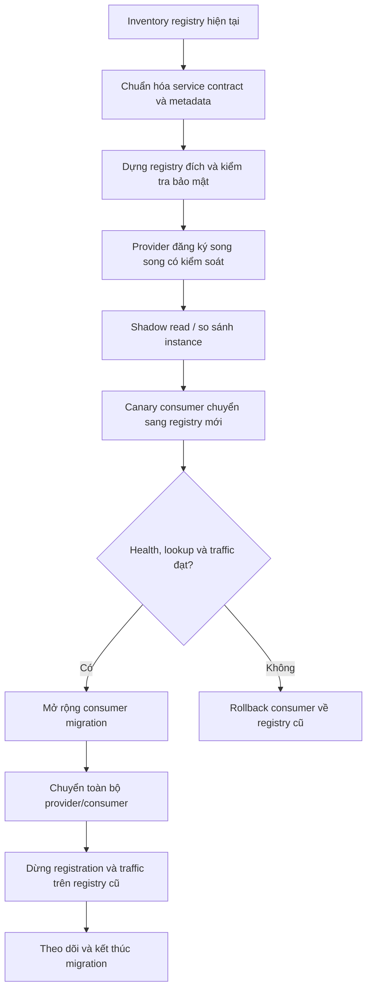

# Chuyển giữa Eureka, Consul và Zookeeper qua lớp trừu tượng chung

Spring Cloud cung cấp các abstraction như `DiscoveryClient`, `ServiceRegistry` và `ServiceInstance` để ứng dụng không phải gọi API riêng của Eureka, Consul hoặc ZooKeeper trong mọi đoạn code nghiệp vụ. Nhờ vậy, consumer có thể tra cứu instance theo service ID và provider có thể đăng ký instance qua một hợp đồng chung.

Tuy nhiên, dùng abstraction chung không có nghĩa ba registry có cùng semantics hoặc có thể thay thế nhau chỉ bằng cách đổi một dependency. Mỗi provider khác nhau về health check, lease/TTL, metadata, ACL, cách đồng bộ dữ liệu, cache, tên service và lifecycle. Migration an toàn cần tách phần code portable khỏi cấu hình và vận hành riêng của provider, rồi chuyển traffic theo từng giai đoạn có kiểm chứng và rollback.

## 1. Lớp trừu tượng chung của Spring Cloud

Spring Cloud Commons định nghĩa các contract quan trọng:

| Abstraction | Vai trò | API thường dùng |
| --- | --- | --- |
| `DiscoveryClient` | Consumer tra cứu service và instance | `getServices()`, `getInstances(serviceId)` |
| `ReactiveDiscoveryClient` | Tra cứu discovery theo reactive API | `getServices()`, `getInstances(serviceId)` trả publisher |
| `ServiceRegistry` | Provider đăng ký, hủy đăng ký và cập nhật trạng thái | `register(registration)`, `deregister(registration)`, `setStatus(...)`, `getStatus(...)` |
| `Registration` | Mô tả instance đang đăng ký | `getServiceId()`, `getHost()`, `getPort()`, `getUri()`, metadata |
| `ServiceInstance` | Mô tả instance trả về cho consumer | `getServiceId()`, `getHost()`, `getPort()`, `isSecure()`, `getMetadata()`, `getUri()` |
| `LoadBalancerClient` / Spring Cloud LoadBalancer | Chọn instance từ danh sách discovery | Chọn `ServiceInstance` theo service ID |

Consumer thường chỉ cần `DiscoveryClient` hoặc gọi service bằng WebClient/RestClient có `@LoadBalanced`. Provider có thể dùng auto-registration do starter tích hợp hoặc gọi `ServiceRegistry` nếu cần điều khiển registration thủ công.

Ví dụ consumer dùng abstraction chung:

```java
import java.util.List;

import org.springframework.cloud.client.ServiceInstance;
import org.springframework.cloud.client.discovery.DiscoveryClient;
import org.springframework.stereotype.Component;

@Component
public class InventoryLookup {

    private final DiscoveryClient discoveryClient;

    public InventoryLookup(DiscoveryClient discoveryClient) {
        this.discoveryClient = discoveryClient;
    }

    public List<ServiceInstance> findInventoryInstances() {
        return discoveryClient.getInstances("inventory-service");
    }
}
```

Đoạn code không phụ thuộc Eureka, Consul hay ZooKeeper. Implementation thực tế được Spring Boot đưa vào context qua starter và auto-configuration.

## 2. Phần nào portable, phần nào phụ thuộc provider?

Có thể giữ phần lớn code consumer portable nếu chỉ cần service ID, host, port, secure flag và metadata chung. Các thao tác như health check, TTL, ACL và watch thường cần cấu hình hoặc adapter riêng.

| Năng lực | Qua abstraction chung? | Phần cần xử lý riêng |
| --- | --- | --- |
| Tìm instance theo service ID | Có, qua `DiscoveryClient` | Quy tắc đặt service ID và cách lọc instance |
| Đọc host/port/metadata | Có, qua `ServiceInstance` | Cách provider ánh xạ tag, metadata và địa chỉ quảng bá |
| Đăng ký/hủy đăng ký | Có, qua `ServiceRegistry` hoặc auto-registration | Registration payload, ID, lifecycle và trạng thái lỗi |
| Chọn instance | Có, qua Spring Cloud LoadBalancer | Supplier, health filter, zone preference và retry policy |
| Health check | Không có semantics hoàn toàn thống nhất | Eureka status/lease, Consul checks, ZooKeeper session, Kubernetes readiness |
| TTL/lease | Không có contract chung đầy đủ | Lease/heartbeat, session timeout hoặc health-check interval |
| ACL/TLS | Không portable | Token, policy, certificate và auth mechanism của từng registry |
| Watch/cache/reconnect | Không portable hoàn toàn | Polling/fetch, Curator watch/session, Kubernetes informer/resourceVersion |
| Namespace/datacenter/zone | Một phần có thể ánh xạ vào metadata | Cách provider tổ chức namespace, datacenter, region và zone |
| Config store | Không thuộc DiscoveryClient | Consul KV, Config Server hoặc nguồn cấu hình riêng |

Lớp trừu tượng giúp code phụ thuộc vào một hợp đồng ổn định; nó không loại bỏ việc phải thiết kế lại các chính sách mà provider cũ và mới triển khai khác nhau.

## 3. Định nghĩa hợp đồng service nội bộ trước khi migration

Trước khi thay registry, hãy thống nhất một schema service mà mọi provider có thể biểu diễn:

```json
{
  "serviceId": "inventory-service",
  "instanceId": "inventory-10-20-1-15-8081",
  "host": "10.20.1.15",
  "port": 8081,
  "secure": false,
  "metadata": {
    "environment": "production",
    "region": "ap-southeast-1",
    "zone": "ap-southeast-1a",
    "version": "2.4.1",
    "protocol": "http"
  }
}
```

Hợp đồng này là mô hình logic của tổ chức, không phải payload JSON bắt buộc của mọi provider. Khi đăng ký, adapter/provider mapping các trường vào đúng cấu trúc riêng.

Quy ước cần thống nhất:

- Service ID dùng chữ thường, dấu gạch ngang và tên ổn định.
- Instance ID duy nhất giữa các replica đang hoạt động.
- Host phải truy cập được từ network của consumer.
- Port là port thật được quảng bá, không nhầm container port với host port.
- Metadata có schema, kiểu dữ liệu và quy tắc version rõ ràng.
- Secret không được đặt trong metadata.
- `environment`, `region`, `zone` và `version` có ý nghĩa nhất quán giữa các provider.

Nếu Eureka đang dùng application name viết hoa, Consul dùng service name viết thường và ZooKeeper dùng path tùy chỉnh, hãy chuẩn hóa tại thời điểm migration và cập nhật consumer theo kế hoạch. Không để mỗi provider tiếp tục quảng bá một service ID khác nhau mà không có mapping.

## 4. Tổ chức code để giảm phụ thuộc provider

Code nghiệp vụ nên phụ thuộc abstraction chung:

```text
Business service
      |
      v
DiscoveryClient / LoadBalancer
      |
      v
Spring Cloud provider integration
      |
      +---- Eureka
      +---- Consul
      +---- ZooKeeper
```

Tránh gọi trực tiếp Eureka REST API, Consul HTTP API hoặc thao tác znode trong business service nếu không cần tính năng đặc thù. Khi cần provider-specific behavior, đặt nó sau một interface nội bộ hoặc một adapter có phạm vi rõ.

Ví dụ một interface cho thao tác mà ứng dụng cần nhưng abstraction chung chưa biểu diễn đầy đủ:

```java
public interface RegistryOperations {
    void register(InstanceDescriptor instance);
    void deregister(String serviceId, String instanceId);
    RegistryHealth getHealth(String serviceId, String instanceId);
}
```

`InstanceDescriptor` và `RegistryHealth` là model nội bộ do ứng dụng định nghĩa. Có thể có `EurekaRegistryOperations`, `ConsulRegistryOperations` hoặc `ZookeeperRegistryOperations`, nhưng chỉ tạo adapter khi cần điều khiển semantics riêng như health, lease hoặc metadata.

Không xây một framework abstraction lớn hơn Spring Cloud chỉ để bọc `getInstances()`. Hãy giữ contract nội bộ nhỏ và phản ánh đúng use case của ứng dụng; càng cố mô hình hóa mọi tính năng đặc thù thành một interface chung, contract càng dễ trở nên mơ hồ.

## 5. Cấu hình chọn provider qua dependency và profile

Provider integration thường được chọn bằng starter có mặt trong runtime classpath và cấu hình của provider. Cách đơn giản nhất là build artifact riêng cho từng provider hoặc dùng profile triển khai với dependency đã được kiểm soát.

Ví dụ cấu hình consumer dùng Eureka:

```yaml
spring:
  application:
    name: checkout-service

eureka:
  client:
    enabled: true
    register-with-eureka: true
    fetch-registry: true
    service-url:
      defaultZone: ${EUREKA_URL:http://eureka:8761/eureka/}
```

Ví dụ cấu hình consumer dùng Consul:

```yaml
spring:
  application:
    name: checkout-service
  cloud:
    consul:
      host: ${CONSUL_HOST:consul-agent}
      port: ${CONSUL_PORT:8500}
      discovery:
        enabled: true
        register: true
        service-name: checkout-service
```

Ví dụ cấu hình ZooKeeper Discovery:

```yaml
spring:
  application:
    name: checkout-service
  cloud:
    zookeeper:
      connect-string: ${ZOOKEEPER_CONNECT:zk-1:2181,zk-2:2181,zk-3:2181}
      discovery:
        enabled: true
        register: true
        root: /services
```

Tên property và starter cụ thể phải khớp release train Spring Cloud đang dùng. Không bật cả ba provider chỉ bằng cách thêm ba starter rồi hy vọng abstraction chung tự chọn đúng registry.

Khi migration, nên có cấu hình tách biệt cho registry cũ, registry mới và giai đoạn dual registration. Profile không nên chứa token hoặc password; đưa credential qua secret manager hoặc environment injection an toàn.

## 6. Cấu hình dependency và BOM tương thích

Spring Boot và Spring Cloud provider starter phải cùng nằm trong ma trận tương thích. Import Spring Cloud BOM để các module Commons, LoadBalancer và provider dùng version đồng bộ:

```xml
<dependencyManagement>
    <dependencies>
        <dependency>
            <groupId>org.springframework.cloud</groupId>
            <artifactId>spring-cloud-dependencies</artifactId>
            <version>${spring-cloud.version}</version>
            <type>pom</type>
            <scope>import</scope>
        </dependency>
    </dependencies>
</dependencyManagement>
```

Khi chuyển provider, thay starter trong dependency set và kiểm tra dependency tree. Không nâng một starter lên version mới độc lập trong khi `spring-cloud-commons` hoặc `spring-cloud-loadbalancer` vẫn thuộc release train cũ.

Nếu cần hỗ trợ nhiều provider trong một artifact migration, kiểm tra kỹ điều kiện auto-configuration và registration. Tách artifact/profile build riêng thường dễ kiểm soát hơn nếu việc bật đồng thời provider có thể tạo registrar hoặc `DiscoveryClient` ngoài ý muốn.

## 7. Khác biệt quan trọng giữa Eureka, Consul và ZooKeeper

### Eureka

Eureka tổ chức registry theo application name và instance ID. Client đăng ký instance, gửi heartbeat để gia hạn lease và fetch registry về local cache.

Điểm cần chuyển đổi:

- `spring.application.name` thường là application/service ID.
- `eureka.instance.instance-id` cần duy nhất cho từng replica.
- Heartbeat/lease và eviction quyết định khi nào instance không còn được xem là còn sống.
- Health status của ứng dụng là một tín hiệu riêng; heartbeat thành công không chứng minh provider Ready.
- Eureka metadata thường là map key/value; cần chuẩn hóa kiểu dữ liệu và key.
- Client local cache và fetch interval ảnh hưởng độ trễ khi thay đổi instance.

### Consul

Consul có service catalog, agent registration và health check. Service được đăng ký vào agent; agent thực hiện check rồi cập nhật trạng thái service.

Điểm cần chuyển đổi:

- Service name, service ID và node/address có thể là các trường riêng.
- Health check có thể là HTTP, TCP, TTL hoặc script tùy cấu hình.
- Consumer có thể truy vấn health API với `passing=true` để chỉ nhận instance passing.
- Tags và metadata có cách biểu diễn khác Eureka.
- ACL token, policy và TLS là phần cấu hình vận hành quan trọng.
- Consul KV/Consul Config là tính năng riêng, không đồng nghĩa Consul Discovery.

### ZooKeeper

ZooKeeper thường lưu registry trong cây znode; Curator Service Discovery có recipe để đăng ký và tra cứu instance. Registration động thường gắn với ephemeral node và session.

Điểm cần chuyển đổi:

- Base path/root là một phần của cấu trúc registry.
- Instance ID ánh xạ vào tên znode.
- Ephemeral node bị xóa khi session hết hạn; provider cần đăng ký lại sau `LOST`.
- Watch/cache và reconnect có semantics khác polling/fetch của Eureka.
- ZooKeeper session state không tương đương HTTP health check của Consul.
- ACL của ZooKeeper và quyền truy cập path cần được cấu hình riêng.

Không thể chuyển nguyên một TTL Eureka sang Consul health interval hoặc ZooKeeper session timeout. Các tham số đó mô tả những cơ chế khác nhau.

## 8. Bảng mapping khi chuyển provider

| Khái niệm logic | Eureka | Consul | ZooKeeper/Curator |
| --- | --- | --- | --- |
| Service ID | Application name | Service name | Service name trong payload/path |
| Instance ID | Eureka instance ID | Consul service ID | Instance znode name/ID |
| Địa chỉ | Hostname/IP + port | Address + port | Address + port trong payload |
| Metadata | Instance metadata map | Tags và service metadata | Payload của service instance |
| Liveness/registration | Heartbeat và lease | Agent registration + check | Session và ephemeral node |
| Health | Instance status/health handler | HTTP/TCP/TTL check status | Không có HTTP health semantics mặc định; có thể bổ sung riêng |
| Đồng bộ consumer | Fetch registry/local cache | Catalog/Health query và cache nếu cấu hình | Watch/ServiceCache/CuratorCache |
| Quyền truy cập | Network/TLS tùy triển khai | ACL token/policy và TLS | ACL và authentication của ZooKeeper |
| Xóa instance | Deregister/lease eviction | Agent deregister/check policy | Xóa node hoặc session expiration |

Bảng mapping là điểm khởi đầu để thiết kế adapter. Không ánh xạ các trạng thái chỉ vì tên có vẻ giống nhau; ví dụ Eureka `UP`, Consul `passing` và ZooKeeper session `CONNECTED` không mang cùng ý nghĩa.

## 9. Migration không chỉ là đổi `DiscoveryClient`

Một migration đầy đủ phải chuyển ít nhất bốn luồng:

1. **Provider registration:** instance mới được đăng ký vào registry đích với ID, địa chỉ, metadata và health đúng.
2. **Consumer lookup:** consumer lấy instance từ registry đích và chọn đúng provider.
3. **Lifecycle:** heartbeat/lease/check/watch, deregistration và graceful shutdown hoạt động đúng.
4. **Operations:** ACL, TLS, dashboards, alert, log, backup/restore và runbook được cập nhật.

Nếu chỉ đổi dependency mà không chuyển health check, service có thể xuất hiện trong catalog nhưng không được consumer chọn; hoặc consumer thấy instance nhưng không kết nối được do địa chỉ quảng bá sai.

## 10. Lộ trình migration theo giai đoạn

Một cách an toàn là chuyển từng service và từng nhóm consumer, giữ khả năng rollback ở mỗi bước.



### Giai đoạn 1: inventory

Thu thập danh sách service, instance ID, metadata, health check, consumer dependency, service name và tần suất thay đổi. Xác định service nào có consumer gọi trực tiếp theo DNS hoặc IP thay vì discovery abstraction.

### Giai đoạn 2: chuẩn hóa contract

Chuẩn hóa service ID, instance ID, host/port, metadata, environment, zone và version. Xác định trường nào bắt buộc, trường nào tùy chọn và mapping sang provider đích.

### Giai đoạn 3: dựng registry mới

Thiết lập cluster, network, TLS, ACL, health check, retention, backup và monitoring. Kiểm thử registration, lookup, deregistration, failover và recovery trước khi chuyển traffic.

### Giai đoạn 4: dual registration có kiểm soát

Provider có thể đăng ký vào cả registry cũ và mới trong một giai đoạn ngắn để consumer mới có dữ liệu. Phải ghi nhận kết quả riêng cho từng registry, xử lý partial failure và tránh duplicate registration. Nếu dùng hai application/service ID khác nhau, phải có mapping rõ để consumer không gọi nhầm.

### Giai đoạn 5: shadow read và so sánh

Đọc danh sách từ cả hai registry nhưng chỉ dùng registry cũ để gửi traffic. So sánh số lượng instance, host/port, zone, version, health và metadata. Không gọi provider hai lần chỉ để shadow một request nghiệp vụ; shadow ở lớp lookup hoặc kiểm tra connectivity an toàn.

### Giai đoạn 6: canary consumer

Chuyển một nhóm consumer hoặc một tỷ lệ nhỏ traffic sang registry mới. Theo dõi lỗi no-instance, connection refused, timeout, 5xx, latency và phân bố instance được chọn.

### Giai đoạn 7: cutover và retirement

Khi canary đạt tiêu chí, chuyển dần consumer còn lại. Sau khi xác nhận không còn consumer phụ thuộc registry cũ, dừng registration cũ, deregister đúng instance và cuối cùng mới tắt cluster cũ.

## 11. Dual registration: tránh trạng thái nửa thành công

Đăng ký một instance vào hai registry không phải transaction nguyên tử. Ví dụ:

```text
register(Eureka) -> success
register(Consul) -> timeout
```

Ứng dụng phải biết instance đang ở trạng thái partial registration. Có thể dùng coordinator:

```java
import java.util.Map;

public record RegistrationResult(
        Map<String, Boolean> registeredByProvider,
        String operationId
) {
    public RegistrationResult {
        registeredByProvider = Map.copyOf(registeredByProvider);
    }
}

public interface RegistryAdapter {
    String provider();
    void register(InstanceDescriptor instance);
    void deregister(String serviceId, String instanceId);
}
```

Coordinator cần:

- Ghi trạng thái theo từng provider.
- Retry provider thất bại mà không lặp registration thành công ngoài ý muốn.
- Có operation ID để đối soát.
- Khi shutdown, deregister khỏi các registry mà instance thực sự đã đăng ký.
- Xử lý trường hợp một registry không truy cập được trong lúc cleanup.
- Có cơ chế reconciliation định kỳ cho partial state nếu migration kéo dài.

Nếu dual registration chỉ nhằm phục vụ migration, đặt thời hạn và tiêu chí kết thúc. Đừng để chế độ dual write tồn tại vô thời hạn mà không có owner.

## 12. Chọn consumer đọc registry nào

Không nên để một consumer ngẫu nhiên nhận instance từ Eureka, Consul và ZooKeeper trong cùng một danh sách nếu không có policy rõ. Cần quyết định:

- Consumer group nào đọc registry cũ?
- Consumer group nào đọc registry mới?
- Nếu registry mới trả empty list, có fallback về registry cũ không?
- Nếu registry mới timeout, có dùng stale cache hoặc registry cũ không?
- Nếu cùng một instance xuất hiện ở hai registry, cách deduplicate là gì?
- Health status khác nhau thì provider nào được ưu tiên?

Trong migration, lựa chọn tường minh theo profile/config thường dễ kiểm soát hơn một `CompositeDiscoveryClient` dùng ngầm. Composite không phải cơ chế đồng bộ hoặc cutover; nó chỉ điều phối lookup theo semantics của implementation.

## 13. Cutover criteria và rollback

Đặt tiêu chí đo được trước khi chuyển traffic. Ví dụ:

| Tiêu chí | Điều kiện minh họa |
| --- | --- |
| Registration coverage | 100% instance đang phục vụ có registration hợp lệ ở registry mới |
| Metadata parity | Service ID, host, port, zone và version khớp mapping đã thống nhất |
| Health parity | Không có instance critical/không Ready bị đưa vào traffic |
| Lookup success | Consumer canary tìm được instance cho mọi service bắt buộc |
| Connectivity | Consumer kết nối thành công đến các instance được chọn |
| Error rate | Không tăng đáng kể so với baseline |
| Latency | p95/p99 nằm trong SLO đã định |
| Recovery | Reconnect, deregistration và instance replacement đã được kiểm thử |

Rollback phải có sẵn trước cutover:

1. Giữ registry cũ hoạt động và không xóa dữ liệu registration khi canary chưa ổn định.
2. Giữ cấu hình consumer cũ có thể bật lại nhanh.
3. Nếu lỗi vượt ngưỡng, chuyển consumer về registry cũ trước.
4. Sau đó dừng dual registration hoặc sửa provider mapping tùy nguyên nhân.
5. Đối soát instance ở cả hai registry trước khi thử lại.

Không rollback bằng cách xóa toàn bộ service catalog hoặc xóa mọi znode. Chỉ dừng hoặc deregister những instance do migration coordinator sở hữu.

## 14. Health check cần được ánh xạ lại

Health semantics là một trong các phần dễ bị bỏ sót nhất:

- Eureka heartbeat cho biết client còn gia hạn lease; application health status có thể được publish riêng.
- Consul health check có thể chủ động gọi HTTP/TCP endpoint hoặc dùng TTL check.
- ZooKeeper ephemeral node phản ánh session còn tồn tại, không tự chứng minh HTTP endpoint khỏe.

Khi chuyển provider, cần chọn tín hiệu tương đương với mục tiêu nghiệp vụ. Nếu trước đây consumer chỉ nhận instance `UP` của Eureka, sang Consul nên xác định rõ dùng health query `passing=true` và endpoint nào được agent kiểm tra. Sang ZooKeeper, cần bổ sung health mechanism nếu yêu cầu loại instance không phục vụ, vì session còn sống không đủ.

Không ánh xạ máy móc:

```text
Eureka UP == Consul passing == ZooKeeper CONNECTED
```

Đây là các trạng thái khác nghĩa. Hãy xác định contract nội bộ như `SERVING`, `NOT_SERVING`, `UNKNOWN`, rồi map mỗi provider theo tín hiệu thực tế và chấp nhận rằng một số provider cần thêm health check bên ngoài.

## 15. Metadata, tags và zone preference

Metadata thường được dùng để lọc version, environment, zone hoặc capability. Mapping giữa provider phải bảo toàn ý nghĩa:

| Metadata logic | Eureka | Consul | ZooKeeper |
| --- | --- | --- | --- |
| `version` | Instance metadata | Service metadata/tag | Payload field |
| `zone` | Metadata hoặc instance zone property | Node/service metadata hoặc tag | Payload field |
| `environment` | Metadata map | Metadata/tag | Payload field/path convention |
| `protocol` | Metadata map | Metadata/tag | Payload field |

Tránh dùng tag có cấu trúc mơ hồ như `v2`, `prod` nếu không có key. Dùng key/value metadata rõ ràng và version schema. Nếu consumer cần zone-aware load balancing, xác minh metadata đến được `ServiceInstance.getMetadata()` sau khi chuyển provider.

## 16. Bảo mật và quyền truy cập trong migration

Registry mới có thể yêu cầu mô hình bảo mật khác registry cũ:

- Eureka có thể dựa vào network isolation, TLS hoặc security integration của triển khai.
- Consul thường dùng ACL token và policy cho service registration, catalog read, health read và KV access.
- ZooKeeper có ACL theo znode, authentication scheme và TLS tùy cấu hình.

Hãy tách quyền provider registration khỏi consumer read. Không dùng một credential quản trị chung cho mọi service. Token/certificate phải được cấp qua secret management, không commit vào YAML hoặc log.

Migration cần kiểm thử cả quyền đọc lẫn quyền ghi. Một consumer có thể lookup được trong môi trường dev nhưng bị `403` trong production vì ACL của prefix/service khác nhau.

## 17. Version compatibility và dependency migration

Khi thay provider, cần giữ Spring Boot và Spring Cloud release train tương thích. Import Spring Cloud BOM và thay starter provider trong cùng kế hoạch nâng cấp.

Kiểm tra dependency tree để phát hiện starter cũ được kéo transitively. Nếu ứng dụng hỗ trợ nhiều provider trong thời gian migration, test context startup ở từng profile và xác nhận bean `DiscoveryClient`, `ServiceRegistry` và auto-registration thực tế.

Không giả định mọi provider starter có cùng property hoặc API. Những cấu hình như `eureka.client.fetch-registry`, `spring.cloud.consul.discovery.register` và `spring.cloud.zookeeper.discovery.root` không thể đổi tên tương ứng một cách cơ học.

## 18. Kiểm thử trước, trong và sau cutover

Một bộ kiểm thử migration nên gồm:

1. **Contract test:** cùng một service instance được biểu diễn thành `ServiceInstance` tương đương ở provider cũ và mới.
2. **Registration test:** service name, instance ID, host, port và metadata được publish đúng.
3. **Lookup test:** consumer lấy đúng instance qua abstraction chung.
4. **Health test:** provider unhealthy/not-ready không được chọn theo policy.
5. **Deregistration test:** instance dừng được loại khỏi registry mới và cũ theo ownership.
6. **Reconnect test:** registry outage, stale cache và reconciliation hoạt động đúng.
7. **Dual-write test:** partial registration failure được phát hiện và phục hồi.
8. **Load-balancing test:** traffic được phân phối theo policy và không dùng endpoint sai.
9. **Security test:** ACL/TLS cho phép đúng operation, từ chối operation ngoài quyền.
10. **Rollback test:** consumer quay lại registry cũ mà không cần sửa code nghiệp vụ.

Nên chạy integration test với registry thật bằng Testcontainers hoặc môi trường ephemeral. Mock abstraction chỉ xác minh logic consumer; nó không chứng minh health check, ACL, lease hoặc session behavior của provider.

## 19. Những lỗi migration thường gặp

| Triệu chứng | Nguyên nhân có thể | Cách xử lý |
| --- | --- | --- |
| Consumer không tìm thấy service sau đổi provider | Service ID khác hoặc provider mới chưa có registration | Kiểm tra mapping service ID và registration coverage |
| Instance có trong registry nhưng không được chọn | Health semantics khác hoặc query chỉ lấy passing/UP | Đối chiếu health check và consumer filter |
| Consumer nhận host/port không truy cập được | Địa chỉ quảng bá phù hợp với registry node nhưng không phù hợp consumer network | Cấu hình advertised address và kiểm thử từ network consumer |
| Instance đăng ký ở registry mới nhưng không bị xóa khi shutdown | Auto-registration/lifecycle không được bật hoặc coordinator không lưu ownership | Kiểm tra deregistration path và cleanup |
| Dual registration chỉ thành công một phía | Không có coordinator/partial state handling | Retry và reconcile theo từng provider |
| Composite trả instance không mong muốn | Thứ tự/delegate semantics không đúng policy migration | Chọn provider tường minh theo profile/adapter |
| Zone-aware load balancing mất tác dụng | Metadata không được mapping sang provider mới | Chuẩn hóa metadata và kiểm tra `ServiceInstance` |
| ZooKeeper instance biến mất sau reconnect | Session `LOST`, ephemeral node bị xóa | Đăng ký lại bằng session mới và chờ cache sync |
| Consul instance ở critical | Agent check không truy cập được endpoint hoặc mapping health sai | Kiểm tra path, advertised address, ACL và health semantics |
| Eureka registry có dữ liệu cũ | Client/server cache hoặc lease propagation | Kiểm tra fetch/eviction và chờ hội tụ theo policy |
| Lỗi `NoSuchMethodError` sau đổi starter | Spring Cloud modules lệch release train | Dùng BOM tương thích và kiểm tra dependency tree |
| Rollback khiến service bị xóa khỏi registry cũ | Cleanup xóa ID dùng chung hoặc toàn bộ application | Chỉ deregister registration do migration sở hữu |

## 20. Checklist migration

- [ ] Code nghiệp vụ dùng `DiscoveryClient`, `ServiceInstance` hoặc LoadBalancer thay vì API provider trực tiếp.
- [ ] Đã phân định rõ chức năng portable và provider-specific.
- [ ] Service ID, instance ID, host/port và metadata có schema thống nhất.
- [ ] Đã mapping health, lease/session, TTL và deregistration semantics.
- [ ] Đã kiểm tra dependency và Spring Cloud BOM tương thích.
- [ ] Registry mới có network, TLS, ACL, monitoring và backup phù hợp.
- [ ] Provider registration được kiểm thử trước khi consumer cutover.
- [ ] Dual registration có owner, partial failure handling và thời hạn kết thúc.
- [ ] Shadow read so sánh dữ liệu nhưng không tạo side effect nghiệp vụ.
- [ ] Canary consumer có tiêu chí error rate/latency/health rõ ràng.
- [ ] Rollback giữ registry cũ hoạt động cho đến khi cutover ổn định.
- [ ] Consumer không dựa vào `CompositeDiscoveryClient` như cơ chế đồng bộ registry.
- [ ] Integration test bao phủ register, lookup, health, reconnect, deregister và security.
- [ ] Registry cũ chỉ được retire sau khi xác nhận không còn consumer/provider phụ thuộc.

Spring Cloud abstraction giúp giảm coupling của code với Eureka, Consul hoặc ZooKeeper, đặc biệt ở luồng tra cứu và mô hình instance. Nhưng migration vẫn phải xử lý các khác biệt về registration, health, lease/session, metadata, cache, bảo mật và vận hành. Hãy chuẩn hóa service contract, tách adapter cho tính năng đặc thù, chuyển provider theo giai đoạn, so sánh dữ liệu trước cutover và giữ rollback khả dụng. Khi đó, thay registry trở thành một quá trình có thể đo lường và kiểm soát thay vì một lần đổi starter đầy rủi ro.
