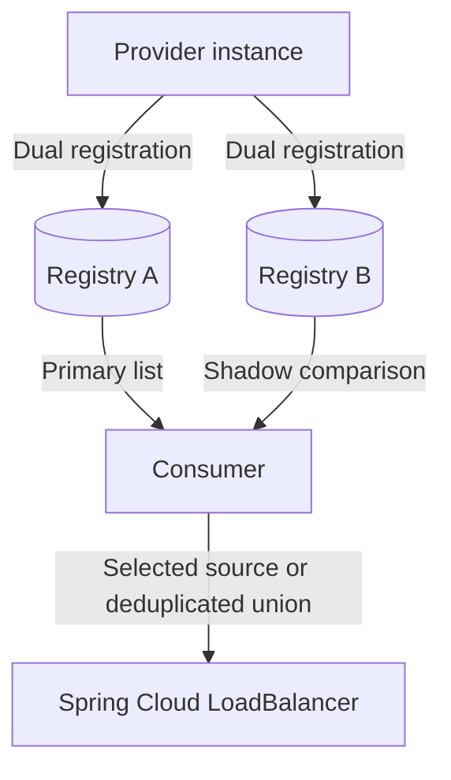
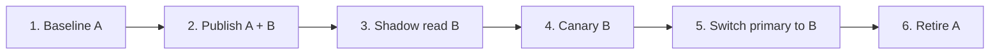

# Chạy song song hai nguồn khám phá và kiểm soát trùng lặp

Khi chuyển service discovery từ Eureka sang Consul, từ Consul sang Kubernetes hoặc khi cần một giai đoạn tương thích giữa hai nền tảng, hệ thống có thể phải duy trì hai nguồn discovery cùng lúc. Provider có thể đăng ký vào cả hai registry; consumer có thể đọc nguồn cũ và nguồn mới; một số consumer còn cần so sánh hai danh sách để xác nhận dữ liệu đã đồng bộ.

Chạy song song giúp giảm rủi ro chuyển đổi, nhưng hai registry không tự trở thành một registry thống nhất. Cùng một process có thể xuất hiện hai lần trong danh sách, health state có thể khác nhau, địa chỉ quảng bá có thể chỉ truy cập được từ một network, và một lần đăng ký có thể thành công trong khi lần còn lại thất bại. Nếu gộp danh sách mà không có định danh và quy tắc ưu tiên, LoadBalancer có thể gửi traffic trùng trọng số tới cùng một process hoặc chọn endpoint stale.

Bài học này phân biệt dual registration, dual read, shadow comparison và union; hướng dẫn chọn nguồn có thẩm quyền, tạo identity dùng chung, khử trùng lặp trước LoadBalancer và triển khai migration theo từng giai đoạn.

## 1. Phân biệt bốn cách chạy song song

Hai nguồn discovery có thể cùng tồn tại theo nhiều cách. Cần chọn đúng mục tiêu trước khi cấu hình.

| Mô hình | Provider đăng ký | Consumer dùng dữ liệu | Mục tiêu |
| --- | --- | --- | --- |
| Dual registration | Ghi instance vào cả registry A và B | Có thể vẫn chỉ đọc A | Duy trì hai catalog trong giai đoạn chuyển đổi. |
| Priority/fallback read | Có thể đăng ký ở cả hai | Đọc A trước, dùng B khi điều kiện fallback được thỏa mãn | Dự phòng khi nguồn chính không khả dụng. |
| Shadow read / comparison | Có thể đăng ký ở cả hai | Chọn A để phục vụ request; đọc B nền để so sánh | Kiểm tra độ tương đương trước khi chuyển traffic. |
| Union / merge read | Đăng ký ở cả hai | Gộp instance từ A và B thành một tập ứng viên | Phục vụ các workload thực sự phân tán giữa hai catalog. |

Các mô hình này giải quyết vấn đề khác nhau. Dual registration không có nghĩa consumer phải union hai danh sách. Shadow read không nên ảnh hưởng tới quyết định chọn instance. Fallback cũng khác union: fallback chọn một nguồn theo thứ tự, còn union đưa ứng viên từ nhiều nguồn vào cùng một tập.



## 2. Vì sao phải kiểm soát trùng lặp?

Giả sử một process `payment-7` đăng ký vào cả Eureka và Consul. Cả hai registry đều trả về một entry cho cùng process:

| Nguồn | Service ID | Instance ID | URI | Health |
| --- | --- | --- | --- | --- |
| Eureka | `payment-service` | `payment-7` | `http://10.0.2.17:8080` | UP |
| Consul | `payment-service` | `payment-7` | `http://10.0.2.17:8080` | passing |

Nếu nối hai list trực tiếp, LoadBalancer nhận hai phần tử có cùng endpoint. Khi round-robin, process đó có thể được chọn với xác suất gấp đôi một instance chỉ xuất hiện ở một registry. Nếu cả ba replica đều có mặt trong cả hai registry, danh sách có sáu phần tử nhưng chỉ có ba process thực tế.

Trùng lặp còn có thể tạo ra các vấn đề khó phát hiện hơn:

- Hai registration cùng process có URI khác nhau do một registry lưu IP nội bộ, registry kia lưu IP quảng bá.
- Một nguồn báo healthy trong khi nguồn kia đã đánh dấu unhealthy hoặc `OUT_OF_SERVICE`.
- Một nguồn giữ registration cũ sau khi process restart, còn nguồn kia đã có instance mới.
- Hai registry dùng cách đặt service ID, namespace hoặc instance ID khác nhau.
- Consumer chọn instance từ registry không thể truy cập trong network của chính consumer.
- Khi shutdown, ứng dụng deregister thành công ở một registry nhưng thất bại ở registry còn lại.

Vì vậy, khử trùng lặp phải diễn ra trước khi danh sách đi vào thuật toán chọn instance; đồng thời phải giữ lại nguồn gốc để có thể điều tra xung đột.

## 3. Spring Cloud hỗ trợ nhiều DiscoveryClient như thế nào?

Spring Cloud Commons định nghĩa `DiscoveryClient` làm abstraction chung cho các registry. Interface này mở rộng `Ordered`, do đó các implementation có thể được sắp xếp theo thứ tự. Spring Cloud có thể tạo composite client từ các discovery client có trong ApplicationContext.

### 3.1. Blocking DiscoveryClient và thứ tự ưu tiên

Với blocking `DiscoveryClient`, Spring Cloud Commons có `CompositeDiscoveryClient` để điều phối các implementation theo thứ tự. Các client có thể được cấu hình order qua property tương ứng hoặc override `getOrder()` trong implementation tự viết.

Ví dụ cấu hình thứ tự:

```yaml
spring:
  cloud:
    consul:
      discovery:
        order: 0

eureka:
  client:
    order: 10
```

Ví dụ đặt Consul ở mức ưu tiên cao hơn Eureka. Tên property và cách bind có thể thay đổi theo release train và starter; xác nhận bằng tài liệu của phiên bản đang dùng và kiểm tra thứ tự bean thực tế khi khởi động.

Composite theo thứ tự không nên bị hiểu nhầm thành phép union. Với mô hình priority/fallback, consumer nhận kết quả từ nguồn ưu tiên theo semantics của phiên bản đang dùng; hãy kiểm tra hành vi khi nguồn đầu trả empty hoặc ném exception. Nếu mục tiêu là hợp nhất instance từ hai registry, cần xác nhận composite có hỗ trợ đúng semantics đó hay triển khai một aggregator rõ ràng.

### 3.2. Reactive composite DiscoveryClient

Với reactive discovery, tài liệu Spring Cloud Commons hiện hành mô tả rõ các chế độ:

- Mặc định, `ReactiveCompositeDiscoveryClient` trả instance từ client có kết quả non-empty nhanh nhất.
- `spring.cloud.discovery.reactive.order-enforced=true` yêu cầu thử theo thứ tự đã cấu hình; client ưu tiên thấp hơn chỉ được subscribe khi các client ưu tiên cao hơn không trả instance. Client chậm hoặc không kết thúc có thể làm chậm kết quả; lỗi được propagate và không tự fallback.
- `spring.cloud.discovery.reactive.combine-instances=true` kết hợp instance từ tất cả reactive discovery clients. Lỗi của một client được log nhưng không ngăn kết quả từ các client còn lại được trả về.
- Khi bật cả `order-enforced` và `combine-instances`, các client vẫn được truy vấn theo thứ tự cấu hình nhưng kết quả được kết hợp.

Ví dụ bật union cho reactive discovery:

```yaml
spring:
  cloud:
    discovery:
      reactive:
        combine-instances: true
```

Property này áp dụng cho reactive composite; không dùng nó để suy ra blocking `DiscoveryClient` cũng tự gộp hai danh sách. Hãy kiểm tra release train vì các property và semantics có thể khác giữa phiên bản.

### 3.3. Tách discovery lookup khỏi registration

`DiscoveryClient` chủ yếu đọc service/instance. `ServiceRegistry` cung cấp thao tác đăng ký và hủy đăng ký qua `register(Registration)` và `deregister(Registration)`. Mỗi registry có loại `Registration` riêng, ví dụ `EurekaRegistration` và `ConsulRegistration`.

Vì vậy, thêm hai `DiscoveryClient` không tự bảo đảm một provider được đăng ký đúng vào cả hai registry. Ngược lại, dual registration cũng không tự bảo đảm consumer đang đọc từ cả hai nguồn. Hãy thiết kế riêng đường ghi registration và đường đọc discovery.

## 4. Thiết kế identity chung trước khi dual registration

Khử trùng lặp chỉ đáng tin cậy khi cùng một process có thể được nhận diện xuyên suốt các registry.

### 4.1. Tạo canonical instance ID

Mỗi replica cần một định danh duy nhất trong phạm vi service và môi trường. Ví dụ:

```text
service:       payment-service
environment:   production
cluster:       cluster-a
instance-id:   payment-7f8c9d-2
```

Có thể tạo `DISCOVERY_INSTANCE_ID` từ Pod UID, hostname/ordinal của StatefulSet hoặc một ID do nền tảng cấp. Giá trị phải:

- Duy nhất giữa các replica đang chạy đồng thời.
- Ổn định trong vòng đời của một process/replica.
- Được gửi vào cả Eureka và Consul registration.
- Không tái sử dụng sớm khi process cũ chưa được deregister hoặc lease chưa hết hạn.
- Không chứa secret hoặc dữ liệu cá nhân.

Ví dụ dùng chung biến môi trường cho hai registration:

```yaml
eureka:
  instance:
    instance-id: ${DISCOVERY_INSTANCE_ID}

spring:
  cloud:
    consul:
      discovery:
        instance-id: ${DISCOVERY_INSTANCE_ID}
```

Các property trên minh họa hai starter cùng dùng một identity. Kiểm tra tên property và cách tạo registration của release train cụ thể trước khi áp dụng.

### 4.2. Canonical key để khử trùng lặp

Không nên dùng riêng hostname hoặc IP làm identity. Một host có thể chạy nhiều service/port; cùng một process cũng có thể quảng bá nhiều địa chỉ theo network view.

Khóa logic gợi ý:

```text
canonical-key = environment + namespace + canonical-service-id + canonical-instance-id
```

Ví dụ:

```text
production|shop|payment-service|payment-7f8c9d-2
```

Nếu chưa thể truyền instance ID chung, có thể dùng khóa tạm từ `serviceId + scheme + normalized host + port + contextPath`. Cách này chỉ là fallback: IP thay đổi, NAT hoặc nhiều network interface có thể làm một process bị nhận diện thành hai instance hoặc hai process bị gộp nhầm.

### 4.3. Chuẩn hóa service ID và scope

Hai registry cần có quy ước mapping cho:

- Service ID/canonical service name.
- Environment, namespace, cluster, region và datacenter.
- Instance ID.
- Scheme, host, port và base path.
- Metadata như zone, version và protocol.

Không gộp hai service chỉ vì tên gần giống nhau. `payment-service` trong staging và production phải thuộc hai scope khác nhau; `payment-service` ở hai cluster có thể là cùng logical service nhưng không nhất thiết cùng tập endpoint.

## 5. Khử trùng lặp và xử lý xung đột

### 5.1. Quy tắc gộp cơ bản

Với mỗi kết quả từ registry, giữ thông tin nguồn:

```text
Candidate {
  sourceRegistry
  canonicalServiceId
  canonicalInstanceId
  uri
  healthState
  observedAt
  metadata
}
```

Sau đó nhóm theo `canonicalServiceId + canonicalInstanceId`. Không bỏ provenance trước khi kiểm tra trùng lặp.

Pseudocode:

```java
Map<InstanceKey, List<Candidate>> grouped = candidates.stream()
        .collect(Collectors.groupingBy(Candidate::canonicalKey));

List<ResolvedInstance> resolved = grouped.entrySet().stream()
        .map(entry -> resolveDuplicate(entry.getKey(), entry.getValue()))
        .filter(ResolvedInstance::eligibleForTraffic)
        .toList();
```

`resolveDuplicate` cần áp dụng quy tắc endpoint, health và source precedence; không chỉ chọn phần tử đầu tiên trong list.

### 5.2. Ma trận xử lý bản ghi trùng

| Tình huống | Cách xử lý gợi ý |
| --- | --- |
| Cùng canonical ID, cùng URI, cùng health | Giữ một instance; ghi nhận cả hai nguồn trong provenance. |
| Cùng canonical ID, khác URI nhưng cùng network view | Kiểm tra registration và chọn URI theo policy của consumer. |
| Cùng canonical ID, khác URI do internal/external address | Giữ các endpoint theo network view hoặc chọn endpoint routable cho consumer; không gộp mất thông tin mạng. |
| Cùng canonical ID, một nguồn healthy và một nguồn unhealthy | Dùng health của nguồn có thẩm quyền hoặc fail closed khi chưa xác định được; phát cảnh báo mismatch. |
| Cùng canonical ID nhưng khác service ID/namespace | Kiểm tra mapping; chỉ gộp khi canonical scope chứng minh chúng là cùng service. |
| Khác canonical ID nhưng cùng URI | Không tự động gộp; có thể là hai process/service dùng chung host/port qua proxy hoặc mapping khác. |
| Một nguồn có instance, nguồn kia không có | Ghi parity mismatch; quyết định traffic theo source policy, không tự kết luận instance chết. |

### 5.3. Quy tắc health phải rõ ràng

Health state không thể gộp bằng cách lấy trạng thái “tốt nhất”. Ví dụ, Eureka báo `UP` nhưng Consul check đã `critical`; nếu union lấy trạng thái UP, consumer có thể gọi một instance mà nguồn còn lại vừa loại.

Chọn một trong các policy:

1. **Authoritative health:** chỉ health state từ registry đang có quyền quyết định traffic được dùng.
2. **Independent health gate:** sau khi dedupe, một health-check supplier độc lập kiểm tra endpoint từ network của consumer.
3. **Fail closed on conflict:** khi hai nguồn có trạng thái mâu thuẫn hoặc một snapshot quá cũ, tạm loại candidate khỏi union và phát cảnh báo.

Trong giai đoạn migration, authoritative health thường dễ kiểm soát nhất: registry mới được so sánh ở chế độ shadow, nhưng chưa có quyền đưa endpoint vào traffic. Khi chuyển quyền sở hữu, đổi source có thẩm quyền trong một change rõ ràng.

### 5.4. Chọn endpoint theo network view

Hai registry có thể trả hai URI cho cùng process:

```text
Eureka: http://10.20.1.17:8080   (private cluster network)
Consul: http://172.20.1.17:8080  (datacenter network)
```

Đây có thể là hai đường truy cập hợp lệ, không phải duplicate cần xóa tùy tiện. Consumer trong Kubernetes có thể chọn private address; consumer ngoài cluster có thể cần địa chỉ routable qua gateway/mesh. Đưa `network-view`, `cluster` hoặc `zone` vào metadata không nhạy cảm và dùng policy để chọn endpoint đúng network.

## 6. Dual registration có kiểm soát

### 6.1. Mỗi registry có Registration riêng

Spring Cloud Commons `ServiceRegistry` làm abstraction cho `register` và `deregister`, nhưng mỗi implementation cần Registration tương ứng. Không tạo một object Registration chung rồi giả định Eureka và Consul hiểu cùng một cấu trúc.

Nếu ứng dụng tự quản lý dual registration, có thể tắt auto-registration mặc định để tránh cùng một service bị đăng ký thêm ngoài ý muốn:

```yaml
spring:
  cloud:
    service-registry:
      auto-registration:
        enabled: false
```

Hoặc dùng `@EnableDiscoveryClient(autoRegister = false)` trong cấu hình phù hợp với phiên bản. Khi tắt auto-registration, ứng dụng phải chịu trách nhiệm gọi cả hai registry và xử lý vòng đời của chúng.

### 6.2. Dùng adapter riêng cho từng registry

Tạo một command chuẩn của ứng dụng, sau đó mỗi adapter chuyển command thành Registration riêng:

```java
public record RegistrationCommand(
        String serviceId,
        String instanceId,
        URI uri,
        Map<String, String> metadata) {
}

public interface RegistryPublisher {
    String registryName();

    void register(RegistrationCommand command);

    void deregister(RegistrationCommand command);
}
```

`EurekaPublisher` dùng `EurekaRegistration`/`EurekaServiceRegistry`; `ConsulPublisher` dùng `ConsulRegistration`/`ConsulServiceRegistry`. Adapter chịu trách nhiệm map service ID, instance ID, address, port, tags/metadata và health check theo đúng semantics của registry.

### 6.3. Không giả định hai lần register là một transaction

Hai registry là hai hệ thống độc lập; không có transaction ACID chung. Có thể xảy ra:

```text
Register Eureka  -> success
Register Consul  -> timeout
```

Kết quả là registration một phần. Coordinator cần lưu trạng thái riêng cho từng đích:

```text
instance payment-7
  eureka: REGISTERED
  consul: RETRY_PENDING
```

Pseudocode điều phối:

```java
for (RegistryPublisher publisher : publishers) {
    try {
        publisher.register(command);
        registrationState.markRegistered(
                command.instanceId(), publisher.registryName());
    } catch (TransientRegistryException ex) {
        registrationState.markRetryPending(
                command.instanceId(), publisher.registryName());
        retryQueue.enqueue(command, publisher.registryName());
    } catch (RuntimeException ex) {
        registrationState.markFailed(
                command.instanceId(), publisher.registryName(), classify(ex));
    }
}
```

Đây là pseudocode cho coordinator, không phải implementation Spring hoàn chỉnh. `registrationState` và `retryQueue` cần được triển khai bằng cơ chế lưu bền phù hợp, ví dụ outbox hoặc job reconciliation.

Nguyên tắc vận hành:

- Mỗi register/deregister phải idempotent theo `serviceId + instanceId`.
- Một registry lỗi không được làm mất kết quả thành công của registry còn lại.
- Retry có backoff, jitter và giới hạn; lỗi authentication/configuration phải được báo rõ thay vì retry vô hạn.
- Có reconciler định kỳ so sánh trạng thái mong muốn với trạng thái thực tế ở từng registry.
- Khi process shutdown, cố gắng deregister cả hai nguồn; TTL/lease/health check là lớp cleanup dự phòng nếu process chết đột ngột.
- Không tạo registration mới với ID khác mỗi lần retry; điều đó có thể để lại duplicate record.

### 6.4. Xử lý partial registration theo traffic policy

Khi một registry register thành công và registry còn lại thất bại, hành động phụ thuộc nguồn nào đang phục vụ traffic:

| Trạng thái | Policy gợi ý |
| --- | --- |
| Registry A là primary, A đăng ký thành công, B lỗi | Cho phép instance phục vụ theo A nếu health A đạt; retry B và cảnh báo parity mismatch. |
| Registry B là primary, B lỗi, A thành công | Không coi A thành công là đủ nếu consumer đã chuyển sang B; áp dụng fallback đã định và phát cảnh báo. |
| Cả hai registry đều là nguồn traffic trong union | Chỉ đưa candidate vào union khi policy identity/health cho phép; tránh một nguồn lỗi làm xuất hiện duplicate hoặc stale endpoint. |
| Cả hai registry đều lỗi | Không quảng bá instance là registered; báo registration failure và xử lý theo readiness policy. |

Không tự động deregister ở registry thành công chỉ vì registry còn lại timeout. Compensation có thể làm mất endpoint đang phục vụ. Chỉ rollback registration thành công khi policy migration yêu cầu rõ và đã đánh giá tác động traffic.

## 7. Chọn chiến lược dual read

### 7.1. Priority/fallback

Một nguồn được đặt làm primary. Nguồn thứ hai chỉ được dùng khi điều kiện fallback đã xác định xảy ra.

Ưu điểm:

- Không tạo duplicate trong danh sách ứng viên.
- Dễ kiểm soát source nào quyết định health và endpoint.
- Phù hợp với migration khi chỉ muốn một registry phục vụ traffic tại một thời điểm.

Rủi ro:

- Nếu primary trả empty hợp lệ, fallback có thể che giấu registration drift nếu policy không phân biệt empty với error.
- Nếu primary chậm hoặc treo, fallback có thể bị trì hoãn khi truy vấn tuần tự.
- Nếu hai nguồn có dữ liệu khác nhau, consumer có thể chuyển qua lại giữa hai snapshot.

Hãy xác định fallback trigger rõ ràng. Ví dụ: fallback khi primary không truy cập được trong deadline; empty result thành công được ghi nhận là mismatch và chỉ fallback nếu service policy cho phép. Không tự động fallback cho `401`/`403`, TLS hoặc sai cấu hình.

### 7.2. Shadow read / parity check

Consumer dùng registry A để chọn instance. Một tác vụ nền truy vấn registry B, chuẩn hóa danh sách và so sánh:

- Số instance và canonical IDs.
- URI/network view.
- Health state.
- Metadata cần thiết cho routing.
- Tuổi snapshot và thời điểm refresh thành công.

Shadow read không gửi request nghiệp vụ tới instance từ nguồn B. Nó chỉ đo độ tương đương của catalog. Nếu dữ liệu khác nhau, phát metric và lưu sample mismatch có giới hạn; không log toàn bộ metadata nhạy cảm.

### 7.3. Union/merge

Union phù hợp khi hai registry thật sự quản lý các tập instance khác nhau, ví dụ một phần workload ở Kubernetes, phần còn lại trên VM. Trước khi đưa union vào LoadBalancer:

1. Chuẩn hóa service ID và scope.
2. Gộp theo canonical instance ID.
3. Giải quyết URI/network view.
4. Áp dụng health policy.
5. Loại snapshot quá cũ hoặc instance không routable.
6. Giữ provenance để debug và audit.

Không dùng union chỉ để “đề phòng” hai registry cùng chứa một service. Nếu cả hai registry phản ánh cùng các replica, priority hoặc shadow read thường dễ kiểm soát hơn.

## 8. Ví dụ deduplication bằng canonical ID

Đoạn code sau minh họa bước nhóm candidate. `Candidate` và `ResolvedInstance` là kiểu dữ liệu của ứng dụng; cần bổ sung mapper từ `ServiceInstance` của từng registry.

```java
public record InstanceKey(
        String environment,
        String namespace,
        String serviceId,
        String canonicalInstanceId) {
}

public record Candidate(
        InstanceKey key,
        URI uri,
        String source,
        String health,
        Instant observedAt,
        Map<String, String> metadata) {
}

public List<ResolvedInstance> deduplicate(List<Candidate> candidates) {
    Map<InstanceKey, List<Candidate>> grouped = candidates.stream()
            .collect(Collectors.groupingBy(Candidate::key));

    return grouped.entrySet().stream()
            .map(entry -> resolve(entry.getKey(), entry.getValue()))
            .filter(ResolvedInstance::eligibleForTraffic)
            .toList();
}
```

`resolve(...)` phải làm rõ ít nhất bốn quyết định:

1. Nguồn nào có quyền quyết định health?
2. Nếu URI khác nhau, consumer đang ở network view nào?
3. Snapshot có còn trong freshness TTL không?
4. Nếu identity hoặc health conflict, candidate bị loại hay đưa vào trạng thái cần kiểm tra?

Không triển khai `resolve` bằng cách lấy `list.get(0)` vì thứ tự registry trả về không phải chính sách nghiệp vụ.

## 9. Quy trình migration theo từng giai đoạn

### Giai đoạn 1 — Baseline registry cũ

- Chọn registry A làm nguồn traffic duy nhất.
- Đo registration count, healthy count, lookup latency, request error rate và cache age.
- Xác định canonical service ID/instance ID cần giữ xuyên suốt migration.
- Ghi lại service/namespace/zone mapping và network reachability.

### Giai đoạn 2 — Dual registration

- Bật registration vào A và B bằng coordinator/adapter có trạng thái riêng.
- Giữ A làm nguồn traffic.
- Xác nhận mỗi process có đúng một canonical ID trong từng registry.
- Kiểm tra partial registration, retry và deregistration.

### Giai đoạn 3 — Shadow read

- Consumer vẫn chọn từ A.
- Đọc B nền và so sánh canonical IDs, health, URI và metadata.
- Đo parity mismatch và thời gian hội tụ sau scale/rollout.
- Sửa mapping và network trước khi chuyển traffic.

### Giai đoạn 4 — Canary traffic từ nguồn mới

- Chọn một nhóm consumer hoặc một service ít rủi ro.
- Chuyển discovery primary của nhóm đó sang B.
- Theo dõi instance được chọn, 5xx, timeout, latency và health.
- Giữ khả năng rollback về A trong cửa sổ đã thống nhất.

### Giai đoạn 5 — Chuyển primary

- Chuyển từng nhóm consumer theo đợt.
- Xác nhận B có đủ registration và health trước mỗi đợt.
- Không union hai danh sách nếu chúng đang phản ánh cùng một replica.
- Giữ dual registration trong thời gian rollback cần thiết.

### Giai đoạn 6 — Ngừng nguồn cũ

- Dừng consumer read từ A.
- Dừng registration vào A sau khi không còn consumer phụ thuộc.
- Deregister các record còn lại và kiểm tra TTL/lease cleanup.
- Xóa dependency/config cũ sau khi xác nhận không còn traffic.
- Theo dõi ghost registration và metric parity trong thời gian hậu chuyển đổi.



## 10. Failure handling và consistency

### 10.1. Phân biệt empty, unavailable và stale

| Kết quả từ nguồn | Ý nghĩa | Hành động gợi ý |
| --- | --- | --- |
| Non-empty, fresh | Có instance theo snapshot mới | Dùng theo health/network policy. |
| Empty, query thành công | Nguồn không có instance phù hợp | Ghi parity mismatch; không coi là lỗi kết nối. |
| Timeout/5xx | Nguồn không truy vấn được | Retry có deadline; dùng fallback nếu policy cho phép. |
| 401/403 hoặc TLS error | Authentication/authorization/trust lỗi | Sửa credential/certificate; không retry mù. |
| Non-empty nhưng stale | Có snapshot cũ | Chỉ dùng trong stale TTL đã định, health guard và cảnh báo. |

Nếu primary trả empty thành công nhưng secondary trả non-empty, đây là khác biệt dữ liệu cần điều tra. Fallback tự động có thể giúp availability trong một số hệ thống, nhưng cũng có thể làm consumer gọi một endpoint mà nguồn authoritative đã loại. Hãy quy định riêng theo service criticality và health semantics.

### 10.2. Retry và idempotency

Registration và deregistration cần idempotent. Dùng cùng `serviceId + instanceId` làm idempotency key ở coordinator. Retry với backoff/jitter; lưu trạng thái mỗi registry để không phải register lại nguồn đã thành công nếu chỉ nguồn kia lỗi.

Không retry vô hạn trong startup thread nếu service có thể phục vụ traffic qua nguồn primary. Có thể cho instance sẵn sàng theo policy của registry đang hoạt động, đồng thời đánh dấu secondary registration `PENDING` và phát cảnh báo. Nếu yêu cầu của tổ chức bắt buộc cả hai registry phải có registration trước khi nhận traffic, readiness phải phản ánh điều kiện đó một cách tường minh.

### 10.3. Deregistration và cleanup

Khi shutdown, gọi deregister cho từng registry. Một thao tác thất bại không được làm mất log trạng thái của thao tác còn lại. Nếu process chết đột ngột, dựa vào TTL/lease/health check và reconciler để xóa record stale.

Reconciler nên đối chiếu:

- Instance mong muốn đang chạy.
- Registration thực tế trong A.
- Registration thực tế trong B.
- Health state và last-seen/lease.
- Canonical identity và URI/network view.

Không xóa registration chỉ vì không thấy instance trong một snapshot ngắn hạn; xác minh tuổi dữ liệu và trạng thái nguồn trước khi cleanup.

## 11. Observability cho dual discovery

Trong thời gian chạy song song, dashboard cần thể hiện trạng thái từng nguồn và mức độ tương đương.

Metric gợi ý (metric contract do ứng dụng/observer cung cấp, không phải tên built-in được đảm bảo):

| Metric | Ý nghĩa |
| --- | --- |
| `discovery_registration_attempts_total{registry,outcome}` | Số lần register/deregister theo registry và kết quả. |
| `discovery_registration_pending{registry}` | Số registration chưa đồng bộ được sang nguồn tương ứng. |
| `discovery_instances{registry,state}` | Số instance registered/healthy/unhealthy theo nguồn. |
| `discovery_duplicate_candidates_total{service}` | Số candidate bị nhận diện trùng trước khi dedupe. |
| `discovery_identity_conflicts_total{service}` | Số trường hợp canonical ID trùng nhưng endpoint/metadata xung đột. |
| `discovery_source_parity_ratio{service}` | Tỷ lệ canonical instance IDs trùng khớp giữa hai nguồn. |
| `discovery_shadow_mismatch_total{service,reason}` | Số lần shadow comparison phát hiện khác biệt. |
| `discovery_selected_source_total{service,registry}` | Số request được phục vụ qua từng nguồn được chọn. |
| `discovery_snapshot_age_seconds{registry}` | Tuổi snapshot mới nhất của mỗi nguồn. |

Label phải có cardinality giới hạn. Không đưa raw URI, Pod UID thay đổi liên tục, token hoặc exception message vào label. Có thể ghi instance ID trong log có kiểm soát thay vì metric label nếu số lượng instance lớn.

### 11.1. Cảnh báo cần có

- Secondary registration pending quá lâu.
- Canonical identity conflict hoặc cùng ID có URI không giải thích được.
- Health mismatch giữa A và B kéo dài.
- Parity ratio giảm dưới ngưỡng trong thời gian shadow.
- Một nguồn không refresh được hoặc snapshot vượt freshness TTL.
- Consumer vẫn chọn nguồn cũ sau thời điểm switch.
- Ghost registration tồn tại sau deregistration/lease timeout.

Không page cho mọi mismatch ngắn trong rollout bình thường. Đặt `for`, severity và ngưỡng theo thời gian hội tụ thực tế.

## 12. Kiểm thử trước khi chuyển traffic

Test tối thiểu nên bao gồm:

| Test | Thiết lập | Assertion |
| --- | --- | --- |
| Same instance in A and B | Cùng canonical ID, URI và health | Union chỉ trả một candidate. |
| Same ID, different URI | A và B quảng bá hai network view | Chọn URI phù hợp consumer hoặc báo conflict; không chọn ngẫu nhiên. |
| Health mismatch | A healthy, B critical | Policy authoritative/fail-closed được áp dụng; mismatch được ghi nhận. |
| Partial registration | Register A thành công, B timeout | Trạng thái từng nguồn được lưu; retry chỉ B và không tạo duplicate ở A. |
| Partial deregistration | Deregister A thành công, B lỗi | B được retry/reconcile; không xóa bằng chứng A. |
| Primary empty, secondary non-empty | Dữ liệu hai nguồn lệch | Fallback theo policy; parity alert phát. |
| Primary unavailable | Timeout/5xx từ nguồn chính | Retry/fallback trong deadline; không nhầm thành empty. |
| Authentication failure | 401/403 hoặc TLS lỗi | Không retry vô hạn; alert cấu hình/quyền. |
| Stale registration | Một nguồn còn record cũ | Health/TTL/reconciler loại theo policy, không duplicate traffic. |
| Rollback | Chuyển canary về A | Consumer quay về A, không để cả hai nguồn cùng điều khiển traffic ngoài ý muốn. |

Kiểm thử cả blocking và reactive path nếu ứng dụng dùng cả hai. Xác nhận composite thực tế được inject, thứ tự client và semantics empty/error/merge trong đúng release train.

## 13. Những lỗi thường gặp

| Lỗi | Hậu quả | Cách khắc phục |
| --- | --- | --- |
| Nghĩ hai DiscoveryClient tự động tạo union | Consumer chỉ thấy nguồn ưu tiên hoặc nguồn nhanh nhất | Kiểm tra composite behavior; bật combine cho reactive nếu phù hợp hoặc viết aggregator rõ ràng. |
| Dual registration nhưng chỉ cấu hình một ServiceRegistry | Instance chỉ xuất hiện ở một nguồn | Dùng adapter/registration riêng cho từng registry và theo dõi partial state. |
| Dùng IP làm khóa dedupe duy nhất | Gộp nhầm process hoặc không nhận ra cùng process đổi IP | Dùng canonical instance ID và scope service/environment. |
| Dedupe sau LoadBalancer | Một process xuất hiện nhiều lần và bị tăng trọng số | Dedupe trong supplier/aggregator trước khi trả danh sách ứng viên. |
| Lấy health tốt nhất từ hai registry | Instance đã bị loại ở một nguồn vẫn nhận traffic | Dùng authoritative health, independent check hoặc fail closed. |
| Fallback khi primary trả empty mà không có policy | Che giấu registration drift hoặc gọi endpoint stale | Phân biệt empty thành công với unavailable; quy định fallback trigger. |
| Hai registry quảng bá URI khác network nhưng bị gộp mất | Consumer nhận địa chỉ không routable | Giữ network view và chọn endpoint theo vị trí consumer. |
| Retry register tạo ID mới mỗi lần | Nhiều registration cho một process | Dùng ID ổn định và thao tác idempotent. |
| Tắt auto-registration nhưng không có coordinator | Service không đăng ký vào registry nào | Bổ sung coordinator và readiness/registration lifecycle rõ ràng. |
| Ngừng registry cũ quá sớm | Consumer chưa chuyển xong bị mất discovery | Dùng migration phases, canary và rollback window. |

## 14. Checklist triển khai

- [ ] Chọn rõ dual-publish, fallback, shadow-read hay union.
- [ ] Xác định registry có quyền quyết định traffic ở từng giai đoạn.
- [ ] Chuẩn hóa service ID, namespace, environment và canonical instance ID.
- [ ] Xác minh order/semantics của blocking và reactive composite theo release train.
- [ ] Nếu union, dedupe trước LoadBalancer và giữ provenance.
- [ ] Quy định xử lý URI/network-view và health mismatch.
- [ ] Tạo adapter Registration riêng cho từng registry.
- [ ] Xử lý partial register/deregister bằng idempotency và reconciliation.
- [ ] Quy định fallback trigger riêng cho empty, timeout, 5xx, 401/403 và stale snapshot.
- [ ] Có dashboard parity, duplicate, identity conflict và registration pending.
- [ ] Kiểm thử source outage, partial failure, health mismatch và rollback.
- [ ] Chỉ ngừng nguồn cũ khi consumer đã chuyển và cleanup được xác minh.

## 15. Ghi nhớ

- Dual registration, dual read, shadow comparison và union là bốn mô hình khác nhau.
- Spring Cloud `DiscoveryClient` có thứ tự; composite không mặc nhiên đồng nghĩa với union.
- Reactive composite hiện hỗ trợ `combine-instances` để hợp nhất kết quả; property này không áp dụng thay cho blocking client.
- Mỗi registry có Registration type và semantics riêng; hai lần register không phải một transaction chung.
- Dùng canonical instance ID xuyên registry và khử trùng lặp trước LoadBalancer.
- Khi URI hoặc health state xung đột, áp dụng policy network/health rõ ràng; không chọn tùy tiện.
- Trong migration, shadow-read và parity check thường giúp phát hiện drift trước khi chuyển traffic.
- Giữ trạng thái partial registration, retry idempotent, reconciler và rollback window cho tới khi nguồn cũ được retire an toàn.

## Tài liệu tham khảo

- [Spring Cloud Commons: Ordering DiscoveryClient instances và Reactive Composite](https://docs.spring.io/spring-cloud-commons/reference/spring-cloud-commons/common-abstractions.html)
- [Spring Cloud Commons: ServiceRegistry và auto-registration](https://docs.spring.io/spring-cloud-commons/reference/spring-cloud-commons/common-abstractions.html#serviceregistry-auto-registration)
- [Spring Cloud LoadBalancer](https://docs.spring.io/spring-cloud-commons/reference/spring-cloud-commons/loadbalancer.html)
- [Spring Cloud Netflix: Eureka](https://docs.spring.io/spring-cloud-netflix/reference/spring-cloud-netflix.html)
- [Spring Cloud Consul: Service Discovery](https://docs.spring.io/spring-cloud-consul/reference/discovery.html)
