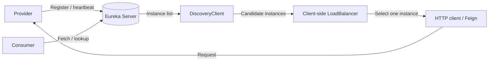

# Nhận diện cấu hình Ribbon, @EnableEurekaClient và hướng dẫn cũ

Nhiều dự án Spring Cloud Service Discovery được khởi tạo từ các bài hướng dẫn sử dụng Netflix Ribbon và annotation @EnableEurekaClient. Những ví dụ đó có thể đúng với release train cũ, nhưng không nên sao chép nguyên trạng vào dự án Spring Boot/Spring Cloud hiện đại.

Cần tách ba trách nhiệm: Eureka đăng ký và cung cấp danh sách instance; client-side load balancer chọn một instance cho từng lần gọi; HTTP client thực hiện kết nối và quản lý timeout. Ribbon từng đảm nhiệm phần chọn instance trong hệ sinh thái Spring Cloud Netflix. Spring Cloud LoadBalancer là giải pháp thay thế được Spring Cloud duy trì cho các release train hiện đại. Annotation @EnableEurekaClient cũng không còn là bước bắt buộc trong các cấu hình dùng starter và auto-configuration hiện nay.

Bài này giúp nhận diện dấu vết của hướng dẫn cũ, hiểu vì sao chúng không còn phù hợp, và chuyển từng phần sang cấu hình hiện tại mà vẫn giữ nguyên service ID và cơ chế discovery của ứng dụng.

## 1. Phân biệt service discovery và client-side load balancing

Hai chức năng thường được dùng cùng nhau nhưng có nhiệm vụ khác nhau:

- **Service discovery:** tìm danh sách instance đang được registry công bố cho một service ID.
- **Client-side load balancing:** chọn một instance từ danh sách đó cho từng lần gọi.
- **HTTP client:** tạo và gửi request tới host/port đã chọn; quản lý kết nối, TLS và timeout ở tầng transport.

Luồng điển hình:



Eureka không tự thực hiện round-robin cho request nghiệp vụ. Eureka lưu thông tin đăng ký và cung cấp registry cho client. Trước đây Ribbon thường đọc danh sách instance từ Eureka rồi chọn server. Trong cấu hình hiện đại, Spring Cloud LoadBalancer đảm nhiệm phần chọn instance.

Vì vậy, thay Ribbon không có nghĩa phải thay Eureka. Một dự án có thể tiếp tục dùng Eureka làm registry và thay riêng Ribbon bằng Spring Cloud LoadBalancer.

## 2. Ribbon là gì và vì sao gặp trong hướng dẫn cũ?

Netflix Ribbon là thư viện client-side load balancing. Trong các thế hệ Spring Cloud Netflix cũ, Ribbon được tích hợp với Eureka để lấy danh sách server và chọn một server cho mỗi request.

Ribbon có các khái niệm riêng:

| Thành phần Ribbon | Vai trò |
|---|---|
| **IRule** | Chính sách chọn server, ví dụ round-robin hoặc zone-aware |
| **ILoadBalancer** | Quản lý danh sách server và lựa chọn server |
| **ServerList** | Nguồn cung cấp danh sách server |
| **ServerListFilter** | Lọc danh sách server trước khi chọn |
| **IPing** | Kiểm tra khả năng hoạt động theo cơ chế Ribbon |
| **IClientConfig** | Cấu hình client Ribbon |
| **@RibbonClient** | Khai báo cấu hình Ribbon riêng cho client |

Các tên class thường gặp trong code cũ:

```java
import com.netflix.loadbalancer.IRule;
import com.netflix.loadbalancer.RoundRobinRule;
import com.netflix.loadbalancer.ZoneAvoidanceRule;
import com.netflix.loadbalancer.ILoadBalancer;
```

Nếu thấy những import này, dự án đang dùng API Ribbon hoặc còn sót code từ tích hợp Ribbon cũ.

Ribbon từng phổ biến trong các ví dụ như:

```java
@Configuration
@RibbonClient(name = "inventory-service")
public class InventoryRibbonConfiguration {

    @Bean
    public IRule ribbonRule() {
        return new RoundRobinRule();
    }
}
```

Cấu hình này gắn một rule của Ribbon vào client có tên inventory-service. Nó không phải cấu hình của Spring Cloud LoadBalancer.

Ribbon đã chuyển sang trạng thái maintenance và tích hợp Ribbon trong Spring Cloud Netflix bị loại khỏi các release train hiện đại (từ thế hệ Spring Cloud 2020.0 / Spring Cloud Netflix 3.x). Vì vậy, code mới nên dùng Spring Cloud LoadBalancer. Dự án cũ đang chạy trên release train tương thích có thể vẫn biên dịch Ribbon, nhưng đó là lựa chọn legacy cần có kế hoạch chuyển đổi.

## 3. Nhận diện dependency Ribbon trong dự án

Kiểm tra Maven/Gradle dependency và dependency tree để tìm các artifact cũ.

Dấu hiệu thường gặp:

```xml
<dependency>
    <groupId>org.springframework.cloud</groupId>
    <artifactId>spring-cloud-starter-netflix-ribbon</artifactId>
</dependency>
```

Hoặc các artifact Ribbon được khai báo trực tiếp:

```xml
<dependency>
    <groupId>com.netflix.ribbon</groupId>
    <artifactId>ribbon-loadbalancer</artifactId>
</dependency>
```

Một số dự án không khai báo Ribbon trực tiếp mà nhận dependency bắc cầu từ starter hoặc thư viện cũ. Vì vậy, chỉ tìm trong pom.xml là chưa đủ; cần kiểm tra dependency tree.

Maven:

```bash
mvn dependency:tree -Dincludes=com.netflix.ribbon,org.springframework.cloud:spring-cloud-starter-netflix-ribbon
```

Gradle:

```bash
./gradlew dependencies --configuration runtimeClasspath
```

Trong output, tìm các module có group com.netflix.ribbon hoặc starter Ribbon. Nếu còn dependency bắc cầu, xác định thư viện nào kéo nó vào trước khi loại bỏ. Không exclude hàng loạt một dependency khi chưa kiểm tra module phụ thuộc có thực sự cần nó hay không.

## 4. Nhận diện API và cấu hình Ribbon

Tìm các dấu hiệu trong source code:

| Dấu hiệu | Ý nghĩa |
|---|---|
| **@RibbonClient**, **@RibbonClients** | Cấu hình Ribbon theo client |
| **IRule**, **RoundRobinRule**, **ZoneAvoidanceRule** | Rule chọn server |
| **ILoadBalancer** | API load balancer Ribbon |
| **ServerList**, **ServerListFilter** | Nguồn và bộ lọc server |
| **ribbon.ConnectTimeout** | Timeout kết nối Ribbon |
| **ribbon.ReadTimeout** | Timeout đọc response Ribbon |
| **MaxAutoRetries**, **MaxAutoRetriesNextServer** | Retry policy Ribbon |
| **NFLoadBalancerRuleClassName** | Tên class rule Ribbon |
| **listOfServers** | Danh sách server tĩnh của Ribbon |

Ví dụ cấu hình cũ:

```yaml
inventory-service:
  ribbon:
    NFLoadBalancerRuleClassName: com.netflix.loadbalancer.RoundRobinRule
    ConnectTimeout: 1000
    ReadTimeout: 3000
    MaxAutoRetries: 0
    MaxAutoRetriesNextServer: 1
```

Hoặc:

```yaml
ribbon:
  eureka:
    enabled: true
```

Các property này thuộc cấu hình Ribbon. Chỉ đổi tên prefix sang spring.cloud.loadbalancer không bảo đảm hành vi tương đương. Timeout, retry, health filter, zone và cache có thể được quản lý ở các tầng khác nhau trong kiến trúc mới.

## 5. @EnableEurekaClient và các annotation liên quan

Các bài hướng dẫn cũ thường yêu cầu đặt:

```java
@SpringBootApplication
@EnableEurekaClient
public class InventoryApplication {

    public static void main(String[] args) {
        SpringApplication.run(InventoryApplication.class, args);
    }
}
```

@EnableEurekaClient là annotation đặc thù của Spring Cloud Netflix Eureka client. Nó xuất hiện trong các dự án và hướng dẫn cũ như một dấu hiệu kích hoạt Eureka client.

Trong các thế hệ Spring Cloud hiện đại, khi dependency spring-cloud-starter-netflix-eureka-client có mặt trên classpath, auto-configuration sẽ cấu hình Eureka client; thông thường không cần thêm @EnableEurekaClient. Tùy release train, annotation có thể không còn cần thiết, đã deprecated hoặc không còn tồn tại. Không nên dựa vào annotation này như điều kiện bắt buộc để bật Eureka.

Ví dụ ứng dụng hiện đại:

```java
@SpringBootApplication
public class InventoryApplication {

    public static void main(String[] args) {
        SpringApplication.run(InventoryApplication.class, args);
    }
}
```

Dependency Eureka client:

```xml
<dependency>
    <groupId>org.springframework.cloud</groupId>
    <artifactId>spring-cloud-starter-netflix-eureka-client</artifactId>
</dependency>
```

Khi ứng dụng chạy với cấu hình Eureka hợp lệ, starter và auto-configuration đảm nhiệm phần client registration/fetch theo property. Provider có thể đăng ký; consumer có thể fetch registry mà không cần annotation cũ.

### Phân biệt ba annotation dễ nhầm

| Annotation | Mục đích | Có cần cho client hiện đại? |
|---|---|---|
| **@EnableEurekaClient** | Annotation riêng của Eureka client trong hướng dẫn cũ | Thường không cần khi dùng starter và auto-configuration |
| **@EnableDiscoveryClient** | Annotation abstraction discovery chung của Spring Cloud | Thường không bắt buộc nếu discovery implementation tự cấu hình qua classpath |
| **@EnableEurekaServer** | Bật chức năng Eureka Server | Vẫn dùng cho ứng dụng chạy vai trò Eureka Server theo hướng dẫn tương ứng |

Không xóa nhầm @EnableEurekaServer khi chuyển đổi client. Đây là annotation của server, không phải annotation thay thế cho Eureka client.

Nếu codebase có annotation cũ, hãy kiểm tra import và release train thực tế trước khi xóa. Một số ứng dụng cũ có thể còn phụ thuộc hành vi auto-registration hoặc cấu hình đặc thù; cần xác minh bằng integration test sau khi chuyển.

## 6. Spring Cloud LoadBalancer thay thế Ribbon

Spring Cloud LoadBalancer là client-side load balancer tích hợp với Spring Cloud Commons. Nó làm việc với abstraction discovery để lấy danh sách instance, sau đó chọn một instance phù hợp.

Các khái niệm chính:

| Ribbon cũ | Spring Cloud LoadBalancer |
|---|---|
| **IRule** | **ReactorServiceInstanceLoadBalancer** hoặc strategy tương ứng |
| **ServerList** | **ServiceInstanceListSupplier** lấy instance từ discovery |
| **ServerListFilter** | Supplier decorator/filter hoặc cơ chế lọc instance |
| **ILoadBalancer** | LoadBalancer client/factory và implementation mới |
| Ribbon per-client config | **@LoadBalancerClient** và cấu hình theo service ID |
| Ribbon cache | LoadBalancer cache/supplier cache theo cấu hình mới |

Không có ánh xạ một-một cho mọi class Ribbon. Nếu dự án có custom IRule, cần mô tả lại mục tiêu lựa chọn (round-robin, zone preference, canary, weight...) rồi chọn extension point phù hợp của Spring Cloud LoadBalancer.

Thêm dependency:

```xml
<dependency>
    <groupId>org.springframework.cloud</groupId>
    <artifactId>spring-cloud-starter-loadbalancer</artifactId>
</dependency>
```

Khi dùng Eureka, giữ dependency discovery:

```xml
<dependency>
    <groupId>org.springframework.cloud</groupId>
    <artifactId>spring-cloud-starter-netflix-eureka-client</artifactId>
</dependency>
```

Eureka cung cấp danh sách instance; Spring Cloud LoadBalancer chọn instance. Hai dependency có trách nhiệm bổ sung cho nhau.

## 7. Cấu hình dependency và release train hiện đại

Spring Boot và Spring Cloud cần dùng các phiên bản tương thích. Nên quản lý Spring Cloud bằng BOM thay vì tự chọn version riêng cho từng starter.

Ví dụ Maven:

```xml
<properties>
    <java.version>17</java.version>
    <spring-cloud.version>YOUR_COMPATIBLE_RELEASE_TRAIN</spring-cloud.version>
</properties>

<dependencyManagement>
    <dependencies>
        <dependency>
            <groupId>org.springframework.cloud</groupId>
            <artifactId>spring-cloud-dependencies</artifactId>
            <version>${spring-cloud.version}</version>
            <type>pom</type>
            <scope>import</scope>
        </dependency>
    </dependencies>
</dependencyManagement>

<dependencies>
    <dependency>
        <groupId>org.springframework.cloud</groupId>
        <artifactId>spring-cloud-starter-netflix-eureka-client</artifactId>
    </dependency>
    <dependency>
        <groupId>org.springframework.cloud</groupId>
        <artifactId>spring-cloud-starter-loadbalancer</artifactId>
    </dependency>
    <dependency>
        <groupId>org.springframework.cloud</groupId>
        <artifactId>spring-cloud-starter-openfeign</artifactId>
    </dependency>
</dependencies>
```

YOUR_COMPATIBLE_RELEASE_TRAIN là placeholder, cần thay bằng release train tương thích với Spring Boot version của dự án theo compatibility matrix chính thức. Phần version trong dependencyManagement tham chiếu lại property spring-cloud.version. Không sao chép một version bất kỳ từ blog cũ. Không override riêng version của LoadBalancer/Eureka/OpenFeign nếu BOM đã quản lý chúng, trừ khi có lý do tương thích đã được kiểm chứng.

Với OpenFeign, dependency LoadBalancer có thể được khai báo optional trong một số thế hệ starter; khai báo rõ starter LoadBalancer giúp thể hiện dependency mà ứng dụng cần và tránh phụ thuộc vào cách kéo dependency bắc cầu của một version cụ thể.

## 8. Chuyển Feign client từ Ribbon sang LoadBalancer

Feign client dùng service name khi không khai báo URL cố định:

```java
@FeignClient(name = "inventory-service")
public interface InventoryClient {

    @GetMapping("/api/items/{id}")
    ItemResponse getItem(@PathVariable("id") String id);
}
```

Khi có OpenFeign và Spring Cloud LoadBalancer phù hợp, Feign dùng service ID để tìm instance. Không cần viết code gọi DiscoveryClient.getInstances() thủ công trong từng API.

Cấu hình dưới đây là dấu hiệu cũ cần rà soát:

```yaml
inventory-service:
  ribbon:
    ConnectTimeout: 1000
    ReadTimeout: 3000
```

Với OpenFeign hiện đại, timeout được cấu hình ở client HTTP/Feign theo property của release train:

```yaml
spring:
  cloud:
    openfeign:
      client:
        config:
          inventory-service:
            connectTimeout: 1000
            readTimeout: 3000
```

Prefix và tên property OpenFeign phụ thuộc thế hệ Spring Cloud OpenFeign; kiểm tra tài liệu đúng version. Timeout kết nối/đọc là trách nhiệm transport client, không nên coi chúng là property thay thế trực tiếp của Ribbon.

Nếu khai báo URL trong annotation hoặc property:

```java
@FeignClient(
    name = "inventory-service",
    url = "http://inventory.internal:8080"
)
```

Feign sẽ gọi URL cố định; service discovery và client-side load balancing không còn là cơ chế chọn endpoint cho client đó. Khi muốn discovery, bỏ URL cố định và chỉ giữ service name, trừ khi có chủ đích dùng endpoint tĩnh.

## 9. Chuyển RestTemplate sang Spring Cloud LoadBalancer

Một RestTemplate có annotation @LoadBalanced có thể gọi service theo tên logic:

```java
@Configuration
public class HttpClientConfiguration {

    @Bean
    @LoadBalanced
    RestTemplate restTemplate(RestTemplateBuilder builder) {
        return builder.build();
    }
}
```

Gọi service:

```java
@Service
public class InventoryGateway {

    private final RestTemplate restTemplate;

    public InventoryGateway(RestTemplate restTemplate) {
        this.restTemplate = restTemplate;
    }

    public ItemResponse getItem(String id) {
        return restTemplate.getForObject(
            "http://inventory-service/api/items/{id}",
            ItemResponse.class,
            id
        );
    }
}
```

Với dependency LoadBalancer, interceptor hỗ trợ chuyển service ID thành instance được chọn. Nếu thiếu @LoadBalanced hoặc thiếu LoadBalancer dependency, hostname inventory-service có thể bị xử lý như DNS hostname thông thường và không resolve được.

Không nên gắn @LoadBalanced lên mọi RestTemplate. Chỉ client dùng service ID mới cần load balancing; một RestTemplate thông thường vẫn phù hợp cho URL cố định hoặc external API.

## 10. Chuyển Ribbon rule và custom routing

Một dự án có thể dùng IRule để chọn instance theo round-robin, zone, response time hoặc logic tùy chỉnh. Khi chuyển sang Spring Cloud LoadBalancer, trước tiên hãy mô tả hành vi mong muốn:

- Chọn đều giữa các instance.
- Ưu tiên cùng zone/region.
- Loại instance không healthy.
- Chọn theo metadata hoặc version.
- Thực hiện canary/blue-green routing.
- Áp dụng weight hoặc sticky behavior.

Spring Cloud LoadBalancer cung cấp các strategy và extension point khác nhau, bao gồm ReactorServiceInstanceLoadBalancer và ServiceInstanceListSupplier. Ví dụ cấu hình riêng cho một service có thể dùng @LoadBalancerClient:

```java
@Configuration
@LoadBalancerClient(
    name = "inventory-service",
    configuration = InventoryLoadBalancerConfiguration.class
)
public class LoadBalancerClientsConfiguration {
}
```

Lớp InventoryLoadBalancerConfiguration cần khai báo bean theo API của đúng Spring Cloud LoadBalancer version. Không đặt class cấu hình này trong component-scan chung nếu bean được dự định chỉ áp dụng cho client riêng; nếu bị scan toàn cục, rule có thể ảnh hưởng các service khác.

Không chuyển nguyên IRule thành một class mới rồi kỳ vọng behavior giống nhau. Kiểm tra thứ tự chọn, zone metadata, health, cache và behavior khi danh sách rỗng bằng test.

## 11. Retry, timeout và cache không có ánh xạ một-một

Các property Ribbon thường gặp:

```yaml
inventory-service:
  ribbon:
    ConnectTimeout: 1000
    ReadTimeout: 3000
    MaxAutoRetries: 0
    MaxAutoRetriesNextServer: 1
```

Khi chuyển đổi, tách chúng theo trách nhiệm:

| Nhu cầu cũ | Nơi cấu hình mới cần kiểm tra |
|---|---|
| Connect/read timeout | HTTP client hoặc Feign client configuration |
| Retry cùng instance / instance khác | Spring Cloud LoadBalancer retry và HTTP client retry |
| Rule chọn instance | LoadBalancer strategy |
| Lọc server | ServiceInstanceListSupplier / health / zone |
| Cache server list | LoadBalancer cache và discovery provider cache |
| Health ping | Health check phù hợp với registry hoặc LoadBalancer supplier |

Retry có thể làm một request nghiệp vụ được gửi nhiều lần. Chỉ bật retry cho thao tác an toàn hoặc có idempotency key phù hợp. Với POST tạo thanh toán/đơn hàng, retry tự động khi timeout có thể gây xử lý trùng nếu server đã thực hiện nhưng response bị mất.

Không copy nguyên số lần retry Ribbon sang LoadBalancer. Một số lần retry được thực hiện ở tầng LoadBalancer, số khác có thể ở Feign/HTTP transport. Nếu cả hai cùng retry, tổng request có thể tăng theo cấp số nhân.

## 12. Các bước migration có kiểm soát

Một quy trình chuyển đổi hợp lý:

1. **Kiểm kê:** tìm dependency Ribbon, @RibbonClient, IRule, ILoadBalancer, ribbon.* và custom server list.
2. **Xác định phiên bản:** ghi Spring Boot, Spring Cloud release train và Eureka client version đang chạy.
3. **Đọc dependency tree:** xác định Ribbon được kéo trực tiếp hay bắc cầu.
4. **Chọn release train tương thích:** dùng BOM theo compatibility matrix.
5. **Thêm LoadBalancer:** khai báo starter cần thiết và giữ Eureka client nếu registry vẫn là Eureka.
6. **Chuyển client:** Feign dùng service name không URL; RestTemplate dùng @LoadBalanced khi gọi service ID.
7. **Chuyển policy:** thay rule/filter theo API LoadBalancer; không copy property Ribbon nguyên trạng.
8. **Chuyển timeout/retry:** cấu hình đúng tầng HTTP client và LoadBalancer, kiểm tra idempotency.
9. **Bỏ annotation cũ:** xác minh starter auto-configuration trước khi xóa @EnableEurekaClient.
10. **Loại dependency cũ:** bỏ Ribbon sau khi không còn code hoặc dependency bắc cầu cần nó.
11. **Kiểm thử:** registration, lookup, chọn instance, timeout, retry, health và behavior khi registry unavailable.
12. **Triển khai từng bước:** theo dõi latency, lỗi no-instance, request distribution và rollback path.

Không nên đổi dependency, annotation, timeout và retry trong cùng một lần mà không có checkpoint. Khi lỗi xảy ra, thay đổi theo từng lớp sẽ giúp xác định nguyên nhân nhanh hơn.

## 13. Kiểm tra dependency và dấu vết còn sót sau migration

Sau khi thay đổi, chạy dependency tree và tìm các dấu vết còn lại:

```bash
mvn dependency:tree
```

Tìm trong source/config:

```text
@RibbonClient
@RibbonClients
IRule
ILoadBalancer
ServerList
ServerListFilter
ribbon.
spring-cloud-starter-netflix-ribbon
com.netflix.ribbon
@EnableEurekaClient
```

Không phải mọi chuỗi tìm thấy đều là lỗi. Một tài liệu migration hoặc module legacy có thể cố ý nhắc Ribbon. Hãy kiểm tra code production, test source, dependency và cấu hình runtime để bảo đảm không còn Ribbon được kích hoạt ngoài dự kiến.

Nếu cả Ribbon và Spring Cloud LoadBalancer cùng xuất hiện, xác định client nào thực sự được sử dụng. Tránh duy trì hai cơ chế chọn instance cùng lúc vì có thể gây cấu hình khó hiểu, dependency conflict hoặc hành vi khác nhau giữa Feign và RestTemplate.

## 14. Các lỗi thường gặp sau khi chuyển

| Hiện tượng | Nguyên nhân có thể | Cách xử lý |
|---|---|---|
| Không tìm thấy bean hoặc class Ribbon | Code còn import API cũ nhưng dependency đã bỏ | Chuyển rule/filter sang LoadBalancer hoặc xóa code không còn dùng |
| Feign báo no instances | Thiếu LoadBalancer, sai service name hoặc URL cố định | Kiểm tra starter, @FeignClient(name=...) và supplier |
| RestTemplate không resolve hostname service | Thiếu @LoadBalanced hoặc dependency | Dùng bean có annotation và LoadBalancer starter |
| Eureka dashboard có instance nhưng consumer rỗng | Fetch registry tắt, client cache chưa cập nhật hoặc status không phù hợp | Kiểm tra fetch-registry, status và registry fetch |
| Timeout khác trước migration | Timeout cũ thuộc Ribbon, timeout mới ở HTTP transport | Cấu hình connect/read timeout cho đúng client |
| Request bị gửi nhiều lần | Retry ở nhiều tầng hoặc retry không an toàn | Kiểm tra retry budget, idempotency và retry layer |
| Custom rule không còn hiệu lực | IRule không được LoadBalancer sử dụng | Triển khai strategy/supplier theo API mới |
| Tất cả service dùng chung một rule ngoài ý muốn | Cấu hình LoadBalancer per-client bị component-scan toàn cục | Cô lập configuration class theo service ID |
| @EnableEurekaClient không compile | Annotation không còn trong version đang dùng | Dùng Eureka starter và auto-configuration phù hợp |
| Vẫn có Ribbon trong runtime | Dependency bắc cầu hoặc module cũ kéo vào | Dùng dependency tree để xác định nguồn |

## 15. Checklist đọc một bài hướng dẫn Spring Cloud cũ

Khi gặp bài viết hoặc repository mẫu, hãy tự hỏi:

1. Bài viết dùng Spring Boot và Spring Cloud release train nào?
2. Có khai báo spring-cloud-starter-netflix-ribbon không?
3. Có @RibbonClient, IRule hoặc ILoadBalancer không?
4. Có dùng các property ribbon.* không?
5. Có coi @EnableEurekaClient là bắt buộc không?
6. Eureka đang làm registry hay bài viết nhầm Eureka với load balancer?
7. Có dùng @EnableEurekaServer trong ứng dụng client một cách nhầm lẫn không?
8. Có URL cố định trong @FeignClient khiến discovery bị bỏ qua không?
9. Timeout/retry được cấu hình ở Ribbon hay HTTP client?
10. Các version dependency có được quản lý bằng BOM tương thích không?
11. Hướng dẫn có kiểm thử bằng registry thật và nhiều instance không?
12. API hoặc property có còn tồn tại trong release train của dự án không?

Không nên kết luận một bài viết sai chỉ vì nó dùng Ribbon. Nó có thể là tài liệu đúng cho một release train cũ. Điều cần đánh giá là liệu version đó còn phù hợp với ứng dụng hiện tại và có nằm trong phạm vi hỗ trợ của dự án hay không.

## 16. Phân biệt cấu hình cũ và hướng hiện đại

| Chủ đề | Hướng dẫn cũ | Hướng hiện đại |
|---|---|---|
| Registry | Eureka Client | Eureka Client vẫn có thể tiếp tục |
| Client-side load balancing | Netflix Ribbon | Spring Cloud LoadBalancer |
| Client rule | IRule | LoadBalancer strategy/supplier |
| Client-specific config | @RibbonClient | @LoadBalancerClient |
| Discovery activation | @EnableEurekaClient thường được yêu cầu | Eureka starter và auto-configuration |
| Feign lookup | Feign + Ribbon | OpenFeign + Spring Cloud LoadBalancer |
| RestTemplate lookup | Ribbon integration | @LoadBalanced + LoadBalancer |
| Timeout | ribbon.ConnectTimeout, ReadTimeout | HTTP client/Feign timeout |
| Retry | Ribbon retry properties | LoadBalancer/HTTP client retry theo từng tầng |
| Dependency | Netflix Ribbon starter | LoadBalancer starter và registry starter |

Spring Cloud LoadBalancer không làm Eureka trở nên thừa. Registry và load balancer vẫn là hai phần riêng: Eureka cung cấp instance, LoadBalancer chọn instance cho request.

## 17. Checklist hoàn tất migration

- [ ] Đã xác định Spring Boot/Spring Cloud version và compatibility matrix.
- [ ] Đã kiểm kê Ribbon dependency trực tiếp và bắc cầu.
- [ ] Đã tìm @RibbonClient, IRule, ILoadBalancer và ribbon.*.
- [ ] Đã xác định các @EnableEurekaClient thực sự có tác dụng gì.
- [ ] Eureka client starter vẫn được giữ nếu tiếp tục dùng Eureka.
- [ ] Spring Cloud LoadBalancer starter được khai báo phù hợp.
- [ ] Feign service ID đúng và không có URL cố định ngoài chủ đích.
- [ ] RestTemplate chỉ dùng @LoadBalanced khi cần service-name lookup.
- [ ] Rule/filter được chuyển sang strategy/supplier phù hợp.
- [ ] Timeout và retry được cấu hình đúng tầng.
- [ ] Không còn dependency Ribbon ngoài dự kiến.
- [ ] Đã test instance selection, health, timeout, retry và no-instance behavior.
- [ ] Đã đo request distribution và latency sau migration.
- [ ] Có rollback plan nếu release mới gây lỗi.

Khi đọc tài liệu Spring Cloud cũ, hãy nhận diện đúng thời kỳ của Ribbon và annotation Eureka trước khi áp dụng. Trong hệ thống hiện đại, giữ registry như Eureka nếu phù hợp, dùng Spring Cloud LoadBalancer cho lựa chọn instance, để HTTP client quản lý timeout ở đúng tầng và dựa vào starter/auto-configuration thay vì thêm annotation cũ theo thói quen.
