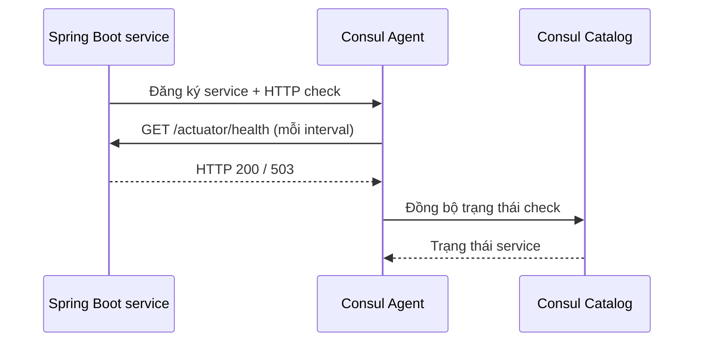
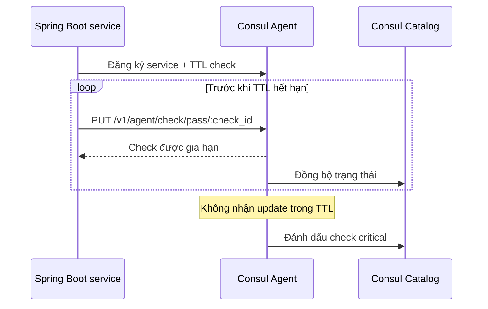

# Dựng Consul để so sánh HTTP check với TTL heartbeat

## 1. Mục tiêu thực hành

Trong bài thực hành này, ta dựng một Consul agent chạy ở chế độ development, đăng ký hai instance Spring Boot và quan sát hai cách kiểm tra sức khỏe:

- **HTTP check:** Consul Agent chủ động gửi HTTP request tới endpoint của service theo chu kỳ.
- **TTL heartbeat:** ứng dụng chủ động gửi tín hiệu tới Consul Agent để gia hạn thời gian sống của health check.

Hai cách đều giúp Consul đánh dấu instance `passing`, `warning` hoặc `critical`, nhưng chúng kiểm tra hai hướng giao tiếp khác nhau và có thể phát hiện những loại lỗi khác nhau.

Sau bài này, bạn có thể:

1. Khởi động Consul local bằng Docker Compose.
2. Đăng ký một Spring Boot service dùng HTTP health check.
3. Đăng ký một Spring Boot service dùng TTL heartbeat.
4. Xem service/check trong Consul UI và Agent HTTP API.
5. Chủ động làm hỏng endpoint HTTP và Actuator health để quan sát trạng thái khác nhau.
6. Dừng process, đo thời gian phát hiện lỗi và kiểm tra quá trình phục hồi.

## 2. HTTP check và TTL heartbeat hoạt động khác nhau thế nào?

### 2.1. HTTP check: Consul chủ động gọi service

Khi service được đăng ký kèm HTTP check, Consul Agent gửi request tới địa chỉ và port đã đăng ký, thường là:

```text
GET http://<service-address>:<service-port>/actuator/health
```

Consul thực hiện request theo `interval`. Nếu endpoint trả trạng thái thành công theo quy tắc HTTP check, check chuyển hoặc giữ ở `passing`. Nếu endpoint không truy cập được, timeout hoặc trả mã lỗi, check có thể chuyển sang `critical`.

Luồng giao tiếp:



HTTP check kiểm tra được đường đi từ Consul Agent tới endpoint thực tế. Nó có thể phát hiện sai địa chỉ đăng ký, port sai, firewall/NetworkPolicy chặn chiều vào, web server không nhận request hoặc health endpoint báo lỗi.

Với Spring Cloud Consul, HTTP check được bật mặc định khi đăng ký service. Health path mặc định là `/actuator/health` và interval mặc định là `10s`. Có thể đổi path, interval, timeout và header bằng các thuộc tính discovery.

### 2.2. TTL heartbeat: ứng dụng chủ động báo trạng thái

TTL check không yêu cầu Consul Agent gọi vào HTTP endpoint của ứng dụng. Thay vào đó, ứng dụng gửi heartbeat tới Consul Agent để cập nhật trạng thái check và đặt lại đồng hồ TTL.



Nếu Consul không nhận được update trước khi TTL hết hạn, check chuyển sang `critical`. Các endpoint Agent API thường dùng để cập nhật TTL là:

| Endpoint | Tác dụng |
|---|---|
| `PUT /v1/agent/check/pass/:check_id` | Đặt trạng thái `passing` và reset TTL |
| `PUT /v1/agent/check/warn/:check_id` | Đặt trạng thái `warning` và reset TTL |
| `PUT /v1/agent/check/fail/:check_id` | Đặt trạng thái `critical` và reset TTL |
| `PUT /v1/agent/check/update/:check_id` | Cập nhật trạng thái và output theo payload |

Spring Cloud Consul hỗ trợ TTL heartbeat tích hợp. Chỉ cần bật `spring.cloud.consul.discovery.heartbeat.enabled`; starter tự quản lý việc gửi heartbeat và đăng ký TTL check.

### 2.3. TTL của Spring Cloud Consul có thể dùng Actuator health

Một điểm dễ hiểu nhầm: TTL heartbeat không nhất thiết chỉ có nghĩa “JVM còn sống”. Với Spring Boot Actuator, Spring Cloud Consul mặc định lấy trạng thái từ health endpoint để quyết định trạng thái heartbeat. Nếu Actuator health báo `DOWN`, TTL check có thể được cập nhật thành `critical` dù process vẫn chạy.

Hai thuộc tính liên quan:

- `spring.cloud.consul.discovery.heartbeat.use-actuator-health`: mặc định `true`; dùng trạng thái Actuator khi gửi heartbeat.
- `spring.cloud.consul.discovery.heartbeat.actuator-health-group`: chọn health group; mặc định dùng root health group.

Nếu health endpoint không tồn tại hoặc ứng dụng không dùng Actuator, Spring Cloud Consul giả định ứng dụng khỏe. Khi đó heartbeat chỉ chứng minh ứng dụng vẫn chạy phần gửi heartbeat và còn liên lạc được với Consul Agent.

Có thể tắt việc dùng Actuator health bằng `use-actuator-health: false`, nhưng lúc đó TTL heartbeat trở thành tín hiệu liveness đơn giản hơn. Một ứng dụng vẫn gửi heartbeat có thể được đánh dấu `passing` dù HTTP endpoint nghiệp vụ đang lỗi.

## 3. So sánh hai cơ chế

| Tiêu chí | HTTP check | TTL heartbeat |
|---|---|---|
| Ai chủ động kiểm tra? | Consul Agent | Ứng dụng |
| Hướng mạng cần hoạt động | Agent → service | Ứng dụng → Agent |
| Đối tượng kiểm tra | Endpoint HTTP được cấu hình | Heartbeat từ process; có thể kết hợp Actuator health |
| Cấu hình mặc định Spring Cloud Consul | Bật, path `/actuator/health`, interval `10s` | Tắt, TTL mặc định `30s` |
| Phát hiện endpoint không truy cập từ Agent | Có | Không trực tiếp |
| Phát hiện process dừng | Có, ở lần probe tiếp theo | Có, khi TTL hết hạn |
| Phụ thuộc HTTP server | Có | Không bắt buộc nếu chỉ dùng heartbeat; Actuator health vẫn có thể được đọc nội bộ |
| Phụ thuộc kết nối tới Agent | Agent cần đồng bộ check | Có, ứng dụng phải gửi heartbeat tới Agent |
| Điều chỉnh chu kỳ | `health-check-interval` | `heartbeat.ttl` và scheduler/interval của starter |
| Rủi ro điển hình | Agent không route tới địa chỉ đã đăng ký | Scheduler còn chạy nhưng endpoint ngoài không truy cập được; hoặc heartbeat mất do Agent/network |

Không có cơ chế nào luôn tốt hơn. HTTP check phù hợp khi muốn kiểm tra endpoint từ góc nhìn của Consul Agent. TTL phù hợp khi ứng dụng cần tự báo trạng thái, endpoint không thể được Agent gọi trực tiếp hoặc muốn kết hợp một health decision nội bộ.

## 4. Chuẩn bị môi trường

### 4.1. Điều kiện cần

- Docker Desktop hoặc Docker Engine có Docker Compose.
- JDK và Maven/Gradle để chạy Spring Boot.
- Một ứng dụng Spring Boot có Web, Actuator và Spring Cloud Consul Discovery.
- Cổng `8500`, `8081`, `8082` chưa bị ứng dụng khác chiếm.

Sử dụng Spring Cloud BOM tương thích với phiên bản Spring Boot của dự án. Không chọn phiên bản Spring Cloud ngẫu nhiên chỉ vì một ví dụ trên mạng đang dùng phiên bản đó.

Các dependency Maven tối thiểu:

```xml
<dependencies>
    <dependency>
        <groupId>org.springframework.boot</groupId>
        <artifactId>spring-boot-starter-web</artifactId>
    </dependency>
    <dependency>
        <groupId>org.springframework.boot</groupId>
        <artifactId>spring-boot-starter-actuator</artifactId>
    </dependency>
    <dependency>
        <groupId>org.springframework.cloud</groupId>
        <artifactId>spring-cloud-starter-consul-discovery</artifactId>
    </dependency>
</dependencies>
```

Trong `dependencyManagement`, import `org.springframework.cloud:spring-cloud-dependencies` bằng phiên bản tương thích với Spring Boot hiện tại.

### 4.2. Dựng Consul Agent bằng Docker Compose

Tạo file `compose.yml` trong thư mục lab:

```yaml
services:
  consul:
    image: hashicorp/consul:1.22
    command:
      - agent
      - -dev
      - -ui
      - -client=0.0.0.0
    ports:
      - "8500:8500"
    extra_hosts:
      - "host.docker.internal:host-gateway"
```

Khởi động:

```powershell
docker compose up -d
docker compose ps
docker compose logs -f consul
```

Mở Consul UI:

```text
http://localhost:8500/ui
```

Kiểm tra Agent API:

```powershell
curl.exe -i http://localhost:8500/v1/status/leader
curl.exe -i http://localhost:8500/v1/agent/self
```

`-dev` tạo một agent đơn lẻ, dữ liệu thử nghiệm không bền vững và không có cấu hình bảo mật production. Chỉ dùng cho local lab. Không dùng dev mode làm kiến trúc Consul production.

`host.docker.internal` giúp Consul container gọi được ứng dụng đang chạy trên máy host. `host-gateway` là alias cho Docker Engine hiện đại trên Linux; Docker Desktop cũng hỗ trợ tên `host.docker.internal`. Nếu môi trường không hỗ trợ alias này, thay bằng địa chỉ host mà container có thể route tới.

## 5. Cấu hình ứng dụng Spring Boot

Trong bài lab, chạy cùng một JAR hai lần:

- Profile `http`: service `consul-http-demo`, cổng `8081`, dùng HTTP check.
- Profile `ttl`: service `consul-ttl-demo`, cổng `8082`, dùng TTL heartbeat.

Hai service có tên và instance ID riêng để có thể quan sát đồng thời trong Consul UI.

### 5.1. Cấu hình chung `application.yml`

```yaml
server:
  address: 0.0.0.0

management:
  endpoints:
    web:
      exposure:
        include: health,info

spring:
  cloud:
    consul:
      host: localhost
      port: 8500
      discovery:
        enabled: true
        register: true
        deregister: true
        hostname: host.docker.internal
        prefer-ip-address: false
        query-passing: true
```

Hai địa chỉ có mục đích khác nhau:

- `spring.cloud.consul.host: localhost` là địa chỉ ứng dụng dùng để gọi Consul Agent đã publish cổng `8500` ra máy host.
- `spring.cloud.consul.discovery.hostname: host.docker.internal` là hostname ứng dụng công bố trong service registration. Consul container dùng hostname này để gọi HTTP check tới ứng dụng.

`query-passing: true` yêu cầu Spring Cloud Consul thêm điều kiện chỉ lấy instance có check `passing` khi truy vấn health service. Nếu không bật, một instance có check `critical` vẫn có thể xuất hiện trong kết quả tùy query policy. Trạng thái check và việc consumer có loại instance hay không là hai vấn đề cần kiểm tra riêng.

### 5.2. Profile HTTP check: `application-http.yml`

```yaml
spring:
  application:
    name: consul-http-demo
  cloud:
    consul:
      discovery:
        instance-id: consul-http-demo-${server.port}
        register-health-check: true
        health-check-path: /lab/check
        health-check-interval: 5s
        health-check-timeout: 2s
        heartbeat:
          enabled: false
```

Trong lab, `health-check-path` dùng `/lab/check` để có thể chủ động trả `503` mà không làm hỏng root Actuator health. Trong môi trường thật, thường dùng readiness endpoint như `/actuator/health/readiness` nếu endpoint đó phản ánh đúng điều kiện nhận traffic.

`health-check-interval: 5s` và `health-check-timeout: 2s` chỉ là thông số thử nghiệm để nhìn thấy chuyển trạng thái nhanh. Mặc định Spring Cloud Consul dùng path `/actuator/health` và interval `10s` nếu không override.

### 5.3. Profile TTL heartbeat: `application-ttl.yml`

```yaml
spring:
  application:
    name: consul-ttl-demo
  cloud:
    consul:
      discovery:
        instance-id: consul-ttl-demo-${server.port}
        heartbeat:
          enabled: true
          ttl: 30s
          use-actuator-health: true
```

TTL heartbeat được bật rõ ràng; `30s` cũng là giá trị TTL mặc định được công bố trong property reference hiện hành. Spring Cloud Consul tự gửi heartbeat theo scheduler nội bộ. Không cần tự viết scheduler gọi Agent API khi đã dùng heartbeat tích hợp.

`use-actuator-health: true` khiến starter dùng Actuator root health group để quyết định trạng thái heartbeat. Giữ dependency Actuator và endpoint health hoạt động trong bài lab. Nếu tắt thuộc tính này, bạn đang thử mô hình heartbeat liveness đơn giản, không còn so sánh cùng một health signal.

Khi `heartbeat.enabled` được bật, TTL check được dùng thay cho HTTP check mặc định. Hãy kiểm tra danh sách check trong Agent API để xác nhận loại check thực tế, không chỉ dựa vào file cấu hình.

## 6. Tạo endpoint để mô phỏng trạng thái khác nhau

Để thấy sự khác nhau giữa hai cơ chế, tạo hai tín hiệu độc lập:

- `/lab/check` chỉ phục vụ HTTP check; có thể trả `200` hoặc `503`.
- Actuator root health có một `HealthIndicator` riêng; có thể trả `UP` hoặc `DOWN` để TTL heartbeat đọc.

### 6.1. Trạng thái lab dùng chung

```java
import java.util.concurrent.atomic.AtomicBoolean;

import org.springframework.stereotype.Component;

@Component
public class LabHealthState {

    private final AtomicBoolean httpCheckHealthy = new AtomicBoolean(true);
    private final AtomicBoolean actuatorHealthy = new AtomicBoolean(true);

    public boolean isHttpCheckHealthy() {
        return httpCheckHealthy.get();
    }

    public void setHttpCheckHealthy(boolean healthy) {
        httpCheckHealthy.set(healthy);
    }

    public boolean isActuatorHealthy() {
        return actuatorHealthy.get();
    }

    public void setActuatorHealthy(boolean healthy) {
        actuatorHealthy.set(healthy);
    }
}
```

### 6.2. Health indicator cho Actuator

```java
import org.springframework.boot.actuate.health.Health;
import org.springframework.boot.actuate.health.HealthIndicator;
import org.springframework.stereotype.Component;

@Component
public class LabActuatorHealthIndicator implements HealthIndicator {

    private final LabHealthState state;

    public LabActuatorHealthIndicator(LabHealthState state) {
        this.state = state;
    }

    @Override
    public Health health() {
        if (state.isActuatorHealthy()) {
            return Health.up().withDetail("lab", "healthy").build();
        }

        return Health.down().withDetail("lab", "forced-down").build();
    }
}
```

### 6.3. Controller điều khiển hai tín hiệu

```java
import org.springframework.http.HttpStatus;
import org.springframework.http.ResponseEntity;
import org.springframework.web.bind.annotation.GetMapping;
import org.springframework.web.bind.annotation.PathVariable;
import org.springframework.web.bind.annotation.PostMapping;
import org.springframework.web.bind.annotation.RequestMapping;
import org.springframework.web.bind.annotation.RestController;
import org.springframework.web.server.ResponseStatusException;

@RestController
@RequestMapping("/lab")
public class LabCheckController {

    private final LabHealthState state;

    public LabCheckController(LabHealthState state) {
        this.state = state;
    }

    @GetMapping("/check")
    public ResponseEntity<String> httpCheck() {
        if (state.isHttpCheckHealthy()) {
            return ResponseEntity.ok("passing");
        }
        return ResponseEntity.status(HttpStatus.SERVICE_UNAVAILABLE)
                .body("critical");
    }

    @PostMapping("/http-check/{value}")
    public String setHttpCheck(@PathVariable String value) {
        state.setHttpCheckHealthy(parseState(value));
        return "HTTP check state updated";
    }

    @PostMapping("/actuator-health/{value}")
    public String setActuatorHealth(@PathVariable String value) {
        state.setActuatorHealthy(parseState(value));
        return "Actuator health state updated";
    }

    private boolean parseState(String value) {
        if ("up".equalsIgnoreCase(value)) {
            return true;
        }
        if ("down".equalsIgnoreCase(value)) {
            return false;
        }
        throw new ResponseStatusException(
                HttpStatus.BAD_REQUEST,
                "State must be up or down"
        );
    }
}
```

Các endpoint `/lab/*` chỉ dùng trong local lab. Không đưa controller điều khiển health này vào production.

## 7. Build và chạy hai instance

Build ứng dụng một lần:

```powershell
mvnw.cmd clean package
```

Giả sử artifact được tạo là `target/consul-lab.jar`. Mở hai terminal PowerShell.

Terminal 1 — HTTP check:

```powershell
java -jar target/consul-lab.jar --spring.profiles.active=http --server.port=8081
```

Terminal 2 — TTL heartbeat:

```powershell
java -jar target/consul-lab.jar --spring.profiles.active=ttl --server.port=8082
```

Kiểm tra ứng dụng:

```powershell
curl.exe -i http://localhost:8081/lab/check
curl.exe -i http://localhost:8081/actuator/health
curl.exe -i http://localhost:8082/actuator/health
```

Ban đầu cả hai endpoint health phải trả trạng thái tốt. Nếu service không đăng ký, xem log Spring Cloud Consul và xác minh ứng dụng kết nối được `localhost:8500`.

## 8. Quan sát registration và health check

### 8.1. Consul UI

Mở:

```text
http://localhost:8500/ui
```

Trong mục Services, tìm:

- `consul-http-demo`
- `consul-ttl-demo`

Mở từng service để xem instance và check tương ứng. Cả hai instance ban đầu phải `passing`.

### 8.2. Agent API

Liệt kê service đã đăng ký trên local agent:

```powershell
curl.exe -s http://localhost:8500/v1/agent/services
```

Liệt kê check mà Agent đang quản lý:

```powershell
curl.exe -s http://localhost:8500/v1/agent/checks
```

Liệt kê health của từng service trong catalog:

```powershell
curl.exe -s http://localhost:8500/v1/health/service/consul-http-demo
curl.exe -s http://localhost:8500/v1/health/service/consul-ttl-demo
```

Chỉ lấy instance có check `passing`:

```powershell
curl.exe -s "http://localhost:8500/v1/health/service/consul-http-demo?passing"
curl.exe -s "http://localhost:8500/v1/health/service/consul-ttl-demo?passing"
```

`/v1/agent/checks` cho biết check mà local agent đang giữ; `/v1/health/service/...` cho biết trạng thái service/check nhìn từ catalog. Hai góc nhìn có thể lệch trong một khoảng ngắn khi Agent đang đồng bộ trạng thái lên catalog.

## 9. Thử nghiệm 1: làm HTTP check thất bại, giữ TTL heartbeat khỏe

Đảm bảo hai ứng dụng đang chạy và cả hai check đang `passing`.

Đưa endpoint riêng của HTTP check xuống trạng thái lỗi:

```powershell
curl.exe -X POST http://localhost:8081/lab/http-check/down
```

Xác minh endpoint:

```powershell
curl.exe -i http://localhost:8081/lab/check
curl.exe -i http://localhost:8081/actuator/health
```

Kết quả mong đợi:

- `/lab/check` trả HTTP `503`.
- `/actuator/health` của instance HTTP vẫn `UP`.
- Consul Agent gọi `/lab/check` theo chu kỳ và chuyển HTTP check sang `critical`.
- TTL instance vẫn `passing`, vì process TTL vẫn gửi heartbeat và Actuator root health của nó vẫn `UP`.

Đây là minh họa cho khác biệt giữa kiểm tra endpoint từ xa và heartbeat chủ động. TTL check không chứng minh rằng mọi đường HTTP từ Consul Agent tới ứng dụng đều thông suốt.

Khôi phục HTTP check:

```powershell
curl.exe -X POST http://localhost:8081/lab/http-check/up
```

Chờ lần probe kế tiếp rồi kiểm tra lại Consul UI/API. HTTP check sẽ trở về `passing` sau khi request thành công.

## 10. Thử nghiệm 2: Actuator health xuống, process TTL vẫn chạy

Đưa Actuator root health của instance TTL xuống `DOWN`:

```powershell
curl.exe -X POST http://localhost:8082/lab/actuator-health/down
```

Kiểm tra:

```powershell
curl.exe -i http://localhost:8082/actuator/health
```

Kết quả mong đợi:

- Process và web server vẫn chạy.
- Actuator root health trả `DOWN` (HTTP status thường là `503`).
- Spring Cloud Consul TTL heartbeat đọc trạng thái Actuator và cập nhật check thành `critical`.
- HTTP check instance vẫn `passing` nếu `/lab/check` của nó vẫn trả `200`.

Điều này cho thấy TTL heartbeat tích hợp của Spring Cloud Consul có thể mang ý nghĩa health status, không chỉ là ping liveness. Khôi phục:

```powershell
curl.exe -X POST http://localhost:8082/lab/actuator-health/up
```

Chờ heartbeat tiếp theo và xác minh TTL check trở lại `passing`.

Nếu cấu hình `heartbeat.use-actuator-health: false`, bước làm Actuator `DOWN` sẽ không còn tác động tới TTL status; heartbeat có thể tiếp tục báo `passing` miễn là scheduler gửi update thành công. Đây là hành vi cần lựa chọn có chủ đích.

## 11. Thử nghiệm 3: dừng process và đo thời gian phát hiện

### 11.1. Dừng instance HTTP

Nhấn `Ctrl+C` trong terminal đang chạy cổng `8081`. Consul Agent tiếp tục gửi HTTP check. Khi lần kiểm tra kế tiếp không kết nối được, HTTP check chuyển sang `critical`.

Với interval `5s` và timeout `2s`, thời điểm phát hiện thường nằm trong khoảng một chu kỳ probe cộng thời gian timeout và độ trễ xử lý. Giá trị thực tế phụ thuộc thời điểm process dừng so với lần probe gần nhất và chính sách số lần thất bại.

### 11.2. Dừng instance TTL

Nhấn `Ctrl+C` trong terminal đang chạy cổng `8082`. Ứng dụng không còn gửi heartbeat. Khi không có update trong thời hạn TTL `30s`, Consul Agent chuyển TTL check sang `critical`.

TTL detection dựa trên thời điểm heartbeat thành công cuối cùng, không phải thời điểm process dừng chính xác. Do đó, độ trễ phát hiện có thể gần TTL cộng phần xử lý/đồng bộ.

### 11.3. Bảng ghi kết quả

| Đo lường | HTTP check | TTL heartbeat |
|---|---|---|
| Interval/TTL cấu hình | 5 giây | TTL 30 giây |
| Thời điểm dừng process | Ghi timestamp | Ghi timestamp |
| Thời điểm check thành `critical` | Ghi timestamp | Ghi timestamp |
| Detection delay | `criticalAt - stoppedAt` | `criticalAt - stoppedAt` |
| Khôi phục | Khởi động lại app, đợi probe thành công | Khởi động lại app, đăng ký/heartbeat lại |

Chạy thử nhiều lần và ghi p50/p95 nếu muốn so sánh định lượng. Không kết luận chỉ từ một lần dừng process.

## 12. TTL check ở mức Consul Agent API

Spring Cloud Consul tự đăng ký TTL check và gửi heartbeat. Để hiểu giao thức nền, có thể tạo một TTL check độc lập bằng service definition HCL:

```hcl
service {
  name    = "manual-ttl-demo"
  id      = "manual-ttl-demo-1"
  address = "host.docker.internal"
  port    = 8090

  check {
    id     = "manual-ttl-check"
    name   = "Manual TTL heartbeat"
    ttl    = "30s"
    status = "critical"
  }
}
```

Lưu nội dung trên thành `manual-ttl.hcl`, sau đó copy vào container và đăng ký bằng Consul CLI:

```powershell
docker compose cp manual-ttl.hcl consul:/tmp/manual-ttl.hcl
docker compose exec consul consul services register /tmp/manual-ttl.hcl
```

Lệnh CLI đăng ký service và check với local agent. Trong bài lab này, dùng cách CLI để giữ nguyên định dạng HCL; nếu tích hợp từ ứng dụng, có thể gửi JSON tương đương tới `PUT /v1/agent/service/register`.

Gia hạn check thủ công:

```powershell
curl.exe -i -X PUT http://localhost:8500/v1/agent/check/pass/manual-ttl-check
```

Đặt trạng thái warning hoặc critical:

```powershell
curl.exe -i -X PUT http://localhost:8500/v1/agent/check/warn/manual-ttl-check
curl.exe -i -X PUT http://localhost:8500/v1/agent/check/fail/manual-ttl-check
```

Mỗi lệnh TTL pass/warn/fail cập nhật trạng thái check và reset TTL clock. Nếu không gửi update trước khi TTL hết hạn, Consul tự chuyển check sang `critical`.

Đây là ví dụ API thủ công để học giao thức, không chạy đồng thời với Spring Cloud Consul heartbeat cho cùng một check ID. Trong production bật ACL, các thao tác ghi check cần quyền phù hợp (ví dụ `node:write` và `service:write` theo endpoint); dùng token Secret và không công khai Agent API ra mạng không tin cậy.

## 13. Health check critical có tự xóa service không?

Không nên đồng nhất `critical` với deregister. Một check chuyển sang `critical` thường làm service không còn `passing`, nhưng bản đăng ký có thể vẫn tồn tại trong catalog. Service chỉ bị tự động deregister nếu có cấu hình như `deregister_critical_service_after`/`health-check-critical-timeout` phù hợp và đủ thời gian.

Trong Spring Cloud Consul, `spring.cloud.consul.discovery.query-passing` mặc định là `false`. Nếu consumer cần chỉ nhận instance có check `passing`, bật:

```yaml
spring:
  cloud:
    consul:
      discovery:
        query-passing: true
```

Điều này quan trọng khi dùng `DiscoveryClient` hoặc Spring Cloud LoadBalancer. Hãy kiểm tra query thực tế và danh sách instance trả về sau khi check chuyển `critical`; đừng chỉ nhìn màu trạng thái trong UI.

## 14. Chọn cơ chế nào cho hệ thống thật?

### 14.1. Chọn HTTP check khi

- Consul Agent có thể route tới địa chỉ/port của service.
- Muốn kiểm tra endpoint thực tế từ network của Agent.
- Muốn phát hiện sai service address, port, firewall, proxy hoặc HTTP listener.
- Có một readiness endpoint nhẹ, ổn định và không yêu cầu thông tin bí mật phức tạp.

Hãy chọn endpoint phản ánh khả năng nhận traffic. Nếu `/actuator/health` báo `UP` dù ứng dụng chưa hoàn tất warm-up, cân nhắc readiness group hoặc endpoint phù hợp hơn. Cấu hình `health-check-timeout` đủ lớn cho p99 của endpoint và `health-check-interval` cân bằng giữa tốc độ phát hiện với số request check.

### 14.2. Chọn TTL heartbeat khi

- Agent không thể chủ động gọi vào địa chỉ của service do NAT, firewall hoặc topology.
- Ứng dụng cần chủ động quyết định trạng thái health và báo cho Agent.
- Muốn kết hợp Actuator health hoặc `ApplicationStatusProvider` tùy chỉnh.
- Có kết nối outbound từ ứng dụng tới Agent nhưng không có đường inbound từ Agent tới ứng dụng.

TTL phải đủ dài để hấp thụ jitter, GC pause, CPU throttling và thời gian tạm thời mất kết nối tới Agent. TTL quá ngắn có thể tạo trạng thái critical giả; TTL quá dài làm phát hiện process chết chậm.

### 14.3. Có thể kết hợp hai loại check không?

Consul hỗ trợ nhiều check trên một service. Có thể dùng nhiều check nếu mỗi check bảo vệ một điều kiện khác nhau, ví dụ HTTP readiness và check TCP phụ trợ. Tuy nhiên, Spring Cloud Consul mô tả TTL heartbeat là lựa chọn thay cho HTTP check mặc định. Nếu muốn đăng ký nhiều check đồng thời, cần cấu hình service/check rõ ràng bằng Agent API hoặc service definition, tránh vô tình tạo hai check trùng ý nghĩa.

Nếu có nhiều check, một instance chỉ nên được xem là đủ điều kiện nhận traffic khi tất cả check bắt buộc đều `passing` theo query policy của consumer.

## 15. Các lỗi thường gặp và cách xử lý

| Dấu hiệu | Nguyên nhân thường gặp | Cách kiểm tra/sửa |
|---|---|---|
| HTTP check luôn critical | Consul Agent không truy cập được hostname/port | Kiểm tra `hostname`, port, firewall và gọi URL từ container Consul |
| HTTP check trả 404 | Sai `health-check-path` hoặc context path | Gọi đúng path từ host/container; kiểm tra management context path |
| HTTP check timeout | Endpoint chậm hoặc `health-check-timeout` quá thấp | Đo latency endpoint, giảm công việc trong health check hoặc tăng timeout hợp lý |
| HTTP check thành critical nhưng app vẫn phục vụ | Check path kiểm tra dependency không liên quan hoặc route từ Agent bị chặn | Xem output của check và kiểm tra network Agent → app |
| TTL check chuyển critical dù app chạy | Heartbeat scheduler không gửi kịp, Agent không nhận được update hoặc TTL quá ngắn | Xem log heartbeat, Agent API, TTL và tải JVM/network |
| TTL luôn passing dù HTTP listener không hoạt động | Heartbeat vẫn gửi và Actuator health không phản ánh lỗi listener | Dùng health indicator/readiness phù hợp hoặc HTTP check bổ sung |
| TTL không chuyển critical khi Actuator DOWN | `use-actuator-health` bị tắt, chọn health group khác hoặc health endpoint không được đọc | Kiểm tra `heartbeat.*` và health group thực tế |
| TTL check không xuất hiện | `heartbeat.enabled` chưa bật hoặc registration bị tắt | Kiểm tra profile/config hiệu lực và `/v1/agent/checks` |
| Có hai check không mong muốn | Cấu hình HTTP check và TTL check chồng nhau hoặc registration cũ còn tồn tại | Kiểm tra check ID; deregister check cũ trong môi trường lab |
| UI critical nhưng DiscoveryClient vẫn trả instance | Consumer không query `passing` | Bật `query-passing` hoặc thêm health-aware supplier |
| App chạy trong Docker nhưng HTTP check không tới được | Đăng ký `localhost` hoặc IP nội bộ container không route từ Agent | Dùng địa chỉ có thể truy cập từ Agent, kiểm tra network alias |
| Agent API trả 403 | Thiếu ACL policy/token | Cấp quyền ghi check/service tối thiểu cho workload |

## 16. Bảo mật và vận hành

- Dev agent không bật ACL/TLS mặc định; chỉ dùng trong local lab.
- Production nên bật ACL, TLS và giới hạn Agent HTTP API theo network policy/firewall.
- TTL heartbeat yêu cầu ứng dụng có quyền cập nhật check; không cấp quyền ghi toàn cluster nếu chỉ cần check/service của node.
- Nếu HTTP check cần header, dùng `spring.cloud.consul.discovery.health-check-headers` và lưu giá trị nhạy cảm trong Secret/config bảo mật.
- Không đặt token trong URL hoặc commit vào source control.
- Health endpoint nên trả dữ liệu tối thiểu; không expose chi tiết database, secret hoặc stack trace.
- Chọn readiness/health policy nhất quán với traffic routing. Liveness, readiness và heartbeat không phải lúc nào cũng cùng một tín hiệu.
- Đặt TTL/interval dựa trên p99, GC pause và network jitter; cảnh báo khi check đổi trạng thái lặp lại.
- Theo dõi thời gian từ lúc lỗi bắt đầu đến khi check critical, và từ lúc phục hồi đến khi check passing.

## 17. Checklist hoàn thành lab

- [ ] Consul agent chạy ở `localhost:8500` và UI truy cập được.
- [ ] Ứng dụng có `spring-cloud-starter-consul-discovery` và Actuator.
- [ ] Consul Agent có thể phân giải `host.docker.internal` và truy cập port ứng dụng.
- [ ] `consul-http-demo` đăng ký HTTP check với path `/lab/check`.
- [ ] `consul-ttl-demo` đăng ký TTL check với `heartbeat.enabled=true`.
- [ ] `/v1/agent/checks` cho thấy đúng loại check của từng instance.
- [ ] Làm `/lab/check` trả 503 khiến HTTP check chuyển critical.
- [ ] Trong thử nghiệm trên, TTL instance vẫn passing khi Actuator root còn UP.
- [ ] Làm Actuator root DOWN khiến TTL check chuyển critical khi `use-actuator-health=true`.
- [ ] Dừng từng process và ghi detection delay.
- [ ] Khôi phục process và xác minh check trở lại passing.
- [ ] Bật `query-passing` nếu consumer cần loại instance critical.
- [ ] Ghi lại cấu hình interval/TTL, thời gian phát hiện và giới hạn của môi trường lab.

## 18. Kết luận

HTTP check là mô hình pull: Consul Agent gọi endpoint của service và xác minh đường truy cập từ phía Agent. TTL heartbeat là mô hình push: ứng dụng gửi trạng thái tới Agent trước khi TTL hết hạn. HTTP check phù hợp để xác nhận endpoint thực sự có thể được gọi; TTL phù hợp khi ứng dụng cần chủ động báo trạng thái hoặc Agent không thể gọi ngược vào service.

Với Spring Cloud Consul, HTTP check được bật mặc định, còn TTL heartbeat cần bật tường minh. TTL tích hợp có thể đọc Actuator health; nếu không có health endpoint, starter giả định ứng dụng khỏe. Hãy chọn tín hiệu phản ánh đúng điều kiện nhận traffic, kiểm tra `query-passing`, đo detection delay và xác minh cả trạng thái check lẫn kết quả discovery trước khi áp dụng vào môi trường thật.

## Tài liệu tham khảo

- [Spring Cloud Consul – Service Discovery](https://docs.spring.io/spring-cloud-consul/reference/discovery.html)
- [Spring Cloud Consul – Common Application Properties](https://docs.spring.io/spring-cloud-consul/reference/appendix.html)
- [Consul – Check Agent HTTP API](https://developer.hashicorp.com/consul/api-docs/agent/check)
- [Consul – Health Check Configuration Reference](https://developer.hashicorp.com/consul/docs/reference/service/health-check)
- [Consul – Agent Service Registration API](https://developer.hashicorp.com/consul/api-docs/agent/service)
