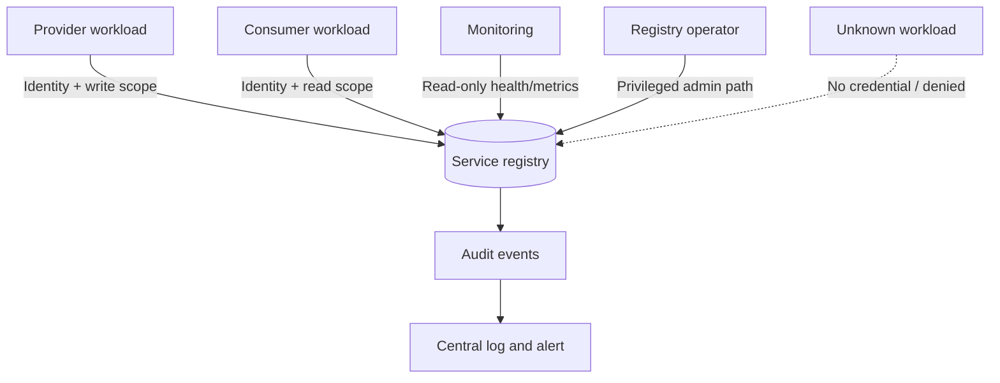

# Bảo vệ sổ đăng ký và kiểm thử đăng ký trái phép

Service registry là một phần của control plane microservice. Nếu người không có quyền có thể đăng ký instance giả, thay đổi metadata, đọc topology hoặc xóa registration hợp lệ, consumer có thể bị điều hướng đến endpoint không tin cậy hoặc mất khả năng tìm service. Vì vậy, registry cần được bảo vệ như một hệ thống hạ tầng có danh tính, xác thực, phân quyền, mã hóa kết nối và audit.

Bài thực hành này tập trung vào Spring Cloud Service Discovery với Eureka, Consul và ZooKeeper. Ta sẽ xác định threat model, tách quyền provider/consumer/operator, cấu hình lớp bảo vệ phù hợp từng registry, kiểm tra dữ liệu registration và viết negative test để chứng minh request không được cấp quyền sẽ bị từ chối. Các thử nghiệm phải chạy trên registry/container dành riêng cho test, không gửi registration giả đến môi trường dùng chung hoặc production.

## 1. Vì sao phải bảo vệ registry?

Registry chứa thông tin mà consumer dùng để tìm đích gọi. Một registration trái phép có thể tạo ra nhiều rủi ro:

- **Service spoofing:** đăng ký một instance giả dưới service ID hợp lệ để consumer chọn nhầm host/port.
- **Metadata poisoning:** sửa zone, version, protocol hoặc capability khiến LoadBalancer chọn sai instance.
- **Unauthorized deregistration:** xóa instance thật, gây gián đoạn traffic.
- **Topology disclosure:** đọc danh sách service, địa chỉ nội bộ, port và metadata của hệ thống.
- **Endpoint abuse:** quảng bá địa chỉ không được phép hoặc endpoint health check tùy ý để biến registry thành nguồn định tuyến đến hệ thống ngoài dự kiến.
- **Credential compromise:** dùng token hoặc mật khẩu dùng chung để ghi/xóa nhiều service.
- **Control-plane denial of service:** tạo registration liên tục, tạo quá nhiều znode hoặc gửi request gây quá tải.

Không nên xem network nội bộ là một cơ chế xác thực. Một workload trong cùng VPC, cluster hoặc subnet vẫn có thể bị xâm nhập. Registry phải xác minh danh tính của client và giới hạn chính xác thao tác client được phép thực hiện.

## 2. Threat model và ranh giới tin cậy

Trước khi cấu hình, xác định ai cần truy cập registry và vì sao:

| Actor | Nhu cầu hợp lệ | Quyền tối thiểu gợi ý |
| --- | --- | --- |
| Provider application | Đăng ký, cập nhật health/metadata và deregister instance của chính nó | Write giới hạn theo service identity hoặc path |
| Consumer application | Tra cứu service/instance và health cần thiết | Read trên các service được phép |
| Registry operator | Quản trị node, policy, ACL, backup và recovery | Quyền quản trị tách biệt, dùng qua quy trình vận hành |
| Monitoring agent | Đọc health/metrics | Read-only trên endpoint cần thiết |
| CI test identity | Tạo và xóa dữ liệu trong namespace/service prefix test | Quyền giới hạn trong vùng test |
| Workload không xác định | Không có nhu cầu truy cập | Không được kết nối hoặc bị từ chối |



Tách quyền theo actor giúp tránh một credential bị lộ có thể vừa đọc topology, vừa đăng ký service, vừa xóa instance. Credential quản trị không nên được nhúng trong mọi ứng dụng Spring Boot.

## 3. Các lớp bảo vệ cần có

Một thiết kế an toàn thường có nhiều lớp bổ trợ nhau:

1. **Network segmentation:** chỉ workload và operator được phép mới truy cập cổng registry; không public registry API ra Internet.
2. **TLS:** mã hóa traffic và xác minh danh tính server; dùng mTLS khi cần xác minh cả client certificate.
3. **Authentication:** xác định chính xác workload hoặc operator đang kết nối.
4. **Authorization:** giới hạn service, namespace, path và thao tác được phép.
5. **Registration validation:** kiểm tra service ID, instance ID, host, port, metadata và health endpoint trước khi chấp nhận.
6. **Secret management:** cấp, xoay vòng và thu hồi credential; không commit token/password vào repository.
7. **Audit và monitoring:** ghi nhận registration, deregistration, ACL denial và thay đổi policy.
8. **Rate/resource limits:** giới hạn request, registration count, connection và kích thước payload.

TLS không thay thế authorization. Một client có certificate hợp lệ vẫn không được tự do đăng ký mọi service. Ngược lại, ACL không mã hóa traffic; token gửi qua HTTP không mã hóa có thể bị đánh cắp trên đường truyền.

## 4. Chuẩn hóa service identity và dữ liệu registration

Một registration cần có danh tính và phạm vi rõ ràng:

```json
{
  "serviceId": "inventory-service",
  "instanceId": "inventory-prod-zone-a-01",
  "host": "10.20.1.15",
  "port": 8081,
  "metadata": {
    "environment": "production",
    "zone": "zone-a",
    "version": "2.4.1"
  }
}
```

Đây là mô hình logic minh họa, không phải payload bắt buộc của mọi provider. Trước khi chấp nhận registration, policy nên xác định:

- Service ID có thuộc danh sách service được workload đó sở hữu không?
- Instance ID có duy nhất trong phạm vi service không?
- Host có thuộc subnet, DNS suffix hoặc network zone được phép không?
- Port có nằm trong dải port được workload khai báo không?
- Metadata có đúng schema và giới hạn kích thước không?
- Environment/version/zone có được cấp từ nguồn tin cậy không?
- Health check path/URL có nằm trong danh sách cho phép không?

Không tin các trường metadata chỉ vì chúng do client gửi. Nếu `environment=production` hoặc `zone=trusted` ảnh hưởng đến routing, hãy lấy giá trị từ workload identity, deployment platform hoặc policy server thay vì cho client tùy ý khai báo.

Đặc biệt, không cho client tự đăng ký health check URL tùy ý nếu agent sẽ chủ động gọi URL đó. Một URL tùy ý có thể khiến agent truy cập endpoint ngoài phạm vi mong muốn. Dùng path/port đã được chuẩn hóa và giới hạn theo service policy.

## 5. Phân quyền riêng cho provider, consumer và operator

Tạo identity riêng cho từng vai trò:

| Identity | Được phép | Không được phép |
| --- | --- | --- |
| `inventory-provider` | Register/update/deregister instance thuộc `inventory-service` | Ghi `payment-service`, sửa ACL hoặc đọc secret quản trị |
| `checkout-consumer` | Đọc danh sách service cần gọi | Register hoặc deregister instance |
| `registry-monitor` | Đọc health/status/metrics cần thiết | Ghi registration hoặc thay đổi policy |
| `registry-operator` | Quản trị registry theo quy trình | Dùng như credential mặc định trong ứng dụng |
| `ci-discovery-test` | Ghi/xóa resource trong vùng test riêng | Đụng vào namespace/service production |

Trong thực tế có thể cấp token riêng cho từng service hoặc từng workload instance tùy cơ chế identity của nền tảng. Không dùng một token `admin` cho mọi provider. Khi một workload bị xâm nhập, phạm vi thiệt hại phải giới hạn trong các service mà workload sở hữu.

## 6. Bảo vệ Eureka Server

Eureka không nên được xem là một API tự bảo vệ chỉ vì nó chạy trong mạng nội bộ. Cần đặt server trong private network, giới hạn ingress, bật HTTPS và thêm authentication/authorization ở server hoặc lớp gateway/service mesh phù hợp.

Ví dụ một cấu hình Spring Security cơ bản cho Eureka Server dùng HTTP Basic trong môi trường test hoặc mạng nội bộ được kiểm soát:

```java
import org.springframework.context.annotation.Bean;
import org.springframework.context.annotation.Configuration;
import org.springframework.security.config.Customizer;
import org.springframework.security.config.annotation.web.builders.HttpSecurity;
import org.springframework.security.web.SecurityFilterChain;

@Configuration
class EurekaSecurityConfiguration {

    @Bean
    SecurityFilterChain registrySecurity(HttpSecurity http) throws Exception {
        http
            .authorizeHttpRequests(auth -> auth
                .requestMatchers("/actuator/health").permitAll()
                .requestMatchers("/eureka/**").authenticated()
                .anyRequest().authenticated())
            .httpBasic(Customizer.withDefaults())
            // Eureka clients use machine-to-machine requests; scope CSRF
            // exemption to the registry API and keep authentication enabled.
            .csrf(csrf -> csrf.ignoringRequestMatchers("/eureka/**"));

        return http.build();
    }
}
```

Đây là khung minh họa. Cần điều chỉnh path theo servlet context/server path thực tế, xác định endpoint nào được public và cấu hình `UserDetailsService`, password encoder hoặc cơ chế identity phù hợp. Nếu ứng dụng dùng session/cookie cho browser admin, cần đánh giá CSRF riêng; không tắt CSRF toàn bộ ứng dụng chỉ để Eureka client đăng ký được.

Eureka client phải gửi credential phù hợp tới server. Nếu cơ chế client đang dùng hỗ trợ Basic authentication qua URL hoặc HTTP client configuration, lấy secret từ secret manager/environment injection và tránh log URL đã resolve vì URL có thể chứa user-info. Với yêu cầu cao hơn, terminate TLS/mTLS ở ingress hoặc service mesh có policy xác minh client identity.

Một số điểm cần kiểm tra:

- Server chỉ nhận traffic từ subnet/workload được phép.
- Client và server xác minh certificate/hostname; không tắt trust validation.
- Endpoint registration không anonymous.
- Quyền read và write được tách nếu triển khai hỗ trợ policy ở gateway/security layer.
- Actuator endpoint không vô tình mở rộng quyền đọc registry hoặc cấu hình.
- Khi bật Spring Security, test POST registration thực tế; CSRF có thể trả `403` nếu endpoint machine-to-machine chưa được cấu hình đúng.

Eureka OSS không cung cấp mô hình ACL theo service identity phong phú như Consul ACL. Nếu cần phân quyền write theo từng service, có thể đặt policy ở gateway/proxy hoặc dùng cơ chế security bổ sung; phải kiểm thử rằng client chỉ được đăng ký service được giao.

## 7. Bảo vệ Consul bằng ACL token

Consul có ACL policy và token. Đây là nơi cần tách quyền service registration, catalog/health read và quản trị. Khi bật ACL, tạo token riêng cho từng workload và chỉ cấp các policy cần thiết.

Ví dụ policy writer chỉ được quản lý một service:

```hcl
service "inventory-service" {
  policy = "write"
}

node_prefix "" {
  policy = "read"
}
```

Ví dụ policy consumer chỉ đọc service catalog/health và node metadata:

```hcl
service "inventory-service" {
  policy = "read"
}

node_prefix "" {
  policy = "read"
}
```

Policy cụ thể cần được rà soát theo Consul version, namespace/partition và API mà ứng dụng sử dụng. Nếu writer cần thêm quyền đọc hoặc consumer chỉ được đọc một số service, thu hẹp rule theo service/namespace tương ứng. Không cấp `operator` hoặc token bootstrap cho ứng dụng.

Spring Cloud Consul có property để cung cấp token; ví dụ cấu hình token qua biến môi trường:

```yaml
spring:
  cloud:
    consul:
      host: ${CONSUL_HOST:consul-agent}
      port: ${CONSUL_PORT:8500}
      token: ${CONSUL_HTTP_TOKEN}
      scheme: https
      discovery:
        enabled: true
        register: true
        service-name: inventory-service
```

Property và TLS options phải khớp phiên bản Spring Cloud Consul đang dùng. Token phải được inject từ secret store, không ghi literal vào `application.yml`, Docker image, CI log hoặc command history. Với agent-based registration, xác định token được dùng bởi application hay agent và tránh vô tình cấp hai lớp quyền rộng hơn cần thiết.

Kiểm tra các tình huống:

- Token writer đăng ký được `inventory-service`.
- Token writer không đăng ký được `payment-service`.
- Token reader tra cứu được service được phép nhưng không đăng ký được.
- Không có token thì API được bảo vệ trả lỗi authorization.
- Token đã revoke không còn thực hiện thao tác mới.
- Agent health check hoạt động với quyền và endpoint được cấu hình.

## 8. Bảo vệ ZooKeeper và Curator bằng ACL

ZooKeeper lưu registry trong znode tree. Nếu ACL không được cấu hình đúng, một client có thể đọc hoặc thay đổi node mà nó không sở hữu. Cần xác định ACL cho root path, service path và instance node; đồng thời tách credential writer khỏi reader.

Các quyền ZooKeeper thường gặp:

| Quyền | Ý nghĩa |
| --- | --- |
| `READ` | Đọc dữ liệu node và xem children |
| `WRITE` | Cập nhật dữ liệu node |
| `CREATE` | Tạo child node |
| `DELETE` | Xóa child node |
| `ADMIN` | Thay đổi ACL của node |

Consumer thường chỉ cần `READ` trên path service. Provider cần `CREATE`/`WRITE`/`DELETE` trong vùng đăng ký được giao và không nên có `ADMIN` trên toàn bộ cây. Operator mới được quản lý ACL và root path.

Với Curator, có thể cấu hình authentication và ACL provider khi tạo client. Ví dụ minh họa cách tạo digest identity và ACL theo path:

```java
import java.nio.charset.StandardCharsets;
import java.util.List;

import org.apache.zookeeper.ZooDefs;
import org.apache.zookeeper.data.ACL;
import org.apache.zookeeper.data.Id;
import org.apache.zookeeper.server.auth.DigestAuthenticationProvider;
import org.apache.curator.framework.CuratorFramework;
import org.apache.curator.framework.CuratorFrameworkFactory;
import org.apache.curator.framework.api.ACLProvider;
import org.apache.curator.retry.ExponentialBackoffRetry;

String writerCredential = readSecret("ZK_REGISTRY_WRITER");
String writerDigestId = DigestAuthenticationProvider.generateDigest(writerCredential);

ACL writerAcl = new ACL(
        ZooDefs.Perms.READ | ZooDefs.Perms.CREATE |
        ZooDefs.Perms.WRITE | ZooDefs.Perms.DELETE,
        new Id("digest", writerDigestId));

ACL readerAcl = new ACL(
        ZooDefs.Perms.READ,
        new Id("digest", DigestAuthenticationProvider.generateDigest(
                readSecret("ZK_REGISTRY_READER"))));

CuratorFramework client = CuratorFrameworkFactory.builder()
        .connectString(System.getenv("ZOOKEEPER_CONNECT"))
        .retryPolicy(new ExponentialBackoffRetry(500, 5))
        .authorization("digest", writerCredential.getBytes(StandardCharsets.UTF_8))
        .aclProvider(new ACLProvider() {
            @Override
            public List<ACL> getDefaultAcl() {
                return List.of(writerAcl, readerAcl);
            }

            @Override
            public List<ACL> getAclForPath(String path) {
                return getDefaultAcl();
            }
        })
        .build();
```

Đây là ví dụ minh họa cho Curator, không phải cấu hình tự động áp dụng cho mọi Spring Cloud Zookeeper starter. `readSecret(...)` là hàm lấy secret từ secret manager do ứng dụng cung cấp. Với digest ACL, cần kiểm tra scheme, identity format và quyền trên cả parent path; hãy xác minh bằng integration test trên đúng phiên bản ZooKeeper/Curator. Trong hệ thống thực tế nên dùng danh tính và cơ chế authentication được tổ chức hỗ trợ, chẳng hạn SASL/Kerberos khi phù hợp.

Các lưu ý quan trọng:

- Cấu hình ACL cho root znode trước khi provider tạo child node.
- Không dùng `OPEN_ACL_UNSAFE` cho registry có dữ liệu production.
- Không cấp `ADMIN` hoặc quyền `CREATE/DELETE` trên toàn bộ root cho consumer.
- Đóng Curator client đúng lifecycle và không log credential.
- Kiểm tra ACL của node đã tồn tại; đổi `ACLProvider` không tự sửa ACL các znode cũ.

## 9. TLS, mTLS và xác minh endpoint

TLS bảo vệ dữ liệu trên đường truyền và xác minh server certificate. mTLS bổ sung client certificate để server xác minh workload. Dù dùng token hay Basic auth, hãy dùng HTTPS/TLS để credential không đi qua mạng dưới dạng có thể đọc được.

Checklist TLS:

- Certificate còn hạn và SAN khớp hostname client sử dụng.
- Truststore chỉ chứa CA cần tin cậy.
- Client không dùng trust-all hoặc bỏ hostname verification.
- Private key được lưu trong secret store hoặc keystore được bảo vệ.
- Certificate rotation có thời gian overlap để tránh gián đoạn.
- Endpoint HTTP không mã hóa bị chặn hoặc chỉ tồn tại trong loopback/test network.
- Alert trước khi certificate hết hạn.

Nếu TLS kết thúc ở reverse proxy, proxy phải xác thực client và truyền identity đáng tin cậy tới registry theo một cơ chế không thể giả mạo từ client bên ngoài. Không tin một header `X-Client-Identity` tùy ý nếu proxy không xóa header do caller gửi và tự thiết lập lại.

## 10. Validate registration ở tầng ứng dụng hoặc gateway

Authentication chứng minh client là ai; authorization xác định client được làm gì; validation xác định dữ liệu registration có hợp lệ hay không. Cần cả ba.

Ví dụ policy nội bộ:

```java
import java.util.List;
import java.util.Set;

import org.springframework.security.access.AccessDeniedException;

public record RegistrationPolicy(
        String allowedServiceId,
        List<String> allowedHostSuffixes,
        int minPort,
        int maxPort,
        Set<String> allowedMetadataKeys
) {}

public void validateRegistration(
        RegistrationRequest request,
        WorkloadIdentity identity,
        RegistrationPolicy policy) {

    if (!policy.allowedServiceId().equals(request.serviceId())) {
        throw new AccessDeniedException("Service identity is not allowed");
    }

    if (!identity.ownsService(request.serviceId())) {
        throw new AccessDeniedException("Workload does not own this service");
    }

    if (!isAllowedHost(request.host(), policy.allowedHostSuffixes())) {
        throw new AccessDeniedException("Advertised host is outside the allowed scope");
    }

    if (request.port() < policy.minPort() || request.port() > policy.maxPort()) {
        throw new IllegalArgumentException("Port is outside the allowed range");
    }

    if (!policy.allowedMetadataKeys().containsAll(request.metadata().keySet())) {
        throw new IllegalArgumentException("Registration contains unsupported metadata");
    }
}

// Implement with parsed hostnames and exact DNS-label boundaries, or CIDR checks for IPs.
private boolean isAllowedHost(String host, List<String> allowedSuffixes) {
    return hostMatchesAnAllowedSuffixOrNetwork(host, allowedSuffixes);
}
```

Đây là pseudocode policy adapter; `RegistrationRequest`, `WorkloadIdentity` và `AccessDeniedException` là model/exception nội bộ. Kiểm tra host suffix phải parse hostname và so sánh ranh giới domain chính xác, không dùng `endsWith()` ngây thơ có thể chấp nhận `trusted.example.attacker.invalid`. Nếu dùng IP, kiểm tra CIDR và network policy tương ứng.

Không nhận service ID, instance ID hoặc metadata có thể ghi đè danh tính workload mà không xác thực quyền sở hữu. Một workload chỉ nên đăng ký các service ID được cấp cho nó.

## 11. Audit registration và thay đổi policy

Mọi thao tác ghi quan trọng nên tạo audit event có thể truy vết:

| Event | Field cần có |
| --- | --- |
| `registry.registration.accepted` | actor identity, service ID, instance ID, provider, timestamp, request ID |
| `registry.registration.denied` | actor identity, requested service ID, reason code, source network |
| `registry.registration.updated` | actor, service/instance ID, changed fields, old/new revision |
| `registry.registration.deregistered` | actor, service/instance ID, reason |
| `registry.acl.denied` | actor, resource path/service, operation, provider |
| `registry.credential.rotated` | identity/token ID, timestamp, operator/change ticket |
| `registry.policy.changed` | policy ID, actor, revision, approved change reference |

Không ghi token, password, private key, Authorization header hoặc toàn bộ request body nếu metadata có thể chứa secret. Có thể log fingerprint/token ID không nhạy cảm để truy vết credential đã dùng.

Alert nên phát hiện:

- Một identity đăng ký service ID ngoài phạm vi.
- Một workload tạo số lượng instance tăng bất thường.
- Nhiều lần `401`/`403` từ một nguồn.
- Registration từ subnet hoặc certificate không mong đợi.
- Thay đổi metadata quan trọng như version, zone hoặc advertised address.
- Credential bị dùng sau thời điểm rotate/revoke.

## 12. Lab thực hành: tạo identity và xác minh quyền

Thực hiện lab trên Consul, Eureka hoặc ZooKeeper container riêng. Dùng tên service và credential test; không dùng token production hoặc registry dùng chung.

### Bước 1: chuẩn bị registry cô lập

Khởi động một registry test có thể xóa sau khi hoàn tất. Ghi lại endpoint, phiên bản và cách xem catalog/registration. Đặt `runId` duy nhất để tất cả service ID và resource test có thể nhận diện.

### Bước 2: tạo ba vai trò

- `provider-writer`: chỉ đăng ký `inventory-test-<runId>`.
- `consumer-reader`: chỉ đọc service test.
- `registry-operator`: tạo policy và thu hồi credential, chỉ dùng trong bước quản trị.

Không cấp credential operator cho application process.

### Bước 3: kiểm thử đường đi hợp lệ

1. Provider dùng writer identity đăng ký instance hợp lệ.
2. Consumer dùng reader identity tra cứu service.
3. Xác nhận `ServiceInstance` có host/port/metadata mong đợi.
4. Provider cập nhật health hoặc metadata trong phạm vi được phép.
5. Provider deregister instance do chính nó tạo.

### Bước 4: kiểm thử đăng ký trái phép

Thực hiện các ca sau trên registry test:

| Ca kiểm thử | Danh tính dùng | Kết quả mong đợi |
| --- | --- | --- |
| Đăng ký không có credential | Anonymous | Bị từ chối (`401`/`403` hoặc `NoAuth`) |
| Consumer reader thử đăng ký | Read-only | Bị từ chối |
| Provider A đăng ký service của Provider B | Writer sai scope | Bị từ chối |
| Provider sửa metadata bị cấm | Writer không có quyền cập nhật field đó | Bị từ chối hoặc validation reject |
| Consumer thử deregister instance | Read-only | Bị từ chối |
| Client có certificate không tin cậy | TLS identity invalid | Handshake bị từ chối |
| Token đã revoke thử ghi lại | Revoked identity | Bị từ chối |

### Bước 5: xác minh không có side effect

Sau mỗi negative test, kiểm tra catalog/tree vẫn không có instance trái phép. Đừng chỉ assert HTTP status; một proxy có thể trả `2xx` cho request đã queue hoặc API có thể trả response khác nhưng vẫn ghi dữ liệu. Hãy kiểm tra trạng thái registry sau thao tác.

### Bước 6: cleanup

Deregister đúng test service/instance, thu hồi token test nếu cần và dừng container. Xác nhận không còn registration hoặc znode thuộc `runId`.

## 13. Negative test với Consul HTTP API

Consul có thể kiểm tra ACL trực tiếp qua agent API trong integration test. Ví dụ shell sau minh họa việc gọi registration API không có token; chạy trên Consul test endpoint do test suite khởi động:

```bash
curl -i -X PUT \
  "http://127.0.0.1:8500/v1/agent/service/register" \
  -H "Content-Type: application/json" \
  --data '{"Name":"inventory-test-negative","ID":"negative-01","Address":"127.0.0.1","Port":8081}'
```

Khi ACL bật và endpoint yêu cầu quyền ghi, request anonymous phải bị từ chối. Mã trạng thái cụ thể phụ thuộc cấu hình ACL/API version; assert nhóm response unauthorized/forbidden theo hợp đồng của môi trường test.

Với token read-only, lặp lại request bằng header `X-Consul-Token` chứa token test reader. Kết quả vẫn phải bị từ chối vì reader không có `service:write`. Không đặt token literal trong command hoặc ghi lại command có token vào log CI.

Sau negative test, gọi health/catalog API bằng reader identity để xác nhận `inventory-test-negative` không xuất hiện. Nếu service xuất hiện, policy hoặc registration path đang mở quá rộng.

## 14. Negative test cho Eureka

Với Eureka Server đã bật Spring Security:

- Gửi request registration đến endpoint `/eureka/apps/{APP}` không có credential; xác nhận server từ chối.
- Gửi request bằng credential sai; xác nhận không tạo instance.
- Gửi request bằng credential hợp lệ; xác nhận registration được chấp nhận.
- Nếu triển khai có gateway/policy theo service identity, thử đăng ký một application name ngoài scope và xác nhận bị chặn.
- Dùng API read có quyền để xác nhận không tồn tại instance từ các request bị từ chối.

Eureka OSS không có ACL service-level mặc định giống Consul. Vì vậy, nếu server chỉ dùng một Basic Auth user chung cho mọi client, test xác nhận authentication nhưng chưa chứng minh provider A không thể đăng ký application của provider B. Muốn kiểm thử authorization theo service, cần policy tại gateway/proxy hoặc một security layer bổ sung nhận diện workload và kiểm tra service ID.

Khi test bằng Spring Security, phân biệt `401` do authentication, `403` do authorization/CSRF và lỗi validation. Một `403` vì CSRF không chứng minh ACL theo service đã hoạt động.

## 15. Negative test cho ZooKeeper/Curator

Tạo root path riêng trong ZooKeeper test, ví dụ `/tests/<runId>/services`. Gán ACL writer cho provider test và ACL read-only cho consumer.

Các ca cần kiểm tra:

1. Client không xác thực thử `create` child node; phải nhận `NoAuth`.
2. Reader identity thử `create`, `setData` hoặc `delete`; phải nhận `NoAuth`.
3. Writer tạo node trong root được giao; thao tác thành công.
4. Writer thử tạo node ngoài root được giao; phải bị từ chối.
5. Reader đọc node được phép; thành công.
6. Reader thử thay ACL bằng `setACL`; phải bị từ chối.

Ví dụ JUnit minh họa assertion quyền từ chối:

```java
assertThatThrownBy(() -> readerClient.create()
        .creatingParentsIfNeeded()
        .forPath(testRoot + "/unauthorized-instance", new byte[0]))
    .hasRootCauseInstanceOf(KeeperException.NoAuthException.class);
```

Tên client và test root phải được tạo trong fixture riêng. Khi test ACL, đừng để `creatingParentsIfNeeded()` vô tình tạo parent bằng một client có quyền rộng; provision root bằng operator fixture trước rồi mới thực hiện negative test bằng reader client.

## 16. Viết integration test có thể chạy lặp lại

Một test nên tạo service ID duy nhất, không dùng `inventory-service` chung với test khác:

```java
@Test
void readOnlyIdentityCannotRegisterService() {
    String serviceId = "inventory-test-" + UUID.randomUUID();

    assertThatThrownBy(() -> registryClientForReader.register(
            serviceId,
            "instance-" + UUID.randomUUID(),
            "127.0.0.1",
            8081))
        .isInstanceOf(RegistryAccessDeniedException.class);

    await().atMost(Duration.ofSeconds(3)).untilAsserted(() ->
            assertThat(registryReader.findInstances(serviceId)).isEmpty());
}
```

`registryClientForReader`, `RegistryAccessDeniedException` và `registryReader` là abstraction/helper của test suite. Provider cụ thể có thể ném exception khác; adapter nên chuẩn hóa lỗi authorization nhưng vẫn giữ cause để điều tra.

Test cần cleanup trong `finally` hoặc fixture `AutoCloseable`, kể cả khi assertion fail. Dữ liệu test nên mang `runId` để có thể dọn đúng phạm vi mà không xóa registration của test chạy song song.

## 17. Xoay vòng và thu hồi credential

Credential dài hạn dùng chung làm tăng phạm vi ảnh hưởng khi bị lộ. Nên:

- Cấp token/certificate riêng cho workload hoặc service.
- Đặt TTL/expiration nếu provider hỗ trợ.
- Rotate theo quy trình có overlap: cấp credential mới, cập nhật workload, xác nhận hoạt động, rồi revoke credential cũ.
- Thu hồi ngay credential bị lộ và xác định registration/operation phát sinh trong thời gian rủi ro.
- Kiểm tra token cũ không còn đọc/ghi được sau revoke.
- Không ghi secret vào log hoặc ticket; chỉ ghi credential ID/fingerprint.

Với Consul, có thể tạo token mới gắn policy tương ứng rồi chuyển workload sang token mới trước khi revoke token cũ. Với ZooKeeper, có thể cần cập nhật ACL/identity trên các znode hiện hữu; đổi cấu hình client không tự sửa ACL cũ. Với Eureka, thay credential Basic Auth/certificate cần phối hợp server và client để tránh làm toàn bộ provider mất khả năng renew hoặc fetch.

## 18. Quan sát và phát hiện registration bất thường

Theo dõi các chỉ số và sự kiện:

| Tín hiệu | Điều cần phát hiện |
| --- | --- |
| Registration success/failure theo actor | Identity không đăng ký được hoặc có lỗi auth tăng |
| Số instance theo service | Tăng bất thường hoặc vượt quota |
| ACL denied/401/403/NoAuth | Credential sai hoặc hành vi ngoài quyền |
| Service ID không thuộc allowlist | Thử đăng ký service ngoài scope |
| Metadata thay đổi | Version/zone/address bị sửa ngoài quy trình |
| Registration source network | Request từ subnet hoặc workload lạ |
| Token/certificate expiry | Sắp hết hạn hoặc credential cũ vẫn được sử dụng |
| Deregistration events | Instance bị xóa ngoài lifecycle bình thường |

Log audit cần có actor, service ID, instance ID, provider, operation, result, reason code và correlation ID. Không log credential hoặc toàn bộ Authorization header.

Alert cần giảm false positive bằng cách phân biệt retry bình thường với hành vi lặp bất thường. Ví dụ một lần `403` do token vừa rotate có thể là lỗi cấu hình; hàng trăm lần thử đăng ký service ngoài scope từ một workload là tín hiệu cần điều tra.

## 19. Xử lý khi phát hiện registration trái phép

Khi phát hiện instance không thuộc workload hợp lệ:

1. Ghi nhận service ID, instance ID, provider, timestamp, actor identity và nguồn request.
2. Chặn hoặc revoke credential/identity liên quan theo quy trình incident response.
3. Xác minh registration có được consumer chọn hoặc đã nhận traffic không.
4. Deregister đúng instance trái phép; không xóa toàn bộ service hoặc namespace nếu chưa xác định ownership.
5. Kiểm tra metadata/health endpoint có bị thay đổi và có consumer nào gọi đến endpoint đó.
6. Rotate credential liên quan và kiểm tra quyền của các workload cùng loại.
7. Rà soát audit log để xác định thời điểm bắt đầu và phạm vi ảnh hưởng.
8. Chạy lại negative test sau khi policy được sửa.

Nếu nghi ngờ endpoint giả đã nhận traffic, xử lý như một sự cố routing/security: kiểm tra network flow, request log và dữ liệu nhạy cảm có thể đã được gửi đến endpoint đó. Không chỉ xóa registration rồi coi sự cố đã kết thúc.

## 20. Những cấu hình sai thường gặp

| Cách làm | Rủi ro | Cách sửa |
| --- | --- | --- |
| Chỉ dựa vào private network | Workload bị xâm nhập vẫn ghi được registry | Authentication và authorization cho từng workload |
| Dùng một admin token cho mọi service | Một token lộ có thể sửa/xóa toàn bộ catalog | Token/policy riêng theo service và vai trò |
| Chỉ bật TLS nhưng không có ACL | Client bất kỳ có certificate hợp lệ có thể ghi quá quyền | Authorization theo service identity |
| Consul token có `operator`/quyền rộng | Provider có thể quản trị cluster | Policy service-scoped và read-only consumer |
| ZooKeeper dùng `OPEN_ACL_UNSAFE` | Client không xác thực có thể đọc/ghi znode | ACL path-specific và authentication |
| Eureka endpoint anonymous | Bất kỳ client truy cập được có thể đăng ký | Security layer, network policy và TLS |
| Tắt CSRF toàn ứng dụng để Eureka đăng ký | Mở rộng bề mặt tấn công cho endpoint khác | Chỉ cấu hình CSRF cho API machine-to-machine phù hợp |
| Tin metadata do client gửi | Poisoning zone/version/environment | Validate và lấy identity từ nguồn tin cậy |
| Cho phép health URL tùy ý | Registry agent có thể bị điều hướng gọi endpoint ngoài ý muốn | Allowlist health path/host/port |
| Log token để debug | Credential bị lộ qua log platform | Log identity/token ID, redaction secret |
| Negative test chỉ assert HTTP status | Request có thể vẫn tạo side effect | Kiểm tra catalog/tree sau thao tác |
| Test trên registry dùng chung | Có thể tạo hoặc xóa dữ liệu thật | Registry/container test cô lập và run ID riêng |

## 21. Checklist hoàn tất bài thực hành

- [ ] Registry chỉ mở network path cho workload/operator cần thiết.
- [ ] TLS được bật và certificate/hostname được xác minh.
- [ ] Provider, consumer, monitor và operator dùng identity riêng.
- [ ] Provider chỉ có quyền ghi service identity được giao.
- [ ] Consumer chỉ có quyền đọc service cần thiết.
- [ ] Credential không nằm trong source code, image hoặc log.
- [ ] Registration validate service ID, instance ID, host, port và metadata.
- [ ] Eureka endpoint được bảo vệ bằng security layer; test authentication và authorization riêng.
- [ ] Consul ACL token/policy được giới hạn theo service và role.
- [ ] ZooKeeper root/path có ACL; không dùng `OPEN_ACL_UNSAFE` cho production.
- [ ] Có audit event cho registration, update, deregistration và ACL denial.
- [ ] Negative test bao gồm anonymous, read-only writer attempt và wrong service scope.
- [ ] Sau negative test, xác nhận registry không chứa registration trái phép.
- [ ] Có test TLS certificate không hợp lệ và token/certificate bị revoke.
- [ ] Credential rotation và incident response đã được diễn tập.
- [ ] Mọi test chạy trên registry cô lập và cleanup đúng resource do test tạo.

Registry an toàn cần xác minh cả danh tính lẫn quyền của từng thao tác. Hãy tách provider writer, consumer reader và operator; dùng TLS để bảo vệ đường truyền; dùng ACL hoặc security layer để giới hạn service identity; kiểm tra dữ liệu registration trước khi chấp nhận; và ghi audit cho mọi thay đổi. Negative test chỉ có giá trị khi không chỉ request bị từ chối mà trạng thái catalog/tree cũng được xác nhận không thay đổi. Khi thực hiện các bước này trên registry test cô lập, nhóm có thể chứng minh rằng client hợp lệ làm được đúng việc của nó và client trái phép không thể đăng ký, sửa hoặc xóa service ngoài phạm vi được cấp.
