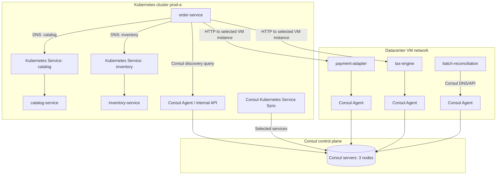
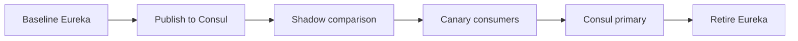

# Thiết kế phương án khám phá cho hệ thống giả định và giải thích đánh đổi

Thiết kế service discovery không bắt đầu bằng việc chọn Eureka hay Consul. Trước tiên cần xác định workload chạy ở đâu, consumer cần tìm provider nào, ranh giới network ra sao, ai quản lý vòng đời instance và hệ thống chấp nhận độ trễ cập nhật registry ở mức nào. Một giải pháp tốt thường dùng cơ chế đơn giản nhất cho từng phạm vi, đồng thời chỉ bổ sung registry tập trung khi có nhu cầu khám phá vượt qua ranh giới đó.

Bài thực hành này xây dựng phương án cho một nền tảng thương mại điện tử giả định có workload chạy trên Kubernetes và một số hệ thống cũ chạy trên VM. Ta sẽ chọn cơ chế discovery cho từng luồng giao tiếp, mô tả registration/health/lookup, xử lý lỗi và migration, sau đó giải thích những đánh đổi của kiến trúc.

## 1. Đề bài: nền tảng ShopNow

ShopNow là nền tảng bán lẻ trực tuyến có các thành phần sau:

| Thành phần | Nơi chạy | Vai trò |
| --- | --- | --- |
| `order-service` | Kubernetes cluster `prod-a` | Nhận và quản lý đơn hàng. |
| `catalog-service` | Kubernetes cluster `prod-a` | Trả thông tin sản phẩm. |
| `inventory-service` | Kubernetes cluster `prod-a` | Kiểm tra và cập nhật tồn kho. |
| `payment-adapter` | VM trong datacenter | Adapter kết nối hệ thống thanh toán cũ. |
| `tax-engine` | VM trong datacenter | Tính thuế qua một ứng dụng legacy. |
| `batch-reconciliation` | VM trong datacenter | Đối soát thanh toán, cần gọi một số service trong Kubernetes. |

Các ràng buộc vận hành:

- Phần lớn request đồng bộ giữa `order`, `catalog` và `inventory` chạy trong cùng Kubernetes cluster.
- `order-service` cần gọi `payment-adapter` và `tax-engine` trên VM.
- `batch-reconciliation` trên VM cần gọi một endpoint được expose có kiểm soát từ Kubernetes.
- Pod có IP thay đổi; VM có địa chỉ ổn định hơn nhưng vẫn có thể thay đổi khi bảo trì.
- Service cần health check, load balancing, TLS, xác thực và audit.
- Registry không được trở thành dependency bắt buộc cho mọi request nội cụm nếu Kubernetes Service/DNS đã đáp ứng.
- Đội vận hành muốn có một catalog chung cho các workload nằm ngoài Kubernetes và các kết nối xuyên runtime.

Mục tiêu thiết kế là tìm đúng instance theo service ID, loại instance không khỏe khỏi tập ứng viên, tránh công bố địa chỉ không routable và có thể chuyển đổi dần từ hệ thống cũ.

## 2. Phân tích yêu cầu trước khi chọn công nghệ

### 2.1. Ma trận provider và consumer

| Provider | Consumer | Phạm vi mạng | Cơ chế discovery đề xuất |
| --- | --- | --- | --- |
| `catalog-service` trong Kubernetes | `order-service` trong cùng cluster | Nội cụm | Kubernetes Service + DNS. |
| `inventory-service` trong Kubernetes | `order-service` trong cùng cluster | Nội cụm | Kubernetes Service + DNS. |
| `payment-adapter` trên VM | `order-service` trong Kubernetes | Xuyên runtime | Consul Catalog/Health qua Spring Cloud Consul DiscoveryClient. |
| `tax-engine` trên VM | `order-service` trong Kubernetes | Xuyên runtime | Consul Catalog/Health qua Spring Cloud Consul DiscoveryClient. |
| Endpoint của Kubernetes | `batch-reconciliation` trên VM | Xuyên runtime | Consul catalog thông qua địa chỉ gateway/endpoint routable đã công bố. |

### 2.2. Những yêu cầu phi chức năng

| Yêu cầu | Quyết định thiết kế cần có |
| --- | --- |
| Availability | Registry cluster có nhiều server; consumer có timeout và retry giới hạn; ứng dụng không phụ thuộc registry cho mọi request đã có route ổn định. |
| Freshness | Health check/registration có chu kỳ xác định; cache TTL phù hợp; đo thời gian hội tụ. |
| Scalability | Discovery query không tạo polling storm; giới hạn số service/metadata được đồng bộ. |
| Security | TLS, Consul ACL, Kubernetes RBAC, secret manager và network segmentation. |
| Operability | Có metric registered/healthy, lookup outcome, snapshot age, health check và alert. |
| Migration | Có thể chạy song song trong giai đoạn chuyển đổi nhưng chỉ một nguồn có quyền quyết định traffic tại một thời điểm. |

## 3. So sánh các lựa chọn

Trước khi chốt kiến trúc, so sánh bốn phương án thường gặp.

| Lựa chọn | Điểm mạnh | Giới hạn trong bài toán ShopNow |
| --- | --- | --- |
| Kubernetes Service + DNS | Có sẵn trong cluster, tích hợp selector, EndpointSlice và readiness, ít thành phần phải vận hành. | Không tự tạo một catalog dùng chung cho VM và các runtime ngoài cluster. |
| Spring Cloud Kubernetes | Giữ abstraction `DiscoveryClient`, đọc Kubernetes Service/endpoint qua Kubernetes API. | Cần ServiceAccount/RBAC và API access; không tự giải quyết discovery của VM ngoài cluster. |
| Eureka | Tích hợp tốt với ứng dụng Spring Cloud đã dùng Eureka; có client cache, heartbeat và peer registry. | Thêm registry riêng trong khi Kubernetes đã có Service/DNS; muốn quản lý VM và K8s cần tích hợp/đồng bộ riêng. |
| Consul | Catalog và health check có thể bao phủ VM lẫn Kubernetes qua agent/service sync; hỗ trợ ACL và nhiều datacenter theo kiến trúc. | Thêm control plane, quorum, ACL, TLS, agent, service sync và chi phí vận hành. |

### 3.1. Phương án được chọn

Chọn mô hình **Kubernetes native cho traffic nội cụm, Consul cho catalog xuyên runtime**:

1. `order-service` gọi `catalog-service` và `inventory-service` bằng Kubernetes Service DNS.
2. `payment-adapter` và `tax-engine` trên VM đăng ký vào Consul, kèm health check.
3. `order-service` dùng Spring Cloud Consul `DiscoveryClient` và Spring Cloud LoadBalancer khi cần gọi service ID của VM.
4. Consul Kubernetes Service Sync chỉ đồng bộ những Kubernetes Service được chọn sang Consul nếu workload ngoài cluster cần tìm chúng.
5. Địa chỉ công bố cho consumer ngoài cluster phải routable, ví dụ private gateway hoặc endpoint qua service mesh; không đưa ClusterIP/Pod IP không thể truy cập từ VM vào catalog với kỳ vọng VM sẽ gọi được.

Không thêm Eureka vào kiến trúc mới vì nó tạo một registry thứ hai mà không giải quyết yêu cầu nào Consul/Kubernetes chưa đáp ứng. Nếu hệ thống hiện hữu đã có Eureka, giữ nó trong giai đoạn migration có kiểm soát, shadow-read và chuyển consumer theo đợt; không union hai danh sách một cách mặc định.

## 4. Kiến trúc tổng thể



Sơ đồ thể hiện hai đường đi khác nhau:

- Traffic nội cụm đi qua Kubernetes Service và DNS.
- Traffic xuyên runtime dùng Consul để tìm địa chỉ VM hoặc endpoint đã được công bố an toàn.

Consul server không nằm trên đường dữ liệu của mọi request. Consumer có thể cache danh sách instance và gọi trực tiếp provider; registry chủ yếu phục vụ registration, health và discovery refresh.

## 5. Thiết kế Consul control plane

### 5.1. Cụm server

Triển khai ba Consul server trên ba failure domain/AZ khác nhau trong cùng datacenter logic. Với ba server, quorum Raft là hai; mất một server vẫn còn đa số. Không đặt cả ba server trên cùng một host hoặc một failure domain.

Các Consul Agent client chạy trên VM và được tích hợp với Kubernetes service sync/controller theo mô hình triển khai. Agent chịu trách nhiệm đăng ký service/check tại node tương ứng và giao tiếp với server cluster. Không dùng một Consul server duy nhất cho production HA.

### 5.2. Phạm vi catalog

Chỉ đưa các service cần giao tiếp xuyên runtime vào Consul:

- `payment-adapter`.
- `tax-engine`.
- Những endpoint Kubernetes được chọn để VM consumer gọi.

Không đồng bộ mọi Service trong Kubernetes theo mặc định. Dùng namespace/label allowlist, naming convention và owner để kiểm soát service nào được export. Service nội cụm như `catalog-service` vẫn có thể chỉ dùng Kubernetes DNS nếu không có consumer ngoài cluster.

### 5.3. Định danh service và instance

Quy ước service ID canonical:

```text
<environment>-<domain>-<service>

production-commerce-payment-adapter
production-commerce-tax-engine
production-commerce-order-public-api
```

Mỗi instance có ID duy nhất:

```text
payment-adapter-vm-07
tax-engine-vm-02
```

Metadata chỉ chứa thông tin định tuyến/vận hành không nhạy cảm:

```yaml
meta:
  environment: production
  region: hcm-dc1
  network-view: datacenter-private
  version: v3
```

Không đưa password, token, connection string hoặc dữ liệu cá nhân vào service name, tags hay metadata. Nếu cùng service tồn tại ở staging và production, phải tách scope để consumer không trộn hai môi trường.

## 6. Cấu hình provider chạy trên VM

Ví dụ `tax-engine` dùng Spring Cloud Consul Discovery. Ứng dụng kết nối Consul Agent gần nó; Agent đăng ký instance và thực hiện health check.

```yaml
spring:
  application:
    name: tax-engine
  cloud:
    consul:
      host: ${CONSUL_AGENT_HOST:127.0.0.1}
      port: ${CONSUL_AGENT_PORT:8500}
      discovery:
        register: true
        service-name: production-commerce-tax-engine
        instance-id: ${DISCOVERY_INSTANCE_ID}
        prefer-ip-address: true
        health-check-path: /actuator/health/readiness
        health-check-interval: 10s

management:
  endpoints:
    web:
      exposure:
        include: health
  endpoint:
    health:
      probes:
        enabled: true
      show-details: never
```

Các điểm cần triển khai cùng cấu hình:

- `DISCOVERY_INSTANCE_ID` phải duy nhất và ổn định trong vòng đời instance.
- Endpoint readiness phải được expose trong network mà Consul Agent sử dụng.
- Consul Agent và provider phải có route tới nhau; nếu Agent ở VM khác, kiểm tra firewall và advertised address.
- Cấu hình ACL token và TLS qua secret source/Consul Agent phù hợp; không commit token vào YAML.
- Health check interval, timeout và deregistration policy phải được chọn theo SLO và thời gian phát hiện lỗi.

Nếu service không phải Spring Boot, có thể đăng ký bằng Consul Agent service definition hoặc API và dùng HTTP/TCP/script/TTL check phù hợp. Nguyên tắc là health check phải phản ánh khả năng phục vụ thật, không chỉ process còn tồn tại.

## 7. Cấu hình consumer chạy trong Kubernetes

`order-service` dùng Kubernetes DNS cho `catalog-service`/`inventory-service`, nhưng cần Consul DiscoveryClient cho VM service.

Dependency Maven cần có Spring Cloud Consul Discovery và LoadBalancer, với version được quản lý bằng Spring Cloud BOM tương thích Spring Boot:

```xml
<dependency>
    <groupId>org.springframework.cloud</groupId>
    <artifactId>spring-cloud-starter-consul-discovery</artifactId>
</dependency>
<dependency>
    <groupId>org.springframework.cloud</groupId>
    <artifactId>spring-cloud-starter-loadbalancer</artifactId>
</dependency>
```

Consumer không cần đăng ký bản thân vào Consul nếu Kubernetes Service/DNS là nguồn cho workload nội cụm:

```yaml
spring:
  application:
    name: order-service
  cloud:
    consul:
      host: ${CONSUL_AGENT_HOST}
      port: ${CONSUL_AGENT_PORT:8500}
      discovery:
        register: false
        query-passing: true
```

Địa chỉ `CONSUL_AGENT_HOST` phải được phân giải và truy cập từ Pod. Có thể dùng Consul Agent/endpoint nội bộ được nền tảng hỗ trợ; bảo vệ API bằng TLS và ACL. Không để Pod truy cập một endpoint Consul không xác thực từ mạng công khai.

`query-passing: true` yêu cầu Spring Cloud Consul chỉ trả các instance có health check passing cho consumer. Đây là cấu hình phía discovery client; health check registration vẫn được cấu hình ở provider/Consul Agent.

### 7.1. Gọi service bằng logical name

Ví dụ `RestTemplate` có LoadBalancer:

```java
import org.springframework.cloud.client.loadbalancer.LoadBalanced;
import org.springframework.context.annotation.Bean;
import org.springframework.context.annotation.Configuration;
import org.springframework.web.client.RestTemplate;

@Configuration
public class HttpClientConfiguration {

    @Bean("consulRestTemplate")
    @LoadBalanced
    RestTemplate consulRestTemplate() {
        return new RestTemplate();
    }

    @Bean("clusterDnsRestTemplate")
    RestTemplate clusterDnsRestTemplate() {
        return new RestTemplate();
    }
}
```

Gọi `tax-engine` bằng service ID trong Consul:

```java
TaxQuote quote = consulRestTemplate.getForObject(
        "http://production-commerce-tax-engine/api/quote?orderId={id}",
        TaxQuote.class,
        orderId
);
```

Spring Cloud LoadBalancer lấy danh sách instance qua DiscoveryClient, chọn một instance và thay logical host bằng địa chỉ thực tế. Nếu service chỉ có một endpoint cố định hoặc chỉ chạy trong Kubernetes, dùng client/DNS phù hợp thay vì thêm Consul lookup không cần thiết.

### 7.2. Luồng gọi nội cụm

Với `catalog-service`, giữ đường gọi đơn giản:

```java
CatalogItem item = clusterDnsRestTemplate.getForObject(
        "http://catalog-service/api/items/{id}",
        CatalogItem.class,
        itemId
);
```

Hai bean được tách rõ: `consulRestTemplate` có `@LoadBalanced` để tra service ID xuyên runtime qua Consul; `clusterDnsRestTemplate` không có `@LoadBalanced` nên hostname `catalog-service` được resolver Kubernetes phân giải trực tiếp. Nếu muốn dùng Spring Cloud LoadBalancer cho cả traffic nội cụm, cấu hình Kubernetes DiscoveryClient làm nguồn tương ứng và kiểm tra implementation được inject; tránh vô tình query cả Consul lẫn Kubernetes cho cùng một logical service.

## 8. Đồng bộ service Kubernetes sang Consul

Nếu `batch-reconciliation` trên VM cần tìm một endpoint Kubernetes, có thể dùng Consul Kubernetes Service Sync để đưa một tập Service được chọn vào Consul Catalog.

Ví dụ cấu hình khái niệm của chart/controller:

```yaml
syncCatalog:
  enabled: true
  toConsul: true
  toK8S: false
```

Tên values và tùy chọn allowlist/denylist phụ thuộc phiên bản `consul-k8s` Helm chart. Cần kiểm tra schema chart đang triển khai trước khi áp dụng; không sao chép snippet này mà bỏ qua version.

Quan trọng hơn, Service Sync chỉ đồng bộ thông tin service. Nó không tự tạo network route từ VM tới ClusterIP hoặc Pod CIDR. Với service cần truy cập từ VM:

1. Expose qua private LoadBalancer, ingress/gateway hoặc Consul service mesh/mesh gateway theo kiến trúc mạng.
2. Đăng ký địa chỉ routable tương ứng vào catalog.
3. Giới hạn consumer và port được phép truy cập.
4. Kiểm thử từ đúng VM network, không chỉ từ Pod provider.

Không sync cùng một service vào Consul bằng hai cơ chế cùng lúc (ví dụ app tự register và controller service sync) nếu chưa có ownership/deduplication rõ ràng. Điều đó có thể tạo duplicate registration.

## 9. Health check và trạng thái sẵn sàng

Health check phải phù hợp với cách traffic đi tới provider.

| Provider | Health source | Điều kiện đưa vào tập ứng viên |
| --- | --- | --- |
| `catalog-service` trong Kubernetes | Pod readiness + EndpointSlice | Endpoint Ready qua Kubernetes Service. |
| `inventory-service` trong Kubernetes | Pod readiness + EndpointSlice | Endpoint Ready; readiness phải phản ánh khả năng nhận request. |
| `payment-adapter` trên VM | Consul HTTP/TCP check | Check passing; consumer query với health filter. |
| `tax-engine` trên VM | Consul HTTP readiness check | Check passing và endpoint có thể truy cập từ network liên quan. |
| Kubernetes endpoint được sync | Kubernetes Service/EndpointSlice cùng service sync state | Kiểm tra controller sync, address routable và health semantics của integration. |

Không đồng nhất `Running` với `Ready`, hoặc `Catalog registered` với `passing`. Một VM service có thể còn registration nhưng check critical; một Pod có thể Running nhưng readiness thất bại.

Health check cũng cần đúng góc nhìn mạng. Nếu Consul Agent kiểm tra từ VM datacenter, endpoint phải truy cập được từ Agent đó. Nếu consumer ở một network khác, có thể cần thêm kiểm tra connectivity ở gateway hoặc service mesh; một check passing không chứng minh mọi consumer đều có route.

## 10. Bảo mật và quyền truy cập

### 10.1. Consul

- Bật TLS cho client-agent-server communication theo topology.
- Dùng ACL token riêng cho service sync, provider registration và consumer read.
- Policy consumer chỉ cần quyền đọc catalog/health cần thiết; không cấp quyền ghi hoặc quản trị.
- Provider chỉ được đăng ký service/node trong phạm vi được phép.
- Lưu token trong secret manager hoặc Kubernetes Secret được bảo vệ; không đặt token trong URL, metadata hoặc log.
- Bảo vệ Gossip encryption key và giới hạn cổng agent/server theo network policy/firewall.

### 10.2. Kubernetes

- Service Sync controller dùng ServiceAccount riêng.
- RBAC chỉ cấp quyền đọc Service/EndpointSlice và tài nguyên thực sự cần đồng bộ.
- Chỉ export namespace/label được phê duyệt.
- Không cấp `cluster-admin` chỉ để discovery.
- Giữ API server private và không expose endpoint quản trị Consul ra Internet.

### 10.3. Service-to-service

Discovery chỉ cung cấp địa chỉ. Nó không thay thế authentication/authorization giữa `order-service` và `payment-adapter`. Dùng TLS/mTLS, identity của workload hoặc OAuth2 client credential phù hợp; xác thực quyền nghiệp vụ ở provider. Không đặt bearer token vào service metadata hoặc query string.

## 11. Xử lý lỗi và chiến lược phục hồi

### 11.1. Consul tạm thời không truy cập được

Consumer cần phân biệt:

- Query thành công nhưng không có instance passing: empty result.
- Query timeout/5xx: registry path không khả dụng.
- Query trả snapshot cũ: stale data.
- 401/403/TLS error: vấn đề danh tính, quyền hoặc certificate.

Retry chỉ lỗi transient với deadline, exponential backoff và jitter. Nếu dùng stale snapshot, đặt TTL ngắn, health guard và metric riêng; không dùng snapshot đã hết hạn. Đối với service thanh toán, có thể fail fast/circuit breaker thay vì gọi endpoint stale không chắc chắn.

### 11.2. Một VM provider chết đột ngột

Consul health check phát hiện check không passing; consumer bật `query-passing` sẽ loại instance khỏi tập ứng viên sau thời gian health check và refresh/cache. Catalog record có thể vẫn còn cho tới khi deregistration policy dọn nó. Đo thời gian từ crash tới lúc consumer ngừng chọn endpoint, không giả định loại bỏ tức thời.

### 11.3. Consul mất một server

Với ba server, mất một server vẫn còn quorum. Theo dõi leader election, peer health và lỗi query/registration. Nếu mất quorum, không coi thao tác ghi là thành công; consumer có thể dùng snapshot cache trong giới hạn policy nhưng cần cảnh báo control plane.

### 11.4. Kubernetes Service không có endpoint Ready

Kiểm tra selector/label, readiness probe, EndpointSlice và Pod events. Không thêm một registry thứ hai để chữa selector sai. Sửa nguồn Kubernetes trước, sau đó xác minh service sync phản ánh trạng thái mới.

## 12. Rollout và migration nếu hệ thống hiện có Eureka

Nếu ShopNow đang chạy Eureka, không chuyển toàn bộ traffic và tắt Eureka trong một lần. Thực hiện theo giai đoạn:

### Giai đoạn 1 — Baseline

- Giữ Eureka là nguồn traffic hiện tại.
- Ghi số registration, health, lookup latency, request error rate và snapshot age.
- Chuẩn hóa service ID, instance ID và metadata.

### Giai đoạn 2 — Dual registration có kiểm soát

- Chọn provider cần xuất hiện ở Consul.
- Đăng ký vào Consul bằng adapter hoặc service sync phù hợp.
- Giữ Eureka làm nguồn traffic; không union hai list.
- Theo dõi partial registration và duplicate.

### Giai đoạn 3 — Shadow read

- Consumer vẫn chọn instance từ Eureka.
- Observer đọc Consul nền và so sánh canonical instance IDs, URI, health và metadata.
- Chỉ chuyển tiếp khi parity đạt ngưỡng trong một khoảng đủ dài.

### Giai đoạn 4 — Canary

- Chuyển một nhóm consumer ít rủi ro sang Consul.
- Theo dõi 5xx, timeout, latency, selected instance và health mismatch.
- Giữ rollback về Eureka trong cửa sổ đã thống nhất.

### Giai đoạn 5 — Chuyển primary và retire

- Chuyển consumer theo đợt.
- Dừng Eureka registration sau khi không còn consumer phụ thuộc.
- Deregister record cũ, kiểm tra lease/ghost registration.
- Gỡ dependency/config Eureka sau khi xác nhận traffic và dashboard không còn dùng.



## 13. Đánh đổi của phương án được chọn

Không có lựa chọn nào tốt nhất cho mọi hệ thống. Các đánh đổi chính:

| Quyết định | Lợi ích | Chi phí/rủi ro | Khi nào chấp nhận |
| --- | --- | --- | --- |
| Kubernetes DNS cho nội cụm | Đơn giản, native, readiness/EndpointSlice tích hợp, ít phụ thuộc control plane ngoài | Không phải catalog đa runtime; DNS không cung cấp mọi metadata qua `DiscoveryClient` | Workload và consumer ở cùng cluster. |
| Consul cho VM và cross-runtime | Một catalog cho VM và service được export từ Kubernetes; health/ACL/metadata thống nhất hơn | Vận hành Consul cluster, Agent, ACL, TLS và sync controller | Có nhu cầu thật sự vượt ranh giới Kubernetes. |
| Không thêm Eureka trong kiến trúc mới | Giảm một registry và một lớp cache/peer/heartbeat phải vận hành | Ứng dụng cũ phụ thuộc Eureka cần migration | Hệ thống chưa có ecosystem Eureka hoặc đã có lộ trình chuyển. |
| Không union hai nguồn mặc định | Tránh duplicate candidate và xung đột health | Trong migration, consumer chỉ dùng một primary tại một thời điểm | Có thể shadow-read và canary thay vì cần một list hợp nhất. |
| Health filter `passing` | Loại instance có check không đạt | Health check có chu kỳ, có thể loại chậm hoặc false negative | Health endpoint đáng tin và interval phù hợp SLO. |
| Consul service sync chọn lọc | VM consumer có thể tìm một số K8s service | Cần kiểm soát address, ownership và network reachability | Chỉ export service có consumer ngoài cluster. |

### 13.1. Vì sao không dùng Eureka cho mọi thứ?

Eureka phù hợp với hệ sinh thái Spring Cloud đã có sẵn client/server và yêu cầu registry theo mô hình đó. Tuy nhiên, trong bài toán này Kubernetes đã quản lý Pod/Service nội cụm, còn Consul giải quyết catalog VM và tích hợp service sync. Thêm Eureka sẽ tạo thêm registration, heartbeat, peer, cache và quy trình đồng bộ mà không tạo lợi ích tương xứng.

Nếu tổ chức đã chuẩn hóa Eureka trên diện rộng, có thể giữ Eureka làm primary trong giai đoạn đầu và chuyển dần sang Consul. Điều quan trọng là không duy trì hai nguồn authoritative vô thời hạn cho cùng một traffic nếu chưa có cơ chế identity, health precedence và deduplication.

### 13.2. Vì sao không dùng Consul cho mọi request nội cụm?

Kubernetes Service/DNS đã giải quyết việc tìm Pod cùng cluster và theo dõi endpoint Ready. Đưa Consul vào mọi request nội cụm làm tăng dependency, số lần lookup/cache và phạm vi ảnh hưởng khi registry có sự cố. Dùng Consul ở nơi cần catalog xuyên runtime giúp giới hạn blast radius và chi phí vận hành.

### 13.3. Chi phí của hai cơ chế song song

Kiến trúc có hai đường discovery nên tài liệu hóa rõ service nào dùng DNS, service nào dùng Consul, ai sở hữu registration và ai chịu trách nhiệm health. Nếu không, đội vận hành dễ thấy cùng một service trong hai dashboard và không biết nguồn nào quyết định traffic. Quy ước naming, label, runbook và dashboard phải thể hiện source of truth.

## 14. Kiểm thử chấp nhận thiết kế

Trước production, chạy các test sau:

| Test | Cách kiểm tra | Kết quả mong đợi |
| --- | --- | --- |
| Intra-cluster discovery | `order-service` gọi `catalog-service` qua Service DNS | Request thành công; không phụ thuộc Consul cho đường này. |
| VM discovery | `order-service` gọi `tax-engine` qua Consul DiscoveryClient + LoadBalancer | Chọn đúng VM instance và nhận response. |
| Health filtering | Làm health check của một VM instance critical | Instance bị loại khỏi query passing sau thời gian hội tụ. |
| Provider crash | Kill process VM trong test | Consumer ngừng chọn endpoint chết trong giới hạn đã định. |
| Consul server loss | Dừng một server trong cụm ba node | Quorum còn; query/registration ổn định sau leader transition. |
| Consul quorum loss | Dừng hai server trong test cluster | Write không được coi là committed; cảnh báo control plane phát. |
| ACL/TLS | Dùng token sai hoặc certificate sai trong test | Lỗi 401/403/TLS được phân loại, không retry vô hạn. |
| Service Sync | Export một service allowlisted | Catalog có service và địa chỉ consumer ngoài cluster truy cập được. |
| Duplicate registration | Cố tình bật hai cơ chế register cùng service | Dashboard/test phát hiện duplicate; policy ownership ngăn đưa hai candidate vào LoadBalancer. |
| Stale cache | Chặn refresh registry sau khi có snapshot | Snapshot age tăng; stale fallback chỉ hoạt động trong TTL đã cấu hình. |
| Recovery | Khôi phục server/network/provider | Registration, health và consumer lookup hội tụ; không còn ghost instance. |

Test network và fault injection chỉ chạy trên staging/test topology có phạm vi rõ ràng. Không dừng Consul server, kill provider hoặc chặn network production để thực hiện checklist này.

## 15. Dashboard và chỉ số vận hành

Dashboard nên có các nhóm:

- **Kubernetes:** desired/ready replicas, Pod restart, EndpointSlice endpoint count, readiness failure.
- **Consul:** server leader/quorum/peer health, agent health, catalog registered count, passing count và ACL/TLS error.
- **Discovery client:** lookup non-empty/empty/error, refresh success, snapshot age, LoadBalancer selected instance.
- **Request:** success/5xx, timeout, latency p95/p99 và downstream dependency error.
- **Migration (nếu có):** registration pending, shadow parity, duplicate candidate, identity conflict và selected source.

Metric names phụ thuộc exporter và instrumentation. Các metric custom cần có contract thống nhất, label cardinality giới hạn; không dùng raw URL, token, exception message hoặc ID biến thiên không cần thiết làm label.

Alert quan trọng:

1. Không còn instance healthy cho service xuyên runtime.
2. Consul mất quorum hoặc không có leader trong thời gian vượt ngưỡng.
3. Provider registration pending hoặc health critical kéo dài.
4. Snapshot discovery quá cũ hoặc refresh liên tục thất bại.
5. Request 5xx/timeout vượt SLO.
6. Service Sync lag hoặc parity mismatch vượt thời gian hội tụ.

## 16. Kết luận thiết kế

Với ShopNow, phương án phù hợp là dùng Kubernetes Service/DNS cho các lời gọi nội cụm và Consul làm service catalog cho các kết nối vượt ranh giới Kubernetes. Spring Cloud Consul DiscoveryClient kết hợp LoadBalancer giúp `order-service` gọi VM service bằng logical service ID; Kubernetes Service Sync chỉ export những endpoint cần thiết và phải bảo đảm địa chỉ có thể truy cập từ consumer ngoài cluster.

Phương án này chấp nhận thêm chi phí vận hành Consul để có catalog đa runtime, đổi lại không buộc mọi request nội cụm phụ thuộc vào registry ngoài. Nó cũng tránh thêm Eureka nếu chưa có nhu cầu tương thích cụ thể. Khi migration từ registry cũ, dual registration và shadow comparison được dùng tạm thời; chỉ một nguồn authoritative phục vụ traffic tại từng giai đoạn, với canonical identity, health policy, deduplication và rollback rõ ràng.

## Tài liệu tham khảo

- [Kubernetes: Service và Service Discovery](https://kubernetes.io/docs/concepts/services-networking/service/)
- [Kubernetes: EndpointSlices](https://kubernetes.io/docs/concepts/services-networking/endpoint-slices/)
- [Spring Cloud Kubernetes: DiscoveryClient](https://docs.spring.io/spring-cloud-kubernetes/reference/discovery-client.html)
- [Spring Cloud Consul: Service Discovery](https://docs.spring.io/spring-cloud-consul/reference/discovery.html)
- [Consul: Kubernetes Service Sync](https://developer.hashicorp.com/consul/docs/register/service/k8s/service-sync)
- [Consul: Consensus and Raft](https://developer.hashicorp.com/consul/docs/architecture/consensus)
- [Spring Cloud LoadBalancer](https://docs.spring.io/spring-cloud-commons/reference/spring-cloud-commons/loadbalancer.html)
