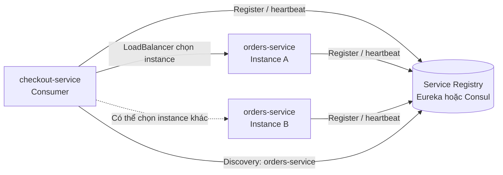

# Chuẩn bị ứng dụng cung cấp dịch vụ và ứng dụng gọi dịch vụ

Trong kiến trúc microservice, một ứng dụng thường cung cấp API cho các ứng dụng khác, còn ứng dụng khác tìm và gọi API đó thông qua service discovery. Để thực hành Spring Cloud Service Discovery, ta cần chuẩn bị ít nhất hai ứng dụng: **service provider** đăng ký một hoặc nhiều instance vào registry, và **service consumer** tra cứu provider theo tên dịch vụ rồi gửi request đến một instance phù hợp.

Hai ứng dụng phải có tên dịch vụ rõ ràng, địa chỉ mạng mà registry có thể quảng bá, cổng lắng nghe, dependency Spring Cloud tương thích và cấu hình kết nối đến cùng một registry. Bài này xây dựng một ví dụ `orders-service` cung cấp API và `checkout-service` gọi API đó. Eureka được dùng làm ví dụ chính; phần cuối trình bày cách chuyển sang Consul.

## 1. Mục tiêu và kiến trúc thực hành

Ta chuẩn bị ba thành phần:

1. **Discovery server:** Eureka Server hoặc Consul Server/agent, lưu thông tin các service instance.
2. **Provider:** ứng dụng `orders-service`, cung cấp API đọc đơn hàng và đăng ký instance vào registry.
3. **Consumer:** ứng dụng `checkout-service`, tra cứu `orders-service` theo service ID rồi gọi API thông qua Spring Cloud LoadBalancer.



Registry giữ thông tin như service ID, instance ID, hostname hoặc IP, port, metadata và trạng thái health. Consumer lấy danh sách instance theo service ID. LoadBalancer chọn một instance từ danh sách đó; HTTP client gửi request đến địa chỉ được chọn.

## 2. Chuẩn bị môi trường và cấu trúc project

Trước khi tạo ứng dụng, cần có:

- JDK tương thích với phiên bản Spring Boot mà dự án chọn.
- Maven hoặc Gradle để quản lý dependency và build ứng dụng.
- Một IDE hoặc trình soạn thảo Java.
- Một Eureka Server hoặc Consul có thể truy cập từ provider và consumer.
- Các cổng mạng dành cho registry và các ứng dụng được mở trong phạm vi môi trường thực hành.

Nên tạo các ứng dụng độc lập để có thể khởi động, dừng hoặc mở rộng từng service:

```text
service-discovery-lab/
├── discovery-server/
├── orders-service/
└── checkout-service/
```

`discovery-server` chỉ chịu trách nhiệm registry. `orders-service` và `checkout-service` có thể dùng chung quy ước cấu hình, nhưng mỗi ứng dụng phải có `spring.application.name` riêng. Trong môi trường lớn, các project này có thể nằm ở repository riêng hoặc là các module trong một multi-module build.

### Chọn phiên bản Spring Boot và Spring Cloud

Spring Cloud release train có ma trận tương thích với các dòng Spring Boot. Hãy chọn một cặp phiên bản được Spring hỗ trợ, sau đó import Spring Cloud BOM để các starter sử dụng version đồng bộ. Không nên tự chọn version riêng cho từng starter hoặc sao chép cấu hình từ tutorial thuộc release train khác.

Ví dụ phần quản lý dependency Maven cho mỗi ứng dụng dùng Spring Cloud:

```xml
<properties>
    <java.version>21</java.version>
    <spring-cloud.version>YOUR_COMPATIBLE_RELEASE_TRAIN</spring-cloud.version>
</properties>

<dependencyManagement>
    <dependencies>
        <dependency>
            <groupId>org.springframework.cloud</groupId>
            <artifactId>spring-cloud-dependencies</artifactId>
            <version>${spring-cloud.version}</version>
            <type>pom</type>
            <scope>import</scope>
        </dependency>
    </dependencies>
</dependencyManagement>
```

`YOUR_COMPATIBLE_RELEASE_TRAIN` là placeholder cần thay bằng release train tương thích với Spring Boot trong project. Nếu project dùng Spring Boot parent, khai báo parent và version Boot theo cùng ma trận tương thích. Với Gradle, áp dụng Spring dependency management plugin hoặc cơ chế BOM platform tương ứng.

## 3. Khai báo dependency cho từng ứng dụng

Với ví dụ Eureka, provider và consumer đều cần Eureka client để đăng ký hoặc truy vấn registry. Consumer cần thêm Spring Cloud LoadBalancer nếu gọi service bằng tên logic thông qua `@LoadBalanced` client.

### Dependency cho provider

```xml
<dependencies>
    <dependency>
        <groupId>org.springframework.boot</groupId>
        <artifactId>spring-boot-starter-web</artifactId>
    </dependency>
    <dependency>
        <groupId>org.springframework.cloud</groupId>
        <artifactId>spring-cloud-starter-netflix-eureka-client</artifactId>
    </dependency>
    <dependency>
        <groupId>org.springframework.boot</groupId>
        <artifactId>spring-boot-starter-actuator</artifactId>
    </dependency>
</dependencies>
```

`spring-boot-starter-web` tạo REST API; Eureka client tích hợp ứng dụng với registry; Actuator cung cấp endpoint health để kiểm tra trạng thái ứng dụng. Nếu không dùng Actuator trong bài thực hành, có thể bỏ dependency này nhưng cần chọn health check phù hợp.

### Dependency cho consumer

```xml
<dependencies>
    <dependency>
        <groupId>org.springframework.boot</groupId>
        <artifactId>spring-boot-starter-web</artifactId>
    </dependency>
    <dependency>
        <groupId>org.springframework.cloud</groupId>
        <artifactId>spring-cloud-starter-netflix-eureka-client</artifactId>
    </dependency>
    <dependency>
        <groupId>org.springframework.cloud</groupId>
        <artifactId>spring-cloud-starter-loadbalancer</artifactId>
    </dependency>
    <dependency>
        <groupId>org.springframework.boot</groupId>
        <artifactId>spring-boot-starter-actuator</artifactId>
    </dependency>
</dependencies>
```

Consumer cần Eureka client để lấy danh sách instance. Spring Cloud LoadBalancer chọn instance khi HTTP client được đánh dấu `@LoadBalanced`. Nếu chỉ muốn đọc danh sách instance bằng `DiscoveryClient` và tự xử lý lựa chọn, có thể không cần LoadBalancer; trong ứng dụng thực tế, nên dùng cơ chế cân bằng tải đã được tích hợp và kiểm thử.

### Dependency cho discovery server

Project `discovery-server` dùng starter `spring-cloud-starter-netflix-eureka-server`. Đây là ứng dụng riêng với `@EnableEurekaServer`; provider và consumer không cần dependency server.

## 4. Tạo ứng dụng provider: orders-service

Provider là ứng dụng Spring Boot thông thường có REST controller. Spring Cloud Eureka client tự đăng ký ứng dụng dựa trên cấu hình khi context khởi động.

### Lớp khởi động

```java
package com.example.orders;

import org.springframework.boot.SpringApplication;
import org.springframework.boot.autoconfigure.SpringBootApplication;

@SpringBootApplication
public class OrdersApplication {

    public static void main(String[] args) {
        SpringApplication.run(OrdersApplication.class, args);
    }
}
```

Với các phiên bản Spring Cloud hiện đại, dependency Eureka client kích hoạt discovery client qua auto-configuration. `@EnableDiscoveryClient` thường không cần thiết, nhưng có thể gặp trong code cũ hoặc ví dụ dùng nhiều implementation.

### Tạo REST API

```java
package com.example.orders.api;

import org.springframework.web.bind.annotation.GetMapping;
import org.springframework.web.bind.annotation.PathVariable;
import org.springframework.web.bind.annotation.RequestMapping;
import org.springframework.web.bind.annotation.RestController;

@RestController
@RequestMapping("/api/orders")
public class OrderController {

    @GetMapping("/{orderId}")
    public String getOrder(@PathVariable String orderId) {
        return "Order " + orderId + " is ready";
    }
}
```

Endpoint `GET /api/orders/{orderId}` là tài nguyên mà consumer sẽ gọi. Trong bài thực hành, response là chuỗi đơn giản để tập trung vào discovery. Trong ứng dụng thực tế, controller nên gọi service layer, validate input và trả DTO với HTTP status phù hợp.

### Cấu hình provider

Tạo `src/main/resources/application.yml`:

```yaml
spring:
  application:
    name: orders-service

server:
  port: 8081

eureka:
  client:
    register-with-eureka: true
    fetch-registry: true
    service-url:
      defaultZone: ${EUREKA_SERVER_URL:http://localhost:8761/eureka/}
  instance:
    prefer-ip-address: true
    instance-id: ${spring.application.name}:${spring.cloud.client.ip-address}:${server.port}

management:
  endpoints:
    web:
      exposure:
        include: health,info
```

Các thuộc tính quan trọng:

- `spring.application.name` đặt service ID mặc định là `orders-service`. Consumer dùng tên này khi discovery hoặc gọi qua LoadBalancer.
- `server.port` là cổng HTTP của provider trong ví dụ.
- `register-with-eureka` bật đăng ký instance và heartbeat.
- `fetch-registry` cho phép provider cũng tải registry; điều này hữu ích nếu chính provider gọi service khác.
- `defaultZone` là URL Eureka Server mà client kết nối.
- `prefer-ip-address` yêu cầu instance quảng bá địa chỉ IP thay cho hostname.
- `instance-id` tạo định danh riêng cho mỗi lần đăng ký. Kết hợp service name, IP và port giúp phân biệt nhiều instance.

`spring.cloud.client.ip-address` được Spring Cloud Commons cung cấp khi môi trường xác định được địa chỉ IP phù hợp. Nếu ứng dụng chạy trong container hoặc nhiều network interface, cần kiểm tra địa chỉ được quảng bá thực sự có thể truy cập từ consumer. Có thể cấu hình địa chỉ/hostname rõ ràng theo môi trường thay vì dựa vào lựa chọn tự động.

## 5. Tạo ứng dụng consumer: checkout-service

Consumer là một ứng dụng Spring Boot khác. Nó có thể tự đăng ký với registry nếu các service khác cần gọi ngược lại, đồng thời tải registry để tìm `orders-service`.

### Lớp khởi động

```java
package com.example.checkout;

import org.springframework.boot.SpringApplication;
import org.springframework.boot.autoconfigure.SpringBootApplication;

@SpringBootApplication
public class CheckoutApplication {

    public static void main(String[] args) {
        SpringApplication.run(CheckoutApplication.class, args);
    }
}
```

### Cấu hình consumer

Tạo `src/main/resources/application.yml`:

```yaml
spring:
  application:
    name: checkout-service

server:
  port: 8082

eureka:
  client:
    register-with-eureka: true
    fetch-registry: true
    service-url:
      defaultZone: ${EUREKA_SERVER_URL:http://localhost:8761/eureka/}

management:
  endpoints:
    web:
      exposure:
        include: health,info
```

Tên `checkout-service` là service ID của consumer. Nếu chỉ là một tiến trình client nội bộ và không cần được service khác tìm thấy, có thể cân nhắc `register-with-eureka: false`; nếu consumer cũng cung cấp API, giữ đăng ký bật để các ứng dụng khác gọi được nó.

### Khai báo HTTP client có LoadBalancer

```java
package com.example.checkout.config;

import org.springframework.cloud.client.loadbalancer.LoadBalanced;
import org.springframework.context.annotation.Bean;
import org.springframework.context.annotation.Configuration;
import org.springframework.web.client.RestTemplate;

@Configuration
public class HttpClientConfig {

    @Bean
    @LoadBalanced
    RestTemplate restTemplate() {
        return new RestTemplate();
    }
}
```

`@LoadBalanced` gắn interceptor của Spring Cloud LoadBalancer vào `RestTemplate`. Khi URL có host là service ID, ví dụ `http://orders-service`, LoadBalancer tra cứu các instance của service đó và chọn một instance trước khi request được gửi.

### Gọi provider theo service ID

```java
package com.example.checkout.api;

import org.springframework.web.bind.annotation.GetMapping;
import org.springframework.web.bind.annotation.PathVariable;
import org.springframework.web.bind.annotation.RequestMapping;
import org.springframework.web.bind.annotation.RestController;
import org.springframework.web.client.RestTemplate;

@RestController
@RequestMapping("/api/checkout")
public class CheckoutController {

    private final RestTemplate restTemplate;

    public CheckoutController(RestTemplate restTemplate) {
        this.restTemplate = restTemplate;
    }

    @GetMapping("/orders/{orderId}")
    public String getOrder(@PathVariable String orderId) {
        return restTemplate.getForObject(
                "http://orders-service/api/orders/{orderId}",
                String.class,
                orderId
        );
    }
}
```

Consumer chỉ cần biết service ID `orders-service` và API path. Nó không cần ghi cứng IP hay port của từng instance. Khi có nhiều instance, LoadBalancer chọn một địa chỉ từ registry; khi danh sách thay đổi, client có thể tiếp tục sử dụng dữ liệu discovery được cập nhật.

## 6. Hiểu service ID và instance ID

Hai định danh này phục vụ hai mục đích khác nhau:

| Thuộc tính | Ý nghĩa | Ví dụ |
| --- | --- | --- |
| Service ID | Tên logic đại diện cho một loại dịch vụ; consumer tra cứu theo tên này | `orders-service` |
| Instance ID | Định danh một tiến trình/instance cụ thể đang cung cấp service | `orders-service:10.0.1.20:8081` |
| Hostname/IP | Địa chỉ mạng mà consumer dùng để kết nối đến instance | `10.0.1.20` |
| Port | Cổng ứng dụng đang lắng nghe | `8081` |

Một service ID có thể ánh xạ đến nhiều instance. Ví dụ, ba tiến trình `orders-service` có thể đăng ký cùng service ID nhưng khác instance ID, hostname/IP hoặc port. Registry dùng thông tin đó để trả danh sách instance cho consumer.

Trong Spring Cloud, `spring.application.name` thường là service name mặc định mà implementation discovery sử dụng. Với Eureka, tên application hiển thị trong dashboard thường được chuẩn hóa thành chữ hoa; tên gọi trong cấu hình client vẫn có thể viết dạng kebab case. Với Consul, `spring.cloud.consul.discovery.service-name` có thể ghi đè service name mặc định.

Instance ID phải duy nhất trong phạm vi registry theo cách implementation quản lý. Nếu hai instance cùng service ID và cùng instance ID, một lần đăng ký có thể ghi đè hoặc làm trạng thái hiển thị khó hiểu. Khi chạy nhiều bản sao, hãy tạo ID kết hợp hostname/IP, port hoặc một giá trị duy nhất do nền tảng cấp.

### Hostname, IP và địa chỉ được quảng bá

Địa chỉ được đăng ký phải là địa chỉ mà thành phần gọi dịch vụ có thể truy cập. Một số lưu ý:

- `localhost` chỉ phù hợp khi consumer và provider dùng chung network namespace. Trong container riêng, `localhost` của consumer không trỏ đến provider.
- Hostname phải phân giải được từ các peer registry và consumer.
- IP được chọn tự động có thể sai khi máy có nhiều network interface, VPN hoặc mạng container.
- Port được quảng bá phải là port mà provider thực sự mở và firewall cho phép truy cập.
- Nếu dùng reverse proxy hoặc port mapping của container, cần phân biệt port bên trong container với port được truy cập từ mạng bên ngoài.

`server.port` là cổng HTTP của ứng dụng. Nếu Actuator chạy trên cổng riêng qua `management.server.port`, cần cấu hình health check và đường truy cập management phù hợp; không nhầm cổng quản trị với cổng API nghiệp vụ.

## 7. Dùng Consul thay cho Eureka

Provider và consumer vẫn là các ứng dụng Spring Boot như trên. Điểm thay đổi là dependency và thuộc tính kết nối registry. Với Consul, mỗi ứng dụng thường gọi Consul agent (thường là client agent trên cùng node) để đăng ký hoặc tra cứu service.

### Dependency

Thay starter Eureka client bằng:

```xml
<dependency>
    <groupId>org.springframework.cloud</groupId>
    <artifactId>spring-cloud-starter-consul-discovery</artifactId>
</dependency>
```

Nếu consumer dùng `@LoadBalanced RestTemplate`, giữ dependency `spring-cloud-starter-loadbalancer`.

### Cấu hình Consul cho provider

```yaml
spring:
  application:
    name: orders-service
  cloud:
    consul:
      host: ${CONSUL_HOST:localhost}
      port: ${CONSUL_PORT:8500}
      discovery:
        register: true
        service-name: orders-service
        instance-id: ${spring.application.name}:${spring.cloud.client.hostname}:${server.port}
        prefer-ip-address: true
        health-check-path: /actuator/health
        health-check-interval: 15s

server:
  port: 8081
```

Consul client đăng ký service với tên `orders-service`, tạo instance ID theo tên ứng dụng, hostname và port, đồng thời cấu hình HTTP health check. Agent phải truy cập được endpoint health của provider. Nếu ứng dụng chạy trong container khác network với agent, cần cấu hình địa chỉ có thể định tuyến và kiểm tra health endpoint từ phía agent.

Consumer dùng cấu hình Consul tương tự với `spring.application.name: checkout-service` và port riêng. `service-name` có thể bỏ nếu muốn dùng tên mặc định từ `spring.application.name`. Cả hai ứng dụng phải trỏ đến cùng datacenter/Consul cluster và có ACL token phù hợp khi ACL được bật.

Không nên cấu hình đồng thời Eureka và Consul một cách tùy tiện trong cùng ứng dụng. Hãy chọn implementation discovery theo kiến trúc và dependency đang dùng, tránh để nhiều registry cùng đăng ký một ứng dụng ngoài chủ đích.

## 8. Kiểm tra ứng dụng sau khi khởi chạy

Khởi động theo thứ tự:

1. Khởi động Eureka Server hoặc Consul và xác nhận registry sẵn sàng.
2. Khởi động `orders-service`.
3. Kiểm tra provider trực tiếp bằng HTTP.
4. Khởi động `checkout-service`.
5. Gọi endpoint consumer để xác nhận request được định tuyến qua service ID.

Với ví dụ Eureka local, có thể dùng các lệnh:

```bash
# Kiểm tra provider trực tiếp
curl http://localhost:8081/api/orders/1001

# Kiểm tra health của provider
curl http://localhost:8081/actuator/health

# Gọi provider thông qua consumer và LoadBalancer
curl http://localhost:8082/api/checkout/orders/1001
```

Mở dashboard Eureka tại `http://localhost:8761/` và kiểm tra có `ORDERS-SERVICE` cùng `CHECKOUT-SERVICE`. Nếu dùng Consul, kiểm tra service catalog qua giao diện Consul hoặc API `/v1/catalog/services` và `/v1/health/service/orders-service`.

Để thấy LoadBalancer phân phối request, chạy thêm một instance `orders-service` trên port khác và gán ID khác. Sau khi registry nhận instance thứ hai, gọi endpoint consumer nhiều lần và quan sát log provider hoặc response có thêm thông tin instance. Không nên kết luận chỉ từ một request vì thuật toán chọn instance có thể không luân phiên đều trong mọi tình huống.

## 9. Kiểm tra danh sách instance bằng DiscoveryClient

Khi cần quan sát dữ liệu discovery trong code, có thể inject `DiscoveryClient`:

```java
package com.example.checkout.debug;

import java.util.List;

import org.springframework.cloud.client.ServiceInstance;
import org.springframework.cloud.client.discovery.DiscoveryClient;
import org.springframework.web.bind.annotation.GetMapping;
import org.springframework.web.bind.annotation.RestController;

@RestController
public class DiscoveryDebugController {

    private final DiscoveryClient discoveryClient;

    public DiscoveryDebugController(DiscoveryClient discoveryClient) {
        this.discoveryClient = discoveryClient;
    }

    @GetMapping("/internal/discovery/orders")
    public List<String> ordersInstances() {
        return discoveryClient.getInstances("orders-service")
                .stream()
                .map(ServiceInstance::getUri)
                .map(Object::toString)
                .toList();
    }
}
```

`getInstances("orders-service")` trả danh sách instance mà discovery implementation hiện tại cung cấp. Endpoint debug này hữu ích khi học hoặc chẩn đoán; không nên để lộ thông tin topology nội bộ qua API công khai trong production.

## 10. Lỗi thường gặp khi chuẩn bị provider và consumer

| Triệu chứng | Nguyên nhân thường gặp | Cách kiểm tra |
| --- | --- | --- |
| Consumer không tìm thấy service | Sai `spring.application.name`, sai registry URL hoặc provider chưa đăng ký | Kiểm tra dashboard/catalog và log khởi động provider |
| Registry có instance nhưng request timeout | Host/IP hoặc port được quảng bá không truy cập được | Thử gọi trực tiếp URI của instance từ network của consumer |
| Consumer gọi `http://orders-service` nhưng DNS không phân giải | Chưa gắn `@LoadBalanced` hoặc thiếu LoadBalancer dependency | Kiểm tra bean HTTP client và dependency |
| Chỉ có một instance dù đã chạy nhiều tiến trình | Trùng instance ID hoặc các tiến trình cùng dùng một cấu hình định danh | Kiểm tra hostname, port và instance ID trên registry |
| Health check luôn lỗi | Agent/registry không gọi được endpoint, sai path hoặc port | Gọi health endpoint từ chính node/network của agent |
| Đăng ký thành công nhưng consumer nhận danh sách cũ | Registry fetch/refresh chưa cập nhật hoặc peer đồng bộ trễ | Kiểm tra trạng thái registry, log client và thời gian refresh |
| Chạy local được nhưng chạy container thất bại | Cấu hình `localhost`, port mapping hoặc DNS container sai | Dùng hostname/service name trong network và kiểm tra từ container gọi |
| Không khởi động được sau khi thêm dependency | Spring Boot và Spring Cloud không tương thích hoặc BOM sai | Đối chiếu release train và kiểm tra dependency tree |

Khi điều tra, nên xác nhận từng chặng: provider chạy được trực tiếp, provider đã đăng ký, registry trả đúng địa chỉ instance, consumer tải được danh sách và cuối cùng LoadBalancer gửi request đến địa chỉ đó. Cách kiểm tra theo từng chặng giúp khoanh vùng lỗi ở ứng dụng, registry hay mạng.

## 11. Bảo mật và cấu hình cho môi trường thật

Registry chứa thông tin nội bộ như tên service, hostname, IP, port và metadata. Provider và consumer cần được cấu hình theo nguyên tắc tối thiểu:

- Chỉ mở cổng registry và API service cho các thành phần cần truy cập.
- Dùng TLS/HTTPS khi kết nối qua mạng không tin cậy; xác thực client nếu nền tảng yêu cầu.
- Với Consul, bật ACL và cấp token có quyền tối thiểu cho từng ứng dụng.
- Không commit password, token, private key hoặc certificate private vào repository.
- Không quảng bá địa chỉ loopback hoặc địa chỉ mạng chỉ tồn tại bên trong một container.
- Bảo vệ Actuator; chỉ mở health/info cần thiết và giới hạn các endpoint quản trị.
- Đặt timeout, retry và circuit breaker phù hợp cho lời gọi liên service; không coi discovery là bảo đảm request sẽ thành công.
- Theo dõi đăng ký, heartbeat, health check, số lượng instance và lỗi gọi giữa service.

Trong production, cấu hình host, port, registry URL và secret nên được cấp theo môi trường triển khai qua environment variable, config server hoặc secret manager. File YAML trong repository chỉ nên chứa giá trị mặc định an toàn cho local development.

## 12. Checklist hoàn tất bài thực hành

- [ ] Discovery server đã khởi động và provider/consumer truy cập được.
- [ ] Provider có `spring.application.name` rõ ràng và API trả kết quả khi gọi trực tiếp.
- [ ] Provider đăng ký đúng service ID, instance ID, host/IP và port.
- [ ] Health endpoint phản ánh đúng trạng thái của provider.
- [ ] Consumer có tên riêng và tải được registry.
- [ ] Consumer gọi provider bằng service ID thông qua LoadBalancer.
- [ ] Đã thử chạy hai instance provider với định danh riêng.
- [ ] Đã kiểm tra trường hợp provider dừng hoặc health check thất bại.
- [ ] Hostname/IP được quảng bá có thể truy cập từ consumer.
- [ ] Cấu hình registry và Actuator được bảo vệ phù hợp.

Khi provider và consumer đã được chuẩn bị đúng, service discovery có thể thay thế địa chỉ cố định bằng tên dịch vụ ổn định. Provider chịu trách nhiệm đăng ký và duy trì trạng thái instance; consumer tra cứu theo service ID và dùng LoadBalancer để chọn instance. Đây là nền tảng để tiếp tục học vòng đời đăng ký, health check, xử lý registry không đồng bộ và khả năng chịu lỗi trong Spring Cloud.
