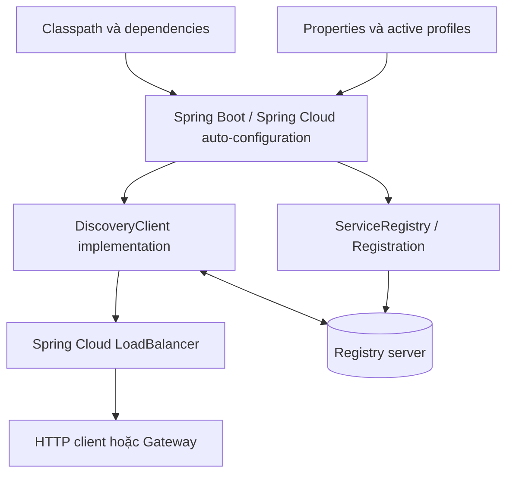

# Kiểm tra tự cấu hình và cô lập từng nhà cung cấp khám phá

Spring Cloud cung cấp abstraction chung để ứng dụng tra cứu và đăng ký dịch vụ, nhưng implementation thực tế được đưa vào ứng dụng thông qua dependency và auto-configuration. Khi thêm starter Eureka, Consul hoặc ZooKeeper, Spring Boot có thể tự tạo các bean discovery tương ứng dựa trên classpath và thuộc tính cấu hình. Nếu đưa nhiều starter vào cùng một ứng dụng mà không kiểm soát, ứng dụng có thể khởi tạo nhiều integration cùng lúc, kết nối tới nhiều registry hoặc tạo hành vi khó dự đoán.

Bài này hướng dẫn cách kiểm tra auto-configuration và cô lập từng nhà cung cấp discovery trong module `SPRING_CLOUD_SERVICE_DISCOVERY`. Mục tiêu là biết integration nào đang hoạt động, hiểu profile ảnh hưởng tới cấu hình ra sao, tách dependency khi cần kiểm thử độc lập và xác minh ứng dụng chỉ dùng đúng registry mong muốn.

## Auto-configuration hình thành DiscoveryClient như thế nào?

Spring Boot auto-configuration xem xét những gì có trên classpath, các bean đã tồn tại và các thuộc tính cấu hình. Các starter của Spring Cloud đưa thư viện tích hợp provider vào classpath; auto-configuration tương ứng có thể tạo client, registry adapter, health contributor và các bean liên quan.

Ví dụ:

- Có `spring-cloud-starter-netflix-eureka-client` trên classpath và Eureka client được bật, ứng dụng có thể được cấu hình để đăng ký và tra cứu qua Eureka.
- Có `spring-cloud-starter-consul-discovery` cùng cấu hình Consul, ứng dụng có thể tạo integration để đăng ký và tra cứu qua Consul.
- Có `spring-cloud-starter-zookeeper-discovery` cùng cấu hình ZooKeeper, ứng dụng có thể dùng ZooKeeper làm registry.
- Khi không có registry client chuyên dụng, `SimpleDiscoveryClient` có thể cung cấp danh sách instance tĩnh từ cấu hình, tùy phiên bản Spring Cloud và các điều kiện auto-configuration.

`DiscoveryClient` là abstraction phía consumer. Các implementation cụ thể cung cấp danh sách `ServiceInstance` theo service ID. Phía provider, `ServiceRegistry` và `Registration` là các abstraction liên quan đến đăng ký. Spring Cloud LoadBalancer có thể sử dụng discovery để lấy danh sách instance trước khi chọn đích cho request.



Auto-configuration không có nghĩa là mọi provider luôn được kích hoạt. Mỗi integration còn có điều kiện riêng như dependency hiện diện, thuộc tính `enabled`, thông tin kết nối và các bean do ứng dụng tự khai báo. Vì điều kiện có thể thay đổi giữa các release train, hãy kiểm tra tài liệu và báo cáo điều kiện của đúng phiên bản đang dùng.

Ở các dòng Spring Cloud hiện đại, việc thêm discovery starter thường đã đủ để kích hoạt integration; `@EnableDiscoveryClient` nhìn chung không còn là annotation bắt buộc. Annotation này cũng không chọn Eureka, Consul hay ZooKeeper thay cho dependency và cấu hình. Hãy kiểm tra tài liệu của release train dự án đang dùng trước khi thêm annotation vào ví dụ.

## Phân biệt dependency, profile và cờ bật/tắt

Ba cơ chế này giải quyết các lớp khác nhau:

| Cơ chế | Tác động | Ví dụ |
|---|---|---|
| Dependency / classpath | Quyết định integration nào có thể được auto-configure | Thêm hoặc bỏ Eureka Client starter |
| Spring profile | Chọn nhóm cấu hình runtime theo môi trường hoặc mục đích chạy | `eureka`, `consul`, `zookeeper`, `test` |
| Property `enabled` / `register` | Bật/tắt chức năng của integration đã có trên classpath | `spring.cloud.zookeeper.discovery.enabled=false` |

**Một profile không tự loại dependency khỏi classpath.** Nếu cả Eureka, Consul và ZooKeeper starter đều được khai báo trong build, chỉ đổi `spring.profiles.active=consul` không đảm bảo hai integration còn lại không được khởi tạo. Cần dùng property disable phù hợp hoặc tách dependency theo build profile để cô lập rõ ràng.

Ngược lại, bỏ starter khỏi classpath sẽ ngăn integration đó được auto-configure, nhưng không thay thế cấu hình profile. Cấu hình còn sót lại có thể gây nhầm lẫn cho người vận hành, vì vậy nên quản lý dependency và profile nhất quán.

## Các abstraction dùng để kiểm tra

| Abstraction | Cần xác minh điều gì? |
|---|---|
| `DiscoveryClient` | Có implementation nào đang được tạo? `getServices()` và `getInstances(serviceId)` trả về gì? |
| `ServiceInstance` | Host, port, URI và metadata có trỏ tới địa chỉ consumer truy cập được không? |
| `ServiceRegistry` | Provider đang đăng ký vào registry nào? Có tự động đăng ký khi khởi động không? |
| `Registration` | Service ID và instance ID có đúng và duy nhất không? |
| `ServiceInstanceListSupplier` | LoadBalancer đang lấy danh sách từ discovery nào, có cache hay lọc health không? |

Có thể kiểm tra danh sách dịch vụ và instance bằng `DiscoveryClient`:

```java
import java.util.List;

import org.springframework.cloud.client.ServiceInstance;
import org.springframework.cloud.client.discovery.DiscoveryClient;
import org.springframework.stereotype.Component;

@Component
public class DiscoveryInspector {
    private final DiscoveryClient discoveryClient;

    public DiscoveryInspector(DiscoveryClient discoveryClient) {
        this.discoveryClient = discoveryClient;
    }

    public void inspect(String serviceId) {
        List<String> services = discoveryClient.getServices();
        List<ServiceInstance> instances = discoveryClient.getInstances(serviceId);

        System.out.println("Services: " + services);
        for (ServiceInstance instance : instances) {
            System.out.printf(
                "%s -> %s:%d (%s)%n",
                instance.getServiceId(),
                instance.getHost(),
                instance.getPort(),
                instance.getUri()
            );
        }
    }
}
```

Không ghi token, password hoặc metadata nhạy cảm ra log. Danh sách trả về có thể rỗng; điều đó có thể có nghĩa provider chưa đăng ký, service ID không khớp, cache chưa cập nhật hoặc registry chưa truy cập được.

## Phát hiện implementation đang được khởi tạo

Khi một ứng dụng có nhiều starter, cần xác minh bean thực tế thay vì suy luận chỉ từ file YAML. Trong môi trường phát triển, có thể liệt kê các bean có kiểu `DiscoveryClient`:

```java
import java.util.Map;

import org.springframework.boot.ApplicationRunner;
import org.springframework.context.ApplicationContext;
import org.springframework.context.annotation.Bean;
import org.springframework.context.annotation.Configuration;
import org.springframework.cloud.client.discovery.DiscoveryClient;

@Configuration
public class DiscoveryDiagnosticsConfiguration {
    @Bean
    ApplicationRunner reportDiscoveryClients(ApplicationContext context) {
        return args -> {
            Map<String, DiscoveryClient> clients =
                context.getBeansOfType(DiscoveryClient.class);
            clients.forEach((name, client) ->
                System.out.println(
                    "DiscoveryClient bean: " + name + " -> "
                        + client.getClass().getName()
                )
            );
        };
    }
}
```

Đây là mã chẩn đoán dùng tạm trong môi trường local hoặc test. Không nên để log chẩn đoán quá chi tiết trong production nếu nó làm lộ topology hoặc thông tin nội bộ.

Có thể bật báo cáo điều kiện auto-configuration khi chạy ứng dụng với `--debug`. Spring Boot sẽ ghi các điều kiện match và không match, giúp xác định vì sao một cấu hình được kích hoạt. Actuator cũng có endpoint `conditions` và `beans` để xem trạng thái context; chỉ expose các endpoint này trên mạng quản trị có kiểm soát.

Ví dụ cấu hình Actuator trong môi trường local:

```yaml
management:
  endpoints:
    web:
      exposure:
        include: health,info,conditions,beans
```

Không expose `beans`, `conditions` hoặc health details công khai trong môi trường production. Các endpoint này có thể tiết lộ tên bean, cấu hình và cấu trúc nội bộ của ứng dụng.

## Cô lập provider bằng Spring profiles

Khi cùng một codebase cần chạy thử nhiều registry, có thể tách cấu hình theo profile. Ví dụ dùng các file:

```text
src/main/resources/
  application.yml
  application-eureka.yml
  application-consul.yml
  application-zookeeper.yml
  application-test.yml
```

File chung chỉ chứa cấu hình dùng cho mọi profile:

```yaml
spring:
  application:
    name: inventory-service
```

### Profile Eureka

```yaml
spring:
  config:
    activate:
      on-profile: eureka
  cloud:
    discovery:
      enabled: true
    service-registry:
      auto-registration:
        enabled: true
eureka:
  client:
    enabled: true
    register-with-eureka: true
    fetch-registry: true
    service-url:
      defaultZone: http://localhost:8761/eureka/
```

`register-with-eureka` điều khiển việc client đăng ký ứng dụng lên Eureka; `fetch-registry` điều khiển việc lấy registry về để tra cứu. Một consumer chỉ cần tra cứu có thể tắt đăng ký nhưng vẫn bật fetch. Nếu muốn tắt hoàn toàn Eureka integration, dùng cờ `eureka.client.enabled=false` hoặc bỏ starter khỏi classpath.

### Profile Consul

```yaml
spring:
  config:
    activate:
      on-profile: consul
  cloud:
    consul:
      enabled: true
      host: localhost
      port: 8500
      discovery:
        enabled: true
        register: true
        service-name: inventory-service
```

`spring.cloud.consul.discovery.register=false` giữ discovery integration nhưng không tự đăng ký instance của ứng dụng. Có thể dùng cấu hình này cho một consumer chỉ cần tra cứu. Để tắt Consul integration, đặt các cờ `spring.cloud.consul.enabled=false` và/hoặc `spring.cloud.consul.discovery.enabled=false` theo phiên bản đang dùng, hoặc loại starter khỏi classpath.

### Profile ZooKeeper

```yaml
spring:
  config:
    activate:
      on-profile: zookeeper
  cloud:
    zookeeper:
      enabled: true
      connect-string: localhost:2181
      discovery:
        enabled: true
        register: true
        root: /services
```

`spring.cloud.zookeeper.discovery.register=false` giữ khả năng tra cứu nhưng không đăng ký instance hiện tại. Để tắt integration, có thể dùng `spring.cloud.zookeeper.enabled=false` hoặc `spring.cloud.zookeeper.discovery.enabled=false` theo release train, hoặc bỏ starter khỏi classpath.

Kích hoạt một profile tại một thời điểm:

```bash
java -jar app.jar --spring.profiles.active=eureka
java -jar app.jar --spring.profiles.active=consul
java -jar app.jar --spring.profiles.active=zookeeper
```

Các file profile tách cấu hình, nhưng không xóa provider khác khỏi classpath. Nếu dependency của nhiều registry cùng hiện diện, hãy đặt cờ disable rõ ràng cho provider không được chọn hoặc dùng build profile để chỉ đưa một integration vào ứng dụng.

## Phân biệt tắt discovery với tắt auto-registration

Đây là hai yêu cầu khác nhau:

- **Tắt discovery:** consumer không sử dụng cơ chế tra cứu service instance. Thuộc tính chung `spring.cloud.discovery.enabled=false` có thể tắt các discovery client auto-configuration của Spring Cloud.
- **Tắt auto-registration:** ứng dụng không công bố chính instance của nó vào registry, nhưng vẫn có thể tra cứu dịch vụ khác. Có thể dùng `spring.cloud.service-registry.auto-registration.enabled=false` hoặc cờ riêng của provider.
- **Tắt một provider:** vô hiệu hóa integration cụ thể như Eureka, Consul hoặc ZooKeeper; điều này không nhất thiết tắt các discovery client khác còn trên classpath.

Ví dụ một ứng dụng chỉ là consumer, cần tra cứu Eureka nhưng không đăng ký chính nó:

```yaml
eureka:
  client:
    register-with-eureka: false
    fetch-registry: true
```

Ví dụ tắt tự động đăng ký ở cấp Spring Cloud Commons:

```yaml
spring:
  cloud:
    service-registry:
      auto-registration:
        enabled: false
```

Property chung và property riêng có thể cùng tồn tại; kết quả cuối cùng phụ thuộc điều kiện auto-configuration và phiên bản integration. Sau khi thay đổi, hãy kiểm tra bean, log và registry để xác nhận ứng dụng không còn đăng ký ngoài ý muốn.

## Cô lập dependency bằng Maven profiles

Với một ứng dụng mẫu cần chạy thử nhiều provider, Maven profiles có thể giới hạn starter được đưa vào build. Trước hết, khai báo Spring Cloud BOM tương thích với Spring Boot trong `dependencyManagement`; sau đó đặt dependency của từng provider vào profile riêng.

Ví dụ rút gọn:

```xml
<profiles>
    <profile>
        <id>discovery-eureka</id>
        <dependencies>
            <dependency>
                <groupId>org.springframework.cloud</groupId>
                <artifactId>spring-cloud-starter-netflix-eureka-client</artifactId>
            </dependency>
        </dependencies>
    </profile>

    <profile>
        <id>discovery-consul</id>
        <dependencies>
            <dependency>
                <groupId>org.springframework.cloud</groupId>
                <artifactId>spring-cloud-starter-consul-discovery</artifactId>
            </dependency>
        </dependencies>
    </profile>

    <profile>
        <id>discovery-zookeeper</id>
        <dependencies>
            <dependency>
                <groupId>org.springframework.cloud</groupId>
                <artifactId>spring-cloud-starter-zookeeper-discovery</artifactId>
            </dependency>
        </dependencies>
    </profile>
</profiles>
```

Để chạy từng cấu hình, kích hoạt Maven profile và Spring profile tương ứng:

```bash
./mvnw -Pdiscovery-eureka spring-boot:run -Dspring-boot.run.profiles=eureka
./mvnw -Pdiscovery-consul spring-boot:run -Dspring-boot.run.profiles=consul
./mvnw -Pdiscovery-zookeeper spring-boot:run -Dspring-boot.run.profiles=zookeeper
```

Maven profile quyết định dependency nào có trong build; Spring profile quyết định cấu hình runtime nào được nạp. Hai profile này độc lập và cần được bật đúng cặp. Trong dự án Gradle, có thể đạt mục tiêu tương tự bằng dependency configurations hoặc các module ứng dụng riêng cho từng provider.

Đối với hệ thống production, thường nên chọn một registry integration cho mỗi service process trừ khi có yêu cầu rõ ràng về multi-registry. Tách ứng dụng hoặc module triển khai theo provider giúp dependency graph và hành vi runtime dễ kiểm soát hơn.

## SimpleDiscoveryClient cho kiểm thử cục bộ

`SimpleDiscoveryClient` hữu ích khi muốn kiểm tra consumer và load balancing mà chưa cần chạy registry server. Danh sách instance được khai báo trong cấu hình:

```yaml
spring:
  cloud:
    discovery:
      client:
        simple:
          instances:
            inventory-service:
              - uri: http://localhost:8081
              - uri: http://localhost:8082
```

Consumer có thể tra cứu `inventory-service` và nhận hai địa chỉ tĩnh này. Cách làm phù hợp cho bài test, demo hoặc môi trường đơn giản; nó không cung cấp vòng đời đăng ký động, heartbeat hoặc health check tương đương Eureka/Consul/ZooKeeper. Cần xác nhận `SimpleDiscoveryClient` là implementation được chọn trong context thực tế, vì integration khác trên classpath có thể thay đổi hành vi discovery.

## Kiểm tra provider trong từng profile

Với mỗi profile, hãy xác minh cả ba lớp: dependency, Spring context và trạng thái registry.

| Lớp kiểm tra | Cách xác minh | Kết quả mong đợi |
|---|---|---|
| Dependency | Xem dependency tree của Maven/Gradle | Chỉ provider dự kiến có starter, nếu đang dùng build isolation |
| Auto-configuration | Chạy với `--debug` hoặc xem Actuator `conditions` | Auto-configuration của provider được chọn match; provider khác không được khởi tạo ngoài ý muốn |
| Bean | Liệt kê bean `DiscoveryClient` và `ServiceRegistry` trong context | Xác định rõ implementation và bean composite nếu có |
| Registry | Kiểm tra UI/API/CLI của Eureka, Consul hoặc ZooKeeper | Chỉ thấy đăng ký dự kiến; service ID và địa chỉ instance đúng |
| Consumer | Gọi `getInstances(serviceId)` | Danh sách đúng, không trộn địa chỉ từ môi trường khác |
| LoadBalancer | Gọi endpoint nhiều lần và quan sát instance đích | Request được chọn trong tập instance mong muốn |

Có thể chạy ứng dụng với các lệnh sau để thu thập báo cáo auto-configuration:

```bash
java -jar app.jar --spring.profiles.active=eureka --debug
java -jar app.jar --spring.profiles.active=consul --debug
java -jar app.jar --spring.profiles.active=zookeeper --debug
```

Khi dùng Actuator, chỉ expose endpoint chẩn đoán trên mạng nội bộ được bảo vệ. Không đưa endpoint `beans` hoặc `conditions` ra internet công khai.

## Kiểm thử cô lập trong Spring Boot tests

Có thể dùng profile test và `SimpleDiscoveryClient` để kiểm thử logic consumer mà không cần registry server thật. Ví dụ cấu hình test:

```yaml
spring:
  cloud:
    discovery:
      client:
        simple:
          instances:
            inventory-service:
              - uri: http://localhost:18081
              - uri: http://localhost:18082
```

Trong test, có thể kiểm tra kết quả tra cứu:

```java
import static org.assertj.core.api.Assertions.assertThat;

import org.junit.jupiter.api.Test;
import org.springframework.beans.factory.annotation.Autowired;
import org.springframework.boot.test.context.SpringBootTest;
import org.springframework.cloud.client.discovery.DiscoveryClient;
import org.springframework.test.context.ActiveProfiles;

@SpringBootTest
@ActiveProfiles("test")
class DiscoveryConfigurationTest {
    @Autowired
    DiscoveryClient discoveryClient;

    @Test
    void loadsConfiguredInventoryInstances() {
        assertThat(discoveryClient.getInstances("inventory-service"))
            .hasSize(2);
    }
}
```

Đây là kiểm thử cấu hình và logic tra cứu tĩnh. Nó không thay thế integration test với registry thật. Với Eureka, Consul hoặc ZooKeeper, cần có test riêng khởi chạy server/agent phù hợp, đăng ký một instance, tra cứu từ consumer rồi xác minh deregistration hoặc health transition.

Không nên để test phụ thuộc vào registry đang chạy trên máy phát triển mà không khai báo rõ. Dùng container hoặc môi trường test cô lập để tránh kết quả phụ thuộc trạng thái bên ngoài.

## Khi cần nhiều registry trong cùng một ứng dụng

Spring Cloud Commons có thể kết hợp nhiều discovery client thông qua `CompositeDiscoveryClient` trong các cấu hình hỗ trợ composite. Thông thường, `getServices()` tổng hợp tên dịch vụ từ các client; còn `getInstances(serviceId)` duyệt theo thứ tự ưu tiên và dùng danh sách không rỗng đầu tiên. Vì vậy, không nên mặc định rằng các instance từ mọi registry sẽ được gộp thành một danh sách. Cần kiểm tra `Ordered`/order của các client và hành vi cụ thể ở release train đang dùng.

Multi-registry chỉ nên được bật khi có mục tiêu kiến trúc cụ thể, chẳng hạn migration từng giai đoạn hoặc cần đọc danh bạ từ nhiều miền. Cần xác định rõ:

- Consumer có chấp nhận instance trùng hoặc cùng service ID ở nhiều registry không?
- Hai registry có cùng quy ước service ID, metadata và địa chỉ truy cập không?
- LoadBalancer có thể chọn nhầm instance thuộc môi trường hoặc miền mạng khác không?
- Provider đăng ký vào một registry hay nhiều registry? Cơ chế `ServiceRegistry`/auto-registration đang hoạt động thế nào?
- Khi một registry lỗi, ứng dụng có tiếp tục dùng registry còn lại hay fail toàn bộ?
- Ai chịu trách nhiệm đồng bộ, xóa bản ghi cũ và xử lý migration?

Không giả định rằng việc tổng hợp `DiscoveryClient` tự động đồng nghĩa provider được đăng ký đồng thời vào mọi registry. Tra cứu và đăng ký là hai luồng abstraction khác nhau; phải kiểm tra bean `ServiceRegistry`, auto-registration và trạng thái từng registry riêng.

## Lỗi thường gặp và cách chẩn đoán

| Triệu chứng | Nguyên nhân có thể | Cách xử lý |
|---|---|---|
| Ứng dụng kết nối nhiều registry ngoài dự kiến | Nhiều starter cùng có trên classpath và các integration đều được bật | Kiểm tra dependency tree, conditions report và các cờ `enabled` |
| Đổi profile nhưng provider cũ vẫn khởi tạo | Profile chỉ đổi cấu hình, không loại dependency khỏi classpath | Tắt integration còn lại bằng property hoặc tách dependency bằng build profile |
| Consumer tìm thấy instance nhưng provider không xuất hiện trong registry | Auto-registration bị tắt hoặc `register=false` | Kiểm tra cờ chung và cờ riêng của provider |
| Provider có trong registry nhưng consumer không tra cứu được | `fetch-registry` tắt, service ID sai, cache hoặc quyền truy cập | Kiểm tra cấu hình consumer, trạng thái registry và log |
| `DiscoveryClient` trả danh sách rỗng | Provider chưa đăng ký, registry không sẵn sàng hoặc đang đọc nhầm implementation | Liệt kê bean, kiểm tra profile và truy vấn registry trực tiếp |
| Test local phụ thuộc registry ngoài máy | Test đang nạp starter/config production | Dùng profile test, SimpleDiscoveryClient hoặc container test riêng |
| Request đi tới sai instance | Nhiều registry trả instance trùng hoặc sai mạng | Kiểm tra metadata, địa chỉ quảng bá, thứ tự composite và supplier |
| Health indicator báo lỗi dù ứng dụng chạy | Registry không truy cập được hoặc health contributor kiểm tra registry | Phân biệt health ứng dụng với health dependency; kiểm tra endpoint và log |

Khi điều tra, đi theo thứ tự: xác nhận dependency, xác nhận profile/property được nạp, xem auto-configuration condition, liệt kê bean thực tế, kiểm tra trạng thái registry và cuối cùng kiểm tra kết quả consumer/load balancer. Trình tự này giúp tìm đúng lớp gây ra vấn đề.

## Checklist trước khi bàn giao môi trường

1. Chốt registry mà service process cần sử dụng.
2. Kiểm tra dependency tree và loại starter không cần thiết nếu muốn cô lập ở build time.
3. Tạo profile riêng cho provider và giữ cấu hình chung ở file base.
4. Đặt `enabled`, `register`, `register-with-eureka` hoặc `fetch-registry` theo vai trò provider/consumer.
5. Kiểm tra địa chỉ quảng bá có thể truy cập từ consumer.
6. Xác minh bean `DiscoveryClient`, `ServiceRegistry` và kết quả auto-configuration.
7. Kiểm tra service ID, instance ID, metadata và trạng thái đăng ký trên registry.
8. Kiểm thử danh sách rỗng, registry mất kết nối, cache cũ và shutdown.
9. Bảo vệ endpoint Actuator và thông tin kết nối registry.
10. Ghi rõ phiên bản Spring Boot, Spring Cloud release train và registry server/client trong hướng dẫn triển khai.

## Kết luận

Auto-configuration của Spring Cloud dựa vào dependency, điều kiện cấu hình và bean hiện có để tạo integration discovery. Muốn cô lập từng nhà cung cấp, cần phân biệt việc có starter trên classpath, profile cấu hình và các cờ bật/tắt runtime. Hãy kiểm tra bean thực tế cùng điều kiện auto-configuration, xác minh trạng thái registry và kết quả tra cứu; dùng build profile khi cần cô lập dependency triệt để. Chỉ dùng multi-registry khi đã xác định rõ cách tổng hợp instance, đăng ký và xử lý lỗi.
