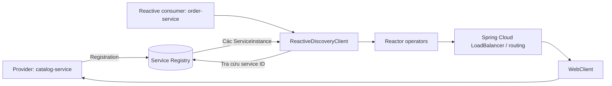
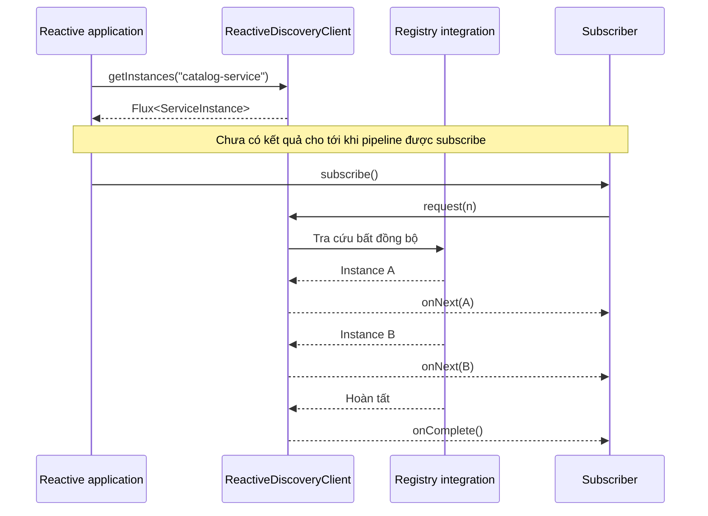

# ReactiveDiscoveryClient và cách xử lý kết quả bất đồng bộ

Trong ứng dụng microservice, consumer cần tìm các instance của một dịch vụ theo tên logic. Với ứng dụng Spring MVC hoặc luồng xử lý đồng bộ, `DiscoveryClient` cung cấp danh sách `ServiceInstance` trực tiếp. Với ứng dụng dùng Spring WebFlux và Reactor, việc tra cứu có thể được biểu diễn bằng publisher để kết hợp với các thao tác bất đồng bộ khác mà không phải chặn thread chờ kết quả.

Spring Cloud Commons định nghĩa `ReactiveDiscoveryClient` cho mục đích đó. Thay vì trả về `List<ServiceInstance>`, API reactive trả về `Flux<ServiceInstance>`. Consumer có thể lọc, biến đổi, gom nhóm, xử lý trường hợp không có instance hoặc chuyển lỗi trong cùng một pipeline Reactor.

Bài học thuộc module `SPRING_CLOUD_SERVICE_DISCOVERY`, tập trung vào cơ chế khám phá instance qua `DiscoveryClient`, `ServiceRegistry`, Eureka hoặc Consul và các vấn đề vận hành đi kèm. Nội dung dưới đây đi sâu vào cách đọc publisher của `ReactiveDiscoveryClient`, hiểu vòng đời subscription và xử lý kết quả bất đồng bộ an toàn trong ứng dụng reactive.

## 1. ReactiveDiscoveryClient trong kiến trúc Service Discovery

`ReactiveDiscoveryClient` thuộc package `org.springframework.cloud.client.discovery`. Đây là abstraction ở phía consumer, cho phép tra cứu dịch vụ bằng service ID và nhận thông tin instance dưới dạng reactive stream.

Một luồng đơn giản:

1. Provider đăng ký instance vào registry theo cơ chế của integration đang dùng.
2. Consumer yêu cầu các instance của service ID, ví dụ `catalog-service`.
3. `ReactiveDiscoveryClient` phát ra các `ServiceInstance` qua `Flux`.
4. Consumer có thể lọc hoặc chuyển dữ liệu cho thành phần định tuyến.
5. Spring Cloud LoadBalancer hoặc logic định tuyến phù hợp lựa chọn instance để gửi request.



`ReactiveDiscoveryClient` chịu trách nhiệm khám phá. Nó không phải registry và cũng không tự quyết định instance nào nhận một request cụ thể. Discovery và load balancing là hai trách nhiệm khác nhau.

## 2. Hợp đồng API và kiểu dữ liệu trả về

API reactive trong Spring Cloud Commons có dạng cốt lõi:

```java
package org.springframework.cloud.client.discovery;

import reactor.core.publisher.Flux;
import org.springframework.cloud.client.ServiceInstance;

public interface ReactiveDiscoveryClient {

    String description();

    Flux<ServiceInstance> getInstances(String serviceId);

    Flux<String> getServices();
}
```

Hai phương thức tra cứu chính là:

| Phương thức | Kiểu trả về | Ý nghĩa |
|---|---|---|
| `getInstances(String serviceId)` | `Flux<ServiceInstance>` | Phát ra các instance được khám phá cho service ID. |
| `getServices()` | `Flux<String>` | Phát ra các service ID mà implementation có thể khám phá. |
| `description()` | `String` | Mô tả implementation discovery. |

`Flux<T>` là một `Publisher` có thể phát ra từ không đến nhiều phần tử. Vì vậy, `getInstances("catalog-service")` có thể phát ra nhiều `ServiceInstance`, hoàn tất mà không phát phần tử nào, hoặc kết thúc bằng lỗi.

Mỗi `ServiceInstance` cung cấp thông tin như service ID, host, port, URI, trạng thái secure và metadata. Consumer có thể dùng các thuộc tính này để quan sát hoặc áp dụng quy tắc lọc. Metadata, cách biểu diễn instance ID và cách lọc health vẫn phụ thuộc vào registry integration.

### 2.1. Phân biệt DiscoveryClient và ReactiveDiscoveryClient

| Tiêu chí | `DiscoveryClient` | `ReactiveDiscoveryClient` |
|---|---|---|
| Kiểu kết quả | `List<ServiceInstance>` | `Flux<ServiceInstance>` |
| Cách tiêu thụ | Gọi phương thức và xử lý danh sách ngay trong luồng hiện tại. | Kết hợp publisher với các operator Reactor và tiêu thụ khi subscribe. |
| Tích hợp tự nhiên | Ứng dụng đồng bộ, Spring MVC hoặc API blocking. | Pipeline reactive, chẳng hạn ứng dụng Spring WebFlux. |
| Kết quả rỗng | Danh sách rỗng. | Publisher hoàn tất mà không phát phần tử. |
| Lỗi | Thường được ném trong lúc gọi hoặc xử lý API. | Có thể được phát thành tín hiệu `onError` trong quá trình subscribe. |

Không nên chỉ nhìn kiểu trả về để kết luận toàn bộ hoạt động bên dưới là non-blocking. Implementation của `ReactiveDiscoveryClient` cần thực sự dùng I/O bất đồng bộ hoặc cơ chế phù hợp. Nếu nó chỉ bọc một API blocking, việc trả về `Flux` không tự biến thao tác mạng blocking thành non-blocking.

## 3. Hiểu Flux và vòng đời bất đồng bộ

Reactor mô hình hóa luồng dữ liệu bằng `Publisher`, `Subscriber` và các tín hiệu. Với `Flux<ServiceInstance>`, những tín hiệu quan trọng gồm:

- `onNext(instance)`: phát ra một instance.
- `onComplete()`: hoàn tất luồng; có thể xảy ra ngay mà không có `onNext` nào.
- `onError(error)`: kết thúc luồng bằng lỗi.
- `request(n)`: subscriber yêu cầu publisher phát tối đa số phần tử theo nhu cầu.
- `cancel()`: subscriber hủy việc tiêu thụ; publisher có thể dừng công việc còn lại nếu implementation hỗ trợ hủy.



Trong nhiều pipeline Reactor, publisher có tính lazy: việc khai báo chuỗi operator chỉ mô tả công việc; công việc được thực thi khi có subscriber. Không nên giả định mọi implementation đều có cùng chiến lược cache hoặc cùng thời điểm thực hiện I/O, nhưng consumer nên viết code theo quy tắc tiêu thụ publisher và tránh mong đợi một giá trị đồng bộ ngay tại dòng gọi `getInstances`.

Ví dụ, đoạn sau chỉ tạo pipeline:

```java
Flux<ServiceInstance> instances =
        reactiveDiscoveryClient.getInstances("catalog-service");
```

Muốn nhận dữ liệu, cần kết hợp pipeline vào một luồng reactive được framework subscribe, hoặc subscribe rõ ràng trong một thành phần thực sự sở hữu vòng đời subscription. Trong controller WebFlux, thường trả `Mono` hoặc `Flux` để framework quản lý việc subscribe.

## 4. Tra cứu và xử lý danh sách instance

Một service có thể có nhiều instance. Consumer thường muốn quan sát hoặc lọc chúng trước khi sử dụng. Ví dụ sau inject `ReactiveDiscoveryClient` và cung cấp các phương thức trả về reactive type:

```java
package com.example.order.discovery;

import java.util.List;

import org.springframework.cloud.client.ServiceInstance;
import org.springframework.cloud.client.discovery.ReactiveDiscoveryClient;
import org.springframework.stereotype.Service;

import reactor.core.publisher.Flux;
import reactor.core.publisher.Mono;

@Service
public class CatalogDiscoveryService {

    private final ReactiveDiscoveryClient discoveryClient;

    public CatalogDiscoveryService(ReactiveDiscoveryClient discoveryClient) {
        this.discoveryClient = discoveryClient;
    }

    public Flux<ServiceInstance> findInstances(String serviceId) {
        return discoveryClient.getInstances(serviceId);
    }

    public Mono<List<ServiceInstance>> requireInstances(String serviceId) {
        return findInstances(serviceId)
                .collectList()
                .flatMap(instances -> {
                    if (instances.isEmpty()) {
                        return Mono.error(new IllegalStateException(
                                "No instances found for service: " + serviceId));
                    }
                    return Mono.just(instances);
                });
    }
}
```

`findInstances` giữ kết quả ở dạng `Flux` để caller tiếp tục xử lý từng phần tử. `requireInstances` dùng `collectList()` để gom toàn bộ kết quả thành `Mono<List<ServiceInstance>>`, sau đó biến danh sách rỗng thành lỗi nghiệp vụ nếu ứng dụng yêu cầu phải có ít nhất một instance.

`collectList()` hữu ích khi cần kiểm tra cả danh sách, nhưng nó đợi publisher hoàn tất và giữ các phần tử trong bộ nhớ. Nếu chỉ cần lọc hoặc biến đổi từng instance, nên giữ `Flux` và dùng các operator như `filter`, `map` hoặc `flatMap` thay vì gom danh sách không cần thiết.

### 4.1. Lọc instance bằng metadata

Giả sử provider công bố metadata `zone`, consumer muốn xem các instance trong `zone-a`:

```java
public Flux<ServiceInstance> findInZone(String serviceId, String zone) {
    return discoveryClient.getInstances(serviceId)
            .filter(instance -> zone.equals(
                    instance.getMetadata().get("zone")));
}
```

Nếu không có instance nào khớp zone, kết quả là một `Flux` rỗng. Ứng dụng phải quyết định rõ có fallback sang zone khác hay báo dependency không khả dụng:

```java
public Flux<ServiceInstance> findInPreferredZone(String serviceId, String zone) {
    Flux<ServiceInstance> preferred = findInZone(serviceId, zone);

    return preferred.switchIfEmpty(
            discoveryClient.getInstances(serviceId));
}
```

Ví dụ này dùng danh sách toàn bộ instance làm fallback khi zone ưu tiên không có kết quả. Với hệ thống yêu cầu locality nghiêm ngặt hoặc có quy định dữ liệu theo vùng, không nên tự động fallback nếu điều đó vi phạm chính sách. Metadata có thể thiếu hoặc sai định dạng; cần thống nhất schema và kiểm tra giá trị trước khi dùng cho quyết định định tuyến.

## 5. Xử lý publisher rỗng và lỗi

Một trong những điểm quan trọng nhất là phân biệt ba kết quả:

1. **Có instance:** publisher phát ra một hoặc nhiều `ServiceInstance`, rồi hoàn tất.
2. **Không có instance:** publisher hoàn tất mà không phát phần tử nào.
3. **Tra cứu thất bại:** publisher phát tín hiệu `onError`, ví dụ do timeout, lỗi kết nối hoặc lỗi từ implementation.

Publisher rỗng không đồng nghĩa với lỗi kết nối registry. Có thể service ID chưa tồn tại, provider chưa đăng ký, instance bị lọc bởi health check hoặc consumer đang truy vấn sai namespace. Ngược lại, lỗi registry không nên bị che giấu thành kết quả rỗng.

### 5.1. switchIfEmpty

Nếu luồng nghiệp vụ yêu cầu phải tìm được ít nhất một instance, có thể chuyển trạng thái rỗng thành lỗi:

```java
public Flux<ServiceInstance> requireAtLeastOne(String serviceId) {
    return discoveryClient.getInstances(serviceId)
            .switchIfEmpty(Flux.error(
                    new IllegalStateException(
                            "No available instance for " + serviceId)));
}
```

`switchIfEmpty` chỉ được dùng khi publisher hoàn tất mà không phát phần tử. Nó không xử lý `onError`. Lỗi tra cứu cần được xử lý bằng các operator lỗi riêng.

### 5.2. onErrorMap và onErrorResume

`onErrorMap` chuyển lỗi kỹ thuật thành một kiểu lỗi phù hợp với tầng ứng dụng:

```java
public Flux<ServiceInstance> discover(String serviceId) {
    return discoveryClient.getInstances(serviceId)
            .onErrorMap(error -> new IllegalStateException(
                    "Discovery lookup failed for " + serviceId, error));
}
```

`onErrorResume` thay pipeline lỗi bằng một publisher khác. Ví dụ, hệ thống có thể dùng một snapshot cache gần nhất trong thời gian ngắn nếu nghiệp vụ chấp nhận dữ liệu cũ:

```java
public Flux<ServiceInstance> discoverWithFallback(String serviceId) {
    return discoveryClient.getInstances(serviceId)
            .onErrorResume(error -> cachedInstances(serviceId));
}
```

`cachedInstances` ở đây là hàm minh họa trả về `Flux<ServiceInstance>` từ cache do ứng dụng quản lý. Nếu dùng fallback, cần giới hạn tuổi dữ liệu, đánh dấu rõ dữ liệu stale và ghi nhận lỗi registry. Không nên âm thầm trả danh sách cũ vô thời hạn, vì instance trong cache có thể đã bị dừng hoặc đổi địa chỉ.

Không nên dùng `onErrorResume(error -> Flux.empty())` cho mọi lỗi nếu ứng dụng cần phân biệt “không có instance” và “không truy cập được registry”. Cách đó làm mất tín hiệu quan trọng cho vận hành và giám sát.

### 5.3. timeout và retry có giới hạn

Có thể đặt timeout cho toàn bộ thao tác tra cứu:

```java
public Mono<List<ServiceInstance>> discoverWithTimeout(String serviceId) {
    return discoveryClient.getInstances(serviceId)
            .collectList()
            .timeout(Duration.ofSeconds(2));
}
```

Khi retry, chỉ nên retry lỗi tạm thời có khả năng phục hồi. Retry không giúp ích cho service ID sai hoặc service thực sự chưa có instance. Cần giới hạn số lần, dùng backoff và tránh retry đồng thời trên số lượng lớn consumer:

```java
public Flux<ServiceInstance> discoverWithRetry(String serviceId) {
    return discoveryClient.getInstances(serviceId)
            .retryWhen(Retry.backoff(2, Duration.ofMillis(200))
                    .filter(this::isTransientRegistryFailure));
}
```

`isTransientRegistryFailure` là chính sách phân loại lỗi của ứng dụng; không nên retry tất cả exception một cách mù quáng. Với một số thao tác discovery, retry có thể được cấu hình ở integration hoặc tầng HTTP bên dưới, vì vậy cần tránh nhân số lần thử do retry lồng nhau.

## 6. Không chặn thread trong reactive pipeline

Lợi ích của WebFlux và Reactor phụ thuộc vào việc các thao tác trong pipeline không chặn event-loop thread trong thời gian dài. Tránh gọi `block()`, `blockFirst()`, `blockLast()` hoặc chuyển publisher sang API blocking bên trong controller và handler reactive.

Ví dụ không nên dùng trong WebFlux:

```java
// Không nên: block event-loop để chờ discovery hoàn tất.
List<ServiceInstance> instances =
        discoveryClient.getInstances("catalog-service").collectList().block();
```

Thay vào đó, trả publisher cho framework tiếp tục điều phối:

```java
@RestController
@RequestMapping("/internal/discovery")
public class DiscoveryController {

    private final CatalogDiscoveryService discoveryService;

    public DiscoveryController(CatalogDiscoveryService discoveryService) {
        this.discoveryService = discoveryService;
    }

    @GetMapping("/{serviceId}")
    public Flux<ServiceInstance> instances(@PathVariable String serviceId) {
        return discoveryService.findInstances(serviceId);
    }
}
```

Controller trả `Flux` để WebFlux quản lý subscription và ghi kết quả ra response. Trong API công khai, không nên để endpoint quản trị này lộ thông tin host, port và metadata nội bộ; cần giới hạn quyền truy cập và chỉ dùng cho mục đích vận hành phù hợp.

### 6.1. Khi implementation bên dưới là blocking

Một integration có thể cung cấp API reactive bằng cách bọc một thao tác blocking. Nếu không có lựa chọn reactive-native, có thể cô lập phần gọi blocking trên scheduler phù hợp, chẳng hạn `Schedulers.boundedElastic()`:

```java
Mono<List<ServiceInstance>> instances = Mono.fromCallable(
        () -> blockingDiscoveryClient.getInstances("catalog-service"))
        .subscribeOn(Schedulers.boundedElastic());
```

Đây chỉ là cách minh họa để cô lập lời gọi blocking; nó không biến I/O bên dưới thành non-blocking. Cần dùng bounded scheduler có giới hạn, quan sát hàng đợi và độ trễ, đồng thời kiểm tra xem registry integration có reactive implementation chính thức hay không. Không chuyển toàn bộ pipeline sang `boundedElastic` nếu chỉ có một thao tác blocking nhỏ.

## 7. Kết hợp ReactiveDiscoveryClient với WebClient và LoadBalancer

Trong ứng dụng WebFlux, `WebClient` là HTTP client reactive. Với service-to-service request theo service ID, có thể dùng `WebClient.Builder` được đánh dấu `@LoadBalanced`:

```java
import org.springframework.cloud.client.loadbalancer.LoadBalanced;
import org.springframework.context.annotation.Bean;
import org.springframework.context.annotation.Configuration;
import org.springframework.web.reactive.function.client.WebClient;

@Configuration
public class ReactiveHttpConfiguration {

    @Bean
    @LoadBalanced
    WebClient.Builder loadBalancedWebClientBuilder() {
        return WebClient.builder();
    }
}
```

Consumer dùng service ID trong URL:

```java
@Service
public class CatalogClient {

    private final WebClient webClient;

    public CatalogClient(@LoadBalanced WebClient.Builder builder) {
        this.webClient = builder
                .baseUrl("http://catalog-service")
                .build();
    }

    public Mono<Product> findProduct(String productId) {
        return webClient.get()
                .uri("/api/products/{id}", productId)
                .retrieve()
                .bodyToMono(Product.class);
    }
}
```

Với dependency và cấu hình Spring Cloud LoadBalancer tương ứng, service ID `catalog-service` được phân giải thành instance phù hợp trước khi request được gửi. LoadBalancer sử dụng cơ chế discovery tích hợp; ứng dụng thường không cần tự gọi `ReactiveDiscoveryClient` rồi lấy phần tử đầu tiên để gọi HTTP.

`ReactiveDiscoveryClient` hữu ích khi cần quan sát danh sách instance, lọc metadata theo quy tắc đặc thù hoặc xây dựng công cụ quản trị. Đối với request nghiệp vụ thông thường, hãy để LoadBalancer đảm nhiệm việc chọn instance. Việc gọi `getInstances(...).next()` chỉ lấy phần tử đầu tiên mà publisher phát ra; nó không tạo ra một chính sách cân bằng tải và không bảo đảm phân phối đều request.

Dependency và khả năng tích hợp reactive phụ thuộc release train Spring Cloud, Spring Boot và registry starter. Khi cấu hình không hoạt động, hãy kiểm tra bean `ReactiveDiscoveryClient`, implementation được tạo, starter tương ứng và cấu hình LoadBalancer đang có hiệu lực.

## 8. Reactive không tự động đồng nghĩa non-blocking

Một kiểu trả về `Flux` chỉ cho biết API được mô hình hóa theo Reactive Streams. Hiệu quả non-blocking còn phụ thuộc vào cách implementation thực hiện I/O và các operator mà ứng dụng sử dụng.

| Trường hợp | Đặc điểm |
|---|---|
| Reactive-native client | Dùng I/O bất đồng bộ hoặc event-driven; phù hợp với pipeline reactive nếu không có đoạn blocking khác. |
| Bọc API blocking | Có thể trả về `Flux` nhưng thread vẫn bị chặn nếu không cô lập lời gọi. |
| Dùng `block()` | Chuyển luồng reactive thành thao tác chờ đồng bộ tại điểm gọi; có thể làm nghẽn event-loop. |
| Dùng `subscribeOn` phù hợp | Có thể chuyển công việc blocking sang scheduler riêng, nhưng vẫn tiêu thụ thread và tài nguyên. |
| Dùng `publishOn` | Chuyển việc xử lý các tín hiệu tiếp theo sang scheduler được chỉ định; không tự biến I/O blocking thành non-blocking. |

Không nên thêm `subscribeOn` hoặc `publishOn` theo thói quen. Trước hết xác định thao tác nào thực sự blocking, thread nào đang chạy, và scheduler nào phù hợp. Dùng BlockHound hoặc công cụ profiling trong môi trường kiểm thử có thể giúp phát hiện đoạn blocking trên event-loop.

## 9. Cache, độ mới dữ liệu và tính nhất quán

Danh sách instance có thể thay đổi khi provider scale, restart, deregister hoặc bị đánh dấu unhealthy. `ReactiveDiscoveryClient` không bảo đảm rằng mỗi subscription luôn đọc trực tiếp trạng thái mới nhất từ server registry. Implementation có thể dùng cache, client-side registry snapshot hoặc cơ chế đồng bộ riêng.

Spring Cloud LoadBalancer cũng có thể có cache hoặc supplier chain tùy phiên bản và cấu hình. Nếu ứng dụng thêm cache bên ngoài, cần xác định rõ tuổi dữ liệu tối đa và cách invalidation. Nhiều tầng cache chồng lên nhau có thể khiến instance cũ tồn tại lâu hơn dự kiến.

Một số tình huống:

- Instance vừa đăng ký nhưng consumer chưa nhìn thấy vì replication hoặc refresh chưa hoàn tất.
- Instance đã dừng nhưng vẫn được phát ra từ cache.
- Hai consumer nhận danh sách khác nhau vì truy vấn ở thời điểm hoặc node khác nhau.
- Registry mất kết nối nhưng consumer còn dữ liệu snapshot cũ.

Vì vậy, discovery không thay thế health check hoặc timeout ở tầng HTTP. Consumer cần xử lý lỗi kết nối tới instance dù instance đó vừa xuất hiện trong kết quả discovery.

## 10. Bảo mật khi khám phá dịch vụ

Kết quả discovery chứa thông tin hạ tầng nội bộ. Consumer cũng có thể dùng dữ liệu này để quyết định gửi request tới đâu. Cần áp dụng các nguyên tắc sau:

1. Chỉ tra cứu các service ID mà thành phần được phép gọi; không dùng chuỗi tùy ý từ request bên ngoài làm service ID.
2. Bảo vệ kết nối tới registry bằng xác thực, phân quyền và TLS theo yêu cầu môi trường.
3. Không ghi token, mật khẩu, private key hoặc dữ liệu nhạy cảm vào metadata.
4. Kiểm tra metadata trước khi dùng nó trong bộ lọc hoặc chính sách định tuyến.
5. Không trả danh sách host, port và metadata nội bộ cho người dùng cuối qua API công khai.
6. Bảo vệ endpoint quản trị hoặc endpoint debug hiển thị danh sách instance.

Service Discovery chỉ cung cấp thông tin định vị. Nó không thay thế xác thực service-to-service, phân quyền nghiệp vụ hoặc kiểm soát truy cập ở endpoint đích.

## 11. Quan sát pipeline và xử lý sự cố

Khi tra cứu bất đồng bộ gặp vấn đề, cần phân biệt publisher rỗng, publisher phát lỗi, publisher timeout và publisher phát ra dữ liệu cũ. Có thể dùng các hook quan sát Reactor ở mức phù hợp:

```java
public Flux<ServiceInstance> observedInstances(String serviceId) {
    return discoveryClient.getInstances(serviceId)
            .doOnSubscribe(subscription ->
                    log.debug("Starting discovery for {}", serviceId))
            .doOnNext(instance ->
                    log.debug("Discovered instance {}:{} for {}",
                            instance.getHost(), instance.getPort(), serviceId))
            .doOnError(error ->
                    log.warn("Discovery failed for {}", serviceId, error))
            .doFinally(signal ->
                    log.debug("Discovery finished for {} with {}",
                            serviceId, signal));
}
```

Các hook `doOn...` dùng cho side effect như log hoặc metric; không dùng chúng để thay đổi dữ liệu hoặc thực hiện lời gọi blocking. Trong production, cân nhắc mức log và tránh ghi toàn bộ metadata hoặc thông tin nhạy cảm.

| Triệu chứng | Nguyên nhân có thể | Hướng kiểm tra |
|---|---|---|
| Flux hoàn tất rỗng | Sai service ID, provider chưa đăng ký, health filter hoặc namespace sai. | Kiểm tra service ID, danh sách service và registry. |
| Flux phát `onError` | Registry timeout, lỗi mạng, lỗi xác thực hoặc lỗi adapter. | Xem nguyên nhân gốc, timeout, TLS và log implementation. |
| Request WebFlux bị treo hoặc chậm | Có đoạn blocking, registry phản hồi chậm hoặc pipeline không được subscribe. | Kiểm tra thread, subscription, timeout và profiling. |
| Consumer nhận instance cũ | Cache, replication lag hoặc TTL/health check chưa cập nhật. | Kiểm tra từng tầng cache và thời gian hội tụ. |
| Nhiều request cùng retry | Retry không giới hạn hoặc retry lồng nhau. | Giới hạn retry, dùng backoff và jitter phù hợp. |
| Chỉ một instance được dùng | Code lấy phần tử đầu tiên hoặc LoadBalancer supplier/policy bị cấu hình sai. | Kiểm tra cách chọn instance và cấu hình LoadBalancer. |

Nên theo dõi số lần tra cứu, thời gian hoàn tất, số instance phát ra, tỷ lệ publisher rỗng, tỷ lệ lỗi, timeout và độ tuổi dữ liệu nếu implementation cung cấp được. Gắn service ID vào log/metric để xác định dịch vụ nào đang gặp vấn đề.

## 12. Kiểm thử bằng StepVerifier

`StepVerifier` thuộc thư viện `reactor-test` và cho phép kiểm tra tín hiệu của publisher mà không cần block để lấy kết quả. Ví dụ kiểm tra một pipeline phát ra hai instance:

```java
StepVerifier.create(discoveryService.findInstances("catalog-service"))
        .expectNextCount(2)
        .verifyComplete();
```

Kiểm tra publisher rỗng:

```java
StepVerifier.create(discoveryClient.getInstances("unknown-service"))
        .verifyComplete();
```

Kiểm tra lỗi:

```java
StepVerifier.create(discoveryClient.getInstances("catalog-service"))
        .expectErrorMatches(error ->
                error instanceof RuntimeException)
        .verify();
```

Trong unit test, có thể mock `ReactiveDiscoveryClient` để trả `Flux.just(...)`, `Flux.empty()` hoặc `Flux.error(...)`, từ đó kiểm tra ba nhánh có dữ liệu, không có dữ liệu và lỗi. Nên kiểm thử thêm timeout, cancellation và fallback nếu các hành vi đó quan trọng với ứng dụng.

## 13. Thực hành tốt

1. Giữ `Flux` hoặc `Mono` xuyên suốt pipeline reactive; chỉ chuyển sang collection khi thật sự cần gom kết quả.
2. Phân biệt publisher rỗng với `onError`; không chuyển mọi lỗi thành danh sách rỗng.
3. Đặt timeout hợp lý và retry có giới hạn, chỉ với lỗi tạm thời phù hợp.
4. Không gọi `block()` trên event-loop hoặc trong controller WebFlux.
5. Xác minh implementation discovery có thực sự non-blocking; cô lập API blocking nếu chưa có reactive-native client.
6. Dùng Spring Cloud LoadBalancer cho lời gọi theo service ID thay vì tự chọn phần tử đầu tiên.
7. Hiểu cache và độ trễ đồng bộ của registry integration trước khi thêm cache riêng.
8. Không đưa secret vào metadata và bảo vệ endpoint hiển thị thông tin instance.
9. Dùng StepVerifier để kiểm tra các tín hiệu complete, empty và error.
10. Theo dõi latency, số lượng instance, lỗi tra cứu và tuổi dữ liệu trong production.

## Kết luận

`ReactiveDiscoveryClient` cung cấp API khám phá dịch vụ theo mô hình Reactor. `getInstances(serviceId)` trả về `Flux<ServiceInstance>`, còn `getServices()` trả về `Flux<String>`. Consumer xử lý các tín hiệu `onNext`, `onComplete` và `onError` bằng các operator như `filter`, `collectList`, `switchIfEmpty`, `onErrorResume`, `timeout` và `retryWhen`.

Để tận dụng reactive đúng cách, cần giữ pipeline bất đồng bộ, tránh chặn event-loop và kiểm tra I/O bên dưới có thực sự non-blocking hay không. Với request service-to-service thông thường, Spring Cloud LoadBalancer kết hợp `WebClient` có thể đảm nhiệm việc chọn instance; gọi trực tiếp `ReactiveDiscoveryClient` phù hợp khi cần tra cứu, quan sát hoặc lọc dữ liệu đặc thù. Dù sử dụng API đồng bộ hay reactive, consumer vẫn phải xử lý danh sách rỗng, dữ liệu registry trễ, lỗi mạng, bảo mật và vòng đời instance.
