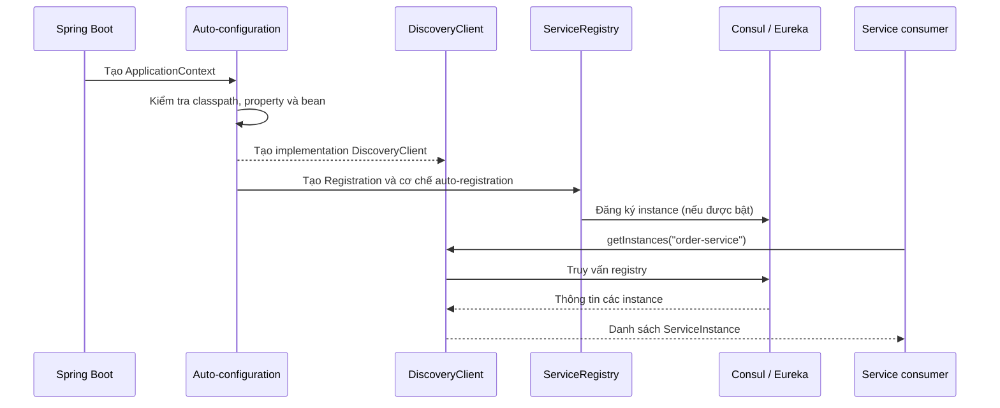

# Vai trò của @EnableDiscoveryClient và điều kiện tự cấu hình

Spring Cloud cung cấp `DiscoveryClient` như một API chung để ứng dụng tìm các instance theo tên service. Ứng dụng có thể dùng cùng cách gọi đó dù registry phía sau là Consul, Eureka, Zookeeper hoặc một implementation khác. Spring Boot và Spring Cloud tự tạo các bean cần thiết thông qua auto-configuration khi dependency và điều kiện cấu hình phù hợp.

`@EnableDiscoveryClient` là annotation gắn với cơ chế discovery của Spring Cloud. Trong các phiên bản Spring Cloud hiện đại, annotation này thường không còn bắt buộc để kích hoạt discovery: starter trên classpath cùng auto-configuration đã đủ để đăng ký implementation. Hiểu rõ vai trò của annotation và các điều kiện tự cấu hình giúp bạn biết vì sao `DiscoveryClient` xuất hiện, vì sao service được đăng ký, và cách tắt từng phần khi cần.

## 1. DiscoveryClient nằm ở đâu trong ứng dụng?

`DiscoveryClient` thuộc Spring Cloud Commons. Đây là abstraction cho thao tác tìm instance theo service ID, ví dụ `order-service`. Implementation cụ thể đến từ thư viện tích hợp registry.

```mermaid
flowchart TD
    APP[Spring Boot application]
    AUTO[@SpringBootApplication / EnableAutoConfiguration]
    CONDITIONS[Auto-configuration conditions]
    COMMONS[Spring Cloud Commons]
    DC[DiscoveryClient API]
    IMPL[Registry implementation]
    REG[ServiceRegistry / Registration]
    BACKEND[(Consul / Eureka / registry khác)]
    CALLER[Application code]

    APP --> AUTO --> CONDITIONS
    CONDITIONS --> COMMONS --> DC
    CONDITIONS --> IMPL --> DC
    IMPL --> REG --> BACKEND
    CALLER --> DC
```

Các thành phần có trách nhiệm khác nhau:

- **`DiscoveryClient`** cung cấp API để lấy danh sách `ServiceInstance` theo tên service.
- **Implementation** như Consul Discovery hoặc Eureka Client kết nối với registry tương ứng và chuyển dữ liệu registry thành `ServiceInstance`.
- **`ServiceRegistry`** cung cấp thao tác đăng ký, hủy đăng ký hoặc truy vấn registration theo implementation.
- **`Registration`** mô tả thông tin instance cần đăng ký, chẳng hạn service ID, host, port và metadata.
- **Auto-configuration** tạo các bean trên khi điều kiện phù hợp được đáp ứng.

`DiscoveryClient` không tự tạo ra registry server. Thêm dependency Consul Discovery không có nghĩa là Consul Server đã được cài đặt hoặc khởi động; ứng dụng vẫn cần một registry có thể truy cập và cấu hình địa chỉ kết nối đúng.

## 2. Vai trò của @EnableDiscoveryClient

Annotation `@EnableDiscoveryClient` thuộc Spring Cloud Commons và có thể đặt trên class cấu hình hoặc class ứng dụng:

```java
import org.springframework.boot.SpringApplication;
import org.springframework.boot.autoconfigure.SpringBootApplication;
import org.springframework.cloud.client.discovery.EnableDiscoveryClient;

@SpringBootApplication
@EnableDiscoveryClient
public class OrderApplication {

    public static void main(String[] args) {
        SpringApplication.run(OrderApplication.class, args);
    }
}
```

Annotation này biểu thị ý định bật khả năng discovery và trong một số phiên bản/cách tích hợp còn điều khiển hành vi tự đăng ký. Tuy nhiên, với Spring Cloud hiện đại, `@EnableDiscoveryClient` thường là tùy chọn: nếu ứng dụng đã có `@SpringBootApplication`, dependency discovery phù hợp và các điều kiện auto-configuration được đáp ứng, implementation có thể được cấu hình mà không cần thêm annotation này.

Do đó, hai cách viết sau thường có cùng kết quả trong một ứng dụng Spring Boot dùng starter discovery hiện đại:

```java
// Cách thông dụng: auto-configuration phát hiện implementation trên classpath.
@SpringBootApplication
public class OrderApplication {
    public static void main(String[] args) {
        SpringApplication.run(OrderApplication.class, args);
    }
}
```

```java
// Có thể giữ annotation để thể hiện rõ ý định dùng discovery.
@SpringBootApplication
@EnableDiscoveryClient
public class OrderApplication {
    public static void main(String[] args) {
        SpringApplication.run(OrderApplication.class, args);
    }
}
```

Điều này phụ thuộc phiên bản Spring Cloud và starter đang sử dụng. Với dự án cũ, annotation có thể là một phần cần thiết của cấu hình. Khi nâng cấp, hãy đối chiếu tài liệu của release train tương ứng trước khi xóa annotation hoặc thay đổi hành vi đăng ký.

### 2.1. Thuộc tính autoRegister

`@EnableDiscoveryClient` có thuộc tính `autoRegister` trong các phiên bản cung cấp thuộc tính này. Ví dụ:

```java
@SpringBootApplication
@EnableDiscoveryClient(autoRegister = false)
public class OrderApplication {
    public static void main(String[] args) {
        SpringApplication.run(OrderApplication.class, args);
    }
}
```

Thiết lập này biểu thị ứng dụng không tự đăng ký instance khi khởi động theo cơ chế gắn với annotation. Nó hữu ích khi ứng dụng chỉ cần truy vấn service hoặc việc đăng ký được quản lý ở một bước triển khai khác. Hành vi chính xác cần được kiểm tra theo phiên bản Spring Cloud đang dùng; trong cấu hình hiện đại, có thể dùng property chung hoặc property riêng của registry để điều khiển auto-registration.

Không nên nhầm `autoRegister = false` với việc tắt toàn bộ discovery. Ứng dụng vẫn có thể cần `DiscoveryClient` để tìm instance của service khác.

## 3. Điều kiện để auto-configuration tạo DiscoveryClient

Auto-configuration không tạo mọi bean trong mọi tình huống. Spring Boot đánh giá các điều kiện trước khi nạp cấu hình. Với discovery, các điều kiện thường gặp gồm:

### 3.1. Có dependency implementation trên classpath

Spring Cloud Commons cung cấp abstraction, còn starter cụ thể mang implementation và metadata auto-configuration tương ứng. Ví dụ dependency Maven:

```xml
<dependencies>
    <!-- Tích hợp Consul -->
    <dependency>
        <groupId>org.springframework.cloud</groupId>
        <artifactId>spring-cloud-starter-consul-discovery</artifactId>
    </dependency>

    <!-- Spring Boot Actuator để cung cấp endpoint vận hành/health -->
    <dependency>
        <groupId>org.springframework.boot</groupId>
        <artifactId>spring-boot-starter-actuator</artifactId>
    </dependency>
</dependencies>
```

Nếu muốn dùng Eureka, ứng dụng cần starter Eureka Client tương ứng thay cho starter Consul. Không thêm nhiều starter registry một cách tùy tiện: nếu nhiều implementation cùng có mặt, cần hiểu cơ chế composite, thứ tự ưu tiên và cấu hình của từng implementation.

Phiên bản Spring Boot và Spring Cloud phải tương thích theo release train. Thông thường, quản lý phiên bản bằng Spring Cloud BOM thay vì tự gán version rời rạc cho từng starter.

### 3.2. Ứng dụng bật auto-configuration

`@SpringBootApplication` bao gồm `@EnableAutoConfiguration`, vì vậy Spring Boot có thể tìm và đánh giá các cấu hình tự động do starter cung cấp.

Nếu ứng dụng không dùng `@SpringBootApplication`, cần bảo đảm có cơ chế kích hoạt auto-configuration tương ứng. Chỉ import `DiscoveryClient` interface hoặc thêm `@EnableDiscoveryClient` không thể thay thế toàn bộ quá trình nạp auto-configuration của Spring Boot.

### 3.3. Các điều kiện classpath, property và bean

Auto-configuration thường dùng các annotation điều kiện:

| Điều kiện | Ý nghĩa trong auto-configuration |
| --- | --- |
| `@ConditionalOnClass` | Chỉ áp dụng cấu hình khi class cần thiết có trên classpath. |
| `@ConditionalOnProperty` | Chỉ áp dụng khi property có giá trị phù hợp; có thể dùng `matchIfMissing` để quy định mặc định. |
| `@ConditionalOnMissingBean` | Chỉ tạo bean mặc định nếu ứng dụng chưa cung cấp bean tương ứng. |
| `@ConditionalOnBean` | Chỉ áp dụng khi một bean phụ thuộc đã tồn tại. |

Ví dụ khái quát về một cấu hình có điều kiện:

```java
@Configuration(proxyBeanMethods = false)
@ConditionalOnClass(ConsulClient.class)
@ConditionalOnProperty(
    name = "spring.cloud.consul.enabled",
    havingValue = "true",
    matchIfMissing = true
)
class ExampleConsulConfiguration {
    // Các bean tích hợp Consul được khai báo tại đây.
}
```

Đây là ví dụ minh họa cách hoạt động của các condition, không phải cấu hình nội bộ nguyên bản của mọi phiên bản Spring Cloud Consul. Tên property và điều kiện thực tế do starter cụ thể quyết định.

### 3.4. Discovery và auto-registration có thể được điều khiển riêng

Một số property thường dùng để điều khiển hai hành vi khác nhau:

```yaml
spring:
  cloud:
    discovery:
      enabled: true
    service-registry:
      auto-registration:
        enabled: true
    consul:
      discovery:
        register: true
```

- `spring.cloud.discovery.enabled` điều khiển việc bật discovery ở mức Spring Cloud. Khi đặt `false`, các cấu hình discovery liên quan có thể bị vô hiệu hóa.
- `spring.cloud.service-registry.auto-registration.enabled` điều khiển cơ chế tự đăng ký service chung khi implementation hỗ trợ auto-registration.
- `spring.cloud.consul.discovery.register` điều khiển đăng ký service của Consul Discovery.

Các property chung và property riêng của implementation không hoàn toàn thay thế nhau. Ví dụ, tắt đăng ký Consul không nhất thiết đồng nghĩa tắt khả năng truy vấn Consul. Hãy kiểm tra tài liệu theo phiên bản để xác nhận property được hỗ trợ và điều kiện nào bị ảnh hưởng.

## 4. DiscoveryClient và đăng ký service trong vòng đời ứng dụng

Khi ứng dụng khởi động, Spring Boot tạo application context và đánh giá auto-configuration. Nếu dependency và property hợp lệ, implementation discovery được tạo. Nếu auto-registration được bật và có `ServiceRegistry` cùng `Registration`, cơ chế đăng ký có thể gửi thông tin instance tới registry.



Ví dụ sử dụng `DiscoveryClient` qua constructor injection:

```java
import java.util.List;

import org.springframework.cloud.client.ServiceInstance;
import org.springframework.cloud.client.discovery.DiscoveryClient;
import org.springframework.web.bind.annotation.GetMapping;
import org.springframework.web.bind.annotation.RestController;

@RestController
public class DiscoveryController {

    private final DiscoveryClient discoveryClient;

    public DiscoveryController(DiscoveryClient discoveryClient) {
        this.discoveryClient = discoveryClient;
    }

    @GetMapping("/discovery/orders")
    public List<ServiceInstance> findOrders() {
        return discoveryClient.getInstances("order-service");
    }
}
```

`getInstances("order-service")` trả về danh sách instance mà implementation tìm được. Danh sách rỗng có thể có nghĩa service chưa đăng ký, health check khiến instance bị lọc, consumer chưa kết nối đúng registry, hoặc tên service không khớp. API không tự chọn một instance duy nhất và cũng không tự thực hiện HTTP call tới instance đó.

Nếu cần chọn instance để gọi service, có thể kết hợp Spring Cloud LoadBalancer. DiscoveryClient cung cấp thông tin instance; LoadBalancer quyết định instance nào được chọn theo cấu hình và chính sách cân bằng tải.

## 5. Khi có nhiều DiscoveryClient implementation

Một ứng dụng thường chỉ cần một registry chính. Tuy nhiên, có tình huống classpath chứa nhiều implementation, chẳng hạn vừa có Consul Discovery vừa có Eureka Client. Spring Cloud có thể cung cấp cơ chế composite để tổng hợp nhiều `DiscoveryClient`; thứ tự các implementation ảnh hưởng tới thứ tự tìm kiếm hoặc kết quả tổng hợp.

Trong tình huống này:

- Kiểm tra dependency tree để biết starter nào đang được kéo vào trực tiếp hoặc gián tiếp.
- Xác định rõ registry nào chịu trách nhiệm đăng ký service.
- Đọc thứ tự `DiscoveryClient` và hành vi `CompositeDiscoveryClient` của release train đang sử dụng.
- Tránh để cùng một instance đăng ký ngoài ý muốn vào nhiều registry.
- Nếu chỉ muốn dùng một implementation, loại bỏ starter thừa hoặc tắt auto-configuration theo hướng dẫn của thư viện đó.

Khi không có registry client cụ thể, Spring Cloud có thể dùng `SimpleDiscoveryClient` như một lựa chọn dựa trên cấu hình tĩnh trong những trường hợp được hỗ trợ. Đây không phải registry phân tán có khả năng tự phát hiện instance động; danh sách instance phải được khai báo trong cấu hình.

## 6. Kiểm tra vì sao auto-configuration được bật hoặc bỏ qua

Khi ứng dụng không có bean `DiscoveryClient`, không nên bắt đầu bằng cách thêm annotation một cách ngẫu nhiên. Hãy kiểm tra lần lượt:

1. Dependency starter có nằm trong runtime classpath không?
2. Spring Boot và Spring Cloud có dùng release train tương thích không?
3. Ứng dụng có bật `@EnableAutoConfiguration` thông qua `@SpringBootApplication` không?
4. Property discovery có bị đặt thành `false` trong file, profile hoặc biến môi trường không?
5. Registry host, port, credential và network route có hợp lệ không?
6. Có cấu hình loại trừ auto-configuration hoặc bean tùy chỉnh nào làm thay đổi điều kiện không?

Chạy ứng dụng với debug để xem Condition Evaluation Report:

```bash
java -jar target/order-service.jar --debug
```

Report cho biết auto-configuration nào được áp dụng và vì sao một cấu hình khác bị bỏ qua, chẳng hạn thiếu class trên classpath hoặc property không khớp.

Nếu dùng Actuator, endpoint `conditions` cũng có thể hỗ trợ kiểm tra condition report. Chỉ expose và bảo vệ endpoint này trong môi trường quản trị phù hợp; không mở công khai vì thông tin có thể tiết lộ cấu trúc và cấu hình nội bộ của ứng dụng.

## 7. Các lỗi thường gặp

| Hiện tượng | Nguyên nhân cần kiểm tra | Hướng xử lý |
| --- | --- | --- |
| Không inject được `DiscoveryClient` | Thiếu Spring Cloud Commons/implementation phù hợp hoặc auto-configuration bị tắt | Kiểm tra dependency tree, `@SpringBootApplication` và các property discovery. |
| Có `DiscoveryClient` nhưng không tìm thấy instance | Service chưa đăng ký, sai service ID, registry chưa đồng bộ hoặc instance bị health check lọc | Kiểm tra service ID, registry UI/API và trạng thái health check. |
| Ứng dụng khởi động nhưng không tự đăng ký | Auto-registration bị tắt hoặc không có `ServiceRegistry`/`Registration` phù hợp | Kiểm tra property chung và property riêng của registry. |
| Thêm `@EnableDiscoveryClient` nhưng lỗi vẫn còn | Lỗi thực tế nằm ở dependency, condition, địa chỉ registry hoặc network | Đọc Condition Evaluation Report và log của registry client. |
| Hai registry cùng được kích hoạt | Nhiều starter nằm trên classpath hoặc dependency bắc cầu kéo vào | Rà soát dependency tree, cấu hình rõ registry được dùng và thứ tự nếu cần composite. |
| Chạy được local nhưng không discovery được trong Docker | Cấu hình host dùng `localhost` trong container hoặc network không thông nhau | Dùng hostname/DNS của service registry trong network Docker và kiểm tra port. |

## 8. Nguyên tắc sử dụng trong dự án

- Giữ `@SpringBootApplication` làm điểm khởi động để Spring Boot thực hiện component scan và auto-configuration.
- Thêm đúng starter registry mà ứng dụng cần; quản lý version bằng BOM tương thích.
- Chỉ thêm `@EnableDiscoveryClient` khi phiên bản hoặc quy ước dự án yêu cầu, hoặc khi muốn thể hiện rõ ý định trong mã nguồn.
- Phân biệt discovery lookup với auto-registration; tắt một hành vi không nhất thiết phải tắt hành vi còn lại.
- Dùng `DiscoveryClient` để lấy danh sách instance; dùng LoadBalancer khi cần lựa chọn instance cho lời gọi dịch vụ.
- Khi auto-configuration không hoạt động, kiểm tra condition report và property source trước khi viết cấu hình thủ công.
- Không xem annotation là giải pháp thay thế cho registry server, network, health check hoặc cấu hình bảo mật.

## 9. Ghi nhớ

- `DiscoveryClient` là abstraction của Spring Cloud Commons; starter cụ thể cung cấp implementation cho Consul, Eureka hoặc registry khác.
- `@EnableDiscoveryClient` có thể dùng để biểu thị/bật discovery, nhưng trong các phiên bản Spring Cloud hiện đại thường không bắt buộc nếu auto-configuration đã được kích hoạt.
- Auto-configuration phụ thuộc classpath, property, bean và `@EnableAutoConfiguration` của Spring Boot.
- Discovery lookup và service auto-registration là hai hành vi khác nhau, có thể được điều khiển bằng các property tương ứng.
- Dùng `--debug` để đọc Condition Evaluation Report khi cần biết vì sao một bean được tạo hoặc bị bỏ qua.

Khi hiểu các điều kiện tự cấu hình, bạn có thể giữ cấu hình discovery gọn, xác định đúng nguyên nhân khi bean không xuất hiện và tránh thêm annotation hoặc dependency không cần thiết vào ứng dụng Spring Cloud.
