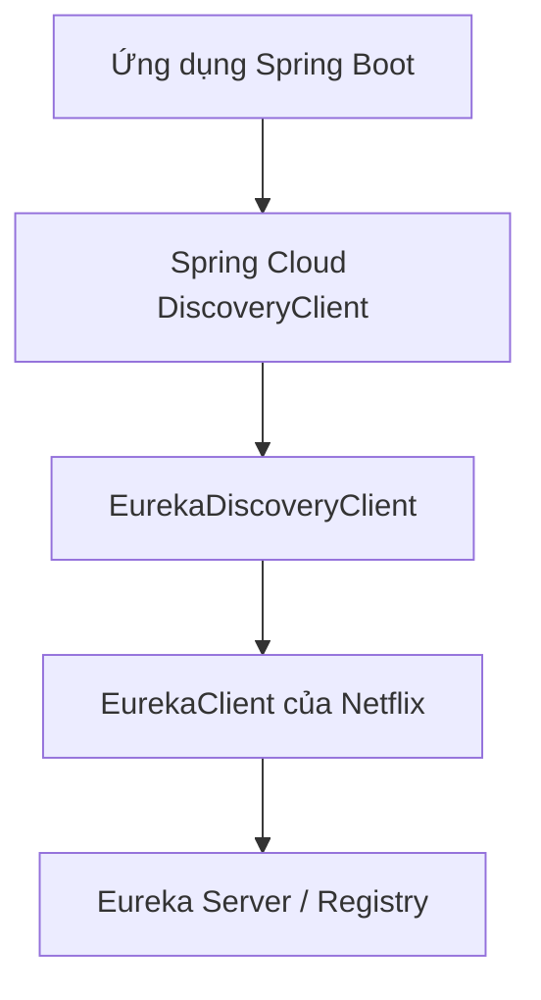

# Phân biệt `DiscoveryClient` của Spring Cloud và `EurekaClient` của Netflix

## 1. Hai API giải quyết cùng nhu cầu ở hai mức khác nhau

Trong microservice, một service consumer cần tìm các instance đang cung cấp một service theo tên logic, chẳng hạn `inventory-service`. Spring Cloud và Netflix Eureka đều có API để thực hiện việc tra cứu này, nhưng hai API thuộc hai tầng khác nhau:

- **`DiscoveryClient` của Spring Cloud** là abstraction do Spring Cloud Commons định nghĩa. Ứng dụng dùng interface này để truy vấn service instance mà không phải phụ thuộc trực tiếp vào Eureka, Consul hay một registry cụ thể.
- **`EurekaClient` của Netflix** là API thuộc thư viện Eureka Client. Nó làm việc trực tiếp với mô hình và kiểu dữ liệu của Eureka, chẳng hạn `Application`, `InstanceInfo`, VIP address và region.

Khi ứng dụng dùng Eureka qua Spring Cloud, một adapter có tên **`EurekaDiscoveryClient`** kết nối hai tầng: nó triển khai interface `DiscoveryClient` và chuyển các thao tác discovery sang Eureka Client bên dưới. Vì vậy, `DiscoveryClient` và `EurekaClient` không phải hai tên gọi khác nhau cho cùng một interface.

## 2. Vị trí trong kiến trúc và package

Các kiểu quan trọng thường gặp:

| Kiểu | Package | Vai trò |
|---|---|---|
| `DiscoveryClient` | `org.springframework.cloud.client.discovery` | Interface discovery chung của Spring Cloud |
| `ServiceInstance` | `org.springframework.cloud.client` | Mô tả instance theo abstraction của Spring Cloud |
| `EurekaClient` | `com.netflix.discovery` | API client chuyên biệt của Netflix Eureka |
| `Application` | `com.netflix.discovery.shared` | Nhóm các instance của một ứng dụng trong registry Eureka |
| `InstanceInfo` | `com.netflix.appinfo` | Bản ghi instance cụ thể của Eureka |
| `EurekaDiscoveryClient` | `org.springframework.cloud.netflix.eureka` | Adapter triển khai Spring Cloud `DiscoveryClient` trên Eureka |

Luồng phụ thuộc có thể hình dung như sau:



Ứng dụng gọi interface Spring Cloud. Adapter của Spring Cloud chuyển yêu cầu thành thao tác trên Eureka Client; Eureka Client giao tiếp với Eureka Server và trả dữ liệu cho adapter chuyển thành `ServiceInstance`.

## 3. `DiscoveryClient` của Spring Cloud

### 3.1. Mục đích và các thao tác chính

`DiscoveryClient` thuộc Spring Cloud Commons, là hợp đồng chung để truy vấn danh sách service và các instance của một service. Các thao tác đồng bộ thường dùng gồm:

| Phương thức | Ý nghĩa |
|---|---|
| `getServices()` | Lấy danh sách service ID mà registry hiện biết |
| `getInstances(serviceId)` | Lấy các instance thuộc service ID được yêu cầu |
| `description()` | Trả về mô tả implementation discovery |

Kết quả `getInstances` là danh sách `ServiceInstance`, không phải kiểu riêng của Eureka. Một `ServiceInstance` thường cung cấp service ID, instance ID, host, port, URI, trạng thái secure và metadata. Những thông tin này đủ cho nhiều use case như hiển thị danh sách instance, kiểm tra endpoint hoặc kết hợp với load balancer.

### 3.2. Ví dụ sử dụng

```java
import java.util.List;

import org.springframework.cloud.client.ServiceInstance;
import org.springframework.cloud.client.discovery.DiscoveryClient;
import org.springframework.stereotype.Service;

@Service
public class InventoryLookup {

    private final DiscoveryClient discoveryClient;

    public InventoryLookup(DiscoveryClient discoveryClient) {
        this.discoveryClient = discoveryClient;
    }

    public List<ServiceInstance> findInventoryInstances() {
        return discoveryClient.getInstances("inventory-service");
    }
}
```

Đoạn mã chỉ phụ thuộc vào Spring Cloud Commons. Nếu dự án thay Eureka bằng Consul và cấu hình starter tương ứng, phần code gọi `DiscoveryClient` có thể giữ nguyên. Spring Cloud sẽ cung cấp implementation phù hợp với registry đang cấu hình.

Ví dụ liệt kê các service đã biết:

```java
List<String> serviceIds = discoveryClient.getServices();

for (String serviceId : serviceIds) {
    List<ServiceInstance> instances = discoveryClient.getInstances(serviceId);
    System.out.printf("%s: %d instance(s)%n", serviceId, instances.size());
}
```

Danh sách trả về phản ánh dữ liệu mà implementation discovery đang cung cấp tại thời điểm truy vấn. Nó không đảm bảo mọi instance đều khỏe hoặc request đến instance sẽ thành công; ứng dụng vẫn cần timeout, retry, health/readiness policy và xử lý lỗi phù hợp.

### 3.3. Khi cần reactive API

Với ứng dụng reactive, Spring Cloud Commons còn có abstraction `ReactiveDiscoveryClient` trong package `org.springframework.cloud.client.discovery`. Đây là API reactive riêng, thường trả về `Flux` thay vì `List`. Không nên nhầm interface reactive này với `DiscoveryClient` đồng bộ; hãy chọn API phù hợp với mô hình xử lý của ứng dụng và implementation được cấu hình.

## 4. `EurekaClient` của Netflix

### 4.1. Mục đích và dữ liệu riêng của Eureka

`com.netflix.discovery.EurekaClient` thuộc thư viện Netflix Eureka Client. API này hiểu trực tiếp cách Eureka tổ chức registry:

- `Application` đại diện cho một nhóm instance của ứng dụng.
- `InstanceInfo` đại diện cho một instance, gồm app name, instance ID, địa chỉ, port, status, metadata và các URL liên quan.
- VIP address và secure VIP address là các định danh được Eureka dùng trong một số thao tác tra cứu.
- Region và availability zone là các khái niệm cấu hình của Eureka trong triển khai nhiều vùng.

`EurekaClient` cung cấp các thao tác tra cứu như lấy `Application`, lấy danh sách `Application`, tìm instance theo ID hoặc VIP address và lấy một server tiếp theo theo VIP. Nó cũng tham gia vào vòng đời client và các hoạt động riêng của Eureka. Chi tiết API có thể thay đổi theo phiên bản thư viện, vì vậy cần xem Javadoc đúng phiên bản đang dùng.

### 4.2. Ví dụ tra cứu trực tiếp

Khi ứng dụng thực sự cần thông tin riêng của Eureka, có thể inject `EurekaClient`:

```java
import java.util.List;

import com.netflix.appinfo.InstanceInfo;
import com.netflix.discovery.EurekaClient;
import com.netflix.discovery.shared.Application;
import org.springframework.stereotype.Service;

@Service
public class EurekaInventoryLookup {

    private final EurekaClient eurekaClient;

    public EurekaInventoryLookup(EurekaClient eurekaClient) {
        this.eurekaClient = eurekaClient;
    }

    public List<InstanceInfo> findInventoryInstances() {
        Application application = eurekaClient.getApplication("INVENTORY-SERVICE");
        if (application == null) {
            return List.of();
        }
        return application.getInstances();
    }
}
```

Ví dụ dùng tên ứng dụng theo cách Eureka lưu trong registry, thường được chuẩn hóa thành chữ hoa. Hãy xác minh app name thực tế và API theo phiên bản Eureka Client của dự án. `InstanceInfo` là kiểu của Netflix, nên code gọi trực tiếp API này phụ thuộc vào Eureka.

Một số ứng dụng còn cần các thao tác cụ thể như tra cứu theo VIP address hoặc đọc metadata/instance status từ `InstanceInfo`. Đây là những tình huống mà API Netflix có thể cung cấp thông tin trực tiếp hơn abstraction chung.

## 5. `EurekaDiscoveryClient` là cầu nối, không phải `EurekaClient`

Khi thêm Spring Cloud Netflix Eureka Client starter, Spring Cloud cấu hình Eureka client và adapter discovery. `EurekaDiscoveryClient` triển khai interface `DiscoveryClient`; nó chuyển dữ liệu Eureka như `InstanceInfo` sang kiểu Spring Cloud `ServiceInstance`.

Ví dụ về ánh xạ khái niệm:

| Dữ liệu Eureka | Dữ liệu Spring Cloud |
|---|---|
| App name | `ServiceInstance.getServiceId()` |
| Instance ID | `ServiceInstance.getInstanceId()` |
| Host/IP và port | `getHost()` và `getPort()` |
| Secure flag / URI | `isSecure()` và `getUri()` |
| Metadata | `getMetadata()` |

Nhờ adapter, một service có thể gọi `DiscoveryClient` mà không biết registry thực tế là Eureka. Nếu đổi sang Consul, implementation phía dưới thay đổi; code phụ thuộc abstraction vẫn có cơ hội giữ nguyên.

Điều này không có nghĩa các registry có semantics hoàn toàn giống nhau. Metadata, trạng thái health, độ trễ cập nhật, tính nhất quán và cách xử lý khi registry mất kết nối vẫn phụ thuộc implementation. Abstraction giúp giảm coupling ở tầng API, không loại bỏ mọi khác biệt vận hành.

## 6. So sánh trực tiếp

| Tiêu chí | Spring Cloud `DiscoveryClient` | Netflix `EurekaClient` |
|---|---|---|
| Tầng abstraction | API chung của Spring Cloud Commons | API chuyên biệt của Eureka |
| Package | `org.springframework.cloud.client.discovery` | `com.netflix.discovery` |
| Kiểu dữ liệu instance | `ServiceInstance` | `InstanceInfo` |
| Cách tra cứu | Theo service ID qua `getInstances` | Theo Application, instance ID, VIP address hoặc API Eureka tương ứng |
| Phụ thuộc registry | Có thể dùng với nhiều implementation discovery | Chỉ dùng với Eureka |
| Coupling trong code | Thấp hơn với nhà cung cấp registry | Cao hơn vì dùng trực tiếp model và semantics của Eureka |
| Use case | Tra cứu instance phục vụ logic ứng dụng thông thường | Tính năng yêu cầu API, metadata hoặc trạng thái riêng của Eureka |
| Khả năng thay registry | Thuận lợi hơn, nhưng vẫn cần kiểm tra semantics và cấu hình | Thường phải sửa code khi chuyển sang registry khác |

Một điểm quan trọng: `DiscoveryClient` chủ yếu phục vụ **đọc thông tin discovery**. Việc đăng ký/hủy đăng ký ở mức Spring thường liên quan đến `ServiceRegistry` và lifecycle auto-configuration của starter. Không nên hiểu rằng inject `DiscoveryClient` đồng nghĩa ứng dụng đang tự đăng ký instance.

## 7. Kết hợp với Spring Cloud LoadBalancer

Tra cứu danh sách instance và chọn instance để gửi request là hai bước khác nhau. `DiscoveryClient` có thể trả về nhiều `ServiceInstance`; ứng dụng thường không nên tự lấy phần tử đầu tiên rồi gọi trực tiếp vì cách đó không có chiến lược cân bằng tải, retry hoặc xử lý instance lỗi đầy đủ.

Với Spring Cloud, có thể dùng `@LoadBalanced` `RestClient.Builder`, `RestTemplate` hoặc `WebClient.Builder` phù hợp với phiên bản và stack ứng dụng. Ví dụ với `RestClient`:

```java
@Configuration
public class HttpClientConfiguration {

    @Bean
    @LoadBalanced
    RestClient.Builder loadBalancedRestClientBuilder() {
        return RestClient.builder();
    }
}
```

Sau đó gọi bằng service ID:

```java
@Service
public class InventoryServiceClient {

    private final RestClient restClient;

    public InventoryServiceClient(RestClient.Builder loadBalancedRestClientBuilder) {
        this.restClient = loadBalancedRestClientBuilder.build();
    }

    public String getStock(String sku) {
        return restClient.get()
                .uri("http://inventory-service/api/stock/{sku}", sku)
                .retrieve()
                .body(String.class);
    }
}
```

`@LoadBalanced` đánh dấu builder để Spring Cloud LoadBalancer phân giải host `inventory-service` qua discovery và chọn instance. Cấu hình bean và API builder cần khớp phiên bản Spring Boot/Spring Framework mà dự án sử dụng; với ứng dụng cũ có thể đang dùng `RestTemplate` hoặc `WebClient`.

Khi dùng load balancer, ứng dụng không cần inject `EurekaClient` để chọn server. Discovery implementation cung cấp danh sách instance, còn Spring Cloud LoadBalancer quyết định instance được dùng cho request theo cấu hình chiến lược.

## 8. Chọn API nào trong ứng dụng?

**Ưu tiên `DiscoveryClient` khi:**

- Code nghiệp vụ chỉ cần tìm service theo tên và lấy host, port, URI hoặc metadata cơ bản.
- Muốn giữ code ít phụ thuộc vào registry để dễ thay Eureka bằng Consul hoặc implementation khác.
- Đang xây thư viện hoặc module dùng chung trong nhiều ứng dụng Spring Cloud.
- Muốn kết hợp discovery với Spring Cloud LoadBalancer.

**Dùng `EurekaClient` trực tiếp khi:**

- Cần truy cập dữ liệu hoặc thao tác chỉ có trong API Eureka, chẳng hạn `Application`, `InstanceInfo`, VIP address, region hoặc API sự kiện riêng.
- Đang viết thành phần tích hợp sâu với Eureka hoặc công cụ vận hành registry.
- Chấp nhận dependency trực tiếp vào Netflix Eureka và có kế hoạch kiểm tra tương thích khi nâng cấp.

Không nên dùng `EurekaClient` chỉ vì dự án hiện tại đang chạy Eureka. Nếu nhu cầu chỉ là lấy instance, abstraction Spring Cloud thường đủ và giúp code dễ thay đổi hơn.

## 9. Dependency và cấu hình cơ bản

Để dùng `DiscoveryClient` với Eureka trong Spring Cloud, dự án thường thêm starter sau và quản lý phiên bản bằng Spring Cloud BOM tương thích với Spring Boot:

```xml
<dependency>
    <groupId>org.springframework.cloud</groupId>
    <artifactId>spring-cloud-starter-netflix-eureka-client</artifactId>
</dependency>
```

Cấu hình tối thiểu phía client:

```yaml
spring:
  application:
    name: checkout-service

eureka:
  client:
    service-url:
      defaultZone: http://localhost:8761/eureka/
    register-with-eureka: true
    fetch-registry: true
```

Starter Eureka Client cung cấp implementation để Spring inject `DiscoveryClient`, đồng thời cấu hình Netflix Eureka Client. Trong cấu hình thông thường, client đăng ký ứng dụng và tải registry; nếu chỉ cần một trong hai chức năng, có thể điều chỉnh hai cờ tương ứng.

Nếu thay bằng Consul, starter và cấu hình Consul discovery sẽ cung cấp implementation khác cho abstraction Spring. Phần code dùng `org.springframework.cloud.client.discovery.DiscoveryClient` vẫn giữ nguyên nếu chỉ dùng các thao tác chung.

## 10. Các lỗi hiểu nhầm thường gặp

| Hiểu nhầm | Cách hiểu đúng |
|---|---|
| `DiscoveryClient` chính là `EurekaClient` | Một bên là abstraction của Spring Cloud, một bên là API riêng của Netflix Eureka |
| `EurekaDiscoveryClient` và `EurekaClient` là cùng một class | `EurekaDiscoveryClient` là adapter Spring triển khai `DiscoveryClient` và sử dụng Eureka phía dưới |
| Có `DiscoveryClient` nghĩa là instance tự đăng ký | DiscoveryClient dùng để truy vấn; đăng ký do ServiceRegistry/lifecycle của client implementation đảm nhiệm |
| `getInstances()` trả về danh sách instance chắc chắn khỏe | Kết quả phụ thuộc registry, cache và health policy; cần xử lý lỗi khi gọi thực tế |
| DiscoveryClient tự cân bằng tải request | Nó cung cấp instance; Spring Cloud LoadBalancer hoặc thành phần tương đương chọn instance cho request |
| Dùng DiscoveryClient thì đổi registry không cần sửa gì | Code gọi API chung dễ giữ nguyên, nhưng dependency, cấu hình và semantics vẫn cần đánh giá |

## 11. Kết luận

`DiscoveryClient` là lựa chọn phù hợp cho phần lớn code Spring Cloud cần tra cứu service vì nó tách logic ứng dụng khỏi nhà cung cấp registry. `EurekaClient` phù hợp khi cần dùng sâu các khái niệm và API riêng của Netflix Eureka. `EurekaDiscoveryClient` là adapter giúp Spring Cloud triển khai abstraction chung trên Eureka.

Khi thiết kế ứng dụng, hãy dùng abstraction ở ranh giới nghiệp vụ và chỉ đi xuống API `EurekaClient` trong phần tích hợp thực sự cần tính năng riêng của Eureka. Cách phân tầng này giữ code dễ kiểm thử, giảm coupling và giúp việc thay đổi công nghệ discovery có phạm vi rõ ràng hơn.
