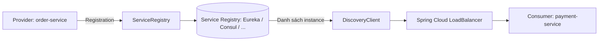
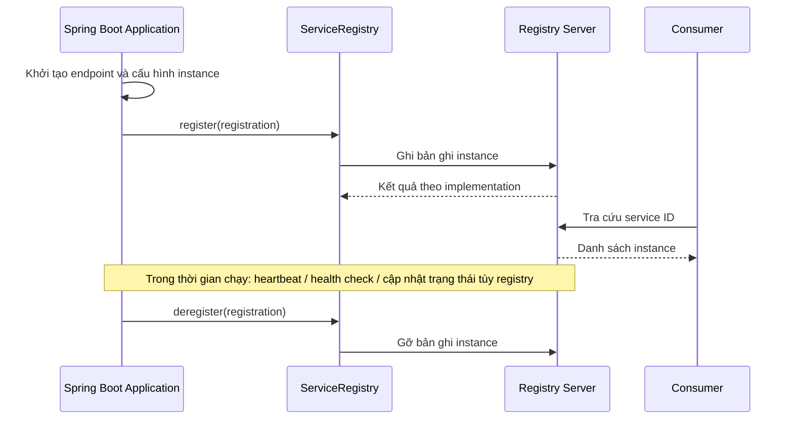

# Hợp đồng ServiceRegistry và đối tượng Registration

Trong Spring Cloud Service Discovery, một ứng dụng cần công bố các instance đang chạy để những ứng dụng khác có thể tìm thấy chúng bằng tên dịch vụ. Chẳng hạn, `order-service` có thể chạy trên nhiều máy hoặc nhiều container; `payment-service` cần lấy danh sách các instance của `order-service` thay vì phải biết trước địa chỉ IP và cổng của từng instance.

Spring Cloud cung cấp một lớp trừu tượng cho hai phía của quy trình này: phía ghi thông tin instance vào registry thông qua `ServiceRegistry`, và phía đọc thông tin instance thông qua `DiscoveryClient`. Bài học này tập trung vào hợp đồng `ServiceRegistry` và đối tượng `Registration`: chúng đại diện cho thao tác đăng ký, hủy đăng ký, thay đổi trạng thái và mô tả một instance dịch vụ như thế nào.

## 1. Vị trí của ServiceRegistry trong Service Discovery

Một registry lưu thông tin về các instance của những dịch vụ đang tham gia hệ thống. Thông tin thường gồm tên dịch vụ, địa chỉ host, cổng, giao thức và metadata. Ví dụ, registry có thể lưu ba instance của `order-service`:

| Service ID | Host | Port | Metadata minh họa |
|---|---|---:|---|
| `order-service` | `10.0.1.21` | 8080 | `zone=zone-a` |
| `order-service` | `10.0.1.22` | 8080 | `zone=zone-a` |
| `order-service` | `10.0.2.15` | 8080 | `zone=zone-b` |

Khi `order-service` khởi động, ứng dụng hoặc cơ chế tự động đăng ký của Spring Cloud công bố thông tin instance lên registry. Khi ứng dụng dừng, nó cần hủy đăng ký để các consumer không tiếp tục nhận một địa chỉ đã ngừng phục vụ. Trong thời gian hoạt động, registry hoặc client của registry có thể dùng heartbeat, health check hay cơ chế lease/TTL để phát hiện instance không còn khả dụng. Cách thực hiện cụ thể phụ thuộc vào nhà cung cấp registry.

Có thể nhìn Service Discovery thành hai luồng:



- **Luồng đăng ký:** ứng dụng cung cấp một đối tượng `Registration`; triển khai `ServiceRegistry` chuyển đối tượng đó thành bản ghi phù hợp với registry đang dùng.
- **Luồng khám phá:** `DiscoveryClient` truy vấn registry và trả về các `ServiceInstance` để consumer hoặc bộ cân bằng tải sử dụng.
- **Luồng gọi dịch vụ:** LoadBalancer lựa chọn một instance từ danh sách đã khám phá. Bản thân `ServiceRegistry` không lựa chọn instance cho từng request.

Vì vậy, `ServiceRegistry` là hợp đồng ở phía quản lý bản ghi, còn `DiscoveryClient` là hợp đồng ở phía tra cứu. Hai API liên quan với nhau nhưng đảm nhiệm hai trách nhiệm khác nhau.

## 2. Hợp đồng Registration

`Registration` nằm trong package `org.springframework.cloud.client.serviceregistry`. Đây là một interface mở rộng `ServiceInstance`:

```java
package org.springframework.cloud.client.serviceregistry;

import org.springframework.cloud.client.ServiceInstance;

public interface Registration extends ServiceInstance {
}
```

`Registration` không bổ sung một nhóm thuộc tính bắt buộc mới. Vai trò của nó là đánh dấu một `ServiceInstance` đang được dùng làm dữ liệu đăng ký với registry. Nhờ kế thừa `ServiceInstance`, một registration cung cấp các thông tin nền tảng để mô tả một địa chỉ dịch vụ.

| Thông tin | Ý nghĩa trong Service Discovery |
|---|---|
| `getServiceId()` | Tên logic của dịch vụ, ví dụ `order-service`; consumer dùng tên này để tra cứu. |
| `getHost()` | Host mà consumer có thể kết nối tới, chẳng hạn hostname hoặc địa chỉ IP có thể định tuyến trong mạng triển khai. |
| `getPort()` | Cổng mà instance nhận kết nối. |
| `isSecure()` | Cho biết instance sử dụng kết nối bảo mật hay không; thông tin này ảnh hưởng đến giao thức khi tạo URI. |
| `getUri()` | URI truy cập instance, thường kết hợp scheme, host và port. |
| `getMetadata()` | Các cặp khóa-giá trị bổ sung, chẳng hạn zone, phiên bản API hoặc nhóm triển khai. |

Các phương thức trên thuộc hợp đồng `ServiceInstance`. `Registration` kế thừa chúng để có thể được dùng trong thao tác đăng ký. Triển khai cụ thể có thể bổ sung dữ liệu riêng của nhà cung cấp, ví dụ instance ID, tag, cấu hình health check hoặc thông tin vùng. Những phần mở rộng này không phải là yêu cầu chung của `Registration`.

### 2.1. Service ID và instance ID

Hai khái niệm này giải quyết hai bài toán khác nhau:

- **Service ID** xác định nhóm dịch vụ logic. Nhiều instance cùng phục vụ một chức năng thường dùng chung service ID, ví dụ `order-service`.
- **Instance ID** xác định một bản chạy cụ thể trong nhóm đó. Cách biểu diễn và nơi cung cấp instance ID phụ thuộc vào registry hoặc lớp registration cụ thể.

Consumer thường tra cứu theo service ID rồi nhận về nhiều instance. Registry cần phân biệt được từng bản ghi instance để cập nhật, kiểm tra sức khỏe hoặc hủy đăng ký đúng bản ghi. Vì vậy, các instance cùng service ID vẫn cần danh tính riêng theo cơ chế của nhà cung cấp.

### 2.2. Metadata có chủ đích

Metadata bổ sung ngữ cảnh cho instance mà không làm thay đổi tên dịch vụ. Ví dụ:

```text
serviceId = order-service
host      = order-7.internal
port      = 8080
secure    = false
metadata  = {
  zone: "zone-b",
  version: "v2",
  team: "commerce"
}
```

Consumer, LoadBalancer hoặc bộ lọc tùy chỉnh có thể sử dụng metadata để áp dụng quy tắc định tuyến. Chẳng hạn, một consumer có thể ưu tiên instance trong cùng zone hoặc chỉ gọi instance có phiên bản tương thích.

Metadata nên nhỏ, ổn định và có ý nghĩa đối với consumer. Không đưa mật khẩu, token, khóa riêng hoặc dữ liệu nhạy cảm vào metadata vì registry có thể được nhiều thành phần trong hệ thống truy cập. Cũng cần thống nhất tên khóa và cách viết giá trị giữa các service; nếu một bên ghi `zone` còn bên kia đọc `availability-zone`, quy tắc lọc sẽ không hoạt động như mong muốn.

## 3. Hợp đồng ServiceRegistry

`ServiceRegistry` là interface tổng quát hóa thao tác ghi và quản lý registration. Hợp đồng Spring Cloud Commons có dạng:

```java
package org.springframework.cloud.client.serviceregistry;

public interface ServiceRegistry<R extends Registration> {

    void register(R registration);

    void deregister(R registration);

    void setStatus(R registration, Object status);

    Object getStatus(R registration);
}
```

Tham số kiểu `R extends Registration` ràng buộc đối tượng đầu vào phải là một registration. Mỗi nhà cung cấp có thể dùng lớp registration riêng, nhưng người dùng vẫn có thể nhận biết các thao tác chung qua interface này.

| Phương thức | Trách nhiệm | Câu hỏi vận hành cần trả lời |
|---|---|---|
| `register(R registration)` | Đăng ký instance với registry. | Instance đã có thể được consumer khám phá và kết nối chưa? |
| `deregister(R registration)` | Hủy đăng ký instance. | Instance đã ngừng nhận traffic và được gỡ khỏi registry chưa? |
| `setStatus(R registration, Object status)` | Cập nhật trạng thái theo mô hình của registry. | Trạng thái nào khiến instance được xem là đủ điều kiện nhận traffic? |
| `getStatus(R registration)` | Đọc trạng thái hiện tại theo mô hình của registry. | Registry đang ghi nhận instance ở trạng thái nào? |

### 3.1. register

`register` công bố một instance lên registry. Sau khi đăng ký thành công, consumer có thể nhận được instance đó khi truy vấn service ID tương ứng, tùy theo thời điểm đồng bộ và chính sách lọc của registry.

Đối tượng registration phải mô tả địa chỉ mà consumer thực sự truy cập được. Nếu ứng dụng chạy trong container nhưng đăng ký hostname chỉ phân giải được bên trong container, các consumer ở mạng khác có thể nhận một địa chỉ vô dụng. Tương tự, đăng ký nhầm cổng nội bộ thay vì cổng được expose sẽ khiến việc khám phá thành công nhưng lời gọi vẫn thất bại.

Interface trả về `void`, nên hợp đồng chung không định nghĩa một đối tượng kết quả đăng ký hoặc một instance ID dùng chung cho mọi registry. Cách báo lỗi, retry và xác nhận bản ghi phụ thuộc vào triển khai cụ thể. Ứng dụng cần quan sát log, metric và trạng thái registry thay vì giả định rằng lời gọi phương thức đã đồng nghĩa mọi consumer lập tức nhìn thấy instance.

### 3.2. deregister

`deregister` yêu cầu registry gỡ registration tương ứng. Thao tác này thường gắn với quá trình dừng ứng dụng hoặc thay thế một instance.

Một quy trình dừng có kiểm soát thường gồm các bước:

1. Ngừng nhận request mới hoặc chuyển instance sang trạng thái không nhận traffic.
2. Chờ các request đang xử lý hoàn tất trong khoảng thời gian graceful shutdown phù hợp.
3. Hủy đăng ký instance khỏi registry.
4. Đóng các tài nguyên của ứng dụng.

Thứ tự chính xác phụ thuộc vào nền tảng triển khai và tích hợp lifecycle. Nếu hủy đăng ký quá muộn, consumer có thể tiếp tục chọn instance đã dừng. Nếu hủy quá sớm, các request đang xử lý có thể bị gián đoạn. Với môi trường có orchestrator, cần phối hợp readiness probe, termination grace period và cơ chế deregistration của Spring Cloud.

### 3.3. setStatus và getStatus

Hai phương thức trạng thái cho phép thao tác với trạng thái của registration mà registry hỗ trợ. Tham số và giá trị trả về là `Object`, do đó API chung không áp đặt một enum trạng thái thống nhất cho tất cả nhà cung cấp.

Ví dụ, một registry có thể biểu diễn trạng thái bằng chuỗi hoặc enum riêng. Các trạng thái như `UP`, `DOWN`, `OUT_OF_SERVICE` hay `UNKNOWN` có thể xuất hiện trong một số tích hợp, nhưng ý nghĩa, tên gọi và tác động tới khả năng khám phá không được bảo đảm giống nhau ở mọi registry.

Do đó, khi sử dụng trạng thái:

- Kiểm tra kiểu dữ liệu và các giá trị mà implementation cụ thể chấp nhận.
- Xác minh trạng thái nào khiến instance bị loại khỏi kết quả khám phá hoặc bị bộ cân bằng tải bỏ qua.
- Không coi `getStatus` là một phép kiểm tra sức khỏe trực tiếp của tiến trình. Đây là trạng thái mà registry báo cáo theo cơ chế của nó.
- Phân biệt trạng thái do ứng dụng chủ động đặt với kết quả health check hoặc heartbeat do registry/client quản lý.

## 4. Liên hệ giữa Registration, ServiceInstance và DiscoveryClient

Ba kiểu dữ liệu/API thường xuất hiện cùng nhau nhưng không thể thay thế cho nhau:

| Thành phần | Vai trò | Hướng sử dụng chính |
|---|---|---|
| `Registration` | Mô tả instance được đưa vào quy trình đăng ký; mở rộng `ServiceInstance`. | Phía provider đăng ký hoặc cập nhật instance. |
| `ServiceInstance` | Mô tả một instance có thể được truy cập. | Kiểu dữ liệu chung cho thông tin instance. |
| `DiscoveryClient` | Tra cứu các instance theo service ID và danh sách dịch vụ đã biết. | Phía consumer khám phá dịch vụ. |
| `ServiceRegistry` | Thực hiện các thao tác quản lý registration. | Phía provider ghi và cập nhật registry. |

Ví dụ, `payment-service` gọi `DiscoveryClient` để lấy danh sách instance của `order-service`. Kết quả là các `ServiceInstance`, chứa URI và metadata của từng địa chỉ. Sau đó, Spring Cloud LoadBalancer có thể chọn một instance. Trong khi đó, mỗi bản chạy của `order-service` sử dụng registration tương ứng để công bố chính nó qua `ServiceRegistry`.

Điều này cũng giải thích vì sao chỉ thêm `DiscoveryClient` ở consumer không tự động đăng ký provider. Muốn một ứng dụng xuất hiện trong registry, cần có registration và cơ chế thực hiện thao tác đăng ký phù hợp.

## 5. Ví dụ sử dụng hợp đồng theo cách tổng quát

Đoạn mã dưới đây minh họa cách một thành phần phụ thuộc vào hợp đồng `ServiceRegistry`. Lớp `R` cụ thể được cung cấp bởi tích hợp registry đang sử dụng:

```java
import org.springframework.cloud.client.serviceregistry.Registration;
import org.springframework.cloud.client.serviceregistry.ServiceRegistry;

public class RegistryPublisher<R extends Registration> {

    private final ServiceRegistry<R> serviceRegistry;

    public RegistryPublisher(ServiceRegistry<R> serviceRegistry) {
        this.serviceRegistry = serviceRegistry;
    }

    public void publish(R registration) {
        serviceRegistry.register(registration);
    }

    public void withdraw(R registration) {
        serviceRegistry.deregister(registration);
    }

    public Object currentStatus(R registration) {
        return serviceRegistry.getStatus(registration);
    }
}
```

Đây là ví dụ về cách phụ thuộc vào abstraction, không phải cấu hình hoàn chỉnh cho một nhà cung cấp cụ thể. Ứng dụng thực tế cần có bean `ServiceRegistry` và đối tượng registration tương thích do starter hoặc cấu hình tích hợp cung cấp. Không thể thay `R` bằng một registration tùy ý nếu implementation đang dùng yêu cầu một kiểu registration riêng.

Trong ứng dụng Spring Boot, quá trình đăng ký thường được tích hợp vào lifecycle tự động của Spring Cloud khi dependency và cấu hình tương ứng được bật. Tùy starter và phiên bản, ứng dụng có thể cần bật hoặc tắt auto-registration bằng cấu hình riêng. Vì vậy, khi debug một instance không xuất hiện trong registry, hãy kiểm tra cả dependency, bean registration, cờ auto-registration và log khởi động.

## 6. Vòng đời registration trong một ứng dụng microservice

Một vòng đời điển hình có thể mô tả như sau:



Các mốc quan trọng trong vòng đời:

**Khởi tạo:** ứng dụng xác định service ID, địa chỉ host, port, giao thức và metadata. Địa chỉ được công bố phải phù hợp với mạng mà consumer sử dụng.

**Đăng ký:** cơ chế auto-registration hoặc mã tích hợp gọi `ServiceRegistry.register`. Registry tạo hoặc cập nhật bản ghi theo quy tắc của nhà cung cấp.

**Duy trì:** registry có thể yêu cầu heartbeat, TTL, health check hoặc gia hạn lease. Không nên suy luận rằng `ServiceRegistry` có một phương thức heartbeat chung; hợp đồng này không định nghĩa phương thức như vậy. Việc duy trì thường được thực hiện bởi client, agent hoặc cơ chế riêng của registry.

**Khám phá và định tuyến:** consumer lấy danh sách instance qua DiscoveryClient. LoadBalancer chọn instance phù hợp theo chính sách đang cấu hình.

**Dừng:** ứng dụng chuyển sang trạng thái ngừng nhận traffic, hoàn tất request đang xử lý và hủy đăng ký. Nếu tiến trình chết đột ngột, cơ chế TTL hoặc health check của nhà cung cấp giúp loại bỏ bản ghi cũ sau một khoảng thời gian.

## 7. Khác biệt giữa các registry implementation

Spring Cloud Commons định nghĩa abstraction; nó không buộc mọi registry sử dụng cùng giao thức hoặc cùng mô hình dữ liệu. Ví dụ, tích hợp Eureka và Consul có thể cung cấp các lớp registration, cách đặt instance ID, health check và trạng thái riêng.

| Khía cạnh | Hợp đồng chung | Phần phụ thuộc nhà cung cấp |
|---|---|---|
| Mô tả instance | `Registration` mở rộng `ServiceInstance`. | Thuộc tính bổ sung như instance ID, tag, zone hoặc cấu hình riêng. |
| Đăng ký | `register(registration)`. | Giao thức ghi, xác thực, retry và cách xử lý bản ghi trùng. |
| Hủy đăng ký | `deregister(registration)`. | Cách xác định bản ghi và thời điểm xóa. |
| Trạng thái | `setStatus` và `getStatus`. | Kiểu status, tập giá trị hợp lệ và tác động lên discovery. |
| Kiểm tra sức khỏe | Không có một API health-check chung trong `ServiceRegistry`. | HTTP health check, heartbeat, TTL, agent hoặc cơ chế riêng. |

Khi chuyển từ registry này sang registry khác, phần mã gọi abstraction có thể giữ nguyên, nhưng cấu hình và hành vi vận hành vẫn cần được kiểm tra. Đặc biệt, không nên giả định rằng metadata, status hoặc health check được ánh xạ tự động giống hệt nhau.

## 8. Các lỗi thường gặp và cách xử lý

### Instance đã đăng ký nhưng consumer không gọi được

Discovery có thể trả về đúng bản ghi nhưng host hoặc port không thể truy cập từ mạng của consumer. Hãy kiểm tra URI được tạo từ registration, DNS, network policy, cổng container, reverse proxy và giao thức HTTP/HTTPS. Một bản ghi tồn tại trong registry chỉ chứng minh rằng registry đang giữ thông tin đó; nó không chứng minh endpoint có thể phục vụ request.

### Instance đã dừng nhưng vẫn xuất hiện trong danh sách

Có thể ứng dụng không hủy đăng ký khi shutdown, tiến trình bị kill đột ngột, hoặc TTL/health check chưa hết hạn. Kiểm tra log lifecycle, cấu hình graceful shutdown và cơ chế loại bỏ instance của registry. Với tình huống crash, cần hiểu thời gian phát hiện và xóa bản ghi cũ để đặt timeout phù hợp.

### Nhiều instance ghi đè hoặc nhầm lẫn nhau

Các instance cần có danh tính riêng theo quy tắc của registry. Nếu instance ID bị trùng hoặc được tạo không ổn định, registry có thể cập nhật nhầm bản ghi hoặc để lại dữ liệu cũ. Kiểm tra cách implementation tạo instance ID và bảo đảm mỗi bản chạy có định danh phù hợp với môi trường triển khai.

### Trạng thái registry khác với trạng thái ứng dụng

Một ứng dụng có thể đang chạy nhưng bị đánh dấu không khỏe; ngược lại, registry có thể còn giữ trạng thái tốt sau khi ứng dụng đã gặp sự cố. So sánh trạng thái do ứng dụng công bố, kết quả health check, heartbeat và dữ liệu mà DiscoveryClient trả về. Không dùng riêng `getStatus` để kết luận tiến trình đang khỏe.

### Metadata không kích hoạt được quy tắc định tuyến

Kiểm tra chính xác tên khóa, chữ hoa/chữ thường, kiểu dữ liệu và giá trị metadata ở cả provider lẫn consumer. Xác minh thêm rằng LoadBalancer hoặc bộ lọc thực sự đọc metadata đó; việc ghi metadata vào registry không tự tạo ra chính sách định tuyến.

## 9. Thực hành tốt khi thiết kế registration

1. **Dùng service ID ổn định:** tên dịch vụ nên phản ánh vai trò logic và thống nhất giữa provider với consumer.
2. **Công bố địa chỉ có thể truy cập:** host, port và scheme phải đúng với góc nhìn mạng của consumer.
3. **Đảm bảo định danh instance phù hợp:** mỗi bản chạy cần được registry phân biệt theo cơ chế của nhà cung cấp.
4. **Giữ metadata tối giản:** chỉ công bố dữ liệu cần cho discovery hoặc định tuyến; tuyệt đối tránh bí mật và thông tin xác thực.
5. **Phối hợp readiness với registration:** chỉ đưa instance vào phục vụ khi endpoint sẵn sàng; khi dừng, ngừng nhận traffic và rút registration theo lifecycle có kiểm soát.
6. **Hiểu semantics của status và health check:** đọc tài liệu của implementation đang dùng và kiểm chứng hành vi bằng thử nghiệm tích hợp.
7. **Theo dõi registry như một thành phần hạ tầng:** quan sát lỗi đăng ký, lỗi heartbeat, số lượng instance, bản ghi cũ và độ trễ cập nhật.
8. **Kiểm thử cả đường ghi lẫn đường đọc:** xác nhận provider đăng ký được, consumer khám phá được và consumer kết nối được tới địa chỉ đã nhận.

## 10. Checklist kiểm tra khi một service không xuất hiện trong registry

| Câu hỏi | Nơi cần kiểm tra |
|---|---|
| Có đúng starter và implementation registry không? | Dependency và cấu hình Spring Boot. |
| Registration có được tạo với service ID hợp lệ không? | Cấu hình tên ứng dụng và bean registration. |
| Auto-registration có đang bật không? | Cấu hình Spring Cloud và log khởi động. |
| Registry có nhận request đăng ký không? | Kết nối mạng, xác thực, TLS và log registry. |
| Host/port có đúng với consumer không? | Registration, DNS, container port và network route. |
| Health check hoặc TTL có loại instance không? | Cấu hình health check, heartbeat và trạng thái. |
| Consumer có tra cứu đúng service ID không? | Lời gọi DiscoveryClient và cấu hình discovery. |
| Có bản ghi cũ hoặc instance ID trùng không? | Dữ liệu registry và cách tạo instance ID. |

## Kết luận

`Registration` mô tả một instance có thể được công bố vào hệ thống Service Discovery bằng cách mở rộng `ServiceInstance`. `ServiceRegistry<R extends Registration>` cung cấp bốn thao tác quản lý chung: đăng ký, hủy đăng ký, đặt trạng thái và đọc trạng thái. Các interface này giúp ứng dụng Spring Cloud phụ thuộc vào abstraction thay vì gắn trực tiếp với API của một registry cụ thể.

Khi triển khai microservice, cần hiểu rõ phần nào được hợp đồng chung bảo đảm và phần nào do Eureka, Consul hoặc implementation khác quyết định. Chất lượng của Service Discovery phụ thuộc đồng thời vào registration đúng, địa chỉ có thể truy cập, lifecycle shutdown, health check và khả năng quan sát registry. Sau khi provider công bố instance, consumer mới có thể khám phá chúng qua `DiscoveryClient` và để LoadBalancer lựa chọn địa chỉ phù hợp.
