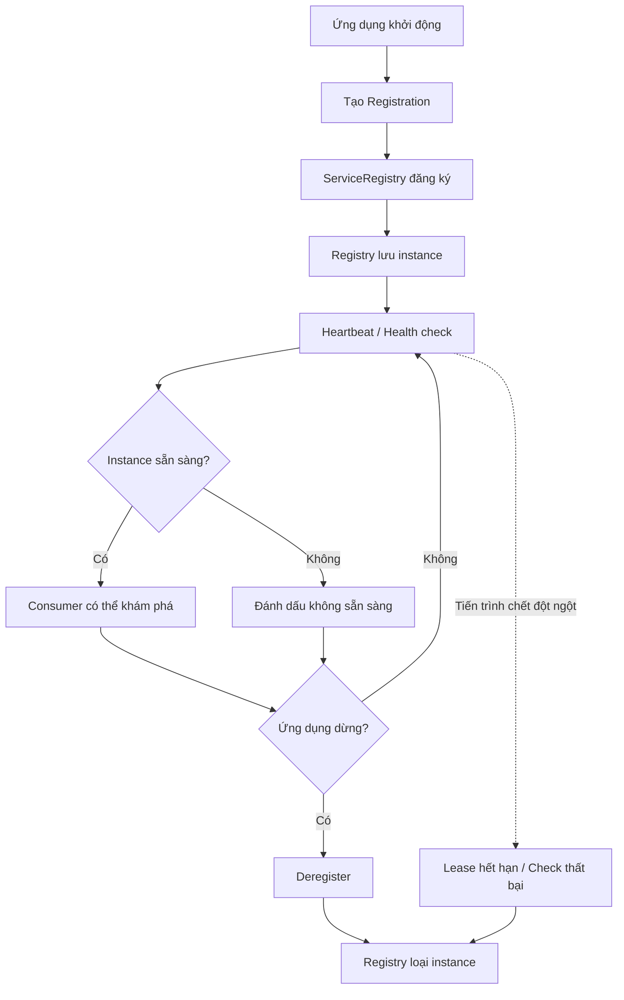

# Đăng ký, hủy đăng ký, đọc và cập nhật trạng thái

Trong Spring Cloud Service Discovery, một instance cần được đăng ký với registry để các dịch vụ khác tìm thấy nó. Trong suốt thời gian chạy, thông tin đăng ký có thể được duy trì bằng heartbeat hoặc health check; trạng thái có thể thay đổi khi instance sẵn sàng, tạm ngừng nhận request hoặc gặp lỗi. Khi ứng dụng dừng bình thường, instance cần được hủy đăng ký để consumer không tiếp tục gửi request tới địa chỉ đó.

Spring Cloud cung cấp abstraction `ServiceRegistry` để thao tác với vòng đời đăng ký. Abstraction này giúp mã ứng dụng làm việc với một giao diện chung trong khi implementation cụ thể có thể đến từ Eureka, Consul hoặc nhà cung cấp khác.

## 1. Các thành phần tham gia

Cần phân biệt những thành phần thường xuất hiện trong một luồng service discovery:

| Thành phần | Trách nhiệm chính |
|---|---|
| `Registration` | Mô tả một instance cần đăng ký, gồm service ID, instance ID, host, port và metadata |
| `ServiceRegistry` | Đăng ký, hủy đăng ký và đọc hoặc cập nhật trạng thái của một registration |
| `DiscoveryClient` | Tra cứu các service và danh sách instance đang được registry công bố |
| Health check / heartbeat | Cung cấp tín hiệu về khả năng hoạt động của instance |
| Spring Cloud LoadBalancer | Chọn một instance trong danh sách tìm được để gửi request |

`ServiceRegistry` là abstraction thiên về thao tác ghi và quản lý registration. `DiscoveryClient` phục vụ việc đọc danh sách service và instance để consumer sử dụng. Việc một consumer gọi được `DiscoveryClient` không có nghĩa consumer đó có quyền đăng ký hoặc thay đổi trạng thái của instance.

Một registration thường mang các thông tin sau:

- **Service ID:** tên logic của dịch vụ, ví dụ `order-service`.
- **Instance ID:** định danh riêng cho một lần chạy, ví dụ `order-service:pod-7c9d`.
- **Host và port:** địa chỉ mạng mà instance nhận kết nối.
- **Metadata:** thông tin bổ sung như zone, phiên bản hoặc nhóm triển khai.
- **Trạng thái:** tín hiệu cho biết instance có nên được xem là sẵn sàng phục vụ hay không; cách biểu diễn phụ thuộc registry.

Nhiều instance có thể cùng đăng ký dưới một service ID. Registry dùng instance ID và địa chỉ để phân biệt từng bản chạy.

## 2. Vòng đời đăng ký của một instance

Một vòng đời phổ biến có thể chia thành các giai đoạn:

1. **Khởi động:** ứng dụng nạp cấu hình như `spring.application.name`, cổng máy chủ và cấu hình discovery client.
2. **Tạo registration:** discovery client thu thập service ID, instance ID, địa chỉ, metadata và các thông tin cần thiết khác.
3. **Đăng ký:** client gửi registration tới registry. Registry lưu instance dưới service ID tương ứng.
4. **Duy trì:** client gửi heartbeat hoặc registry thực hiện health check theo cơ chế của nhà cung cấp.
5. **Thay đổi trạng thái:** instance có thể được đánh dấu sẵn sàng, không sẵn sàng hoặc tạm ngừng nhận lưu lượng.
6. **Hủy đăng ký:** khi ứng dụng dừng bình thường, client gửi yêu cầu xóa registration.
7. **Dọn dẹp khi sự cố:** nếu tiến trình chết đột ngột và không thể hủy đăng ký, heartbeat hết hạn hoặc health check thất bại giúp registry loại instance khỏi danh sách có thể phục vụ.



Đăng ký thành công chỉ cho biết registry đã nhận thông tin instance. Nó không tự chứng minh ứng dụng đã sẵn sàng xử lý nghiệp vụ. Cần kết hợp health check hoặc readiness signal phù hợp để tránh đưa instance vào luồng request quá sớm.

## 3. Tự động đăng ký và đăng ký chủ động

Trong ứng dụng Spring Boot tích hợp Spring Cloud discovery client, việc đăng ký thường được tự động hóa. Khi ứng dụng khởi động, auto-configuration của discovery client tạo registration và đăng ký với registry. Khi application context đóng, client thực hiện quy trình hủy đăng ký theo integration của nhà cung cấp.

Cách này phù hợp với phần lớn microservice vì vòng đời registry được gắn với vòng đời ứng dụng. Nhóm phát triển thường chỉ cần cấu hình service ID, địa chỉ registry, health check và metadata cần thiết.

Có thể tắt cơ chế tự động đăng ký nếu ứng dụng có yêu cầu vận hành đặc biệt. Một thuộc tính chung thường dùng để điều khiển auto-registration là:

```yaml
spring:
  cloud:
    service-registry:
      auto-registration:
        enabled: false
```

Tên thuộc tính và hành vi chi tiết cần được đối chiếu với phiên bản Spring Cloud đang sử dụng. Ngoài cấu hình chung, từng discovery client còn có tùy chọn riêng, ví dụ cấu hình đăng ký của Eureka hoặc Consul. Nếu tắt tự động đăng ký, ứng dụng phải có quy trình đăng ký thay thế và phải chịu trách nhiệm xử lý cả lỗi đăng ký lẫn hủy đăng ký.

### API ServiceRegistry

Spring Cloud Commons định nghĩa giao diện tổng quát có dạng:

```java
public interface ServiceRegistry<R extends Registration> {

    void register(R registration);

    void deregister(R registration);

    void close();

    void setStatus(R registration, Object status);

    Object getStatus(R registration);
}
```

Các phương thức có ý nghĩa:

- `register(registration)`: gửi thông tin instance tới registry.
- `deregister(registration)`: yêu cầu registry loại bỏ registration.
- `getStatus(registration)`: đọc trạng thái hiện tại mà implementation cung cấp cho registration đó.
- `setStatus(registration, status)`: cập nhật trạng thái theo quy ước của implementation.
- `close()`: đóng tài nguyên của service registry khi integration yêu cầu.

`R` là kiểu registration cụ thể của nhà cung cấp. Vì vậy, đoạn interface trên mô tả hợp đồng chung; ứng dụng cần một registration tương thích với Eureka, Consul hoặc registry đang tích hợp. Không thể tạo một object `Registration` tùy ý rồi giả định mọi implementation đều hiểu nó.

Ví dụ về thứ tự thao tác ở mức API:

```java
// Pseudocode: registration và status phải tương thích
// với implementation ServiceRegistry đang sử dụng.

serviceRegistry.register(registration);

Object currentStatus = serviceRegistry.getStatus(registration);

serviceRegistry.setStatus(registration, providerSpecificStatus);

serviceRegistry.deregister(registration);
```

Đây là ví dụ mô tả thứ tự gọi API, không phải cấu hình đầy đủ để tự tạo registration. Trong ứng dụng Spring Cloud thông thường, discovery client đã tự quản lý registration; không nên gọi đăng ký thủ công lần thứ hai cho cùng instance nếu chưa xác định rõ cách integration quản lý vòng đời.

## 4. Đọc danh sách instance và trạng thái

Consumer thường dùng `DiscoveryClient` để lấy các instance theo service ID:

```java
import java.util.List;

import org.springframework.cloud.client.ServiceInstance;
import org.springframework.cloud.client.discovery.DiscoveryClient;
import org.springframework.stereotype.Component;

@Component
public class OrderServiceLookup {

    private final DiscoveryClient discoveryClient;

    public OrderServiceLookup(DiscoveryClient discoveryClient) {
        this.discoveryClient = discoveryClient;
    }

    public List<ServiceInstance> findInstances() {
        return discoveryClient.getInstances("payment-service");
    }
}
```

Mỗi `ServiceInstance` cung cấp thông tin như service ID, instance ID (nếu implementation có cung cấp), host, port, URI và metadata. Danh sách trả về là góc nhìn của discovery client tại thời điểm truy vấn. Danh sách rỗng có thể xảy ra khi service chưa đăng ký, tên service không khớp, instance chưa được xem là healthy hoặc dữ liệu registry chưa đồng bộ tới client.

Để quan sát registry, có thể sử dụng giao diện quản trị của nhà cung cấp, log của discovery client, endpoint quản lý được bảo vệ hoặc API của registry. Cần phân biệt:

- **Danh sách instance:** consumer nhìn thấy instance nào qua discovery client.
- **Trạng thái registration:** registry hoặc service registry adapter báo trạng thái nào cho một registration.
- **Sức khỏe ứng dụng:** ứng dụng có đang đáp ứng các tiêu chí health/readiness hay không.

Ba thông tin này liên quan nhưng không nhất thiết cập nhật đồng thời. Một instance có thể vừa chuyển sang trạng thái lỗi nhưng consumer vẫn nhìn thấy bản ghi cũ trong một khoảng thời gian do heartbeat, health check, cache hoặc đồng bộ registry có độ trễ.

Không nên chọn phần tử đầu tiên của `getInstances()` rồi dùng cố định cho mọi request. Hãy để Spring Cloud LoadBalancer chọn instance cho từng request hoặc từng chu kỳ chọn phù hợp với cấu hình cân bằng tải.

## 5. Cập nhật trạng thái instance

Trạng thái giúp registry và consumer biết instance có nên nhận request hay không. Các tình huống vận hành thường gặp gồm:

- Instance đang khởi động và chưa sẵn sàng.
- Instance hoạt động bình thường.
- Instance cần tạm ngừng nhận lưu lượng để bảo trì.
- Instance gặp lỗi và không nên được chọn.
- Instance đã dừng và cần được xóa khỏi registry.

`ServiceRegistry.setStatus(registration, status)` cung cấp cách cập nhật trạng thái qua abstraction chung. Tham số `status` có kiểu `Object` vì mỗi registry có mô hình trạng thái riêng. Không được giả định mọi registry đều chấp nhận cùng một chuỗi hoặc cùng một enum.

### Ví dụ với Eureka

Eureka có các trạng thái instance như `UP`, `DOWN`, `STARTING`, `OUT_OF_SERVICE` và `UNKNOWN`. Trong đó:

- `UP`: instance được xem là sẵn sàng.
- `DOWN`: instance không hoạt động bình thường.
- `STARTING`: instance đang khởi động.
- `OUT_OF_SERVICE`: instance tạm thời không nên nhận lưu lượng.
- `UNKNOWN`: chưa xác định được trạng thái.

Eureka client thường gửi heartbeat để gia hạn lease. Nếu heartbeat ngừng trong khoảng thời gian cấu hình, Eureka server có thể loại instance khỏi registry theo cơ chế lease expiration và eviction. Heartbeat phản ánh việc client còn duy trì kết nối với server; để phản ánh chính xác sức khỏe ứng dụng, cần cấu hình health check integration phù hợp.

### Ví dụ với Consul

Consul kết hợp đăng ký service với health check. Agent có thể thực hiện HTTP check, TCP check hoặc loại check phù hợp khác. Kết quả check thường được thể hiện thành các trạng thái như `passing`, `warning` và `critical`.

- `passing`: check thành công.
- `warning`: check có cảnh báo nhưng chưa nhất thiết là lỗi nghiêm trọng.
- `critical`: check thất bại và service không khỏe theo tiêu chí đã khai báo.

Trong mô hình này, trạng thái sức khỏe thường được cập nhật từ kết quả health check. Cách một thao tác `setStatus` được ánh xạ sang Consul phụ thuộc implementation và loại registration; không nên truyền một chuỗi trạng thái của Eureka rồi mong Consul hiểu cùng ý nghĩa.

### Thay đổi trạng thái không thay thế health check

Cập nhật trạng thái qua registry là một thao tác quản lý registration. Nó không tự sửa nguyên nhân gây lỗi trong ứng dụng và cũng không thay thế endpoint health của ứng dụng.

Ví dụ, nếu một instance bị đánh dấu `OUT_OF_SERVICE` nhưng health check vẫn báo sẵn sàng, hệ thống có thể xuất hiện trạng thái không nhất quán hoặc trạng thái bị một lần kiểm tra tiếp theo ghi đè. Khi đưa instance trở lại phục vụ, cần đồng bộ cả trạng thái quản lý, readiness của ứng dụng và quy tắc health check.

Thông tin metadata cũng là phần riêng. `setStatus` không phải API cập nhật metadata tổng quát. Nếu zone, phiên bản hoặc thuộc tính registration thay đổi, cách cập nhật phải theo khả năng của provider hoặc quy trình đăng ký lại được tài liệu của integration hỗ trợ.

## 6. Hủy đăng ký và dọn dẹp instance

Khi ứng dụng dừng bình thường, discovery client nên gửi deregistration để registry loại instance khỏi danh sách có thể khám phá. Việc này giúp consumer ngừng gửi request tới địa chỉ đã dừng mà không cần chờ lease hết hạn hoặc health check thất bại nhiều lần.

Một số tình huống thường dẫn tới deregistration:

- Ứng dụng được dừng có kiểm soát.
- Một instance được thay thế trong quá trình rollout.
- Instance được đưa ra khỏi cụm để bảo trì.
- Dịch vụ thay đổi cấu hình triển khai và không còn dùng registration cũ.

Deregistration cần thực hiện đúng registration của instance đang dừng. Không xóa theo service ID một cách thiếu kiểm soát vì service ID có thể đang đại diện cho nhiều replica còn khỏe mạnh.

Nếu tiến trình bị kill đột ngột, mất máy hoặc mất kết nối mạng, ứng dụng không thể gửi yêu cầu deregistration. Khi đó registry cần cơ chế dọn dẹp thay thế:

- Eureka dựa vào heartbeat và lease expiration để phát hiện client không còn gia hạn.
- Consul dựa vào health check và các quy tắc deregistration của service/agent.
- Các registry khác có thể sử dụng TTL, session hoặc cơ chế kiểm tra định kỳ tương ứng.

Không nên đặt thời gian hết hạn quá dài vì instance lỗi có thể còn xuất hiện lâu trong registry. Cũng không nên đặt quá ngắn vì một đợt nghẽn mạng tạm thời có thể khiến instance khỏe mạnh bị loại nhầm. Cần cân bằng giữa tốc độ phát hiện lỗi và khả năng chịu dao động mạng.

## 7. Health check, readiness và tính nhất quán

Health check giúp registry đánh giá instance dựa trên tín hiệu có thể kiểm tra. Tuy nhiên, cần chọn đúng tín hiệu:

- **Liveness:** tiến trình còn sống và không bị treo nghiêm trọng hay không.
- **Readiness:** instance đã sẵn sàng nhận request nghiệp vụ hay chưa.
- **Dependency health:** các hệ thống phụ thuộc như database hoặc message broker có hoạt động hay không.

Nếu mục tiêu là quyết định có đưa instance vào danh sách nhận lưu lượng, readiness thường là tín hiệu phù hợp hơn liveness. Một ứng dụng còn sống nhưng chưa hoàn tất khởi tạo không nên được coi là sẵn sàng. Ngược lại, một dependency phụ trợ bị gián đoạn không phải lúc nào cũng đồng nghĩa toàn bộ instance cần bị loại khỏi mọi loại request; cần thiết kế health group theo chức năng thực tế.

Khi dùng Spring Boot Actuator, có thể cấu hình health endpoint và health probes cho ứng dụng. Ví dụ:

```yaml
management:
  endpoint:
    health:
      probes:
        enabled: true
```

Đường dẫn và cách kết nối health check của registry cần được cấu hình riêng theo discovery client. Không phải cứ bật Actuator là Eureka hoặc Consul tự động dùng đúng readiness endpoint mà hệ thống mong muốn.

Độ trễ đồng bộ là điều cần tính đến. Sau khi trạng thái thay đổi, registry server, cache phía client và LoadBalancer có thể chưa cùng nhìn thấy kết quả ngay lập tức. Vì vậy, thao tác bảo trì nên có trình tự rõ ràng: ngừng nhận request mới, chờ request đang xử lý hoàn tất trong giới hạn cho phép, cập nhật hoặc hủy đăng ký, rồi mới dừng tiến trình.

## 8. Lỗi thường gặp và cách xử lý

| Hiện tượng | Nguyên nhân có thể | Hướng kiểm tra |
|---|---|---|
| Instance không xuất hiện trong registry | Discovery client chưa bật, sai endpoint, thiếu quyền hoặc đăng ký thất bại | Kiểm tra cấu hình, log lúc khởi động và kết nối tới registry |
| Instance xuất hiện nhưng consumer không gọi được | Sai host/port, firewall, địa chỉ container không thể truy cập từ consumer | Đối chiếu địa chỉ registration với mạng thực tế |
| Instance đã dừng nhưng vẫn còn trong registry | Deregistration không chạy hoặc lease/check chưa hết hạn | Kiểm tra log shutdown, heartbeat, TTL và health check |
| Instance khỏe bị đánh dấu lỗi | Timeout quá ngắn, health endpoint không ổn định hoặc check dùng sai đường dẫn | Kiểm tra thời gian check, endpoint và điều kiện readiness |
| Trạng thái vừa cập nhật lại bị đổi | Health check hoặc heartbeat integration tiếp tục ghi trạng thái theo tín hiệu cũ | Đồng bộ quy tắc quản lý trạng thái với health check |
| Consumer vẫn nhìn thấy dữ liệu cũ | Cache hoặc đồng bộ registry có độ trễ | Kiểm tra cache, chu kỳ refresh và thời gian hội tụ |
| Hủy đăng ký một replica làm ảnh hưởng replica khác | Dùng nhầm thao tác theo service ID thay vì registration cụ thể | Kiểm tra instance ID và API deregister của provider |

Khi điều tra, hãy đối chiếu cùng một instance ID qua log ứng dụng, registry và thông tin consumer nhìn thấy. Chỉ so sánh service ID có thể chưa đủ vì nhiều replica cùng dùng một tên logic.

## 9. Bảo mật thao tác registry

Đăng ký và cập nhật trạng thái ảnh hưởng trực tiếp đến lưu lượng giữa các microservice. Một client không được tin cậy có thể đăng ký địa chỉ giả, làm thay đổi trạng thái instance hoặc gây gián đoạn việc khám phá dịch vụ.

Cần áp dụng các nguyên tắc sau:

- Bảo vệ endpoint và thông tin xác thực của registry; chỉ cấp quyền ghi cho thành phần cần đăng ký hoặc quản trị.
- Giới hạn quyền cập nhật trạng thái và hủy đăng ký theo service hoặc phạm vi vận hành phù hợp.
- Mã hóa kết nối tới registry khi môi trường yêu cầu bảo vệ dữ liệu trên đường truyền.
- Không đặt mật khẩu, token hoặc khóa bí mật trong service ID hay metadata vì thông tin này có thể được nhiều client đọc.
- Nếu sử dụng endpoint quản trị như Actuator để thay đổi trạng thái, chỉ expose endpoint cần thiết và đặt xác thực, phân quyền, giới hạn mạng phù hợp.
- Ghi log thao tác đăng ký, cập nhật trạng thái và hủy đăng ký để có thể truy vết sự cố.

## 10. Ví dụ vận hành một đợt bảo trì

Giả sử `payment-service` có ba instance đang phục vụ. Một instance cần được nâng cấp:

1. Bộ điều phối hoặc quy trình vận hành chọn đúng instance ID cần bảo trì.
2. Instance được đánh dấu không nhận request mới theo cơ chế mà registry và ứng dụng hỗ trợ.
3. LoadBalancer và consumer cập nhật danh sách instance sau khi nhận thay đổi; cần tính đến độ trễ cache.
4. Instance hoàn tất các request đang xử lý trong giới hạn thời gian cho phép.
5. Ứng dụng dừng có kiểm soát và discovery client hủy registration.
6. Bản mới khởi động, health/readiness đạt yêu cầu rồi đăng ký dưới service ID `payment-service`.
7. Consumer tiếp tục gọi `payment-service`; LoadBalancer chọn trong các instance hiện được khám phá.

Service ID không cần đổi chỉ vì một replica được nâng cấp. Registry tiếp tục nhóm các instance tương thích dưới cùng tên logic, trong khi instance ID và địa chỉ mạng xác định từng bản chạy.

## 11. Checklist triển khai

Trước khi đưa service discovery vào môi trường thực tế, hãy xác nhận:

1. Discovery client đăng ký đúng service ID và instance ID.
2. Đăng ký tự động được bật hoặc có quy trình đăng ký chủ động rõ ràng.
3. Health check phản ánh đúng readiness của instance.
4. Trạng thái do quản trị cập nhật không mâu thuẫn với health check tự động.
5. Consumer chỉ nhận các instance có thể truy cập trên mạng thực tế.
6. Ứng dụng dừng bình thường sẽ deregister đúng instance.
7. Có cơ chế phát hiện instance chết đột ngột bằng heartbeat, TTL hoặc health check.
8. Thời gian timeout, chu kỳ kiểm tra và cache phù hợp với yêu cầu phát hiện lỗi.
9. Quyền đăng ký, cập nhật trạng thái và hủy đăng ký được giới hạn phù hợp.
10. Log và công cụ quan sát đủ để đối chiếu registration giữa ứng dụng, registry và consumer.

Khi hiểu rõ trách nhiệm của `ServiceRegistry`, `DiscoveryClient` và health check, ta có thể quản lý đầy đủ vòng đời instance: đăng ký để được khám phá, duy trì trạng thái để định tuyến chính xác, và hủy đăng ký hoặc dọn dẹp khi instance không còn phục vụ.
