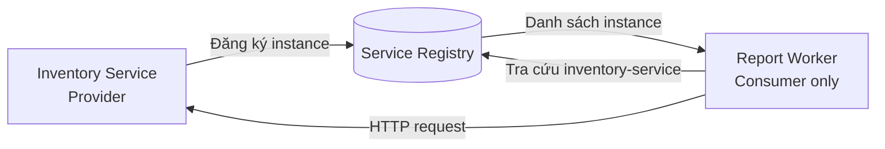

# Tắt tự đăng ký nhưng vẫn giữ chức năng khám phá

Trong một hệ thống microservice, không phải tiến trình nào cũng cần công bố chính nó như một dịch vụ. Một ứng dụng xử lý batch, một worker nền hoặc một service chỉ gọi các API nội bộ có thể cần tìm `inventory-service`, `pricing-service` hay `payment-service`, nhưng không có endpoint nào cần được các service khác gọi trực tiếp. Với trường hợp đó, ứng dụng có thể **tắt tự đăng ký instance của chính nó nhưng vẫn giữ khả năng tra cứu registry**.

Trong Spring Cloud, cần tách hai luồng: đăng ký provider và khám phá ở phía consumer. `ServiceRegistry` cùng cơ chế auto-registration quản lý việc công bố instance; `DiscoveryClient` tra cứu danh sách instance theo service ID. Tắt auto-registration không đồng nghĩa tắt discovery.

## Phân biệt đăng ký và khám phá

Giả sử `report-worker` cần gọi `inventory-service`. `inventory-service` đã đăng ký hai instance vào Eureka hoặc Consul. `report-worker` chỉ cần đọc danh sách instance rồi gọi một instance phù hợp. Nếu `report-worker` không cung cấp API cho service khác, việc đăng ký chính nó có thể không cần thiết.

| Chức năng | Phía tham gia | Mục đích |
|---|---|---|
| Service registration | Provider | Công bố service ID, instance ID, host, port và metadata vào registry |
| Auto-registration | Vòng đời ứng dụng Spring | Tự động đăng ký instance khi ứng dụng khởi động và hủy đăng ký khi dừng |
| Service discovery | Consumer | Tra cứu instance đã đăng ký theo service ID |
| Load balancing | Consumer hoặc Gateway | Chọn một instance từ danh sách tra cứu được cho request |



Trong sơ đồ, `report-worker` không tạo bản ghi của chính nó nhưng vẫn đọc được các bản ghi của `inventory-service`. Nó cần quyền kết nối và đọc registry; không nhất thiết cần quyền tạo, sửa hoặc xóa đăng ký.

## Cờ cấu hình chung của Spring Cloud

Spring Cloud Commons cung cấp thuộc tính để tắt cơ chế tự động đăng ký:

```yaml
spring:
  cloud:
    discovery:
      enabled: true
    service-registry:
      auto-registration:
        enabled: false
```

Ý nghĩa:

- `spring.cloud.discovery.enabled=true` giữ các discovery client auto-configuration được phép hoạt động.
- `spring.cloud.service-registry.auto-registration.enabled=false` ngăn Spring Cloud tự động đăng ký ứng dụng qua lifecycle auto-registration.
- Consumer vẫn có thể inject `DiscoveryClient`, gọi `getServices()` hoặc `getInstances(serviceId)` nếu provider discovery tương ứng đã được cấu hình và kết nối được registry.

Không dùng `spring.cloud.discovery.enabled=false` cho mục tiêu này. Cờ đó có thể vô hiệu hóa discovery client auto-configuration, khiến ứng dụng không còn tra cứu được instance. Cũng không nên tắt toàn bộ starter hoặc cờ `enabled` riêng của provider nếu ứng dụng vẫn cần truy vấn registry.

Cờ chung chỉ kiểm soát luồng auto-registration của Spring Cloud. Nếu code ứng dụng tự gọi `ServiceRegistry.register(...)`, gọi API đăng ký riêng của provider hoặc tạo bản ghi bằng SDK khác, các thao tác thủ công đó vẫn có thể đăng ký instance. Cần tìm và bỏ hoặc điều kiện hóa các lệnh đăng ký thủ công nếu muốn bảo đảm tiến trình không công bố chính nó.

## Cấu hình theo từng registry

Ngoài cờ chung, mỗi integration có thuộc tính riêng. Nên đặt cờ rõ ràng để thể hiện vai trò consumer-only và tránh phụ thuộc vào giá trị mặc định của phiên bản.

### Eureka: không đăng ký nhưng vẫn fetch registry

```yaml
spring:
  application:
    name: report-worker
  cloud:
    discovery:
      enabled: true
    service-registry:
      auto-registration:
        enabled: false

eureka:
  client:
    enabled: true
    register-with-eureka: false
    fetch-registry: true
    service-url:
      defaultZone: http://eureka-server:8761/eureka/
```

Các thuộc tính quan trọng:

- `eureka.client.register-with-eureka=false`: Eureka Client không đăng ký instance của ứng dụng hiện tại lên Eureka Server.
- `eureka.client.fetch-registry=true`: client vẫn tải registry để tra cứu dịch vụ khác.
- `eureka.client.enabled=true`: giữ Eureka client integration hoạt động.
- `spring.cloud.service-registry.auto-registration.enabled=false`: tắt thêm lifecycle auto-registration chung của Spring Cloud.

`register-with-eureka` và `fetch-registry` là hai tùy chọn độc lập. Consumer-only thường tắt đăng ký nhưng bật fetch. Không đặt `eureka.client.enabled=false`, vì như vậy sẽ tắt Eureka client và làm mất khả năng discovery qua Eureka.

### Consul: giữ discovery, tắt service registration

```yaml
spring:
  application:
    name: report-worker
  cloud:
    discovery:
      enabled: true
    service-registry:
      auto-registration:
        enabled: false
    consul:
      enabled: true
      host: consul-server
      port: 8500
      discovery:
        enabled: true
        register: false
```

`spring.cloud.consul.discovery.register=false` ngăn ứng dụng tự đăng ký service của chính nó. `spring.cloud.consul.discovery.enabled=true` giữ integration discovery hoạt động; consumer vẫn có thể truy vấn Consul catalog. `spring.cloud.consul.enabled` cũng cần giữ bật để client tích hợp Consul được tạo.

Consumer phải có quyền đọc catalog và các service cần tra cứu. Nếu Consul bật ACL, token của worker chỉ nên có quyền đọc cần thiết; không cấp quyền ghi hoặc deregister nếu worker không quản lý đăng ký.

### ZooKeeper: giữ discovery, không tạo registration node

```yaml
spring:
  application:
    name: report-worker
  cloud:
    discovery:
      enabled: true
    service-registry:
      auto-registration:
        enabled: false
    zookeeper:
      enabled: true
      connect-string: zk-1:2181,zk-2:2181,zk-3:2181
      discovery:
        enabled: true
        register: false
        root: /services
```

`spring.cloud.zookeeper.discovery.register=false` giữ khả năng đọc service records nhưng ngăn integration đăng ký instance của ứng dụng. `spring.cloud.zookeeper.discovery.enabled=true` và `spring.cloud.zookeeper.enabled=true` cần được giữ bật. Consumer cần quyền đọc các znode dưới root path đã cấu hình; nó không cần quyền tạo hoặc xóa registration node.

Tên thuộc tính và điều kiện auto-configuration có thể thay đổi giữa các release train. Khi nâng Spring Cloud, hãy đối chiếu tài liệu đúng phiên bản và xác minh bằng điều kiện auto-configuration cùng trạng thái registry.

## Dùng DiscoveryClient sau khi tắt auto-registration

Khi discovery client vẫn hoạt động, consumer có thể tiếp tục tra cứu bằng abstraction chung `DiscoveryClient`:

```java
import java.util.List;

import org.springframework.cloud.client.ServiceInstance;
import org.springframework.cloud.client.discovery.DiscoveryClient;
import org.springframework.stereotype.Service;

@Service
public class InventoryLookup {
    private final DiscoveryClient discoveryClient;

    public InventoryLookup(DiscoveryClient discoveryClient) {
        this.discoveryClient = discoveryClient;
    }

    public List<ServiceInstance> findInventoryInstances() {
        return discoveryClient.getInstances("inventory-service");
    }
}
```

Việc tắt tự đăng ký không làm thay đổi cách gọi `getInstances`. Kết quả vẫn phụ thuộc registry đang có dữ liệu, kết nối mạng, quyền đọc và cache của discovery client. Danh sách có thể rỗng; consumer phải xử lý trường hợp chưa có instance thay vì giả định registry luôn trả về ít nhất một kết quả.

Có thể xem danh sách service ID để chẩn đoán:

```java
List<String> serviceIds = discoveryClient.getServices();
System.out.println("Registered services: " + serviceIds);
```

Trong consumer-only mode, `report-worker` thường không xuất hiện như một service do chính tiến trình đăng ký. Điều này không ngăn nó nhìn thấy các service khác. Nếu ứng dụng có nhiều `DiscoveryClient` hoặc `CompositeDiscoveryClient`, kết quả còn phụ thuộc implementation và thứ tự ưu tiên.

## Gọi dịch vụ bằng service ID và LoadBalancer

Tra cứu instance thủ công phù hợp khi cần xem metadata hoặc xây dựng logic riêng. Với HTTP request thông thường, có thể dùng Spring Cloud LoadBalancer để chọn instance tự động.

```java
import org.springframework.boot.web.client.RestTemplateBuilder;
import org.springframework.cloud.client.loadbalancer.LoadBalanced;
import org.springframework.context.annotation.Bean;
import org.springframework.context.annotation.Configuration;
import org.springframework.web.client.RestTemplate;

@Configuration
public class HttpClientConfiguration {
    @Bean
    @LoadBalanced
    RestTemplate serviceRestTemplate(RestTemplateBuilder builder) {
        return builder.build();
    }
}
```

Một consumer inject bean đã đánh dấu `@LoadBalanced` và gọi bằng service ID:

```java
import org.springframework.beans.factory.annotation.Qualifier;
import org.springframework.stereotype.Service;
import org.springframework.web.client.RestTemplate;

@Service
public class InventoryClient {
    private final RestTemplate serviceRestTemplate;

    public InventoryClient(
            @Qualifier("serviceRestTemplate") RestTemplate serviceRestTemplate) {
        this.serviceRestTemplate = serviceRestTemplate;
    }

    public InventoryItem getItem(long id) {
        return serviceRestTemplate.getForObject(
            "http://inventory-service/api/items/{id}",
            InventoryItem.class,
            id
        );
    }
}
```

LoadBalancer lấy danh sách instance thông qua discovery integration và chọn một instance cho request. Cần có dependency Spring Cloud LoadBalancer và registry starter tương ứng. Tắt auto-registration của `report-worker` không ảnh hưởng tới việc nó chọn instance của `inventory-service`.

## Chọn cách tắt phù hợp

| Mục tiêu | Cấu hình nên xem xét | Discovery còn hoạt động? |
|---|---|---|
| Ứng dụng không đăng ký chính nó nhưng vẫn tra cứu | `spring.cloud.service-registry.auto-registration.enabled=false` | Có, nếu provider discovery vẫn bật |
| Consumer Eureka không đăng ký nhưng vẫn tải registry | `register-with-eureka=false`, `fetch-registry=true` | Có |
| Consumer Consul không đăng ký nhưng vẫn đọc catalog | `spring.cloud.consul.discovery.register=false` | Có |
| Consumer ZooKeeper không tạo registration node | `spring.cloud.zookeeper.discovery.register=false` | Có |
| Tắt toàn bộ discovery client | `spring.cloud.discovery.enabled=false` | Không |
| Tắt hẳn một integration provider | Cờ `...enabled=false` riêng hoặc bỏ starter khỏi classpath | Không qua provider đó |

Đối với ứng dụng consumer-only, cách rõ ràng nhất là giữ discovery client được bật, tắt auto-registration chung và đặt cờ đăng ký riêng của provider thành `false`. Cách này làm rõ ý định cấu hình và giảm nguy cơ một integration khác vẫn tự đăng ký.

## Những tình huống cần lưu ý

### Ứng dụng cần tra cứu nhưng không có endpoint phục vụ

Worker, scheduler hoặc batch job thường là consumer-only. Không đăng ký chúng có thể giảm dữ liệu rác trong registry và tránh khiến service khác cố gọi vào một tiến trình không có API server. Vẫn cần cấu hình địa chỉ registry, quyền đọc và timeout hợp lý.

### Ứng dụng vừa gọi dịch vụ khác vừa cần được gọi

Một service như `order-service` vừa là consumer của `inventory-service`, vừa là provider cho client khác. Không nên tắt auto-registration toàn cục trong trường hợp này nếu các service khác cần tìm `order-service`. Hãy giữ đăng ký hoặc chỉ tắt đăng ký trong profile/test phù hợp.

### Registry cần quyền ghi riêng

Khi tắt registration, worker có thể chỉ cần quyền đọc. Với Consul, cấp token có quyền đọc service catalog. Với ZooKeeper, ACL cho phép đọc nhánh service cần thiết. Với Eureka, bảo vệ endpoint registry và network theo chính sách hệ thống. Không cấp quyền deregister hoặc write nếu tiến trình không cần.

### Tự đăng ký bằng code

`spring.cloud.service-registry.auto-registration.enabled=false` kiểm soát tự đăng ký do Spring Cloud quản lý. Nếu ứng dụng có code gọi trực tiếp `ServiceRegistry.register`, `ServiceDiscovery.registerService` của Curator hoặc API Consul, các lời gọi đó vẫn có thể tạo đăng ký. Hãy tìm các điểm gọi này và chỉ chạy chúng khi profile/provider yêu cầu.

### Health indicator và trạng thái ứng dụng

Tắt đăng ký không có nghĩa registry đã biến mất khỏi các dependency của ứng dụng. Health indicator của provider vẫn có thể kiểm tra kết nối registry; trạng thái health tổng thể có thể phản ánh lỗi kết nối nếu cấu hình health group bao gồm thành phần đó. Cần phân biệt readiness của ứng dụng với khả năng truy cập registry, rồi quyết định liệu registry là dependency bắt buộc để phục vụ request hay không.

## Kiểm chứng cấu hình consumer-only

Không chỉ dựa vào YAML để kết luận. Hãy kiểm tra dependency, Spring context, registry và hành vi thực tế.

| Bước | Cách kiểm tra | Kết quả mong đợi |
|---|---|---|
| 1. Cấu hình | Xác nhận discovery enabled và auto-registration disabled | Consumer vẫn bật discovery |
| 2. Bean | Kiểm tra `DiscoveryClient` và provider integration được tạo | Có discovery client của registry đã chọn |
| 3. Đăng ký | Khởi động ứng dụng và xem registry | Không có instance mới của consumer được tạo bởi tiến trình này |
| 4. Tra cứu | Gọi `getInstances("inventory-service")` | Nhận các instance provider đã đăng ký |
| 5. Gọi dịch vụ | Gửi request bằng HTTP client có `@LoadBalanced` | Request tới một instance provider hợp lệ |
| 6. Dừng ứng dụng | Shutdown consumer và xem registry | Không có bản ghi consumer cần dọn; các provider khác vẫn tồn tại |

Ví dụ có thể kiểm tra bằng Actuator trong môi trường local:

```yaml
management:
  endpoints:
    web:
      exposure:
        include: health,info,beans,conditions
```

Chỉ expose endpoint chẩn đoán trên mạng quản trị được bảo vệ. Endpoint `beans` và `conditions` có thể tiết lộ cấu trúc nội bộ; không công khai chúng trong production.

Với Eureka, kiểm tra danh sách application/instance trên dashboard hoặc API của Eureka Server. Với Consul, xem service catalog và health status. Với ZooKeeper, xác nhận không có ephemeral registration node mang instance ID của consumer dưới root path. Đồng thời kiểm tra consumer vẫn đọc được node hoặc service record của provider.

## Kiểm thử tự động

Có thể dùng `SimpleDiscoveryClient` để kiểm tra consumer mà không cần registry server thật. Ví dụ cấu hình test:

```yaml
spring:
  cloud:
    discovery:
      enabled: true
      client:
        simple:
          instances:
            inventory-service:
              - uri: http://localhost:18081
              - uri: http://localhost:18082
    service-registry:
      auto-registration:
        enabled: false
```

Kiểm thử tra cứu:

```java
import static org.assertj.core.api.Assertions.assertThat;

import org.junit.jupiter.api.Test;
import org.springframework.beans.factory.annotation.Autowired;
import org.springframework.boot.test.context.SpringBootTest;
import org.springframework.cloud.client.discovery.DiscoveryClient;
import org.springframework.test.context.ActiveProfiles;

@SpringBootTest
@ActiveProfiles("test")
class ConsumerOnlyDiscoveryTest {
    @Autowired
    DiscoveryClient discoveryClient;

    @Test
    void canDiscoverInventoryWithoutRegisteringThisApplication() {
        assertThat(discoveryClient.getInstances("inventory-service"))
            .hasSize(2);
    }
}
```

Test này xác minh consumer tra cứu được các instance tĩnh và cấu hình auto-registration bị tắt. Nó không thay thế integration test với Eureka, Consul hoặc ZooKeeper thật. Với từng provider, nên kiểm thử thêm rằng instance của ứng dụng không xuất hiện trong registry sau khi khởi động, trong khi tra cứu service khác vẫn thành công.

## Lỗi thường gặp

| Triệu chứng | Nguyên nhân có thể | Cách xử lý |
|---|---|---|
| Tắt đăng ký xong không tìm thấy dịch vụ | Vô tình đặt `spring.cloud.discovery.enabled=false` hoặc tắt provider integration | Bật discovery và provider client; chỉ tắt auto-registration |
| Ứng dụng vẫn xuất hiện trong registry | Cờ provider chưa tắt, property chưa được nạp hoặc code tự đăng ký | Kiểm tra profile, conditions report và các lời gọi đăng ký thủ công |
| Consumer tra cứu trả danh sách rỗng | Registry không truy cập được, fetch/catalog query tắt, ACL thiếu quyền đọc hoặc service ID sai | Kiểm tra kết nối, `fetch-registry`, token/ACL và service ID |
| Eureka không tải danh sách service | `fetch-registry=false` hoặc Eureka client bị disable | Giữ `fetch-registry=true` và `eureka.client.enabled=true` |
| Consul không trả service catalog | Consul discovery bị disable hoặc token không có quyền đọc | Giữ discovery enabled và cấp quyền catalog read |
| ZooKeeper không thấy service record | Discovery integration tắt, sai connect string/root path hoặc ACL thiếu READ | Kiểm tra kết nối ensemble, root và ACL |
| Service khác không gọi được ứng dụng | Đã tắt đăng ký trong khi ứng dụng vẫn cần làm provider | Bật lại auto-registration cho profile cung cấp API |

Khi chẩn đoán, hãy xác định rõ ứng dụng đang đóng vai trò consumer, provider hay cả hai. Sau đó kiểm tra từng luồng độc lập: discovery client có đọc được registry không, auto-registration có tạo bản ghi không và code nghiệp vụ có tự gọi API đăng ký không.

## Kết luận

Tắt tự đăng ký nhưng vẫn giữ chức năng khám phá là cấu hình phù hợp cho tiến trình chỉ cần gọi các dịch vụ khác. Trong Spring Cloud, hãy giữ discovery client và registry integration được bật, tắt auto-registration bằng thuộc tính chung hoặc cờ riêng của provider, đồng thời giữ quyền đọc registry. Với Eureka, cặp cấu hình quan trọng là `register-with-eureka=false` và `fetch-registry=true`; với Consul và ZooKeeper, dùng `discovery.register=false` nhưng giữ `discovery.enabled=true`. Cuối cùng, xác minh cả hai điều: ứng dụng không tạo bản ghi của chính nó và vẫn tra cứu, gọi được các provider cần thiết.
