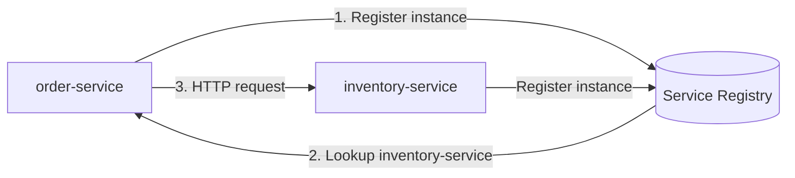

# Phân biệt tắt đăng ký, tắt truy vấn và tắt toàn bộ khám phá

Trong Spring Cloud Service Discovery, một ứng dụng có thể vừa cung cấp dịch vụ cho ứng dụng khác, vừa gọi các dịch vụ khác. Hai vai trò này dùng chung hạ tầng discovery nhưng thực hiện hai luồng độc lập:

- **Đăng ký (registration):** ứng dụng công bố thông tin instance của chính nó lên registry để provider khác có thể tìm thấy.
- **Truy vấn (discovery lookup):** ứng dụng đọc registry để tìm instance của dịch vụ mà nó muốn gọi.

Vì vậy, tắt đăng ký không đồng nghĩa với tắt truy vấn. Một ứng dụng có thể ngừng xuất hiện trong registry nhưng vẫn tìm và gọi được dịch vụ khác. Ngược lại, ứng dụng có thể tiếp tục đăng ký để provider khác gọi tới nhưng không tải danh sách dịch vụ từ registry.

Cần phân biệt thêm việc **tắt toàn bộ khám phá**: khi đó ứng dụng không còn sử dụng discovery client theo cơ chế đã cấu hình và cũng cần kiểm soát việc tự động đăng ký. Hiểu đúng ba chế độ giúp tránh vô tình làm mất khả năng phục vụ hoặc khả năng gọi dịch vụ khi thay đổi cấu hình.

## 1. Hai luồng độc lập trong Service Discovery

Giả sử hệ thống có hai ứng dụng:

- `order-service` cung cấp API tạo và xem đơn hàng.
- `inventory-service` cung cấp API kiểm tra tồn kho.

`order-service` có thể vừa đăng ký instance của chính nó, vừa tra cứu `inventory-service` để kiểm tra tồn kho. Hai hoạt động có thể mô tả như sau:



**Luồng đăng ký** thường diễn ra khi ứng dụng khởi động:

1. Discovery client lấy service ID, instance ID, host, port và metadata của ứng dụng.
2. Client gửi registration tới Eureka, Consul hoặc registry tương ứng.
3. Registry lưu instance và duy trì trạng thái bằng heartbeat, lease hoặc health check.
4. Khi ứng dụng dừng bình thường, client hủy đăng ký; nếu tiến trình chết đột ngột, registry dọn dẹp theo cơ chế hết hạn hoặc health check.

**Luồng truy vấn** diễn ra khi ứng dụng cần tìm provider:

1. Consumer yêu cầu danh sách instance theo service ID.
2. Discovery client đọc dữ liệu từ registry hoặc cache cục bộ.
3. Spring Cloud LoadBalancer có thể chọn một instance.
4. HTTP client gửi request tới host và port của instance được chọn.

Tắt một luồng không tự động tắt luồng còn lại. Đây là cơ sở để hiểu các thuộc tính cấu hình ở những phần tiếp theo.

## 2. Tắt đăng ký: ứng dụng không công bố instance của chính nó

Tắt đăng ký phù hợp khi ứng dụng vẫn cần gọi dịch vụ khác nhưng không muốn tự xuất hiện như một provider trong registry. Ví dụ:

- Một batch worker chỉ gọi các microservice khác, không nhận request từ microservice.
- Một ứng dụng quản trị cần tra cứu các service nhưng không cung cấp endpoint nghiệp vụ cho các service khác.
- Một Eureka client cần đọc registry nhưng không muốn đăng ký bản thân.

### Cấu hình chung của Spring Cloud

Spring Cloud Commons có thuộc tính điều khiển auto-registration:

```yaml
spring:
  cloud:
    service-registry:
      auto-registration:
        enabled: false
```

Thuộc tính này tắt cơ chế **tự động đăng ký** do Spring Cloud quản lý. Discovery client vẫn có thể được dùng để truy vấn registry nếu integration của provider còn được bật và được cấu hình tương ứng.

Cần phân biệt auto-registration với API đăng ký. Nếu ứng dụng tự gọi `ServiceRegistry.register(registration)` trong code, việc tắt auto-registration không nhất thiết ngăn lời gọi thủ công đó. Khi có logic đăng ký riêng, phải tắt hoặc thay đổi logic ấy theo chủ đích.

### Cấu hình riêng của Eureka

Eureka có thuộc tính `eureka.client.register-with-eureka`:

```yaml
eureka:
  client:
    register-with-eureka: false
    fetch-registry: true
```

Trong ví dụ này:

- `register-with-eureka: false`: Eureka client không đăng ký instance hiện tại lên Eureka server.
- `fetch-registry: true`: client vẫn lấy registry để tra cứu các service khác.

Ứng dụng vẫn có thể dùng `DiscoveryClient.getInstances("inventory-service")` hoặc HTTP client có `@LoadBalanced`, miễn là phần discovery và LoadBalancer còn được cấu hình.

Với Eureka, `register-with-eureka` là công tắc provider-specific rõ ràng cho hành vi đăng ký. Có thể kết hợp nó với thuộc tính auto-registration chung để cấu hình thể hiện rõ ý định của ứng dụng.

### Cấu hình riêng của Consul

Spring Cloud Consul cung cấp thuộc tính `spring.cloud.consul.discovery.register` để điều khiển việc đăng ký service:

```yaml
spring:
  cloud:
    consul:
      discovery:
        register: false
        enabled: true
```

Trong cấu hình này, `register: false` tắt đăng ký service của ứng dụng với Consul, còn integration discovery vẫn được bật để ứng dụng có thể sử dụng chức năng tra cứu theo khả năng của phiên bản đang dùng.

Các thuộc tính provider-specific có thể khác nhau giữa các phiên bản Spring Cloud. Khi dùng Consul, hãy kiểm tra đúng phiên bản dependency và cấu hình thực tế để xác nhận hành vi registration và lookup.

## 3. Tắt truy vấn: ứng dụng không tải danh sách registry

Tắt truy vấn phù hợp khi ứng dụng vẫn cần được các service khác tìm thấy nhưng bản thân nó không cần khám phá provider qua registry. Ví dụ:

- Một HTTP API chỉ nhận request từ các consumer khác.
- Một provider gọi các dependency bằng địa chỉ cố định hoặc qua một gateway khác.
- Một Eureka client chỉ đăng ký instance nhưng không cần tải registry về.

### Cấu hình riêng của Eureka

Eureka có thuộc tính `eureka.client.fetch-registry`:

```yaml
eureka:
  client:
    register-with-eureka: true
    fetch-registry: false
```

Trong ví dụ này:

- `register-with-eureka: true`: ứng dụng vẫn đăng ký instance của chính nó.
- `fetch-registry: false`: Eureka client không tải registry từ server để tra cứu các service khác.

Như vậy, ứng dụng vẫn có thể xuất hiện trong Eureka dashboard hoặc API registry, nhưng không có danh sách instance remote được cập nhật cho các thao tác discovery thông thường. Các lời gọi dựa trên service ID qua Spring Cloud LoadBalancer sẽ không thể tìm được provider từ registry đã tắt fetch.

Đây là ví dụ điển hình cho thấy tắt truy vấn không đồng nghĩa với tắt đăng ký.

### Spring Cloud Commons không có một công tắc fetch chung cho mọi provider

`DiscoveryClient` là abstraction chung, nhưng cơ chế lấy registry khác nhau giữa Eureka, Consul, Kubernetes và các provider khác. Không nên lấy tên thuộc tính `eureka.client.fetch-registry` rồi áp dụng cho mọi discovery client.

Nếu ứng dụng chỉ muốn ngừng một truy vấn nghiệp vụ cụ thể, có thể thay đổi code hoặc cấu hình của thành phần gọi dịch vụ đó. Việc này khác với tắt toàn bộ discovery client.

Với Consul, việc tra cứu có thể dựa trên API và cache của Consul client. Không nên giả định có một thuộc tính chung tương đương `fetch-registry` trong mọi phiên bản. Thuộc tính `spring.cloud.consul.discovery.enabled` điều khiển integration discovery của Consul và có phạm vi rộng hơn một thao tác fetch đơn lẻ; hãy kiểm tra tài liệu phiên bản trước khi dùng nó như công tắc chỉ tắt lookup.

## 4. Tắt toàn bộ khám phá: ngừng cả hai vai trò

Khi ứng dụng không cần đăng ký bản thân và cũng không cần tra cứu instance qua Spring Cloud Discovery, có thể tắt discovery ở phạm vi toàn cục và tắt auto-registration.

Cấu hình Spring Cloud Commons thường dùng:

```yaml
spring:
  cloud:
    discovery:
      enabled: false
    service-registry:
      auto-registration:
        enabled: false
```

Ý nghĩa:

- `spring.cloud.discovery.enabled: false` tắt auto-configuration discovery client chung của Spring Cloud.
- `spring.cloud.service-registry.auto-registration.enabled: false` tắt cơ chế tự động đăng ký service.

Nếu provider có công tắc enable riêng, cần kiểm tra và tắt integration đó khi mục tiêu là ngừng hoàn toàn client của provider. Ví dụ với Eureka:

```yaml
eureka:
  client:
    enabled: false
```

Với Consul, có thể tắt discovery integration bằng thuộc tính tương ứng:

```yaml
spring:
  cloud:
    consul:
      discovery:
        enabled: false
```

Phạm vi tác động chính xác phụ thuộc phiên bản Spring Cloud và provider. Một số integration còn có cấu hình riêng cho Consul agent, config, health check hoặc các tính năng khác; tắt discovery không nhất thiết tắt toàn bộ kết nối Consul được dùng cho mục đích khác.

Khi tắt toàn bộ discovery, cần kiểm tra code có còn yêu cầu bean `DiscoveryClient`, `ServiceRegistry`, `LoadBalancerClient` hoặc HTTP client gắn với service ID hay không. Nếu bean không được tạo hoặc không còn nguồn instance, ứng dụng có thể lỗi khi khởi động hoặc khi gửi request. Các thành phần phụ thuộc discovery nên được điều kiện hóa theo profile hoặc cấu hình tương ứng.

## 5. Ma trận cấu hình và hành vi

| Mục tiêu | Auto-registration | Eureka register | Eureka fetch | Discovery client |
|---|---:|---:|---:|---|
| Provider và consumer bình thường | Bật | Bật | Bật | Bật |
| Chỉ tắt đăng ký | Tắt | Tắt | Bật | Bật |
| Chỉ tắt truy vấn | Bật | Bật | Tắt | Vẫn có client nhưng không tải registry |
| Tắt cả đăng ký và fetch Eureka | Tắt | Tắt | Tắt | Integration vẫn có thể tồn tại nhưng không thực hiện hai luồng |
| Tắt discovery toàn cục | Tắt | Theo cấu hình provider | Theo cấu hình provider | Tắt auto-configuration chung |

Ma trận trên dùng Eureka làm ví dụ cho hai công tắc đăng ký và fetch độc lập. Với provider khác, cần ánh xạ theo thuộc tính riêng của integration; không áp dụng máy móc cột Eureka cho Consul hoặc Kubernetes.

Có thể ghi nhớ ba ý:

- **Tắt đăng ký:** ứng dụng không quảng bá instance của chính nó; vẫn có thể tra cứu provider.
- **Tắt truy vấn:** ứng dụng không lấy danh sách instance từ registry; vẫn có thể đăng ký để được gọi.
- **Tắt toàn bộ khám phá:** ứng dụng không sử dụng discovery client và không tự đăng ký; các lời gọi dựa trên service ID cần một cơ chế thay thế.

## 6. Các tình huống sử dụng thực tế

### Batch worker chỉ gọi dịch vụ khác

Một batch worker chạy theo lịch, không nhận HTTP request từ các microservice. Nó cần gọi `inventory-service` và `payment-service`.

Mục tiêu là tắt đăng ký, giữ truy vấn:

```yaml
spring:
  application:
    name: settlement-worker
  cloud:
    service-registry:
      auto-registration:
        enabled: false

eureka:
  client:
    register-with-eureka: false
    fetch-registry: true
```

Worker không xuất hiện như một provider trong Eureka nhưng vẫn có thể tra cứu hai dịch vụ cần gọi.

### Provider chỉ nhận request, không gọi dịch vụ bằng registry

Giả sử `public-catalog-service` nhận request từ gateway và gọi các hệ thống phụ trợ qua endpoint do nền tảng cung cấp. Ứng dụng vẫn cần đăng ký để gateway hoặc các consumer discovery khác tìm thấy nó, nhưng không cần tải registry.

Mục tiêu là giữ đăng ký, tắt fetch:

```yaml
spring:
  application:
    name: public-catalog-service

eureka:
  client:
    register-with-eureka: true
    fetch-registry: false
```

Gateway vẫn có thể tìm instance từ Eureka. Bản thân `public-catalog-service` không có registry cache để tra cứu các service ID khác.

### Ứng dụng chạy độc lập trong môi trường kiểm thử

Một ứng dụng được chạy riêng để kiểm thử logic nội bộ và không cần đăng ký hoặc tìm dịch vụ qua registry. Có thể tắt discovery trong profile kiểm thử:

```yaml
# application-test.yml
spring:
  cloud:
    discovery:
      enabled: false
    service-registry:
      auto-registration:
        enabled: false

eureka:
  client:
    enabled: false
```

Nếu code vẫn gọi service ID như `http://inventory-service`, request đó sẽ không tự phân giải thành instance. Trong profile test, cần mock client, dùng endpoint cố định hoặc cung cấp một implementation discovery phù hợp với bài kiểm thử.

## 7. Hệ quả với DiscoveryClient và LoadBalancer

`DiscoveryClient` là điểm truy vấn service ID. Khi discovery bị tắt hoặc provider không fetch registry, các thao tác như `getServices()` và `getInstances(serviceId)` có thể không trả dữ liệu như khi hoạt động bình thường. Hành vi cụ thể có thể là danh sách rỗng, không có bean, hoặc lỗi cấu hình tùy integration và phiên bản.

`Spring Cloud LoadBalancer` thường lấy danh sách instance thông qua discovery integration hoặc `ServiceInstanceListSupplier`. Nếu không có instance phù hợp, lời gọi bằng service ID có thể thất bại với lỗi dạng “No instances available”. Tắt fetch registry nhưng vẫn giữ code gọi service ID là một cấu hình không nhất quán về mặt chức năng.

Khi tắt discovery toàn cục:

- Các bean phụ thuộc discovery có thể không được tạo.
- Client-side load balancing dựa trên discovery không còn dữ liệu.
- Các URL dùng service ID không thể được giải quyết theo cơ chế discovery.
- Các thành phần quản trị hoặc health check dựa trên registry có thể không còn hoạt động.

Nếu cần gọi một dịch vụ khi discovery tắt, hãy chuyển sang hostname DNS, URL cố định, API gateway hoặc một cơ chế định vị khác đã được quản lý. Không nên giả định HTTP client tự biến service ID thành DNS name trong mọi cấu hình; hành vi phụ thuộc client và cấu hình LoadBalancer.

## 8. Cẩn trọng khi dùng cấu hình profile và biến môi trường

Các công tắc discovery thường được đặt khác nhau theo môi trường:

- Development có thể dùng registry local để tiện kiểm tra.
- Test có thể tắt đăng ký và thay discovery bằng mock hoặc danh sách instance tĩnh.
- Production thường bật các chức năng cần thiết theo vai trò provider/consumer.

Ví dụ, có thể dùng profile riêng:

```yaml
# application-worker.yml
spring:
  cloud:
    service-registry:
      auto-registration:
        enabled: false

eureka:
  client:
    register-with-eureka: false
    fetch-registry: true
```

Khi cấu hình bằng biến môi trường, cần dùng đúng tên thuộc tính theo quy tắc relaxed binding của Spring Boot và kiểm tra giá trị thực tế sau khi nạp profile. Nhiều nguồn cấu hình có thể ghi đè nhau; một profile được kích hoạt ngoài dự kiến có thể làm tắt fetch hoặc registration.

Không nên chỉ dựa vào việc ứng dụng khởi động thành công để kết luận discovery đang hoạt động. Hãy xác minh registry và hành vi truy vấn thực tế.

## 9. Cách kiểm chứng từng chế độ

Sau khi thay đổi cấu hình, hãy kiểm tra cả phía provider và consumer:

| Kiểm tra | Chỉ tắt đăng ký | Chỉ tắt truy vấn | Tắt toàn bộ |
|---|---|---|---|
| Instance của ứng dụng xuất hiện trong registry | Không | Có | Không |
| Ứng dụng lấy được instance của service khác | Có | Không qua registry fetch | Không |
| Gọi HTTP bằng service ID qua LoadBalancer | Có, nếu có instance | Thường thất bại do không có registry data | Không hoạt động qua discovery |
| Discovery client auto-configuration | Bật | Bật | Tắt theo cấu hình chung |
| Auto-registration | Tắt | Bật | Tắt |

Có thể kiểm tra theo các bước:

1. Xem log khởi động để xác định discovery client và auto-registration có được bật hay không.
2. Mở Eureka dashboard hoặc Consul UI/API để kiểm tra instance của ứng dụng.
3. Gọi `DiscoveryClient.getInstances("inventory-service")` để kiểm tra danh sách instance mà consumer nhìn thấy.
4. Thử một lời gọi HTTP qua service ID để xác minh LoadBalancer có chọn được instance không.
5. Kiểm tra log lỗi khi registry không được fetch hoặc discovery client không được tạo.
6. Đối chiếu profile và biến môi trường đang thực sự được kích hoạt.

Kết quả phải khớp với mục tiêu. Ví dụ, ở chế độ chỉ tắt đăng ký, ứng dụng không xuất hiện trong registry nhưng vẫn tra cứu được provider. Nếu cả hai điều này đều thất bại, có thể cấu hình đã tắt discovery rộng hơn dự kiến hoặc registry đang có lỗi.

## 10. Các lỗi thường gặp

| Hiện tượng | Nguyên nhân có thể | Cách xử lý |
|---|---|---|
| Ứng dụng không xuất hiện trong registry nhưng vẫn gọi được service khác | Auto-registration đã tắt đúng mục tiêu | Không cần sửa nếu đây là vai trò consumer-only |
| Ứng dụng xuất hiện trong registry nhưng không tìm thấy service khác | Fetch registry đã tắt | Bật lại fetch nếu ứng dụng cần tra cứu |
| LoadBalancer báo không có instance | Fetch bị tắt, sai service ID hoặc registry chưa có instance healthy | Kiểm tra fetch, tên service và health |
| Không inject được DiscoveryClient | Discovery auto-configuration hoặc provider integration đã tắt | Điều kiện hóa bean hoặc bật lại discovery |
| Vẫn thấy instance sau khi tắt auto-registration | Registration cũ còn tồn tại, deregistration chưa chạy hoặc cấu hình provider-specific chưa tắt | Kiểm tra registration cũ và công tắc của provider |
| Ứng dụng vẫn tự đăng ký dù đã tắt auto-registration | Code có lời gọi đăng ký thủ công hoặc provider có cơ chế riêng | Tìm logic register và cấu hình integration |
| Profile test tắt discovery nhưng request vẫn dùng service ID | Code vẫn phụ thuộc LoadBalancer/discovery | Mock client hoặc cung cấp endpoint thay thế |

Tắt đăng ký không tự động xóa bản ghi cũ đã tồn tại trong registry. Nếu ứng dụng đã đăng ký trước đó, cần để discovery client deregister đúng instance hoặc xử lý registration cũ theo công cụ quản trị của provider. Không xóa theo service ID một cách tùy tiện vì có thể ảnh hưởng các replica khác.

## 11. Checklist trước khi tắt discovery

Trước khi thay đổi công tắc, hãy xác định:

1. Ứng dụng có cung cấp API để service khác gọi hay chỉ là consumer?
2. Ứng dụng có cần xuất hiện trong registry không?
3. Ứng dụng có gọi provider bằng service ID qua DiscoveryClient hoặc LoadBalancer không?
4. Đang dùng Eureka, Consul, Kubernetes hay provider nào khác?
5. Thuộc tính đang thay đổi là thuộc tính chung hay provider-specific?
6. Có registration cũ cần deregister hoặc dọn dẹp không?
7. Các bean và HTTP client có phụ thuộc discovery không?
8. Khi discovery tắt, endpoint thay thế là DNS, URL cố định, gateway hay mock?
9. Profile và biến môi trường nào có thể ghi đè cấu hình?
10. Đã kiểm chứng cả đăng ký lẫn truy vấn theo đúng mục tiêu chưa?

Điểm cốt lõi là registration và lookup là hai chức năng riêng biệt. Tắt registration giúp một ứng dụng không công bố bản thân nhưng vẫn có thể gọi provider; tắt fetch/lookup giúp ứng dụng không tải danh sách registry nhưng vẫn có thể được consumer khác tìm thấy; tắt toàn bộ discovery cần ngừng cả auto-registration và discovery client theo cấu hình chung cùng provider. Chọn đúng phạm vi sẽ giữ được vai trò cần thiết của từng microservice và tránh lỗi “không có instance” khi triển khai.
