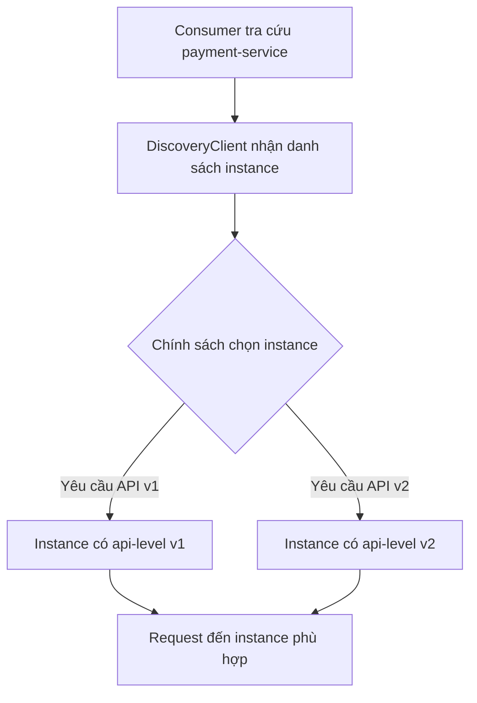

# Phân biệt tên dịch vụ, mã phiên bản chạy và phiên bản phần mềm

Trong hệ thống microservice, một dịch vụ có thể được triển khai thành nhiều instance và mỗi instance có thể chạy một bản phát hành phần mềm cụ thể. Khi tra cứu dịch vụ, cần phân biệt ba thông tin thường xuất hiện cạnh nhau: **tên dịch vụ**, **mã định danh instance** và **phiên bản phần mềm**. Chúng trả lời ba câu hỏi khác nhau: consumer cần gọi dịch vụ logic nào, cần kết nối đến bản chạy cụ thể nào và bản chạy đó đang sử dụng phiên bản phần mềm nào.

Trong Spring Cloud, service discovery giúp consumer tìm instance theo tên dịch vụ thông qua `DiscoveryClient`, `ServiceRegistry` và các registry như Eureka hoặc Consul. Registry lưu thông tin của từng instance; thông tin phiên bản phần mềm thường được công bố qua metadata hoặc tag để hệ thống triển khai và định tuyến có thể sử dụng. Hiểu đúng ba loại định danh giúp tránh đăng ký trùng, tra cứu sai dịch vụ và chọn nhầm phiên bản trong giai đoạn nâng cấp.

## 1. Ba khái niệm trả lời ba câu hỏi khác nhau

Giả sử hệ thống thanh toán có dịch vụ logic `payment-service`. Dịch vụ này đang chạy ba instance trên các máy hoặc container khác nhau. Hai instance sử dụng bản phát hành `2.4.1`, instance còn lại đang thử nghiệm bản `2.5.0`.

| Khái niệm | Câu hỏi được trả lời | Ví dụ | Phạm vi và vòng đời |
|---|---|---|---|
| Tên dịch vụ (service name/service ID) | Consumer muốn tìm dịch vụ logic nào? | `payment-service` | Ổn định qua nhiều lần triển khai; dùng để nhóm các instance cùng dịch vụ. |
| Mã định danh instance (instance ID) | Đây là bản chạy cụ thể nào? | `payment-service:pay-02:8082` | Riêng cho từng instance đang chạy; có thể thay đổi khi container, pod hoặc tiến trình được tạo lại. |
| Phiên bản phần mềm (software version) | Instance đang chạy bản phát hành hoặc build nào? | `2.4.1` hoặc `2.5.0` | Gắn với artifact được triển khai; thường giữ nguyên trong suốt vòng đời của một instance. |

Ba giá trị có liên quan nhưng không thể thay thế cho nhau. Một dịch vụ có thể có nhiều instance; nhiều instance có thể chạy cùng một phiên bản phần mềm; trong giai đoạn rolling deployment, các instance của cùng dịch vụ còn có thể chạy các phiên bản phần mềm khác nhau.

## 2. Tên dịch vụ: định danh logic để tra cứu

Tên dịch vụ đại diện cho năng lực hoặc API logic mà một nhóm instance cùng cung cấp. Trong ứng dụng Spring Boot, tên này thường được khai báo bằng `spring.application.name`:

```yaml
spring:
  application:
    name: payment-service
```

Với Eureka, Eureka client dùng tên ứng dụng này để đăng ký instance vào application tương ứng trong registry. Với các triển khai Spring Cloud khác, tên đăng ký có thể được ánh xạ thành service ID hoặc service name theo cơ chế của registry.

Consumer tra cứu tên dịch vụ thay vì lưu địa chỉ IP và port cố định. Ví dụ, khi gọi `payment-service`, discovery client trả về danh sách instance đang được đăng ký dưới tên logic đó. Spring Cloud LoadBalancer có thể dùng danh sách này để chọn một instance cho request.

Tên dịch vụ nên có các đặc điểm:

- **Ổn định:** không đổi theo hostname, pod, port hay mỗi lần build phần mềm.
- **Có ý nghĩa:** thể hiện dịch vụ logic, chẳng hạn `order-service`, `payment-service` hoặc `inventory-service`.
- **Nhất quán:** tất cả instance thuộc cùng dịch vụ dùng cùng tên; consumer tra cứu đúng tên đó.
- **Được quản lý có chủ đích:** đổi tên dịch vụ có thể ảnh hưởng đến mọi consumer, cấu hình gateway, policy và dashboard.

Không nên đưa hostname hoặc mã pod vào `spring.application.name`, vì khi mỗi replica có một tên ứng dụng khác nhau, registry sẽ coi chúng là những dịch vụ logic khác nhau. Cũng không nên thay tên dịch vụ theo từng bản phát hành thông thường, vì điều đó khiến consumer phải biết tên của từng phiên bản phần mềm.

### 2.1. Service name không phải địa chỉ mạng

`payment-service` là tên logic, không phải hostname DNS hay IP. Registry ánh xạ tên logic này đến các instance có địa chỉ truy cập cụ thể. Ví dụ:

```text
payment-service
├── payment-01.internal:8082
├── payment-02.internal:8082
└── payment-03.internal:8082
```

Khi một instance được thay thế bằng container mới có địa chỉ khác, tên dịch vụ vẫn có thể giữ nguyên. Consumer tiếp tục tra cứu `payment-service` và nhận danh sách đã được cập nhật theo registry.

## 3. Instance ID: định danh một bản chạy cụ thể

Instance ID phân biệt từng bản triển khai đang đăng ký trong một dịch vụ. Hai instance của `payment-service` có thể có cùng service name nhưng phải được nhận diện riêng để registry cập nhật, gia hạn lease và hủy đăng ký đúng bản ghi.

Ví dụ:

| Service name | Instance ID | Host | Port |
|---|---|---|---:|
| `payment-service` | `payment-01:8082` | `payment-01.internal` | 8082 |
| `payment-service` | `payment-02:8082` | `payment-02.internal` | 8082 |
| `payment-service` | `payment-03:8082` | `payment-03.internal` | 8082 |

Các instance có cùng service name để consumer tìm theo một dịch vụ, nhưng mỗi instance ID xác định một bản chạy riêng. Khi một instance gửi heartbeat, cập nhật status hoặc deregister, registry cần biết bản ghi nào đang được thao tác.

### 3.1. Yêu cầu đối với instance ID

Một instance ID nên đáp ứng các yêu cầu sau:

1. **Duy nhất trong phạm vi service:** hai instance đang hoạt động đồng thời không nên dùng cùng ID trong một application/service registration.
2. **Ổn định trong vòng đời instance:** heartbeat và deregistration phải tham chiếu đúng ID đã đăng ký lúc khởi động.
3. **Có thể truy vết:** ID nên giúp người vận hành liên hệ bản ghi registry với hostname, pod, container hoặc tiến trình tương ứng.
4. **Có thể thay đổi khi thay instance:** khi pod bị thay thế hoặc tiến trình được tạo mới, ID mới có thể được sinh ra để phân biệt vòng đời mới.

Không dùng phiên bản phần mềm làm instance ID. Nếu cả ba replica đều chạy `2.4.1` và cùng đăng ký ID `2.4.1`, registry không thể phân biệt rõ từng bản chạy. Tương tự, không dùng riêng `payment-service` làm instance ID khi dịch vụ có nhiều replica.

### 3.2. Instance ID trong Eureka

Trong Spring Cloud Netflix Eureka, có thể cấu hình instance ID bằng `eureka.instance.instance-id`. Ví dụ:

```yaml
spring:
  application:
    name: payment-service

server:
  port: 8082

eureka:
  instance:
    instance-id: ${spring.application.name}:${server.port}:${random.value}
```

Ví dụ trên tạo ID từ tên dịch vụ, port và một giá trị ngẫu nhiên do Spring Boot cung cấp. Trong hệ thống thực tế, có thể dùng hostname, pod name hoặc UID của workload để ID dễ đối chiếu với nền tảng triển khai. Cần bảo đảm giá trị được giữ ổn định trong vòng đời của instance và không trùng với instance đang chạy khác.

Không có một định dạng instance ID duy nhất phù hợp cho mọi môi trường. Với container orchestration, pod UID thường giúp phân biệt các pod được tạo lại dù tên ứng dụng và port không đổi. Nếu dùng hostname và port, cần xem xét khả năng nhiều replica chia sẻ cùng hostname hoặc dùng port mapping khác nhau.

## 4. Phiên bản phần mềm: xác định artifact đang chạy

Phiên bản phần mềm cho biết instance đang chạy bản phát hành hoặc build nào của dịch vụ. Ví dụ `2.4.1`, `2.5.0-rc.1` hoặc một commit SHA. Giá trị này thường được tạo trong quá trình build và đưa vào cấu hình triển khai.

Phiên bản phần mềm có thể giúp:

- Xác định instance nào đang chạy bản phát hành cần kiểm tra.
- Theo dõi rolling deployment khi nhiều phiên bản cùng tồn tại.
- Thực hiện canary release hoặc phân nhóm traffic theo phiên bản.
- Hỗ trợ rollback, điều tra lỗi và đối chiếu với artifact/container image.
- Kiểm tra khả năng tương thích giữa consumer và provider khi có quy ước tương thích rõ ràng.

Phiên bản phần mềm không nhất thiết là service name hoặc instance ID. Các replica được tạo từ cùng một image thường có cùng software version nhưng mỗi replica vẫn cần instance ID riêng. Khi phát hành bản mới, service name thường giữ nguyên trong khi metadata version thay đổi trên các instance mới.

### 4.1. Phân biệt software version và API version

Software version mô tả bản phát hành của artifact. API version mô tả hợp đồng giao tiếp mà consumer sử dụng. Hai khái niệm có liên quan nhưng không đồng nhất.

Ví dụ, bản phát hành `payment-service` `2.5.0` có thể vẫn cung cấp API `/api/v1/payments` để tương thích với consumer cũ. Một bản phát hành khác có thể cung cấp đồng thời `/api/v1` và `/api/v2`. Vì vậy:

- `version=2.5.0` có thể mô tả artifact đang chạy.
- `api-version=v1` hoặc `api-level=v1,v2` có thể mô tả hợp đồng API được hỗ trợ.
- Chính sách định tuyến cần dựa trên yêu cầu tương thích API hoặc khả năng của instance, không nên suy luận mọi thứ chỉ từ số phiên bản phần mềm.

Khi cần quản lý tương thích, hãy công bố một metadata riêng như `api-level`, `protocol-version` hoặc `capabilities`. Quy ước phải được provider và consumer thống nhất.

### 4.2. Semantic Versioning và build identity

Nếu dự án áp dụng Semantic Versioning, định dạng phổ biến là `MAJOR.MINOR.PATCH`:

- `MAJOR`: thay đổi có thể phá vỡ tương thích.
- `MINOR`: bổ sung chức năng theo cách tương thích ngược.
- `PATCH`: sửa lỗi tương thích ngược.

Các hậu tố như `-SNAPSHOT`, `-rc.1` hoặc build metadata có thể được dùng theo quy ước phát hành. Không nên so sánh version bằng chuỗi thông thường, ví dụ so sánh từ điển có thể cho kết quả sai giữa `2.10.0` và `2.9.0`. Khi cần so sánh thứ tự phiên bản, sử dụng bộ phân tích Semantic Versioning hoặc quy tắc version mà tổ chức đã thống nhất.

Trong môi trường CI/CD, nên công bố thêm build identity như Git commit SHA, image tag hoặc image digest. Software version cho người dùng biết bản phát hành; build identity giúp xác định chính xác artifact đã được tạo từ mã nguồn nào. Nếu tag có thể bị ghi đè, image digest là định danh bất biến đáng tin cậy hơn để truy vết artifact.

## 5. Cấu trúc ba loại thông tin trong registry

Một registry record thường chứa tên dịch vụ, thông tin định danh instance, địa chỉ truy cập và metadata. Với Eureka, có thể hình dung mối quan hệ như sau:

```text
Eureka Server
└── Application: PAYMENT-SERVICE
    ├── InstanceInfo
    │   ├── instanceId: payment-01:8082
    │   ├── hostName: payment-01.internal
    │   ├── port: 8082
    │   └── metadata:
    │       ├── version: 2.4.1
    │       └── api-level: v1
    ├── InstanceInfo
    │   ├── instanceId: payment-02:8082
    │   ├── hostName: payment-02.internal
    │   ├── port: 8082
    │   └── metadata:
    │       ├── version: 2.4.1
    │       └── api-level: v1
    └── InstanceInfo
        ├── instanceId: payment-03:8082
        ├── hostName: payment-03.internal
        ├── port: 8082
        └── metadata:
            ├── version: 2.5.0
            └── api-level: v1,v2
```

Trong ví dụ:

- `PAYMENT-SERVICE` là application/service name, dùng để nhóm các instance.
- `payment-01:8082`, `payment-02:8082` và `payment-03:8082` là các instance ID khác nhau.
- `2.4.1` và `2.5.0` là software version được công bố trong metadata.
- `api-level` mô tả khả năng tương thích API theo quy ước của hệ thống.

Consumer tra cứu `payment-service` sẽ nhận danh sách các instance. Nếu cần chỉ gọi bản có API v2, consumer hoặc cơ chế định tuyến phải đọc metadata `api-level` và áp dụng policy tương ứng. Bản thân việc một instance có `version=2.5.0` không khiến Eureka tự động ưu tiên hoặc lọc instance đó.

## 6. Biểu diễn trong Spring Cloud

Spring Cloud cung cấp abstraction `ServiceInstance` để biểu diễn một instance được discovery tìm thấy. Các thông tin thường được truy cập gồm:

| Thông tin | Vai trò |
|---|---|
| `getServiceId()` | Tên dịch vụ hoặc service ID mà instance thuộc về. |
| `getInstanceId()` | Mã định danh instance nếu implementation cung cấp. |
| `getHost()` | Hostname hoặc địa chỉ host được công bố. |
| `getPort()` | Port dùng để kết nối. |
| `isSecure()` | Cho biết instance được mô tả là sử dụng kết nối bảo mật hay không. |
| `getMetadata()` | Map metadata do registry/client cung cấp, có thể chứa version, zone hoặc capability. |

`ServiceInstance` là abstraction chung. Cách một registry lưu service name, instance ID, tags và metadata phụ thuộc implementation. Eureka thường biểu diễn dữ liệu instance bằng `InstanceInfo`; Consul có mô hình service registration và các trường metadata/tags riêng. Khi chuyển registry, cần kiểm tra cách ánh xạ của implementation đang dùng, không giả định mọi field có tên và hành vi giống nhau.

### 6.1. Ví dụ cấu hình Eureka client

Một cấu hình minh họa cho service `payment-service`:

```yaml
spring:
  application:
    name: payment-service

server:
  port: 8082

eureka:
  client:
    service-url:
      defaultZone: http://localhost:8761/eureka/
  instance:
    instance-id: ${spring.application.name}:${server.port}:${random.value}
    metadata-map:
      version: ${APP_VERSION:2.4.1}
      git-commit: ${GIT_COMMIT:local}
      api-level: v1
      zone: zone-a
```

Trong cấu hình trên:

- `spring.application.name` đặt tên dịch vụ logic.
- `instance-id` định danh một instance cụ thể.
- `metadata-map.version` công bố phiên bản artifact.
- `metadata-map.git-commit` hỗ trợ truy vết build.
- `metadata-map.api-level` mô tả hợp đồng API theo quy ước của ứng dụng.
- `metadata-map.zone` cho biết vùng triển khai nếu hệ thống có sử dụng thông tin zone.

Biến môi trường `APP_VERSION` và `GIT_COMMIT` có thể được pipeline triển khai cung cấp. Giá trị mặc định trong ví dụ chỉ phục vụ chạy thử; môi trường production nên cung cấp version và commit thực của artifact. Mỗi instance của cùng một bản phát hành cần công bố metadata nhất quán.

`metadata-map` là cách Eureka client công bố metadata cho instance. Đây không phải một trường version có ngữ nghĩa đặc biệt do Eureka tự diễn giải. Eureka lưu và truyền metadata; ứng dụng hoặc thành phần định tuyến chịu trách nhiệm hiểu và sử dụng các key đó.

### 6.2. Đọc metadata từ DiscoveryClient

Consumer có thể lấy danh sách instance theo service ID bằng `DiscoveryClient`:

```java
import java.util.List;
import java.util.stream.Collectors;

import org.springframework.cloud.client.ServiceInstance;
import org.springframework.cloud.client.discovery.DiscoveryClient;
import org.springframework.stereotype.Service;

@Service
public class PaymentInstanceLookup {

    private final DiscoveryClient discoveryClient;

    public PaymentInstanceLookup(DiscoveryClient discoveryClient) {
        this.discoveryClient = discoveryClient;
    }

    public List<ServiceInstance> findApiV1Instances() {
        return discoveryClient.getInstances("payment-service")
                .stream()
                .filter(instance -> {
                    String apiLevel = instance.getMetadata().get("api-level");
                    return apiLevel != null &&
                            List.of(apiLevel.split(",")).contains("v1");
                })
                .collect(Collectors.toList());
    }
}
```

Ví dụ dùng `List.of`, có trong Java 9 trở lên. Nếu ứng dụng dùng Java 8, có thể thay phần kiểm tra bằng `Arrays.asList(apiLevel.split(","))`. Đây là ví dụ minh họa việc đọc metadata; trong hệ thống thực tế cần xử lý trường hợp không tìm thấy instance, metadata thiếu hoặc registry chưa cập nhật.

Việc lọc metadata bằng `DiscoveryClient` chỉ tạo ra danh sách ứng viên. Nó chưa tự gắn chính sách này vào mọi request. Nếu muốn lựa chọn instance theo version cho từng request, cần tích hợp policy với Spring Cloud LoadBalancer, gateway hoặc lớp định tuyến của ứng dụng.

## 7. Version metadata không tự động là cơ chế load balancing

Eureka lưu metadata và cung cấp danh sách instance cho client. Mặc định, việc một instance công bố `version=2.5.0` không có nghĩa Eureka Server sẽ tự chọn instance đó cho consumer. Spring Cloud LoadBalancer cũng cần được cấu hình hoặc mở rộng nếu muốn lựa chọn dựa trên metadata.

Ví dụ, một đợt triển khai rolling có thể diễn ra như sau:



Chính sách chọn instance phải xác định rõ:

- Consumer nào được gọi phiên bản API nào.
- Instance nào đáp ứng hợp đồng API đó.
- Cách xử lý khi không có instance tương thích.
- Cách tránh gửi request đến instance đã rời registry nhưng còn nằm trong cache.
- Cách chuyển traffic dần trong canary hoặc blue-green deployment.

Không nên chỉ so sánh chuỗi `version` trong load balancer rồi mặc định phiên bản lớn hơn luôn tốt hơn. Phiên bản mới có thể thay đổi hành vi, chưa được kiểm thử với consumer cụ thể hoặc chưa hỗ trợ API mà consumer yêu cầu.

## 8. Chọn cách tổ chức service name và software version

Không có một chiến lược duy nhất cho mọi hệ thống. Có thể lựa chọn dựa trên mức độ tương thích API và cách định tuyến.

### 8.1. Giữ một service name, công bố version trong metadata

Ví dụ, các instance đều đăng ký dưới `payment-service`, một số instance có `version=2.4.1`, một số có `version=2.5.0`.

Phù hợp khi:

- Các bản phát hành vẫn tương thích với cùng một nhóm consumer.
- Hệ thống triển khai rolling update và chấp nhận nhiều phiên bản cùng tồn tại trong thời gian ngắn.
- Cần quan sát version hoặc thực hiện canary bằng policy định tuyến có kiểm soát.

Ưu điểm là service name ổn định và consumer không phải thay tên dịch vụ mỗi lần phát hành. Hệ thống cần có cách lựa chọn instance tương thích nếu các phiên bản khác nhau không thể phục vụ cùng một request.

### 8.2. Dùng service name riêng cho hợp đồng API không tương thích

Nếu hai nhóm instance cung cấp hợp đồng API khác nhau và cần được định tuyến tách biệt, hệ thống có thể đăng ký dưới các service ID riêng, chẳng hạn `payment-service-v1` và `payment-service-v2`.

Cách này làm rõ ranh giới tương thích và giúp consumer chọn đích rõ ràng. Đổi lại, consumer, gateway và cấu hình vận hành phải quản lý nhiều service name. Không nên tạo service name mới cho từng bản patch hoặc từng build nếu các bản đó vẫn thuộc cùng một dịch vụ logic.

### 8.3. Kết hợp service name, API version và software version

Trong hệ thống lớn, có thể dùng ba thông tin riêng:

| Thuộc tính | Ví dụ | Mục đích |
|---|---|---|
| `serviceId` | `payment-service` | Tìm dịch vụ logic. |
| `api-level` | `v2` | Xác định hợp đồng giao tiếp được hỗ trợ. |
| `version` | `2.5.0` | Xác định bản phát hành phần mềm. |
| `git-commit` | `8f31c2a` | Truy vết mã nguồn tạo artifact. |
| `instanceId` | `payment-03:8082:abc123` | Phân biệt bản chạy cụ thể. |

Với cách tổ chức này, consumer tìm dịch vụ theo `serviceId`, sau đó chính sách tương thích dựa trên `api-level`. Người vận hành dùng `version` và `git-commit` để biết chính xác bản phát hành nào đang chạy. `instanceId` giúp xác định host hoặc container cần điều tra.

## 9. Các lỗi thường gặp khi nhầm lẫn định danh

| Hiện tượng | Nguyên nhân | Cách xử lý |
|---|---|---|
| Mỗi replica xuất hiện như một service khác nhau | Đưa hostname, pod name hoặc instance ID vào `spring.application.name`. | Dùng một service name ổn định cho các replica; chuyển thông tin từng bản chạy sang instance ID. |
| Registry chỉ hiển thị một instance dù có nhiều replica | Các replica đăng ký cùng một instance ID và cập nhật cùng một bản ghi. | Tạo instance ID duy nhất cho từng replica; kiểm tra cấu hình của từng deployment. |
| Consumer tra cứu đúng service nhưng gọi nhầm phiên bản | Consumer chỉ dùng service ID và không áp dụng policy dựa trên metadata/API compatibility. | Công bố metadata rõ ràng và tích hợp chính sách lựa chọn instance vào lớp định tuyến phù hợp. |
| Dashboard cho thấy version không đúng | Metadata được đóng cứng trong cấu hình hoặc pipeline truyền sai biến môi trường. | Đưa version/build identity từ artifact pipeline vào deployment và xác minh registry sau khi khởi động. |
| Instance mới vẫn mang metadata của bản cũ | Container hoặc cấu hình cũ được tái sử dụng, hoặc rollout chưa thay thế hết replica. | Kiểm tra image digest, build variables và danh sách instance theo từng ID. |
| Không thể xác định artifact gây lỗi | Chỉ công bố version chung, không có build identity hoặc image digest. | Bổ sung commit SHA và thông tin artifact bất biến vào metadata hoặc hệ thống quan sát. |
| So sánh `2.10.0` và `2.9.0` cho kết quả sai | Dùng so sánh chuỗi thay cho bộ phân tích version. | Parse theo Semantic Versioning hoặc quy tắc version chính thức của dự án. |

Khi điều tra, hãy đối chiếu service name, instance ID, host/port, software version và build identity trên cùng một bản ghi. Sau đó kiểm tra trạng thái triển khai thực tế để biết bản ghi trong registry có phản ánh đúng workload đang chạy hay không.

## 10. Nguyên tắc vận hành

- Giữ `spring.application.name` ổn định và thống nhất giữa các replica của cùng một dịch vụ.
- Tạo instance ID riêng cho từng bản chạy; không dùng service name hoặc software version làm instance ID.
- Đưa software version và build identity vào metadata từ pipeline triển khai để tránh sai lệch do nhập tay.
- Định nghĩa riêng metadata cho API compatibility hoặc capability; không suy luận hợp đồng API chỉ từ software version.
- Thống nhất tên key và định dạng metadata giữa provider, consumer, dashboard và công cụ vận hành.
- Không lưu password, token, private key hoặc thông tin bí mật trong metadata của registry.
- Xem xét độ trễ của registry và client cache khi rollout; không giả định mọi consumer thấy version mới cùng thời điểm.
- Nếu lọc instance theo metadata, cần có hành vi dự phòng khi metadata thiếu, không hợp lệ hoặc không có instance tương thích.
- Theo dõi tỷ lệ instance theo version trong suốt quá trình triển khai và sau khi rollout hoàn tất.

## Kết luận

Tên dịch vụ xác định nhóm chức năng logic mà consumer muốn tìm; instance ID xác định một bản chạy cụ thể trong nhóm đó; software version xác định artifact đang được thực thi. Trong Spring Cloud, service discovery chủ yếu tra cứu theo service ID và trả về các `ServiceInstance`; thông tin version thường được công bố qua metadata hoặc tag để ứng dụng và cơ chế định tuyến sử dụng.

Giữ ba khái niệm tách biệt giúp registry phản ánh đúng topology, hỗ trợ nhiều replica và nhiều bản phát hành cùng tồn tại trong quá trình nâng cấp. Khi cần định tuyến theo khả năng tương thích, hãy công bố API version hoặc capability riêng và triển khai policy lựa chọn instance có chủ đích.
