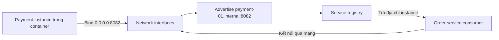

# Chọn hostname hoặc địa chỉ IP được công bố

Khi một microservice đăng ký với service registry, nó phải công bố địa chỉ mà consumer có thể dùng để kết nối đến instance. Địa chỉ đó thường là hostname hoặc IP, đi cùng port và thông tin giao thức. Chọn sai địa chỉ có thể khiến registry hiển thị instance `UP` nhưng consumer vẫn không kết nối được.

Trong Spring Cloud, service discovery giúp tìm instance theo tên dịch vụ thông qua `DiscoveryClient`, `ServiceRegistry` và các registry như Eureka hoặc Consul. Tên dịch vụ xác định nhóm logic; hostname/IP được công bố xác định đường mạng đến từng bản chạy. Vì vậy, quyết định chọn hostname hay IP phải dựa trên góc nhìn mạng của consumer, cách DNS được quản lý và topology triển khai.

## 1. Địa chỉ được công bố là gì?

Khi ứng dụng khởi động, service registry cần biết địa chỉ để consumer kết nối đến instance. Một bản ghi có thể chứa:

- Service name, ví dụ `payment-service`.
- Instance ID, ví dụ `payment-01:8082`.
- Hostname hoặc IP được công bố.
- Port HTTP/HTTPS.
- Metadata như zone, version hoặc nhóm triển khai.
- Trạng thái health hoặc lease tùy registry.

Ví dụ, hai instance cùng thuộc `payment-service` có thể đăng ký:

| Instance | Địa chỉ được công bố | Port |
|---|---|---:|
| `payment-01` | `payment-01.internal.example` | 8082 |
| `payment-02` | `10.20.0.22` | 8082 |

Consumer tra cứu `payment-service`, nhận danh sách instance và dùng địa chỉ cùng port để gửi request. Địa chỉ được công bố vì thế phải có ý nghĩa từ phía consumer, không chỉ từ bên trong tiến trình provider.

## 2. Phân biệt địa chỉ bind và địa chỉ advertise

Đây là điểm dễ gây nhầm lẫn nhất khi cấu hình service discovery.

- **Bind address** là địa chỉ/interface mà server lắng nghe kết nối đến.
- **Advertised address** là hostname hoặc IP mà ứng dụng công bố cho registry để consumer sử dụng.

Hai địa chỉ có thể khác nhau. Ví dụ, ứng dụng trong container lắng nghe trên mọi interface bằng `0.0.0.0:8082`, nhưng consumer ở mạng nội bộ phải truy cập container qua `payment-01.internal.example:8082`.

`0.0.0.0` có nghĩa là bind trên mọi IPv4 interface. Đây không phải địa chỉ đích để consumer gọi. Tương tự, `127.0.0.1` hoặc `localhost` chỉ trỏ về chính máy/container của consumer; nếu registry công bố địa chỉ loopback này, consumer khác sẽ kết nối nhầm vào máy của chính nó.



`server.address` trong Spring Boot liên quan đến địa chỉ bind của web server. Cấu hình hostname/IP cho Eureka hoặc Consul liên quan đến địa chỉ đăng ký. Đổi `server.address` không nhất thiết thay đổi địa chỉ được công bố trong registry, và đổi địa chỉ được công bố cũng không làm server tự động lắng nghe trên interface đó.

## 3. Khi nào nên chọn hostname?

Hostname phù hợp khi hệ thống có DNS nội bộ đáng tin cậy và tên máy ổn định hơn IP. Ví dụ `payment-01.internal.example` có thể luôn trỏ đến địa chỉ hiện tại của instance, kể cả khi hạ tầng thay đổi IP sau khi tái tạo máy.

Ưu điểm của hostname:

- **Tách tên logic khỏi địa chỉ IP:** có thể đổi IP bằng cách cập nhật DNS mà không cần thay tên được công bố.
- **Dễ đọc và vận hành:** hostname thường giúp xác định môi trường, node hoặc zone nhanh hơn một địa chỉ số.
- **Hỗ trợ thay đổi hạ tầng:** có thể duy trì tên DNS ổn định khi VM hoặc máy chủ được thay thế.
- **Phù hợp với TLS:** chứng thư số thường được cấp cho DNS name và có thể xác thực hostname khi client kết nối HTTPS.

Hostname chỉ hữu ích nếu consumer phân giải được tên đó. Một tên chỉ tồn tại trong `/etc/hosts` của provider hoặc trong DNS riêng của một subnet sẽ không giúp consumer ở mạng khác kết nối được.

### 3.1. Rủi ro khi dùng hostname

- DNS có thể không phân giải được từ một số subnet, container hoặc cluster.
- Bản ghi DNS có thể trỏ đến IP cũ trong thời gian TTL hoặc do resolver cache.
- Một hostname có thể trả về nhiều IP; điều này có thể tạo thêm một lớp load balancing ngoài registry.
- Split-horizon DNS có thể trả về địa chỉ khác nhau tùy mạng. Đây có thể là chủ đích, nhưng cần bảo đảm mọi kết quả đều truy cập đúng instance.
- Tên DNS có thể trỏ đến load balancer hoặc reverse proxy thay vì instance cụ thể; khi đó registry đang đại diện cho endpoint trung gian chứ không phải từng replica.

Nếu mỗi instance được đăng ký riêng, nên công bố hostname riêng cho từng instance, chẳng hạn `payment-01.internal.example` và `payment-02.internal.example`. Tránh đăng ký nhiều instance với cùng một hostname đại diện cho một service VIP nếu consumer kỳ vọng registry cung cấp địa chỉ từng replica.

## 4. Khi nào nên chọn địa chỉ IP?

IP phù hợp khi consumer có thể định tuyến trực tiếp đến địa chỉ đó và địa chỉ ổn định trong vòng đời đăng ký. Ví dụ, các pod trong cùng một Kubernetes cluster có thể giao tiếp qua Pod IP nếu network policy và CNI cho phép.

Ưu điểm của IP:

- Không phụ thuộc bước phân giải DNS khi thiết lập kết nối.
- Dễ đối chiếu với bảng định tuyến, firewall, network interface và log mạng.
- Hữu ích trong môi trường DNS không sẵn có hoặc khi IP được quản lý ổn định.
- Có thể giảm một lớp phụ thuộc vào DNS khi chẩn đoán sự cố.

Rủi ro khi dùng IP:

- IP động có thể thay đổi sau khi container, pod hoặc VM được tạo lại.
- IP private có thể không định tuyến được từ consumer ở mạng khác.
- IP nội bộ của container có thể chỉ có ý nghĩa trong network namespace của host hoặc bridge network.
- IP public có thể bị NAT, firewall hoặc policy mạng chặn.
- Chứng thư TLS phải phù hợp với cách client kết nối bằng IP; chứng thư chỉ có DNS SAN có thể không hợp lệ khi client xác thực IP.

Không chọn IP chỉ vì có thể lấy được từ network interface của provider. Hãy xác nhận đó là IP mà consumer thực sự truy cập được.

## 5. Cách chọn theo topology triển khai

| Môi trường | Lựa chọn thường phù hợp | Điều cần xác minh |
|---|---|---|
| VM trong cùng mạng nội bộ | Hostname DNS nội bộ hoặc private IP tĩnh. | DNS/route, firewall và port giữa các subnet. |
| Docker Compose cùng network | DNS service/container name nếu mỗi container có tên phân giải riêng; hoặc địa chỉ do nền tảng công bố. | Consumer và provider có cùng Docker network; không công bố địa chỉ bridge chỉ host mới truy cập được. |
| Kubernetes cùng cluster | Pod IP hoặc hostname riêng có thể phân giải trong cluster; tùy integration và cách đăng ký. | Pod IP thay đổi theo vòng đời; kiểm tra CNI, NetworkPolicy và readiness. |
| Nhiều cluster hoặc nhiều VPC | DNS có phạm vi liên mạng hoặc địa chỉ routable đã được công bố. | Peering, VPN, transit gateway, DNS forwarding và firewall. |
| Consumer ở Internet gọi vào dịch vụ private | Endpoint qua gateway, ingress hoặc load balancer công khai. | Không công bố private IP không thể định tuyến; bảo vệ endpoint và xác thực TLS. |
| Hệ thống có IPv4 và IPv6 | Hostname có bản ghi phù hợp hoặc IP đúng family mà consumer hỗ trợ. | Thứ tự ưu tiên địa chỉ, route IPv6, firewall và TLS SAN. |

Không có quy tắc hostname luôn tốt hơn IP hoặc ngược lại. Địa chỉ phù hợp là địa chỉ có thể phân giải/định tuyến ổn định từ tất cả consumer cần gọi instance đó.

## 6. Cấu hình hostname hoặc IP trong Eureka

Với Spring Cloud Netflix Eureka, các thuộc tính instance thường dùng gồm:

| Thuộc tính | Ý nghĩa |
|---|---|
| `eureka.instance.hostname` | Hostname được công bố cho instance. |
| `eureka.instance.ip-address` | IP được công bố cho instance. |
| `eureka.instance.prefer-ip-address` | Khi `true`, ưu tiên công bố IP thay cho hostname. |
| `eureka.instance.instance-id` | Mã định danh riêng của instance trong application. |

### 6.1. Ưu tiên hostname

Nếu consumer có thể phân giải DNS nội bộ, cấu hình hostname rõ ràng:

```yaml
spring:
  application:
    name: payment-service

server:
  port: 8082

eureka:
  instance:
    hostname: ${PAYMENT_HOSTNAME:payment-01.internal.example}
    prefer-ip-address: false
    instance-id: ${spring.application.name}:${PAYMENT_INSTANCE_ID:payment-01}
```

Trong cấu hình này, client công bố hostname. Biến `PAYMENT_HOSTNAME` cho phép môi trường triển khai cung cấp tên DNS thực tế. Mỗi replica cần có hostname và instance ID phù hợp với bản chạy riêng.

### 6.2. Ưu tiên IP

Nếu consumer truy cập trực tiếp được private IP của instance, có thể cấu hình:

```yaml
spring:
  application:
    name: payment-service

server:
  port: 8082

eureka:
  instance:
    ip-address: ${PAYMENT_ADVERTISE_IP:10.20.0.21}
    prefer-ip-address: true
    instance-id: ${spring.application.name}:${PAYMENT_INSTANCE_ID:payment-01}
```

`ip-address` chỉ nên nhận giá trị đã được xác định là địa chỉ có thể truy cập từ consumer. Không nên mặc định dùng IP đầu tiên mà máy trả về nếu máy có nhiều interface như management, storage, public và application network.

### 6.3. Kiểm tra thông tin đã đăng ký

Sau khi khởi động, mở Eureka Dashboard hoặc API registry trong mạng quản trị để kiểm tra hostname, IP, port và status mà server đang lưu. Đối chiếu các trường đó với cấu hình thực tế và kiểm tra từ chính môi trường chạy consumer.

Nếu registry hiển thị hostname nhưng consumer không phân giải được, sửa DNS hoặc địa chỉ được công bố. Nếu registry hiển thị IP sai, kiểm tra `eureka.instance.ip-address`, `prefer-ip-address` và cách ứng dụng chọn interface. Đừng chỉ dựa vào log khởi động của provider.

## 7. Cấu hình hostname hoặc IP trong Consul

Với Spring Cloud Consul Discovery, có thể cấu hình địa chỉ service được đăng ký bằng các thuộc tính discovery tương ứng:

| Thuộc tính | Ý nghĩa |
|---|---|
| `spring.cloud.consul.discovery.hostname` | Hostname được công bố cho service. |
| `spring.cloud.consul.discovery.ip-address` | IP được công bố cho service. |
| `spring.cloud.consul.discovery.prefer-ip-address` | Ưu tiên IP thay cho hostname khi đăng ký. |

Ví dụ ưu tiên hostname:

```yaml
spring:
  application:
    name: payment-service
  cloud:
    consul:
      host: consul.internal.example
      port: 8500
      discovery:
        hostname: ${PAYMENT_HOSTNAME:payment-01.internal.example}
        prefer-ip-address: false
        instance-id: ${spring.application.name}:${PAYMENT_INSTANCE_ID:payment-01}
```

Ví dụ ưu tiên IP:

```yaml
spring:
  application:
    name: payment-service
  cloud:
    consul:
      host: consul.internal.example
      port: 8500
      discovery:
        ip-address: ${PAYMENT_ADVERTISE_IP:10.20.0.21}
        prefer-ip-address: true
        instance-id: ${spring.application.name}:${PAYMENT_INSTANCE_ID:payment-01}
```

Đây là cấu hình minh họa cho Spring Cloud Consul Discovery; hãy kiểm tra tên thuộc tính theo phiên bản dependency đang dùng. Địa chỉ Consul agent/server mà ứng dụng kết nối (`spring.cloud.consul.host`) là endpoint registry, khác với địa chỉ service instance mà consumer sẽ gọi.

Consul có thể thực hiện health check từ agent. Nếu dùng HTTP check, URL health check cũng phải truy cập được từ nơi thực hiện check. Vì thế, cần kiểm tra cả advertised address lẫn đường đi từ Consul agent đến endpoint health; hai luồng này có thể đi qua interface hoặc mạng khác nhau.

## 8. Docker và Kubernetes: tránh công bố địa chỉ chỉ có ý nghĩa cục bộ

### 8.1. Docker

Trong Docker, địa chỉ `172.x.x.x` của container thường thuộc bridge network. Container khác trên cùng network có thể truy cập địa chỉ đó, nhưng một consumer bên ngoài host có thể không truy cập được nếu không có route hoặc port mapping phù hợp.

Nếu provider và consumer cùng Docker Compose network, Docker DNS thường cho phép phân giải tên service hoặc container. Tuy nhiên, nếu mỗi replica cần được registry quản lý riêng, phải bảo đảm mỗi bản chạy có tên hoặc địa chỉ phân biệt được. Một tên service Compose có thể đại diện cho nhiều replica và được Docker cân bằng kết nối; đăng ký nhiều bản ghi cùng tên này có thể tạo hai lớp lựa chọn instance.

Không công bố `localhost` của container cho consumer khác. `localhost` trong container provider trỏ về chính container provider; `localhost` trong consumer lại trỏ về consumer.

### 8.2. Kubernetes

Trong Kubernetes, Pod IP thường thay đổi khi pod được tạo lại. Nếu Eureka hoặc Consul đăng ký trực tiếp Pod IP, registry phải được cập nhật theo vòng đời pod và consumer phải xử lý cache cũ. Cách này hữu ích khi cần discovery từng pod và network policy cho phép pod-to-pod traffic.

Nếu dùng DNS của Kubernetes, có thể công bố hostname riêng cho pod khi StatefulSet/headless Service cung cấp danh tính mạng ổn định. Với Deployment thông thường, Pod hostname không nhất thiết ổn định sau khi pod thay thế.

Một Kubernetes Service DNS như `payment.default.svc.cluster.local` thường đại diện cho một virtual service và có thể phân phối traffic đến nhiều pod. Nếu registry lưu cùng địa chỉ Service DNS cho từng replica, consumer có thể thực hiện load balancing ở registry client rồi tiếp tục đi qua Kubernetes Service load balancing. Đây có thể là chủ đích hoặc gây double load balancing; cần chọn rõ một lớp chịu trách nhiệm phân phối traffic.

### 8.3. Ví dụ lựa chọn theo mục tiêu

| Mục tiêu | Địa chỉ nên cân nhắc |
|---|---|
| Consumer cần chọn từng pod và có thể truy cập Pod IP | Pod IP được đăng ký, kèm cơ chế cập nhật theo vòng đời pod. |
| Consumer chỉ cần một endpoint ổn định do Kubernetes quản lý | Kubernetes Service DNS; không cần đăng ký từng pod dưới cùng một địa chỉ như các endpoint riêng. |
| Cần hostname ổn định cho từng replica có danh tính cố định | StatefulSet ordinal DNS qua headless Service. |
| Consumer ngoài cluster cần gọi dịch vụ | Gateway/Ingress/LoadBalancer có endpoint được công bố và bảo vệ phù hợp. |

## 9. DNS, cache và thay đổi địa chỉ

Hostname giúp tách tên khỏi IP, nhưng không xóa bỏ vấn đề cache. Khi DNS record thay đổi, consumer có thể tiếp tục dùng địa chỉ cũ do DNS TTL, JVM DNS cache, resolver của hệ điều hành, proxy hoặc connection pool.

Khi thiết kế hostname:

- Chọn TTL phù hợp với tốc độ thay đổi hạ tầng và khả năng chịu tải DNS.
- Kiểm tra chính sách DNS cache của JVM và runtime đang sử dụng.
- Bảo đảm mọi resolver mà consumer dùng có thể truy cập zone DNS tương ứng.
- Không dùng một hostname trỏ đến IP khác nhau một cách khó dự đoán giữa các consumer.
- Khi thay đổi mapping DNS, đo thời gian hội tụ và giữ endpoint cũ hoạt động trong khoảng chuyển tiếp nếu cần.

Nếu dùng IP động, cần cập nhật registration khi IP thay đổi hoặc tạo instance ID mới cho vòng đời mới. Một bản ghi registry còn tồn tại nhưng trỏ đến IP cũ có thể gây lỗi kết nối cho đến khi lease/health check/deregistration và cache refresh hoàn tất.

## 10. TLS và bảo mật địa chỉ được công bố

Địa chỉ được công bố ảnh hưởng đến việc xác thực TLS. Khi consumer kết nối bằng hostname, chứng thư server thường cần DNS SAN tương ứng. Khi kết nối bằng IP, chứng thư cần IP SAN phù hợp; chỉ có DNS SAN có thể khiến xác thực hostname/IP thất bại.

Một số lưu ý:

- Chọn hostname/IP trùng với cách client thực sự kết nối và cách chứng thư được cấp.
- Không tắt hostname verification chỉ để né lỗi do công bố sai địa chỉ.
- Giới hạn registry và dashboard trong mạng quản trị; bản ghi có thể tiết lộ hostname, IP, port và topology nội bộ.
- Không đưa token, password hoặc private key vào metadata registry.
- Dùng network policy/firewall để chỉ cho phép consumer cần thiết truy cập port service.
- Nếu công bố địa chỉ qua gateway hoặc load balancer, cấu hình TLS termination và xác thực giữa các hop theo mô hình bảo mật của hệ thống.

## 11. Quy trình kiểm tra địa chỉ từ phía consumer

Khi một instance hiển thị `UP` nhưng request thất bại, hãy kiểm tra theo thứ tự:

1. **Đọc bản ghi registry:** xác định chính xác hostname/IP, port, secure port và status đã được đăng ký.
2. **Kiểm tra DNS từ consumer:** dùng `getent hosts payment-01.internal.example`, `nslookup` hoặc công cụ DNS phù hợp trong đúng container/VM của consumer.
3. **Kiểm tra route và port:** dùng `nc -vz payment-01.internal.example 8082`, `Test-NetConnection` hoặc công cụ tương đương.
4. **Kiểm tra HTTP/TLS:** dùng `curl -v` đến đúng scheme, hostname/IP và port; quan sát lỗi kết nối hay lỗi chứng thư.
5. **Đối chiếu địa chỉ bind:** xác nhận ứng dụng thực sự lắng nghe trên interface và port được công bố.
6. **Kiểm tra network policy:** xem firewall, security group, Kubernetes NetworkPolicy, Docker network và NAT.
7. **Kiểm tra cache và vòng đời:** xác nhận bản ghi registry, DNS cache và discovery/load-balancer cache có cùng phản ánh instance hiện tại hay không.

Không chỉ thử kết nối từ chính provider. Một địa chỉ có thể truy cập được từ máy đăng ký nhưng không truy cập được từ mạng consumer. Bài kiểm tra có giá trị nhất phải chạy từ cùng network namespace hoặc môi trường triển khai với consumer thực tế.

## 12. Các lỗi thường gặp

| Hiện tượng | Nguyên nhân thường gặp | Hướng xử lý |
|---|---|---|
| Registry hiển thị `localhost` hoặc `127.0.0.1` | Client công bố loopback thay vì địa chỉ mạng. | Cấu hình hostname/IP có thể truy cập từ consumer. |
| Registry hiển thị `0.0.0.0` | Nhầm địa chỉ bind wildcard với địa chỉ advertise. | Giữ wildcard ở bind nếu cần; đặt advertised hostname/IP riêng. |
| Consumer không phân giải được hostname | DNS zone không được chia sẻ, sai record hoặc thiếu DNS forwarding. | Kiểm tra resolver từ consumer và công bố tên trong DNS có phạm vi phù hợp. |
| Consumer kết nối đến IP nhưng timeout | IP thuộc mạng riêng không có route hoặc port bị firewall chặn. | Chọn địa chỉ routable và mở policy mạng đúng phạm vi. |
| Container đăng ký IP bridge nhưng consumer ở ngoài host không truy cập được | Địa chỉ container chỉ có ý nghĩa trong Docker network. | Dùng DNS/endpoint được công bố qua network phù hợp hoặc thiết kế port mapping. |
| Instance mới vẫn trỏ IP cũ | IP thay đổi nhưng registration/cache chưa cập nhật. | Kiểm tra instance lifecycle, deregistration, lease, health check và refresh. |
| HTTPS lỗi hostname verification | Hostname/IP client dùng không khớp SAN của certificate. | Cấp certificate phù hợp với advertised address và giữ xác thực TLS bật. |
| Request đi qua hai lớp cân bằng tải | Registry trả cùng một Service DNS/VIP cho nhiều instance, sau đó nền tảng lại cân bằng tiếp. | Chọn rõ discovery từng instance hay discovery endpoint ảo; tránh cấu hình chồng lấn ngoài ý muốn. |

## 13. Nguyên tắc lựa chọn trong production

- Bắt đầu từ câu hỏi: consumer nào cần kết nối đến instance và consumer đó nằm trong mạng nào?
- Chọn hostname nếu DNS ổn định, phân giải được từ mọi consumer liên quan và phù hợp với TLS.
- Chọn IP nếu địa chỉ routable, ổn định trong vòng đời registration và không phụ thuộc NAT không được kiểm soát.
- Không công bố loopback, wildcard bind address, link-local hoặc IP private không thể định tuyến từ consumer.
- Phân biệt endpoint registry với endpoint service instance; hai địa chỉ này phục vụ hai luồng kết nối khác nhau.
- Trong môi trường nhiều network interface, cấu hình rõ interface/hostname/IP cần công bố thay vì dựa vào lựa chọn tự động.
- Với container và orchestration, đồng bộ vòng đời registration với vòng đời workload và readiness.
- Kiểm tra DNS TTL, JVM cache, load-balancer cache và thời gian hội tụ khi thay đổi địa chỉ.
- Đảm bảo health check được chạy từ nơi có thể truy cập đúng địa chỉ và port được cấu hình.
- Đối chiếu advertised address với TLS SAN, firewall, route và chính sách truy cập.

## Kết luận

Hostname và IP đều có thể dùng để đăng ký service instance. Hostname phù hợp khi DNS nội bộ ổn định và được chia sẻ đúng phạm vi; IP phù hợp khi consumer có thể định tuyến trực tiếp đến địa chỉ đó và IP ổn định trong vòng đời instance. Quyết định cần dựa trên góc nhìn mạng của consumer, không chỉ dựa trên địa chỉ mà provider nhìn thấy bên trong máy hoặc container.

Trong Spring Cloud, Eureka và Consul cho phép cấu hình hostname, IP và lựa chọn ưu tiên địa chỉ được công bố. Hãy phân biệt bind address với advertised address, kiểm tra record trong registry và xác minh DNS, route, port, health check cùng TLS từ môi trường consumer. Làm đúng các bước này giúp tránh tình trạng instance xuất hiện khỏe mạnh trong registry nhưng không thể được các service khác truy cập.
