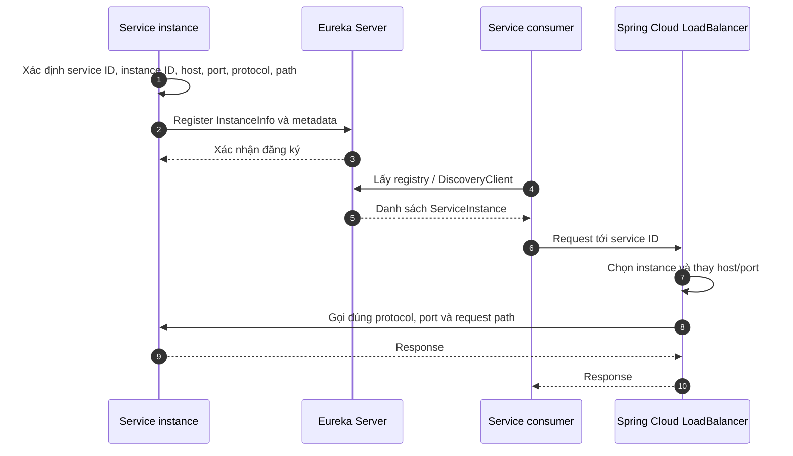

# Công bố đúng cổng, giao thức và đường dẫn dịch vụ

## 1. Vì sao thông tin endpoint trong registry phải chính xác?

Trong Spring Cloud Service Discovery, registry giúp consumer tìm một instance theo tên logic như `payment-service`. Khi đăng ký, instance công bố thông tin nhận diện và địa chỉ để consumer có thể tạo request. Nếu registry lưu sai hostname, IP, port, giao thức hoặc đường dẫn, việc tìm thấy instance vẫn thành công nhưng request thực tế có thể thất bại.

Một endpoint cần được nhìn từ góc độ của consumer: địa chỉ đó phải phân giải được, cổng phải truy cập được, giao thức phải khớp với listener và đường dẫn phải trỏ đến đúng ứng dụng hoặc endpoint. Địa chỉ `localhost` của container, cổng nội bộ không được publish hoặc đường dẫn thiếu context path đều có thể khiến registry chứa thông tin hợp lệ về cú pháp nhưng vô dụng trong mạng triển khai.

Trong Spring Cloud Service Discovery, `DiscoveryClient` trả về `ServiceInstance` để consumer biết host, port, URI và metadata. Với Eureka, các thông tin này được lưu trong `InstanceInfo` và công bố qua Eureka Server. Vì vậy, cấu hình instance phải phản ánh đúng địa chỉ mà các consumer thực sự sử dụng.

## 2. Phân biệt định danh service và địa chỉ instance

Một service có thể chạy nhiều instance. Cần phân biệt tên service với thông tin của từng instance:

| Thành phần | Ví dụ | Mục đích |
|---|---|---|
| Service ID | `payment-service` | Tên logic để consumer tra cứu nhóm instance |
| Instance ID | `payment-service:node-a:8082` | Phân biệt một bản chạy cụ thể trong registry |
| Hostname/IP | `payments.internal` hoặc `10.0.2.15` | Địa chỉ mạng mà consumer dùng để kết nối |
| Service port | `8082` | Cổng ứng dụng nghiệp vụ đang lắng nghe |
| Protocol | `http` hoặc `https` | Cách thiết lập kết nối tới service |
| Context path | `/payments` | Tiền tố đường dẫn của ứng dụng nếu được cấu hình |
| Metadata | `version=v2`, `zone=az-a` | Thông tin bổ sung để consumer hoặc hạ tầng sử dụng |

Trong Spring Boot, `spring.application.name` thường trở thành service ID. Instance ID cần duy nhất giữa các instance cùng service. Hostname/IP, port và protocol xác định địa chỉ kết nối của từng bản chạy; context path xác định vị trí ứng dụng được mount trên server.

Ví dụ, hai instance của `payment-service` có thể là:

```text
payment-service
  payment-service:node-a:8082 -> http://10.0.1.10:8082/payments
  payment-service:node-b:8082 -> http://10.0.1.11:8082/payments
```

Consumer tra cứu bằng `payment-service`; registry trả về các instance cùng địa chỉ tương ứng. Không nên dùng địa chỉ của một instance làm service ID vì cách đó khiến ứng dụng phụ thuộc vào một máy cụ thể.

## 3. Công bố hostname hoặc IP có thể truy cập

Eureka cần công bố hostname hoặc địa chỉ IP mà các consumer có thể truy cập từ network của chúng. Hai lựa chọn phổ biến là:

- **Hostname:** phù hợp khi DNS hoặc service discovery của hạ tầng cung cấp tên ổn định và có thể phân giải từ consumer.
- **IP address:** phù hợp khi địa chỉ IP có thể định tuyến trực tiếp và không thay đổi ngoài dự kiến.

Ví dụ cấu hình hostname:

```yaml
eureka:
  instance:
    hostname: payments.internal
    prefer-ip-address: false
```

Hoặc ưu tiên địa chỉ IP:

```yaml
eureka:
  instance:
    ip-address: 10.0.2.15
    prefer-ip-address: true
```

`prefer-ip-address` quyết định Eureka instance dùng IP thay cho hostname khi công bố host. Nếu dùng hostname, bảo đảm DNS phân giải tên đó từ các consumer. Nếu dùng IP, bảo đảm IP được định tuyến từ mọi mạng cần gọi service.

Không công bố `127.0.0.1`, `localhost` hoặc hostname chỉ tồn tại bên trong một container nếu consumer nằm ở máy/container khác. Những địa chỉ này có thể hoạt động khi kiểm thử trên cùng máy nhưng thất bại trong môi trường phân tán.

### 3.1. Chọn địa chỉ trong Docker và Kubernetes

Trong Docker, `localhost` bên trong container là chính container đó. Nếu `payment-service` và Eureka Server ở hai container khác nhau trên cùng Docker network, service nên công bố tên DNS mà consumer phân giải được, chẳng hạn `payment-service` hoặc hostname riêng của container. Consumer trong cùng network có thể truy cập cổng container; consumer ở host có thể cần cổng đã publish.

Ví dụ ánh xạ cổng:

```text
Host machine:18082  ->  payment-service container:8082
```

Consumer chạy cùng Docker network thường gọi `payment-service:8082`. Consumer chạy từ host thường gọi `localhost:18082` nếu cổng được publish trên host. Nếu registry chỉ công bố `payment-service:8082` cho consumer ở host, consumer đó có thể không phân giải được tên hoặc không truy cập được cổng container.

Trong Kubernetes, thường ưu tiên DNS của Kubernetes Service khi consumer cần đi qua một Service abstraction ổn định. Nếu registry đăng ký từng pod riêng, địa chỉ pod phải có thể định tuyến từ consumer và phải được cập nhật khi pod thay đổi. Tránh đăng ký địa chỉ pod chỉ có ý nghĩa trong một network không được consumer sử dụng.

### 3.2. Khi service nằm sau reverse proxy hoặc NAT

Nếu service chạy phía sau reverse proxy, ingress hoặc NAT, địa chỉ nội bộ của process có thể khác địa chỉ consumer phải gọi. Cần quyết định registry phục vụ consumer nào:

- Consumer cùng mạng nội bộ có thể dùng hostname và port nội bộ.
- Consumer ở mạng ngoài có thể cần DNS và cổng public của proxy.
- Nếu hai nhóm consumer không thể dùng chung một endpoint, cần tách discovery view, dùng gateway/proxy chung hoặc thiết kế địa chỉ theo từng network zone.

Không nên công bố hostname nội bộ cho consumer bên ngoài hoặc public URL cho consumer nội bộ nếu điều đó làm tăng vòng đi mạng và tạo điểm lỗi không cần thiết. Với forwarded headers, chỉ tin các header do proxy tin cậy đặt và cấu hình ứng dụng/proxy nhất quán.

## 4. Công bố đúng service port

Service port là cổng mà ứng dụng nghiệp vụ thực sự lắng nghe. Trong Spring Boot, cổng này thường được cấu hình bằng `server.port`:

```yaml
server:
  port: 8082
```

Eureka instance có các thuộc tính điều khiển cổng HTTP và HTTPS:

| Thuộc tính | Ý nghĩa |
|---|---|
| `eureka.instance.non-secure-port-enabled` | Cho biết instance có công bố cổng không mã hóa hay không |
| `eureka.instance.non-secure-port` | Cổng HTTP được công bố |
| `eureka.instance.secure-port-enabled` | Cho biết instance có công bố cổng bảo mật hay không |
| `eureka.instance.secure-port` | Cổng HTTPS được công bố |

Khi cổng thực tế khác giá trị mà auto-configuration suy ra, hoặc có port mapping/proxy, hãy cấu hình rõ port được công bố. Ví dụ một service HTTP lắng nghe cổng `8082`:

```yaml
server:
  port: 8082

eureka:
  instance:
    non-secure-port-enabled: true
    non-secure-port: 8082
    secure-port-enabled: false
```

Không nhầm service port với các cổng sau:

- Cổng Eureka Server, thường là `8761`, là nơi client đăng ký và truy vấn registry.
- Cổng management/Actuator có thể khác cổng nghiệp vụ.
- Cổng host publish từ Docker hoặc reverse proxy có thể khác cổng process bên trong container.

Consumer dùng cổng service được công bố trong `ServiceInstance` để gọi request nghiệp vụ. Nếu công bố nhầm cổng Eureka Server hoặc cổng management, consumer sẽ kết nối sai đích.

## 5. Công bố đúng giao thức HTTP hoặc HTTPS

Giao thức trong registry phải khớp với cách service nhận request. Với HTTP, có thể bật cổng không bảo mật và tắt cổng bảo mật:

```yaml
eureka:
  instance:
    non-secure-port-enabled: true
    non-secure-port: 8082
    secure-port-enabled: false
```

Với HTTPS, cấu hình cổng bảo mật và đánh dấu nó được bật:

```yaml
eureka:
  instance:
    non-secure-port-enabled: false
    secure-port-enabled: true
    secure-port: 8443
```

Eureka client adapter sử dụng thông tin secure-port-enabled để xác định instance có được truy cập bằng HTTPS hay không. Khi dùng HTTPS, service phải thật sự có TLS listener trên cổng đã công bố; chứng thư phải hợp lệ với hostname mà consumer gọi và consumer phải tin cậy CA phát hành chứng thư.

Nếu TLS kết thúc tại reverse proxy, cần xác định consumer gọi trực tiếp instance hay gọi qua proxy. Nếu consumer gọi qua proxy, registry phải công bố endpoint HTTPS mà proxy phục vụ và có thể định tuyến; nếu consumer gọi trực tiếp pod/container, service cần tự phục vụ TLS trên địa chỉ/cổng đó hoặc có lớp bảo vệ tương đương.

Không nên bật cả HTTP và HTTPS một cách tùy tiện rồi giả định mọi consumer sẽ tự chọn giao thức mong muốn. Hãy xác định giao thức chính, port tương ứng và chính sách redirect/allow HTTP rõ ràng. Nếu hệ thống chỉ cho phép HTTPS, không công bố HTTP như một endpoint hợp lệ.

## 6. Công bố đúng đường dẫn ứng dụng

Địa chỉ host và port chỉ xác định phần gốc của endpoint. Ứng dụng có thể được mount dưới một context path, ví dụ `/payments`, thông qua:

```yaml
server:
  servlet:
    context-path: /payments
```

Khi đó, endpoint nghiệp vụ có thể là:

```text
http://payments.internal:8082/payments/api/transactions
```

Nếu consumer gọi qua service ID bằng Spring Cloud LoadBalancer:

```java
restClient.get()
    .uri("http://payment-service/payments/api/transactions")
    .retrieve()
    .body(String.class);
```

Load balancer phân giải `payment-service` thành một instance và thay host/port của request. Nó không tự suy ra context path `/payments` từ `server.servlet.context-path` của ứng dụng đích. Consumer phải gọi đúng path hoặc dùng một lớp client/gateway biết base path.

Có thể công bố context path trong metadata để consumer tùy biến đọc:

```yaml
eureka:
  instance:
    metadata-map:
      context-path: /payments
      api-version: v2
```

Metadata tùy chỉnh không tự làm thay đổi URI hoặc hành vi của Spring Cloud LoadBalancer. Consumer chỉ sử dụng `context-path` nếu code của nó chủ động đọc metadata và ghép path. Nếu có nhiều service dùng context path khác nhau, hãy đặt quy ước rõ ràng và kiểm thử cách client sử dụng.

## 7. Công bố home page, status page và health check URL

Eureka `InstanceInfo` có các URL mô tả instance:

| Thuộc tính | Mục đích |
|---|---|
| `home-page-url` | Trang gốc hoặc trang thông tin của ứng dụng |
| `status-page-url` | Trang trạng thái/thông tin vận hành |
| `health-check-url` | URL health được công bố cùng instance |
| `home-page-url-path` | Đường dẫn tương đối dùng để tạo home page URL |
| `status-page-url-path` | Đường dẫn tương đối dùng để tạo status page URL |
| `health-check-url-path` | Đường dẫn tương đối dùng để tạo health check URL |

Nếu ứng dụng chạy dưới context path hoặc có management base path khác mặc định, hãy cấu hình các path tương ứng. Khi endpoint nằm ở host, port hoặc giao thức khác, dùng URL đầy đủ để công bố địa chỉ chính xác.

Ví dụ ứng dụng chạy HTTP trên cổng `8082`, context path `/payments`, Actuator base path `/manage`:

```yaml
spring:
  application:
    name: payment-service

server:
  port: 8082
  servlet:
    context-path: /payments

management:
  endpoints:
    web:
      base-path: /manage
      exposure:
        include: health,info

eureka:
  instance:
    hostname: payments.internal
    prefer-ip-address: false
    instance-id: ${spring.application.name}:${server.port}:${random.value}
    non-secure-port-enabled: true
    non-secure-port: 8082
    secure-port-enabled: false
    home-page-url: http://payments.internal:8082/payments/
    status-page-url: http://payments.internal:8082/payments/manage/info
    health-check-url: http://payments.internal:8082/payments/manage/health
    metadata-map:
      context-path: /payments
      api-version: v2
      zone: az-a
```

Trong ví dụ, `/manage/info` và `/manage/health` là đường dẫn Actuator sau khi áp dụng context path `/payments`. Nếu management server chạy trên cổng riêng bằng `management.server.port`, hãy công bố status/health URL với đúng cổng quản trị; service port dùng cho traffic nghiệp vụ vẫn là `server.port`.

Lưu ý: `health-check-url` là URL được ghi trong thông tin instance. Việc công bố URL này không đồng nghĩa Eureka Server mặc định liên tục gọi HTTP GET để kiểm tra sức khỏe ứng dụng. Nếu muốn trạng thái Eureka Client phản ánh health indicator của Spring Boot Actuator, cần cấu hình tích hợp health check của Eureka Client phù hợp, ví dụ:

```yaml
eureka:
  client:
    healthcheck:
      enabled: true
```

Health endpoint cần được bảo vệ theo chính sách bảo mật. Chỉ expose endpoint cần thiết; không mở toàn bộ Actuator ra mạng công khai chỉ để Eureka có một URL hiển thị. Nếu endpoint yêu cầu authentication, hãy cân nhắc ai cần truy cập URL đó và liệu dashboard/consumer có thể sử dụng được hay không.

## 8. Metadata bổ sung cho consumer

Ngoài các trường endpoint chuẩn, Eureka cho phép công bố metadata dạng key/value. Metadata phù hợp để mang thông tin mô tả như:

- Phiên bản ứng dụng hoặc API (`api-version`).
- Availability zone hoặc nhóm triển khai (`zone`).
- Context path nếu consumer cần biết base path (`context-path`).
- Nhóm tính năng hoặc capability (`features`).
- Nhãn môi trường (`environment`).

Ví dụ:

```yaml
eureka:
  instance:
    metadata-map:
      api-version: v2
      zone: az-a
      context-path: /payments
      environment: production
```

Metadata là dữ liệu tùy chỉnh; registry không tự áp dụng mọi key. Consumer hoặc load balancer cần được lập trình để đọc và sử dụng metadata. Không đưa secret, token, mật khẩu hoặc dữ liệu nhạy cảm vào metadata vì các client có quyền đọc registry có thể nhìn thấy chúng.

Không nên dùng metadata để thay thế các trường host, port, secure port hoặc URL chuẩn khi các trường chuẩn đã biểu diễn được endpoint. Hãy dùng metadata cho thuộc tính bổ sung, có schema và quy ước thống nhất giữa producer và consumer.

## 9. Cấu hình theo môi trường triển khai

Một cấu hình có thể dùng biến môi trường để thay hostname, port và protocol theo môi trường:

```yaml
eureka:
  instance:
    hostname: ${DISCOVERY_HOST:localhost}
    prefer-ip-address: false
    non-secure-port-enabled: ${DISCOVERY_HTTP_ENABLED:true}
    non-secure-port: ${DISCOVERY_HTTP_PORT:8082}
    secure-port-enabled: ${DISCOVERY_HTTPS_ENABLED:false}
    secure-port: ${DISCOVERY_HTTPS_PORT:8443}
    home-page-url: ${DISCOVERY_HOME_URL:http://localhost:8082/payments/}
```

Đặt các biến phù hợp với network mà consumer sử dụng. Trong production, tránh để giá trị mặc định `localhost` được dùng ngoài ý muốn; nên yêu cầu cấu hình hostname/URL rõ ràng và kiểm tra giá trị cuối cùng khi ứng dụng khởi động.

Nếu có nhiều nhóm consumer ở các network khác nhau, một endpoint duy nhất có thể không phù hợp cho tất cả. Có thể dùng DNS/service proxy chung, gateway, hoặc thiết kế registry riêng theo network boundary thay vì công bố một địa chỉ chỉ một nhóm client truy cập được.

## 10. Xác minh thông tin đã đăng ký

Sau khi ứng dụng khởi động, cần xác minh thông tin trong registry thay vì chỉ nhìn vào cấu hình nguồn. Một số bước kiểm tra:

1. Đọc log khởi động để xác nhận service name, instance ID và địa chỉ mà Eureka Client chuẩn bị đăng ký.
2. Mở Eureka dashboard hoặc truy vấn Eureka API để xem `InstanceInfo` của service.
3. Đối chiếu host, port, secure flag, home page URL, status page URL và health check URL với listener thực tế.
4. Từ đúng network của consumer, kiểm tra DNS và kết nối tới hostname/port được công bố.
5. Gọi thử endpoint với đúng giao thức và context path.
6. Nếu có Actuator trên management port riêng, kiểm tra URL health/status bằng cổng đó và xác nhận chính sách truy cập.
7. Dùng `DiscoveryClient.getInstances("payment-service")` để kiểm tra `ServiceInstance` mà consumer nhận được, gồm host, port, URI và metadata.

Ví dụ truy vấn registry bằng HTTP trong môi trường có thể truy cập Eureka Server:

```bash
curl -H "Accept: application/json" \
  http://eureka-server:8761/eureka/apps/PAYMENT-SERVICE
```

Đường dẫn và định dạng phản hồi có thể phụ thuộc phiên bản, cấu hình bảo mật và `Accept` header. Khi kiểm thử, thực hiện từ đúng network của consumer; truy cập thành công từ laptop phát triển không chứng minh pod hoặc container production có cùng quyền định tuyến.

### 10.1. Dấu hiệu sai cấu hình thường gặp

| Dấu hiệu | Nguyên nhân có thể | Cách kiểm tra |
|---|---|---|
| Registry hiển thị `localhost` hoặc `127.0.0.1` | Hostname/IP mặc định không phù hợp môi trường | Kiểm tra `hostname`, `ip-address`, `prefer-ip-address` |
| Consumer nhận instance nhưng `Connection refused` | Port công bố khác port listener hoặc firewall chặn | Đối chiếu `server.port`, port mapping và `non-secure-port`/`secure-port` |
| Request lỗi protocol hoặc TLS handshake | HTTP/HTTPS hoặc chứng thư không khớp | Kiểm tra secure-port flags, TLS listener và certificate SAN |
| Trang ứng dụng trả `404` | Thiếu context path hoặc servlet path | Kiểm tra `server.servlet.context-path` và path consumer gọi |
| Health/status link lỗi | URL Actuator sai base path, port hoặc security | Kiểm tra management endpoint, `management.server.port`, base path và quyền truy cập |
| Consumer ở container không gọi được service | Đăng ký hostname/port chỉ host hoặc container khác truy cập được | Kiểm tra DNS và route từ chính consumer |
| Nhiều instance dùng cùng ID | Instance ID không duy nhất | Tạo ID phân biệt theo host, port hoặc mã instance |

## 11. Sơ đồ luồng công bố và sử dụng endpoint



Registry cung cấp thông tin định tuyến ở mức instance; consumer vẫn phải tạo request với đường dẫn nghiệp vụ đúng. Nếu địa chỉ được công bố không thể truy cập từ network của consumer hoặc path không khớp context path, discovery có thể thành công nhưng request vẫn thất bại.

## 12. Nguyên tắc cần nhớ

- Service ID là tên logic; instance ID phân biệt từng bản chạy; host/port/protocol xác định địa chỉ kết nối.
- Chỉ công bố hostname hoặc IP có thể phân giải và định tuyến từ network của consumer.
- Service port phải là cổng nghiệp vụ; không nhầm với cổng Eureka Server, management port hoặc cổng publish của host.
- HTTP/HTTPS và secure-port flags phải khớp listener thật, TLS certificate và chính sách truy cập.
- Context path là một phần của request path; Spring Cloud LoadBalancer không tự suy ra context path của service đích.
- Home page, status page và health check URL cần trỏ đúng endpoint, host, port và path; health URL được công bố không tự có nghĩa Eureka Server chủ động gọi nó.
- Metadata chỉ có ý nghĩa khi producer và consumer thống nhất schema; không lưu bí mật trong metadata.
- Luôn xác minh endpoint từ network của consumer và đọc lại thông tin instance thực tế trong registry.

Công bố đúng endpoint giúp service discovery chuyển từ việc tìm thấy một bản ghi trong registry thành khả năng kết nối thực sự tới ứng dụng. Hãy kiểm tra cả địa chỉ mạng, giao thức, cổng và đường dẫn theo topology triển khai của hệ thống.
