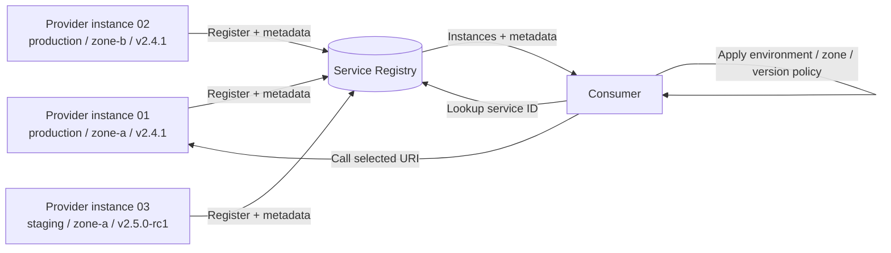

# Thiết kế metadata cho môi trường, vùng và phiên bản phần mềm

Service registry lưu thông tin về service instance để consumer tìm được địa chỉ cần gọi. Ngoài service ID, hostname/IP và port, registry thường cho phép provider đính kèm metadata như môi trường triển khai, vùng địa lý hoặc availability zone, phiên bản phần mềm và nhóm phụ trách. Metadata giúp hệ thống quan sát topology, chọn instance theo chính sách và triển khai nhiều phiên bản có kiểm soát.

Metadata chỉ phát huy tác dụng khi các service thống nhất schema và cách diễn giải. Nếu một instance ghi `zone=az-a`, instance khác ghi `availabilityZone=zone-a`, consumer không thể lọc nhất quán. Bài này xây dựng một schema thực tế cho `environment`, `region`, `zone` và `version`, sau đó minh họa cách đăng ký các trường đó bằng Eureka và Consul trong Spring Cloud.

## 1. Metadata nằm ở đâu trong service discovery?

Một service ID đại diện cho dịch vụ logic, còn mỗi instance là một tiến trình đang cung cấp dịch vụ tại một địa chỉ cụ thể. Metadata là các thuộc tính bổ sung gắn với instance hoặc service tùy mô hình của registry.

Ví dụ, ba instance `payment-service` có thể cùng service ID nhưng chạy ở các vùng và phiên bản khác nhau:

| Service ID | Instance ID | Environment | Region | Zone | Version |
| --- | --- | --- | --- | --- | --- |
| `payment-service` | `payment-01` | `production` | `ap-southeast-1` | `ap-southeast-1a` | `2.4.1` |
| `payment-service` | `payment-02` | `production` | `ap-southeast-1` | `ap-southeast-1b` | `2.4.1` |
| `payment-service` | `payment-03` | `staging` | `ap-southeast-1` | `ap-southeast-1a` | `2.5.0-rc1` |

Consumer có thể cần biết instance nào thuộc production, instance nào ở gần nó, hoặc instance nào hỗ trợ API version mà consumer yêu cầu. Registry cung cấp metadata; chính sách chọn instance thường thuộc consumer, Spring Cloud LoadBalancer hoặc một thành phần định tuyến chuyên biệt.



Metadata không thay thế địa chỉ kết nối hoặc health check. Một instance có metadata `environment=production` vẫn có thể không truy cập được; một instance có `version=2.4.1` vẫn có thể không tương thích với một request cụ thể.

## 2. Thiết kế schema metadata dùng chung

Trước khi cấu hình Eureka hoặc Consul, cần thống nhất tên key, giá trị hợp lệ và ý nghĩa của từng trường. Với các ví dụ trong bài, dùng schema sau:

| Key | Ý nghĩa | Ví dụ | Quy tắc |
| --- | --- | --- | --- |
| `environment` | Môi trường triển khai | `development`, `staging`, `production` | Dùng tập giá trị chuẩn; chữ thường |
| `region` | Vùng triển khai ở cấp khu vực | `ap-southeast-1` | Dùng mã region thống nhất của hạ tầng |
| `zone` | Availability zone hoặc failure domain cụ thể | `ap-southeast-1a` | Phải nằm trong region tương ứng |
| `version` | Phiên bản artifact/service đang chạy | `2.4.1` | Ưu tiên Semantic Versioning nếu phù hợp |
| `api-version` | Phiên bản hợp đồng API mà instance hỗ trợ | `v2` | Tách khỏi version của artifact |
| `release` | Mã phát hành hoặc build | `2026.11.24.3` | Chỉ dùng khi cần truy vết release |
| `team` | Nhóm sở hữu dịch vụ | `payments` | Dùng tên nhóm ổn định |

Không phải hệ thống nào cũng cần toàn bộ key. Hãy bắt đầu với những trường phục vụ một quyết định vận hành cụ thể. Nếu consumer chỉ cần chọn theo zone, đừng thêm hàng chục thuộc tính không có người dùng hoặc không có quy trình duy trì.

### Quy ước đặt tên và giá trị

- Dùng key chữ thường, phân tách từ bằng dấu gạch ngang hoặc quy ước thống nhất; ví dụ bài này dùng `api-version`.
- Dùng giá trị chữ thường cho environment và zone để tránh khác biệt do chữ hoa/chữ thường.
- Thống nhất mã region và zone với nền tảng triển khai. Không trộn `zone-a`, `az-a` và `ap-southeast-1a` nếu chúng chỉ cùng một vùng.
- Metadata dạng key/value thường được truyền dưới dạng chuỗi. Nếu cần số hoặc boolean, quy định rõ cách biểu diễn và parse.
- Không thay đổi ý nghĩa của key đã phát hành. Khi cần schema mới, bổ sung key mới hoặc có quy trình chuyển đổi tương thích.

Ví dụ schema logic của một instance:

```yaml
service:
  id: payment-service
  instance-id: payment-01
  host: 10.20.1.15
  port: 8085
  metadata:
    environment: production
    region: ap-southeast-1
    zone: ap-southeast-1a
    version: 2.4.1
    api-version: v2
    team: payments
```

Đây là mô hình minh họa để thống nhất ý nghĩa. Không phải file YAML này được nạp trực tiếp bởi mọi registry; mỗi provider có cấu hình riêng được trình bày ở các phần sau.

## 3. Phân biệt environment, region và zone

Ba khái niệm này có quan hệ nhưng không thể dùng thay thế nhau.

### Environment: môi trường triển khai

`environment` mô tả vòng đời hoặc mục đích của hệ thống, chẳng hạn:

- `development`: môi trường phát triển, thường thay đổi thường xuyên.
- `test`: môi trường kiểm thử tự động hoặc tích hợp.
- `staging`: môi trường tiền production, dùng xác minh trước khi phát hành.
- `production`: môi trường phục vụ người dùng thật.

Mỗi môi trường thường cần registry hoặc phạm vi truy cập tách biệt. Chỉ gắn metadata `environment=production` không tạo ra ranh giới bảo mật. Nếu staging và production cùng nằm trong một registry mà consumer truy vấn không lọc đúng, ứng dụng staging có thể nhìn thấy instance production và ngược lại.

Nên ưu tiên tách cluster, datacenter, namespace, network hoặc quyền ACL theo khả năng của nền tảng. Metadata environment bổ sung khả năng quan sát và kiểm tra cấu hình; nó không thay thế cách ly hạ tầng.

### Region: khu vực triển khai

`region` thường đại diện cho một khu vực địa lý hoặc cloud region, ví dụ `ap-southeast-1`. Region giúp nhận diện nơi đặt hạ tầng ở cấp rộng. Một region có thể chứa nhiều availability zone.

### Zone: availability zone hoặc failure domain

`zone` xác định một vùng lỗi nhỏ hơn region, ví dụ `ap-southeast-1a`. Việc phân tán instance qua nhiều zone giúp giảm ảnh hưởng khi một zone gặp sự cố. Trong một số hạ tầng on-premises, zone có thể là rack, phòng máy hoặc failure domain do tổ chức định nghĩa.

Không nên giả định tên zone có cùng ý nghĩa giữa các cloud provider. Cần chuẩn hóa zone thành giá trị mà các thành phần trong cùng hệ thống hiểu được.

## 4. Phân biệt version phần mềm và version API

`version` và `api-version` giải quyết hai câu hỏi khác nhau:

- `version`: artifact hoặc bản phát hành nào đang chạy? Ví dụ `2.4.1`.
- `api-version`: instance hỗ trợ hợp đồng API nào? Ví dụ `v1`, `v2`.

Một bản vá phần mềm có thể đổi từ `2.4.1` sang `2.4.2` mà không đổi API contract `v2`. Ngược lại, một bản phát hành mới có thể hỗ trợ đồng thời `v1` và `v2`. Consumer cần chọn theo khả năng tương thích API, không nhất thiết chọn đúng một artifact version.

### Dùng Semantic Versioning có chủ đích

Nếu đội phát triển áp dụng Semantic Versioning, version thường có dạng `MAJOR.MINOR.PATCH`:

- MAJOR thay đổi khi có thay đổi không tương thích theo quy ước của sản phẩm.
- MINOR bổ sung chức năng tương thích ngược.
- PATCH sửa lỗi tương thích ngược.

Không nên so sánh version bằng chuỗi thông thường. Ví dụ chuỗi `2.10.0` có thể bị xếp trước `2.9.0` nếu so sánh từ điển. Nếu cần lọc theo khoảng version, hãy parse theo quy tắc SemVer hoặc dùng capability/API version đã chuẩn hóa.

### Khả năng tương thích khi rollout

Trong triển khai rolling hoặc blue/green, hai phiên bản có thể cùng tồn tại. Consumer cần biết API version hoặc capability của instance để chọn đúng backend. Chỉ dùng `version` của artifact để quyết định tương thích có thể quá chặt hoặc sai.

Một cách thiết kế là khai báo `api-version=v2` và `capabilities=refund,authorization` nếu thật sự cần định tuyến theo capability. Nếu dùng danh sách capability, cần thống nhất cách phân tách và mã hóa; với Consul, tags có thể phù hợp cho nhãn đơn giản, còn metadata map phù hợp cho cặp key/value. Không nên giả định cách mã hóa giống nhau ở mọi provider.

## 5. Cấu hình metadata trong Eureka

Eureka lưu application và instance. Với Spring Cloud Netflix Eureka Client, metadata tùy chỉnh thường được cấu hình bằng `eureka.instance.metadata-map`.

Ví dụ `application.yml` của `payment-service`:

```yaml
spring:
  application:
    name: payment-service

server:
  port: 8085

eureka:
  client:
    service-url:
      defaultZone: ${EUREKA_SERVER_URL:http://localhost:8761/eureka/}
  instance:
    prefer-ip-address: true
    instance-id: ${spring.application.name}:${spring.cloud.client.ip-address}:${server.port}
    metadata-map:
      environment: ${APP_ENV:development}
      region: ${APP_REGION:local}
      zone: ${APP_ZONE:local-a}
      version: ${APP_VERSION:0.1.0-SNAPSHOT}
      api-version: v1
      team: payments
```

Các giá trị `${...:default}` cho phép chọn metadata theo môi trường triển khai. Ví dụ production có thể truyền `APP_ENV=production`, `APP_REGION=ap-southeast-1`, `APP_ZONE=ap-southeast-1a` và `APP_VERSION=2.4.1` từ pipeline hoặc nền tảng container.

`metadata-map` là map key/value gắn với Eureka instance. Các giá trị này có thể được đọc từ metadata của `ServiceInstance` qua Eureka DiscoveryClient implementation. Eureka không tự hiểu rằng `environment=production` có nghĩa là chỉ consumer production được phép truy cập; việc lọc hoặc cách ly phải được thiết kế riêng.

### Đọc metadata từ DiscoveryClient

```java
import java.util.List;

import org.springframework.cloud.client.ServiceInstance;
import org.springframework.cloud.client.discovery.DiscoveryClient;
import org.springframework.stereotype.Service;

@Service
public class PaymentInstanceSelector {

    private final DiscoveryClient discoveryClient;

    public PaymentInstanceSelector(DiscoveryClient discoveryClient) {
        this.discoveryClient = discoveryClient;
    }

    public List<ServiceInstance> findProductionInstances() {
        return discoveryClient.getInstances("payment-service").stream()
                .filter(instance -> "production".equals(
                        instance.getMetadata().get("environment")))
                .toList();
    }
}
```

Đây là ví dụ lọc ở phía ứng dụng sau khi lấy danh sách instance. Nó không biến metadata thành một ranh giới bảo mật và cũng không bảo đảm registry chỉ trả instance khỏe mạnh. Với luồng gọi thực tế, cần kết hợp health policy và LoadBalancer; nếu cần lọc zone/version trong quá trình chọn instance, hãy cấu hình supplier hoặc adapter phù hợp với phiên bản Spring Cloud.

## 6. Cấu hình metadata trong Consul

Consul tổ chức service theo service catalog, node, service instance và health check. Spring Cloud Consul hỗ trợ `service-name`, `instance-id`, `tags` và `metadata` trong discovery configuration.

Ví dụ `application.yml`:

```yaml
spring:
  application:
    name: payment-service
  cloud:
    consul:
      host: ${CONSUL_HOST:localhost}
      port: ${CONSUL_PORT:8500}
      discovery:
        register: true
        service-name: payment-service
        instance-id: ${spring.application.name}:${spring.cloud.client.hostname}:${server.port}
        prefer-ip-address: true
        tags:
          - "environment=${APP_ENV:development}"
          - "region=${APP_REGION:local}"
          - "zone=${APP_ZONE:local-a}"
          - "version=${APP_VERSION:0.1.0-SNAPSHOT}"
          - "api-version=v1"
          - "team=payments"
        metadata:
          environment: ${APP_ENV:development}
          region: ${APP_REGION:local}
          zone: ${APP_ZONE:local-a}
          version: ${APP_VERSION:0.1.0-SNAPSHOT}
          api-version: v1
          team: payments
        health-check-path: /actuator/health
        health-check-interval: 15s

server:
  port: 8085
```

Trong ví dụ:

- `service-name` là tên dịch vụ logic trong Consul catalog.
- `instance-id` phân biệt instance đăng ký.
- `tags` là danh sách nhãn gắn với service; phù hợp cho các nhãn đơn giản và truy vấn theo tag của Consul.
- `metadata` là map key/value bổ sung cho service instance.
- `health-check-path` và `health-check-interval` cấu hình HTTP check mà Consul agent thực hiện.

Không nhất thiết phải lặp tất cả thông tin trong cả `tags` và `metadata`. Chỉ lặp khi có lý do tương thích với công cụ hoặc API đang dùng. Nếu hai nơi cùng lưu một giá trị, pipeline cần bảo đảm chúng được cập nhật đồng bộ.

### Đọc metadata và tags qua Spring Cloud

Khi Spring Cloud Consul ánh xạ service vào `ServiceInstance`, consumer có thể đọc metadata qua `getMetadata()`. Các tag có thể được biểu diễn theo cách provider implementation hỗ trợ; nếu cần truy vấn theo tag hoặc trạng thái health với semantics chính xác của Consul, hãy dùng Consul API hoặc adapter thay vì giả định `DiscoveryClient` chung cung cấp mọi bộ lọc.

Consul có thể truy vấn health service với điều kiện `passing=true` qua API health endpoint. Điều kiện này là ngữ nghĩa riêng của Consul và không có tham số tương đương tổng quát trong `DiscoveryClient.getInstances(serviceId)`.

## 7. Chuẩn hóa metadata khi hỗ trợ nhiều registry

Nếu ứng dụng cần chạy với cả Eureka và Consul, hãy giữ một schema logic ở tầng ứng dụng và ánh xạ schema đó sang từng provider.

| Schema ứng dụng | Eureka | Consul |
| --- | --- | --- |
| Service ID | Application name | Service name |
| Instance ID | Eureka instance ID | Consul service instance ID |
| Environment | `metadata-map.environment` | `metadata.environment` hoặc tag `environment=...` |
| Region | `metadata-map.region` | `metadata.region` hoặc tag `region=...` |
| Zone | `metadata-map.zone` | `metadata.zone` hoặc tag `zone=...` |
| Software version | `metadata-map.version` | `metadata.version` hoặc tag `version=...` |
| API version | `metadata-map.api-version` | `metadata.api-version` hoặc tag `api-version=...` |
| Health | Heartbeat/lease và trạng thái Eureka | Consul health checks và trạng thái check |

Bảng trên là quy ước ánh xạ do ứng dụng lựa chọn, không phải cam kết tự động của Spring Cloud. Mỗi provider có thể chuẩn hóa tên, lưu trữ hoặc trả metadata theo cách riêng. Hãy kiểm tra dữ liệu thực tế trên registry và `ServiceInstance.getMetadata()` trong từng implementation.

### Tạo một lớp cấu hình metadata ở ứng dụng

Có thể gom các giá trị chuẩn vào một properties class để tránh khai báo key rải rác:

```java
import org.springframework.boot.context.properties.ConfigurationProperties;

@ConfigurationProperties(prefix = "app.instance")
public record InstanceMetadataProperties(
        String environment,
        String region,
        String zone,
        String version,
        String apiVersion,
        String team
) {}
```

Ví dụ cấu hình:

```yaml
app:
  instance:
    environment: ${APP_ENV:development}
    region: ${APP_REGION:local}
    zone: ${APP_ZONE:local-a}
    version: ${APP_VERSION:0.1.0-SNAPSHOT}
    api-version: v1
    team: payments
```

Ứng dụng có thể dùng properties class này để cấu hình Eureka hoặc Consul adapter. Việc tách schema logic giúp tránh khác biệt tên biến ở từng file cấu hình và giúp kiểm tra giá trị bắt buộc lúc khởi động.

## 8. Dùng metadata để định tuyến và rollout

Metadata chỉ có ích khi có consumer hoặc thành phần vận hành dùng nó cho một quyết định cụ thể. Một số trường hợp thường gặp:

### Chọn instance cùng zone

Một consumer có thể ưu tiên instance ở zone gần nó để giảm độ trễ và chi phí liên vùng. Nếu zone gần không còn instance khỏe mạnh, chính sách có thể cho phép fallback sang zone khác.

Không nên giả định `zone` trong metadata tự động thay đổi lựa chọn của mọi LoadBalancer. Cần cấu hình zone-aware supplier hoặc viết chính sách chọn instance phù hợp với phiên bản Spring Cloud và provider. Khi tự lọc, luôn có fallback rõ ràng để tránh danh sách instance rỗng khi một zone ngừng hoạt động.

### Cách ly staging và production

Metadata environment hữu ích để quan sát và kiểm tra, nhưng không nên dùng nó làm cơ chế cách ly duy nhất. Tốt hơn là dùng registry, datacenter, namespace, network hoặc ACL riêng cho từng môi trường. Nếu vẫn dùng chung registry, consumer cần có policy lọc môi trường và test để bảo đảm không gọi nhầm instance.

### Canary và blue/green deployment

Trong canary, một phần traffic được chuyển đến phiên bản mới. Có thể gắn `version` hoặc nhãn `release-track=canary` cho instance mới, sau đó cấu hình gateway hoặc LoadBalancer chọn tỷ lệ/phạm vi phù hợp. Không nên dựa vào metadata nếu thành phần định tuyến không thực sự đọc và áp dụng key đó.

Trong blue/green, hai nhóm instance có thể cùng tồn tại. Metadata `release-track=blue` hoặc `release-track=green` giúp quan sát và lựa chọn nhóm, nhưng bước chuyển traffic vẫn phải do cơ chế routing có kiểm soát thực hiện.

### Kiểm tra tương thích API

Consumer có thể yêu cầu `api-version=v2`. Chỉ những instance khai báo hỗ trợ `v2` mới phù hợp với request đó. Trước khi lọc theo version, phải có quy ước cập nhật metadata và xác minh rằng mọi instance đã đăng ký đúng giá trị.

## 9. Những gì không nên đưa vào metadata

Metadata được lưu trong registry và có thể được nhiều consumer hoặc người vận hành đọc. Vì vậy, không đưa các dữ liệu sau vào metadata:

- Password, API key, access token, refresh token hoặc private key.
- Dữ liệu cá nhân, dữ liệu khách hàng hoặc payload nghiệp vụ.
- Thông tin nhạy cảm về hạ tầng mà consumer không cần biết.
- Giá trị thay đổi liên tục như request ID, session ID hoặc metric mỗi request.
- Danh sách rất lớn hoặc blob cấu hình có thể làm registry phình to.

Metadata nên nhỏ, ổn định và phục vụ định tuyến, tương thích hoặc quan sát. Những dữ liệu thay đổi liên tục nên đặt trong hệ thống telemetry/configuration phù hợp, không biến registry thành cơ sở dữ liệu tổng quát.

## 10. Cập nhật metadata và xử lý sai lệch

Metadata thường được gửi cùng thông tin đăng ký instance. Khi environment, zone hoặc version thay đổi, cần bảo đảm registry nhận được dữ liệu mới. Cách cập nhật cụ thể phụ thuộc provider và phiên bản Spring Cloud; nhiều hệ thống cần đăng ký lại instance hoặc khởi động lại workload với cấu hình mới.

Một quy trình rollout an toàn nên:

1. Chuẩn hóa giá trị metadata trong pipeline hoặc deployment manifest.
2. Khởi chạy instance mới với version/zone/environment chính xác.
3. Kiểm tra registry và metadata mà consumer nhìn thấy.
4. Chỉ chuyển traffic khi instance mới đạt health và tương thích API.
5. Drain traffic và deregister instance cũ theo quy trình shutdown.
6. Đối chiếu lại registry sau rollout để phát hiện instance cũ hoặc metadata sai.

| Triệu chứng | Nguyên nhân có thể | Cách kiểm tra |
| --- | --- | --- |
| Consumer không tìm thấy instance theo environment | Key sai tên, giá trị khác chữ hoa/thường hoặc provider chưa cập nhật | Xem metadata thực tế trên registry và schema ứng dụng |
| Instance bị xếp sai zone | IP/hostname được phát hiện sai hoặc deployment truyền nhầm zone | Đối chiếu node metadata với hạ tầng đang chạy |
| Consumer lọc nhầm version | Dùng artifact version thay cho API version hoặc parse chuỗi version sai | Xác định tiêu chí tương thích và kiểm tra parser |
| Metadata có ở Eureka nhưng thiếu ở Consul | Ánh xạ schema không đồng nhất hoặc ghi tags/metadata khác nhau | Kiểm tra provider adapter và dữ liệu trả về từ từng API |
| Staging xuất hiện trong production | Dùng chung phạm vi registry và không lọc environment | Tách registry/namespace/network hoặc bổ sung policy kiểm tra |
| Instance cũ vẫn xuất hiện sau rollout | Deregistration/health propagation/cache chưa hoàn tất | Kiểm tra lifecycle, health, cache và thời gian đồng bộ |
| Zone-aware routing trả về danh sách rỗng | Tất cả instance trong zone ưu tiên đã lỗi hoặc filter quá chặt | Thêm fallback sang zone khác và giám sát fallback |

## 11. Kiểm thử schema metadata

Metadata là một phần của hợp đồng giữa provider, registry và consumer. Nên kiểm thử schema như kiểm thử một API:

- Mỗi provider bắt buộc có `environment`, `region`, `zone`, `version` theo yêu cầu của hệ thống.
- Giá trị phải thuộc tập hợp hoặc định dạng được quy định.
- `zone` phải thuộc `region` tương ứng.
- `version` phải parse được theo quy ước; `api-version` phải thuộc danh sách được hỗ trợ.
- Instance ID phải duy nhất trong phạm vi đăng ký.
- Consumer chỉ chọn instance phù hợp với policy environment/zone/version.
- Khi metadata thiếu hoặc không hợp lệ, hệ thống có hành vi an toàn và phát cảnh báo.
- Contract test được chạy với từng registry implementation mà ứng dụng hỗ trợ.

Ví dụ kiểm tra đơn giản ở tầng ứng dụng:

```java
import java.util.Map;

public final class InstanceMetadataValidator {

    private static final String[] REQUIRED_KEYS = {
            "environment", "region", "zone", "version", "api-version"
    };

    private InstanceMetadataValidator() {}

    public static void validate(Map<String, String> metadata) {
        for (String key : REQUIRED_KEYS) {
            String value = metadata.get(key);
            if (value == null || value.isBlank()) {
                throw new IllegalArgumentException(
                        "Missing required instance metadata: " + key);
            }
        }
    }
}
```

Validator này kiểm tra sự hiện diện của key. Trong dự án thật cần bổ sung kiểm tra enum environment, định dạng version, quy tắc region-zone và chính sách fallback. Không nên để consumer âm thầm chọn một instance không đủ metadata nếu metadata là điều kiện an toàn của routing.

## 12. Checklist thiết kế metadata

- [ ] Đã xác định mục đích sử dụng của từng key.
- [ ] Key và giá trị có quy ước chung, không phụ thuộc cách viết của một provider.
- [ ] `environment`, `region` và `zone` có ý nghĩa tách biệt.
- [ ] `version` của artifact được phân biệt với `api-version`.
- [ ] Instance ID duy nhất cho mỗi instance.
- [ ] Eureka `metadata-map` và Consul `metadata`/`tags` được ánh xạ rõ ràng.
- [ ] Không dùng metadata thay cho ACL hoặc cách ly môi trường.
- [ ] Không lưu secret hoặc dữ liệu biến động cao trong registry.
- [ ] Chính sách zone/version có fallback và được LoadBalancer/gateway thực thi thực sự.
- [ ] Metadata được kiểm tra khi khởi động, đăng ký và rollout.
- [ ] Contract test xác minh schema trên từng provider.

Thiết kế metadata tốt bắt đầu từ schema nhỏ, có ý nghĩa rõ ràng và được mọi provider áp dụng thống nhất. Environment xác định môi trường triển khai, region và zone mô tả vị trí/failure domain, còn version giúp quan sát release và kiểm tra tương thích API. Eureka và Consul lưu các giá trị này theo cấu trúc riêng; Spring Cloud cung cấp một số trường chung để consumer đọc, nhưng policy định tuyến, cách ly và kiểm tra tính hợp lệ vẫn cần được thiết kế ở tầng ứng dụng hoặc hạ tầng.
