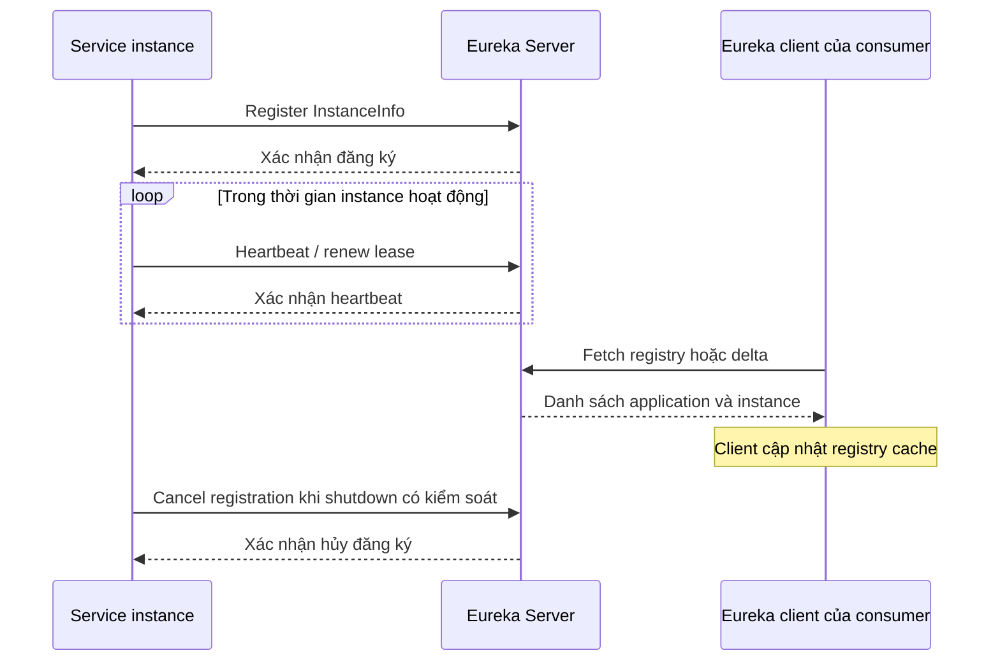
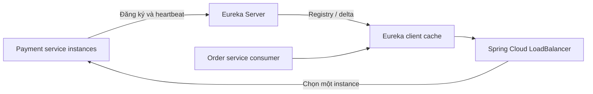

# Vai trò của Eureka Server và cấu trúc thông tin đăng ký

Trong kiến trúc microservice, một dịch vụ thường có nhiều instance chạy trên các máy hoặc container khác nhau. Số lượng instance có thể thay đổi khi hệ thống tự mở rộng, thu hẹp hoặc thay thế một instance gặp sự cố. Vì vậy, service consumer cần một cách để tìm địa chỉ hiện tại của dịch vụ mà không phải gắn cứng hostname và port trong cấu hình.

Trong Spring Cloud, Eureka Server đảm nhiệm vai trò **service registry**: nơi các service instance đăng ký thông tin của mình và nơi các Eureka client tra cứu danh sách instance theo tên dịch vụ. Nội dung này thuộc module `SPRING_CLOUD_SERVICE_DISCOVERY`, giúp làm rõ vai trò của Eureka Server và những dữ liệu được lưu trong registry. Hiểu đúng cấu trúc đăng ký sẽ giúp cấu hình service name, định danh instance, health status và cơ chế khám phá dịch vụ chính xác hơn.

## 1. Eureka Server giải quyết vấn đề gì?

Giả sử hệ thống bán hàng có các dịch vụ `order-service`, `payment-service` và `inventory-service`. Mỗi dịch vụ có thể chạy nhiều instance:

- `order-service` có ba instance ở các địa chỉ khác nhau.
- `payment-service` có hai instance và có thể tăng lên bốn instance vào giờ cao điểm.
- Một instance có thể bị thay thế sau khi triển khai phiên bản mới hoặc khi máy chủ gặp sự cố.

Nếu `order-service` phải lưu trực tiếp địa chỉ của từng instance `payment-service`, mỗi lần số lượng instance hoặc địa chỉ thay đổi, cấu hình của consumer cũng phải thay đổi theo. Cách làm này tạo ra sự phụ thuộc chặt giữa các dịch vụ và khó vận hành khi hệ thống mở rộng.

Eureka Server cung cấp một registry tập trung theo góc nhìn logic. Mỗi instance tự đăng ký thông tin như tên ứng dụng, mã định danh, hostname, IP, port và trạng thái. Consumer sử dụng tên dịch vụ để lấy danh sách instance phù hợp từ registry. Nhờ đó, consumer không cần biết trước từng địa chỉ vật lý.

Eureka Server có các trách nhiệm chính:

1. **Nhận đăng ký:** tiếp nhận thông tin của instance khi ứng dụng khởi động hoặc tham gia hệ thống.
2. **Lưu và cung cấp registry:** duy trì danh sách ứng dụng cùng các instance tương ứng để client tra cứu.
3. **Theo dõi lease:** nhận heartbeat từ client để biết instance còn duy trì kết nối với registry hay không.
4. **Loại bỏ bản ghi hết hạn:** dọn các đăng ký không còn được gia hạn theo chính sách lease và eviction.
5. **Đồng bộ giữa các Eureka Server:** trao đổi dữ liệu đăng ký với peer khi triển khai cụm nhiều server.

Eureka Server là thành phần quản lý thông tin khám phá dịch vụ. Nó không đứng giữa mọi request nghiệp vụ và cũng không tự thực hiện load balancing cho request. Việc chọn instance và gửi request thường được thực hiện ở phía consumer thông qua Eureka client kết hợp với Spring Cloud LoadBalancer.

## 2. Các khái niệm trong registry

Registry của Eureka có thể được hiểu qua ba khái niệm: application, instance và instance information.

### 2.1. Application

`Application` đại diện cho một dịch vụ logic, thường được xác định bởi tên ứng dụng mà client cấu hình qua `spring.application.name`. Ví dụ, tất cả instance có tên `payment-service` thuộc cùng một application trong registry.

Application là nhóm logic, không phải một tiến trình hay một máy chủ cụ thể. Một application có thể chứa một hoặc nhiều instance. Khi một instance mới được tạo, nó đăng ký vào application có tên tương ứng; khi một instance dừng, các instance còn lại vẫn có thể phục vụ dịch vụ.

### 2.2. Instance

`Instance` là một bản triển khai cụ thể của application. Mỗi instance có địa chỉ mạng và mã định danh riêng. Ví dụ, hai instance của `payment-service` có thể được triển khai như sau:

| Thuộc tính | Instance thứ nhất | Instance thứ hai |
|---|---|---|
| Application | `PAYMENT-SERVICE` | `PAYMENT-SERVICE` |
| Instance ID | `payment-01:8082` | `payment-02:8082` |
| Hostname | `payment-01.internal` | `payment-02.internal` |
| IP | `10.0.0.21` | `10.0.0.22` |
| Port | `8082` | `8082` |
| Status | `UP` | `UP` |

Hai instance có cùng tên application nhưng có `instanceId` và địa chỉ khác nhau. Khi consumer tra cứu `PAYMENT-SERVICE`, registry trả về các instance đang được công bố cho application đó.

### 2.3. InstanceInfo

Trong mô hình của Netflix Eureka, `InstanceInfo` là đối tượng mô tả một instance. Nó chứa các thông tin nhận dạng, địa chỉ truy cập, trạng thái, URL phục vụ quản trị và metadata. Eureka Server lưu các bản ghi này trong registry và cung cấp chúng cho client.

Có thể hình dung cấu trúc tổng quát như sau:

```text
Eureka Server
└── Registry
    ├── Application: ORDER-SERVICE
    │   ├── InstanceInfo: order-01
    │   └── InstanceInfo: order-02
    ├── Application: PAYMENT-SERVICE
    │   ├── InstanceInfo: payment-01
    │   └── InstanceInfo: payment-02
    └── Application: INVENTORY-SERVICE
        └── InstanceInfo: inventory-01
```

Tên application cho biết instance thuộc dịch vụ logic nào; `instanceId` phân biệt từng bản triển khai; các trường địa chỉ cho biết consumer có thể kết nối đến đâu.

## 3. Những trường quan trọng trong thông tin đăng ký

Một bản ghi `InstanceInfo` có nhiều trường. Các trường thường gặp và ý nghĩa của chúng được mô tả dưới đây.

| Trường | Ý nghĩa | Lưu ý khi cấu hình |
|---|---|---|
| `app` | Tên application mà instance đăng ký vào. Trong Spring Cloud, giá trị này thường xuất phát từ `spring.application.name`. | Các instance của cùng một dịch vụ cần dùng cùng tên logic. |
| `instanceId` | Mã định danh của một instance trong application. | Cần duy nhất trong phạm vi application để tránh các bản ghi va chạm hoặc khó phân biệt. |
| `hostName` | Hostname của máy hoặc container chạy instance. | Consumer phải phân giải được hostname trong môi trường triển khai. |
| `ipAddr` | Địa chỉ IP được công bố cho instance. | Cần chọn địa chỉ mà các consumer có thể truy cập; IP nội bộ của container có thể không phù hợp trong mọi mạng. |
| `port` | Port HTTP của instance, kèm thông tin cho biết port có được bật hay không. | Phải khớp với port ứng dụng thực sự lắng nghe. |
| `securePort` | Port HTTPS của instance, kèm trạng thái bật/tắt. | Chỉ công bố khi instance thực sự phục vụ HTTPS tại port đó. |
| `status` | Trạng thái mà client công bố cho instance, chẳng hạn `UP`, `DOWN`, `STARTING`, `OUT_OF_SERVICE` hoặc `UNKNOWN`. | `UP` là trạng thái trong registry, không phải cam kết rằng mọi thao tác nghiệp vụ đều thành công. |
| `homePageUrl` | URL trang chủ hoặc địa chỉ gốc của instance. | Hữu ích cho dashboard và một số công cụ quản trị. |
| `statusPageUrl` | URL trang trạng thái của instance. | Thường trỏ đến endpoint thông tin trạng thái, ví dụ endpoint do Actuator cung cấp. |
| `healthCheckUrl` | URL endpoint health check được ghi trong thông tin `InstanceInfo` của instance. | Không nên hiểu rằng Eureka Server mặc định liên tục gọi URL này để kiểm tra sức khỏe instance. |
| `vipAddress` | Virtual IP hoặc tên logic dùng để đại diện cho dịch vụ trong một số cơ chế discovery tương thích. | Đây là tên định danh logic, không phải địa chỉ IP vật lý. |
| `secureVipAddress` | Tên logic tương ứng cho đường truy cập bảo mật. | Có ý nghĩa khi hệ thống sử dụng endpoint HTTPS. |
| `metadata` | Các cặp key-value bổ sung do ứng dụng cung cấp. | Có thể chứa version, zone, nhóm triển khai hoặc thông tin định tuyến; không nên lưu bí mật tại đây. |
| `leaseInfo` | Thông tin lease như chu kỳ gia hạn và thời hạn lease. | Được dùng để xác định khi nào một đăng ký cần được xem là hết hạn nếu không nhận heartbeat. |
| `dataCenterInfo` | Thông tin về môi trường trung tâm dữ liệu, chẳng hạn kiểu triển khai hoặc dữ liệu nhận diện cloud. | Có thể hỗ trợ các chính sách lựa chọn instance phụ thuộc môi trường. |

Trong thực tế, không phải ứng dụng nào cũng cần tự cấu hình mọi trường. Spring Cloud Netflix Eureka client tạo phần lớn thông tin đăng ký từ cấu hình Spring và môi trường chạy. Nhà phát triển thường cần chú ý nhất đến tên application, instance ID, địa chỉ IP/hostname, port, status và metadata.

### 3.1. Tên dịch vụ và mã định danh instance

Hai giá trị này giải quyết hai nhu cầu khác nhau:

- `spring.application.name` xác định **dịch vụ logic**. Các instance của cùng một dịch vụ dùng chung giá trị này.
- `eureka.instance.instance-id` xác định **một instance cụ thể**. Các instance chạy song song cần có mã định danh khác nhau.

Ví dụ, ba instance của `order-service` có thể cùng đăng ký dưới application `order-service`, nhưng lần lượt dùng các ID `order-01:8081`, `order-02:8081` và `order-03:8081`. Nếu các instance vô tình dùng chung ID, thông tin đăng ký có thể ghi đè hoặc cập nhật nhầm bản ghi tùy cách chúng được triển khai và xử lý trong registry.

### 3.2. Địa chỉ và port

Địa chỉ được đăng ký phải là địa chỉ mà consumer có thể truy cập. Trong môi trường container hoặc cloud, hostname và IP mà ứng dụng nhìn thấy bên trong container có thể khác với địa chỉ mà các dịch vụ khác sử dụng. Nếu công bố sai địa chỉ, registry vẫn có thể hiển thị instance `UP` nhưng consumer không kết nối được.

`prefer-ip-address: true` yêu cầu Eureka client ưu tiên công bố IP thay cho hostname trong những tình huống phù hợp. Cấu hình này không tự giải quyết mọi vấn đề mạng: IP được chọn vẫn phải có thể định tuyến từ các consumer. Với hệ thống dùng DNS, service mesh hoặc địa chỉ công bố riêng, cần xác định rõ hostname/IP phù hợp với kiến trúc mạng.

### 3.3. Status và metadata

`status` mô tả trạng thái của instance trong Eureka. Các trạng thái thường gặp gồm:

- `UP`: instance được công bố là sẵn sàng.
- `DOWN`: instance được công bố là không sẵn sàng.
- `STARTING`: instance đang khởi động.
- `OUT_OF_SERVICE`: instance tạm thời không nhận traffic theo chính sách của hệ thống.
- `UNKNOWN`: trạng thái chưa được xác định rõ.

Metadata là phần mở rộng để lưu thông tin dạng key-value. Ví dụ, một instance có thể công bố `version=v2`, `zone=zone-a` hoặc `canary=true`. Consumer hoặc cơ chế lựa chọn instance có thể sử dụng metadata này nếu được thiết kế tương ứng. Eureka không tự hiểu ý nghĩa nghiệp vụ của mọi metadata; ứng dụng cần thống nhất tên key, kiểu giá trị và cách diễn giải giữa bên đăng ký với bên tra cứu.

Không lưu password, access token, private key hoặc dữ liệu nhạy cảm trong metadata. Registry thường được nhiều thành phần nội bộ truy cập và metadata có thể xuất hiện trên dashboard hoặc API.

### 3.4. LeaseInfo

Eureka dùng lease để theo dõi việc một instance còn duy trì đăng ký hay không. `leaseInfo` thường chứa:

- `renewalIntervalInSecs`: khoảng thời gian client dự kiến gửi heartbeat.
- `durationInSecs`: thời hạn lease được dùng để xác định đăng ký đã quá hạn.
- Các mốc thời gian liên quan đến đăng ký, gia hạn, eviction hoặc thời điểm dịch vụ chuyển sang trạng thái hoạt động, tùy phiên bản và cách biểu diễn dữ liệu.

Với cấu hình mặc định thường gặp của Eureka, client gửi heartbeat khoảng mỗi 30 giây và lease có thời hạn khoảng 90 giây. Đây là các giá trị mặc định phổ biến, có thể thay đổi theo phiên bản và cấu hình. Khi triển khai, cần kiểm tra cấu hình thực tế thay vì dựa vào các con số mặc định.

## 4. Ví dụ một bản ghi instance

Giả sử `order-service` có một instance chạy trên máy `order-01.internal`, IP `10.0.0.12`, port `8081`. Dữ liệu dưới đây minh họa các trường quan trọng ở dạng JSON rút gọn để dễ đọc:

```json
{
  "app": "ORDER-SERVICE",
  "instanceId": "order-01:8081",
  "hostName": "order-01.internal",
  "ipAddr": "10.0.0.12",
  "port": 8081,
  "securePort": null,
  "status": "UP",
  "homePageUrl": "http://order-01.internal:8081/",
  "statusPageUrl": "http://order-01.internal:8081/actuator/info",
  "healthCheckUrl": "http://order-01.internal:8081/actuator/health",
  "vipAddress": "order-service",
  "metadata": {
    "version": "1.4.0",
    "zone": "zone-a"
  },
  "leaseInfo": {
    "renewalIntervalInSecs": 30,
    "durationInSecs": 90
  }
}
```

Đây là biểu diễn khái niệm đã lược giản, không phải bản sao nguyên dạng của payload REST mà Eureka trả về. Cấu trúc wire format thực tế có thể biểu diễn port, metadata và các kiểu dữ liệu theo định dạng riêng của Eureka.

Khi consumer yêu cầu danh sách instance của `ORDER-SERVICE`, nó có thể nhận được bản ghi này cùng các bản ghi khác thuộc cùng application. Consumer sử dụng địa chỉ và port để kết nối, còn metadata có thể được dùng cho các chính sách lựa chọn instance đã được ứng dụng định nghĩa.

## 5. Vòng đời đăng ký của một instance

Đăng ký không chỉ diễn ra một lần lúc ứng dụng khởi động. Client và server duy trì trạng thái đăng ký thông qua heartbeat, cập nhật trạng thái và cơ chế hết hạn lease.



### 5.1. Đăng ký khi khởi động

Khi ứng dụng khởi động, Eureka client đọc cấu hình và tạo thông tin `InstanceInfo`. Client gửi thông tin này đến Eureka Server để đăng ký vào application tương ứng. Trong REST API của Eureka, thao tác đăng ký gắn với endpoint có dạng `POST /eureka/apps/{appName}`.

Sau khi nhận đăng ký hợp lệ, server thêm hoặc cập nhật bản ghi trong registry. Từ thời điểm đó, instance có thể xuất hiện trong danh sách discovery mà các client tải về. Việc đăng ký thành công chỉ cho biết registry đã nhận thông tin; nó chưa chứng minh mọi dependency hoặc luồng nghiệp vụ của instance đều hoạt động bình thường.

### 5.2. Heartbeat và gia hạn lease

Trong thời gian hoạt động, client định kỳ gửi heartbeat để gia hạn lease. Endpoint heartbeat của Eureka có dạng `PUT /eureka/apps/{appName}/{instanceId}`. Nếu server liên tục nhận được heartbeat, đăng ký tiếp tục được duy trì.

Nếu server không nhận heartbeat trong thời hạn lease, bản ghi có thể được xem là hết hạn và được loại bỏ trong chu kỳ eviction. Việc này giúp registry dần loại bỏ instance đã dừng đột ngột hoặc mất kết nối.

Heartbeat thể hiện client vẫn liên lạc được với Eureka Server. Nó không đồng nghĩa Eureka Server đang gửi request kiểm tra mọi API nghiệp vụ của ứng dụng. Nếu cần liên kết trạng thái registry với Spring Boot Actuator health, có thể bật health check integration ở Eureka client bằng cấu hình `eureka.client.healthcheck.enabled: true` và bảo đảm endpoint health phản ánh đúng tình trạng ứng dụng. Cấu hình health check cần được đặt ở vị trí cấu hình ứng dụng phù hợp theo hướng dẫn của phiên bản Spring Cloud đang dùng.

### 5.3. Hủy đăng ký khi dừng có kiểm soát

Khi ứng dụng shutdown bình thường, client có thể gửi yêu cầu hủy đăng ký. REST API tương ứng có dạng `DELETE /eureka/apps/{appName}/{instanceId}`. Server xóa bản ghi để các consumer không tiếp tục chọn instance đã dừng.

Trong quá trình triển khai phiên bản mới hoặc bảo trì, hệ thống có thể chuyển instance sang `OUT_OF_SERVICE`, chờ traffic đang xử lý kết thúc rồi mới dừng ứng dụng. Cách này giúp giảm lỗi khi thay thế instance. Nếu tiến trình bị kill đột ngột hoặc máy chủ mất điện, thao tác hủy đăng ký có thể không diễn ra; lease và eviction sẽ xử lý bản ghi còn sót lại.

### 5.4. Client lấy registry và lưu cache

Eureka client của consumer tải danh sách application và instance từ server. Client thường duy trì registry cache cục bộ và định kỳ làm mới dữ liệu, có thể sử dụng bản cập nhật delta để giảm lượng dữ liệu trao đổi. Nhờ cache, consumer không phải hỏi Eureka Server trước mỗi request nghiệp vụ.

Do có cache và cơ chế đồng bộ định kỳ, một thay đổi trong registry có thể không xuất hiện tức thời ở mọi consumer. Trong khoảng thời gian hội tụ, consumer có thể nhìn thấy một bản ghi cũ hoặc chưa nhìn thấy instance vừa đăng ký. Ứng dụng cần có timeout, retry và xử lý lỗi kết nối phù hợp.

## 6. Eureka Server trong luồng service discovery

Khi một service consumer cần gọi `payment-service`, luồng điển hình như sau:

1. Consumer yêu cầu Eureka client lấy danh sách instance của `payment-service` từ registry cache.
2. Eureka client trả về các instance phù hợp với dữ liệu discovery đang có.
3. Spring Cloud LoadBalancer chọn một instance theo chiến lược cấu hình.
4. Consumer gửi HTTP request trực tiếp đến địa chỉ của instance được chọn.



Sơ đồ thể hiện hai luồng khác nhau: luồng quản lý đăng ký giữa service instance và Eureka Server, và luồng request nghiệp vụ giữa consumer với instance đích. Eureka hỗ trợ tìm địa chỉ; nó không chuyển tiếp request nghiệp vụ thay cho consumer.

Điều này cũng giải thích vì sao registry có thể hoạt động nhưng request vẫn thất bại. Ví dụ, Eureka lưu IP `10.0.0.12` và trạng thái `UP`, nhưng firewall chặn consumer kết nối đến port `8081`. Discovery đã trả về một địa chỉ, song đường mạng đến địa chỉ đó không thông suốt.

## 7. Cấu hình Eureka Server và client trong Spring Cloud

### 7.1. Tạo Eureka Server

Ứng dụng server cần dependency `spring-cloud-starter-netflix-eureka-server` và bật annotation `@EnableEurekaServer` trên lớp ứng dụng Spring Boot.

```xml
<dependency>
    <groupId>org.springframework.cloud</groupId>
    <artifactId>spring-cloud-starter-netflix-eureka-server</artifactId>
</dependency>
```

```java
import org.springframework.boot.SpringApplication;
import org.springframework.boot.autoconfigure.SpringBootApplication;
import org.springframework.cloud.netflix.eureka.server.EnableEurekaServer;

@SpringBootApplication
@EnableEurekaServer
public class EurekaServerApplication {

    public static void main(String[] args) {
        SpringApplication.run(EurekaServerApplication.class, args);
    }
}
```

Với một Eureka Server độc lập dùng cho môi trường phát triển, có thể cấu hình:

```yaml
spring:
  application:
    name: eureka-server

server:
  port: 8761

eureka:
  client:
    register-with-eureka: false
    fetch-registry: false
```

Hai thuộc tính `register-with-eureka` và `fetch-registry` được đặt thành `false` để server độc lập không tự đăng ký vào registry của chính nó và không tải registry từ peer. Trong cụm nhiều Eureka Server, các node cần cấu hình peer URL phù hợp và thường phải trao đổi đăng ký với nhau; không áp dụng nguyên cấu hình standalone cho tất cả node trong cluster.

### 7.2. Đăng ký một service client

Service cần dependency `spring-cloud-starter-netflix-eureka-client`. Cấu hình tối thiểu có thể như sau:

```yaml
spring:
  application:
    name: order-service

server:
  port: 8081

eureka:
  client:
    service-url:
      defaultZone: http://localhost:8761/eureka/
  instance:
    prefer-ip-address: true
    instance-id: ${spring.application.name}:${server.port}
```

Trong ví dụ này:

- `spring.application.name` đặt tên application mà client đăng ký.
- `defaultZone` chỉ địa chỉ Eureka Server mà client sử dụng.
- `prefer-ip-address` yêu cầu client ưu tiên công bố IP.
- `instance-id` tạo ID dễ nhận biết từ tên ứng dụng và port.

Biểu thức `instance-id` ở trên phù hợp cho ví dụ đơn giản. Nếu có nhiều instance cùng chạy trên một host hoặc nhiều máy cùng dùng một port, cần bổ sung hostname, IP hoặc một định danh triển khai để bảo đảm ID không trùng trong cùng application.

Tên thuộc tính `defaultZone` được viết theo dạng camelCase trong cấu hình Eureka. Khi cấu hình nhiều node, mỗi Eureka Server cần biết địa chỉ peer phù hợp để trao đổi registry. Cách đặt URL và số lượng node phụ thuộc topology triển khai.

## 8. Đồng bộ registry, self-preservation và tính nhất quán

Eureka ưu tiên tính sẵn sàng của cơ chế discovery trong môi trường mạng phân tán. Registry được cập nhật qua heartbeat, client refresh và peer replication; vì vậy, dữ liệu có thể có độ trễ trong quá trình lan truyền.

### 8.1. Peer replication

Trong triển khai có nhiều Eureka Server, mỗi node có thể trao đổi các thay đổi registry với node peer. Nếu một client đăng ký với một node, thông tin có thể được sao chép sang các node khác để client kết nối đến node khác vẫn có khả năng tra cứu dịch vụ.

Peer replication giúp giảm phụ thuộc vào một server duy nhất, nhưng không nên xem các node như một cơ sở dữ liệu đồng bộ tức thời. Khi có lỗi mạng hoặc node tạm thời mất kết nối, registry giữa các node có thể lệch nhau trong một khoảng thời gian và hội tụ lại sau khi kết nối được khôi phục.

### 8.2. Self-preservation

Trong một sự cố mạng diện rộng, nhiều client có thể không gửi được heartbeat dù ứng dụng vẫn đang chạy. Nếu server xóa toàn bộ bản ghi chỉ vì heartbeat bị thiếu, hệ thống có thể mất hàng loạt instance khỏi registry đúng lúc đang gặp sự cố mạng.

Eureka có cơ chế self-preservation để hạn chế việc eviction hàng loạt khi số heartbeat nhận được thấp hơn ngưỡng dự kiến. Mục đích là tránh xóa quá nhiều đăng ký chỉ do một đợt gián đoạn kết nối. Hệ quả là một instance đã thực sự dừng có thể còn xuất hiện trong registry lâu hơn dự kiến trong thời gian self-preservation hoạt động.

Vì vậy, consumer vẫn phải xử lý trường hợp kết nối đến instance thất bại. Không nên coi một bản ghi `UP` trong registry là bằng chứng tuyệt đối rằng instance đang phục vụ request. Cần kết hợp timeout, retry có giới hạn, circuit breaker và quan sát sức khỏe hệ thống ở các tầng phù hợp.

## 9. Các lỗi thường gặp khi đăng ký và tra cứu

| Hiện tượng | Nguyên nhân có thể có | Hướng kiểm tra |
|---|---|---|
| Không thấy service trên Eureka Dashboard | Client chưa có Eureka client dependency, sai URL server, lỗi mạng hoặc chưa đăng ký thành công. | Kiểm tra log khởi động của client, `defaultZone`, DNS và kết nối đến Eureka Server. |
| Service xuất hiện nhưng consumer không gọi được | Instance công bố sai hostname/IP/port hoặc firewall không cho phép kết nối. | Đối chiếu địa chỉ trên registry với địa chỉ mà consumer truy cập được; kiểm tra port và network policy. |
| Có nhiều instance nhưng chỉ thấy một hoặc dữ liệu thay đổi bất thường | Các instance có thể dùng trùng `instanceId`, hoặc đang đăng ký dưới các application name khác nhau. | Kiểm tra `spring.application.name` và cấu hình định danh instance trên từng bản triển khai. |
| Instance đã dừng nhưng vẫn còn trong registry | Shutdown không gửi được lệnh hủy đăng ký, heartbeat bị gián đoạn hoặc self-preservation đang giữ bản ghi. | Kiểm tra log heartbeat, lease, eviction và trạng thái self-preservation. |
| Consumer chưa thấy instance vừa khởi động | Client cache chưa được refresh hoặc dữ liệu đang được replication giữa các peer. | Kiểm tra registry trên node client đang dùng và thời gian refresh cấu hình. |
| Instance luôn ở trạng thái không mong muốn | Health check integration, Actuator hoặc cấu hình status chưa phù hợp. | Kiểm tra health endpoint, `eureka.client.healthcheck.enabled` và log cập nhật trạng thái. |

Khi điều tra sự cố, nên đối chiếu cả ba phía: log của service instance, trạng thái trên Eureka Server và khả năng kết nối thực tế từ consumer. Chỉ nhìn Dashboard có thể chưa đủ để phân biệt lỗi đăng ký với lỗi mạng hoặc lỗi ứng dụng.

## 10. Lưu ý khi triển khai thực tế

- **Đặt tên application nhất quán:** các instance của cùng một dịch vụ cần dùng cùng `spring.application.name`; consumer phải tra cứu đúng tên đó.
- **Bảo đảm instance ID duy nhất:** tạo ID từ hostname, IP, port hoặc định danh container/pod phù hợp với môi trường chạy.
- **Công bố địa chỉ có thể truy cập:** kiểm tra routing, DNS, port mapping và firewall giữa consumer với instance.
- **Cấu hình health status có chủ đích:** heartbeat và health check có ý nghĩa khác nhau; chọn cách công bố trạng thái phù hợp với yêu cầu sẵn sàng của dịch vụ.
- **Thiết kế cho dữ liệu có độ trễ:** registry và cache có thể chưa đồng bộ tức thời, nên consumer cần xử lý instance lỗi một cách bình thường.
- **Triển khai nhiều node khi cần độ sẵn sàng cao:** cấu hình peer replication, kiểm tra kết nối giữa các node và theo dõi độ lệch registry.
- **Bảo vệ registry:** registry có thể tiết lộ tên dịch vụ, hostname, IP, port và metadata nội bộ. Giới hạn truy cập mạng, bật cơ chế xác thực và mã hóa phù hợp với môi trường triển khai; không công bố Eureka Dashboard hoặc API registry rộng rãi ra Internet.
- **Theo dõi hoạt động của registry:** quan sát số lượng instance, heartbeat, trạng thái self-preservation, eviction, lỗi kết nối peer và tỷ lệ request thất bại ở consumer.

## Kết luận

Eureka Server là registry giúp các microservice đăng ký và tìm instance theo tên dịch vụ. Một application đại diện cho dịch vụ logic, còn mỗi instance được mô tả bằng `InstanceInfo` với các trường nhận dạng, địa chỉ, trạng thái, metadata và lease. Client đăng ký khi khởi động, gửi heartbeat để gia hạn, hủy đăng ký khi dừng có kiểm soát và tải registry về cache để phục vụ discovery.

Khi vận hành, cần phân biệt trạng thái đăng ký với khả năng phục vụ request thực tế. Tên application phải nhất quán, instance ID phải phân biệt được từng bản triển khai và địa chỉ công bố phải truy cập được từ consumer. Nắm vững các nguyên tắc này là nền tảng để sử dụng Eureka trong cơ chế service discovery của Spring Cloud.
