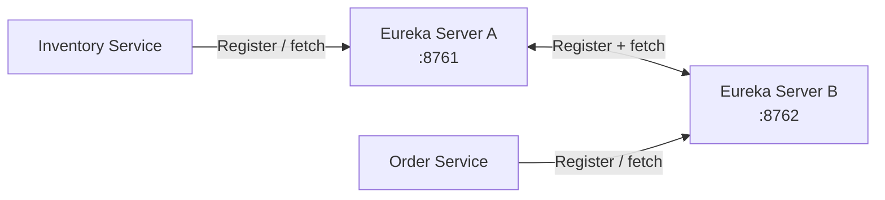

# Cấu hình register-with-eureka và fetch-registry trên máy chủ

Eureka Server vừa cung cấp registry để các ứng dụng đăng ký và tra cứu, vừa được xây dựng trên Eureka Client. Vì vậy, một tiến trình chạy vai trò máy chủ Eureka cũng có các tùy chọn client như `register-with-eureka` và `fetch-registry`. Hai thuộc tính này độc lập: một thuộc tính điều khiển việc máy chủ tự đăng ký vào registry khác, thuộc tính còn lại điều khiển việc máy chủ tải danh sách instance từ peer.

Với Eureka Server chạy độc lập một node, thông thường cần tắt cả hai thuộc tính. Khi triển khai nhiều Eureka Server theo mô hình peer-aware, mỗi node cần trao đổi registry với các peer còn lại, vì vậy thường bật cả hai và cấu hình URL của các peer. Cấu hình đúng phụ thuộc topology triển khai, không chỉ phụ thuộc việc ứng dụng có annotation `@EnableEurekaServer`.

## Eureka Server cũng có Eureka Client

Trong Spring Cloud Netflix, ứng dụng bật `@EnableEurekaServer` để cung cấp Eureka Server. Tuy nhiên, server vẫn có Eureka Client ở bên trong để có thể tham gia một cụm registry nhiều node. Điều này giải thích vì sao cấu hình của server có các thuộc tính bắt đầu bằng `eureka.client`.

```java
import org.springframework.boot.SpringApplication;
import org.springframework.boot.autoconfigure.SpringBootApplication;
import org.springframework.cloud.netflix.eureka.server.EnableEurekaServer;

@SpringBootApplication
@EnableEurekaServer
public class EurekaServerApplication {
    public static void main(String[] args) {
        SpringApplication.run(EurekaServerApplication.class, args);
    }
}
```

Ứng dụng cần dependency `spring-cloud-starter-netflix-eureka-server`. Phiên bản Spring Cloud nên được quản lý bằng BOM/release train tương thích với phiên bản Spring Boot đang dùng.

```xml
<dependency>
    <groupId>org.springframework.cloud</groupId>
    <artifactId>spring-cloud-starter-netflix-eureka-server</artifactId>
</dependency>
```

`register-with-eureka` và `fetch-registry` là cấu hình của Eureka Client bên trong tiến trình. Chúng không bật hoặc tắt vai trò HTTP server của Eureka. Vai trò server được cung cấp bởi starter và `@EnableEurekaServer`; hai thuộc tính client điều khiển cách node đó tham gia registry.

## Ý nghĩa của hai thuộc tính

| Thuộc tính | Khi bật (`true`) | Khi tắt (`false`) |
|---|---|---|
| `eureka.client.register-with-eureka` | Eureka Client đăng ký instance của ứng dụng hiện tại với một Eureka Server/peer | Không công bố instance của tiến trình hiện tại qua Eureka Client |
| `eureka.client.fetch-registry` | Eureka Client tải registry từ server/peer để tra cứu các application và instance | Không tải danh sách registry về client cục bộ |

Có thể nhớ ngắn gọn:

- `register-with-eureka`: “Tôi có đăng ký chính mình với registry khác không?”
- `fetch-registry`: “Tôi có tải danh bạ từ registry khác về không?”

Hai thuộc tính không phải một cặp bật/tắt duy nhất. Một ứng dụng consumer có thể đặt `register-with-eureka=false` nhưng `fetch-registry=true`: ứng dụng không đăng ký chính nó nhưng vẫn tìm được service khác. Một máy chủ Eureka peer-aware thường bật cả hai để công bố node của mình cho peer và nhận dữ liệu registry từ peer.

## Cấu hình máy chủ Eureka độc lập một node

Khi chỉ chạy một Eureka Server độc lập, không có peer khác để đồng bộ. Máy chủ không cần đăng ký chính nó vào registry và cũng không cần tải registry từ peer. Hãy cấu hình tường minh:

```yaml
server:
  port: 8761

spring:
  application:
    name: eureka-server

eureka:
  client:
    register-with-eureka: false
    fetch-registry: false
```

Trong cấu hình này:

- `register-with-eureka: false` ngăn Eureka Server cố đăng ký instance của chính nó như một Eureka Client.
- `fetch-registry: false` ngăn client bên trong server tải danh sách registry từ một Eureka peer.
- Eureka Server vẫn khởi động endpoint registry và dashboard tại cổng `8761`.

Các service client sẽ kết nối tới máy chủ này bằng URL của registry. Ví dụ cấu hình cho một provider:

```yaml
spring:
  application:
    name: inventory-service

eureka:
  client:
    register-with-eureka: true
    fetch-registry: true
    service-url:
      defaultZone: http://localhost:8761/eureka/
```

Ở đây, `inventory-service` là client của Eureka Server nên thường vừa đăng ký chính nó vừa tải registry. Nếu ứng dụng chỉ là consumer, có thể đặt `register-with-eureka: false` và vẫn giữ `fetch-registry: true`.

## Cấu hình cụm Eureka Server theo peer

Khi cần tính sẵn sàng cao, có thể triển khai nhiều Eureka Server và cấu hình chúng làm peer. Mỗi node vừa phục vụ client, vừa đăng ký với peer và lấy registry từ peer. Trong mô hình này, hai thuộc tính thường được bật:

```yaml
eureka:
  client:
    register-with-eureka: true
    fetch-registry: true
```

Điều quan trọng là `defaultZone` của mỗi node phải trỏ tới peer khác, không trỏ vòng về chính node đó. Các node cần có hostname hoặc DNS ổn định và có thể kết nối tới nhau qua mạng.

### Ví dụ cụm hai node

**Node A — `eureka-a`**

```yaml
server:
  port: 8761

spring:
  application:
    name: eureka-server

eureka:
  instance:
    hostname: eureka-a
  client:
    register-with-eureka: true
    fetch-registry: true
    service-url:
      defaultZone: http://eureka-b:8762/eureka/
```

**Node B — `eureka-b`**

```yaml
server:
  port: 8762

spring:
  application:
    name: eureka-server

eureka:
  instance:
    hostname: eureka-b
  client:
    register-with-eureka: true
    fetch-registry: true
    service-url:
      defaultZone: http://eureka-a:8761/eureka/
```

Node A đăng ký và fetch từ B; node B đăng ký và fetch từ A. Mỗi node tiếp tục phục vụ API registry cho các service client. Trong môi trường thực tế, `eureka-a` và `eureka-b` cần phân giải DNS đúng từ cả hai máy chủ; không dùng `localhost` để trỏ tới peer từ một container khác.



### Ví dụ cụm ba node

Với ba node, mỗi node cấu hình URL của hai peer còn lại. Ví dụ:

| Node | Port | `defaultZone` trỏ tới |
|---|---:|---|
| `eureka-a` | 8761 | `http://eureka-b:8762/eureka/,http://eureka-c:8763/eureka/` |
| `eureka-b` | 8762 | `http://eureka-a:8761/eureka/,http://eureka-c:8763/eureka/` |
| `eureka-c` | 8763 | `http://eureka-a:8761/eureka/,http://eureka-b:8762/eureka/` |

Ví dụ cấu hình cho node A:

```yaml
server:
  port: 8761
spring:
  application:
    name: eureka-server
eureka:
  instance:
    hostname: eureka-a
  client:
    register-with-eureka: true
    fetch-registry: true
    service-url:
      defaultZone: http://eureka-b:8762/eureka/,http://eureka-c:8763/eureka/
```

Các node B và C dùng cùng cấu trúc nhưng thay `hostname`, `port` và danh sách peer tương ứng. URL trong `defaultZone` là danh sách endpoint peer phân tách bằng dấu phẩy. Không đưa chính URL của node hiện tại vào danh sách peer.

## Vì sao cấu hình standalone và peer cluster khác nhau?

| Kiểu triển khai | `register-with-eureka` | `fetch-registry` | Lý do |
|---|---:|---:|---|
| Eureka Server độc lập một node | `false` | `false` | Không có peer để đăng ký hoặc tải registry |
| Eureka Server trong cụm peer | `true` | `true` | Mỗi node công bố tới peer và nhận registry từ peer |
| Service provider thông thường | `true` | `true` | Đăng ký chính nó và tra cứu các service khác |
| Consumer-only | `false` | `true` | Không đăng ký instance của consumer nhưng vẫn cần danh sách registry |

Không nên sao chép cấu hình server độc lập vào từng node của cụm peer. Nếu mọi node đều tắt cả hai thuộc tính, chúng sẽ không trao đổi registry với nhau. Ngược lại, bật cả hai trên server một node mà không cấu hình peer hợp lệ có thể tạo các lần thử kết nối không cần thiết hoặc khiến log khó chẩn đoán.

## Registry replication hoạt động ra sao?

Trong cụm Eureka peer-aware, mỗi server duy trì registry cục bộ và trao đổi các thay đổi với peer. Khi một client đăng ký vào node A, thông tin đăng ký được xử lý tại A và được replication tới các peer theo cơ chế của Eureka. Client kết nối node B cũng có thể nhìn thấy thông tin sau khi replication hoàn tất.

Replication không nên được xem là đồng bộ tức thời tuyệt đối. Trong khoảng thời gian ngắn, hai node có thể hiển thị danh sách khác nhau do độ trễ mạng, heartbeat, cache hoặc quá trình replication. Vì vậy, ứng dụng vẫn cần xử lý trường hợp instance vừa được đăng ký chưa xuất hiện ở mọi node, hoặc một instance đã chết vẫn còn trong registry trong thời gian phát hiện và eviction.

`register-with-eureka` và `fetch-registry` cho phép node tham gia vòng trao đổi này, nhưng không tự tạo ra topology HA hoàn chỉnh. Cần bảo đảm peer URL chính xác, DNS/network thông suốt, cổng server mở và các node có cấu hình nhất quán.

## Các lỗi cấu hình thường gặp

| Triệu chứng | Nguyên nhân có thể | Cách kiểm tra hoặc xử lý |
|---|---|---|
| Server độc lập liên tục tìm peer hoặc báo lỗi fetch | Để `fetch-registry=true` nhưng không có peer phù hợp | Đặt `fetch-registry=false` cho standalone |
| Server độc lập cố đăng ký chính nó | Để `register-with-eureka=true` trong cấu hình một node | Đặt `register-with-eureka=false` |
| Các node trong cụm không nhìn thấy cùng danh sách service | Một node tắt fetch/register hoặc `defaultZone` thiếu peer | Bật cả hai thuộc tính và kiểm tra danh sách peer hai chiều |
| Node kết nối tới chính nó thay vì peer | `defaultZone` dùng `localhost` hoặc hostname của chính node | Dùng DNS/hostname của các peer khác |
| Node không kết nối được peer | DNS, firewall, port hoặc URL `/eureka/` sai | Kiểm tra phân giải tên và gọi endpoint peer từ chính container/server |
| Client đăng ký được nhưng gọi service không thành công | Registry có bản ghi nhưng địa chỉ quảng bá không truy cập được | Kiểm tra host/port mà client đăng ký và đường mạng từ consumer |
| Danh sách registry giữa các peer chênh lệch trong thời gian ngắn | Replication hoặc heartbeat chưa hoàn tất | Kiểm tra log replication, kết nối peer và thời gian cập nhật |

Một lỗi hay gặp là dùng `localhost` trong `defaultZone` khi chạy bằng Docker hoặc Kubernetes. `localhost` luôn trỏ tới network namespace của chính container/pod, không phải máy chủ Eureka còn lại. Dùng DNS service hoặc hostname có thể phân giải từ node đang chạy.

## Cách xác minh cấu hình

### Kiểm tra dashboard

Khởi động server rồi mở `http://localhost:8761/` trong môi trường local. Dashboard giúp xem registry đang có application và instance nào. Với cụm nhiều node, mở dashboard của từng node và so sánh danh sách sau khi đăng ký client.

### Kiểm tra REST endpoint

Có thể đọc registry qua REST API của Eureka:

```bash
curl -H "Accept: application/json" http://localhost:8761/eureka/apps
```

Với cụm peer, thực hiện lệnh tương tự trên từng node. Sau khi đăng ký một service client, kiểm tra service ID và instance xuất hiện trên các peer sau thời gian replication. API và định dạng phản hồi có thể thay đổi theo cấu hình bảo mật và phiên bản.

### Kiểm tra log khởi động

Khi chạy với mức log phù hợp, tìm các thông tin liên quan tới:

- Eureka Client được enable hay disable.
- Client có đang đăng ký instance của server hay không.
- Danh sách peer trong `service-url.defaultZone`.
- Kết quả kết nối và fetch registry từ peer.
- Lỗi DNS, timeout, connection refused hoặc lỗi HTTP khi đồng bộ.

Có thể tạm bật log debug trong local:

```yaml
logging:
  level:
    com.netflix.discovery: DEBUG
    com.netflix.eureka: DEBUG
    org.springframework.cloud.netflix.eureka: DEBUG
```

Không nên giữ debug log quá chi tiết lâu dài trong production vì lượng log lớn và có thể tiết lộ topology nội bộ.

### Kiểm tra bằng cấu hình Actuator

Nếu ứng dụng đã có Spring Boot Actuator, có thể dùng endpoint health và thông tin bean để hỗ trợ chẩn đoán. Chỉ expose endpoint quản trị trên mạng được bảo vệ; dashboard và REST API của Eureka cũng cần được giới hạn truy cập phù hợp.

## Lưu ý về self-preservation và tính sẵn sàng

`register-with-eureka` và `fetch-registry` không thay thế cơ chế self-preservation, lease renewal, eviction hay giám sát sức khỏe của Eureka. Self-preservation có thể giữ lại một số bản ghi khi server nghi ngờ có sự cố mạng diện rộng và nhận ít heartbeat hơn dự kiến. Do đó, instance đã dừng có thể vẫn hiển thị trong registry trong một khoảng thời gian.

Khi thiết kế cụm, hãy theo dõi peer replication, số heartbeat, số instance đã đăng ký, trạng thái server và lỗi kết nối. Đừng tắt self-preservation chỉ để làm registry biến mất nhanh hơn trong một bài lab; trước tiên cần hiểu nguyên nhân heartbeat bị thiếu và tác động của việc eviction sớm.

## Checklist chọn cấu hình

1. Xác định Eureka Server đang chạy độc lập hay là một node trong peer cluster.
2. Với standalone, đặt `register-with-eureka=false` và `fetch-registry=false`.
3. Với peer cluster, bật cả hai thuộc tính và liệt kê các peer khác trong `defaultZone`.
4. Không trỏ `defaultZone` về chính node; dùng hostname/DNS có thể phân giải từ từng peer.
5. Đảm bảo các node dùng cấu hình service URL, port và network nhất quán.
6. Kiểm tra service client có trỏ tới ít nhất một Eureka Server khả dụng.
7. So sánh registry trên từng node sau khi client đăng ký để xác nhận replication.
8. Kiểm thử một peer dừng, khởi động lại và quan sát quá trình phục hồi.
9. Theo dõi heartbeat, lease, self-preservation và các bản ghi stale.
10. Quản lý phiên bản Spring Boot/Spring Cloud bằng BOM tương thích và bảo vệ dashboard/API registry.

## Kết luận

`register-with-eureka` điều khiển việc Eureka Client bên trong tiến trình đăng ký chính nó; `fetch-registry` điều khiển việc client tải registry từ server/peer. Với Eureka Server độc lập một node, đặt cả hai thành `false` để tránh tự đăng ký và fetch từ peer không tồn tại. Với cụm Eureka peer-aware, bật cả hai và cấu hình mỗi node trỏ tới các peer còn lại. Service client thông thường thường bật cả hai, còn consumer-only có thể tắt đăng ký nhưng vẫn fetch registry. Luôn xác minh cấu hình bằng dashboard, REST API, log kết nối và trạng thái registry trên từng node.
