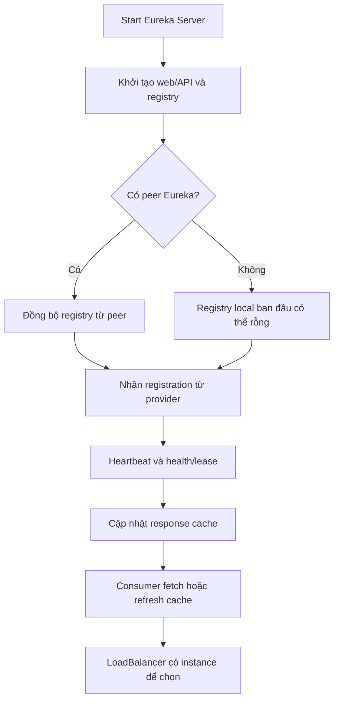

# Khởi động, làm nóng sổ đăng ký và giới hạn của một máy chủ

Eureka Server là nơi lưu danh sách các service instance để consumer tra cứu. Khi máy chủ vừa khởi động, registry có thể chưa có instance nào: các provider cần thời gian khởi động, đăng ký và gửi heartbeat; server có thể cần đồng bộ dữ liệu từ peer; cache phản hồi và cache phía client cũng có chu kỳ cập nhật riêng.

Vì vậy, **Eureka Server khởi động thành công không đồng nghĩa registry đã được làm nóng và có đủ instance để phục vụ traffic**. Trong module Spring Cloud Service Discovery, cần hiểu rõ vòng đời startup, thời gian hội tụ của registry và giới hạn khi chỉ triển khai một Eureka Server.

## 1. Khởi động một Eureka Server độc lập

Một ứng dụng Spring Boot có thể bật vai trò Eureka Server bằng annotation `@EnableEurekaServer`:

```java
import org.springframework.boot.SpringApplication;
import org.springframework.boot.autoconfigure.SpringBootApplication;
import org.springframework.cloud.netflix.eureka.server.EnableEurekaServer;

@SpringBootApplication
@EnableEurekaServer
public class EurekaServerApplication {

    public static void main(String[] args) {
        SpringApplication.run(EurekaServerApplication.class, args);
    }
}
```

Cấu hình cơ bản cho một máy chủ chạy độc lập:

```yaml
spring:
  application:
    name: eureka-server

server:
  port: 8761

eureka:
  client:
    register-with-eureka: false
    fetch-registry: false
```

Hai thuộc tính client được tắt trong ví dụ standalone vì server không cần tự đăng ký với chính nó hoặc tải registry từ peer khác:

- `register-with-eureka: false`: không gửi registration của Eureka Server này tới một registry khác.
- `fetch-registry: false`: không tải registry từ peer.

Cấu hình này phù hợp với máy chủ đơn lẻ trong môi trường học tập, development hoặc hệ thống nhỏ chấp nhận một điểm lỗi duy nhất. Trong cụm nhiều peer, cấu hình của server sẽ khác: mỗi peer cần biết địa chỉ các peer còn lại và tham gia trao đổi registry.

Sau khi ứng dụng khởi động, có thể mở dashboard tại `http://localhost:8761/`. Dashboard giúp quan sát server và danh sách application, nhưng trang dashboard hiển thị được không chứng minh các provider quan trọng đã đăng ký đầy đủ hoặc traffic đã sẵn sàng.

## 2. Các giai đoạn từ startup đến registry sẵn sàng

Một lần khởi động thường trải qua các giai đoạn:

1. **Khởi động tiến trình:** Spring Boot tạo application context, khởi tạo web server và các bean.
2. **Khởi tạo Eureka Server:** các thành phần registry, API và cơ chế quản lý instance được tạo.
3. **Đồng bộ peer (nếu có):** server trao đổi dữ liệu với các Eureka peer theo cấu hình cluster.
4. **Nhận registration:** provider khởi động và gửi thông tin instance tới Eureka Server.
5. **Duy trì registration:** client gửi heartbeat; server xử lý lease và health status.
6. **Cập nhật response cache:** server cập nhật dữ liệu phục vụ truy vấn; client cũng có thể cần chu kỳ fetch để nhận bản ghi mới.
7. **Consumer sử dụng dữ liệu:** DiscoveryClient và LoadBalancer nhìn thấy instance phù hợp và bắt đầu định tuyến request.

Sơ đồ tổng quát:



Các giai đoạn không nhất thiết xảy ra đồng thời. Server có thể nhận HTTP request trước khi các service nghiệp vụ đăng ký xong. Một consumer khởi động quá sớm có thể truy vấn một service ID nhưng nhận danh sách rỗng.

## 3. Registry mới khởi động thường chưa có dữ liệu

Trong chế độ standalone, registry của Eureka Server mới khởi động có thể rỗng. Server không tự biết các provider trong hệ thống; các provider phải đăng ký với nó.

Ví dụ hệ thống có:

- `order-service`: xử lý đơn hàng.
- `inventory-service`: kiểm tra tồn kho.
- `payment-service`: xử lý thanh toán.

Khi Eureka Server vừa lên, dashboard có thể chưa hiển thị ba application. Sau khi từng provider khởi động và đăng ký, registry mới dần có dữ liệu. Nếu consumer gọi `inventory-service` trước khi instance đầu tiên đăng ký, LoadBalancer có thể báo không có instance phù hợp.

Đây là trạng thái bình thường trong giai đoạn khởi động, không nhất thiết là lỗi của Eureka Server. Khi chẩn đoán cần phân biệt:

- Server chưa sẵn sàng nhận request.
- Server đã sẵn sàng nhưng registry chưa có provider.
- Provider đã đăng ký nhưng bản ghi chưa xuất hiện trong response cache.
- Server đã cập nhật nhưng consumer chưa refresh registry cache.
- Instance có bản ghi nhưng health/lease khiến nó không được xem là có thể phục vụ.

Không nên đánh đồng “dashboard mở được” với “mọi service đã sẵn sàng”.

## 4. Vì sao cần làm nóng registry?

Làm nóng (warm-up) là quá trình chờ các thành phần cần thiết khởi tạo và hội tụ dữ liệu trước khi đưa traffic phụ thuộc vào discovery.

Các nguyên nhân gây độ trễ:

| Thành phần | Điều xảy ra | Ảnh hưởng |
|---|---|---|
| Provider startup | Ứng dụng cần thời gian khởi động web server và discovery client | Chưa có registration |
| Registration | Client gửi thông tin instance tới server | Registry chưa thấy provider trước thời điểm đăng ký |
| Peer synchronization | Server mới cần nhận dữ liệu từ các peer | Registry giữa các node có thể tạm thời khác nhau |
| Server response cache | Eureka cập nhật cache phục vụ truy vấn theo chu kỳ | Bản ghi mới có thể chưa xuất hiện ngay trong response |
| Client registry fetch | Consumer tải hoặc refresh danh sách instance | Consumer có thể còn nhìn thấy dữ liệu cũ hoặc danh sách rỗng |
| Health/lease | Instance phải đáp ứng điều kiện trạng thái và gia hạn lease | Instance chưa được xem là có thể phục vụ |

Eureka thường có cache ở phía server và client. Một số chu kỳ mặc định phổ biến vào khoảng vài chục giây, nhưng giá trị chính xác và cách áp dụng phụ thuộc phiên bản, cấu hình và loại cache. Không nên giả định registration vừa gửi sẽ lập tức xuất hiện trong mọi consumer.

Tổng thời gian hội tụ phụ thuộc nhiều bước nối tiếp: provider khởi động, gửi registration, server cập nhật cache, rồi consumer refresh dữ liệu. Cần đo trong môi trường thật thay vì chọn một khoảng chờ cố định theo cảm tính.

## 5. Quy trình làm nóng có kiểm soát

Có thể tổ chức startup theo thứ tự sau:

1. Khởi động Eureka Server và chờ health/readiness của tiến trình đạt yêu cầu.
2. Khởi động các provider quan trọng.
3. Chờ từng provider đăng ký và đạt trạng thái mong muốn.
4. Kiểm tra registry đã có đủ service ID và instance cần thiết.
5. Chờ consumer nhận dữ liệu mới nếu ứng dụng phụ thuộc client-side registry cache.
6. Cho phép gateway, worker hoặc luồng traffic nghiệp vụ bắt đầu gọi các service đó.

Đối với hệ thống triển khai bằng Kubernetes hoặc nền tảng điều phối khác, readiness probe nên kiểm tra điều kiện phù hợp với vai trò của workload. Chỉ kiểm tra cổng TCP mở hoặc process còn sống là chưa đủ để kết luận registry đã có đủ provider.

### Kiểm tra trạng thái ứng dụng với Spring Boot Actuator

Có thể bật health probes:

```yaml
management:
  endpoints:
    web:
      exposure:
        include: health,info
  endpoint:
    health:
      probes:
        enabled: true
```

Sau đó kiểm tra endpoint readiness, ví dụ:

```text
GET /actuator/health/readiness
```

Readiness mặc định phản ánh trạng thái sẵn sàng của ứng dụng theo các health group mà Spring Boot cấu hình. Nó **không tự động chứng minh registry đã có đủ instance nghiệp vụ**. Nếu yêu cầu deployment phải đợi các provider quan trọng xuất hiện, cần bổ sung readiness check hoặc bước kiểm tra riêng phù hợp với kiến trúc.

Không nên thêm toàn bộ dependency nghiệp vụ vào liveness probe. Nếu Eureka hoặc một provider tạm thời không truy cập được, liveness thất bại có thể khiến hệ thống restart liên tục và làm sự cố lan rộng. Readiness, liveness và registry readiness là các tín hiệu khác nhau, cần thiết kế theo mục đích.

### Kiểm tra registry qua API

Có thể truy vấn danh sách application đã đăng ký bằng REST API của Eureka:

```bash
curl -H "Accept: application/json" \
  http://localhost:8761/eureka/apps
```

API này hữu ích để kiểm tra registry có application và instance nào. Trong môi trường production, endpoint cần được bảo vệ bằng authentication, network policy và TLS theo yêu cầu hệ thống.

Có thể kiểm tra cụ thể một application theo REST API tương ứng hoặc quan sát dashboard và log. Khi kiểm tra readiness của một provider, hãy xác minh instance ID, host, port và trạng thái của instance đó, thay vì chỉ đếm tên application.

### Dùng retry có giới hạn ở consumer

Consumer có thể khởi động trước provider hoặc trước khi registry hội tụ. Khi gọi service ID, nên có retry với backoff và giới hạn thời gian phù hợp với nghiệp vụ.

Ví dụ minh họa chiến lược:

```text
Lần 1: gọi service ID
    Nếu chưa có instance: chờ backoff ngắn
Lần 2: truy vấn lại và thử gọi
    Nếu vẫn chưa có instance: tăng backoff
Lần tiếp theo:
    Dừng khi thành công hoặc hết startup deadline
```

Không nên dùng vòng lặp vô hạn hoặc `Thread.sleep()` cố định trong luồng xử lý request. Retry nên nằm ở startup orchestration hoặc cơ chế resilience phù hợp, có timeout, giới hạn số lần và log rõ nguyên nhân thất bại.

## 6. Phân biệt server readiness và registry readiness

Có ít nhất ba trạng thái cần quan sát:

| Trạng thái | Câu hỏi cần trả lời | Cách kiểm tra |
|---|---|---|
| Process/server readiness | Eureka Server có khởi động và nhận request được không? | Health endpoint, web server và log startup |
| Registry readiness | Registry đã có các service/instance quan trọng chưa? | Eureka REST API, dashboard, custom health check |
| Consumer readiness | Consumer đã nhìn thấy instance và gọi được provider chưa? | DiscoveryClient, LoadBalancer và kiểm thử request |

Ba trạng thái này có quan hệ nhưng không đồng nhất. Server có thể khỏe trong khi registry trống. Registry có thể đã có instance nhưng consumer chưa refresh cache. Consumer có thể nhìn thấy instance nhưng kết nối thất bại do host, port, firewall hoặc TLS.

Trong production, nên xác định tiêu chí readiness theo vai trò. Một Eureka Server có thể sẵn sàng phục vụ đăng ký dù registry chưa đủ mọi application. Một gateway có thể cần chờ các service bắt buộc trước khi nhận traffic. Không nên dùng một tiêu chí readiness chung cho tất cả workload.

## 7. Giới hạn của một Eureka Server

Triển khai một Eureka Server đơn giản nhưng có các giới hạn quan trọng.

### Single point of failure

Nếu máy chủ duy nhất bị dừng, lỗi phần cứng, mất mạng hoặc cần nâng cấp, client không thể truy cập registry để nhận dữ liệu mới hoặc đăng ký instance mới trong thời gian đó.

Các consumer đã có registry cache có thể tiếp tục gọi một số instance đang biết, nhưng dữ liệu có thể cũ. Khả năng tiếp tục phục vụ phụ thuộc cache, trạng thái instance, thời gian lease và hành vi của client. Không thể coi cache cục bộ là giải pháp HA đầy đủ.

### Không có peer replication

Một server đơn không có peer để sao chép registry. Nếu server restart, registry trong bộ nhớ có thể bắt đầu rỗng rồi được xây dựng lại khi provider đăng ký lại. Trong lúc phục hồi, consumer có thể thấy thiếu instance hoặc dữ liệu chưa hội tụ.

Eureka không phải cơ sở dữ liệu lưu trữ bền vững theo kiểu database nghiệp vụ. Không nên dựa vào một server đơn như kho dữ liệu durable duy nhất cho danh tính và trạng thái instance.

### Bảo trì gây gián đoạn registry

Nâng cấp JVM, cập nhật cấu hình, thay chứng thư TLS hoặc sửa lỗi server có thể làm gián đoạn điểm discovery duy nhất. Các client vẫn có thể sử dụng cache trong một khoảng thời gian nhưng không nhận được thay đổi mới trong thời gian server ngừng hoạt động.

### Giới hạn tài nguyên và failure domain

Một máy chủ có giới hạn CPU, RAM, network, kết nối và khả năng xử lý request. Khi số lượng service/instance hoặc tốc độ đăng ký tăng, một node có thể trở thành nút thắt. Nếu server nằm trong cùng failure domain với các ứng dụng, một sự cố vùng hoặc mạng có thể ảnh hưởng cả registry lẫn provider.

### Self-preservation không thay thế HA

Eureka có cơ chế self-preservation để hạn chế việc xóa hàng loạt instance khi số heartbeat nhận được giảm bất thường. Cơ chế này giúp tránh loại nhầm instance khỏe trong một đợt gián đoạn mạng diện rộng.

Tuy nhiên, self-preservation có thể khiến bản ghi instance đã chết còn tồn tại lâu hơn dự kiến. Nó không tạo thêm server dự phòng, không sao chép dữ liệu sang peer và không bảo đảm registry vẫn truy cập được khi node duy nhất hỏng.

## 8. Khi nào một máy chủ là đủ?

Một Eureka Server đơn có thể phù hợp với:

- Môi trường học tập, local development hoặc demo.
- Hệ thống nội bộ nhỏ chấp nhận thời gian gián đoạn khi bảo trì.
- Môi trường kiểm thử tích hợp không yêu cầu registry luôn sẵn sàng.
- Giai đoạn đầu của dự án khi đã có kế hoạch rõ ràng để mở rộng khi nhu cầu tăng.

Không nên mặc định một server đơn phù hợp với production chỉ vì số lượng service hiện tại còn ít. Mức độ quan trọng của registry, thời gian downtime chấp nhận được, phạm vi triển khai và hậu quả khi mất khả năng đăng ký/tra cứu mới là tiêu chí quyết định.

## 9. Hướng mở rộng thành cụm Eureka nhiều peer

Khi cần tính sẵn sàng cao hơn, có thể triển khai nhiều Eureka Server peer. Mỗi peer duy trì registry của mình và sao chép các thay đổi tới các peer khác theo cơ chế replication của Eureka.

Ví dụ cấu hình peer URLs:

```yaml
eureka:
  client:
    register-with-eureka: true
    fetch-registry: true
    service-url:
      defaultZone: http://eureka-2:8761/eureka/,http://eureka-3:8761/eureka/
```

Đây là phần cấu hình minh họa cho một node trong cụm; mỗi node cần có danh sách peer phù hợp với topology thực tế và hostname có thể phân giải từ các node còn lại.

Client nên được cấu hình nhiều URL server để có thể kết nối tới node khác khi một peer không khả dụng:

```yaml
eureka:
  client:
    service-url:
      defaultZone: http://eureka-1:8761/eureka/,http://eureka-2:8761/eureka/,http://eureka-3:8761/eureka/
```

Khi triển khai peer:

- Đặt các node ở failure domain phù hợp, tránh cùng phụ thuộc một máy hoặc một vùng mạng.
- Mở kết nối giữa peer và cấu hình hostname/port có thể truy cập.
- Kiểm tra replication và thời gian hội tụ khi một node khởi động lại.
- Theo dõi trạng thái peer, heartbeat, request rate và lỗi replication.
- Kiểm thử khi một node mất kết nối và khi một node trở lại.
- Đánh giá số lượng peer và tài nguyên theo quy mô registry.

Replication của Eureka có tính eventual consistency; không nên giả định mọi peer cập nhật cùng một thời điểm. Cần thiết kế consumer và quy trình rollout chịu được khoảng thời gian dữ liệu chưa đồng nhất.

## 10. Quan sát và vận hành registry

Một Eureka Server cần được giám sát như một thành phần hạ tầng quan trọng. Các chỉ số và tín hiệu hữu ích gồm:

- Trạng thái health/readiness của tiến trình.
- Số application và instance đang đăng ký.
- Số heartbeat nhận được và tỷ lệ renewal.
- Số instance bị đánh dấu DOWN hoặc bị eviction.
- Thời gian phản hồi REST API và lỗi HTTP.
- CPU, heap, garbage collection, thread và network.
- Cache update, client fetch và độ trễ hội tụ.
- Tình trạng peer replication nếu chạy cluster.

Không nên chỉ giám sát cổng 8761. Cổng mở nhưng registry trống hoặc peer replication lỗi vẫn có thể khiến hệ thống không gọi được dịch vụ.

Cần bảo vệ dashboard và REST API. Chỉ cho phép workload và người vận hành được ủy quyền truy cập; dùng TLS, authentication và network segmentation theo chính sách của hệ thống. Không expose registry quản trị trực tiếp ra Internet công cộng.

## 11. Các lỗi thường gặp khi khởi động và làm nóng

| Hiện tượng | Nguyên nhân có thể | Hướng kiểm tra |
|---|---|---|
| Dashboard mở được nhưng không có application | Provider chưa khởi động hoặc chưa đăng ký | Kiểm tra log client và cấu hình service URL |
| Consumer báo không có instance ngay sau startup | Registry chưa nhận registration hoặc client chưa fetch dữ liệu mới | Kiểm tra thứ tự khởi động, cache và retry |
| Instance xuất hiện chậm | Response cache hoặc client fetch có chu kỳ | Đo độ trễ và kiểm tra interval cấu hình |
| Server mới không có registry từ peer | Peer URL sai, network lỗi hoặc replication chưa hoàn tất | Kiểm tra peer status, log và REST API |
| Server restart làm registry tạm thời trống | Registry local trong bộ nhớ cần được provider đăng ký lại | Kiểm tra client reconnect và thời gian rebuild |
| Instance chết nhưng vẫn còn trên dashboard | Heartbeat giảm, lease hoặc self-preservation trì hoãn eviction | Kiểm tra renewal threshold, health và log |
| Một server quá tải | Số instance/request vượt khả năng node | Theo dõi tài nguyên và đánh giá cluster |

Khi xử lý lỗi, hãy xác định vấn đề thuộc process readiness, registry readiness hay consumer readiness trước. Cách phân loại này giúp tránh thay đổi timeout hoặc restart server khi nguyên nhân thực tế là provider chưa đăng ký.

## 12. Checklist trước khi đưa Eureka Server vào sử dụng

1. Server có khởi động đúng với `@EnableEurekaServer` và port dự kiến không?
2. Chế độ standalone đã tắt register/fetch client nếu không dùng peer chưa?
3. Provider có đăng ký đúng service ID, host và port không?
4. Có tiêu chí phân biệt server readiness với registry readiness không?
5. Consumer có xử lý danh sách instance rỗng trong giai đoạn startup không?
6. Đã đo thời gian registration, response-cache update và client refresh chưa?
7. Có theo dõi heartbeat, lease và self-preservation không?
8. Một server đơn có đáp ứng yêu cầu downtime và failure domain không?
9. Nếu cần HA, peer replication và nhiều server URL đã được kiểm thử chưa?
10. Dashboard, REST API và kết nối peer đã được bảo vệ chưa?

Khởi động Eureka Server chỉ là bước đầu. Registry cần thời gian nhận registration, đồng bộ và cập nhật cache trước khi consumer có thể sử dụng dữ liệu ổn định. Một server đơn phù hợp cho môi trường đơn giản nhưng là điểm lỗi duy nhất và không có peer replication. Khi registry trở thành hạ tầng quan trọng của production, cần có readiness rõ ràng, quan sát độ trễ hội tụ và kế hoạch triển khai nhiều peer phù hợp.
