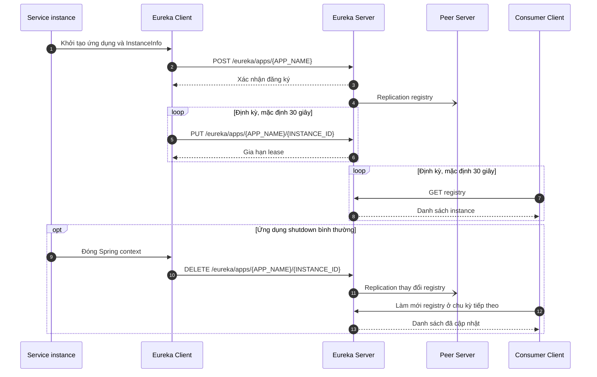

# Chu trình đăng ký, gia hạn thuê và hủy đăng ký trong Eureka

## 1. Vì sao Eureka cần một chu trình vòng đời?

Trong hệ thống microservice, một dịch vụ có thể chạy nhiều instance trên các máy hoặc container khác nhau. Địa chỉ IP và cổng của từng instance có thể thay đổi khi triển khai lại, mở rộng hoặc thay thế container. Vì vậy, service consumer không nên phụ thuộc vào một địa chỉ cố định.

Spring Cloud Service Discovery cung cấp cơ chế tìm instance theo tên dịch vụ. Với Eureka, mỗi instance đăng ký thông tin của mình lên Eureka Server. Server duy trì registry để các Eureka Client khác truy vấn và chọn instance phù hợp. Registry không chỉ ghi nhận một instance đã từng xuất hiện; nó cần được cập nhật trong suốt thời gian instance hoạt động và được dọn dẹp khi instance ngừng chạy.

Chu trình đó gồm ba hoạt động chính:

1. **Đăng ký (registration):** gửi thông tin instance lên Eureka Server khi ứng dụng khởi động.
2. **Gia hạn lease (renewal/heartbeat):** gửi heartbeat định kỳ để cho biết instance vẫn có thể liên lạc với Eureka Server.
3. **Hủy đăng ký (deregistration):** thông báo cho Eureka Server khi ứng dụng dừng bình thường.

Eureka Client của Spring Cloud tự thực hiện các hoạt động này trong vòng đời ứng dụng. Thông thường, lập trình viên không cần tự viết tác vụ gửi heartbeat hoặc gọi REST API đăng ký.

## 2. Những thông tin được đăng ký

Eureka tổ chức registry theo tên ứng dụng. Một ứng dụng có thể có nhiều instance; mỗi instance được mô tả bằng một bản ghi `InstanceInfo`. Bản ghi thường chứa:

- Tên ứng dụng, thường lấy từ `spring.application.name`.
- Instance ID để phân biệt các bản chạy cùng một ứng dụng.
- Hostname hoặc địa chỉ IP và cổng phục vụ request.
- Trạng thái của instance, chẳng hạn `UP`, `DOWN` hoặc `OUT_OF_SERVICE`.
- Metadata và các URL liên quan như health check, status page nếu được cấu hình.

Tên ứng dụng dùng để tìm nhóm dịch vụ; instance ID dùng để nhận diện một bản chạy cụ thể. Vì vậy, các instance cùng ứng dụng cần có instance ID khác nhau. Nếu nhiều instance dùng chung một ID, thông tin đăng ký có thể ghi đè hoặc gây nhầm lẫn khi gia hạn và hủy đăng ký.

Một **lease** là khoảng thời gian đăng ký có hiệu lực nếu server tiếp tục nhận được heartbeat. Lease giúp Eureka nhận biết một instance có thể đã biến mất ngay cả khi instance đó không thể gửi thông báo dừng.

## 3. Đăng ký khi ứng dụng khởi động

Khi ứng dụng có dependency Eureka Client khởi động, Spring Cloud cấu hình `EurekaClient` và `DiscoveryClient`. Nếu `eureka.client.register-with-eureka` được bật (mặc định là `true`), client tạo thông tin instance từ cấu hình ứng dụng và gửi yêu cầu đăng ký đến một Eureka Server trong danh sách `service-url`.

Luồng cơ bản:

1. Ứng dụng khởi tạo Spring context và xác định tên ứng dụng, instance ID, địa chỉ, cổng cùng metadata.
2. Eureka Client tạo `InstanceInfo` và gửi yêu cầu đăng ký. Trong REST API Eureka, thao tác này thường tương ứng với `POST /eureka/apps/{APP_NAME}`.
3. Eureka Server lưu instance vào registry cục bộ và trả kết quả cho client.
4. Nếu Eureka Server chạy theo cụm, thông tin registry được chuyển tiếp đến các peer theo cơ chế replication. Việc đồng bộ giữa các peer có thể có độ trễ.
5. Eureka Client tiếp tục gửi heartbeat định kỳ và có thể tải registry để phục vụ việc khám phá dịch vụ.

Ví dụ cấu hình phía một service:

```yaml
spring:
  application:
    name: order-service

server:
  port: 8081

eureka:
  client:
    service-url:
      defaultZone: http://localhost:8761/eureka/
    register-with-eureka: true
    fetch-registry: true
    registry-fetch-interval-seconds: 30
  instance:
    instance-id: ${spring.application.name}:${server.port}
    prefer-ip-address: true
    lease-renewal-interval-in-seconds: 30
    lease-expiration-duration-in-seconds: 90
```

Trong cấu hình trên, `service-url.defaultZone` chỉ đến Eureka Server. `register-with-eureka` điều khiển việc đăng ký instance; `fetch-registry` điều khiển việc tải danh sách instance để khám phá dịch vụ. Hai tùy chọn này phục vụ hai mục đích khác nhau. Một ứng dụng chỉ cần đăng ký có thể tắt việc fetch registry; một Eureka Server độc lập thường tắt cả đăng ký lẫn fetch registry của chính nó.

`instance-id` cần duy nhất trong phạm vi registry. Ví dụ dùng tên ứng dụng và cổng phù hợp khi mỗi instance có cổng riêng. Trong môi trường container hoặc nhiều máy, hãy chọn giá trị phân biệt được các bản chạy thực tế.

## 4. Gia hạn lease bằng heartbeat

Sau khi đăng ký, Eureka Client định kỳ gửi heartbeat để gia hạn lease. Với REST API Eureka, heartbeat thường tương ứng với:

```text
PUT /eureka/apps/{APP_NAME}/{INSTANCE_ID}
```

Khi nhận heartbeat hợp lệ, Eureka Server cập nhật thời điểm gia hạn của instance. Nếu server không nhận được heartbeat trong thời gian lease cho phép, instance trở thành ứng viên để bị loại khỏi registry.

Các giá trị mặc định thường gặp:

| Cấu hình | Nơi áp dụng | Giá trị mặc định | Ý nghĩa |
|---|---|---:|---|
| `eureka.instance.lease-renewal-interval-in-seconds` | Eureka Client | 30 giây | Khoảng cách giữa các lần heartbeat |
| `eureka.instance.lease-expiration-duration-in-seconds` | Eureka Client | 90 giây | Thời gian lease có thể không được gia hạn trước khi instance đủ điều kiện bị loại |
| `eureka.server.eviction-interval-timer-in-ms` | Eureka Server | 60000 ms | Chu kỳ chạy tác vụ kiểm tra và loại instance hết hạn |
| `eureka.client.registry-fetch-interval-seconds` | Eureka Client | 30 giây | Chu kỳ tải lại registry để cập nhật cache phía client |

Các giá trị trên là mặc định phổ biến của Eureka và có thể được điều chỉnh theo phiên bản, cấu hình triển khai hoặc nhu cầu vận hành. Cần phân biệt heartbeat với việc tải registry: heartbeat chứng minh client còn liên lạc với server; `registry-fetch-interval-seconds` quyết định khi nào một consumer làm mới bản cache danh sách instance. Vì vậy, một instance vừa đăng ký hoặc vừa bị xóa có thể chưa xuất hiện ngay trong cache của mọi consumer.

### 4.1. Heartbeat không đồng nghĩa với kiểm tra toàn bộ sức khỏe ứng dụng

Heartbeat cho biết Eureka Client vẫn có thể gửi yêu cầu đến Eureka Server. Nó không tự chứng minh mọi chức năng nghiệp vụ của ứng dụng đều hoạt động tốt. Ví dụ, một service vẫn gửi heartbeat được dù kết nối cơ sở dữ liệu đang lỗi.

Nếu muốn trạng thái Eureka phản ánh health indicator của ứng dụng, có thể tích hợp Spring Boot Actuator và bật health check của Eureka Client:

```yaml
eureka:
  client:
    healthcheck:
      enabled: true
```

Hãy kiểm tra cấu hình health indicator và hành vi trạng thái trong phiên bản Spring Cloud đang dùng. Không nên coi việc nhận heartbeat là bằng chứng duy nhất rằng instance sẵn sàng xử lý request.

### 4.2. Khi nào server loại instance hết hạn?

Khi không nhận được heartbeat trong khoảng `lease-expiration-duration-in-seconds`, instance có thể được xem là hết hạn. Tác vụ eviction trên server chạy theo chu kỳ `eviction-interval-timer-in-ms`, vì vậy việc xóa thực tế có thể xảy ra muộn hơn thời điểm lease vừa hết hạn.

Eureka còn có cơ chế **self-preservation**. Khi số heartbeat nhận được thấp hơn ngưỡng kỳ vọng trong một khoảng thời gian, server có thể tạm ngừng eviction để tránh xóa hàng loạt instance do sự cố mạng hoặc một đợt mất kết nối diện rộng. Cơ chế này bảo vệ registry trước lỗi mạng, nhưng cũng có thể khiến instance đã chết tiếp tục xuất hiện trong registry lâu hơn dự kiến.

Do đó, thời gian một consumer ngừng nhìn thấy instance lỗi phụ thuộc vào nhiều yếu tố: thời điểm heartbeat cuối cùng, lease expiration, chu kỳ eviction, trạng thái self-preservation, replication giữa các Eureka Server và chu kỳ làm mới registry của consumer.

## 5. Hủy đăng ký khi ứng dụng dừng bình thường

Khi Spring application context đóng theo quy trình shutdown bình thường, Eureka Client có thể gửi yêu cầu hủy đăng ký đến server. Trong REST API Eureka, thao tác này thường tương ứng với:

```text
DELETE /eureka/apps/{APP_NAME}/{INSTANCE_ID}
```

Server xóa instance khỏi registry cục bộ và chuyển tiếp thay đổi đến các peer nếu đang chạy theo cụm. Các consumer sẽ nhận thấy thay đổi sau khi registry được cập nhật và cache của chúng được làm mới.

Trong ứng dụng Spring Cloud thông thường, lifecycle hook của Eureka Client đảm nhiệm việc hủy đăng ký khi ứng dụng dừng. Không cần tự tạo một tác vụ heartbeat hoặc tự gọi endpoint `DELETE` trong `@PreDestroy` nếu không có yêu cầu đặc biệt. Hãy để ứng dụng đóng context theo quy trình shutdown của Spring để các callback vòng đời có cơ hội chạy.

Với hệ thống cần rút instance khỏi lưu lượng một cách êm ái, có thể thực hiện theo thứ tự:

1. Chuyển trạng thái instance sang `OUT_OF_SERVICE` để consumer có thể ngừng chọn instance đó sau khi nhận registry mới.
2. Chờ khoảng thời gian phù hợp để cache được làm mới và các request đang xử lý hoàn tất.
3. Dừng ứng dụng bình thường để Eureka Client hủy đăng ký.

Việc đổi trạng thái có thể thực hiện qua `ApplicationInfoManager` của Eureka, ví dụ:

```java
applicationInfoManager.setInstanceStatus(InstanceInfo.InstanceStatus.OUT_OF_SERVICE);
```

Đoạn mã chỉ minh họa thao tác chuyển trạng thái; ứng dụng cần quản lý thời điểm gọi và thời gian drain request theo cách triển khai thực tế.

## 6. Điều gì xảy ra khi instance gặp sự cố?

Không phải lần dừng nào cũng có thể gửi yêu cầu `DELETE`. Cần hiểu sự khác nhau giữa shutdown bình thường và mất kết nối đột ngột:

| Tình huống | Điều Eureka quan sát được | Hệ quả thường gặp |
|---|---|---|
| Ứng dụng dừng bình thường | Client gửi yêu cầu hủy đăng ký | Instance được xóa sau khi server xử lý và thay đổi lan tới consumer |
| Process hoặc máy bị tắt đột ngột | Không có yêu cầu hủy đăng ký; heartbeat ngừng | Lease hết hạn rồi instance được eviction, trừ khi self-preservation trì hoãn việc xóa |
| Client mất kết nối tới Eureka Server | Server không nhận heartbeat dù ứng dụng có thể vẫn chạy | Instance có thể bị xem là hết hạn; khi mạng phục hồi, client cần đăng ký/gia hạn lại theo trạng thái hiện tại |
| Ứng dụng còn heartbeat nhưng chức năng nghiệp vụ lỗi | Server vẫn nhận heartbeat | Instance có thể còn trong registry nếu health status không phản ánh lỗi đó |
| Eureka Server trong cụm chưa đồng bộ | Các peer hoặc cache consumer tạm thời có dữ liệu khác nhau | Kết quả discovery có thể chưa nhất quán trong một khoảng thời gian |

Ví dụ: `order-service` đăng ký thành công lúc 10:00 và gửi heartbeat mỗi 30 giây. Nếu process bị kill lúc 10:01, nó không thể gửi `DELETE`. Server phải dựa vào lease để nhận biết instance đã mất. Với lease expiration 90 giây và eviction chạy mỗi 60 giây, instance có thể còn được nhìn thấy sau 10:02; thời điểm cụ thể còn phụ thuộc chu kỳ tác vụ, self-preservation và cache của consumer.

## 7. Sơ đồ tổng quát



Sơ đồ mô tả luồng khái niệm. Thời điểm replication, phản hồi REST và làm mới cache phụ thuộc cấu hình, phiên bản và trạng thái mạng; các bước không nhất thiết diễn ra đồng thời trên mọi node.

## 8. Điều chỉnh cấu hình và vận hành

Không nên giảm heartbeat hoặc lease expiration chỉ để dashboard xóa instance nhanh hơn. Heartbeat quá dày làm tăng lưu lượng tới Eureka Server; lease quá ngắn khiến một đợt nghẽn mạng ngắn có thể bị hiểu nhầm là instance đã chết. Khi điều chỉnh, cần cân nhắc đồng thời:

- **Khoảng heartbeat:** phải đủ thưa để tránh tạo tải không cần thiết nhưng đủ thường xuyên để server phát hiện mất kết nối trong thời gian chấp nhận được.
- **Lease expiration:** nên dài hơn nhiều lần heartbeat để chịu được jitter, GC pause hoặc gián đoạn mạng ngắn.
- **Eviction interval:** ảnh hưởng thời điểm server thực sự dọn instance đã hết hạn.
- **Registry fetch interval:** ảnh hưởng độ trễ consumer nhìn thấy đăng ký hoặc hủy đăng ký.
- **Self-preservation và replication:** ảnh hưởng cách registry phản ứng khi nhiều client hoặc peer mất liên lạc cùng lúc.

Khi một instance không xuất hiện hoặc vẫn còn xuất hiện sau khi dừng, có thể kiểm tra theo thứ tự:

1. Xác nhận `spring.application.name`, `instance-id`, host và port mà client đang đăng ký.
2. Kiểm tra `eureka.client.service-url.defaultZone`, kết nối mạng và log đăng ký/heartbeat của Eureka Client.
3. Kiểm tra `register-with-eureka` và trạng thái instance trên Eureka Server.
4. Nếu instance đã mất heartbeat, kiểm tra lease expiration, eviction interval và log self-preservation của server.
5. Kiểm tra chu kỳ tải registry và cache của consumer; một thay đổi trên server không nhất thiết xuất hiện ngay trong mọi client.
6. Khi shutdown, xác nhận ứng dụng đóng Spring context bình thường và log có ghi nhận việc hủy đăng ký.

Trong môi trường nhiều Eureka Server, cũng cần xác minh cấu hình peer và replication. Nếu một peer không nhận thay đổi, các client truy vấn peer đó có thể tạm thời nhìn thấy registry cũ.

## 9. Những điểm cần ghi nhớ

- Registration tạo bản ghi instance trong registry; heartbeat gia hạn lease để giữ bản ghi đó còn hiệu lực.
- Shutdown bình thường cho phép client gửi yêu cầu deregistration. Khi process chết đột ngột, server phải dựa vào lease expiration và eviction.
- Heartbeat là tín hiệu liên lạc giữa Eureka Client và Server, không tự thay thế health check của ứng dụng.
- Self-preservation có thể trì hoãn eviction khi server nghi ngờ đang xảy ra lỗi mạng diện rộng.
- Replication giữa server và cache phía consumer có độ trễ, vì vậy đăng ký hoặc hủy đăng ký không nhất thiết được mọi consumer nhìn thấy ngay lập tức.

Hiểu rõ ba giai đoạn đăng ký, gia hạn và hủy đăng ký giúp thiết kế thời gian phát hiện instance lỗi, quy trình triển khai rolling update và cách xử lý registry cũ một cách có chủ đích.
