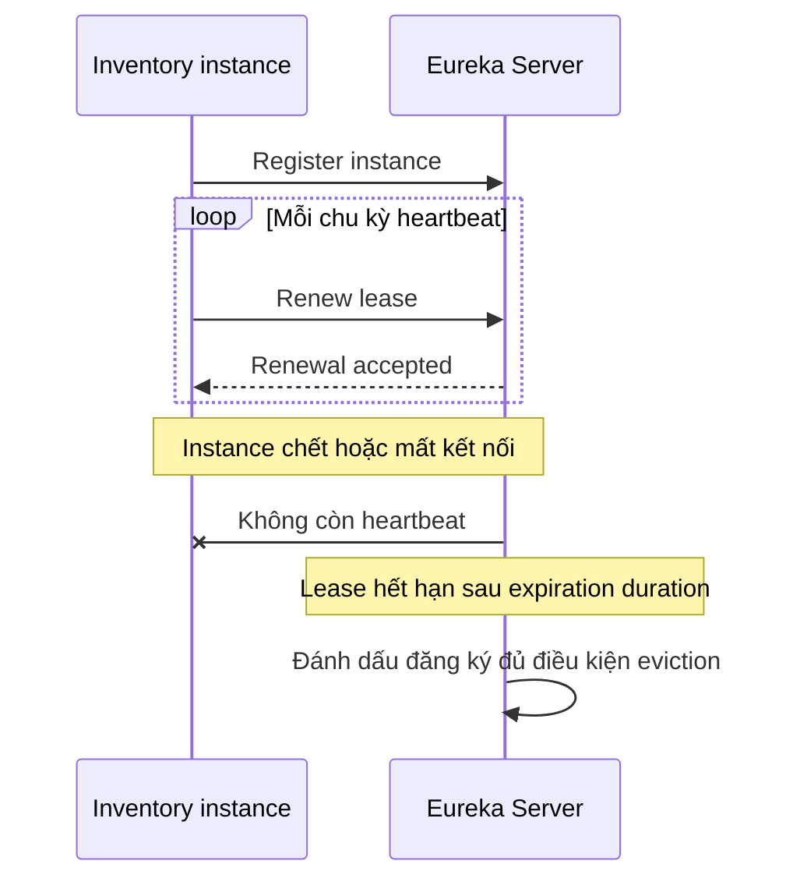
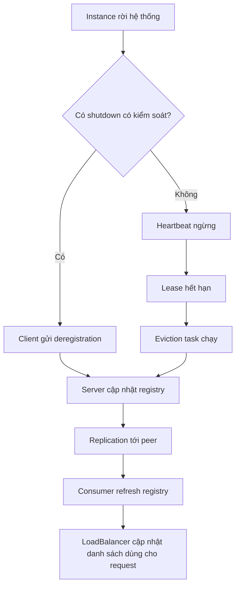

# Loại bỏ bản đăng ký hết hạn và độ trễ phát hiện instance chết

Trong Eureka, một instance không biến mất khỏi registry ngay khi tiến trình bị dừng hoặc máy chủ gặp sự cố. Eureka dựa trên heartbeat để gia hạn lease; khi không nhận được heartbeat đủ lâu, server xem đăng ký đã hết hạn và loại bỏ nó trong một chu kỳ eviction. Sau đó, các Eureka Client còn phải làm mới bản registry cục bộ và bộ cân bằng tải có thể cần cập nhật cache. Vì vậy, thời gian phát hiện instance chết là tổng hợp của nhiều khoảng chờ.

Hiểu đúng chuỗi này giúp cấu hình thời gian lease, chu kỳ eviction và registry refresh phù hợp. Nó cũng giải thích vì sao một instance đã chết vẫn có thể xuất hiện trong dashboard hoặc bị gọi thêm một thời gian, đặc biệt khi mạng bị phân vùng hoặc Eureka bật self-preservation.

## Bản đăng ký trong Eureka có thời hạn

Khi provider đăng ký với Eureka, server lưu thông tin instance như application name, instance ID, host, port, metadata và trạng thái. Eureka Client gửi heartbeat định kỳ để báo rằng instance vẫn còn hoạt động. Mỗi heartbeat hợp lệ gia hạn lease của instance.

Lease có thời hạn. Nếu server không nhận được heartbeat trước khi lease hết hạn, instance trở thành ứng viên bị loại bỏ. Server không nhất thiết xóa ngay tại đúng thời điểm hết hạn; một tác vụ eviction định kỳ sẽ quét và xử lý các lease đã quá hạn.

Các mốc cấu hình quan trọng:

| Thuộc tính | Nơi cấu hình | Ý nghĩa | Giá trị mặc định thường gặp |
|---|---|---|---:|
| `lease-renewal-interval-in-seconds` | `eureka.instance` phía provider | Khoảng thời gian client gửi heartbeat | 30 giây |
| `lease-expiration-duration-in-seconds` | `eureka.instance` phía provider | Thời gian lease không được gia hạn trước khi instance bị xem là hết hạn | 90 giây |
| `eviction-interval-timer-in-ms` | `eureka.server` | Chu kỳ chạy tác vụ quét và loại bỏ lease hết hạn | 60.000 ms |
| `registry-fetch-interval-seconds` | `eureka.client` phía consumer | Chu kỳ consumer tải/làm mới registry | 30 giây |

Đây là các giá trị mặc định thường gặp trong cấu hình Eureka; hãy xác nhận theo phiên bản Spring Cloud Netflix/Eureka đang dùng và cấu hình thực tế. Giá trị hiệu lực có thể bị ghi đè bởi profile, environment variable hoặc config server.

## Heartbeat và lease expiration

Giả sử `inventory-service` đăng ký một instance với Eureka. Client gửi heartbeat theo chu kỳ `lease-renewal-interval-in-seconds`. Mỗi heartbeat được server chấp nhận sẽ cập nhật thời điểm gia hạn lease. Nếu heartbeat bị mất liên tiếp và thời gian kể từ lần gia hạn cuối cùng vượt quá `lease-expiration-duration-in-seconds`, đăng ký được coi là hết hạn.



`lease-renewal-interval-in-seconds` và `lease-expiration-duration-in-seconds` được khai báo ở phía instance. Ví dụ:

```yaml
spring:
  application:
    name: inventory-service

eureka:
  instance:
    lease-renewal-interval-in-seconds: 30
    lease-expiration-duration-in-seconds: 90
```

Với cấu hình này, client dự kiến gia hạn khoảng mỗi 30 giây. Nếu không có lần gia hạn mới trong 90 giây tính từ lần thành công cuối cùng, server có thể xem lease đã hết hạn. Thời gian 90 giây là ngưỡng phát hiện dựa trên lease, không phải cam kết instance sẽ bị xóa chính xác sau 90 giây.

Không nên đặt expiration quá sát renewal interval. Mạng có jitter, CPU bị quá tải, JVM pause hoặc server bận có thể làm heartbeat trễ. Nếu lease ngắn hơn nhiều so với độ trễ bình thường, một instance khỏe có thể bị đánh dấu hết hạn nhầm. Ngược lại, lease dài làm thời gian phát hiện sự cố tăng.

## Eviction task loại bỏ lease hết hạn

Khi lease đã hết hạn, Eureka Server cần thực hiện eviction để xóa instance khỏi registry. `eviction-interval-timer-in-ms` quy định chu kỳ chạy tác vụ này. Giá trị thường gặp là 60.000 ms, tức khoảng một phút.

```yaml
server:
  port: 8761

eureka:
  server:
    eviction-interval-timer-in-ms: 60000
    enable-self-preservation: true
```

Ví dụ này giữ self-preservation bật và cho tác vụ eviction chạy mỗi 60 giây. Khi lease vừa hết hạn ngay sau một lần quét, instance có thể phải chờ gần trọn chu kỳ tiếp theo mới được xử lý. Nếu lease hết hạn ngay trước lần quét, nó có thể được loại bỏ sớm hơn.

Eviction không phải là health check chủ động. Eureka Server không nhất thiết gọi HTTP endpoint của từng instance để xác định nó còn khỏe hay không; cơ chế lease chủ yếu dựa vào heartbeat do client gửi. Một ứng dụng có thể vẫn gửi heartbeat dù endpoint nghiệp vụ đã treo, trừ khi trạng thái sức khỏe được tích hợp và công bố đúng cách.

## Self-preservation có thể trì hoãn eviction

Eureka có cơ chế self-preservation để tránh xóa hàng loạt instance khi server nhận ít heartbeat hơn dự kiến. Một đợt mất mạng, nghẽn mạng hoặc sự cố diện rộng có thể khiến nhiều client khỏe mạnh tạm thời không gửi được heartbeat. Nếu server lập tức xóa mọi lease hết hạn, registry có thể mất quá nhiều instance trong khi chúng vẫn đang chạy.

Server ước lượng số heartbeat kỳ vọng từ số lượng instance đã đăng ký và chu kỳ renewal. Khi tỷ lệ heartbeat nhận được thấp hơn ngưỡng bảo vệ, Eureka có thể chuyển sang self-preservation và tạm ngừng eviction tự động. Vì vậy, bản ghi hết hạn có thể vẫn còn trong registry lâu hơn thời gian lease thông thường.

Các thuộc tính thường được dùng để cấu hình cơ chế này:

| Thuộc tính | Ý nghĩa |
|---|---|
| `enable-self-preservation` | Bật hoặc tắt cơ chế tự bảo vệ của Eureka Server |
| `renewal-percent-threshold` | Tỷ lệ heartbeat tối thiểu so với mức kỳ vọng để đánh giá tình trạng renewal |
| `renewal-threshold-update-interval-ms` | Chu kỳ cập nhật ngưỡng heartbeat kỳ vọng trong các phiên bản hỗ trợ thuộc tính này |

Ví dụ cấu hình tường minh:

```yaml
eureka:
  server:
    enable-self-preservation: true
    renewal-percent-threshold: 0.85
    eviction-interval-timer-in-ms: 60000
```

Ngưỡng `0.85` là giá trị thường gặp, không nên xem là con số bắt buộc cho mọi phiên bản hoặc mọi môi trường. Cần đọc tài liệu cấu hình đúng release train và theo dõi log/metrics để hiểu server đang đánh giá lượng heartbeat như thế nào.

**Không nên tắt self-preservation chỉ để instance biến mất nhanh hơn trong production.** Nếu heartbeat giảm mạnh, nguyên nhân có thể là server bị cô lập mạng hoặc nhiều client không thể kết nối. Tắt cơ chế bảo vệ có thể khiến registry xóa các instance vẫn khỏe, làm gián đoạn toàn hệ thống. Chỉ cân nhắc thay đổi trong môi trường kiểm thử có kiểm soát và khi đã hiểu rõ tác động.

## Hủy đăng ký có kiểm soát khác với phát hiện instance chết

Có hai đường để một instance rời registry:

1. **Graceful deregistration:** ứng dụng dừng có kiểm soát và Eureka Client gửi yêu cầu hủy đăng ký. Server có thể xóa bản ghi sớm mà không phải chờ lease hết hạn. Thay đổi vẫn cần được replication tới peer và được consumer tải về.
2. **Lease expiration:** tiến trình chết đột ngột, máy bị tắt hoặc kết nối mất kéo dài nên không còn heartbeat. Server đợi lease hết hạn, sau đó eviction task mới xử lý.



Với graceful shutdown, nên cho ứng dụng thời gian hoàn tất request đang xử lý và thực hiện lifecycle callback trước khi tiến trình kết thúc. Nếu container bị kill ngay lập tức hoặc hết thời gian termination grace period, deregistration có thể không hoàn tất và server phải dựa vào lease expiration.

## Độ trễ từ lúc instance chết tới lúc consumer ngừng gọi

Việc xóa bản ghi ở Eureka Server chưa đồng nghĩa tất cả consumer biết ngay thay đổi. Một consumer có thể đang dùng bản registry cache cục bộ; Spring Cloud LoadBalancer còn có thể có cache danh sách instance riêng tùy cấu hình.

Các giai đoạn thường gặp:

| Giai đoạn | Điều gì xảy ra? | Nguồn độ trễ |
|---|---|---|
| 1. Mất instance | Tiến trình chết hoặc không thể gửi heartbeat | Thời điểm sự cố so với heartbeat cuối |
| 2. Lease hết hạn | Server không nhận renewal trong thời gian expiration | `lease-expiration-duration-in-seconds` |
| 3. Eviction | Tác vụ định kỳ quét và xóa lease hết hạn | `eviction-interval-timer-in-ms` |
| 4. Peer replication | Các Eureka Server khác nhận thay đổi registry | Mạng và cơ chế replication |
| 5. Client fetch | Consumer tải registry mới | `registry-fetch-interval-seconds` |
| 6. LoadBalancer refresh | Danh sách instance được dùng cho request được cập nhật | Cache TTL hoặc cơ chế refresh của supplier |

Có thể ước lượng độ trễ ở trạng thái bình thường bằng cách cộng các khoảng chờ lớn nhất liên quan:

```text
detection delay ≈
    thời gian lease còn lại tại lúc instance chết
  + thời gian chờ eviction task
  + độ trễ peer replication (nếu có)
  + thời gian chờ consumer fetch registry
  + thời gian cache LoadBalancer còn hiệu lực (nếu có)
```

Thời gian lease còn lại phụ thuộc instance chết ngay sau heartbeat hay gần cuối chu kỳ lease. Nếu client gia hạn mỗi 30 giây và lease expiration là 90 giây, thời gian từ lúc chết tới khi lease hết hạn có thể xấp xỉ từ 60 đến 90 giây trong điều kiện heartbeat đều đặn. Sau đó còn phải chờ eviction, replication, fetch và cache refresh.

Đây chỉ là mô hình ước lượng trong điều kiện bình thường. Self-preservation, mạng bị phân vùng, server quá tải hoặc client cache không làm mới có thể kéo dài thời gian lâu hơn; không có giới hạn trên cứng chỉ dựa vào các giá trị lease.

## Cấu hình phía consumer để cập nhật registry

Consumer Eureka có thể cấu hình chu kỳ tải registry bằng `registry-fetch-interval-seconds`. Giá trị thường gặp là 30 giây:

```yaml
eureka:
  client:
    fetch-registry: true
    registry-fetch-interval-seconds: 30
```

Thuộc tính này kiểm soát chu kỳ làm mới registry phía Eureka Client. Đặt khoảng thời gian ngắn hơn giúp consumer nhận thay đổi sớm hơn trong điều kiện bình thường, nhưng tăng tần suất request tới server và chi phí xử lý. Nó không thay đổi thời gian lease hoặc chu kỳ eviction phía server.

Nếu ứng dụng dùng Spring Cloud LoadBalancer, kiểm tra xem `ServiceInstanceListSupplier` có cache hay không. Khi cache bật, TTL của cache cũng ảnh hưởng tới thời điểm request ngừng chọn instance đã bị xóa. Thuộc tính cache thường được cấu hình dưới `spring.cloud.loadbalancer.cache`; chi tiết phụ thuộc phiên bản và supplier được dùng.

Không nên giảm tất cả các chu kỳ xuống giá trị rất nhỏ cùng lúc. Hãy xác định giai đoạn nào đang tạo độ trễ lớn nhất, sau đó điều chỉnh một lớp và đo lại. Giảm registry fetch interval không giúp ích nếu server vẫn giữ stale record do self-preservation.

## Một cấu hình tham khảo cho môi trường thử nghiệm

Ví dụ provider:

```yaml
spring:
  application:
    name: inventory-service

eureka:
  client:
    service-url:
      defaultZone: http://localhost:8761/eureka/
  instance:
    lease-renewal-interval-in-seconds: 10
    lease-expiration-duration-in-seconds: 30
```

Ví dụ server:

```yaml
server:
  port: 8761

eureka:
  client:
    register-with-eureka: false
    fetch-registry: false
  server:
    eviction-interval-timer-in-ms: 5000
    enable-self-preservation: true
```

Ví dụ consumer:

```yaml
eureka:
  client:
    service-url:
      defaultZone: http://localhost:8761/eureka/
    fetch-registry: true
    registry-fetch-interval-seconds: 5
```

Các giá trị 10/30/5 giây và 5.000 ms chỉ nhằm rút ngắn thời gian quan sát trong lab. Chúng không phải khuyến nghị production. Lease quá ngắn có thể khiến instance khỏe bị loại khi JVM pause hoặc mạng chập chờn; eviction quá thường xuyên và fetch quá dày làm tăng tải registry.

Trong production, thường nên bắt đầu từ giá trị mặc định phù hợp của phiên bản, đo heartbeat và thời gian phát hiện thực tế, rồi điều chỉnh theo SLA cùng độ ổn định mạng. Luôn giữ expiration lớn hơn renewal interval với khoảng dự phòng đủ cho jitter và pause.

## Đo và quan sát thời gian phát hiện

Để biết độ trễ đến từ đâu, cần ghi nhận mốc thời gian ở từng thành phần thay vì chỉ nhìn thấy instance biến mất trên dashboard.

- **Provider:** log lúc khởi động, đăng ký, heartbeat cuối cùng và lúc bắt đầu graceful shutdown.
- **Eureka Server:** theo dõi số lượng instance, số renewal nhận được, eviction, self-preservation state và lỗi peer replication.
- **Consumer:** ghi thời điểm registry fetch thành công và danh sách instance sau mỗi lần refresh.
- **LoadBalancer:** quan sát instance được chọn, lỗi kết nối và thời điểm cache thay đổi.
- **Request:** ghi nhận lần cuối request được gửi tới instance đã chết và lần đầu request chỉ còn tới instance khỏe.

Có thể dùng dashboard Eureka và endpoint registry để quan sát danh sách instance. Nếu bật Spring Boot Actuator/Micrometer, hãy xuất metrics cần thiết tới hệ thống giám sát và tạo biểu đồ cho heartbeat, registry size, request error và latency. Tên metric cụ thể phụ thuộc phiên bản và instrumentation.

Một bài đo đơn giản:

1. Khởi động hai instance của `inventory-service` và chờ cả hai xuất hiện trên Eureka.
2. Ghi lại thời điểm heartbeat gần nhất của instance A.
3. Dừng A bằng graceful shutdown; đo thời gian tới khi bản ghi biến mất.
4. Khởi động lại A, sau đó kill tiến trình đột ngột; đo lại thời gian tới khi bản ghi bị eviction.
5. Quan sát cùng lúc dashboard của server, registry ở consumer và instance do LoadBalancer chọn.
6. Lặp lại khi có network delay hoặc peer tạm mất kết nối trong môi trường test.

So sánh graceful deregistration với crash detection. Hai kết quả khác nhau là bình thường vì một trường hợp có yêu cầu hủy đăng ký rõ ràng, trường hợp còn lại phải đợi lease và eviction.

## Self-preservation, network partition và stale registry

Khi nhiều client cùng mất heartbeat, cần phân biệt hai khả năng:

- **Nhiều instance thực sự chết:** heartbeat giảm vì provider không còn hoạt động. Registry cần loại các bản ghi hết hạn.
- **Registry bị cô lập hoặc mạng lỗi:** provider vẫn chạy nhưng heartbeat không tới server. Nếu server xóa hàng loạt bản ghi, consumer có thể mất khả năng định tuyến tới những instance vẫn phục vụ được.

Self-preservation được thiết kế để giảm nguy cơ thứ hai. Vì vậy, khi thấy bản ghi cũ tồn tại lâu, hãy kiểm tra renewal rate và kết nối peer trước khi tắt cơ chế bảo vệ. Nếu registry ở trạng thái self-preservation, tăng tốc eviction bằng cách giảm timer có thể không giải quyết được vấn đề.

Các bước điều tra stale record:

1. Kiểm tra provider có còn sống và endpoint có đáp ứng không.
2. Kiểm tra heartbeat/renewal có tới Eureka Server hay không.
3. Xác định server có đang ở self-preservation mode không.
4. Kiểm tra lease expiration và eviction task có được cấu hình đúng không.
5. Kiểm tra peer replication và xem từng node có cùng registry state không.
6. Kiểm tra consumer fetch interval và cache của LoadBalancer.
7. Chỉ sau khi xác nhận nguyên nhân mới điều chỉnh lease, eviction hoặc cache TTL.

## Những lỗi cấu hình thường gặp

| Triệu chứng | Nguyên nhân có thể | Hướng xử lý |
|---|---|---|
| Instance chết nhưng vẫn xuất hiện lâu | Lease expiration dài, eviction interval lớn hoặc self-preservation đang giữ bản ghi | Kiểm tra heartbeat, lease, eviction và renewal threshold |
| Instance khỏe bị xóa nhầm | Lease quá ngắn so với jitter, JVM pause hoặc thời gian mạng | Tăng khoảng dự phòng giữa renewal và expiration; kiểm tra network/GC |
| Server xóa bản ghi chậm dù lease đã hết | Eviction task chưa tới chu kỳ hoặc self-preservation đang bật eviction protection | Kiểm tra timer và trạng thái self-preservation |
| Dashboard đã xóa nhưng consumer vẫn gọi instance cũ | Consumer chưa fetch registry mới hoặc LoadBalancer cache chưa hết TTL | Kiểm tra registry fetch interval và cache supplier |
| Các Eureka peer hiển thị registry khác nhau | Replication chậm hoặc peer mất kết nối | Kiểm tra peer URL, DNS, network và replication logs |
| Shutdown bình thường vẫn để lại bản ghi | Lifecycle dừng đột ngột hoặc deregistration không hoàn tất | Kiểm tra shutdown grace period và log client cancellation |
| Tắt self-preservation làm nhiều instance biến mất | Server đang bị thiếu heartbeat do sự cố mạng diện rộng | Khôi phục mạng và renewal; không dùng tắt self-preservation như cách chữa mặc định |

## Nguyên tắc điều chỉnh trong production

1. Giữ `lease-expiration-duration-in-seconds` đủ lớn so với `lease-renewal-interval-in-seconds` để hấp thụ jitter và pause ngắn.
2. Chọn `eviction-interval-timer-in-ms` theo yêu cầu phát hiện và tải của registry; giảm chu kỳ làm tăng công việc quét.
3. Giữ self-preservation bật trừ khi có đánh giá vận hành cụ thể và môi trường phù hợp.
4. Đặt `registry-fetch-interval-seconds` theo độ mới cần thiết của consumer và khả năng chịu tải của Eureka Server.
5. Kiểm tra cache của LoadBalancer để tránh một lớp cache kéo dài stale instance sau khi registry đã cập nhật.
6. Thiết kế graceful shutdown để provider hủy đăng ký trước khi tiến trình kết thúc.
7. Theo dõi renewal rate, eviction count, registry size, replication và request failures.
8. Kiểm thử crash, network partition, server restart và rolling deployment trước khi chốt giá trị.

## Kết luận

Eureka loại bỏ instance chết bằng cách theo dõi lease được gia hạn qua heartbeat và chạy eviction task định kỳ. Thời gian phát hiện không chỉ phụ thuộc `lease-expiration-duration-in-seconds`, mà còn phụ thuộc chu kỳ eviction, self-preservation, peer replication, registry fetch của consumer và cache LoadBalancer. Graceful deregistration có thể loại bản ghi sớm hơn; crash detection phải chờ lease hết hạn và eviction. Hãy đo từng giai đoạn, điều chỉnh có kiểm soát và giữ self-preservation để tránh xóa nhầm hàng loạt instance khi mạng gặp sự cố.
