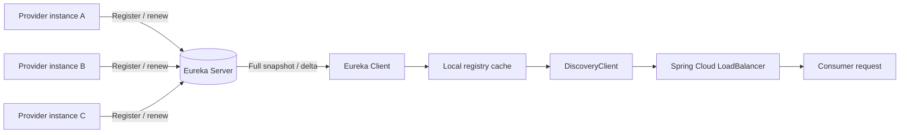
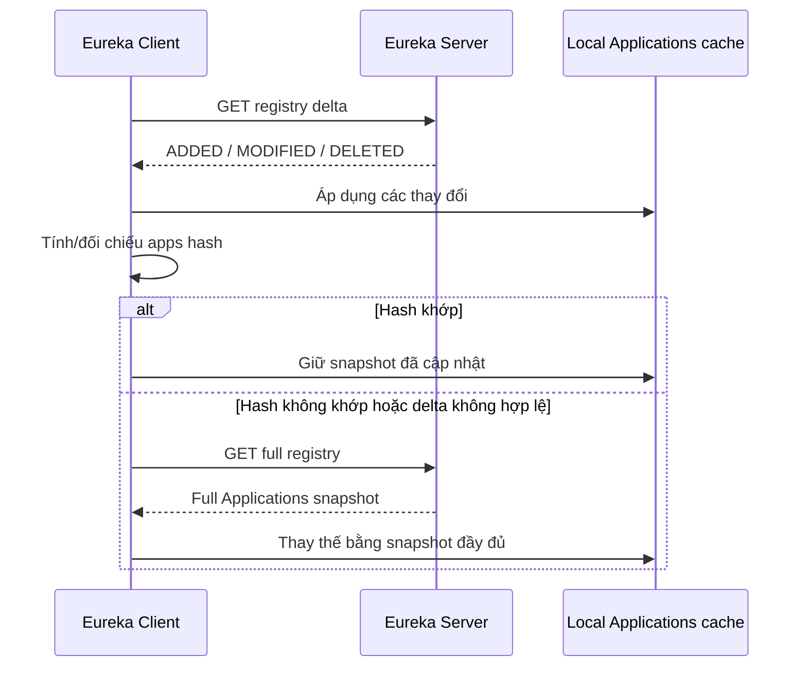
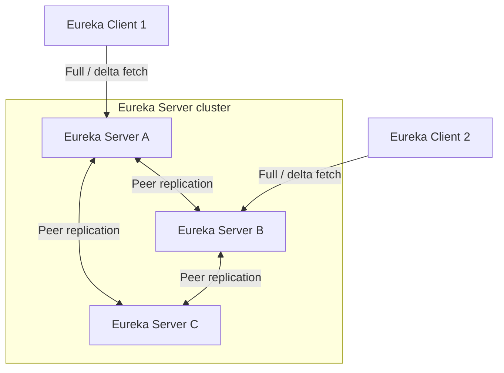

# Tải đầy đủ và cập nhật chênh lệch danh sách đăng ký

Eureka client cần biết những instance nào đang được đăng ký để consumer có thể khám phá dịch vụ. Thay vì yêu cầu toàn bộ registry sau mỗi lần cập nhật, Eureka hỗ trợ hai cách lấy dữ liệu: tải đầy đủ danh sách đăng ký (*full registry fetch*) và lấy phần thay đổi kể từ lần đồng bộ trước (*delta fetch*).

Ở lần khởi tạo, client cần một snapshot đầy đủ để xây dựng registry cục bộ. Trong các lần làm mới tiếp theo, client có thể nhận delta gồm những instance được thêm, thay đổi hoặc xóa, rồi áp dụng các thay đổi đó vào snapshot đang giữ. Cách làm này giảm lượng dữ liệu phải truyền khi registry lớn và chỉ có một số instance thay đổi. Khi delta không dùng được hoặc dữ liệu sau khi áp dụng không còn khớp với trạng thái server, client cần tải lại snapshot đầy đủ để đồng bộ.

Bài học thuộc chương `Cơ chế Eureka` trong module `SPRING_CLOUD_SERVICE_DISCOVERY`. Module tập trung vào cách Spring Cloud tìm instance theo tên dịch vụ qua `DiscoveryClient`, `ServiceRegistry`, Eureka hoặc Consul, cùng vòng đời đăng ký, health check, load balancing, bảo mật và xử lý sai lệch registry. Bài này đi sâu vào quá trình full fetch, delta refresh, cache cục bộ và cách kiểm tra khi dữ liệu client khác với registry server.

## 1. Vì sao Eureka client cần tải registry?

Một service có thể có nhiều instance chạy trên các máy hoặc container khác nhau. Ví dụ, `ORDER-SERVICE` có ba instance. Khi consumer cần gọi service này, nó phải biết host, port và metadata của các instance hiện có.

Eureka client tải thông tin từ Eureka Server và giữ một bản registry cục bộ. Các thành phần discovery phía ứng dụng có thể đọc dữ liệu từ bản cache này thay vì gọi server cho từng request nghiệp vụ.



Quy trình này có ba mục tiêu:

- **Khởi tạo dữ liệu:** client lấy snapshot đầy đủ để biết những application và instance mà server đang công bố.
- **Cập nhật thay đổi:** client định kỳ đồng bộ các registration mới, bị sửa hoặc bị xóa.
- **Giữ dữ liệu cục bộ để tra cứu:** consumer có thể lấy danh sách instance từ cache của client, giảm việc truy vấn mạng trên mỗi lần cần định vị service.

Registry cục bộ là một bản sao có độ trễ. Nó phản ánh dữ liệu client đã đồng bộ thành công gần nhất, không phải cam kết rằng mọi thay đổi ở server lập tức xuất hiện trong mọi consumer.

## 2. Full registry fetch là gì?

Full registry fetch là thao tác tải snapshot registry đầy đủ từ Eureka Server. Snapshot thường chứa danh sách các application và instance được server công bố tại thời điểm phản hồi, bao gồm những thông tin như instance ID, host, port, status và metadata.

Ví dụ snapshot minh họa:

| Application | Instance ID | Host:Port | Status |
|---|---|---|---|
| `ORDER-SERVICE` | `order-a` | `10.0.1.21:8080` | `UP` |
| `ORDER-SERVICE` | `order-b` | `10.0.1.22:8080` | `UP` |
| `PAYMENT-SERVICE` | `payment-a` | `10.0.2.31:8090` | `UP` |

Khi client nhận snapshot, nó cập nhật cấu trúc `Applications` cục bộ. Những API discovery của Eureka client có thể đọc từ dữ liệu này để trả lời câu hỏi như “có những instance nào của `ORDER-SERVICE`?”.

### 2.1. Khi nào full fetch xảy ra?

Các trường hợp thường gặp:

1. **Khởi tạo client:** client chưa có registry cục bộ nên cần tải snapshot ban đầu.
2. **Delta không khả dụng:** server hoặc client không thể cung cấp delta phù hợp, client cần lấy full snapshot.
3. **Phát hiện dữ liệu không khớp:** hash của registry sau khi áp dụng delta khác với hash server công bố, client cần tải lại đầy đủ để reconcile.
4. **Delta bị tắt:** cấu hình client yêu cầu không dùng delta, do đó các lần refresh sẽ tải đầy đủ theo cơ chế của phiên bản.
5. **Làm mới cưỡng bức hoặc khôi phục:** một số luồng nội bộ có thể yêu cầu full fetch để phục hồi trạng thái local.

Full fetch là thao tác nặng hơn delta khi registry lớn. Nó truyền lại nhiều thông tin dù phần lớn instance không thay đổi. Vì vậy, không nên ép client tải full registry quá thường xuyên nếu không có lý do vận hành rõ ràng.

## 3. Delta fetch là gì?

Delta fetch chỉ lấy những thay đổi mà Eureka Server cung cấp so với trạng thái registry trước đó. Thay đổi thường rơi vào ba nhóm:

- **ADDED:** instance mới được đăng ký.
- **MODIFIED:** thông tin hoặc trạng thái của instance hiện có được cập nhật.
- **DELETED:** instance đã bị hủy đăng ký hoặc bị loại khỏi registry.

Ví dụ, client đang giữ snapshot gồm `order-a` và `order-b`. Sau đó `order-c` được đăng ký, `order-b` đổi status và `payment-a` bị xóa. Delta có thể biểu diễn các thay đổi này thay vì gửi lại mọi instance của tất cả application.

| Loại thay đổi | Ví dụ | Cách cập nhật cache minh họa |
|---|---|---|
| ADDED | `order-c` mới đăng ký. | Thêm instance vào application tương ứng. |
| MODIFIED | `order-b` đổi từ `UP` sang trạng thái khác. | Cập nhật dữ liệu instance hiện có. |
| DELETED | `payment-a` bị gỡ khỏi registry. | Loại instance khỏi application tương ứng. |

Delta chỉ là tập hợp thay đổi; để có kết quả đúng, client phải áp dụng chúng lên đúng snapshot nền. Nếu bỏ sót một delta, áp dụng sai thứ tự hoặc cache nền đã lệch, kết quả cục bộ có thể khác registry server.

### 3.1. Luồng cập nhật delta



Quy trình trên là mô hình khái niệm. Tên phương thức nội bộ, điều kiện fallback và chi tiết xử lý có thể thay đổi theo phiên bản Eureka client. Điều quan trọng là client không coi mọi delta response đều mặc nhiên chính xác; nó có cơ chế kiểm tra và có thể lấy lại snapshot đầy đủ.

## 4. Cách Eureka client giữ và cập nhật registry cục bộ

Eureka client duy trì một cấu trúc dữ liệu chứa các application và instance đã tải. Khi consumer yêu cầu khám phá service, lớp discovery tích hợp có thể đọc từ registry local này.

Luồng khái quát:

1. Client tải full snapshot từ Eureka Server.
2. Snapshot được lưu vào cấu trúc registry cục bộ.
3. Một tác vụ refresh chạy định kỳ theo cấu hình.
4. Nếu delta được bật và có sẵn, client lấy delta và áp dụng vào cache.
5. Nếu delta không dùng được hoặc kiểm tra consistency thất bại, client tải lại full snapshot.
6. Consumer tiếp tục đọc danh sách instance từ cache đã cập nhật.

Điều này giải thích vì sao lời gọi discovery không nhất thiết tạo một HTTP request tới Eureka Server. Client thường tra cứu trên dữ liệu local đã được refresh trước đó.

### 4.1. DiscoveryClient đọc dữ liệu nào?

Trong tích hợp Eureka của Spring Cloud, `EurekaDiscoveryClient` sử dụng Eureka client để lấy các instance theo service ID. Về mặt vận hành, consumer có thể đang đọc snapshot cục bộ mà Eureka client đã tải và cập nhật.

Do đó, khi Dashboard hiển thị instance mới nhưng consumer chưa thấy, cần xem thời gian refresh và trạng thái cache client. Không nên kết luận ngay rằng server không đăng ký instance. Ngược lại, nếu consumer vẫn thấy instance đã bị xóa, có thể cache chưa nhận được delta hoặc full refresh mới.

### 4.2. Cache local và độ trễ cập nhật

Độ trễ giữa thay đổi ở server và lúc consumer nhìn thấy có thể đến từ:

- Chu kỳ refresh registry của client.
- Độ trễ phản hồi hoặc lỗi mạng giữa client và server.
- Cache response phía Eureka Server.
- Replication giữa các Eureka Server peer.
- Cache hoặc supplier của Spring Cloud LoadBalancer ở phía consumer.
- Health check, lease expiration và eviction chưa hoàn tất.

Các tầng này có chu kỳ và trách nhiệm khác nhau. Cần xác định dữ liệu đang trễ ở tầng nào thay vì chỉ tăng tần suất refresh của client.

## 5. Hash kiểm tra và cơ chế reconcile

Eureka sử dụng thông tin hash của registry, thường được gọi là `appsHashCode`, để giúp client và server phát hiện trạng thái registry không khớp sau khi áp dụng delta.

Client có thể đối chiếu hash được tính từ registry local với hash server trả về trong phản hồi. Nếu hai giá trị khác nhau, có thể client đã bỏ lỡ thay đổi hoặc delta không đưa cache về cùng trạng thái với server. Khi đó, client có thể tải full registry để xây dựng lại snapshot.

Ví dụ minh họa:

| Thời điểm | Registry server | Registry local sau refresh | Kết quả |
|---|---|---|---|
| T0 | `order-a=UP`, `order-b=UP` | `order-a=UP`, `order-b=UP` | Hash khớp |
| T1 | `order-a=UP`, `order-b=DOWN`, `order-c=UP` | Delta cập nhật `order-b`, thêm `order-c` | Hash dự kiến khớp |
| T2 | Server có thêm thay đổi nhưng client thiếu một delta | Cache vẫn thiếu instance hoặc giữ trạng thái cũ | Hash không khớp |
| T3 | Client tải full snapshot | Cache được thay thế bằng dữ liệu đầy đủ | Reconcile hoàn tất nếu fetch thành công |

Hash là tín hiệu kiểm tra tính nhất quán của tập trạng thái registry theo cách Eureka định nghĩa; nó không phải checksum bảo đảm mọi endpoint nghiệp vụ đều khỏe. Hash khớp cũng không chứng minh host/port có thể truy cập từ mọi consumer.

### 5.1. Khi nào full fetch là cách khôi phục phù hợp?

Full fetch hữu ích khi client không thể tin cậy snapshot local hiện tại. Nó thay thế trạng thái đã tích lũy bằng một snapshot đầy đủ từ server, nhờ đó loại bỏ sai lệch do delta bị thiếu hoặc cache cũ.

Nếu full fetch cũng thất bại vì server không truy cập được, client không thể tự tạo ra dữ liệu mới. Ứng dụng có thể tiếp tục nhìn thấy snapshot cũ tùy trạng thái và implementation. Cần quan sát log lỗi, thời điểm refresh thành công gần nhất và tuổi của cache trước khi quyết định xử lý.

## 6. Cấu hình fetch registry trong Spring Cloud Eureka

Một cấu hình client minh họa:

```yaml
spring:
  application:
    name: order-service

eureka:
  client:
    register-with-eureka: true
    fetch-registry: true
    registry-fetch-interval-seconds: 30
    disable-delta: false
    service-url:
      defaultZone: http://localhost:8761/eureka/
```

Ý nghĩa các thuộc tính:

| Thuộc tính | Ý nghĩa |
|---|---|
| `register-with-eureka` | Cho biết ứng dụng có đăng ký instance của chính nó với Eureka Server hay không. |
| `fetch-registry` | Cho biết client có tải registry để khám phá các service khác hay không. |
| `registry-fetch-interval-seconds` | Khoảng thời gian giữa các lần refresh registry của client. |
| `disable-delta` | Khi bật, client không dùng delta fetch và sẽ dùng full fetch theo cơ chế của implementation. |
| `service-url.defaultZone` | Địa chỉ Eureka Server mà client truy cập. |

Trong nhiều cấu hình Eureka client, chu kỳ refresh mặc định thường là 30 giây; giá trị thực tế cần kiểm tra theo phiên bản, cấu hình và profile đang chạy. Giảm chu kỳ giúp client nhìn thấy thay đổi sớm hơn nhưng làm tăng số request tới registry. Tăng chu kỳ giảm tải nhưng kéo dài thời gian client có thể giữ dữ liệu cũ.

`register-with-eureka` và `fetch-registry` là hai lựa chọn độc lập. Một consumer chỉ cần tra cứu service có thể fetch registry mà không cần tự đăng ký. Một ứng dụng chỉ công bố chính nó có thể đăng ký nhưng không cần tải registry nếu không gọi service khác. Với Eureka Server standalone, hai thuộc tính này thường được đặt `false` để server không tự đăng ký và fetch chính nó; cấu hình cụm peer cần xem riêng.

### 6.1. Khi nào nên tắt delta?

`disable-delta: true` có thể hữu ích trong môi trường điều tra hoặc khi cần so sánh hành vi full fetch với delta. Nó cũng có thể là biện pháp tạm thời khi nghi ngờ vấn đề ở quá trình áp dụng delta, nhưng làm tăng lượng dữ liệu trao đổi.

Không nên tắt delta đại trà chỉ vì một consumer có danh sách cũ. Trước hết kiểm tra refresh interval, log fetch, hash reconciliation, cache, server response và peer replication. Nếu cần thử tắt delta, hãy giới hạn phạm vi, đo tải mạng/server và có kế hoạch khôi phục cấu hình.

## 7. Full fetch và delta fetch: so sánh

| Tiêu chí | Full registry fetch | Delta fetch |
|---|---|---|
| Dữ liệu trả về | Toàn bộ snapshot application/instance server cung cấp. | Những thay đổi được server cung cấp kể từ trạng thái đồng bộ trước. |
| Thường dùng khi | Khởi tạo, delta không khả dụng, hash lệch hoặc bị cấu hình tắt delta. | Refresh định kỳ khi delta được hỗ trợ và bật. |
| Băng thông | Cao hơn khi registry lớn. | Thường thấp hơn nếu chỉ một phần nhỏ instance thay đổi. |
| Xử lý phía client | Tạo hoặc thay thế snapshot local. | Áp dụng thay đổi lên snapshot hiện có. |
| Rủi ro chính | Tải lớn, độ trễ hoặc timeout khi registry lớn. | Cache có thể lệch nếu delta thiếu hoặc áp dụng không đúng; cần kiểm tra consistency. |
| Khôi phục | Dùng để dựng lại trạng thái local từ nguồn đầy đủ. | Hiệu quả cho cập nhật thường xuyên, không thay thế hoàn toàn full snapshot. |

Hai cơ chế bổ trợ nhau. Full fetch tạo nền dữ liệu đáng tin cậy; delta fetch giúp cập nhật nền dữ liệu đó với chi phí thấp hơn khi registry chỉ thay đổi một phần.

## 8. Phân biệt client refresh với peer replication của Eureka Server

Một nhầm lẫn thường gặp là xem delta fetch của client như cơ chế replication giữa các Eureka Server. Đây là hai luồng khác nhau:

- **Client registry fetch:** Eureka client hỏi server để cập nhật registry local mà consumer sử dụng.
- **Server peer replication:** các Eureka Server peer trao đổi registration và trạng thái để duy trì registry trong cụm server.



Client fetch interval không phải peer replication interval. Nếu một client đọc từ server A trong khi provider đăng ký qua server B, dữ liệu client nhìn thấy còn phụ thuộc việc server cluster đồng bộ registration và response cache được cập nhật ra sao.

Khi Dashboard trên hai peer khác nhau, hãy điều tra peer replication trước. Khi các peer thống nhất nhưng một client vẫn có danh sách cũ, hãy điều tra client refresh, cache và kết nối tới server mà client đang sử dụng.

## 9. Các endpoint registry hữu ích khi điều tra

Với cấu hình Eureka Server mặc định phổ biến, REST API cung cấp endpoint đọc snapshot và delta:

| Endpoint | Mục đích |
|---|---|
| `GET /eureka/apps` | Đọc danh sách application và instance đầy đủ. |
| `GET /eureka/apps/delta` | Đọc các thay đổi registry mà server cung cấp qua delta API. |

Ví dụ đọc full registry:

```bash
curl -H "Accept: application/json" \
  http://localhost:8761/eureka/apps
```

Ví dụ đọc delta:

```bash
curl -H "Accept: application/json" \
  http://localhost:8761/eureka/apps/delta
```

Các ví dụ dùng URL mặc định. Context path, port, reverse proxy, xác thực và định dạng JSON/XML có thể thay đổi theo cấu hình. Delta endpoint thường được thiết kế cho giao thức client; gọi thủ công một lần không tương đương với việc tái tạo chính xác trạng thái client vì client còn phải áp dụng các thay đổi lên snapshot nền và đối chiếu hash.

Chỉ dùng GET để quan sát khi điều tra. Các request thay đổi registration hoặc status có thể ảnh hưởng toàn hệ thống và cần được kiểm soát.

## 10. Khi nào consumer có thể nhìn thấy dữ liệu cũ?

Một số tình huống thường gặp:

### Instance mới đã đăng ký nhưng consumer chưa thấy

Provider có thể đã đăng ký thành công nhưng client chưa đến chu kỳ refresh tiếp theo. Ngoài ra, server response cache hoặc peer replication có thể chưa phản ánh thay đổi ở node mà consumer đang truy vấn.

Kiểm tra registration trên Dashboard/API của server nhận đăng ký, peer mà client đang kết nối, thời điểm refresh gần nhất và log delta fetch.

### Instance đã xóa nhưng consumer vẫn thấy

Delta xóa có thể chưa được client nhận hoặc cache local chưa được refresh. Nếu fetch thất bại, client có thể tiếp tục dùng snapshot cũ. Cũng cần xem LoadBalancer có cache danh sách instance riêng hay không.

Kiểm tra xem server đã xóa registration chưa, endpoint delta có chứa thay đổi xóa không, client có refresh thành công không và cache LoadBalancer được cập nhật theo chu kỳ nào.

### Client nhận danh sách khác Dashboard

Dashboard và client có thể đang đọc từ hai Eureka Server peer khác nhau hoặc hai thời điểm khác nhau. Ngoài ra, client có thể chưa áp dụng delta mới nhất hoặc server response cache chưa đồng bộ.

So sánh cùng peer, cùng thời điểm, cùng application name và cùng instance ID trước khi kết luận có lỗi dữ liệu.

### Hash không khớp lặp lại

Hash mismatch liên tục có thể liên quan tới delta bị thiếu, server/client đọc từ các trạng thái khác nhau, replication trễ hoặc vấn đề trong đường đồng bộ. Kiểm tra log client về hash reconciliation, log server về peer replication và response cache, sau đó xác minh full fetch có thành công không.

## 11. Quy trình kiểm tra full/delta fetch

Khi một Eureka client không thấy instance mới hoặc vẫn dùng instance đã bị xóa, có thể thực hiện quy trình sau:

1. **Xác nhận đúng client và service ID.** Ghi lại `spring.application.name`, service ID đang tra cứu và instance cần kiểm tra.
2. **Kiểm tra server registry.** Dùng Dashboard hoặc `GET /eureka/apps` để xác nhận server đang lưu bản ghi nào.
3. **Kiểm tra server mà client dùng.** Đối chiếu `eureka.client.service-url.defaultZone`, DNS và peer cụ thể.
4. **Kiểm tra cấu hình fetch.** Xác nhận `fetch-registry`, `registry-fetch-interval-seconds` và `disable-delta`.
5. **Kiểm tra log refresh.** Tìm lần full fetch hoặc delta fetch gần nhất, thời gian hoàn tất, lỗi timeout và thông tin fallback nếu có.
6. **Kiểm tra consistency.** Tìm log liên quan tới apps hash hoặc việc client tải lại full registry sau delta.
7. **Đối chiếu local discovery.** Kiểm tra danh sách instance mà `DiscoveryClient`/Eureka client trả về sau refresh.
8. **Kiểm tra cache LoadBalancer.** Nếu Eureka client đã có dữ liệu mới nhưng request vẫn dùng instance cũ, xem supplier/cache của LoadBalancer.
9. **Kiểm tra peer replication.** Nếu các server trả dữ liệu khác nhau, điều tra liên kết peer và response cache trước khi thay đổi client fetch interval.
10. **Đánh giá tuổi dữ liệu.** Ghi thời điểm provider thay đổi, server nhận thay đổi và consumer nhìn thấy thay đổi để xác định tầng gây trễ.

Không xóa cache hoặc restart hàng loạt consumer ngay khi thấy một instance cũ. Trước hết xác định snapshot sai ở Eureka Server, ở Eureka client hay ở LoadBalancer; hành động khôi phục cần nhắm đúng tầng.

## 12. Tối ưu tần suất và chi phí đồng bộ

Tần suất refresh là một đánh đổi giữa độ mới dữ liệu và tải hệ thống.

- Chu kỳ ngắn giúp client nhận thay đổi sớm hơn nhưng tăng số request và công việc xử lý delta/full fetch.
- Chu kỳ dài giảm tải registry nhưng kéo dài thời gian client có thể giữ snapshot cũ.
- Full fetch thường tốn băng thông và xử lý hơn delta khi registry lớn.
- Delta fetch tiết kiệm hơn khi số thay đổi nhỏ, nhưng vẫn cần full fetch để khởi tạo và reconcile khi cần.

Không chọn interval chỉ dựa trên cảm giác. Hãy đo số lượng application/instance, tỷ lệ thay đổi, độ trễ refresh, tải Eureka Server và yêu cầu phục hồi của consumer. Nếu hệ thống có nhiều client cùng refresh ở thời điểm gần nhau, cần xem xét cấu hình và hành vi của client để tránh tạo tải đột biến.

## 13. Bảo mật và vận hành

Full registry và delta đều có thể tiết lộ tên dịch vụ, host, port, metadata và trạng thái nội bộ. Cần bảo vệ API Eureka như một thành phần hạ tầng:

- Giới hạn client nào được truy cập endpoint registry.
- Dùng TLS và xác thực theo yêu cầu triển khai.
- Phân quyền đọc/ghi registration phù hợp với vai trò provider và consumer.
- Không đưa secret vào metadata instance.
- Không công khai `/eureka/apps` hoặc `/eureka/apps/delta` ra mạng công cộng nếu không có kiểm soát.
- Ghi log và metric cho full fetch, delta fetch, lỗi refresh, hash mismatch và thời gian đồng bộ.

Khi thu thập log để điều tra, tránh ghi toàn bộ payload registry nếu payload chứa metadata nhạy cảm. Nên log service ID, thời gian, loại refresh, số lượng instance, trạng thái thành công/thất bại và mã lỗi cần thiết.

## 14. Checklist kiểm tra dữ liệu registry

| Câu hỏi | Điều cần xác nhận |
|---|---|
| Client đã tải snapshot ban đầu chưa? | Full fetch thành công và cache local có dữ liệu. |
| Client có fetch registry không? | `fetch-registry` đang bật nếu consumer cần khám phá. |
| Client dùng delta hay full mỗi lần? | Kiểm tra `disable-delta` và hành vi implementation. |
| Chu kỳ refresh là bao lâu? | `registry-fetch-interval-seconds` khớp yêu cầu độ mới. |
| Delta có được áp dụng không? | Có log refresh thành công và số lượng thay đổi hợp lý. |
| Hash có khớp không? | Không có mismatch kéo dài hoặc full reconcile thất bại. |
| Client đang đọc server nào? | `defaultZone`, peer và region đúng môi trường. |
| Server peer đã đồng bộ chưa? | Dashboard/API và log replication giữa peer nhất quán. |
| Local cache có mới không? | So sánh thời điểm fetch thành công với thay đổi ở server. |
| LoadBalancer có cache riêng không? | Xác nhận danh sách supplier và refresh của LoadBalancer. |
| Registry endpoint có được bảo vệ không? | TLS, authentication và ACL phù hợp. |

## Kết luận

Eureka client dùng full registry fetch để xây dựng snapshot ban đầu hoặc khôi phục trạng thái local khi cần. Trong các lần refresh tiếp theo, delta fetch giúp cập nhật các instance được thêm, sửa hoặc xóa mà không phải tải lại toàn bộ registry. Client áp dụng delta lên cache cục bộ và có thể dùng `appsHashCode` để phát hiện trạng thái không khớp, từ đó tải full snapshot để reconcile.

Khi điều tra dữ liệu cũ, hãy phân biệt client refresh với peer replication của Eureka Server, kiểm tra cấu hình fetch, log delta/full, hash reconciliation và cache LoadBalancer. Chu kỳ refresh ảnh hưởng trực tiếp đến độ mới dữ liệu và tải registry; cần chọn dựa trên số lượng instance và yêu cầu vận hành. Dù full fetch hay delta fetch thành công, registry vẫn chỉ là nguồn thông tin định vị: consumer phải tiếp tục xử lý endpoint không khả dụng, health check, timeout và lỗi mạng.
