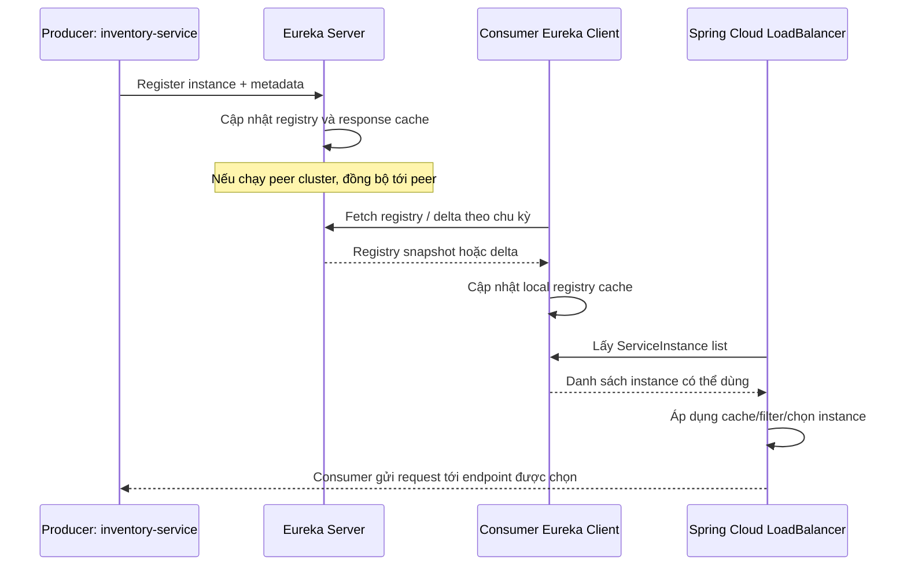

# Vì sao dịch vụ vừa đăng ký chưa được bên gọi nhìn thấy

Một service gửi đăng ký thành công tới Eureka không có nghĩa mọi consumer lập tức nhìn thấy instance đó. Eureka được thiết kế theo mô hình eventual consistency: server nhận đăng ký, cập nhật registry và response cache; các Eureka Client định kỳ tải thay đổi về bộ nhớ cục bộ; Spring Cloud LoadBalancer có thể còn một lớp cache danh sách instance. Mỗi lớp cập nhật theo chu kỳ riêng.

Vì vậy, khi một instance vừa khởi động, dashboard Eureka có thể đã hiển thị nó trong khi consumer vẫn chưa thấy. Cũng có trường hợp server đã nhận đăng ký nhưng instance chưa ở trạng thái `UP`, consumer lọc bỏ nó, hoặc consumer đang hỏi một peer chưa đồng bộ. Muốn tìm đúng nguyên nhân, cần kiểm tra lần lượt producer, từng Eureka Server, cache phía consumer và LoadBalancer.

## 1. Đường đi từ đăng ký đến lúc consumer nhìn thấy instance

Giả sử `inventory-service` vừa khởi động và đăng ký vào Eureka Server. Luồng dữ liệu khái quát như sau:



Có bốn trạng thái khác nhau cần phân biệt:

1. **Producer đã gửi đăng ký:** Eureka Client đã gửi thông tin instance tới URL registry.
2. **Server đã ghi nhận:** instance có trong registry của node Eureka nhận request.
3. **Consumer đã cập nhật local cache:** Eureka Client của consumer đã fetch được phiên bản registry chứa instance.
4. **Consumer có thể định tuyến:** instance vượt qua bộ lọc trạng thái/zone và danh sách mà LoadBalancer sử dụng đã cập nhật.

Chỉ kiểm tra một trạng thái không đủ để kết luận toàn bộ luồng đã hoàn tất. Ví dụ, dashboard cho thấy instance nhưng `DiscoveryClient` ở consumer vẫn trả danh sách rỗng thường là vấn đề ở bước 3 hoặc 4.

## 2. Eureka cập nhật dữ liệu theo chu kỳ

Eureka Client không hỏi server cho từng request nghiệp vụ. Sau khi khởi tạo, client tải registry và giữ bản sao trong bộ nhớ. Các lần fetch tiếp theo thường lấy delta để giảm dữ liệu truyền; nếu phát hiện chênh lệch, client có thể tải lại toàn bộ registry.

Các chu kỳ mặc định quan trọng trong Spring Cloud Netflix hiện hành:

| Thuộc tính | Mặc định | Vai trò |
|---|---:|---|
| `eureka.instance.lease-renewal-interval-in-seconds` | `30s` | Nhịp heartbeat để gia hạn lease của instance |
| `eureka.client.registry-fetch-interval-seconds` | `30s` | Chu kỳ consumer tải thay đổi registry từ Eureka Server |
| `eureka.server.response-cache-update-interval-ms` | `30000ms` | Chu kỳ cập nhật read-only response cache phía server |
| `eureka.server.use-read-only-response-cache` | `true` | Cho phép server phục vụ dữ liệu từ read-only response cache |
| `spring.cloud.loadbalancer.cache.ttl` | `35s` | TTL mặc định của cache LoadBalancer khi cơ chế cache này được sử dụng |

Spring Cloud Netflix giải thích rằng instance chỉ sẵn sàng cho discovery khi metadata ở instance, server và client đã đồng bộ; quá trình này có thể cần tới ba chu kỳ heartbeat. Với heartbeat mặc định 30 giây, có thể mất khoảng 90 giây trong tình huống thông thường. Tài liệu Netflix Eureka cũng mô tả độ trễ lan truyền có thể lên tới khoảng hai phút do cache phía server và chu kỳ fetch delta phía client.

Đây là mô tả độ trễ eventual consistency, không phải SLA hay giới hạn cứng. Mạng chậm, retry, peer replication, server quá tải, consumer khởi động muộn hoặc cache bổ sung có thể làm thời gian dài hơn.

### 2.1. Cache phía server

Eureka Server có response cache để tạo payload cho các request đọc registry. Cấu hình mặc định sử dụng read-only cache được làm mới định kỳ. Vì vậy, dữ liệu đã được ghi vào registry nội bộ có thể chưa xuất hiện ngay trong payload mà client fetch tại thời điểm đó.

Thuộc tính thường gặp:

```yaml
eureka:
  server:
    use-read-only-response-cache: true
    response-cache-update-interval-ms: 30000
```

Đây là các giá trị mặc định được ghi tường minh để minh họa. Không nên giảm chu kỳ cache trên production chỉ để sửa một lỗi đăng ký chưa được xác định; việc đó có thể tăng tải tạo payload và lưu lượng đọc. Trước tiên hãy kiểm tra server nhận đăng ký ở node nào và response từ endpoint registry có chứa instance hay chưa.

### 2.2. Cache phía Eureka Client

Consumer duy trì local registry cache. `DiscoveryClient.getInstances(serviceId)` đọc từ dữ liệu cục bộ này, không gửi một request HTTP tới Eureka Server cho mỗi lần gọi. Mặc định client fetch registry mỗi 30 giây:

```yaml
eureka:
  client:
    fetch-registry: true
    registry-fetch-interval-seconds: 30
```

`fetch-registry: false` có thể phù hợp với một ứng dụng chỉ đăng ký bản thân mà không cần tra cứu service khác, nhưng consumer cần discovery phải bật fetch. Nếu client không tải registry, chờ thêm heartbeat cũng không làm cache tự cập nhật.

Việc giảm `registry-fetch-interval-seconds` làm client nhìn thấy delta sớm hơn trong nhiều trường hợp, nhưng sẽ tăng số request tới Eureka. Chỉ điều chỉnh sau khi đo tải và xác định chu kỳ fetch là phần gây trễ.

### 2.3. Cache của Spring Cloud LoadBalancer

LoadBalancer chọn instance từ `ServiceInstanceListSupplier`. Nếu cấu hình đang dùng cache supplier, danh sách lấy từ DiscoveryClient có thể tiếp tục được cache. TTL mặc định của Spring Cloud LoadBalancer là `35s`.

```yaml
spring:
  cloud:
    loadbalancer:
      cache:
        enabled: true
        ttl: 35s
```

Không phải ứng dụng nào cũng cần thêm lớp cache này. Eureka Client đã giữ registry cache của riêng nó; tài liệu Spring Cloud LoadBalancer khuyến nghị tắt cache LoadBalancer nếu DiscoveryClient đã cache dữ liệu, để tránh double caching:

```yaml
spring:
  cloud:
    loadbalancer:
      cache:
        enabled: false
```

Trước khi thay đổi, kiểm tra `ServiceInstanceListSupplier` thực tế của ứng dụng. Nếu có custom supplier, health-check supplier hoặc cache supplier, thời gian làm mới có thể phụ thuộc cả thứ tự các supplier đó.

## 3. Vì sao server đã nhận đăng ký nhưng consumer vẫn không thấy?

### 3.1. Consumer chưa fetch registry hoặc fetch sai Eureka Server

Kiểm tra các thuộc tính trên consumer:

```yaml
eureka:
  client:
    register-with-eureka: true
    fetch-registry: true
    service-url:
      defaultZone: http://eureka-server:8761/eureka/
    registry-fetch-interval-seconds: 30
```

`register-with-eureka` quyết định consumer có tự đăng ký hay không; `fetch-registry` quyết định nó có tải registry để tìm service khác hay không. Hai hành vi độc lập. Một consumer chỉ cần tìm service có thể đặt `register-with-eureka: false`, nhưng vẫn phải giữ `fetch-registry: true`.

Đảm bảo producer và consumer thực sự dùng URL Eureka mong muốn. Nếu chạy container, `localhost` trong container producer và `localhost` trong container consumer là hai địa chỉ khác nhau. Dùng DNS service name hoặc hostname mà cả hai bên đều truy cập được.

`defaultZone` là key của map và phân biệt chữ hoa/chữ thường. Hãy giữ nguyên camel case `defaultZone`; không đổi thành `default-zone`.

### 3.2. Producer chưa đăng ký hoặc đăng ký nhầm nơi

Kiểm tra cấu hình producer:

```yaml
spring:
  application:
    name: inventory-service

eureka:
  client:
    register-with-eureka: true
    service-url:
      defaultZone: http://eureka-server:8761/eureka/
```

Spring Cloud Netflix tự cấu hình đăng ký khi starter Eureka Client có trên classpath và discovery không bị tắt. `spring.application.name` mặc định được dùng làm service ID. Nếu tên ứng dụng không được đặt, service ID có thể rơi về giá trị mặc định không mong muốn; nếu consumer tra cứu một ID khác, kết quả sẽ rỗng.

Kiểm tra thêm:

- Profile đang active có ghi đè `eureka.client.register-with-eureka` hoặc `service-url` không?
- Producer có bật `spring.cloud.discovery.enabled=false` hoặc `eureka.client.enabled=false` không?
- Log có báo đăng ký thành công hay lỗi DNS, connection refused, timeout, HTTP 401/403 không?
- Eureka Server có đang ở trạng thái sẵn sàng nhận đăng ký không?
- Nếu có nhiều server, producer đăng ký vào peer nào và consumer fetch từ peer nào?

Không kết luận đăng ký thành công chỉ vì ứng dụng producer khởi động xong. Hãy tìm log Eureka Client cho thao tác register/heartbeat và kiểm tra record ở server.

### 3.3. Instance chưa ở trạng thái UP

Eureka Client mặc định lọc registry để chỉ trả các instance có trạng thái `UP` (`eureka.client.filter-only-up-instances=true`). Một record đang ở `STARTING`, `DOWN` hoặc `OUT_OF_SERVICE` có thể xuất hiện trong thông tin quản trị nhưng không có trong danh sách instance consumer sử dụng.

Kiểm tra trạng thái instance trên dashboard hoặc REST API. Cũng cần phân biệt heartbeat với health status: heartbeat chứng minh client còn liên lạc với server, không tự chứng minh ứng dụng sẵn sàng xử lý nghiệp vụ.

Nếu muốn trạng thái Spring Boot Actuator được truyền tới Eureka, cấu hình health check integration rõ ràng:

```yaml
eureka:
  client:
    healthcheck:
      enabled: true
```

Đặt thuộc tính này trong `application.yml` (hoặc file cấu hình ứng dụng thông thường), không đặt trong `bootstrap.yml`; tài liệu Spring Cloud Netflix cảnh báo vị trí bootstrap có thể khiến instance đăng ký với trạng thái `UNKNOWN`. Với ứng dụng cần điều khiển status chi tiết, có thể dùng `HealthCheckHandler` theo API Eureka.

Để thử nghiệm, kiểm tra trạng thái hiện tại và bộ lọc:

```yaml
eureka:
  client:
    filter-only-up-instances: true
```

Chỉ tắt bộ lọc để chẩn đoán trong môi trường thử nghiệm. Đưa instance `DOWN` hoặc `OUT_OF_SERVICE` vào danh sách traffic không phải cách sửa lỗi readiness.

### 3.4. Eureka Server chạy nhiều peer nhưng chưa đồng bộ

Trong peer-aware cluster, producer có thể đăng ký ở peer A trong khi consumer đang fetch từ peer B. Các peer cần biết URL của nhau và có thể liên lạc qua mạng; nếu cấu hình peer sai, replication bị lỗi hoặc firewall chặn, hai node có thể trả registry khác nhau trong một khoảng thời gian.

Kiểm tra:

- `eureka.client.service-url.defaultZone` của từng server có chứa peer URL đúng không?
- Hostname/DNS của peer có phân giải được từ từng node không?
- Các peer có truy cập được endpoint `/eureka/` qua đúng protocol, port và TLS không?
- Log server có lỗi peer replication, timeout hoặc authentication không?
- Producer và consumer có đang kết nối vào cùng một peer hoặc cùng cụm không?

Standalone mode không có peer để đồng bộ. Trong production, dùng peer-aware servers và theo dõi replication; không coi việc một dashboard hiển thị instance là bằng chứng mọi node đã có cùng dữ liệu.

## 4. Có instance trong DiscoveryClient nhưng request vẫn không tới được service

Đây là vấn đề khác với việc consumer không nhìn thấy instance. Nếu `DiscoveryClient.getInstances(serviceId)` đã trả danh sách nhưng request qua service ID thất bại, kiểm tra thông tin endpoint và bước LoadBalancer.

| Dấu hiệu | Nguyên nhân có thể | Kiểm tra |
|---|---|---|
| Instance có trong danh sách nhưng connect timeout | Host/IP/port được quảng bá không thể truy cập từ consumer | `eureka.instance.hostname`, `prefer-ip-address`, `non-secure-port`, DNS và firewall |
| Instance trả về có status không mong muốn | Health check/status mapping hoặc bộ lọc instance | `InstanceInfo.status`, `filter-only-up-instances`, health check handler |
| Một zone không nhìn thấy instance của zone khác | Zone preference hoặc supplier đang lọc theo zone | `eureka.instance.metadata-map.zone`, `eureka.client.availability-zones`, LoadBalancer zone supplier |
| DiscoveryClient thấy instance nhưng LoadBalancer chưa thấy | Cache hoặc custom `ServiceInstanceListSupplier` chưa refresh | Cache TTL, supplier chain và cấu hình LoadBalancer |
| Gọi URL cố định được nhưng gọi bằng service ID thất bại | Thiếu LoadBalancer hoặc client không dùng load-balanced builder | Dependency LoadBalancer và annotation `@LoadBalanced` |

Địa chỉ mà Eureka quảng bá phải là địa chỉ mà consumer có thể gọi. Trong Docker/Kubernetes, địa chỉ host nội bộ hoặc loopback thường không phù hợp nếu consumer ở container/pod khác.

## 5. Kiểm tra từng lớp bằng REST API và code

### 5.1. Kiểm tra trực tiếp trên Eureka Server

Xem toàn bộ registry:

```bash
curl -H "Accept: application/json" http://localhost:8761/eureka/apps
```

Xem riêng application `INVENTORY-SERVICE`:

```bash
curl -H "Accept: application/json" http://localhost:8761/eureka/apps/INVENTORY-SERVICE
```

Nếu server bật authentication hoặc TLS, bổ sung thông tin xác thực và chứng thư phù hợp. Tên application trong đường dẫn Eureka thường hiển thị ở dạng chữ hoa; dùng đúng app name mà server đang trả về.

### 5.2. Kiểm tra qua DiscoveryClient ở consumer

Đoạn code sau giúp kiểm tra danh sách mà chính Eureka Client trong consumer đang nhìn thấy:

```java
import java.util.List;

import org.springframework.cloud.client.ServiceInstance;
import org.springframework.cloud.client.discovery.DiscoveryClient;
import org.springframework.stereotype.Component;

@Component
class DiscoveryDiagnostics {

    private final DiscoveryClient discoveryClient;

    DiscoveryDiagnostics(DiscoveryClient discoveryClient) {
        this.discoveryClient = discoveryClient;
    }

    void printInventoryInstances() {
        List<ServiceInstance> instances =
                discoveryClient.getInstances("inventory-service");

        instances.forEach(instance -> System.out.printf(
                "service=%s host=%s port=%d uri=%s metadata=%s%n",
                instance.getServiceId(),
                instance.getHost(),
                instance.getPort(),
                instance.getUri(),
                instance.getMetadata()));
    }
}
```

Không gọi đoạn chẩn đoán này trong constructor hoặc `@PostConstruct` nếu Eureka Client chưa hoàn tất khởi tạo. Có thể chạy sau khi ứng dụng đã sẵn sàng hoặc expose qua một endpoint nội bộ được bảo vệ.

### 5.3. Đối chiếu ba kết quả

| Eureka Server API | Consumer `DiscoveryClient` | LoadBalancer | Hướng điều tra |
|---|---|---|---|
| Không có record | Không có instance | Không có instance | Producer chưa đăng ký, sai URL, registration bị từ chối hoặc server đang xem không phải node nhận đăng ký |
| Có record `UP` | Chưa có instance | Chưa có instance | Consumer chưa fetch, fetch sai peer, local cache chưa cập nhật hoặc service ID không khớp |
| Có record không phải `UP` | Rỗng | Rỗng | Trạng thái instance và `filter-only-up-instances` |
| Có record `UP` | Có instance | Chưa có instance | LoadBalancer cache/supplier/filter hoặc zone |
| Có record `UP` | Có instance | Có instance nhưng request lỗi | Host/port, network, protocol, security hoặc ứng dụng đích |

Bảng này giúp xác định lỗi đang nằm ở lớp nào. Khi hai kết quả được đo ở các thời điểm khác nhau, cần ghi timestamp và chạy lại gần như đồng thời để tránh nhầm lẫn do registry đang tiếp tục cập nhật.

## 6. Tuning độ trễ: thay đổi có chủ đích

Nếu hệ thống cần consumer nhìn thấy instance mới nhanh hơn, có thể điều chỉnh chu kỳ fetch của Eureka Client:

```yaml
eureka:
  client:
    registry-fetch-interval-seconds: 10
```

Giá trị `10` chỉ là ví dụ cho một thử nghiệm có kiểm soát. Chu kỳ ngắn làm tăng số lần consumer gọi Eureka; với nhiều consumer, tải registry có thể tăng đáng kể. Cần đo request rate, CPU server, kích thước delta và thời gian propagation trước/sau thay đổi.

Spring Cloud Netflix cũng cho phép thay đổi heartbeat interval bằng `eureka.instance.lease-renewal-interval-in-seconds`. Tài liệu khuyên giữ mặc định 30 giây trong production vì server có các tính toán nội bộ giả định chu kỳ renew này. Không nên giảm heartbeat chỉ để che một cache hoặc peer replication đang cấu hình sai.

Với LoadBalancer, chỉ điều chỉnh TTL hoặc tắt cache sau khi đã xác định supplier đang sử dụng. Nếu Eureka Client đã cung cấp dữ liệu từ local cache, tắt cache LoadBalancer có thể tránh thêm một tầng stale data. Ngược lại, nếu một custom DiscoveryClient truy vấn registry qua mạng mỗi lần, cache LoadBalancer có thể hữu ích để giảm tải.

Không có một con số timeout duy nhất phù hợp với mọi cụm. Hãy đặt mục tiêu propagation dựa trên yêu cầu hệ thống, đo từng lớp và tránh giảm đồng loạt tất cả chu kỳ.

## 7. Quy trình xử lý khi service mới chưa xuất hiện

Thực hiện lần lượt để tìm nơi dữ liệu dừng lại:

1. **Xác minh producer:** xem `spring.application.name`, `register-with-eureka`, `service-url.defaultZone`, profile active và log đăng ký.
2. **Xác minh server nhận đăng ký:** gọi `/eureka/apps/{APP_NAME}` trên đúng node mà producer gửi request.
3. **Xác minh trạng thái:** record có `status=UP` không; nếu không, kiểm tra health/status handler và cấu hình readiness.
4. **Xác minh consumer:** kiểm tra `fetch-registry=true`, URL peer, registry fetch interval và service ID mà code đang tra cứu.
5. **Xác minh local cache:** gọi `DiscoveryClient.getInstances(serviceId)` trong chính process consumer và ghi timestamp.
6. **Xác minh LoadBalancer:** kiểm tra cache TTL, supplier chain, zone filtering và instance list được chọn.
7. **Xác minh endpoint:** từ network namespace của consumer, thử kết nối tới host/port mà Eureka quảng bá.
8. **Xác minh peer cluster:** đối chiếu cùng một app trên từng Eureka Server và đọc log replication.
9. **Đo lại propagation:** ghi thời điểm producer register, server hiển thị, consumer thấy và request đầu tiên thành công.

## 8. Thực hành đo thời gian propagation

Có thể dùng hai service nhỏ trong môi trường local:

- `inventory-service`: bật Eureka Client và đăng ký với tên `inventory-service`.
- `order-service`: bật Eureka Client, fetch registry và truy vấn `inventory-service` bằng `DiscoveryClient` hoặc Spring Cloud LoadBalancer.

Thực hiện thử nghiệm:

1. Khởi động Eureka Server và đợi dashboard sẵn sàng.
2. Khởi động `order-service` trước để local cache ban đầu chưa có `inventory-service`.
3. Ghi thời điểm bắt đầu khởi động `inventory-service`.
4. Gọi REST API `/eureka/apps/INVENTORY-SERVICE` định kỳ để ghi thời điểm server có record `UP`.
5. Từ `order-service`, gọi `getInstances("inventory-service")` định kỳ để ghi thời điểm local cache có instance.
6. Gọi endpoint qua LoadBalancer để ghi thời điểm request đầu tiên thành công.
7. Lặp lại vài lần và so sánh thời gian; không chỉ đo một lần vì chu kỳ fetch có thể lệch pha so với thời điểm đăng ký.

Ví dụ bảng ghi nhận:

| Mốc | Thời gian |
|---|---|
| Producer bắt đầu đăng ký | `T0` |
| Eureka Server trả record `UP` | `T1` |
| Consumer `DiscoveryClient` nhìn thấy instance | `T2` |
| LoadBalancer chọn được instance và request thành công | `T3` |

Các khoảng thời gian cần tính:

- Server registration delay: `T1 - T0`.
- Consumer discovery delay: `T2 - T1`.
- Routing/cache delay: `T3 - T2`.
- End-to-end visibility: `T3 - T0`.

Thử lại khi consumer khởi động sau producer, khi dùng hai Eureka peer, khi thay đổi fetch interval và khi cache LoadBalancer được bật/tắt. Những phép đo này giúp nhận ra lớp nào đang tạo độ trễ thực tế trong hệ thống.

## 9. Checklist vận hành

- [ ] Producer đặt `spring.application.name` rõ ràng và đăng ký tới đúng Eureka Server.
- [ ] `register-with-eureka` bật trên producer; `fetch-registry` bật trên consumer cần discovery.
- [ ] `defaultZone` đúng camel case, hostname, port, protocol và có thể truy cập từ từng container/host.
- [ ] Eureka Server API đã có record của service mới.
- [ ] Instance có trạng thái `UP` và không bị lọc bởi `filter-only-up-instances`.
- [ ] Consumer đã fetch registry và `DiscoveryClient.getInstances(serviceId)` trả danh sách mong đợi.
- [ ] Peer replication hoạt động nếu cụm có nhiều Eureka Server.
- [ ] Đã xác định có cache LoadBalancer hoặc custom supplier nào đang thêm độ trễ.
- [ ] Đã kiểm tra địa chỉ host/port mà Eureka quảng bá từ network của consumer.
- [ ] Đã đo propagation delay bằng timestamp thay vì chỉ chờ theo cảm tính.
- [ ] Các thay đổi chu kỳ fetch/heartbeat/cache đã được đo tải và kiểm thử.

## Tài liệu tham khảo

- [Spring Cloud Netflix 5.1.0 — Why Is It so Slow to Register a Service?](https://docs.spring.io/spring-cloud-netflix/reference/spring-cloud-netflix.html)
- [Spring Cloud Netflix — Configuration Properties](https://docs.spring.io/spring-cloud-netflix/reference/configprops.html)
- [Spring Cloud LoadBalancer — Cache configuration](https://docs.spring.io/spring-cloud-commons/reference/spring-cloud-commons/loadbalancer.html)
- [Netflix Eureka — Understanding client/server communication](https://github.com/Netflix/eureka/wiki/Understanding-eureka-client-server-communication)
- [Netflix Eureka — DiscoveryClient registry fetch and cache reconciliation](https://github.com/Netflix/eureka/blob/master/eureka-client/src/main/java/com/netflix/discovery/DiscoveryClient.java)
