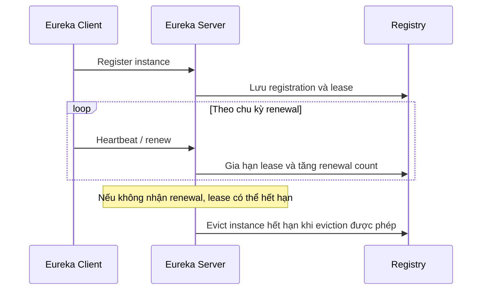

# Self-preservation: mục đích, ngưỡng kích hoạt và ảnh hưởng

Eureka Client gửi heartbeat định kỳ tới Eureka Server để xác nhận instance vẫn hoạt động. Nếu server đột nhiên nhận ít heartbeat hơn dự kiến, nguyên nhân có thể là nhiều instance thực sự đã dừng, nhưng cũng có thể chỉ là mạng bị phân vùng, server quá tải hoặc client tạm thời không thể kết nối. Nếu xóa ngay mọi instance không gửi heartbeat, Eureka có thể xóa nhầm các instance vẫn đang chạy.

Eureka giải quyết rủi ro này bằng **self-preservation mode** (chế độ tự bảo vệ). Khi số heartbeat nhận được giảm xuống dưới một ngưỡng, server tạm ngừng eviction các instance hết hạn để giữ lại registry trong lúc có thể đang xảy ra sự cố diện rộng. Cơ chế này bảo vệ tính sẵn có của dữ liệu discovery, nhưng cũng có thể khiến instance đã chết tiếp tục xuất hiện trong registry. Bài học này giải thích mục đích, cách tính ngưỡng, tác động và cách vận hành chế độ tự bảo vệ.

## 1. Heartbeat và lease expiration

Khi một ứng dụng đăng ký với Eureka, server lưu thông tin instance như application name, instance ID, hostname/IP và port. Client sau đó gửi heartbeat (renewal) định kỳ để gia hạn lease của registration.

Các khoảng thời gian thường gặp trong cấu hình mặc định:

| Thuộc tính | Giá trị mặc định thường gặp | Ý nghĩa |
| --- | ---: | --- |
| `eureka.instance.lease-renewal-interval-in-seconds` | 30 giây | Chu kỳ Eureka Client gửi heartbeat. |
| `eureka.instance.lease-expiration-duration-in-seconds` | 90 giây | Thời gian lease trước khi instance có thể bị xem là hết hạn nếu không được gia hạn. |
| `eureka.server.eviction-interval-timer-in-ms` | 60.000 ms | Chu kỳ server chạy tác vụ kiểm tra và eviction instance hết hạn. |
| `eureka.server.renewal-percent-threshold` | 0,85 | Tỷ lệ heartbeat tối thiểu so với mức dự kiến để duy trì trạng thái bình thường. |
| `eureka.server.enable-self-preservation` | `true` | Bật chế độ tự bảo vệ. |

Giá trị mặc định có thể thay đổi theo phiên bản hoặc cấu hình của dự án; hãy xác minh với release train Spring Cloud Netflix đang sử dụng.

Luồng cơ bản:



Trong điều kiện bình thường, client gửi heartbeat khoảng mỗi 30 giây. Nếu một client mất kết nối và không gửi renewal, lease có thể hết hạn sau khoảng 90 giây; server chạy eviction task theo chu kỳ để loại registration hết hạn. Thời điểm instance thực sự biến mất có thể muộn hơn lease expiration do eviction chạy theo lịch và còn phụ thuộc trạng thái self-preservation.

## 2. Vì sao Eureka cần self-preservation?

Giả sử một cụm có 100 instance đang chạy. Một sự cố mạng khiến Eureka Server không nhận được heartbeat từ 40 instance, dù một phần hoặc tất cả các instance đó vẫn đang xử lý request bình thường. Nếu server xóa chúng chỉ vì thiếu heartbeat, consumer sẽ mất địa chỉ của các instance còn hoạt động.

Điều này tạo ra hiệu ứng dây chuyền:

1. Mạng hoặc server registry gặp sự cố tạm thời.
2. Nhiều heartbeat bị mất hoặc đến trễ.
3. Eureka xem nhiều lease là hết hạn.
4. Registry xóa các instance vẫn có thể phục vụ request.
5. Consumer không còn tìm thấy đủ instance, khiến khả năng phục vụ giảm thêm.

Self-preservation được thiết kế để tránh việc xóa hàng loạt registration trong tình huống không chắc chắn. Khi ngưỡng renewal bị vi phạm, Eureka ưu tiên giữ lại registry và ngừng eviction tự động. Sau khi heartbeat phục hồi và tỷ lệ renewal vượt ngưỡng, server có thể thoát chế độ tự bảo vệ và tiếp tục eviction theo quy trình bình thường.

Đây là lựa chọn giữa hai rủi ro:

- **Không có self-preservation:** registry có thể nhanh chóng loại instance chết, nhưng cũng có thể xóa nhầm instance khỏe khi có network partition hoặc sự cố heartbeat diện rộng.
- **Có self-preservation:** registry được giữ lại khi tín hiệu heartbeat bất thường, nhưng registration của instance đã chết có thể tồn tại lâu hơn.

Self-preservation không sửa chữa mạng, không khởi động lại instance và không chứng minh rằng mọi instance đang được giữ lại đều khỏe. Nó chỉ thay đổi cách Eureka xử lý eviction khi lượng heartbeat giảm bất thường.

## 3. Ngưỡng kích hoạt được tính như thế nào?

Eureka Server theo dõi số renewal nhận được trong một khoảng thời gian và so sánh với số renewal dự kiến. Có thể diễn giải công thức ở cấu hình thông thường như sau:

\[
R_{expected} = N \times \frac{60}{I}
\]

\[
R_{threshold} = R_{expected} \times P
\]

Trong đó:

- `N` là số instance client đang được tính trong registry.
- `I` là chu kỳ renewal tính bằng giây.
- `P` là `renewal-percent-threshold`, mặc định thường là `0,85`.
- `R_expected` là số heartbeat dự kiến nhận được trong một phút.
- `R_threshold` là ngưỡng renewal tối thiểu trong một phút.

Với chu kỳ renewal mặc định 30 giây, mỗi instance gửi khoảng hai heartbeat mỗi phút. Nếu có 100 instance:

\[
R_{expected} = 100 \times \frac{60}{30} = 200
\]

Với ngưỡng 85%:

\[
R_{threshold} = 200 \times 0,85 = 170
\]

Server kỳ vọng nhận khoảng 200 renewal mỗi phút. Nếu số renewal nhận được giảm xuống dưới khoảng 170, self-preservation có thể được kích hoạt. Số liệu thực tế được làm tròn và cách cập nhật ngưỡng còn phụ thuộc phiên bản Eureka, chu kỳ tính toán và cấu hình lease của các instance.

Ví dụ khác với 50 instance, chu kỳ renewal 30 giây:

| Đại lượng | Cách tính | Kết quả |
| --- | --- | ---: |
| Renewal dự kiến/phút | `50 × 60 / 30` | 100 |
| Ngưỡng 85% | `100 × 0,85` | 85 |
| Renewal nhận được | Giả sử đo được | 70 |
| So sánh | `70 < 85` | Dưới ngưỡng |

Khi số renewal thực tế thấp hơn ngưỡng, server xem đây là dấu hiệu có thể xảy ra mất kết nối diện rộng và bật chế độ tự bảo vệ. Ngưỡng không phải tỷ lệ CPU, số lượng instance unhealthy hay phần trăm request thành công; nó dựa trên heartbeat renewal của Eureka Client.

## 4. Cấu hình self-preservation

Ví dụ cấu hình trên Eureka Server:

```yaml
eureka:
  server:
    enable-self-preservation: true
    renewal-percent-threshold: 0.85
    renewal-threshold-update-interval-ms: 900000
    eviction-interval-timer-in-ms: 60000
```

Ý nghĩa:

- `enable-self-preservation` bật hoặc tắt cơ chế tự bảo vệ. Mặc định thường là `true`.
- `renewal-percent-threshold` đặt tỷ lệ renewal tối thiểu so với mức dự kiến. Giá trị `0.85` tương ứng 85%.
- `renewal-threshold-update-interval-ms` đặt chu kỳ cập nhật ngưỡng renewal theo số instance đang đăng ký; ví dụ `900000` ms tương đương 15 phút.
- `eviction-interval-timer-in-ms` đặt chu kỳ chạy tác vụ eviction; ví dụ `60000` ms tương đương 1 phút.

Đây là ví dụ cho Eureka Server và cần kiểm tra tên property, mặc định cùng khả năng hỗ trợ trong phiên bản Spring Cloud Netflix của dự án. Không đặt `renewal-percent-threshold` quá thấp chỉ để tránh cảnh báo: ngưỡng thấp làm server ít nhạy hơn với việc mất heartbeat và có thể trì hoãn kích hoạt bảo vệ.

Ở phía client, có thể cấu hình chu kỳ heartbeat và lease expiration:

```yaml
eureka:
  instance:
    lease-renewal-interval-in-seconds: 30
    lease-expiration-duration-in-seconds: 90
```

Chỉ thay đổi các khoảng thời gian này khi đã đo độ trễ mạng, thời gian pause của JVM, tải server và yêu cầu phát hiện instance chết. Nếu client gửi heartbeat mỗi 60 giây nhưng server vẫn tính kỳ vọng theo nhịp 30 giây, tỷ lệ renewal có thể thấp hơn dự kiến và kích hoạt self-preservation ngoài ý muốn.

## 5. Điều gì xảy ra khi self-preservation được kích hoạt?

Khi renewal rate giảm dưới ngưỡng và self-preservation đang bật, Eureka Server chuyển sang chế độ tự bảo vệ. Hành vi quan trọng nhất là **ngừng eviction tự động các instance hết hạn** trong khi chế độ này còn hiệu lực.

Những ảnh hưởng thường thấy:

- Instance không gửi heartbeat có thể vẫn xuất hiện trong registry lâu hơn lease expiration thông thường.
- Eureka Dashboard hiển thị cảnh báo self-preservation hoặc thông báo renewal thấp hơn ngưỡng.
- Consumer vẫn có thể nhận được thông tin của instance cũ khi fetch registry.
- Lời gọi tới instance đã dừng có thể thất bại do timeout hoặc connection error.
- Registry tránh xóa hàng loạt instance khỏe chỉ vì server tạm thời không nhận được heartbeat.

Self-preservation không có nghĩa là server dừng mọi hoạt động. Server vẫn có thể phục vụ REST API, nhận đăng ký hoặc renewal và đồng bộ registry theo cấu hình peer. Cơ chế này chủ yếu ngăn eviction tự động khi renewal rate thấp.

Khi renewal rate trở lại mức phù hợp, Eureka có thể thoát self-preservation và eviction tiếp tục. Các instance đã hết hạn có thể được loại ở những vòng eviction tiếp theo. Không nên giả định registration cũ biến mất ngay tại thời điểm cảnh báo tắt.

## 6. Ảnh hưởng tới service discovery và consumer

Consumer thường lấy danh sách instance từ Eureka theo chu kỳ hoặc thông qua cơ chế cache của client. Nếu self-preservation giữ lại instance đã dừng, danh sách mà consumer nhìn thấy có thể chứa địa chỉ không còn phục vụ.

Ví dụ:

```text
Eureka registry:
  order-service
    - order-a:8081  (đang chạy)
    - order-b:8082  (đã dừng, chưa bị eviction)
    - order-c:8083  (đang chạy)

Consumer có thể nhận cả ba instance từ registry.
```

Nếu LoadBalancer chọn `order-b:8082`, request có thể thất bại. Điều này cho thấy self-preservation bảo vệ tính đầy đủ của registry khi có sự cố mạng, nhưng không bảo đảm mọi instance trong registry đều đang khỏe.

Ảnh hưởng phụ thuộc cách consumer lấy và cache registry, chính sách retry, health check phía client và cơ chế lọc instance. Hãy kết hợp Eureka với timeout hợp lý, retry có giới hạn, circuit breaker và quan sát lỗi gọi dịch vụ. Không nên xem danh sách instance từ registry là phép đo sức khỏe tức thời.

## 7. Khi nào nên bật hoặc tắt?

### 7.1. Production

Thông thường nên giữ self-preservation bật trong production. Cơ chế này giúp tránh xóa nhầm registration khi có network partition, nghẽn mạng, server quá tải hoặc nhiều client tạm thời không gửi heartbeat.

Khi cảnh báo xuất hiện, hãy điều tra nguyên nhân renewal giảm thay vì tắt cơ chế ngay lập tức. Việc tắt có thể khiến server xóa các instance đang khỏe trong lúc mạng bị gián đoạn.

### 7.2. Development hoặc môi trường kiểm thử

Trong môi trường local đơn giản, đôi khi muốn instance dừng sẽ nhanh chóng bị xóa để kiểm tra hành vi đăng ký/hủy đăng ký. Có thể cân nhắc tắt self-preservation trong môi trường cô lập:

```yaml
eureka:
  server:
    enable-self-preservation: false
```

Chỉ dùng cấu hình này cho môi trường phát triển hoặc kiểm thử có thể chấp nhận rủi ro. Không đưa cấu hình tắt self-preservation vào production chỉ để xóa nhanh instance cũ.

### 7.3. Điều chỉnh threshold

Nếu hệ thống thường xuyên bật self-preservation do tải cao hoặc heartbeat có độ trễ, trước tiên hãy đo:

- Số instance thực tế và số renewal dự kiến.
- Tỷ lệ renewal nhận được theo từng phút.
- Chu kỳ renewal của client và lease expiration đang khai báo.
- Network latency, packet loss và firewall giữa client với server.
- CPU, memory, thread pool và thời gian pause GC của client/server.
- Số lần client restart hoặc scale up/down trong khoảng cập nhật threshold.

Chỉ điều chỉnh `renewal-percent-threshold` sau khi hiểu baseline và mô hình lỗi chấp nhận được. Ngưỡng cao kích hoạt bảo vệ sớm hơn; ngưỡng thấp khiến server chấp nhận mức suy giảm heartbeat lớn hơn trước khi bật chế độ bảo vệ.

## 8. Quy trình chẩn đoán khi Dashboard báo self-preservation

Khi Eureka Dashboard cảnh báo renewal thấp hơn ngưỡng, thực hiện theo thứ tự:

1. **Xác nhận quy mô registry:** đếm số application instance đang đăng ký và so sánh với số instance dự kiến đang chạy.
2. **Kiểm tra renewal rate:** đối chiếu số heartbeat nhận được với ngưỡng; xác định thời điểm bắt đầu giảm.
3. **Kiểm tra client:** đọc log Eureka Client, xác minh client còn chạy và đang gửi heartbeat tới đúng server/peer.
4. **Kiểm tra mạng:** xem DNS, route, firewall, packet loss, timeout và network partition giữa client với Eureka Server.
5. **Kiểm tra tải JVM:** tìm GC pause dài, CPU saturation, thread starvation hoặc server quá tải khiến heartbeat đến trễ.
6. **Kiểm tra cấu hình lease:** so sánh `lease-renewal-interval-in-seconds` và `lease-expiration-duration-in-seconds` giữa các nhóm client.
7. **Kiểm tra peer server:** nếu chạy cụm Eureka, xác minh các node peer có thể giao tiếp và đồng bộ registry.
8. **Xác minh instance cũ:** đối chiếu registration trong Eureka với trạng thái process, endpoint health và log của ứng dụng trước khi xóa thủ công.

Không xóa hàng loạt instance chỉ dựa trên cảnh báo self-preservation. Trước tiên cần xác định chúng đã dừng thật hay chỉ tạm thời không gửi được heartbeat.

## 9. Giám sát và vận hành

Nên theo dõi các tín hiệu sau:

| Tín hiệu | Điều cần quan sát |
| --- | --- |
| Renewal rate | Số heartbeat thực tế nhận được theo phút. |
| Renewal threshold | Mức heartbeat tối thiểu được tính từ registry và cấu hình. |
| Self-preservation state | Thời điểm bật/tắt và thời gian duy trì chế độ tự bảo vệ. |
| Registry size | Số lượng instance theo application và biến động theo thời gian. |
| Client heartbeat errors | Lỗi timeout, connection refused hoặc HTTP error khi renew. |
| JVM và network | GC pause, CPU, thread pool, latency và packet loss. |

Dashboard Eureka thường hiển thị trạng thái self-preservation và thông báo khi số renewal thấp hơn ngưỡng. Log của server và client giúp xác định thời điểm, endpoint và nguyên nhân heartbeat bị mất. Nếu dùng Actuator/Micrometer, có thể tích hợp metric phù hợp với phiên bản thư viện; hãy xác minh tên metric thực tế trong môi trường chạy thay vì giả định mọi release train xuất cùng một tập metric.

Trong quy trình vận hành, nên có cảnh báo khi self-preservation kéo dài bất thường, khi renewal rate giảm liên tục và khi số instance registry chênh lệch lớn so với số replica thực tế. Kết hợp số liệu registry với health check của ứng dụng để phát hiện stale registration.

## 10. Những nhầm lẫn thường gặp

| Nhầm lẫn | Cách hiểu đúng |
| --- | --- |
| Self-preservation nghĩa là mọi instance đều khỏe. | Nó chỉ giữ registration khi heartbeat giảm bất thường; instance đã chết vẫn có thể còn trong registry. |
| Ngưỡng 85% là tỷ lệ request thành công. | Đây là tỷ lệ renewal heartbeat so với số renewal dự kiến. |
| Instance không gửi heartbeat sẽ luôn bị xóa sau 90 giây. | Lease expiration chỉ là điều kiện hết hạn; self-preservation có thể tạm ngừng eviction. |
| Tắt self-preservation luôn giúp registry chính xác hơn. | Khi mạng có sự cố, tắt bảo vệ có thể khiến server xóa nhầm instance khỏe. |
| Self-preservation thay thế health check. | Heartbeat và health check là tín hiệu khác nhau; cần phối hợp cả hai. |
| Cảnh báo xuất hiện chắc chắn do client chết. | Có thể do network partition, server quá tải, GC pause, thread starvation hoặc cấu hình renewal không khớp. |

## 11. Ghi nhớ

- Eureka Client gửi heartbeat để gia hạn lease của registration.
- Self-preservation bật khi renewal rate thấp hơn ngưỡng tính từ số instance và chu kỳ renewal dự kiến; ngưỡng mặc định thường là 85%.
- Khi chế độ tự bảo vệ hoạt động, Eureka tạm ngừng eviction tự động để tránh xóa nhầm instance khỏe trong sự cố mạng diện rộng.
- Đổi lại, instance đã dừng có thể còn xuất hiện trong registry và gây lỗi khi consumer gọi tới.
- Production thường nên giữ self-preservation bật; hãy điều tra heartbeat, network, JVM, peer và lease trước khi điều chỉnh threshold hoặc tắt bảo vệ.
- Kết hợp monitoring renewal rate, registry size, health check và lỗi gọi dịch vụ để nhận diện stale registration.

Hiểu đúng self-preservation giúp đội vận hành cân bằng giữa việc giữ lại thông tin discovery khi mạng bất ổn và việc loại bỏ instance đã chết sau khi hệ thống phục hồi.
