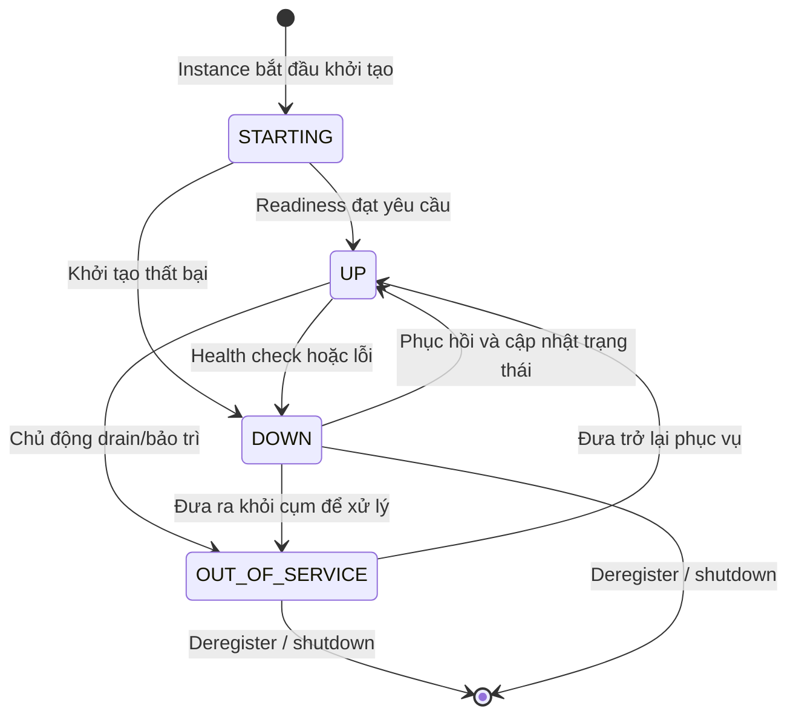
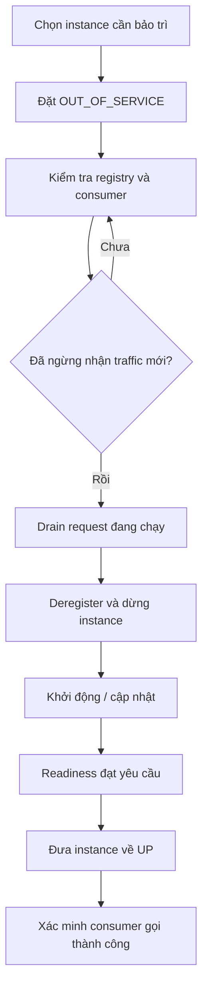

# Phân biệt instance UP, DOWN, STARTING và OUT_OF_SERVICE

Eureka lưu trạng thái của từng service instance để mô tả tình trạng mà instance công bố với registry. Bốn trạng thái thường gặp là `UP`, `DOWN`, `STARTING` và `OUT_OF_SERVICE`. Chúng giúp phân biệt instance đã sẵn sàng, đang lỗi, còn khởi tạo hoặc được chủ động rút khỏi lưu lượng.

Trạng thái là một phần của registration. Nó không đồng nghĩa với việc instance đã bị xóa khỏi registry, cũng không tự chứng minh request tới instance sẽ thành công hay thất bại. Khi vận hành Spring Cloud Service Discovery, cần hiểu ý nghĩa trạng thái, nguồn cập nhật và cách consumer/LoadBalancer sử dụng trạng thái đó.

## 1. Bốn trạng thái có ý nghĩa gì?

| Trạng thái | Ý nghĩa | Tình huống điển hình |
|---|---|---|
| `UP` | Instance được công bố là sẵn sàng phục vụ | Ứng dụng khởi động xong và health check đạt yêu cầu |
| `DOWN` | Instance được đánh dấu không hoạt động hoặc không khỏe | Health check thất bại, ứng dụng gặp lỗi hoặc bị đánh dấu lỗi |
| `STARTING` | Instance đang trong quá trình khởi tạo, chưa nên nhận traffic nghiệp vụ | JVM đã chạy nhưng ứng dụng chưa nạp xong cấu hình hoặc chưa sẵn sàng |
| `OUT_OF_SERVICE` | Instance được chủ động đưa ra khỏi phục vụ | Bảo trì, triển khai phiên bản mới hoặc drain traffic trước khi dừng |

### UP

`UP` biểu thị instance đang được công bố là có thể phục vụ. Đây là trạng thái mong muốn của instance đã khởi động hoàn tất, các thành phần bắt buộc đã sẵn sàng và health check đáp ứng điều kiện.

`UP` không phải lời bảo đảm request sẽ luôn thành công. Instance vẫn có thể gặp lỗi ngay sau khi trạng thái được cập nhật; network, dependency, timeout hoặc lỗi nghiệp vụ vẫn có thể làm request thất bại.

### DOWN

`DOWN` biểu thị instance không được xem là khỏe hoặc không nên phục vụ theo tín hiệu trạng thái hiện tại. Trạng thái này có thể đến từ health check, tín hiệu do client công bố hoặc thao tác quản trị.

`DOWN` không đồng nghĩa với deregistration. Registration có thể vẫn còn trong registry để quan sát, điều tra hoặc chờ phục hồi. Nếu instance tự hồi phục, trạng thái có thể được cập nhật lại theo health integration hoặc logic quản lý.

### STARTING

`STARTING` biểu thị instance đang khởi động và chưa đạt điều kiện sẵn sàng. Ví dụ, tiến trình JVM đã chạy nhưng ứng dụng còn đang:

- Nạp cấu hình và tạo application context.
- Khởi tạo connection pool tới database.
- Tạo cache hoặc tải dữ liệu ban đầu.
- Đăng ký listener, consumer hoặc các thành phần nền.
- Chờ readiness của dependency bắt buộc.

Không nên đưa instance `STARTING` vào lưu lượng nghiệp vụ chỉ vì cổng HTTP đã mở. Process readiness và application readiness là hai khái niệm khác nhau.

### OUT_OF_SERVICE

`OUT_OF_SERVICE` thường được dùng khi instance vẫn tồn tại nhưng người vận hành chủ động yêu cầu không gửi lưu lượng mới tới nó. Ví dụ:

- Chuẩn bị triển khai phiên bản mới.
- Bảo trì JVM hoặc cấu hình.
- Drain request trước khi dừng container.
- Tạm rút một instance khỏi cụm để chẩn đoán.

Đây là tín hiệu quản trị có chủ đích, khác với `DOWN` do lỗi sức khỏe. Instance có thể vẫn chạy và trả lời health endpoint trong khi được đánh dấu `OUT_OF_SERVICE`.

## 2. Phân biệt trạng thái với health check và deregistration

Ba khái niệm thường bị nhầm lẫn:

| Khái niệm | Câu hỏi trả lời | Ví dụ |
|---|---|---|
| Health check | Ứng dụng có đáp ứng tiêu chí sức khỏe/readiness không? | Actuator readiness trả về trạng thái UP |
| Eureka instance status | Instance đang công bố trạng thái gì trong registry? | UP, DOWN, STARTING, OUT_OF_SERVICE |
| Deregistration | Registration của instance đã bị xóa khỏi registry chưa? | Client gửi yêu cầu hủy đăng ký khi shutdown |

Một instance có thể healthy nhưng được đặt `OUT_OF_SERVICE` để bảo trì. Ngược lại, một instance đã báo `DOWN` có thể vẫn còn registration trong registry. Chỉ deregistration mới yêu cầu xóa registration của instance.

Không nên dùng health endpoint và trạng thái registry thay thế cho nhau. Health endpoint mô tả sức khỏe theo các health indicator được cấu hình; Eureka status là trạng thái được công bố và lưu trong registry. Việc ánh xạ giữa hai thứ phụ thuộc cấu hình Eureka client và phiên bản integration.

## 3. Vòng đời trạng thái thường gặp

Một vòng đời điển hình:



Đây là mô hình vận hành để hiểu các chuyển đổi phổ biến, không phải quy tắc bắt buộc cho mọi ứng dụng. Eureka client, health integration và thao tác quản trị quyết định thời điểm cập nhật thực tế. Một số trạng thái có thể bị thay đổi bởi health check hoặc cơ chế đồng bộ của provider.

Một ví dụ rollout:

1. Instance mới khởi động và ở trạng thái `STARTING`.
2. Ứng dụng hoàn tất khởi tạo, readiness đạt yêu cầu và instance được đánh dấu `UP`.
3. Instance cũ được đánh dấu `OUT_OF_SERVICE` để ngừng nhận traffic mới.
4. Các request đang xử lý được drain trong thời gian cho phép.
5. Instance cũ deregister và dừng.
6. Registry tiếp tục công bố instance mới ở trạng thái `UP`.

Không nên chuyển instance mới sang `UP` chỉ vì tiến trình đã bắt đầu chạy. Hãy dùng readiness thể hiện đúng khả năng phục vụ.

## 4. Cập nhật trạng thái từ Eureka client

Trong ứng dụng Spring Cloud Netflix Eureka, trạng thái của instance có thể được cập nhật qua `ApplicationInfoManager`. Ví dụ sau minh họa việc chủ động đưa instance ra khỏi phục vụ:

```java
import com.netflix.appinfo.ApplicationInfoManager;
import com.netflix.appinfo.InstanceInfo;
import org.springframework.stereotype.Component;

@Component
public class EurekaInstanceLifecycle {

    private final ApplicationInfoManager applicationInfoManager;

    public EurekaInstanceLifecycle(
            ApplicationInfoManager applicationInfoManager) {
        this.applicationInfoManager = applicationInfoManager;
    }

    public void takeOutOfService() {
        applicationInfoManager.setInstanceStatus(
            InstanceInfo.InstanceStatus.OUT_OF_SERVICE
        );
    }

    public void markUp() {
        applicationInfoManager.setInstanceStatus(
            InstanceInfo.InstanceStatus.UP
        );
    }

    public void markDown() {
        applicationInfoManager.setInstanceStatus(
            InstanceInfo.InstanceStatus.DOWN
        );
    }
}
```

Đây là API của Eureka client, không phải abstraction chung của mọi registry. Ứng dụng dùng Consul hoặc Kubernetes cần dùng cơ chế tương ứng của provider.

Chỉ nên cập nhật trạng thái từ một thành phần quản trị có quyền và có hiểu biết về vòng đời instance. Không nên cho endpoint công khai bất kỳ ai gọi `markUp()` hoặc `takeOutOfService()` mà không có xác thực và phân quyền.

### Trạng thái ban đầu và STARTING

Eureka có enum `InstanceInfo.InstanceStatus` gồm các trạng thái như `UP`, `DOWN`, `STARTING`, `OUT_OF_SERVICE` và `UNKNOWN`. Giá trị ban đầu cụ thể phụ thuộc cách tạo `InstanceInfo`, lifecycle của client và cấu hình integration.

Nếu ứng dụng cần biểu diễn rõ giai đoạn khởi tạo, hãy xác định thời điểm trạng thái được đặt thành `STARTING` và điều kiện chuyển sang `UP`. Không nên giả định mọi phiên bản Spring Cloud Netflix đều tự động giữ trạng thái `STARTING` trong toàn bộ giai đoạn bootstrap.

## 5. Tích hợp health check với Eureka

Eureka client có thể dùng health check của Spring Boot Actuator để đồng bộ trạng thái sức khỏe của ứng dụng với registry. Trong cấu hình Spring Cloud Netflix phù hợp, có thể bật:

```yaml
eureka:
  client:
    healthcheck:
      enabled: true
```

Ứng dụng cần có dependency Actuator và health indicator phù hợp. Khi bật integration, Eureka client có thể công bố trạng thái dựa trên health của ứng dụng thay vì chỉ dựa vào việc tiến trình còn gửi heartbeat.

Lưu ý:

- Đặt thuộc tính health check trong cấu hình ứng dụng được nạp đúng thời điểm, thường là `application.yml`; tài liệu Spring Cloud Netflix cảnh báo không đặt thuộc tính này trong `bootstrap.yml`.
- Health check cần phản ánh tiêu chí sẵn sàng phục vụ. Liveness chỉ cho biết tiến trình còn sống không đủ để quyết định instance có thể nhận request nghiệp vụ.
- Cần xác định health group và dependency nào ảnh hưởng trạng thái. Một dependency phụ trợ lỗi không phải lúc nào cũng có nghĩa mọi API của instance đều phải ngừng phục vụ.
- Kiểm tra hành vi thực tế trên phiên bản Spring Cloud Netflix đang dùng, vì cơ chế và cấu hình có thể thay đổi theo phiên bản.

Ví dụ bật Actuator readiness probes:

```yaml
management:
  endpoint:
    health:
      probes:
        enabled: true
```

Endpoint readiness có thể được dùng bởi nền tảng điều phối hoặc health integration nếu được cấu hình phù hợp. Chỉ bật probes không có nghĩa Eureka tự động sử dụng đúng readiness endpoint trong mọi phiên bản.

## 6. DOWN và OUT_OF_SERVICE khác nhau thế nào?

Cả hai trạng thái đều báo rằng instance không nên được coi là bình thường, nhưng nguyên nhân và mục đích khác nhau.

| Tiêu chí | DOWN | OUT_OF_SERVICE |
|---|---|---|
| Nguyên nhân thường gặp | Health thất bại hoặc instance có lỗi | Chủ động bảo trì hoặc drain |
| Ý nghĩa vận hành | Instance không khỏe | Instance tạm thời không nhận traffic |
| Tiến trình có thể vẫn chạy? | Có thể | Thường có |
| Có thể tự phục hồi? | Có, nếu health trở lại và client cập nhật status | Có, khi được đưa trở lại phục vụ |
| Có đồng nghĩa đã xóa khỏi registry? | Không | Không |
| Hành động tiếp theo | Điều tra health, dependency, log và network | Hoàn tất drain/bảo trì rồi đưa về UP hoặc deregister |

Ví dụ, database connection pool bị lỗi có thể khiến health check đánh dấu instance `DOWN`. Trong khi đó, một instance cần nâng cấp nhưng vẫn khỏe có thể được đặt `OUT_OF_SERVICE` để rút khỏi lưu lượng trước khi dừng.

Không nên dùng `DOWN` như công cụ drain thông thường nếu hệ thống có trạng thái `OUT_OF_SERVICE` cho mục đích đó. Trạng thái phản ánh đúng nguyên nhân sẽ giúp dashboard, cảnh báo và người vận hành hiểu tình huống chính xác hơn.

## 7. Trạng thái có ảnh hưởng thế nào tới consumer và LoadBalancer?

Consumer thường lấy danh sách instance qua Eureka DiscoveryClient hoặc Spring Cloud LoadBalancer. Trạng thái trong registry có thể ảnh hưởng đến kết quả được trả về hoặc cách instance được lọc, tùy phiên bản Eureka client và cấu hình discovery integration.

Trong vận hành, nên thiết kế chính sách rõ ràng:

- Instance `UP` mới đủ điều kiện được cân nhắc để nhận traffic thông thường.
- Instance `STARTING` chưa nên nhận request nghiệp vụ.
- Instance `DOWN` cần được loại khỏi luồng phục vụ hoặc xử lý theo fallback phù hợp.
- Instance `OUT_OF_SERVICE` cần được rút khỏi luồng traffic mới trong quá trình bảo trì.

Không nên giả định mọi consumer đều tự động lọc tất cả trạng thái giống nhau chỉ vì registry đã cập nhật. Hãy kiểm tra danh sách mà `DiscoveryClient.getInstances(serviceId)` trả về và hành vi của `ServiceInstanceListSupplier`/LoadBalancer trong phiên bản đang triển khai.

Đặc biệt, khi đổi trạng thái sang `OUT_OF_SERVICE`, hãy xác minh consumer đã ngừng chọn instance trước khi dừng tiến trình. Cache ở server và client có thể khiến trạng thái mới chưa đến mọi consumer ngay lập tức. Nếu cần drain an toàn, kết hợp trạng thái registry với readiness, cơ chế ngừng nhận request mới, thời gian hoàn tất request đang chạy và deregistration.

## 8. Ví dụ quy trình bảo trì một instance

Giả sử `payment-service` có ba instance đang ở `UP`. Một instance cần cập nhật cấu hình:

1. Xác định đúng instance ID cần bảo trì.
2. Gửi thao tác quản trị đặt instance đó thành `OUT_OF_SERVICE`.
3. Kiểm tra trạng thái trong Eureka và danh sách instance phía consumer.
4. Chờ cache hội tụ và xác minh LoadBalancer không còn chọn instance đó cho request mới.
5. Drain request đang xử lý và chờ graceful shutdown timeout.
6. Hủy đăng ký instance nếu quy trình shutdown chưa tự thực hiện.
7. Dừng hoặc nâng cấp tiến trình.
8. Khởi động lại, chờ readiness đạt yêu cầu và đưa instance trở lại `UP`.
9. Xác minh consumer nhìn thấy instance mới và request hoạt động bình thường.

Sơ đồ quy trình:



Đây là quy trình khái niệm. Lệnh quản trị, thời gian cache và thao tác drain phụ thuộc kiến trúc, framework HTTP server và nền tảng triển khai.

## 9. Status override và nguồn cập nhật trạng thái

Trạng thái có thể được cập nhật bởi nhiều nguồn:

- Eureka client thông qua `ApplicationInfoManager`.
- Health check integration.
- Eureka Server hoặc công cụ quản trị có quyền thực hiện status override.
- Quy trình deployment hoặc orchestration.

Khi có nhiều nguồn cùng cập nhật, cần xác định nguồn nào có thẩm quyền. Ví dụ, operator đặt `OUT_OF_SERVICE` để bảo trì nhưng health integration vẫn thấy ứng dụng khỏe và cập nhật trạng thái về `UP`. Nếu không kiểm soát, instance có thể quay lại nhận traffic ngoài dự kiến.

Quy trình quản trị nên có quy tắc rõ ràng: ai được đổi status, status nào được tự động thay đổi, khi nào status thủ công được giữ và điều kiện nào cho phép đưa instance về `UP`.

Status override không phải deregistration. Một registration vẫn có thể tồn tại và được quan sát trong registry dù status đã bị thay đổi. Nếu muốn xóa instance, phải thực hiện deregistration hoặc để lease/health mechanism dọn dẹp theo chính sách.

## 10. UNKNOWN và những trạng thái khác

Ngoài bốn trạng thái chính, Eureka còn có `UNKNOWN`. Đây là trạng thái dùng khi chưa xác định được tình trạng instance hoặc khi trạng thái chưa được thiết lập rõ ràng theo integration. Không nên xem `UNKNOWN` là tương đương `UP`.

Tùy phiên bản Netflix Eureka, enum có thể chứa các giá trị khác phục vụ tương thích hoặc nội bộ. Khi viết code, nên dùng enum chính thức của phiên bản dependency thay vì tự tạo chuỗi status tùy ý.

Trong Consul, mô hình health check thường sử dụng các trạng thái như `passing`, `warning` và `critical`; không ánh xạ trực tiếp từng tên này sang trạng thái Eureka. Nếu hệ thống dùng nhiều provider, hãy tạo quy ước nghiệp vụ chung ở tầng ứng dụng và ánh xạ rõ ràng sang trạng thái của từng provider.

## 11. Lỗi thường gặp khi quản lý trạng thái

| Hiện tượng | Nguyên nhân có thể | Hướng xử lý |
|---|---|---|
| Instance vẫn nhận request sau khi đặt OUT_OF_SERVICE | Consumer cache cũ hoặc LoadBalancer không lọc status như kỳ vọng | Kiểm tra danh sách instance và chính sách supplier/filter |
| Instance tự quay lại UP | Health integration hoặc nguồn cập nhật khác ghi đè status | Xác định nguồn có thẩm quyền và trình tự bảo trì |
| Instance STARTING đã nhận request | Readiness chưa được dùng trong routing hoặc status chưa được công bố đúng | Chỉ đưa vào UP sau khi readiness đạt |
| Instance DOWN nhưng vẫn thấy trên dashboard | Status không xóa registration | Kiểm tra status và deregistration riêng biệt |
| Instance khỏe nhưng bị DOWN | Health indicator phụ thuộc sai hoặc timeout quá ngắn | Kiểm tra health group, dependency và timeout |
| Instance OUT_OF_SERVICE nhưng vẫn còn record | Đây là trạng thái hợp lệ, registration vẫn tồn tại | Drain rồi deregister khi dừng |
| Các consumer thấy trạng thái khác nhau | Cache/refresh interval hoặc peer replication có độ trễ | Kiểm tra cache, peer và thời gian hội tụ |

Khi điều tra, hãy đối chiếu cùng instance ID ở Eureka dashboard/API, log provider và kết quả DiscoveryClient của consumer. Chỉ nhìn trạng thái trên dashboard chưa đủ để kết luận LoadBalancer đã ngừng chọn instance.

## 12. Checklist vận hành

Trước khi đưa instance vào phục vụ hoặc rút khỏi lưu lượng, hãy kiểm tra:

1. Instance đang ở trạng thái nào trong Eureka?
2. Trạng thái đó đến từ health check, client hay thao tác quản trị?
3. Readiness đã phản ánh đúng khả năng nhận request nghiệp vụ chưa?
4. Có phân biệt DOWN với OUT_OF_SERVICE không?
5. Thay đổi status đã hội tụ tới consumer và LoadBalancer chưa?
6. Request mới đã ngừng tới instance cần bảo trì chưa?
7. Request đang chạy đã được drain trước khi dừng chưa?
8. Instance đã deregister đúng ID khi không còn phục vụ chưa?
9. Có nguồn nào có thể ghi đè status thủ công không?
10. Dashboard, REST API và endpoint quản trị đã được bảo vệ chưa?

`UP`, `DOWN`, `STARTING` và `OUT_OF_SERVICE` mô tả trạng thái phục vụ của một instance trong registry. Hiểu đúng sự khác nhau giữa chúng giúp quản lý startup, phát hiện lỗi và bảo trì có kiểm soát. Kết hợp status với health check, readiness, LoadBalancer, cache và deregistration mới tạo ra quy trình service discovery đáng tin cậy.
