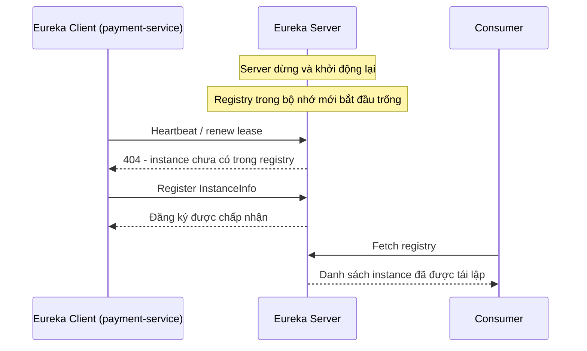
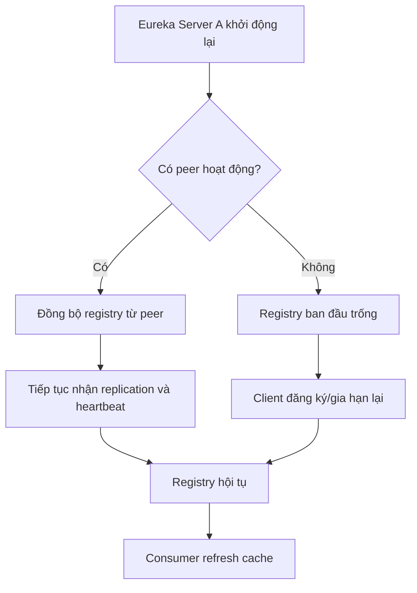

# Khởi động lại Eureka và quá trình tái lập sổ đăng ký

Eureka Server duy trì registry chứa các application và instance đã đăng ký. Khi một instance khởi động, Eureka Client gửi thông tin đăng ký; trong thời gian hoạt động, client gửi heartbeat để gia hạn lease. Consumer tải registry về cache và dùng danh sách instance đó để khám phá dịch vụ.

Khi Eureka Server khởi động lại, câu hỏi quan trọng là registry được khôi phục từ đâu. Registry của Eureka chủ yếu được giữ trong bộ nhớ của server, không phải một cơ sở dữ liệu bền vững tự động ghi toàn bộ trạng thái xuống đĩa. Vì vậy, sau khi một server độc lập khởi động lại, registry có thể bắt đầu trống và được tái lập khi client đăng ký lại. Trong cụm nhiều Eureka Server, node mới khởi động có thể đồng bộ registry từ peer còn hoạt động trước khi các client hoàn tất quá trình gia hạn và đăng ký lại.

Nắm được các đường phục hồi này giúp thiết kế rolling restart, xử lý trường hợp mất đồng thời nhiều node và phân biệt dữ liệu registry trên server với cache discovery ở phía consumer. Đây là phần quan trọng trong vận hành service discovery của Spring Cloud.

## 1. Registry được duy trì như thế nào?

Eureka Server lưu thông tin đăng ký của các service instance trong registry. Một bản ghi thường có application name, instance ID, hostname/IP, port, status, metadata và lease information.

Vòng đời thông thường gồm các thao tác:

1. **Register:** khi ứng dụng khởi động, Eureka Client gửi `InstanceInfo` đến Eureka Server.
2. **Renew:** client định kỳ gửi heartbeat để gia hạn lease và thông báo instance vẫn đang duy trì đăng ký.
3. **Fetch registry:** consumer tải danh sách application/instance và làm mới cache cục bộ.
4. **Cancel:** khi ứng dụng dừng có kiểm soát, client gửi yêu cầu hủy đăng ký.
5. **Eviction:** nếu instance không gia hạn lease trong thời gian quy định, server có thể loại bỏ bản ghi theo chính sách eviction.

Registry trên mỗi Eureka Server là trạng thái vận hành được duy trì trong bộ nhớ. Trong một cụm, các node trao đổi thông tin đăng ký qua peer replication. Peer replication giúp các node có registry tương tự nhau, nhưng không phải một bản sao lưu bền vững độc lập. Nếu tất cả node cùng mất trạng thái bộ nhớ, việc khôi phục phụ thuộc vào các client đăng ký lại và các nguồn dữ liệu khác mà hệ thống có thiết kế riêng.

## 2. Điều gì xảy ra khi một Eureka Server khởi động lại?

Hãy xét một Eureka Server độc lập đang quản lý ba instance của `payment-service`. Khi server dừng, registry trong bộ nhớ của tiến trình đó không còn. Khi tiến trình khởi động lại, server tạo registry mới; các instance không tự xuất hiện ngay chỉ vì ứng dụng provider vẫn đang chạy.

Nếu client vẫn chạy trong khi server khởi động lại, client tiếp tục chu kỳ heartbeat. Khi server chưa có bản ghi tương ứng, thao tác renew có thể nhận phản hồi cho biết instance chưa được đăng ký. Với Netflix Eureka Client, trường hợp renew trả về `404` được xử lý bằng cách thực hiện đăng ký lại. Thời điểm phục hồi thực tế còn phụ thuộc retry, kết nối mạng, lịch heartbeat và phiên bản thư viện.



Luồng trên mô tả trường hợp client còn hoạt động và server phản hồi renew rằng bản ghi không tồn tại. Nếu server vẫn chưa sẵn sàng hoặc kết nối bị lỗi, client phải tiếp tục thử lại theo cơ chế của thư viện. Không nên giả định toàn bộ instance sẽ xuất hiện tức thời sau khi tiến trình Eureka Server báo `UP`.

### 2.1. Client không cần khởi động lại cùng server

Provider không nhất thiết phải restart chỉ vì Eureka Server restart. Eureka Client vẫn giữ cấu hình và tiến trình của mình; nó có thể tiếp tục heartbeat, đăng ký lại khi cần và tải registry theo lịch. Điều này giúp tránh phải khởi động lại toàn bộ microservice chỉ để tái lập registry.

Tuy nhiên, trong khoảng thời gian registry chưa được tái lập:

- Consumer mới có thể tải về danh sách trống hoặc danh sách chưa đầy đủ.
- Consumer đang chạy có thể còn cache cũ trong một khoảng thời gian, tùy thời điểm refresh và lỗi kết nối.
- Load balancer có thể chọn instance từ cache cũ, hoặc không tìm thấy instance nếu cache đã được cập nhật thành rỗng.
- Request đến instance đã dừng hoặc chưa được đăng ký lại có thể thất bại.

Vì vậy, ứng dụng vẫn cần timeout, retry có giới hạn, circuit breaker và xử lý trường hợp không có instance. Registry phục hồi không thay thế các cơ chế chịu lỗi ở tầng gọi dịch vụ.

## 3. Quá trình tái lập registry từ Eureka Client

Khi server khởi động lại và registry đang trống, các client đang hoạt động có thể góp phần tái lập dữ liệu.

### 3.1. Đăng ký ban đầu

Khi một provider khởi động lần đầu, client tạo `InstanceInfo` từ cấu hình như `spring.application.name`, `eureka.instance.instance-id`, hostname/IP và port. Client gửi yêu cầu đăng ký đến endpoint có dạng:

```text
POST /eureka/apps/{APP_NAME}
```

Server thêm instance vào application tương ứng. Nếu provider có nhiều replica, mỗi replica cần instance ID riêng để registry phân biệt từng bản chạy.

### 3.2. Heartbeat và đăng ký lại

Khi hoạt động bình thường, client gửi heartbeat theo chu kỳ để gia hạn lease. Endpoint renew có dạng:

```text
PUT /eureka/apps/{APP_NAME}/{INSTANCE_ID}
```

Nếu server còn bản ghi, heartbeat gia hạn lease. Nếu bản ghi đã mất, Netflix Eureka Client có thể nhận phản hồi `404` và thực hiện đăng ký lại. Nếu request không đến được server do timeout hoặc lỗi mạng, client sẽ retry theo cơ chế của nó; một lỗi kết nối không đồng nghĩa instance đã bị xóa khỏi registry.

Các giá trị mặc định thường gặp của Eureka là heartbeat khoảng 30 giây và lease expiration khoảng 90 giây. Chúng có thể được cấu hình bằng `eureka.instance.lease-renewal-interval-in-seconds` và `eureka.instance.lease-expiration-duration-in-seconds`. Đây là giá trị tham khảo, không phải cam kết thời gian phục hồi. Cần xem cấu hình thực tế và log của phiên bản Spring Cloud Netflix đang chạy.

### 3.3. Consumer tải lại registry

Consumer sử dụng Eureka Client để tải registry từ server. Client thường giữ cache trong bộ nhớ và làm mới theo chu kỳ; thuộc tính `eureka.client.registry-fetch-interval-seconds` điều chỉnh khoảng thời gian làm mới thông thường.

Khi registry server được tái lập, consumer cần thời gian để nhận dữ liệu mới. Có thể tồn tại khoảng chênh giữa:

- Thời điểm provider đăng ký lại.
- Thời điểm Eureka Server lưu bản ghi.
- Thời điểm consumer tải registry mới.
- Thời điểm Spring Cloud LoadBalancer sử dụng danh sách instance đã cập nhật.

Nếu một request thất bại trong giai đoạn này, cần xử lý như một lỗi phụ thuộc tạm thời. Không nên buộc mọi consumer restart chỉ để làm mới cache trừ khi có một lý do vận hành cụ thể và đã đánh giá tác động.

## 4. Phục hồi trong cụm Eureka nhiều node

Một cụm Eureka Server có thể có nhiều peer. Các node trao đổi thông tin đăng ký để tăng khả năng sẵn sàng và tránh phụ thuộc vào một server duy nhất.

Khi một node restart trong lúc peer khác còn hoạt động, node mới có thể lấy registry từ peer trong quá trình đồng bộ lúc khởi động. Sau đó, các cập nhật mới tiếp tục được truyền qua peer replication. Do vậy, một node restart riêng lẻ thường có cơ hội khôi phục registry nhanh hơn server độc lập, miễn là peer còn lại có dữ liệu và kết nối mạng hoạt động.



### 4.1. Cấu hình peer cơ bản

Ví dụ node A kết nối đến node B và C:

```yaml
spring:
  application:
    name: eureka-server

server:
  port: 8761

eureka:
  client:
    register-with-eureka: true
    fetch-registry: true
    service-url:
      defaultZone: http://eureka-b:8761/eureka/,http://eureka-c:8761/eureka/
```

Các node B và C cần cấu hình peer URL tương ứng để hình thành topology trao đổi registry. Trong môi trường cluster, `register-with-eureka` và `fetch-registry` thường được bật để node tham gia đăng ký và lấy registry từ peer. URL peer phải là địa chỉ có thể truy cập giữa các node, không dùng `localhost` nếu các node chạy trên máy/container khác nhau.

Với Eureka Server độc lập dùng cho phát triển, cấu hình thường khác:

```yaml
eureka:
  client:
    register-with-eureka: false
    fetch-registry: false
```

Hai cấu hình này phản ánh hai topology khác nhau. Không sao chép cấu hình standalone sang mọi node của cluster, vì node sẽ không trao đổi registry với peer theo cách mong muốn.

### 4.2. Khởi động lại từng node

Trong cluster, nên restart lần lượt từng Eureka Server:

1. Xác nhận các peer còn lại khỏe mạnh và có registry hiện tại.
2. Restart một node.
3. Chờ node kết nối lại peer và đồng bộ registry.
4. Kiểm tra số application/instance và trạng thái replication.
5. Chỉ chuyển sang node tiếp theo khi cụm đã ổn định.

Không restart tất cả peer cùng lúc nếu mục tiêu là dựa vào peer replication để khôi phục registry. Khi tất cả node cùng mất trạng thái bộ nhớ, không còn peer sống để cung cấp bản sao registry.

## 5. Điều gì xảy ra nếu toàn bộ Eureka Server cùng restart?

Nếu mọi Eureka Server trong cluster cùng dừng hoặc mất dữ liệu bộ nhớ, không còn peer nào có thể cung cấp registry cho node vừa khởi động. Các server có thể khởi động với registry trống và chờ client đăng ký lại.

Quá trình phục hồi khi đó phụ thuộc vào:

- Các provider còn chạy và có thể kết nối đến Eureka Server.
- Client retry được yêu cầu register/renew sau khi server sẵn sàng.
- Các ứng dụng mới khởi động có thể đăng ký thành công.
- Consumer refresh cache và nhận lại danh sách instance.
- DNS, mạng, xác thực và các dependency cần thiết đều hoạt động.

Trong thời gian đó, service discovery có thể thiếu dữ liệu hoặc trả về danh sách không đầy đủ. Một số ứng dụng vẫn có thể phục vụ request dựa trên cache cũ, trong khi consumer mới không tìm thấy service. Cần lên kế hoạch phục hồi theo từng lớp thay vì đánh giá trạng thái chỉ từ health endpoint của Eureka Server.

Eureka Server không tự khôi phục registry từ một database bền vững mặc định. Nếu yêu cầu vận hành cần khả năng phục hồi dữ liệu độc lập với client re-registration, cần thiết kế thêm cơ chế lưu trữ/backup hoặc một hệ thống discovery có mô hình persistence phù hợp; không nên xem peer replication là bản backup dài hạn.

## 6. Self-preservation trong giai đoạn phục hồi

Eureka có cơ chế self-preservation nhằm tránh eviction hàng loạt khi số heartbeat nhận được thấp bất thường so với mức dự kiến. Điều này hữu ích khi có sự cố mạng làm client không thể gửi heartbeat dù nhiều instance vẫn đang chạy.

Self-preservation có một số hệ quả cần hiểu rõ:

- Nó có thể giữ lại những bản ghi cũ lâu hơn khi heartbeat giảm dưới ngưỡng.
- Nó giúp tránh xóa hàng loạt instance chỉ do gián đoạn mạng tạm thời.
- Nó không phải cơ chế lưu trữ registry qua restart tiến trình.
- Nó không thay thế peer replication, client re-registration hoặc kiểm tra sức khỏe ứng dụng.

Nếu server restart và registry bộ nhớ đã mất, self-preservation không thể tự tái tạo những bản ghi trước đó. Nếu server còn registry nhưng mất liên lạc với nhiều client, self-preservation có thể hạn chế eviction trong khi mạng đang phục hồi.

Không nên tắt self-preservation chỉ để dashboard xóa bản ghi nhanh hơn mà chưa hiểu tác động. Trong môi trường production, cần cân nhắc giữa nguy cơ giữ stale instance và nguy cơ loại bỏ nhầm nhiều instance đang hoạt động.

## 7. Trình tự phục hồi khuyến nghị

### 7.1. Một Eureka Server độc lập

Khi chỉ có một node, có thể thực hiện theo trình tự:

1. Khởi động Eureka Server và xác nhận endpoint registry sẵn sàng.
2. Kiểm tra các Eureka Client có thể kết nối đến server.
3. Theo dõi heartbeat và các lần client đăng ký lại.
4. Kiểm tra số instance trong registry theo từng application.
5. Xác nhận consumer refresh cache và gọi được các instance đã đăng ký.
6. Điều tra các provider chưa xuất hiện bằng log client, network và cấu hình instance ID.

Nếu server được restart trong một đợt bảo trì đã lên lịch, nên ghi nhận danh sách service/instance kỳ vọng trước khi thao tác để so sánh sau phục hồi.

### 7.2. Cụm nhiều Eureka Server

Với cluster, ưu tiên giữ ít nhất một peer khỏe mạnh trong quá trình restart:

1. Kiểm tra peer URL, DNS, port và xác thực giữa các node.
2. Chọn một node để restart.
3. Chờ node mới đồng bộ registry từ peer còn hoạt động.
4. Kiểm tra registry trên node vừa phục hồi và một node khác để so sánh.
5. Kiểm tra client có thể register, renew và fetch registry.
6. Tiếp tục với node kế tiếp sau khi cụm ổn định.

Nếu một node không thể đồng bộ peer, kiểm tra log startup, trạng thái peer, cấu hình `defaultZone`, DNS và firewall. Không đánh giá thành công chỉ vì dashboard của node mới mở được.

## 8. Cấu hình và tham số cần chú ý

| Thuộc tính | Vai trò | Lưu ý khi phục hồi |
|---|---|---|
| `eureka.client.service-url.defaultZone` | URL của Eureka Server hoặc peer mà client kết nối. | URL phải đúng và truy cập được từ mạng của client/node. |
| `eureka.client.register-with-eureka` | Cho phép client đăng ký chính nó với registry. | Trong cluster peer, thường bật; server standalone thường tắt. |
| `eureka.client.fetch-registry` | Cho phép client tải registry. | Cần bật cho consumer và thường bật cho peer node trong cluster. |
| `eureka.client.registry-fetch-interval-seconds` | Chu kỳ làm mới registry cache phía client. | Giá trị nhỏ hơn có thể thấy thay đổi nhanh hơn nhưng tăng request đến server. |
| `eureka.instance.lease-renewal-interval-in-seconds` | Chu kỳ heartbeat của instance. | Ảnh hưởng thời điểm client phát hiện renew cần đăng ký lại. |
| `eureka.instance.lease-expiration-duration-in-seconds` | Thời hạn lease trước khi instance có thể bị xem là hết hạn. | Không phải thời gian phục hồi sau restart; còn phụ thuộc eviction và self-preservation. |
| `eureka.server.enable-self-preservation` | Bật/tắt cơ chế self-preservation. | Không dùng nó như persistence hoặc backup. |

Không nên giảm đồng loạt mọi chu kỳ để làm registry phục hồi nhanh hơn. Tần suất heartbeat/fetch cao có thể tăng tải, tạo nhiều request trong thời điểm hệ thống vừa khởi động và làm tình trạng quá tải nặng hơn. Hãy đo thời gian phục hồi thực tế trước khi thay đổi tham số.

## 9. Quan sát quá trình tái lập registry

Trong khi phục hồi, cần kiểm tra trạng thái của server, client, peer và consumer.

### 9.1. Trên Eureka Server

- Dashboard truy cập được và hiển thị trạng thái node.
- Số application và instance tăng dần theo dự kiến.
- Peer node có thể kết nối và trao đổi registry.
- Log startup cho thấy quá trình đồng bộ peer nếu cluster có cấu hình peer.
- Không có lỗi xác thực, timeout hoặc DNS khi gọi peer.

### 9.2. Trên Eureka Client

- Log cho biết client đã kết nối đến đúng `defaultZone`.
- Các lần register và renew thành công.
- Nếu renew báo instance không tồn tại, theo dõi lần đăng ký lại.
- Hostname/IP, port và instance ID trong bản ghi đúng với workload thực tế.
- Client không bị lỗi kết nối lặp lại do DNS hoặc firewall.

### 9.3. Trên consumer

- `DiscoveryClient.getInstances(serviceId)` trả về danh sách phù hợp.
- Cache registry được làm mới sau khi server phục hồi.
- Spring Cloud LoadBalancer chọn được instance có thể kết nối.
- Request nghiệp vụ thành công sau khi các provider sẵn sàng.
- Tỷ lệ timeout, connection refused và retry giảm về mức bình thường.

Có thể kiểm tra registry qua Eureka REST API trong mạng quản trị:

```bash
curl -H "Accept: application/json" \
  http://eureka-server:8761/eureka/apps
```

Để xem một application cụ thể:

```bash
curl -H "Accept: application/json" \
  http://eureka-server:8761/eureka/apps/PAYMENT-SERVICE
```

Đường dẫn có thể khác nếu server dùng context path hoặc cấu hình bảo mật. Không công khai API registry ra Internet nếu không có xác thực và kiểm soát mạng phù hợp.

## 10. Các sự cố thường gặp sau restart

| Hiện tượng | Nguyên nhân có thể | Hướng kiểm tra |
|---|---|---|
| Eureka Server đã chạy nhưng registry trống | Server độc lập vừa khởi động, chưa có client đăng ký lại. | Kiểm tra client kết nối, heartbeat và register log. |
| Node mới không có dữ liệu từ peer | Sai peer URL, peer không sẵn sàng hoặc node khác không có registry. | Kiểm tra `defaultZone`, DNS, firewall và log đồng bộ khi startup. |
| Chỉ một số service xuất hiện | Một số client không kết nối được, tắt registration hoặc đang retry. | Kiểm tra log từng provider, `register-with-eureka` và cấu hình URL. |
| Consumer không thấy instance mới | Registry fetch cache chưa được refresh hoặc consumer đang đọc node khác chưa hội tụ. | Kiểm tra node được truy cập, `registry-fetch-interval-seconds` và cache. |
| Dashboard còn instance đã dừng | Cache/lease chưa hết hạn hoặc self-preservation đang hạn chế eviction. | Kiểm tra heartbeat, lease, eviction và status. |
| Client liên tục báo lỗi renew | Server chưa sẵn sàng, sai URL hoặc lỗi mạng/xác thực. | Kiểm tra kết nối đến `/eureka/` và phản hồi HTTP. |
| Nhiều instance bị thiếu sau khi toàn cluster restart | Không còn peer sống để đồng bộ; client chưa đăng ký lại hết. | Theo dõi client register/retry và khởi động provider theo nhóm. |
| Instance có trong registry nhưng request thất bại | Host/IP/port cũ hoặc cache consumer chưa hội tụ. | Kiểm tra `InstanceInfo`, DNS, route, port và LoadBalancer. |

## 11. Kịch bản kiểm thử phục hồi trong staging

Có thể xây dựng một bài kiểm thử có kiểm soát để đo thời gian tái lập registry:

1. Khởi động Eureka Server và một vài provider có nhiều instance.
2. Ghi lại danh sách application, instance ID, host, port và status trên server.
3. Ghi nhận consumer đã tải được registry và gọi thành công provider.
4. Restart Eureka Server trong khi provider và consumer vẫn chạy.
5. Đo thời gian server sẵn sàng, thời điểm client renew/register lại và thời điểm registry đủ dữ liệu.
6. Đo thời gian consumer refresh cache và thời điểm request thành công ổn định.
7. Lặp lại với cluster nhiều peer, restart một node và sau đó thử một kịch bản toàn cluster restart trong môi trường riêng.
8. So sánh thời gian phục hồi, số request lỗi, số lần retry và mức tải phát sinh.

Không thực hiện thử nghiệm restart toàn bộ registry trên production chỉ để đo hành vi. Kịch bản cần chạy ở staging hoặc môi trường được phê duyệt, có phương án khôi phục và giới hạn tải.

## 12. Nguyên tắc vận hành

- Dùng nhiều Eureka Server peer nếu cần khả năng sẵn sàng cao; kiểm tra peer replication và DNS/network giữa các node.
- Restart lần lượt từng node để node còn hoạt động có thể cung cấp registry cho node đang phục hồi.
- Không xem registry trong bộ nhớ hoặc peer replication là bản backup bền vững.
- Bảo đảm provider có thể tự đăng ký lại sau khi server phục hồi; theo dõi phản hồi renew và register.
- Duy trì `defaultZone` chính xác và có nhiều URL phù hợp với topology khi cần failover.
- Không restart toàn bộ Eureka cluster cùng lúc nếu chưa có kế hoạch cho việc client re-registration.
- Giữ timeout/retry của consumer hợp lý vì cache có thể cũ hoặc rỗng trong thời gian hội tụ.
- Không tắt self-preservation chỉ để ép xóa instance nhanh mà chưa đánh giá nguy cơ false eviction.
- Theo dõi số lượng instance theo application và đối chiếu với số workload thực tế sau mỗi lần bảo trì.
- Kiểm tra đúng phiên bản Spring Cloud Netflix/Eureka trước khi thay đổi các chu kỳ heartbeat, lease hoặc registry fetch.

## Kết luận

Khi Eureka Server khởi động lại, registry trong bộ nhớ của node có thể bắt đầu trống. Với server độc lập, client đang chạy sẽ góp phần tái lập registry thông qua heartbeat và đăng ký lại khi bản ghi không còn. Với cluster, node mới có thể đồng bộ registry từ peer còn hoạt động rồi tiếp tục nhận replication. Consumer cũng cần thời gian refresh cache trước khi sử dụng danh sách instance mới.

Phục hồi an toàn dựa trên ba việc: giữ peer hoạt động khi restart theo từng node, bảo đảm client có thể register/renew lại và xác minh consumer đã nhận danh sách instance có thể kết nối. Self-preservation giúp tránh eviction hàng loạt trong một số sự cố heartbeat, nhưng không lưu registry qua restart và không thay thế kế hoạch phục hồi dữ liệu.
