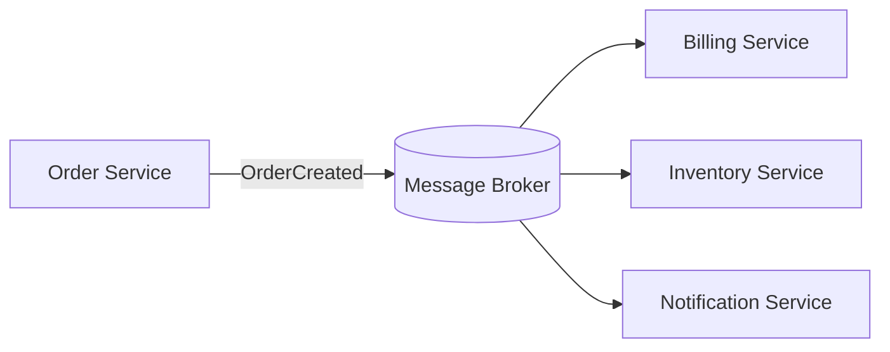
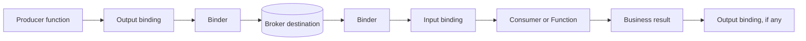

# What Is Spring Cloud Stream and What Problem Does It Solve

## 1. Context: When Services Need to Exchange Events

In a system composed of multiple services, a business action often produces information that other parts of the system need to know. When an order is created, the billing service needs to prepare the transaction, the inventory service needs to reserve stock, and the notification service may send an email to the customer. If the order service calls all the remaining services directly, it must know each party's address, protocol, response time, and error-handling strategy. A slow or temporarily unavailable service can also slow down the entire order creation flow.

Event-driven architecture addresses this coupling by publishing an event describing what happened. Interested services subscribe to the event and process it independently. The event-emitting service does not need to know how many consumers exist or where each one is deployed.

For example, `OrderCreated` is an event indicating that an order has been created. The order service sends the event to a messaging system. The billing service and the inventory service can receive the same event via two separate consumer groups and then perform their own work.



This model reduces direct dependencies between services, enables asynchronous processing, and allows each service to scale according to its own load. In return, the system must manage event contracts, duplicate delivery, processing ordering, latency, and observability of flows running through the broker.

## 2. What Is Spring Cloud Stream

**Spring Cloud Stream** is a framework in the Spring ecosystem for building message-driven and event-driven applications. The framework provides a unified programming model for applications that send, receive, and transform messages, while connecting the application to the messaging middleware through a component called a *binder*.

Applications are typically built on top of Spring Boot. Developers focus on writing business logic using Java functions such as `Supplier`, `Function`, and `Consumer`. Spring Cloud Stream connects those functions to message input and output endpoints. The binder handles communication with a specific broker, such as Apache Kafka or RabbitMQ; Apache Pulsar can also be integrated when using a binder compatible with the platform version.

A Spring Cloud Stream application can take on one or more roles:

- **Event producer:** creates messages and sends them to a destination for other services to receive.
- **Event consumer:** receives messages from a destination and executes business processing.
- **Stream transformer:** receives data, validates or transforms it, and emits the result to another destination.
- **Stateful stream processor:** combines events with persisted state, typically through the Kafka Streams binder when the problem and infrastructure are a good fit.

Spring Cloud Stream provides the integration layer and programming model. It does not replace the broker, does not define an enterprise's entire data contract on its own, and does not give every broker identical delivery semantics.

## 3. Core Concepts

### Message and Event

A **message** is the unit of data passed between components. A message typically consists of:

- **Payload:** the main content, such as order details.
- **Headers:** metadata such as content type, partition key, correlation ID, timestamp, or routing information.

An **event** is a message representing something that has happened, usually named in the past tense such as `OrderCreated` or `PaymentCompleted`. An event should describe a business fact and carry enough data for consumers to process according to an agreed contract. Consumers should not depend on internal objects or the producer's private database.

An event is different from a command. A command asks a component to perform an action; an event notifies that an action or change has occurred. Distinguishing the two makes naming, ownership, and error handling clearer.

### Destination

A **destination** is the logical name of where messages are sent to or read from. Depending on the binder, a destination may map to a Kafka topic, a RabbitMQ exchange/queue, or an equivalent construct on another broker. In configuration, you typically declare the destination name rather than writing code that depends directly on a broker's API.

### Binding

A **binding** connects a function in the application to a destination. An input binding brings messages from the broker into the function; an output binding takes the result from the function and sends it to the broker. A single function can have both types of bindings.

Binding names are derived from the function bean name and the input/output index. For a bean named `processOrder`:

- `processOrder-in-0` is the first input.
- `processOrder-out-0` is the first output.

The index `0` denotes the first port; functions with multiple inputs or outputs can have additional corresponding indices. The binding name serves as the key for configuring the destination, consumer group, content type, and related options.

### Binder

A **binder** is the integration layer between Spring Cloud Stream and a specific type of messaging middleware. The binder creates and configures bindings, transfers messages via the broker's API, and exposes options specific to that system.

Common binders include:

| Binder | System | Broker Concepts to Understand |
|---|---|---|
| Kafka binder | Apache Kafka | Topic, partition, offset, consumer group, record key |
| Rabbit binder | RabbitMQ | Exchange, queue, binding key, acknowledgement, dead-letter exchange |
| Pulsar binder | Apache Pulsar | Topic, subscription, subscription type, message key |
| Kafka Streams binder | Kafka Streams on Apache Kafka | KStream, KTable, state store, topology |

Binders reduce broker-connection boilerplate in the business layer, but they do not erase differences between brokers. Configuration for retries, partitioning, delivery, transactions, and dead-lettering can still vary. You should check the documentation of the specific binder and version in use before relying on a particular feature.

### Consumer Group and Partition

A **consumer group** identifies a group of consumers that share the work of processing a data stream. In Kafka, consumers belonging to the same group coordinate to read partitions; typically at any given time, a partition is assigned to at most one consumer within a group. Two different groups can read the same topic independently, allowing both the billing service and the inventory service to receive the event.

A **partition** splits a topic into multiple segments to increase parallel processing capacity. With Kafka, records with the same key are typically routed to the same partition, which helps preserve the relative order of those records within that partition. Global ordering across multiple partitions is not guaranteed. The number of partitions, the number of instances, and the choice of key therefore directly affect scalability and business ordering.

Equivalent concepts on RabbitMQ or Pulsar have their own behavior. You should not infer how queues, exchanges, or subscriptions work solely from how Kafka operates.

## 4. Functional Programming Model: Supplier, Function, and Consumer

Spring Cloud Stream favors the functional model from Spring Cloud Function. You declare function beans in the Spring context; the framework detects the function signature and creates the appropriate bindings.

| Function Type | General Signature | Role | Typical Generated Bindings |
|---|---|---|---|
| `Supplier<T>` | `T get()` | Generates data to emit | `<function>-out-0` |
| `Function<I, O>` | `O apply(I input)` | Receives and transforms data | `<function>-in-0`, `<function>-out-0` |
| `Consumer<T>` | `void accept(T input)` | Receives data and performs an action | `<function>-in-0` |

`Supplier` fits data sources generated by the application. For a regular supplier, the framework invokes the function via polling; therefore you need to consider the emission interval and how to avoid regenerating the same data. `Function` fits processing that has both input and output. `Consumer` fits processing that ends in a side effect such as updating a database or calling an internal service.

For example, the billing service receives `OrderCreated` and produces `BillingCommand` to pass to the next processing step:

```java
import java.util.function.Function;
import org.springframework.context.annotation.Bean;
import org.springframework.context.annotation.Configuration;

record OrderCreated(String orderId, long totalCents) {}
record BillingCommand(String orderId, long amountCents) {}

@Configuration
class BillingFunctions {

    @Bean
    Function<OrderCreated, BillingCommand> createBillingCommand() {
        return event -> new BillingCommand(
            event.orderId(),
            event.totalCents()
        );
    }
}
```

When an application has multiple functions, you can specify which function to activate using `spring.cloud.function.definition`. The example below configures the two bindings of the `createBillingCommand` function and uses the Kafka binder:

```yaml
spring:
  cloud:
    function:
      definition: createBillingCommand
    stream:
      bindings:
        createBillingCommand-in-0:
          destination: orders.created
          group: billing-service
          content-type: application/json
        createBillingCommand-out-0:
          destination: billing.commands
          content-type: application/json
      kafka:
        binder:
          brokers: localhost:9092
```

In this example:

- `createBillingCommand-in-0` receives events from the `orders.created` destination.
- `group: billing-service` places the consumer in the billing service's processing group. Instances in the same group share work according to Kafka's rules.
- `createBillingCommand-out-0` sends results to the `billing.commands` destination.
- `content-type: application/json` declares the content format so Spring Cloud Stream performs the appropriate message conversion.
- `brokers` specifies the Kafka broker address for the example environment. In real deployments, addresses and credentials should be retrieved from environment configuration or a secrets management system.

Binding names must match exactly between the function bean and the configuration. If you rename the bean, the derived binding name also changes unless the application declares a custom binding. When using multiple functions, explicitly specify the function definition to avoid accidentally activating the wrong function or failing to activate the desired one.

## 5. How Spring Cloud Stream Processes a Message Flow

A typical processing flow consists of the following steps:

1. The producer application creates an event or message.
2. The output binding passes the message to the binder.
3. The binder sends the message to the destination on the broker.
4. The consumer application's binder receives the message from the destination and passes it into the input binding.
5. Spring Cloud Stream converts the payload into the data type declared by the function, if the configured content type and corresponding converter allow it.
6. The function executes the business logic. If the function has an output, the result goes through the output binding and is sent onward to the broker.



For consumer-only applications, the flow ends at the `Consumer` function. For transformer applications, the result of the `Function` is emitted through the output binding. Applications can be deployed and scaled independently as long as they adhere to the message contract and appropriate broker configuration.

## 6. Problems Spring Cloud Stream Helps Solve

### Decoupling Services

The producer only needs to know the destination and the message contract. It does not need to call each consumer directly. A single event can be used by multiple service groups for different purposes. Adding a new consumer usually does not require changing event-emission logic, provided the contract is maintained.

### Decoupling Processing Time and Absorbing Load

The broker persists or queues messages according to its mechanism. Producers and consumers do not have to be active at the same time. Consumers can process backlog after restarting or scale up instances when event volume rises. Retention capability, backlog limits, and expiration policies depend on the broker and deployment configuration.

### Standardizing Message-Driven Application Development

The function, binding, and binder model keeps business code less coupled to a specific broker's API. An application can switch binders or run multiple binders in appropriate cases. However, switching brokers still requires reviewing configuration, semantics, limits, ordering, and error handling; it is not always just a single-line config change.

### Splitting Processing into Composable Steps

A `Function` can transform an event into output data for the next step. Functions can be composed using Spring Cloud Function capabilities or deployed as separate services connected via a broker. How you split them should be based on business boundaries, data ownership, and operational requirements.

### Stateful Stream Processing

For problems requiring aggregations, stream joins, time windows, or maintaining keyed state, the Kafka Streams binder provides a way to integrate Kafka Streams into the Spring Cloud Stream model. Concepts such as `KStream`, `KTable`, state stores, and topologies must be understood on their own because they have different state lifecycles, resource requirements, and recovery rules than an ordinary stateless consumer.

## 7. Architectural Concerns to Solve Alongside the Framework

Spring Cloud Stream provides the integration mechanism; overall system reliability also depends on message design and broker operations.

### Consumer Groups and Scalability

Choose groups based on independent processing purposes. Two services that need to receive the same event typically use two separate groups. Instances of the same service typically share a group to distribute load. If multiple instances share a group but there are fewer partitions than instances, some Kafka consumer instances may not be assigned any partitions and will remain idle during that time.

### Partition Keys and Ordering

Choose a key based on the entity that needs ordering preserved, such as `orderId` if changes to a single order must be processed sequentially. If an inappropriate key is chosen, related events may land in different partitions. Increasing the partition count can affect key distribution and must be considered when designing processing order.

### Message Contracts and Schemas

Producers and consumers may be released at different times. Therefore, schemas need compatibility rules when adding, removing, or changing fields. Prefer backward-compatible changes, clearly specify required fields and defaults, and use a schema registry or appropriate schema management mechanism when the system needs strict control. `content-type` helps determine how data is serialized/deserialized; it does not by itself guarantee compatibility across schema versions.

### Retries, Dead-Lettering, and Duplicate Processing

Consumers can encounter transient errors such as lost connections or dependent services being temporarily unavailable. Retries are appropriate for recoverable errors, but you should limit the number of attempts and consider backoff to avoid creating heavier load while the system is degraded. Messages that still cannot be processed after retries can be routed to a dead-letter queue/topic depending on binder and broker capabilities.

A message can be redelivered if a consumer fails after performing a side effect but before acknowledging completion. Therefore, consumers should be **idempotent**: processing the same event again does not produce duplicate business side effects. You can use an event ID, business key, inbox table, or unique database constraint to detect already-processed messages. Be sure to distinguish in-application retries from broker redelivery, as the two mechanisms may have different timing and state.

### Delivery Guarantees

Messaging systems commonly provide guarantees such as at-most-once or at-least-once depending on configuration and acknowledgement handling. At-least-once can deliver duplicates, so consumers require idempotency. Exactly-once is typically tied to specific scopes and conditions of the broker, binder, or transaction. It does not automatically guarantee that a side effect outside the broker, such as sending an email or calling a payment API, happens only once.

When you need to update a database and publish an event as a single unified business operation, consider patterns such as the transactional outbox. When a consumer updates data and records the processed event, an inbox table or database transaction can be used to avoid gaps between the two operations. The choice must be based on consistency requirements and the capabilities of each system.

### Testing and Observability

Spring Cloud Stream includes a test binder for testing message flows in a test environment without needing a real broker. Tests should verify input payloads, output results, important headers, and error-handling behavior. Broker-specific features such as partitioning, transactions, acknowledgements, retries, or dead-lettering still require integration testing against the corresponding broker.

In production, monitor message ingestion and processing rates, latency, backlog/consumer lag, retry counts, DLQ message counts, and data conversion errors. Logs should include an event ID or correlation ID to trace a business flow across multiple services. Connection settings, credentials, and broker access permissions must also be managed per environment.

## 8. When to Use Spring Cloud Stream

Spring Cloud Stream is suitable when Spring applications need to exchange events or messages asynchronously, when multiple consumers need to consume the same data, when decoupling producers from consumers, or when organizing processing into independent functions connected via a broker.

The framework is especially useful in microservices architectures, cross-service integrations, data processing pipelines, and applications requiring continuous stream processing. For stateful Kafka processing, the Kafka Streams binder can be a suitable choice if the development team accepts Kafka Streams' model and operational requirements.

Do not choose Spring Cloud Stream simply because an application has a simple synchronous call that needs an immediate result. HTTP or gRPC is usually a better fit when the caller needs a direct response and the business flow depends on an immediate result. Also weigh broker operational overhead, eventual consistency complexity, observability, and incident-response capability before turning a synchronous flow into an asynchronous one.

## 9. Recommended Learning Path

To build a complete Spring Cloud Stream application, follow this progression:

1. Understand the concepts of messages, events, destinations, and asynchronous processing.
2. Create a Spring Boot application with a `Supplier`, `Function`, or `Consumer`.
3. Configure bindings, destinations, content types, and the binder.
4. Design consumer groups, partition keys, and schema contracts.
5. Add retries, DLQ, idempotency, and a delivery strategy.
6. Test with the test binder, then run integration tests against Kafka, RabbitMQ, or Pulsar.
7. Explore Kafka Streams when stateful stream processing is needed, then deploy with appropriate monitoring and security.

The key takeaway is that Spring Cloud Stream helps organize message-processing logic around functions and bindings, while the broker handles transport according to its own semantics. A well-designed system must address both parts together: clean application logic and a delivery contract that can be operated reliably.
