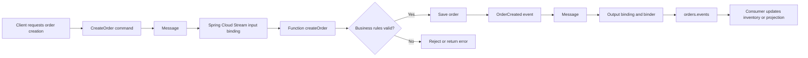

# Distinguishing Messages, Events, and Commands

Spring Cloud Stream helps build event-processing applications using the `Supplier`, `Function`, and `Consumer` functional model. Functions exchange data through bindings, while binders connect bindings to middleware systems such as Kafka, RabbitMQ, or Pulsar. To design clear data flows, you first need to distinguish three concepts that frequently appear together: **message**, **event**, and **command**.

These three concepts are related but answer three different questions:

- A message answers how data is packaged and transported.
- An event answers what happened in the business domain.
- A command answers what a component wants the system to do.

A command or an event can be carried inside a message. Therefore, seeing a `Message<T>` in source code is not enough to conclude whether the payload is an event or a command.

## 1. Message: The Unit of Data Transported

In Spring Messaging, `Message<T>` is a structure consisting of a **payload** and **headers**:

- `payload` contains the main content, typically a Java object or data converted to/from the format on the broker.
- `headers` contain accompanying information such as correlation ID, content type, timestamp, routing information, or metadata provided by the application and framework.

For example, an application can create a message carrying order data:

```java
import org.springframework.messaging.Message;
import org.springframework.messaging.support.MessageBuilder;

CreateOrder command = new CreateOrder(
    "cmd-1042",
    "order-9001",
    "customer-27"
);

Message<CreateOrder> message = MessageBuilder
    .withPayload(command)
    .setHeader("correlationId", "request-7f31")
    .setHeader("source", "checkout-api")
    .build();
```

Here, the payload is a `CreateOrder` command; `correlationId` and `source` are metadata that help trace the request across multiple components. The `Message` object itself does not turn the payload into an event. If you replace the payload with `OrderCreated`, you have a message carrying an event.

In Spring Cloud Stream, application functions work with messages at Spring's abstraction level. The binder maps data and metadata to the corresponding representation in Kafka, RabbitMQ, or Pulsar. How each binder maps headers, data types, and broker properties can vary; you should not assume every Java header is preserved intact across every system.

Essential business information should live in a payload with a clear schema. Headers are suitable for metadata used for correlation, routing, and operations. Avoid placing sole business data in headers because broker limits or mapping rules may make that information difficult to preserve.

## 2. Event: A Business Fact That Has Occurred

An **event** describes something that has happened and is meaningful to the business. Event names typically use the past tense, for example:

- `OrderCreated`: an order has been created.
- `PaymentAuthorized`: a payment has been authorized.
- `ShipmentDispatched`: a shipment has been dispatched.

An event records a fact; it does not ask any specific recipient to take a particular action. The emitting component publishes what it knows; interested components can subscribe and decide on their own how to react. For example, after `OrderCreated`, the inventory system can reserve stock, the notification system can send an email, and the analytics system can update metrics.

An event should reflect a confirmed state. If an order has not yet been saved successfully, the application should not emit `OrderCreated` as if order creation were complete. In systems with both a database transaction and a broker, event emission must be designed around the commit outcome; transactional outbox is a common technique to reduce the risk of committed data without a published event.

An event commonly includes fields such as:

| Field | Meaning |
|---|---|
| `eventId` | Unique identifier of the event, supporting duplicate-processing detection. |
| `orderId` | Identifier of the related business entity. |
| `occurredAt` | Timestamp when the event occurred according to system conventions. |
| `schemaVersion` | Payload structure version to support schema evolution. |
| Business data | Information recipients need to understand the fact that just occurred. |

Once published, an event should be treated as immutable: if state needs to be corrected, emit a new event describing the subsequent change or build an explicit adjustment flow. Do not silently change the meaning of an old event.

## 3. Command: A Request for an Action

A **command** expresses the intent to ask an authoritative component to perform an action. Command names usually use imperative verbs or phrases expressing intent:

- `CreateOrder`: request to create an order.
- `CancelOrder`: request to cancel an order.
- `AuthorizePayment`: request to authorize a payment.

A command is directed at a handler responsible for deciding whether the request is valid. The handler may accept, reject, or return an error because the command violates business rules, lacks required data, or no longer fits the current state.

For example, `CreateOrder` does not assert that the order already exists. It only represents a request to create an order. Only after validation and successful persistence can the handler emit the `OrderCreated` event. If the request is rejected, the application must represent the rejection according to the designed contract; it must not emit a success event.

A command typically carries an identifier or idempotency key so the system can recognize resent requests. This is useful when a client times out and retries the command, or when the broker redelivers the message. Receiving the same command multiple times should not accidentally create duplicate orders or charge money multiple times.

A command has one authoritative logical handler destination. When deploying multiple instances to scale, those instances can share a consumer group; that does not change the fact that only one authoritative business component decides on that command.

## 4. Comparing the Three Concepts

| Criterion | Message | Event | Command |
|---|---|---|---|
| Answers the question | How is data packaged? | What happened? | What do we want the system to do? |
| Nature | Transport structure with payload and headers | Business fact that occurred | Intent/request to perform an action |
| Typical naming | Payload type name or binding name | `OrderCreated` | `CreateOrder` |
| Recipients | Determined by bindings and topology | Can have multiple interested groups | One authoritative logical handler |
| Expected outcome | Delivered and decoded according to contract | Received and processed by subscribers | Accepted, rejected, or errored |
| Data characteristics | Depends on payload | Records a fact; meaning is not altered after emission | Represents a request; needs safe duplicate handling |

You can remember the distinction with this example:

- `Message<CreateOrder>`: a message whose payload is a request to create an order.
- `Message<OrderCreated>`: a message whose payload is an event stating an order was created.
- `Message` is the transport envelope; `CreateOrder` and `OrderCreated` determine the business meaning of the payload.

## 5. Combining Commands, Events, and Messages in Spring Cloud Stream

Suppose the order service receives an order creation request, saves the order, and publishes an event when the operation succeeds. You can model the data types as follows:

```java
import java.time.Instant;

public record CreateOrder(
    String commandId,
    String orderId,
    String customerId
) {}

public record OrderCreated(
    String eventId,
    String orderId,
    String customerId,
    Instant occurredAt,
    int schemaVersion
) {}
```

The `Function` below receives a message carrying a command, invokes the business service, and produces an output event:

```java
import java.time.Instant;
import java.util.UUID;
import java.util.function.Function;

import org.springframework.context.annotation.Bean;
import org.springframework.messaging.Message;
import org.springframework.messaging.support.MessageBuilder;

@Bean
Function<Message<CreateOrder>, Message<OrderCreated>> createOrder(
        OrderService orderService) {
    return input -> {
        CreateOrder command = input.getPayload();

        // Validate and persist the order according to business rules.
        orderService.create(command);

        OrderCreated event = new OrderCreated(
            UUID.randomUUID().toString(),
            command.orderId(),
            command.customerId(),
            Instant.now(),
            1
        );

        return MessageBuilder.withPayload(event)
            .setHeader("correlationId",
                input.getHeaders().get("correlationId"))
            .build();
    };
}
```

This is a simplified example to illustrate semantic boundaries. `OrderService` represents the business processing layer; in a production application, you must ensure the event is published consistently with durable persistence. A transactional outbox can be used when data commits and event emission need to stay synchronized.

With the function name `createOrder`, Spring Cloud Stream creates input binding `createOrder-in-0` and output binding `createOrder-out-0`. Configuration can map them to two separate destinations:

```yaml
spring:
  cloud:
    function:
      definition: createOrder
    stream:
      bindings:
        createOrder-in-0:
          destination: orders.commands
        createOrder-out-0:
          destination: orders.events
```

In this example, `orders.commands` is the destination receiving commands and `orders.events` is the destination publishing events. Destination names are application-level logical configuration; the binder handles connecting them to the corresponding resources on Kafka, RabbitMQ, or Pulsar. Broker connection settings, consumer groups, partitioning, and binder-specific properties are added per deployment environment.

Another component can subscribe to the event using a `Consumer`:

```java
@Bean
Consumer<OrderCreated> updateOrderProjection() {
    return event -> {
        // Update the read model or projection from the event.
    };
}
```

In Spring Cloud Stream's functional model:

| Function Type | Technical Role | Possible Business Examples |
|---|---|---|
| `Supplier<T>` | Produces output data, with no input | Emitting an event on a schedule or from an internal data source |
| `Function<T, R>` | Receives data and produces output data | Processing a command and emitting an event; or transforming one event into another data structure |
| `Consumer<T>` | Receives and processes data, returning no output via a function binding | Processing an event to update a projection |

A function signature only describes how data flows through the application. It does not by itself determine whether the payload is a command or an event: `Consumer<T>` can receive either a command or an event, and `Function<T, R>` can perform many kinds of transformations depending on the business contract.

The overall flow can be visualized as follows:



## 6. Design Principles to Apply

**Name according to business meaning.** Use past tense for events (`PaymentAuthorized`) and intent-expressing names for commands (`AuthorizePayment`). Avoid vague names like `OrderMessage` when you can clearly state whether the payload is a command or an event.

**Separate command receivers from event publishers.** Commands must reach the authoritative component responsible for handling them. Events are published so interested components can react independently. Specific destination and topology organization depends on the broker and system architecture.

**Keep payloads under clear contracts.** Use typed models and versioned schemas. Consumers need to know which fields are required, which may be absent, and how compatibility is maintained as schemas evolve.

**Design for safe duplicate processing.** Commands may be resent; events may be redelivered depending on configuration and failure scenarios. Use appropriate identifiers, processing records, or idempotency mechanisms to avoid duplicate side effects.

**Use headers for metadata.** `correlationId` helps tie steps of a processing flow together; source information can aid tracing. Do not use headers to replace the payload or hold business data that consumers are required to understand.

**Do not confuse function names with data semantics.** A `Function` is not inherently an event transformer; a `Consumer` does not inherently only receive events. Determine semantics through payload types, contract names, destinations, and business responsibilities.

## 7. Common Misconceptions

1. **Calling all data sent through a broker an event.** A broker merely transports data. The payload may be a command, an event, or another kind of data.
2. **Assuming `Message<T>` is synonymous with an event.** `Message<T>` is a Spring Messaging construct; you must inspect the type and meaning of `T` to know what it is.
3. **Publishing an event before the action completes.** The name `OrderCreated` must reflect an order that has actually been created according to business rules.
4. **Using an event to ask a service to perform work.** If the meaning is "cancel the order," that is a `CancelOrder` command. `OrderCancelled` is only appropriate after the cancellation has occurred.
5. **Putting everything into headers.** Headers are for metadata; data necessary to understand the business action must reside in a contracted payload.
6. **Ignoring message redelivery.** Distributed systems can resend or reprocess messages after failures. Commands and consumers need strategies to prevent duplicate side effects.

## 8. Self-Check Before Designing Bindings

For each type of data you plan to send through Spring Cloud Stream, ask yourself:

1. Does the payload describe a fact that has happened or request an action?
2. Which component has authority to process it if it is a command?
3. Which components might be interested if it is an event?
4. Which fields belong in the business payload, and which are purely message metadata?
5. If data is redelivered or processed multiple times, how does the application ensure idempotency?
6. Which destinations are the input and output bindings mapped to, and is the binder Kafka, RabbitMQ, or Pulsar?

By answering these questions clearly, the development team can name payloads and destinations consistently, choose the right `Supplier`, `Function`, or `Consumer`, and design bindings that are easier to read and operate.
