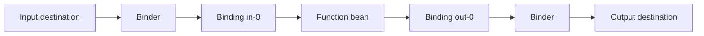

# Relationship Between Handler Functions, Bindings, Binders, and Destinations

Spring Cloud Stream enables applications to process events without tightly coupling business code to the APIs of Kafka, RabbitMQ, or Pulsar. To understand how the framework establishes that connection, you need to distinguish four concepts that frequently appear together: **handler function**, **binding**, **binder**, and **destination**.

These four components form a message path. The function describes what the application does with data; the binding describes how the function's input or output is connected; the binder transfers data between the application and the messaging system; and the destination is the resource that receives or emits messages on that system. Once you understand these boundaries, you can change brokers or configure consumer groups, partitions, retries, or dead-letter queues without rewriting your business processing code.

## 1. The Four Concepts and Their Responsibilities

### Handler Function: The Application's Business Code

In Spring Cloud Stream's functional programming model, an application declares beans using one of three primary types:

- `Supplier<T>` produces data and emits it to an output. This function typically serves as an event source.
- `Function<T, R>` receives an input value, processes it, and returns an output result.
- `Consumer<T>` receives data to perform an action and returns no output.

For example, a `validateOrder` function can receive a new-order event, validate the data, and produce a validated-order event. The function focuses on business rules. It does not need to open Kafka connections, declare RabbitMQ queues, or invoke Pulsar message-sending APIs directly.

Spring Cloud Function provides the mechanism to discover function beans. The `spring.cloud.function.definition` property tells Spring Cloud Stream which function should be wired to the messaging system. If an application has multiple function beans, this declaration selects the exact function or function chain to activate.

### Binding: The Application's Logical Connection Point

A binding represents an input or output of a function within the Spring Cloud Stream environment. You can view a binding as the application's port to a message stream:

- An input binding passes messages from the broker into the function's parameter.
- An output binding takes the value returned by the function and forwards it back to the broker.

For a function named `validateOrder`, Spring Cloud Stream generates binding names by convention:

| Function Component | Default Binding Name |
| --- | --- |
| `Supplier` | `validateOrder-out-0` |
| `Function` | `validateOrder-in-0` and `validateOrder-out-0` |
| `Consumer` | `validateOrder-in-0` |

The function name in the example above only illustrates the naming rule; actual binding names are always derived from the declared function bean name. The `in-0` suffix indicates the first input, while `out-0` indicates the first output. For functions with multiple inputs or outputs, indices distinguish each port.

A binding is the name and configuration of a connection point inside the application. It is not yet the topic or queue name on the broker. You can configure the `validateOrder-in-0` binding to read from destination `orders.created`, then switch the destination to `orders.submitted` while keeping the bean and binding name unchanged.

### Destination: The Resource on the Broker

A destination is the logical address of a message stream on the messaging system. A binding's `destination` configuration maps the application's input or output port to that resource.

The physical meaning of a destination depends on the binder and broker:

| Broker | Typical Mapping of Destination | Points to Note |
| --- | --- | --- |
| Kafka | Topic | Consumer groups share reading across partitions; message keys influence partitioning when configured appropriately. |
| RabbitMQ | Exchange | The binder sets up queues and binds them to the exchange for consumers; routing keys and binding configs affect routing. |
| Pulsar | Topic | The binder translates consumption config into Pulsar subscriptions and corresponding message-receiving mechanisms. |

Therefore, you should not assume a destination is always a queue or always a topic with identical physical semantics across every broker. In Spring Cloud Stream configuration, a destination is a logical resource name; the binder is responsible for interpreting that name according to the corresponding broker's model.

Whether a resource is auto-provisioned or must exist beforehand depends on the binder, provisioning settings, and connection account permissions. At deployment time, verify permissions to create or access topics, exchanges, queues, or subscriptions rather than assuming declaring `destination` will always auto-create the resource.

### Binder: The Bridge to the Messaging System

A binder is the component that integrates Spring Cloud Stream with a specific messaging platform. The binder manages connections and translates between the application's binding model and the broker's mechanisms for sending, receiving, and managing resources.

For example, the Kafka binder works with Kafka producers, consumers, topics, and consumer groups. The Rabbit binder works with exchanges, queues, and routing. The Pulsar binder works with topics and subscriptions. The application still uses `Supplier`, `Function`, or `Consumer` beans and configures bindings using Spring Cloud Stream's unified model.

The binder is also where broker-dependent behaviors such as partitioning, acknowledgements, retries, and dead-letter queues are configured. Common binding properties can be shared across multiple binders, but details and support levels for each feature may differ. Do not infer that identical configuration produces identical delivery guarantees across every broker.

## 2. The Path of a Message

For a `Function`, the path typically covers both directions:

1. The broker receives a message at the input destination.
2. The binder reads the message and delivers it to the input binding.
3. Spring Cloud Stream passes the payload to the handler function.
4. The function returns a result; Spring Cloud Stream passes the result to the output binding.
5. The binder sends the result to the output destination on the broker.



The diagram shows responsibilities by layer. The function does not need to know whether the destination is implemented as a Kafka topic or a RabbitMQ exchange. The binding does not implement the broker's protocol itself. The binder knows how to connect to the broker and translate between the two models. The destination is where messages are stored, distributed, or consumed according to the broker's capabilities.

With a `Consumer`, the path ends at the function because there is no output binding. With a `Supplier`, the path starts from the function and flows through the output binding to the destination. With a `Function`, the application has both an input port and an output port.

## 3. Example: Connecting an Order-Processing Function to Kafka

Suppose a service receives an `OrderCreated` event, validates it, and emits an `OrderAccepted` event. The business code can be written in Java as follows:

```java
import java.util.function.Function;

import org.springframework.boot.SpringApplication;
import org.springframework.boot.autoconfigure.SpringBootApplication;
import org.springframework.context.annotation.Bean;

@SpringBootApplication
public class OrderStreamApplication {

    public record OrderCreated(String orderId, long amount) {}

    public record OrderAccepted(String orderId, String status) {}

    @Bean
    public Function<OrderCreated, OrderAccepted> acceptOrder() {
        return event -> new OrderAccepted(event.orderId(), "ACCEPTED");
    }

    public static void main(String[] args) {
        SpringApplication.run(OrderStreamApplication.class, args);
    }
}
```

The `acceptOrder` bean only describes the data transformation. It contains no topic names, broker addresses, or message-sending code. Spring Cloud Stream connects this bean through bindings configured outside the source code.

Example `application.yml` configuration when using the Kafka binder:

```yaml
spring:
  cloud:
    function:
      definition: acceptOrder
    stream:
      bindings:
        acceptOrder-in-0:
          destination: orders.created
          group: order-acceptance
          content-type: application/json
          consumer:
            max-attempts: 3
        acceptOrder-out-0:
          destination: orders.accepted
          content-type: application/json
      kafka:
        binder:
          brokers: localhost:9092
```

Reading the configuration layer by layer:

- `definition: acceptOrder` selects the function bean to wire.
- `acceptOrder-in-0` is the input binding created from the bean name and Spring Cloud Stream's convention.
- `destination: orders.created` connects the input binding to the destination holding new-order events.
- `group: order-acceptance` sets the consumer group for the input binding. With Kafka, instances in the same group coordinate reading the topic's partitions.
- `acceptOrder-out-0` is the function's output binding; the `orders.accepted` destination receives the processing result.
- `spring.cloud.stream.kafka.binder.brokers` supplies the broker address for the Kafka binder.
- `content-type` declares the content format so the framework converts the payload. For JSON data, Java types must match the structure of the exchanged events.
- `max-attempts` configures the number of processing attempts under the binding's retry mechanism. Routing failed messages to a DLQ requires corresponding configuration on the binder and broker.

The key point is that `acceptOrder-in-0` and `orders.created` play different roles. The first identifies the application's logical port; the second identifies the destination that port connects to. If you change the destination to `orders.submitted`, the `acceptOrder` function and binding remain intact as long as the input event structure remains compatible.

## 4. Same Binding, Different Binder Implementations

The functional and binding model helps keep an application's structure stable when changing brokers. Still, the binder must map common configuration onto each platform's specific concepts.

**With Kafka**, the input destination is typically a topic. `group` identifies the consumer group; instances in the same group are assigned partitions to read. If per-order processing ordering is required, the application usually chooses an appropriate key so events for the same order go to the same partition. Partition count and partitioning strategy affect both parallelism and processing order.

**With RabbitMQ**, the destination typically represents an exchange. The binder sets up a queue for the consumer group and binds the queue to the exchange. Routing keys, exchange types, and queue properties determine how messages are routed. Therefore, when migrating configuration from Kafka to RabbitMQ, review resource naming and routing rules carefully.

**With Pulsar**, the destination is typically a topic. The `group` concept in common configuration is mapped by the binder to Pulsar's subscription model. Subscription type, consumer count, and acknowledgement handling can affect message distribution; check the specific properties supported by the binder version in use.

If an application has multiple binders on the classpath, you can choose a default binder or specify a binder per binding. Each binding can then connect to a different platform, but you must separately configure connection details and binder-specific properties for each one. Changing brokers therefore typically involves updating dependencies, connection settings, provisioning, and operational testing.

## 5. Bindings Also Carry Operational Configuration

Bindings are where many properties controlling data flow are attached. Common configurations include:

- **Consumer group:** specifies the group of consumers collaborating to receive data. On Kafka, the group governs partition assignment across instances. On other brokers, the binder maps the group to the corresponding consumption mechanism.
- **Partition:** supports data distribution and parallel processing. Partition capabilities and configuration depend on the binder; with Kafka, pay attention to partition count, message keys, and consumers per group.
- **Schema and content type:** determines how payloads are interpreted. Producers and consumers must agree on schemas, schema versions, and compatibility rules when event structures evolve.
- **Retries and DLQ:** retries enable reattempting processing after transient errors. If a message still fails, a dead-letter queue or error destination stores the message for investigation and later handling. Exact property names and behaviors depend on the binder.
- **Delivery and acknowledgements:** producer acknowledgements, consumer acknowledgements, transactions, and duplicate-handling capability affect delivery guarantees. Combine broker configuration with idempotent handling in the application.

These settings do not alter the roles of the four components. They specify how a binding is executed via the binder against the chosen destination. When troubleshooting, verify step by step whether the function receives the expected data, whether the binding points to the right destination, whether the binder connects and converts properly, and then inspect the resource state on the broker.

## 6. Stateful Processing with Kafka Streams

When stream processing requires state—such as counting orders per customer or joining two event streams—the Kafka Streams binder provides an integration model tailored for Kafka Streams. Applications can declare functions operating on types such as `KStream` or `KTable`; the binder connects that topology to input and output topics.

In this case, the binder remains the integration layer between the application and Kafka, and bindings define the topology's entry and exit points. However, the topology may maintain local state stores and use changelog topics for state recovery. Operating a Kafka Streams application therefore also requires attention to application ID, state restoration, partitioning, and storage resources. Do not treat a state store like an ordinary message destination.

## 7. Testing the Link Between Functions and Bindings

Spring Cloud Stream provides a test binder for testing message flows in a test environment without connecting to a real broker. Tests can send data into an input binding, inspect results on an output binding, and verify that the right function is selected.

The test binder is useful for verifying function logic, binding names, and input/output wiring at the application level. It does not replace integration testing against Kafka, RabbitMQ, or Pulsar. Behaviors such as partitioning, routing, access permissions, retries, DLQs, transactions, and delivery acknowledgements should be tested with the target broker before deployment.

## 8. How to Diagnose When an Event Flow Does Not Work

When an event fails to reach a function or results do not appear at the destination, trace its path:

1. **Check the function:** is the bean declared with the proper `Supplier`, `Function`, or `Consumer` type? Does `spring.cloud.function.definition` select the right bean name?
2. **Check the binding:** do the `in-0` and `out-0` names match the function name? Are there binding aliases or multiple inputs/outputs to account for?
3. **Check the destination:** does the binding point to the right topic, exchange, or Pulsar topic? Does the resource exist and does the account have access permissions?
4. **Check the binder:** are the selected dependency and binder right for the broker? Are connection addresses, credentials, and binder-specific properties valid?
5. **Check consumption settings:** do the group, subscription, partitions, routing keys, and instance count match the intended distribution?
6. **Check errors and delivery:** do logs show schema conversion errors, retries, or DLQ routing? Does the application handle redelivered messages safely?

When deploying, manage connection settings and broker resources per environment. At the same time, monitor consumer lag, unprocessed message counts, conversion errors, retry counts, and DLQ message counts. These metrics help separate bugs in business functions from issues in the connectivity layer or broker.

## Conclusion

Handler functions define business logic; bindings provide the application's input and output ports; binders implement integration with brokers; and destinations identify the resources where messages are exchanged. Spring Cloud Stream keeps function code relatively independent of Kafka, RabbitMQ, and Pulsar, while binders translate the unified model into each platform's concrete sending, receiving, and operational semantics. Understanding these four roles clearly is the foundation for designing event flows that are easy to evolve, test, and operate.
