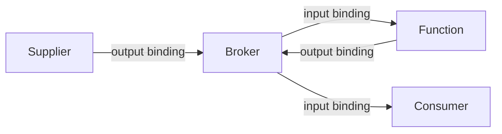

# When to Use It, Abstraction Limits, and Operational Costs

Spring Cloud Stream is well suited when a Spring application needs to exchange data via messages and wants to structure processing around `Supplier`, `Function`, or `Consumer` functions. The framework provides a binding layer to connect those functions to brokers such as Apache Kafka, RabbitMQ, or Apache Pulsar. As a result, business code can focus on producing, transforming, and handling events, while binder configuration handles connectivity to the messaging system.

This abstraction reduces connection boilerplate and creates a uniform structure for event-driven applications. It does not give Kafka, RabbitMQ, and Pulsar the same delivery, retention, or scaling model. When choosing Spring Cloud Stream, the development team must weigh the benefits of bindings, the limits of binders, and the operational costs of running an asynchronous system.

## 1. What Part of the Work Does Spring Cloud Stream Handle?

In the functional model, each bean takes on a specific role:

| Function Type | Role | Example |
|---|---|---|
| `Supplier<T>` | Produces output messages | Periodically reading data and emitting inventory events |
| `Function<T, R>` | Receives data, transforms it, and returns a result | Validating an order and producing a validated-order event |
| `Consumer<T>` | Receives and processes messages | Updating inventory upon receiving `OrderCreated` |

A binding is a logical connection between a function's input or output and a destination. Binding names are typically derived from the bean name and port index—for instance, `handleOrderCreated-in-0` is the first input of the `handleOrderCreated` function. The binder translates that binding into configuration suitable for the active broker.



For example, a service receives an order-creation event and requests an inventory reservation:

```java
@Bean
public Consumer<OrderCreated> handleOrderCreated(InventoryService inventory) {
    return event -> inventory.reserve(event.orderId(), event.items());
}
```

The corresponding binding configuration can be written as follows:

```properties
spring.cloud.function.definition=handleOrderCreated
spring.cloud.stream.bindings.handleOrderCreated-in-0.destination=orders.created
spring.cloud.stream.bindings.handleOrderCreated-in-0.group=inventory-service
spring.cloud.stream.bindings.handleOrderCreated-in-0.consumer.maxAttempts=3
```

Here, `destination` identifies the logical target of the event; `group` identifies the application group sharing consumption of that stream according to how the binder maps it to the broker; and `maxAttempts` bounds the number of processing attempts under Spring Cloud Stream's retry mechanism. Production configuration also needs broker addresses, credentials, message formats, and binder-specific settings. Exact property names and behaviors must be cross-checked against the binder version in use.

## 2. When Should You Use It?

### 2.1. Services That Need Asynchronous Communication

Spring Cloud Stream fits when a business action can be represented as an event and the publisher does not need to wait for consumers to finish processing. For example, the order service emits `OrderCreated`; the inventory service reserves stock, the payment service initiates a transaction, and the notification service sends an email. Each party can deploy, scale, and recover more independently than in a chain of synchronous calls.

This model is useful when:

- Senders and receivers need to reduce temporal coupling.
- One event needs to be consumed by multiple service groups for different purposes.
- Work can run in the background, tolerates latency, and needs to absorb traffic spikes.
- The system needs to decouple data ingestion from time-consuming processing steps.
- The team wants to use the same functional and binding model across multiple Spring applications on a messaging platform.

The broker can retain messages for a period of time or accumulate backlog according to its configuration. This lets consumers catch up after restarting or scale up consumer counts. However, retention, replayability, and data expiration depend on the broker and its configuration.

### 2.2. Event-Processing Pipelines with Clear Structure

When a workflow consists of ingestion, validation, enrichment, routing, and output writing steps, `Supplier`, `Function`, and `Consumer` beans help express each step distinctly. Bindings clearly show the inputs and outputs of each step. This structure makes it convenient to unit-test business functions, configure per-environment settings, and observe message flows.

For example, a transaction-processing pipeline can receive `TransactionReceived`, normalize fields, evaluate risk rules, and emit `TransactionReviewed`. Each step can run in the same application or be split into separate services when scaling needs and data ownership call for it.

### 2.3. When an Organization Wants to Standardize Broker Integration

Binders let applications declare bindings in a consistent way. This is valuable when an organization operates many Spring services, manages environment-specific configuration, and wants to reduce repetitive connection boilerplate. Changing brokers can reduce the number of places to modify in application code if the application relies only on common binder-supported capabilities.

This benefit is clearest when the team has established shared conventions for binding names, destination names, consumer groups, payload formats, headers, error handling, and broker resource provisioning. If every service invents its own conventions, the binding layer will not create consistency on its own.

## 3. When Should You Not Choose It?

Spring Cloud Stream is not the default choice for every service-to-service interaction.

| Situation | Reason to Consider Another Option |
|---|---|
| The caller needs an immediate result to continue a user request | HTTP or RPC usually expresses timeouts, errors, and synchronous results more clearly |
| Just a simple internal call with no need for queuing or replay | Adding a broker and bindings increases configuration, deployment, and monitoring overhead |
| Ultra-low latency or very high throughput requiring specialized tuning | Framework layers, payload conversion, and message wrapping can add overhead; benchmark under real load |
| Business logic depends deeply on proprietary features of one broker | Native APIs may be needed for full control over transactions, routing, consumers, or topology |
| Must update a database and emit an event as one atomic transaction | Bindings do not create a distributed transaction across database and broker; outbox, CDC, or similar patterns are needed |
| No operational capacity for a broker and insufficient asynchronous demand | The system must manage extra infrastructure, security, storage, alerting, and incident response |

An important decision is distinguishing the need to "dispatch work for later processing" from "calling a service to get a result." If the business flow needs to know immediately whether an operation succeeded, design a synchronous API for that confirmation step. You can emit an event after the transaction is committed so secondary tasks run asynchronously.

## 4. Limits of the Binder Abstraction

### 4.1. Identical Bindings Do Not Mean Identical Broker Semantics

Binders standardize how connections are declared, yet each broker has its own resource and delivery model:

| Aspect | Kafka | RabbitMQ | Pulsar |
|---|---|---|---|
| Primary resources | Topic and partition | Exchange, queue, and binding/routing key | Topic and subscription |
| Consumer group | Consumer group manages partition assignment and offsets | Usually a dedicated queue per application group as configured by the binder | Subscription determines how consumers collectively receive messages |
| Processing position | Offset within each partition | Queue delivery and acknowledgement state | Subscription cursor |
| Ordering | Preserved within a partition in write order | Depends on queue, consumer count, and acknowledgement handling | Depends on partitions and subscription type |
| Notable capabilities | Log retention, offset-based replay, partitioned processing | Routing via exchanges, queues, acknowledgements, and prefetch | Multiple subscription types, backlog, and tiered storage per Pulsar architecture |

Rows in the table describe the underlying models at a high level. Concrete binder configurations may create additional resources or alter mappings. For example, a `group` in Spring Cloud Stream configuration does not turn a RabbitMQ queue into a Kafka consumer group; it is merely a configuration concept interpreted by each binder according to its broker's capabilities.

Therefore, changing `spring.cloud.stream.*` to point to another broker is not enough to finish a migration. The team must re-evaluate topology, routing, retention policies, ordering, acknowledgements, retries, dead-lettering, access permissions, and consumer scaling.

### 4.2. Delivery Can Often Produce Duplicate Messages

In distributed systems, a consumer may complete a business side effect and lose connectivity before the broker records the acknowledgement or offset. The broker may redeliver the message. Retries after errors can also cause the same event to be processed multiple times. Consequently, applications must design idempotent consumers: receiving the same event again must not cause duplicate business effects.

A common approach is attaching a unique `eventId` to each event and recording processed markers within the same transaction boundary as the business change. For single-record updates, unique keys or version checks can reject duplicate operations. For calls to external systems, consider an idempotency key or an outbound status-tracking table.

Do not assume using Spring Cloud Stream implies "exactly once." Acknowledgement, retry, and transaction mechanisms differ by binder. Kafka can support transactions for certain read-process-write flows within Kafka, but that does not automatically make an external database update and a message send an atomic transaction. At the database-broker boundary, transactional outbox or CDC are commonly needed patterns.

### 4.3. Ordering and Scalability Depend on Partitions or Queues

If events for the same order must be processed in sequence, the producer must pick a consistent partition key, such as `orderId`, and consumers must process in a way that preserves that order. With Kafka, order is guaranteed within a single partition, not across the entire topic. Increasing consumer instances in the same group cannot yield parallelism beyond the number of assigned partitions.

With RabbitMQ, consumer count, prefetch, acknowledgements, and routing affect observed ordering. With Pulsar, subscription type and topic partitioning affect both ordering and parallelism. When switching brokers, re-verify ordering assumptions instead of blindly keeping the same instance counts.

### 4.4. Schemas and Headers Remain the Application's Responsibility

Binders can assist with payload conversion and header propagation, but they cannot define the data contract between services on their own. The team must agree on:

- Content type and payload format, such as JSON, Avro, or Protobuf.
- Event names, schema versions, and compatibility rules when adding, modifying, or removing fields.
- Identifier fields such as `eventId`, `eventType`, `occurredAt`, `correlationId`, and business keys.
- Rules for handling missing fields, default values, time zones, and numeric precision.
- How headers pass through the broker and how to handle cases where headers are not preserved as expected.

For example, an event might carry `eventId`, `eventType`, `schemaVersion`, `occurredAt`, and `orderId`. Consumers should check contract versions and handle incompatible cases intentionally. Avoid using internal Java class names as the sole contract across independent services, since changing a package or class layout can break deserialization on the receiving side.

### 4.5. Retries and Dead-Lettering Must Be Configured per Binder

Retries suit transient errors like brief timeouts or temporarily unreachable dependencies. They do not fix malformed data, unsupported schemas, or messages that deterministically fail. Unbounded retries on a poison message can stall an entire stream.

A dead-letter queue (DLQ) or dead-letter topic allows unprocessable messages to be moved to an isolated location for investigation and reprocessing. Property names, resource declarations, DLQ routing conditions, and redelivery behavior differ across the Kafka binder, Rabbit binder, and Pulsar binder. Read the documentation for the deployed binder version and test against a real broker.

An error-handling policy should clearly specify:

1. Which errors are retried and the maximum number of attempts.
2. Backoff intervals between attempts and how to avoid retry storms when a dependency recovers.
3. Which errors go straight to the DLQ.
4. Who monitors the DLQ, how root causes are investigated, and conditions for replay.
5. How to prevent replays from creating duplicate business side effects.

A DLQ is only a storage location for failed messages; it does not fix bad data, notify the right owner, or guarantee successful replay on its own. The system needs an accompanying operational process.

### 4.6. Stateful Processing Is a Specialized Layer

For stateful Kafka Streams processing, an application may need to maintain aggregation tables, time windows, or keyed state. The Kafka Streams binder supports this processing model and manages state stores using Kafka Streams mechanisms. Local state is typically restored from changelog topics when an instance restarts or tasks move to another instance.

This brings requirements around partitioning, keys, changelogs, disk capacity, recovery time, task counts, and application upgrades. State stores are not a generic stateful feature that can be ported verbatim across every binder. If an application uses the Kafka Streams binder, the team must understand Kafka Streams principles and operate its internal topics; do not treat this layer as a pure `Function` that can swap brokers without architectural changes.

## 5. Operational Costs to Plan Ahead For

### 5.1. Broker Infrastructure and Resources

An event stream requires continuously running brokers, storage, networking, replication/backups, authentication, and authorization. Costs scale with throughput, message size, retention periods, partition or queue counts, consumer counts, and availability targets. Large messages also increase serialization, network transfer, and disk write overhead.

Do not estimate only events per second. Measure payload sizes, backlog growth rates, retention windows, peak bursts, and sustainable consumer throughput. If producers outpace consumers for extended periods, backlogs grow and drive up both storage costs and end-to-end latency.

### 5.2. Configuration and Version Compatibility

Applications must manage compatible versions of Spring Boot, Spring Cloud, Spring Cloud Stream, and binders. When upgrading, check changes in properties, default behaviors, client libraries, and broker compatibility. Environment configuration must manage endpoints, credentials, TLS, destination permissions, groups, partitions, and retry/DLQ policies.

Using unified bindings can reduce boilerplate code, but it does not eliminate configuration and resource provisioning work. Destinations, queues, subscriptions, DLQs, and internal topics may need to be pre-created or auto-provisioned by the binder according to granted permissions. Define provisioning practices clearly to avoid giving production applications overly broad resource-creation privileges.

### 5.3. Monitoring and Incident Response

An asynchronous system is harder to observe than a synchronous call chain without correlation IDs and per-hop metrics. At a minimum, monitor:

| Category | Metrics or Signals to Observe | What to Detect |
|---|---|---|
| Throughput | Publish rate, consume rate, message counts per destination | Producer stopped sending or abnormal traffic spikes |
| Latency | Age of oldest message, processing duration, end-to-end latency | Slow consumers or growing backlog |
| Kafka | Consumer lag, rebalances, commit errors, and partition health | Consumers falling behind or unstable groups |
| RabbitMQ | Queue depth, unacked messages, redeliveries, and consumer utilization | Growing queues, slow acknowledgements, or continuous redelivery |
| Pulsar | Backlog per subscription, redeliveries, and consumer status | Subscriptions falling behind or delivery failures |
| Errors | Retry count, DLQ rate, deserialization errors, and business errors | Repeated failing messages or incompatible data contracts |
| Broker | Capacity, connections, replication, and node health | Risk of resource exhaustion or degraded availability |

Logs should include `eventId`, `correlationId`, destination name, and consumer identifier where appropriate. Avoid logging full sensitive payloads. Distributed tracing must propagate context via headers or equivalent mechanisms and should be verified end to end through the broker.

### 5.4. Multi-Layer Testing

Spring Cloud Stream's test binder is useful for testing functions and binding flows within application scope without starting a real broker. It helps verify input payloads, outputs, and part of the integration configuration. However, the test binder does not replace testing against real Kafka, RabbitMQ, or Pulsar.

Before deploying, include integration tests for critical scenarios: authentication and authorization, serialization, consumer groups or subscriptions, partition keys, acknowledgements, retries, DLQs, consumer restarts, broker interruptions, and message replay. With stateful Kafka Streams, verify state store restoration and behavior when tasks are reassigned.

## 6. Decision-Making and Scope Control

You can use the following questions to decide whether to adopt Spring Cloud Stream in a service:

| Question | If the Answer Is "Yes" | Design Consequence |
|---|---|---|
| Can the sender proceed without waiting for the receiver? | Asynchronous communication adds value | Define events and processing boundaries |
| Do multiple consumers need to receive the same event? | Fan-out or multiple independent groups needed | Define destinations and groups explicitly |
| Do you need to absorb traffic spikes or replay data? | A broker can address part of this need | Choose retention, backlog, and replay policies |
| Does the app only rely on common broker capabilities? | Binders can reduce connection boilerplate | Use standard bindings and keep vendor specifics minimal |
| Does the domain need specialized transactions or routing? | Abstraction may fall short | Evaluate native APIs, outbox, or specialized architecture |
| Can the team operate the broker and DLQs? | Capable of sustaining asynchronous flows | Set up dashboards, alerts, procedures, and clear owners |

Before rolling out across many services, implement one small end-to-end flow complete with producer, consumer, schema, retries, and a DLQ. Measure latency, throughput, backlog growth, resource cost, and incident-handling effort. Real measurements will show whether the binding layer delivers more value than operational cost in your system's context.

## 7. Pre-Production Checklist

- [ ] Every event has a name, business meaning, owner, and managed schema.
- [ ] `Supplier`, `Function`, or `Consumer` matches its role; binding and destination names are clear.
- [ ] Groups or subscriptions accurately reflect message-sharing and replay requirements.
- [ ] Partition keys and ordering assumptions are explicitly defined.
- [ ] Consumers handle duplicates safely; database or external service side effects have appropriate idempotency mechanisms.
- [ ] Retries are bounded; DLQs have owners, alerts, and a replay procedure.
- [ ] Payloads, headers, schema versions, and compatibility rules are tested.
- [ ] Dashboards exist for throughput, latency, backlog, consumer lag or queue depth, retries, and DLQs.
- [ ] Integration tests against a real broker cover failure and restart scenarios.
- [ ] Resource estimates, retention, access permissions, and binder/broker upgrade plans are in place.

Spring Cloud Stream works best when the system genuinely benefits from asynchronous event processing and the team maintains clear conventions around data contracts, delivery, and operations. Binders standardize connectivity at the application level; decisions around ordering, durability, transactions, scaling, and recovery must still rest on the semantics of the chosen broker. Evaluating all of those pieces upfront helps prevent a system with clean business code that becomes difficult to operate as traffic and service count grow.
