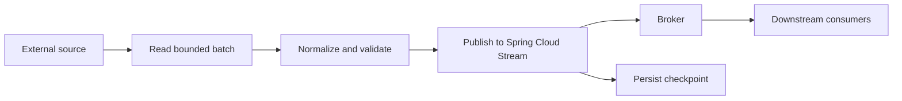

# Reading External Data Sources and Managing Safe Checkpoints

A Spring Cloud Stream producer does not only emit data submitted directly by users to the application. It can also pull changes from a database, REST API, filesystem, or external service and convert them into events for consumers to process. For this kind of producer, the key challenge is knowing how far it has read and when it is safe to save a new checkpoint.

The checkpoint (or cursor) must be updated in a way that avoids dropping data when the application stops abruptly, the broker is temporarily unavailable, or messages are replayed. If the checkpoint is saved too early, a record may be marked as read before being safely sent. If saved too late, the application may re-emit previously emitted records. Therefore, practical designs usually prioritize zero data loss, accept potential duplicate sends, and use a stable `eventId` alongside idempotent consumers to control duplicate side effects.

## 1. Source Reading and Event Emission Model

A basic ingestion flow can be broken into the following steps:



Data sources can include:

- **Database:** querying new or changed rows by monotonically increasing key, update timestamp, or change sequence.
- **REST API:** reading via page token, cursor, sequence, or `updatedSince` provided by the API.
- **File:** reading an append-only file by byte offset or processed record, accounting for rotation and truncation.
- **Another service:** using a synchronous API, subscription, or change feed exposed by that service.

Reading a record must not be treated as having completed event emission. Clearly separate each state: read from source, durably staged in a holding area, sent to the broker, and processed by consumers. These states may span different systems and do not automatically form a single transaction.

## 2. Choosing a Cursor Suited to the Data Source

A cursor marks the position allowing the next read to resume where the previous one stopped. Choose a cursor matching the source's actual contract:

| Source | Preferred Cursor | Key Considerations |
|---|---|---|
| Table with monotonic key | ID or sequence | Suits append-only data; does not automatically detect updates to older rows |
| Table with `updated_at` | `(updated_at, primary_key)` | Needs a secondary key to break ties among rows with the same timestamp |
| CDC/change feed | Log sequence, change token, or offset | Must respect source log retention limits and recovery rules |
| Paginated REST API | Opaque page token or continuation token | Do not reconstruct tokens yourself; persist the exact value returned by the API |
| Append-only file | File identity and byte offset or record sequence | Must detect file replacement, rotation, or truncation |

The cursor must remain meaningful across restarts. Do not use in-memory sequence numbers, an instance-local `AtomicLong`, or the consumer machine's current clock as a long-lived checkpoint.

### 2.1. Reading a Database by Increasing Key

For append-only tables with a monotonically increasing key, you can read by ID:

```sql
SELECT id, order_id, status, created_at
FROM orders
WHERE id > :last_id
ORDER BY id
LIMIT :batch_size;
```

Once a record is safely emitted, the checkpoint can save that ID. This is simple and has a clear ordering. However, if an older row is updated after the cursor has already passed its ID, the query above will not re-read the change. For mutable data, use a change sequence, CDC, or an `updated_at` column with reliable semantics.

### 2.2. Using a Timestamp with a Tie-Breaker Key

If the source has `updated_at`, storing only the timestamp can skip rows when multiple rows share the same update timestamp. Use a `(updated_at, id)` pair as the cursor:

```sql
SELECT id, order_id, status, updated_at
FROM orders
WHERE (updated_at > :last_updated_at)
   OR (updated_at = :last_updated_at AND id > :last_id)
ORDER BY updated_at, id
LIMIT :batch_size;
```

The composite comparison creates a deterministic order among rows sharing a timestamp. The data type and precision of `updated_at` must match how the cursor is stored. If timestamps have millisecond precision while the checkpoint rounds down to seconds, the next read may duplicate or skip records depending on query predicates.

For sources that may write late-arriving data or update timestamps unreliably, a plain timestamp query is insufficient. Consider an overlap window paired with event ID deduplication, or use CDC with source-assigned sequences. For example, re-reading a window of a few minutes before the cursor replays some records while reducing the risk of missing late-arriving changes. The overlap length should reflect source latency characteristics and re-read cost.

### 2.3. Capturing an Upper Bound per Batch

When the source continues receiving writes while the producer is reading, capture a high-water mark at the start of the read pass. For example, take `upperBound` as the current sequence and only read rows whose sequence exceeds the cursor and does not exceed that bound. This gives the batch a finite scope and lets the run finish before moving on to newer data.

If using timestamps, `upperBound` must be obtained from the source or under controlled clock rules. Do not grab `Instant.now()` on the producer machine and assume it equals the latest database update time. Clock skew, late transaction commits, and replication lag can all invalidate that assumption.

## 3. Reading Paginated APIs Safely

For REST APIs, prefer API-provided cursors or continuation tokens over incrementing page numbers yourself. Page numbers shift when records are inserted or deleted mid-read, causing duplicated or skipped records.

A paginated response might look like this:

```json
{
  "items": [
    { "id": "chg-100", "orderId": "ord-100", "status": "PAID" },
    { "id": "chg-101", "orderId": "ord-101", "status": "PAID" }
  ],
  "nextPageToken": "opaque-token-2"
}
```

Processing flow:

1. Read the latest persisted token and call the API to fetch a bounded page.
2. Validate the response, schema, size limits, and required fields.
3. Emit each event or stage them into a durable holding area.
4. Advance the token to `nextPageToken` only after the entire page is safely persisted according to the chosen strategy.
5. When the API returns an empty page or no next token, end the read pass; the next poll resumes from the saved cursor.

If a token expires, do not synthesize a new token from the current timestamp and skip older data. Follow the API contract: re-initialize from a supported marker, backfill, or request a fresh snapshot. Log cursor resets clearly because they can trigger a large replay.

## 4. Integrating the Source Reader with Spring Cloud Stream

Spring Cloud Stream provides functional models to represent producers:

- An imperative `Supplier<T>` is typically invoked by the framework poller to fetch one message at a time. `Supplier<Flux<T>>` returns a reactive publisher; the publisher must provide its own emission mechanism and polling cadence if the source is non-continuous. Do not assume an imperative poller will re-invoke the supplier for every element of a `Flux`.
- `StreamBridge` fits when an application component proactively sends messages to an output binding—for example, a scheduled job or an API integration service.
- A dedicated adapter can read the source, normalize data, and convert it into messages before sending.

A producer should not cram query logic, pagination, cursor management, serialization, and retries into a single lambda. Separating `SourceReader`, `CheckpointStore`, the normalizer, and the publisher makes each piece testable and clarifies where the checkpoint advances.

Example event message definition:

```java
public record ExternalOrderChange(
        String eventId,
        String sourceRecordId,
        String orderId,
        String status,
        Instant occurredAt) {}
```

Example configured output binding:

```yaml
spring:
  cloud:
    stream:
      bindings:
        externalOrderChanges-out-0:
          destination: external.orders.changed
          content-type: application/json
```

`Supplier` provides messages to the output binding. For an imperative supplier, polling can be configured via Spring Cloud Stream's poller; verify exact property names and values against your framework version. The supplier should read a bounded amount of data with timeouts and rate limits. For reactive sources, the publisher itself must define how new data is fetched and how backpressure is handled. Never run an unbounded query or an API call that can hang indefinitely inside a poll.

When sending needs to be controlled from a job or integration component, `StreamBridge` can send messages to a binding:

```java
@Component
public class ExternalOrderPublisher {
    private final StreamBridge streamBridge;

    public ExternalOrderPublisher(StreamBridge streamBridge) {
        this.streamBridge = streamBridge;
    }

    public boolean publish(ExternalOrderChange event) {
        Message<ExternalOrderChange> message = MessageBuilder
                .withPayload(event)
                .setHeader("eventId", event.eventId())
                .setHeader("sourceRecordId", event.sourceRecordId())
                .build();

        return streamBridge.send("externalOrderChanges-out-0", message);
    }
}
```

A `true` return value from `StreamBridge.send` indicates the send through the message channel was accepted. Do not assume it always means the broker has durably persisted the message. If advancing the checkpoint depends on delivery confirmation, the publisher must use the confirmation mechanism appropriate to the binder/client and durability settings in production. Separately verify Kafka producer acknowledgments, Rabbit publisher confirms, or Pulsar acknowledgment mechanisms for your version.

## 5. Rules for Updating Checkpoints

A core rule is never to advance the checkpoint past data that has not been safely persisted or confirmed. If the producer reads 100 records, successfully sends 40, and then fails, the cursor must not jump past record 100. Doing so could permanently drop the remaining 60 records.

### 5.1. Send Before Advancing the Checkpoint

With a cursored source and a publisher capable of confirming delivery, a straightforward workflow is:

1. Read the next records after the saved checkpoint.
2. Build events with a stable `eventId`.
3. Send the message and await confirmation per the publisher's contract.
4. Only after confirmation, persist the record's corresponding cursor.
5. If sending or checkpoint persistence fails, halt the read pass and retry per policy.

The code below illustrates the application contract. `ConfirmedPublisher` is an application-defined abstraction built atop the binder's actual confirmation mechanism; it is not a built-in Spring Cloud Stream API:

```java
public interface ConfirmedPublisher<T> {
    void publishAndAwaitConfirmation(T event);
}

public void pollNextBatch() {
    SourceCursor cursor = checkpointStore.load();
    List<SourceRecord> records = sourceReader.readAfter(cursor, 200);

    for (SourceRecord record : records) {
        ExternalOrderChange event = mapper.toEvent(record);

        publisher.publishAndAwaitConfirmation(event);
        checkpointStore.advanceTo(record.cursor());
    }
}
```

If the process stops after the broker confirms but before the checkpoint is saved, the next run will re-read that record and may re-emit it. This failure window cannot be eliminated by two independent operations across two systems. Keep `eventId` deterministic from the source identity—such as `sourceName + sourceRecordId + sourceVersion`—so consumers can process idempotently.

Do not update the checkpoint merely when placing a message onto an in-memory queue or when a send API returns before required confirmation arrives. Also do not update the checkpoint before publishing just to avoid duplicates; that turns transient errors into data loss.

### 5.2. Using a Transactional Outbox When Source and Outbox Share a Database

If the source data and outbox table live in the same database, you can read records, insert outbox rows, and update the checkpoint within a single database transaction:

```text
BEGIN TRANSACTION
  Read source rows after stored cursor
  Insert outbox rows with stable event_id (unique)
  Update source checkpoint to the last staged cursor
COMMIT
```

A separate publisher reads unsent outbox rows, emits messages to the broker, awaits confirmation according to the configured mechanism, and marks the rows as sent. If the publisher stops after broker confirmation but before marking, it may resend the row; consumers still need idempotency. An outbox closes the gap between updating the database checkpoint and recording intent to emit an event, but it does not by itself create exactly-once semantics between database and broker.

If the source is a REST API or a system outside the local database, you cannot wrap the external source cursor and local outbox in a default distributed transaction. Instead, store the fetched page in a local inbox/staging table along with the next token in a local transaction, then publish from staging. Advance the API token only after the entire page is durably written to staging. This enables recovery after API or broker interruptions.

### 5.3. Saving Cursors in Order and Preventing Backward Updates

A checkpoint should store source identifier, cursor type, cursor value, and update timestamp. When multiple workers or overlapping polls exist, checkpoint updates must be serialized or guarded with compare-and-set so an older batch finishing late cannot overwrite the cursor backward.

Example storage schema:

| Field | Purpose |
|---|---|
| `source_name` | Distinguish data sources or streams |
| `cursor_value` | Stored ID, sequence, token, or position |
| `cursor_type` | Interpret the cursor format accurately |
| `updated_at` | Timestamp when the checkpoint was updated |
| `version` | Guard concurrent updates via optimistic locking |

Do not log API tokens or cursors that may contain access credentials to public logs. If a token is secret or reusable to access the source, protect it like a credential.

## 6. Error Handling and Recovery

| Scenario | Safe Handling |
|---|---|
| Source times out before returning full batch | Leave checkpoint unchanged; retry with timeout and backoff |
| A record fails conversion | Quarantine the record, log cursor and reason; do not skip silently |
| Broker rejects send or lacks confirmation | Keep checkpoint before the unconfirmed record; retry per policy |
| Broker accepted but app stopped before saving cursor | Allow replay; consumers deduplicate via stable event ID |
| Checkpoint save fails | Stop reading ahead; recover from the previous durable checkpoint and accept replay |
| API token expires | Follow the API's recovery/snapshot procedure; do not skip unread data |
| File rotated or truncated | Detect identity/size change and recover per source file policy |
| Two instances read the same source | Use a lease/lock or clear partition ownership; prevent backward checkpoint writes |

Retries should use bounded attempts, backoff, and jitter to prevent multiple producers from hammering the source simultaneously after an outage. Authentication failures or invalid cursors typically require alerts and configuration intervention; infinite retries will not fix those root causes.

## 7. Running Multiple Instances Without Uncontrolled Duplicate Reads

When an application scales horizontally, each instance may start the same polling job. If all instances read from one cursor, the same batch will be emitted multiple times. Common coordination models include:

- **Single active poller:** use a distributed lease or time-bounded lock so only one instance reads the source at a time. Leases need renewal and handling for an old instance waking up after the lease has been granted to another instance.
- **Partitioned source:** split scope by tenant, key range, or source partition; each worker owns a distinct slice and checkpoint.
- **CDC consumer group:** if the CDC source supports consumer groups/partition assignment, rely on its assignment mechanism and commit offsets per its contract.

With leases, include a fencing token or monotonically increasing version so operations from a worker that lost ownership cannot write checkpoints after a new worker takes over. A simple in-memory `isRunning` flag provides zero coordination across instances.

Do not confuse a producer's source checkpoint with a Kafka consumer group offset. The producer checkpoint tracks how far the external source has been read into the emission pipeline. The Kafka consumer offset tracks how far a consumer group has processed or committed in a topic. These two markers belong to different systems and different responsibilities.

## 8. Flow Control and Stability

Reading an external source too fast can overload the database/API or build up broker backlog. Each poll should bound record count, query duration, and total processing time. Monitor:

- Records read, records published successfully, and records quarantined.
- Source read latency, publish latency, and lag from `occurredAt` to emission.
- Current cursor position, checkpoint age, and distance between cursor and source high-water mark.
- Retry counts, timeout errors, authentication errors, and pending outbox/inbox counts.
- Broker backlog and downstream service consumption rate.

Set explicit connection and query timeouts. For rate-limited APIs, honor `Retry-After` if provided and use exponential backoff with jitter. When the broker slows down or fails to confirm, throttle reading instead of pulling more data without durable storage.

## 9. Designing Event IDs and Replay Data

A source record may be read multiple times due to an unpersisted checkpoint or an overlap window. The event ID must deterministically identify the same source change. If a database row can be updated multiple times, using only the row's primary key is insufficient; combine record version, change sequence, or a source-issued event identifier.

Example:

```text
eventId = "erp-orders:order-100:version-7"
```

When the same version-7 change is re-read, the event ID stays identical. When the order moves to version 8, the event ID changes. Consumers can store processed event IDs with a unique constraint to prevent the same change from taking effect twice.

Payloads should carry enough information for consumers to understand the event without querying back to a source that may have already changed. If the event is a change notification, specify clearly whether consumers receive a full snapshot or only a delta. Schemas should explicitly state version, business timestamp, and source identifier.

## 10. Testing Checkpoints and Recovery

Unit tests for mappers and cursors should verify ordering, batch boundaries, and tie-breaking for records with identical timestamps. Integration tests should simulate key failure windows:

1. Successful batch read, publish, and checkpoint save.
2. Publish failure mid-batch; the next run must resume from a safe position without dropping remaining records.
3. Broker confirmation succeeds but app crashes before saving checkpoint; the next run may re-emit, yet consumers must not apply side effects twice.
4. Checkpoint save fails after publish; the application must not advance reads past the durable cursor.
5. Multiple records share the same timestamp; no record is skipped.
6. API returns a next token, expired token, or incomplete page response.
7. Two instances contend for a lease or process a partition; the checkpoint never regresses.
8. Source has late-arriving updates or rotated/truncated files.

For outboxes, also test cases where the publisher sends successfully before marking the row sent, and where two publishers read the same row. For CDC, test offset/sequence recovery after restarts and source log retention boundaries.

## 11. Pre-Deployment Checklist

- [ ] Data source has a stable cursor, clear read order, and bounded batch size.
- [ ] Timestamp cursors include a tie-breaker key or an overlap/dedupe mechanism for late-arriving data.
- [ ] API page tokens are saved verbatim and have a recovery workflow on expiration.
- [ ] Checkpoints are durably persisted and never advance past safely stored or confirmed data.
- [ ] Distinguish `StreamBridge.send`/channel acceptance from broker delivery confirmation.
- [ ] If coordinating database writes and event emission, evaluate a transactional outbox or inbox/staging table.
- [ ] Event IDs remain stable across retries, replays, and source record version changes.
- [ ] Consumers are idempotent to handle duplicate messages safely.
- [ ] Multi-instance deployments use leases, partition ownership, or checkpoint coordination.
- [ ] Metrics exist for cursor age, batch size, publish failures, retries, outbox, and backlog.
- [ ] Process crashes were tested between reading, publishing, and saving checkpoints.

Reading external data safely requires producers to manage both source progress and message emission outcomes. `Supplier` or `StreamBridge` connects the application to an output binding; they do not automatically solve transactions across external sources, brokers, and checkpoints. By choosing a stable cursor, bounding batches, saving checkpoints only after durable steps, accepting controlled replays, and designing idempotent consumers, systems can recover from failures without silently skipping data.
