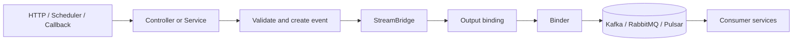
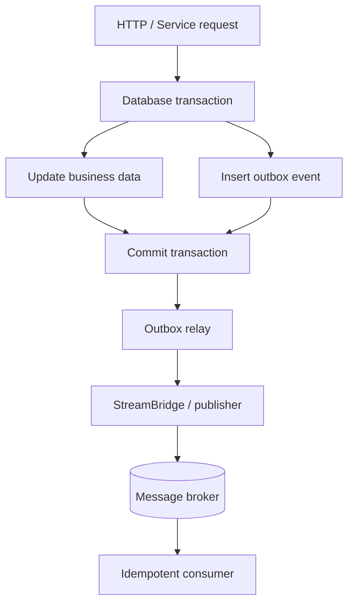

# The Role of StreamBridge When Publishing Messages from External Sources

## 1. The problem: data coming from non-function beans

Spring Cloud Stream is often introduced through the `Supplier`, `Function`, and `Consumer` function model. This model works well when the data source, processing step, and data sink are represented by function beans. However, in a real Spring Boot application, events can also originate from components that are not function beans:

- A REST controller receiving HTTP requests from another system.
- A scheduled task reading due data and publishing events.
- A business service detecting changes after completing an operation.
- A listener receiving callbacks from a library, SDK, or integrated system.
- A file import process or data ingestion from a legacy source that needs to enter the event stream.

These components need to send messages to Kafka, RabbitMQ, or Pulsar without directly calling each broker's specific producer API. **`StreamBridge`** provides a point for sending messages from regular application code into Spring Cloud Stream's binding system.



The source component only needs to know the binding name it sends to and the message structure per contract. The binder handles integration with the configured broker. As a result, HTTP code or business services do not need to depend directly on `KafkaTemplate`, RabbitMQ client, or Pulsar producer.

## 2. What is StreamBridge?

`StreamBridge` is a Spring Cloud Stream API used to send data from a non-function bean component to an output binding. You can inject `StreamBridge` into a controller, service, or other component and call `send(...)`.

Commonly used APIs:

```java
boolean send(String bindingName, Object data);
boolean send(String bindingName, MimeType contentType, Object data);
```

Depending on the Spring Cloud Stream version, there are also overloads that directly accept `Message<?>`. Check the API of the version your project is using when a specific overload is needed.

The first parameter is the **binding name** in the application. It does not necessarily match the topic or queue name on the broker. The `data` parameter is the payload or message sent through the output binding. The overload with `contentType` allows specifying the MIME type for outgoing data.

`StreamBridge` is not a broker and does not replace a binder. It is a bridge from application code to Spring Cloud Stream's output binding mechanism. The sending flow still uses the corresponding binding configuration, message conversion, and binder.

## 3. Sending messages from a REST controller

A common case is an external system calling a REST API to create an order. The controller validates the request, converts the request into a business event, and sends the event via `StreamBridge`.

### Defining the event payload

```java
public record CreateOrderRequest(String customerId, long totalCents) {}

public record OrderCreated(
    String orderId,
    String customerId,
    long totalCents
) {}
```

The HTTP request and the internal event can differ. The request describes the caller's intent; the `OrderCreated` event describes what happened. Creating the event after validating and completing business rules helps give consumers a clear contract.

### Configuring a static output binding

```yaml
spring:
  cloud:
    stream:
      output-bindings: orders-out-0
      bindings:
        orders-out-0:
          destination: orders.created
          content-type: application/json
```

Here:

- `orders-out-0` is the binding name the application uses when calling `StreamBridge`.
- `orders.created` is the logical destination mapped by the binder to the corresponding resource on the broker.
- `content-type` declares the payload format so message conversion occurs appropriately.

An explicitly declared output binding allows destination configuration and access permissions to be prepared before the application runs. This binding does not require a `Supplier` or `Function` bean just to produce output.

### Injecting and calling StreamBridge

```java
import java.util.UUID;
import org.springframework.http.HttpStatus;
import org.springframework.http.ResponseEntity;
import org.springframework.messaging.support.MessageBuilder;
import org.springframework.cloud.stream.function.StreamBridge;
import org.springframework.web.bind.annotation.*;

@RestController
@RequestMapping("/api/orders")
class OrderIngressController {

    private final StreamBridge streamBridge;
    private final OrderApplicationService orderService;

    OrderIngressController(
        StreamBridge streamBridge,
        OrderApplicationService orderService
    ) {
        this.streamBridge = streamBridge;
        this.orderService = orderService;
    }

    @PostMapping
    ResponseEntity<Void> create(@RequestBody CreateOrderRequest request) {
        OrderCreated event = orderService.createOrder(request);

        var message = MessageBuilder
            .withPayload(event)
            .setHeader("eventId", UUID.randomUUID().toString())
            .setHeader("aggregateId", event.orderId())
            .setHeader("eventType", "OrderCreated")
            .build();

        boolean accepted = streamBridge.send("orders-out-0", message);
        if (!accepted) {
            return ResponseEntity.status(HttpStatus.SERVICE_UNAVAILABLE).build();
        }

        return ResponseEntity.accepted().build();
    }
}
```

The example illustrates how to connect HTTP to an output binding. In a real application, you need to implement `OrderApplicationService`, validate requests, handle errors, and define appropriate transaction boundaries. Do not publish `OrderCreated` before the order creation business logic succeeds.

A `true` return value from `send` indicates that the send operation was accepted by the sending path inside the application. Do not interpret it as proof that the consumer has received or finished processing the message. If the API needs stronger guarantees of durable storage on the broker, design acknowledgments based on the binder/broker capabilities or use the transactional outbox pattern.

## 4. Binding name and destination are two different concepts

When using `StreamBridge`, distinguish between:

| Concept | Example | Meaning |
|---|---|---|
| Binding name | `orders-out-0` | The output binding name passed by Java code to `send` |
| Destination | `orders.created` | Where the binder sends the message on the broker |
| Binder | `kafka` or `rabbit` | The component integrating with the messaging system |
| Payload | `OrderCreated` | The business data being sent |

The application calls:

```java
streamBridge.send("orders-out-0", event);
```

The binding name is looked up in configuration. If the binding is already declared, the binder uses the destination and properties attached to that binding. Do not pass a topic name into `send` just because it is the name visible in the broker admin UI, unless the application intentionally uses that name as a dynamic binding name.

Keeping the binding name stable in code and configuration allows changing the destination per environment without modifying controllers or services.

## 5. Static binding and dynamic destination

### Static binding for known business flows

For a fixed event stream like `orders.created`, declare the output binding in configuration:

```yaml
spring:
  cloud:
    stream:
      bindings:
        orders-out-0:
          destination: orders.created
          content-type: application/json
          producer:
            partition-key-expression: headers['aggregateId']
            partition-count: 6
```

Then, all components sending orders use the same binding name `orders-out-0`. Producer configuration can control partitioning by business key when the binder supports those properties.

Static binding fits when the destination, binder, and producer policy are known in advance. It helps operations teams control permissions, resources, and per-environment configuration.

### Dynamic destination when the target is only known at runtime

`StreamBridge` can also create an output binding dynamically when the passed binding name does not yet exist. For example, an application needs to send events to a destination chosen from tenant configuration:

```java
boolean sent = streamBridge.send("tenant-a.audit", auditEvent);
```

When no matching binding exists yet, Spring Cloud Stream can create an output binding for the specified destination and reuse the created binding. This approach is useful when the application genuinely needs multiple destinations determined at runtime.

However, do not take an arbitrary destination string from an HTTP request and pass it directly into `send`. That can let callers send data to unintended destinations or cause the application to create too many dynamic bindings. Map a validated identifier to an allowed list of destinations:

```java
import java.util.Map;

Map<String, String> tenantDestinations = Map.of(
    "tenant-a", "tenant-a.audit",
    "tenant-b", "tenant-b.audit"
);

String destination = tenantDestinations.get(tenantId);
if (destination == null) {
    throw new IllegalArgumentException("Unknown tenant");
}

streamBridge.send(destination, auditEvent);
```

This simplified example illustrates an allow-list; the application needs to load this list from trusted configuration or a managed registry. Set limits and monitor the number of dynamic bindings, because each binding can create client resources and consume broker resources.

### Choosing a binder for a binding

If the application has multiple binders, specify which binder the binding will use. For statically declared bindings, set the binder property for the binding according to the configuration of the version in use. For dynamic bindings, verify the default binder rules and the project's multi-binder setup; do not assume every dynamic destination automatically picks the desired broker.

## 6. Sending a payload or a Message with headers

`StreamBridge` can send an object as a payload:

```java
streamBridge.send("orders-out-0", event);
```

If metadata needs to be passed, build a `Message<?>` using `MessageBuilder`:

```java
var message = MessageBuilder
    .withPayload(event)
    .setHeader("eventId", eventId)
    .setHeader("correlationId", correlationId)
    .setHeader("aggregateId", event.orderId())
    .setHeader("eventType", "OrderCreated")
    .build();

streamBridge.send("orders-out-0", message);
```

Headers can support correlation, tracing, partitioning, or routing if the binder and producer configuration are set up to use them. Not every internal Spring header is transferred intact across the broker. Only use metadata types that can be serialized and are permitted by the producer/consumer contract.

If you need to specify the MIME type for the payload, use the overload accepting `MimeType`:

```java
import org.springframework.util.MimeTypeUtils;

streamBridge.send(
    "orders-out-0",
    MimeTypeUtils.APPLICATION_JSON,
    event
);
```

Keep the content type aligned with the actual format and converter. Setting a MIME type does not serialize the payload by itself; the converter still must support the data type.

## 7. Sending from a service or scheduled task

`StreamBridge` is not only for REST controllers. It can be injected into a business service to publish events after an operation completes:

```java
import org.springframework.cloud.stream.function.StreamBridge;
import org.springframework.stereotype.Service;

@Service
class InventoryEventPublisher {

    private final StreamBridge streamBridge;

    InventoryEventPublisher(StreamBridge streamBridge) {
        this.streamBridge = streamBridge;
    }

    boolean publishStockChanged(StockChanged event) {
        return streamBridge.send("stock-changed-out-0", event);
    }
}
```

A scheduled task can also publish messages:

```java
import org.springframework.scheduling.annotation.Scheduled;
import org.springframework.stereotype.Component;

@Component
class DailyReportPublisher {

    private final StreamBridge streamBridge;
    private final ReportService reportService;

    DailyReportPublisher(StreamBridge streamBridge, ReportService reportService) {
        this.streamBridge = streamBridge;
        this.reportService = reportService;
    }

    @Scheduled(cron = "0 0 1 * * *")
    void publishDailyReport() {
        DailyReportReady event = reportService.prepareReport();
        streamBridge.send("daily-report-out-0", event);
    }
}
```

This example requires the application to have scheduling enabled and an output binding `daily-report-out-0`. In a multi-instance environment, each instance may run the same schedule and publish duplicate events. Use a distributed scheduler, execution locks, idempotency mechanisms, or a single coordinator source if business logic only allows publishing once.

## 8. Handling send results and errors

The `send` method returns a boolean. This value is useful for detecting when a send operation is not accepted on the application side, but it does not replace broker durability acknowledgments or consumer processing acknowledgments.

When sending fails, decide based on the source type:

- **HTTP request:** return an appropriate error code if the request cannot be accepted yet; do not report success when the send operation has failed.
- **Scheduled task:** log with context, increment error metrics, and plan bounded retries.
- **Callback or event from external systems:** persist the ingestion state and use appropriate retry/replay mechanisms to avoid data loss.
- **Business flows requiring high reliability:** consider transactional outbox to record events to publish within the same business data transaction.

Do not retry indefinitely directly in the request thread. Retries need backoff, attempt limits, and classification between transient and permanent errors. If resending the same event, keep a stable event ID so consumers can process idempotently.

### Distinguishing acknowledgment levels

| Milestone | What can be concluded | What cannot be concluded yet |
|---|---|---|
| `send` returns `true` | The application's send path accepted the send operation | The message has been processed by the consumer |
| Broker confirms publish/produce per configured mechanism | The broker confirmed receipt per its semantics | The business task at the consumer has completed |
| Consumer acknowledges or commits after processing | The consumer completed within the designed acknowledgment boundary | A side effect outside the broker occurred exactly once if proper idempotency/transactions are absent |

With Kafka, RabbitMQ, and Pulsar, producer acknowledgment mechanisms have different names and semantics. Configure and test according to the specific binder when you need to know the message was durably accepted by the broker.

## 9. Business transactions and transactional outbox

A common mistake is updating the database and then calling `StreamBridge.send` as two independent operations:

1. Database commit succeeds.
2. The application fails before the message is sent.

In that case, the business state has changed but the event is not published. The reverse can also happen if the message is sent before the database transaction rolls back: consumers receive an event describing a change that does not exist.

For critical flows, transactional outbox records business changes and outbox records in the same database transaction. A relay process reads the outbox and sends messages via `StreamBridge` or an appropriate publisher mechanism, then marks the record as sent. The relay can send duplicates if a failure occurs between publishing and marking; consumers still need idempotency by event ID.



Outbox decouples the data commit time from the broker send time, while providing a place to store events to be published for retry after failures. It does not automatically provide end-to-end exactly-once delivery; event locking, relay state, retry policies, and idempotent consumers are needed.

## 10. When to use StreamBridge and when to use functions

| Scenario | Suitable approach | Reason |
|---|---|---|
| HTTP controller receives a request and publishes an event | `StreamBridge` | Controller is a data source outside the function model |
| Service or scheduler publishes an event | `StreamBridge` | Can send from any bean in the Spring context |
| A step receives a message and transforms it into another message | `Function` | Processing logic has clear input and output |
| Application generates data on a polling basis | `Supplier` | Data source can be represented by a function bean |
| Application only receives and performs side effects | `Consumer` | Logic ends at the input processing step |
| Connecting multiple message processing steps | Function composition or appropriate bindings | Keeps the processing pipeline in the functional model |

Do not put every message-sending call into controllers. If multiple sources publish the same event type, group the event creation and sending rules into a publisher service to avoid duplicating configuration, headers, and error handling. Conversely, if the logic is genuinely message input/output processing, functions usually express that flow more clearly.

## 11. Security and controlling external sources

When the publishing source is HTTP or a callback, input data must be treated as untrusted. Before sending a message:

- Authenticate the caller and check authorization to publish the corresponding event type.
- Validate the request's structure, length, value ranges, and required fields.
- Construct events from validated data; do not let callers set privileged headers or arbitrary destinations.
- Limit payload size and sending rate to protect the broker.
- Only allow configured destinations or those on an allow-list.
- Do not include tokens, passwords, or sensitive data in unnecessary headers.
- Log the event ID/correlation ID and send result, but avoid logging full sensitive payloads.

If the caller sends a `tenantId` field, verify that the tenant belongs to the caller before mapping it to a destination. Renaming destinations does not replace broker access control.

## 12. Testing and observability

Testing publishing sources should verify both application logic and the binding path:

1. Mock or replace `StreamBridge` to verify the controller/service calls the right binding name and payload.
2. Check event ID, correlation ID, event type, and partition key headers.
3. Test the case where `send` returns `false` and verify the source API handles errors properly.
4. Test dynamic destinations with valid tenants, invalid tenants, and destination limits.
5. Use the test binder to verify messages pass through bindings at the application level.
6. Run integration tests with a real broker to verify serialization, header mapping, producer confirms, or transactions per binder.
7. Test retries and idempotency when publishing fails or events are sent repeatedly.

In operations, monitor send count, error rate, send latency, number of dynamic bindings, consumer-side backlog, and pending outbox records. Logs should include binding name, selected destination, event ID, and correlation ID for tracing. Do not log secrets or full sensitive payloads.

## 13. Checklist for implementing a non-function publishing source

1. Identify the data source: HTTP, scheduler, callback, or integration component.
2. Define the business event and the schema consumers will understand.
3. Validate source data and convert it into an internal event.
4. Choose static binding if the destination is known; only use dynamic destinations when clearly needed.
5. Configure destination, content type, binder, and producer properties.
6. Use `StreamBridge.send` to send a payload or `Message<?>` with required headers.
7. Define the semantics of `send` results, error policies, and retries.
8. For critical data, evaluate transactional outbox and idempotency.
9. Test with the test binder and corresponding broker; monitor metrics and logs after deployment.

`StreamBridge` helps bring data from standard Spring components into the event stream while still using Spring Cloud Stream bindings and binders. By properly distinguishing binding names from destinations, choosing the right binding type, controlling external sources, and understanding the limits of send results, applications can consistently connect REST APIs, schedulers, and integrated systems to Kafka, RabbitMQ, or Pulsar.
