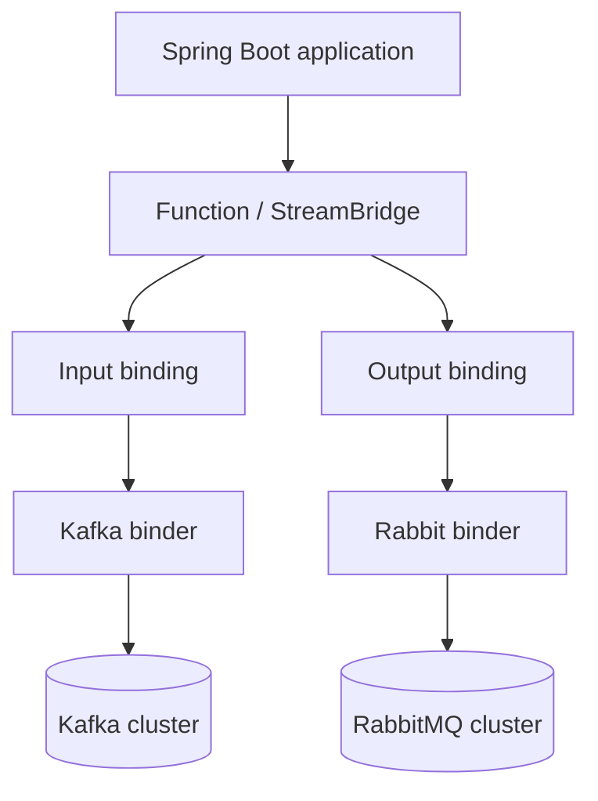
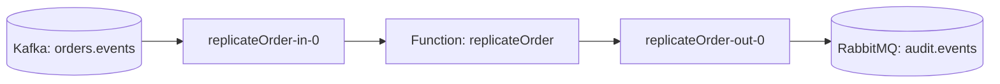

# Choosing a Binder When Using Multiple Messaging Systems

## 1. Why does an application need multiple binders?

In event-driven systems, each broker may serve a different set of needs. Kafka is often chosen for log-retained event streams with multiple independent consumer groups. RabbitMQ often fits message routing through exchanges and queues. Pulsar provides topics, subscriptions, and distinct message delivery modes. An organization may operate multiple platforms simultaneously due to system history, product requirements, or infrastructure transitions.

A Spring Cloud Stream application may need to connect to multiple brokers in situations such as:

- Consuming order events from Kafka and publishing audit records to RabbitMQ.
- Reading data from an internal Kafka cluster and writing to another Kafka cluster.
- Publishing business events to Pulsar while still sending notifications to RabbitMQ.
- Running an infrastructure migration phase where some bindings still use the old broker and new bindings use the new broker.

Spring Cloud Stream supports configuring multiple **binders** within the same application. Each binder is an integration configuration for a specific broker type or broker cluster. The application can select a default binder and specify individual binders per binding.



Having multiple binders does not automatically synchronize data between brokers. The application must define the processing flow, data transformation, and recovery strategy when one side succeeds and the other fails.

## 2. Distinguishing binder type, binder instance, and binding

These three concepts serve different roles:

| Concept | Example | Meaning |
|---|---|---|
| Binder type | `kafka`, `rabbit`, `pulsar` | Integration type provided by the binder library on the classpath |
| Binder instance/name | `kafkaEast`, `rabbitAudit` | A concrete connection configuration, potentially pointing to a separate broker cluster |
| Binding | `replicateOrder-in-0`, `replicateOrder-out-0` | Input or output port of a function connected to a destination and binder |

An application can declare two binder instances of the same type `kafka` pointing to two different Kafka clusters. Conversely, two binder instances can have different types, such as one `kafka` instance and one `rabbit` instance.

The binding is where you specify which binder instance to use. The binder instance name must match the name declared in `spring.cloud.stream.binders`.

## 3. Declaring multiple binders in configuration

Suppose an application has a function that receives events from Kafka and publishes audit information to RabbitMQ. We declare two binder instances:

```yaml
spring:
  cloud:
    function:
      definition: replicateOrder
    stream:
      binders:
        kafkaEast:
          type: kafka
          environment:
            spring:
              cloud:
                stream:
                  kafka:
                    binder:
                      brokers: localhost:9092
        rabbitAudit:
          type: rabbit
          environment:
            spring:
              rabbitmq:
                host: localhost
                port: 5672
                username: app
                password: ${RABBIT_PASSWORD}
      default-binder: kafkaEast
      bindings:
        replicateOrder-in-0:
          destination: orders.events
          group: audit-bridge
          binder: kafkaEast
          content-type: application/json
        replicateOrder-out-0:
          destination: audit.events
          binder: rabbitAudit
          content-type: application/json
```

Configuration explanation:

1. `binders.kafkaEast.type: kafka` selects the Kafka binder implementation.
2. `kafkaEast`'s `environment` supplies broker configuration specific to this binder instance.
3. `binders.rabbitAudit.type: rabbit` selects the Rabbit binder implementation.
4. `rabbitAudit`'s `environment` supplies RabbitMQ connection details. The password is read from an environment variable.
5. `default-binder: kafkaEast` sets the default binder for bindings that do not specify one.
6. `replicateOrder-in-0.binder` chooses Kafka for input.
7. `replicateOrder-out-0.binder` chooses RabbitMQ for output.

In the example, binding names are inferred from the function bean `replicateOrder`. If the bean name changes, default binding names change too and configuration must be updated accordingly.

`environment` creates a scoped configuration environment for the binder instance. Place properties in the exact namespace of the binder and library version in use. The example above illustrates configuring the Kafka binder via `spring.cloud.stream.kafka.binder.brokers` and the Rabbit binder via Spring Boot RabbitMQ connection properties.

## 4. Choosing a binder per binding

The `binder` property under a binding specifies the binder instance used for that binding:

```yaml
spring:
  cloud:
    stream:
      bindings:
        orders-in-0:
          destination: orders.events
          binder: kafkaEast
        audit-out-0:
          destination: audit.events
          binder: rabbitAudit
```

If `binder` is not specified, Spring Cloud Stream uses the default binder according to the application's binder selection configuration and rules. Declaring `default-binder` makes intent explicit when multiple binder candidates exist.

Do not confuse `binder` with `destination`:

- `binder: rabbitAudit` selects the RabbitMQ connection configuration.
- `destination: audit.events` selects where to send messages within that RabbitMQ system.

Two binder instances can point to the same broker type while using different clusters, credentials, or virtual hosts. This is useful when isolating environments, data regions, or access permissions.

### Default binder and default candidate

`default-binder` specifies the default binder the application intends to use. When declaring multiple binder instances, explicitly configure `binder` on critical bindings to avoid relying on implicit selection.

The `default-candidate` property of a binder instance can be used to control whether that binder participates in default binder selection. This property is useful when you have a dedicated binder meant only for bindings that explicitly specify it. Verify behavior against the Spring Cloud Stream version in use, especially when the application has multiple binders of the same type.

## 5. Example function bridging Kafka to RabbitMQ

A function can receive an event type from Kafka, transform it into an audit record, and publish the result through an output binding attached to RabbitMQ.

```java
import java.util.function.Function;
import org.springframework.context.annotation.Bean;
import org.springframework.context.annotation.Configuration;

record OrderEvent(String orderId, String eventType, long occurredAt) {}
record AuditRecord(String entityId, String action, long timestamp) {}

@Configuration
class OrderAuditFunctions {

    @Bean
    Function<OrderEvent, AuditRecord> replicateOrder() {
        return event -> new AuditRecord(
            event.orderId(),
            event.eventType(),
            event.occurredAt()
        );
    }
}
```

The configuration from the previous section binds `replicateOrder-in-0` to Kafka and `replicateOrder-out-0` to RabbitMQ. The function does not need to call a Kafka client or Rabbit client directly; binders handle both ends of the bindings.



This is a forwarding flow between two brokers. Returning `AuditRecord` from the function only completes processing inside the application. To ensure data is delivered properly when the target broker experiences issues, design appropriate retries, deduplication, and offset/ack recovery.

## 6. Multiple binders of the same type

You do not need different broker types to need multiple binder instances. For example, an application might read from the sales domain's Kafka cluster and publish to the analytics domain's Kafka cluster:

```yaml
spring:
  cloud:
    stream:
      binders:
        salesKafka:
          type: kafka
          environment:
            spring:
              cloud:
                stream:
                  kafka:
                    binder:
                      brokers: sales-kafka.internal:9092
        analyticsKafka:
          type: kafka
          environment:
            spring:
              cloud:
                stream:
                  kafka:
                    binder:
                      brokers: analytics-kafka.internal:9092
      bindings:
        copySales-in-0:
          destination: sales.orders
          group: analytics-copy
          binder: salesKafka
        copySales-out-0:
          destination: analytics.orders
          binder: analyticsKafka
```

The two binder instances have the same type but connect to two different clusters. Credentials, TLS, truststores, timeouts, and other client properties can be configured separately in each binder's environment.

This pattern is useful when moving data across network zones or clusters, but pay attention to access permissions, data transfer costs, schema compatibility, and recovery when one cluster is temporarily unavailable.

## 7. Combining StreamBridge with multiple binders

`StreamBridge` sends messages through an output binding. When destinations are selected dynamically and the application has multiple binders, clarify which binder handles that output. Dynamic bindings typically fall back to the default binder if no specific binding configuration exists. Therefore, if the target broker is a fixed requirement, declare a static output binding and explicitly attach `binder`.

Example declaring two output bindings:

```yaml
spring:
  cloud:
    stream:
      output-bindings: audit-kafka-out;audit-rabbit-out
      bindings:
        audit-kafka-out:
          destination: audit.events
          binder: kafkaEast
          content-type: application/json
        audit-rabbit-out:
          destination: audit.events
          binder: rabbitAudit
          content-type: application/json
```

Application code selects the configured binding name:

```java
streamBridge.send("audit-kafka-out", auditRecord);
streamBridge.send("audit-rabbit-out", auditRecord);
```

The two bindings can send the same payload to two different brokers. If fan-out is needed, clearly define the policy when one send succeeds and the other fails. Two `send` calls do not form an atomic distributed transaction.

`output-bindings` tells Spring Cloud Stream to create the listed output bindings when the application starts. If not pre-declared, `StreamBridge` can create a dynamic binding on the first send to a non-existent binding name; with multiple binders, binder selection for dynamic bindings must be controlled via configuration and the default binder.

Do not let external callers pass arbitrary binder names or destinations directly. Use a validated business choice and map it to an allow-listed binding name.

## 8. Choosing a binder by architectural criteria

Choosing a binder should be based on required semantics and capabilities, not just which library is already available.

| Criterion | Questions to answer |
|---|---|
| Storage model | Do you need a retained log, a queue, or a subscription? |
| Distribution | Do you need consumer groups, competing consumers, shared subscriptions, or key-based delivery? |
| Ordering | Must ordering be preserved per partition, per queue, or by key? |
| Delivery guarantees | What acknowledgments, publisher confirms, offset commits, or transactions are needed? |
| Retry and DLQ | How does the binder support retry/DLQ and how are failed messages routed? |
| Scale | What are the expected throughput, connection count, partition/queue count, and message sizes? |
| Security | Does the broker use TLS, SASL, username/password, ACLs, or which identity mechanism? |
| Operations | Does the team have monitoring, backup, upgrade, and incident response tooling for that broker? |
| Schema compatibility | How do producers and consumers manage versions, serializers, and schema registries? |

A binder may support many common Spring Cloud Stream properties, yet broker-specific semantics still differ. For example, Kafka offset commits are not identical to RabbitMQ acknowledgments; Pulsar subscription types are not completely equivalent to Kafka consumer groups. Never copy a consumer configuration verbatim from one binder to another without checking what it means.

## 9. Common configuration vs. binder-specific configuration

Spring Cloud Stream provides common binding properties such as `destination`, `group`, `content-type`, `consumer`, and `producer`. Additionally, each binder has its own namespace for specific properties:

| Scope | Example property | Purpose |
|---|---|---|
| Common | `spring.cloud.stream.bindings.<name>.destination` | Specify destination |
| Common | `spring.cloud.stream.bindings.<name>.content-type` | Message format |
| Common | `spring.cloud.stream.bindings.<name>.consumer.concurrency` | Adjust concurrency where supported by the binder |
| Kafka binder | `spring.cloud.stream.kafka.binder.brokers` | Kafka broker addresses |
| Rabbit binder | `spring.rabbitmq.host` | RabbitMQ host in the binder environment |
| Pulsar binder | `spring.cloud.stream.pulsar.binder.*` | Pulsar binder properties by version |

Example declaring a separate Pulsar binder, when the application already has a compatible Pulsar binder dependency:

```yaml
spring:
  cloud:
    stream:
      binders:
        pulsarArchive:
          type: pulsar
          environment:
            spring:
              cloud:
                stream:
                  pulsar:
                    binder:
                      service-url: pulsar://pulsar.internal:6650
      bindings:
        archive-out-0:
          destination: audit-archive
          binder: pulsarArchive
          content-type: application/json
```

The names and locations of Pulsar connection properties can vary across binder and Spring Boot generations. Check configuration metadata for your exact dependency version before using this example in production.

When using multiple binder instances, connection properties must be placed inside the corresponding binder's `environment` to avoid accidentally using global configuration. Some shared Spring Boot properties may need to be isolated or passed through the binder's private environment. Check binder docs and Spring Boot/Spring Cloud Stream versions before choosing a namespace.

Do not place secrets directly in committed YAML files. Use environment variables, a secret manager, or your deployment platform's secure configuration mechanism. Grant least-privilege permissions per binder instance; a binder reading a topic does not necessarily need write permission and vice versa.

## 10. Differences in message conversion and schema

Two brokers can receive the same JSON payload, but that does not guarantee all headers or metadata are transmitted identically. A binder may map Spring headers to transport headers according to its own rules. A header used as a partition key in Kafka may need different configuration when mapped to a routing key or message key in another broker.

When connecting multiple binders:

- Choose an explicit content type for each binding.
- Agree on the payload schema between producer and consumer.
- Do not rely on one binder's internal headers in another binder.
- Transform headers or payloads if the target requires different field names, encoding, or schema.
- Test serializers/deserializers and message sizes at both ends.

If two systems use different schemas, an intermediate function can translate to a shared contract. For large systems, a schema registry and compatibility rules help reduce failures when producers and consumers are released independently.

## 11. Transactions, errors, and cross-broker consistency

When a function reads from broker A and writes to broker B, there is no default transaction spanning both brokers. A typical scenario:

1. Consumer receives a message from Kafka.
2. Function successfully sends output to RabbitMQ.
3. Application stops before the Kafka offset is committed.
4. Kafka redelivers the input after the consumer restarts.
5. Function sends the same output again.

As a result, RabbitMQ may receive duplicate messages. Therefore, design stable event IDs and idempotent target consumers. For operations requiring tighter control, persist processing state or use outbox/inbox patterns aligned with data boundaries.

### Retries and dead-letter

Retries must be configured per binding and binder. Transient connection errors can be retried with backoff; data or schema errors usually belong in a DLQ or exception-handling flow. If retrying output to broker B fails, decide whether input from broker A should be acknowledged. Acknowledging input too early can lose the chance to reprocess; not acknowledging can lead to redelivery and duplicate outputs.

A common design is:

- Keep input unacknowledged until output is sent at the chosen guarantee level.
- Use event ID or a business key to deduplicate at the target consumer.
- Bound retries and route unprocessable messages to a DLQ.
- Maintain a controlled replay process preserving the original event ID so idempotency works.
- Monitor lag, retry counts, and DLQs on both brokers.

For critical business transactions, transactional outbox on the source side and inbox on the target side help coordinate state better. This is an application/database-layer design pattern; it does not turn two brokers into a single atomic transaction.

## 12. Provisioning, resources, and binder lifecycle

Each binder instance can create its own connections, producers, consumers, and client resources. Increasing the number of binder instances increases connections, threads, buffers, and monitoring overhead. Declare only the binders actually needed.

Destination provisioning depends on the binder and account permissions. The Kafka binder can create topics if configuration and permissions allow; the Rabbit binder can declare exchanges, queues, and bindings per configuration; the Pulsar binder has its own topic and subscription rules. In production environments, resource creation can be delegated to infrastructure processes to control naming, retention, partitions, durability, and ACLs.

When the application stops or a binding is unbound, client resources managed by the binder are released according to the lifecycle. That does not delete topics, queues, or data on the broker. Broker data lifecycles must be managed separately.

## 13. Testing applications with multiple binders

Testing should verify both binder selection and data flow:

1. Start the application with multi-binder configuration and verify each binder instance connects to the right cluster.
2. Verify input/output bindings attach to the right binder name and destination.
3. Send a test message to each broker and verify the function receives the right data.
4. Verify payload, content type, and headers that must survive across broker boundaries.
5. Make the target broker temporarily unavailable and verify retries, offset/ack, and redelivery.
6. Replay the same event ID to verify the target consumer handles it idempotently.
7. Verify access permissions, TLS, and secrets for each binder instance.
8. Test shutdown, reconnect, and provisioning in an integration environment.

The Test Binder is useful for testing function and binding logic at the application level. It does not replace integration tests against each real broker when verifying semantics around acknowledgments, partitions, transactions, routing, or subscriptions.

## 14. Observability and operations

When multiple brokers are involved, distinguish metrics by binder, binding, and destination. Monitor:

- Connection health of each binder instance.
- Send/receive rates and errors per binding.
- Corresponding Kafka consumer lag, RabbitMQ queue depth, or Pulsar backlog.
- Processing latency, retry counts, and DLQ message counts.
- Connection counts and client resources per binder.
- Payload conversion, header mapping, and schema compatibility errors.

Logs should include binding name, binder name, destination, event ID, and correlation ID for cross-broker tracing. Avoid logging credentials or sensitive payloads. Alerts should clearly indicate which broker or binding has an issue; an application can remain healthy on one stream while another stream is backed up.

## 15. Process for selecting binders for an application

1. List each input/output stream and the broker it must connect to.
2. Choose a binder type aligned with required semantics and operational requirements.
3. Declare binder instances with dedicated connection and security configuration.
4. Set `default-binder` for unspecified cases and explicitly assign `binder` on critical bindings.
5. Define destination, group, content type, and producer/consumer properties.
6. Verify how payloads/headers convert across brokers.
7. Design retries, DLQ, idempotency, and recovery when one side succeeds while the other fails.
8. Test against each real broker, then deploy metrics, logs, and alerts per binder.

Spring Cloud Stream allows an application to work with multiple messaging systems through named binder instances. Selecting binders at the binding level decouples connection configuration from function logic, though it does not eliminate differences in delivery, ordering, transactions, and metadata across brokers. When each binding is attached to the right binder, message contracts are aligned, and cross-broker failure cases are cleanly designed, an application can integrate multiple messaging platforms in a controlled manner.
