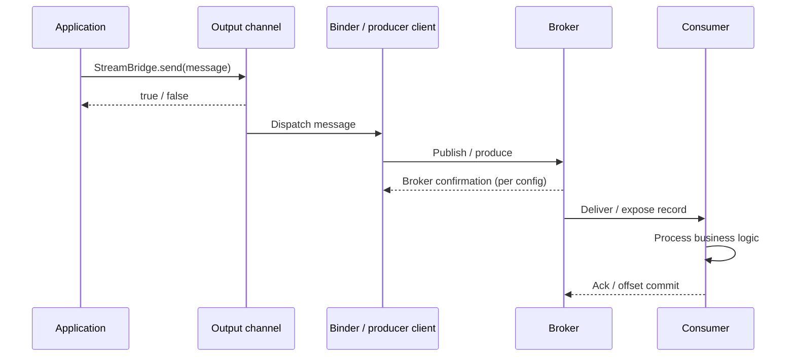

# Interpreting send Results and Distinguishing Them from Broker Acknowledgments

`StreamBridge` allows a Spring component to send data to an output binding without declaring a separate `Supplier` or `Function` for each publishing path. The `send()` method returns a `boolean`, but this value must be interpreted properly: it indicates whether sending the message through the application's channel was accepted. It is not a universal confirmation that Kafka, RabbitMQ, or Pulsar durably stored the message, much less proof that a consumer received or processed the message.

In an event-driven system, there are multiple delivery stages: the application builds the message, the channel accepts the message, the binder passes the message to the producer client, the broker confirms receipt according to configuration, and then the consumer reads and processes it. Each stage has its own success signal and failure mode. Understanding these boundaries helps the application decide when to mark a task complete, when to retry, and when to check state to avoid duplicate publishing.

## 1. StreamBridge sends messages through an output binding

`StreamBridge` is Spring Cloud Stream's API for sending messages from non-function components, such as a REST controller, business service, or scheduler. The application specifies the output binding name and the data to send.

Example of a service publishing order events:

```java
@Service
public class OrderEventPublisher {

    private final StreamBridge streamBridge;

    public OrderEventPublisher(StreamBridge streamBridge) {
        this.streamBridge = streamBridge;
    }

    public boolean publish(OrderPlaced event) {
        Message<OrderPlaced> message = MessageBuilder
            .withPayload(event)
            .setHeader("eventId", event.eventId())
            .setHeader("correlationId", event.correlationId())
            .build();

        return streamBridge.send("orders-out-0", message);
    }
}
```

`orders-out-0` is the output binding name. The destination can be explicitly configured:

```yaml
spring:
  cloud:
    stream:
      bindings:
        orders-out-0:
          destination: orders.placed
          content-type: application/json
```

When `send()` is called, StreamBridge finds or creates the corresponding binding per configuration, then sends the message through the output channel bound to the binder. The binder forwards the message to the selected broker's producer mechanism.

The API can accept a payload directly or a `Message<?>`. Use `Message<?>` when you need to attach agreed-upon headers such as event ID, correlation ID, or routing metadata. Never put secrets in headers because headers can be logged or passed through intermediate components.

## 2. What does the boolean return value of send() mean?

Two main outcomes to distinguish:

| Result | Correct interpretation |
|---|---|
| `true` | The channel accepted the message per the semantics of the channel and configured send path |
| `false` | The channel did not accept the message; the application must examine the cause and retry policy |

Example:

```java
boolean accepted = streamBridge.send("orders-out-0", message);

if (!accepted) {
    throw new MessageDeliveryException(
        message,
        "Output channel did not accept the message"
    );
}
```

The code handles the case where the channel returns `false`. In a real application, consider where the exception is caught and the retry policy of the service calling the publisher.

A `true` value does NOT mean:

- The broker confirmed the message.
- The message was durably written per replication or durability policy.
- The message was routed to a queue that a consumer is listening to.
- A consumer read, committed the offset for, or acknowledged the message.
- Consumer business logic completed.

`StreamBridge.send()` returns the result of sending to the channel. This generic API does not return a future containing a broker message ID or a publisher-confirm object with identical semantics across all binders.

If the channel uses synchronous dispatch, the call may perform additional handler work before returning. If the sending path uses an asynchronous channel or executor, `true` may only indicate that the message was accepted into an internal queue. Either way, never infer broker confirmation solely from the boolean value. Rely on the specific binder contract and producer configuration when broker-level confirmation is required.

## 3. Distinguishing delivery stages

An event publish can pass through the following stages:



The signals in the diagram are not always synchronous with one another. In particular, the channel result can return before the broker responds or before a consumer processes the message.

| Stage | Observable signal | What that signal proves |
|---|---|---|
| Application → channel | Boolean from `send()` | Channel accepted or rejected the message |
| Binder/client → broker | Producer confirm, completed future, or message ID | Broker confirmed per specific mechanism and configuration |
| Broker → consumer | Record/queue message becomes readable | Message is ready for consumers per broker mechanism |
| Consumer → broker | Offset commit or acknowledgment | Broker recorded consumer progress/ack |
| Consumer business logic | Processing result and data commit | Business task completed within the application's transaction |

Broker confirmation and consumer acknowledgment are two different signals. A producer confirm does not prove a consumer received the message. Consumer acknowledgment likewise does not prove producer data was committed in the same database transaction in another system.

## 4. Scenarios that can occur after send()

### Channel rejects the message

If `send()` returns `false`, the channel did not accept the message. Causes may involve channel state, timeout, or sending path capacity. The application must record the error, check configuration, and apply bounded retries if the error is recoverable.

Do not ignore the return value:

```java
streamBridge.send("orders-out-0", message); // Return value ignored
```

The call above loses the signal that the channel rejected the message. Always check the boolean and decide the next action.

### Channel accepts, but broker rejects or cannot confirm

The channel may accept the message, yet the producer client encounters an error when sending to the broker—for example, broker unavailable, timeout, authentication failure, missing topic/exchange, or unserializable data. Depending on the binder, producer client, and sync/async settings, the error may propagate immediately during the call, be reported through the framework's error mechanism, or surface after `send()` has already returned.

Therefore, do not catch every exception and treat the message as sent. Configure error handling suited to the binder, log with correlation/event IDs, and track producer error metrics. For asynchronous sending paths, identify the async error reporting mechanism provided by the binder.

### Broker confirms, but consumer has not processed yet

The broker may have stored or accepted the message, while the consumer is not running, stopped, lacks a matching subscription, or is lagging. In this state, the message was successfully sent by the producer, but business processing has not finished.

Monitoring consumer lag, queue depth, unacknowledged messages, and consumer status helps detect this situation. Do not use producer confirms as the sole indicator of end-to-end progress.

### Consumer finishes processing, but acknowledgment is not recorded

The consumer may complete a database update and then fail before committing its offset or acknowledging. The broker can redeliver the message. Thus, consumers need to be idempotent or have deduplication using event IDs/business keys. Broker redelivery does not necessarily mean the producer sent the message twice.

## 5. Broker confirmations have distinct semantics

Spring Cloud Stream provides a common API for sending messages, while broker confirmations depend on the specific binder and client. There is no single universal meaning of StreamBridge's `true` that replaces all these mechanisms.

### Kafka: producer acknowledgment

The Kafka producer has the `acks` setting to determine the level of acknowledgment from the broker:

- `acks=0`: producer does not wait for broker acknowledgment.
- `acks=1`: leader acknowledges after writing the record to the leader's local log.
- `acks=all` (or `-1`): leader waits for replicas in the in-sync replicas set to acknowledge per Kafka's protocol.

`acks=all` must be considered alongside `min.insync.replicas` and the replication factor. It does not mean every configured replica, including replicas outside the ISR, has acknowledged. If high durability is required, design appropriate replication and ISR policies.

When using Kafka directly via Spring for Apache Kafka, `KafkaTemplate.send()` returns `CompletableFuture<SendResult<K, V>>` in modern Spring Kafka versions. The future completes when the producer receives the send result from Kafka or hits an error:

```java
kafkaTemplate.send("orders.placed", event.orderId(), event)
    .whenComplete((result, failure) -> {
        if (failure != null) {
            log.error("Kafka publish failed: {}", event.eventId(), failure);
            return;
        }

        RecordMetadata metadata =
            result.getRecordMetadata();

        log.info(
            "Kafka acknowledged event {}, partition={}, offset={}",
            event.eventId(),
            metadata.partition(),
            metadata.offset()
        );
    });
```

This example uses the Kafka API directly, not the return value of `StreamBridge.send()`. A successfully completed future indicates the producer received the send outcome per `acks` config; it does not prove a consumer processed the record. With the Kafka binder, consult the binder version docs to choose sync or async send mode and the corresponding error handling mechanism. Do not mechanically apply `KafkaTemplate` properties to StreamBridge.

### RabbitMQ: publisher confirms and returns

RabbitMQ supports publisher confirms so publishers know the broker confirmed the publish per protocol. This mechanism is separate from consumer acknowledgments. If a message is not routed to any queue, publisher returns can provide additional details when mandatory/returns mode is configured.

With Spring AMQP, `RabbitTemplate` and `CorrelationData` can track publisher confirms:

```java
CorrelationData correlation =
    new CorrelationData(event.eventId());

rabbitTemplate.convertAndSend(
    "orders.exchange",
    "order.placed",
    event,
    correlation
);

correlation.getFuture().whenComplete((confirm, failure) -> {
    if (failure != null) {
        log.error("Rabbit publish failed: {}", event.eventId(), failure);
    } else if (confirm.ack()) {
        log.info("Rabbit broker confirmed event {}", event.eventId());
    } else {
        log.error(
            "Rabbit broker rejected event {}: {}",
            event.eventId(),
            confirm.reason()
        );
    }
});
```

To use publisher confirms, enable the corresponding setting on the connection factory. If unrouted messages must be detected, configure publisher returns/mandatory and inspect returned message info according to your Spring AMQP version. A publisher confirm ack only confirms the broker received the publish; returns and routing topology help verify whether the message was routed as expected. Confirms also do not prove a consumer processed it.

This example calls Spring AMQP APIs directly. If sending through the Rabbit binder and StreamBridge, inspect the binder's publisher confirm and returns capabilities and specific binder configuration; do not infer that a boolean from StreamBridge is a confirm.

### Pulsar: send result and MessageId

An Apache Pulsar producer can receive a `MessageId` when the broker confirms a successful send per producer settings. Spring for Apache Pulsar provides `PulsarTemplate` with synchronous and asynchronous send methods in supported versions.

General example when using the template directly:

```java
MessageId messageId = pulsarTemplate.send(
    "persistent://public/default/orders",
    event
);

log.info(
    "Pulsar acknowledged event {} with messageId {}",
    event.eventId(),
    messageId
);
```

The `MessageId` value is the message identifier assigned by Pulsar after a successful send. If using asynchronous methods, handle the resulting future and exceptions appropriately. Batching, timeout, retry, and topic durability settings affect actual semantics. This result comes from Pulsar/Spring Pulsar APIs; `StreamBridge.send()` still returns the channel boolean.

## 6. Synchronous vs. asynchronous: understand the exact scope

A synchronous send path may wait for a downstream operation to finish before returning. However, it can only be called a broker confirmation if the binder documentation confirms the call actually waits for the producer result and clearly defines the success condition.

An asynchronous send path usually separates when the channel accepts the message from when the producer receives a result from the broker. This increases throughput but requires an observability mechanism for async errors.

| Characteristic | Synchronous send | Asynchronous send |
|---|---|---|
| Calling thread waits | Waits for send operation per config | Usually does not wait for broker completion |
| When errors are detected | Potentially immediately during the call | Potentially via callback, future, or error handling |
| Throughput | Potentially lower when waiting for confirmations | Potentially higher due to parallel/buffered sending |
| State management needed | Still needs event ID and idempotency | Additionally needs async result tracking |
| Meaning of `StreamBridge.send() == true` | Channel accepted | Channel accepted, possibly into an internal queue |

Do not switch to synchronous sending blindly just for a sense of safety. Measure throughput, latency, and identify exactly which broker confirmation the application needs. If a binder offers a sync producer property, check the binder version documentation and test with a real broker before relying on that outcome.

## 7. Designing retries without uncontrolled duplicates

If the channel returns `false`, the application can consider retrying after a bounded wait. If the producer reports a failed broker send, determine whether the error guarantees the message was not written or whether the state is ambiguous due to a timeout. In a timeout situation, the broker might have received the message while the response was lost; resending can create a duplicate record.

Therefore, every important event should have a stable ID:

```java
public record OrderPlaced(
    String eventId,
    String orderId,
    Instant occurredAt
) {}
```

The ID must be generated when the event is created and preserved across retries or replays. Consumers use that ID to deduplicate or keep business operations idempotent.

A retry strategy should define:

- Which errors are retried and which go to error storage.
- Maximum retry attempts and backoff.
- Which timeouts are treated as ambiguous outcomes.
- How to keep the original event ID and payload intact during retries.
- How to record publish state so events are not lost.
- How to handle messages already received by the broker before the application recorded confirmation.

Never generate a new event ID on each retry. Doing so prevents consumers from recognizing redeliveries of the same event.

## 8. Using transactional outbox when database consistency is needed

A common problem is a service updating the database and then calling `StreamBridge.send()`. If the database commits but the application fails before publishing, business state changed without publishing the event. If publishing happens first and the database rolls back, consumers may receive an event for an uncommitted change.

Transactional outbox resolves this boundary by writing business data and an outbox record in the same database transaction:

1. Service updates business data.
2. Service writes an outbox record containing event ID, type, payload, and pending status.
3. Database transaction commits.
4. A relay reads the outbox and sends messages to the broker.
5. Relay marks the record as published only after receiving a send success signal at the level required by the system.
6. If the relay is unsure whether the broker received the message, the record can be sent again; consumers must be idempotent.

If relying solely on StreamBridge's boolean, the relay knows the channel accepted the message but cannot be sure of a broker confirm. When the outbox requires waiting for broker acknowledgment before marking published, you need a synchronous mechanism or callback supported by the binder, or an appropriate producer API with clear broker results. Do not mark an outbox record as published just because `StreamBridge.send()` returned `true` if business requirements demand broker confirmation.

Outbox typically provides at-least-once delivery from the relay side. Idempotent consumers handle duplicate messages. It does not automatically create end-to-end exactly-once across the database, broker, and all external systems.

## 9. Monitoring producers and consumers separately

To observe an event stream, monitor signals across each stage:

| Metric / data | Helps detect |
|---|---|
| `StreamBridge.send()` call count and false rate | Channel rejecting messages |
| Dispatch exceptions or binder errors | Errors before or during producer send |
| Producer success/failure, latency, timeouts | Client/broker-level send results |
| Kafka record metadata, topic/partition/offset | Record position confirmed by Kafka |
| Rabbit confirm/return, queue depth, unacked | Publish confirms, routing, and consumer status |
| Pulsar send result, MessageId, backlog | Successful sends and subscription progress |
| Consumer lag, retry count, DLQ count | Slow consumers, processing errors, and messages needing investigation |

Use `eventId` to correlate logs across producer, broker, and consumer; use `correlationId` to link multiple operations within the same business flow. Avoid logging entire payloads or sensitive data.

A dashboard showing only how many times `StreamBridge.send()` returned true reflects channel activity—it is not enough to conclude broker publish success rates or consumer completion rates.

## 10. Checklist for choosing the right success signal

- Identify the question to answer: channel accepted message, broker confirmed, message routed, or consumer finished business processing.
- Check the boolean return value of `StreamBridge.send()` and handle channel rejections.
- Do not treat `true` as broker acknowledgment or consumer acknowledgment.
- Read binder/client documentation to understand sync vs. async sending and error reporting paths.
- Use Kafka producer results, Rabbit publisher confirms/returns, or Pulsar send results when broker-specific signals are needed.
- Configure durability, replication, acks, routing, and timeouts appropriate for the broker.
- Keep event IDs stable, design idempotent consumers, and keep retries bounded.
- Use transactional outbox when consistency between database and publishing is required.
- Monitor channel, producer, broker, and consumer using separate metrics.
- Test broker rejections, ambiguous timeouts, stopped consumers, and redelivered messages.

## 11. References

- [Spring Cloud Stream Reference — Producing and Consuming Messages](https://docs.spring.io/spring-cloud-stream/reference/spring-cloud-stream/producing-and-consuming-messages.html), StreamBridge usage section.
- [Spring for Apache Kafka Reference — Sending Messages](https://docs.spring.io/spring-kafka/reference/kafka/sending-messages.html).
- [Spring AMQP Reference — AmqpTemplate](https://docs.spring.io/spring-amqp/reference/amqp/template.html), publisher confirms and returns section.
- [Spring for Apache Pulsar Reference](https://docs.spring.io/spring-pulsar/reference/).

`StreamBridge.send()` is a convenient sending entry point in the Spring Cloud Stream model, yet its boolean return value pertains to sending through the output channel. Broker confirmation is a separate signal and must be obtained from the corresponding producer/binder mechanism. By cleanly separating channel acceptance, broker confirmation, and consumer acknowledgment, an application can handle errors, retries, outbox, and completion states with reliability suited to business requirements.
