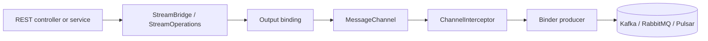

# Applying ChannelInterceptor and Testing via StreamOperations

`StreamBridge` enables an application component that is not a `Supplier` or `Function` to send data to a Spring Cloud Stream output binding. For example, a REST controller, a business service, or a listener from an external system can send events to Kafka, RabbitMQ, or Pulsar through the same binding and binder mechanism used by the rest of the application.

In some cases, before a message is sent to the binder, the application needs to add metadata, normalize headers, record technical information, or reject invalid messages. **`ChannelInterceptor`** provides hooks before and after send operations on a `MessageChannel`. With `StreamBridge`, you can register an interceptor globally or scope it by binding name. To test the sending component without depending directly on `StreamBridge`, the application can inject the **`StreamOperations`** interface and mock it in unit tests.

## 1. StreamBridge sends through MessageChannel

`StreamBridge` bridges data sources outside the functional model to an output binding. The application component calls `send(...)`, the framework converts the data into a message, finds or creates the output binding, and sends the message through the channel attached to that binding. The binder receives the message and forwards it to the corresponding destination on the broker.



A channel interceptor runs at the channel boundary inside the application. It can inspect or transform a message before the message is forwarded to the binder's handler. An interceptor is not a consumer, does not replace a serializer, and does not directly manage transactions or broker delivery acknowledgments.

For example, a service publishing order events:

```java
import org.springframework.cloud.stream.function.StreamBridge;
import org.springframework.stereotype.Service;

@Service
class OrderEventPublisherWithStreamBridge {

    private final StreamBridge streamBridge;

    OrderEventPublisherWithStreamBridge(StreamBridge streamBridge) {
        this.streamBridge = streamBridge;
    }

    boolean publish(OrderCreated event) {
        return streamBridge.send("orderEvents-out-0", event);
    }
}
```

`orderEvents-out-0` is the output binding name passed to `send`. If the binding does not exist yet, `StreamBridge` can dynamically create it on the first send and reuse it on subsequent sends. If you want the binding created as soon as the application starts, declare `spring.cloud.stream.output-bindings`.

```yaml
spring:
  cloud:
    stream:
      output-bindings: orderEvents-out-0
      bindings:
        orderEvents-out-0:
          destination: orders.events
          content-type: application/json
```

In this example, messages are sent to destination `orders.events`. `StreamBridge` can also accept a Java object or a `Message<?>`; type conversion and producer binding properties are still applied per Spring Cloud Stream configuration.

## 2. ChannelInterceptor and the message send lifecycle

`ChannelInterceptor` belongs to Spring Messaging. For an output channel, the key callbacks are:

| Callback | When invoked | Purpose |
|---|---|---|
| `preSend` | Before the channel hands the message to subscribers/handlers. | Inspect, add headers, replace message, or reject sending. |
| `postSend` | After the send operation, receiving the `sent` flag. | Record channel-level send outcome. |
| `afterSendCompletion` | After the send operation completes, even if an exception occurred. | Clean up resources or record processing completion. |

The `preReceive`, `postReceive`, and `afterReceiveCompletion` callbacks serve channels with receive/poll operations. When using an interceptor for `StreamBridge` output, focus on the send callbacks.

Signature of `preSend`:

```java
Message<?> preSend(Message<?> message, MessageChannel channel)
```

- Return the original message if no changes are needed.
- Return a new message if payload/headers need to be added or modified.
- Return `null` to prevent the message from proceeding through the channel.
- Throw an exception if the error should fail the send operation per application policy.

Messages in Spring Messaging are structurally immutable. When modifying headers, build a new message using `MessageBuilder` instead of attempting to mutate the original message's header map directly.

## 3. Registering an interceptor for StreamBridge

Spring Cloud Stream does not automatically apply every `ChannelInterceptor` bean to the channels used by `StreamBridge`. For an interceptor to apply to these channels, register the bean with the `@GlobalChannelInterceptor` annotation and specify an appropriate pattern.

The annotation resides in package `org.springframework.integration.config`; the `ChannelInterceptor` interface resides in `org.springframework.messaging.support`.

```java
import org.springframework.context.annotation.Bean;
import org.springframework.context.annotation.Configuration;
import org.springframework.integration.config.GlobalChannelInterceptor;
import org.springframework.messaging.support.ChannelInterceptor;

@Configuration
class StreamBridgeInterceptorConfiguration {

    @Bean
    @GlobalChannelInterceptor(patterns = "orderEvents-out-0")
    ChannelInterceptor orderEventsInterceptor() {
        return new CorrelationIdChannelInterceptor();
    }
}
```

`patterns` specifies the channel names to which the interceptor applies. Wildcards can cover a group of bindings:

```java
@Bean
@GlobalChannelInterceptor(patterns = "orders-*")
ChannelInterceptor ordersInterceptor() {
    return new CorrelationIdChannelInterceptor();
}
```

If it needs to apply to every channel managed by the global interceptor mechanism, `patterns = "*"` can be used. A scope broader than needed is usually unnecessary; prefer specific patterns to avoid inadvertently interfering with flows outside the interceptor's responsibility.

The pattern is matched against the channel/binding name used by `StreamBridge`. Therefore, match the name passed to `streamBridge.send(...)` against the declared pattern. Do not assume the broker destination name is always the channel name to match.

## 4. Example: adding correlationId before sending

An interceptor can ensure messages always carry a `correlationId`, helping connect logs and traces across the inbound API, producer, and event-consuming services.

```java
import java.util.UUID;

import org.springframework.messaging.Message;
import org.springframework.messaging.MessageChannel;
import org.springframework.messaging.support.ChannelInterceptor;
import org.springframework.messaging.support.MessageBuilder;

class CorrelationIdChannelInterceptor implements ChannelInterceptor {

    @Override
    public Message<?> preSend(Message<?> message, MessageChannel channel) {
        Object existingId = message.getHeaders().get("correlationId");
        if (existingId != null && !existingId.toString().isBlank()) {
            return message;
        }

        return MessageBuilder.fromMessage(message)
            .setHeader("correlationId", UUID.randomUUID().toString())
            .build();
    }
}
```

The interceptor preserves the caller-provided `correlationId` if it is already present. If missing, it generates a new ID and attaches it to the outgoing message. `MessageBuilder.fromMessage(...)` preserves the payload and existing headers, then builds a new message with the added header.

If a request carries a correlation ID from an upstream system, propagate that ID throughout the flow instead of generating a new ID at every service. The interceptor should only create an ID when no valid value exists; overwriting an existing ID breaks trace continuity.

## 5. Suitable and unsuitable tasks for an interceptor

Interceptors fit short, synchronous, cross-cutting technical processing:

- Adding missing `correlationId`, `source`, or technical headers.
- Normalizing header names or formats.
- Checking required metadata before sending.
- Recording metrics on messages passing through the channel or send outcomes.
- Producing concise tracing logs without logging sensitive data.

Do not turn an interceptor into the place for core business logic. For example, never call a payment service, query multiple database tables, send emails, or wait on a remote API inside `preSend`. Slow operations hold the message-sending thread, increasing latency and reducing throughput.

If you need to check business rules such as "whether an order can be canceled", handle that in a service or function before calling `StreamOperations`. Interceptors should focus on metadata and technical rules applied consistently to messages.

### Rejecting a message in preSend

An interceptor can reject a message by returning `null`:

```java
class RequiredHeaderInterceptor implements ChannelInterceptor {

    @Override
    public Message<?> preSend(Message<?> message, MessageChannel channel) {
        Object tenantId = message.getHeaders().get("tenantId");
        if (tenantId == null || tenantId.toString().isBlank()) {
            return null;
        }
        return message;
    }
}
```

When `preSend` returns `null`, the message is blocked at the channel and not forwarded to the binder. This is a send-layer rejection; the application must record or return an appropriate result to the caller. Do not silently drop messages without logs, metrics, or error details sufficient for investigation.

If you want the caller to receive an explicit error, throw a dedicated exception in the interceptor or check the condition before calling `StreamOperations`. Standardize the handling approach to avoid recording the same error twice across layers.

## 6. postSend and afterSendCompletion

`postSend` is invoked after the channel performs the send operation and receives the `sent` parameter:

```java
@Override
public void postSend(
        Message<?> message,
        MessageChannel channel,
        boolean sent) {
    if (sent) {
        // Record metric or log at the channel level that the send operation was accepted.
    }
}
```

`afterSendCompletion` can be used to record processing completion and exceptions:

```java
@Override
public void afterSendCompletion(
        Message<?> message,
        MessageChannel channel,
        boolean sent,
        Exception ex) {
    if (ex != null) {
        // Record the send failure by correlationId.
    }
}
```

Do not interpret `sent = true` as proof that the final consumer processed the message. It reflects the result of the channel send operation inside the application. Durability guarantees, publisher confirms, ACKs, or business completion still depend on the binder, broker, and consumer.

Similarly, the boolean return value from `StreamOperations.send(...)` tells the caller whether the send succeeded at the API/channel level. It does not prove every consumer received the message, nor does it prove business data committed in the target system.

## 7. Using StreamOperations instead of concrete StreamBridge

`StreamOperations` is the interface defining `StreamBridge`'s `send` operations. `StreamBridge` implements this interface. Applications can inject `StreamOperations` to reduce coupling to the concrete class and make mocking easy in unit tests.

```java
import org.springframework.cloud.stream.function.StreamOperations;
import org.springframework.stereotype.Service;

@Service
class OrderEventPublisher {

    private static final String OUTPUT_BINDING = "orderEvents-out-0";

    private final StreamOperations streamOperations;

    OrderEventPublisher(StreamOperations streamOperations) {
        this.streamOperations = streamOperations;
    }

    boolean publish(OrderCreated event) {
        return streamOperations.send(OUTPUT_BINDING, event);
    }
}
```

The interface provides `send` overloads for sending data to a binding, including:

```java
boolean send(String bindingName, Object data);
boolean send(String bindingName, Object data, MimeType outputContentType);
```

Some overloads also accept a binder name when the application has multiple binders. Choose the overload matching your needs; for applications using a single default binder and content type declared on the binding, `send(bindingName, data)` is usually enough.

For example, if you need to set a specific content type for a send call:

```java
import org.springframework.util.MimeTypeUtils;

streamOperations.send(
    "orderEvents-out-0",
    event,
    MimeTypeUtils.APPLICATION_JSON
);
```

When sending a `Message<?>`, the content type inside the message can be used according to Spring Cloud Stream's content type negotiation mechanism. Ensure the metadata accurately describes the payload and a matching converter is configured.

## 8. Configuring output bindings for StreamBridge

If the application knows the binding name in advance, explicitly declare the output binding so it is created at startup:

```yaml
spring:
  cloud:
    stream:
      output-bindings: orderEvents-out-0
      bindings:
        orderEvents-out-0:
          destination: orders.events
          content-type: application/json
```

Without declaring `output-bindings`, `StreamBridge` can still create a dynamic binding on the first `send`. Dynamic bindings are useful when destinations are only known at runtime, but you must bound and manage the number of destinations to prevent uncontrolled cache growth. For fixed destinations, explicit declaration makes configuration easier to audit.

If the application has multiple binders, specify the binder for the binding via binding configuration. Some `send` overloads accept an additional binder name, mainly meaningful when creating dynamic bindings. If a binding is already created or pre-declared with a specific binder, a binder parameter passed to `send` does not necessarily override the already selected binder.

## 9. Unit testing publishers by mocking StreamOperations

Unit tests for a message-publishing service should verify the contract between the service and `StreamOperations`, without starting a broker. Because the service depends on the interface, you can mock the interface and verify the binding name, payload, and return value.

```java
import static org.junit.jupiter.api.Assertions.assertTrue;
import static org.mockito.Mockito.verify;
import static org.mockito.Mockito.when;

import org.junit.jupiter.api.Test;
import org.springframework.cloud.stream.function.StreamOperations;

class OrderEventPublisherTest {

    @Test
    void sendsEventToExpectedBinding() {
        StreamOperations operations = org.mockito.Mockito.mock(StreamOperations.class);
        OrderEventPublisher publisher = new OrderEventPublisher(operations);
        OrderCreated event = new OrderCreated("evt-101", "order-9001");

        when(operations.send("orderEvents-out-0", event)).thenReturn(true);

        boolean sent = publisher.publish(event);

        assertTrue(sent);
        verify(operations).send("orderEvents-out-0", event);
    }
}

record OrderCreated(String eventId, String orderId) {}
```

This test verifies the service calls the right binding and passes the right object. You can add a case where `send` returns `false` to ensure callers handle failed sends per the application's contract.

```java
when(operations.send("orderEvents-out-0", event)).thenReturn(false);

boolean sent = publisher.publish(event);

assertFalse(sent);
```

Mocking `StreamOperations` does not execute `StreamBridge`, does not create a real channel, and does not run interceptors. This is a unit test for the publisher's logic; interceptors and the binding path must be tested separately.

## 10. Direct unit testing of ChannelInterceptor

An interceptor is a standalone component and can be tested by calling `preSend` with a sample message. No broker is needed to verify headers are added or preserved.

```java
import static org.junit.jupiter.api.Assertions.assertEquals;
import static org.junit.jupiter.api.Assertions.assertNotNull;

import org.junit.jupiter.api.Test;
import org.springframework.messaging.Message;
import org.springframework.messaging.MessageChannel;
import org.springframework.messaging.support.GenericMessage;
import org.mockito.Mockito;

class CorrelationIdChannelInterceptorTest {

    private final CorrelationIdChannelInterceptor interceptor =
        new CorrelationIdChannelInterceptor();
    private final MessageChannel channel = Mockito.mock(MessageChannel.class);

    @Test
    void addsCorrelationIdWhenMissing() {
        Message<String> input = new GenericMessage<>("order-created");

        Message<?> output = interceptor.preSend(input, channel);

        assertNotNull(output.getHeaders().get("correlationId"));
        assertEquals("order-created", output.getPayload());
    }

    @Test
    void preservesExistingCorrelationId() {
        Message<String> input = new GenericMessage<>(
            "order-created",
            java.util.Map.of("correlationId", "request-42")
        );

        Message<?> output = interceptor.preSend(input, channel);

        assertEquals("request-42", output.getHeaders().get("correlationId"));
    }
}
```

These tests verify interceptor logic without creating an application context. You can add tests for rejected messages, invalid headers, or ensuring the interceptor preserves the payload and other metadata.

## 11. Testing the StreamBridge and interceptor path with Test Binder

To verify an interceptor is actually attached to the channel used by `StreamBridge`, use the Spring Cloud Stream Test Binder. The Test Binder creates an in-JVM simulated broker, allowing you to send messages and receive outputs via `OutputDestination` without installing Kafka, RabbitMQ, or Pulsar.

Add the test dependency:

```xml
<dependency>
    <groupId>org.springframework.cloud</groupId>
    <artifactId>spring-cloud-stream-test-binder</artifactId>
    <scope>test</scope>
</dependency>
```

Condensed integration test example:

```java
import static org.junit.jupiter.api.Assertions.assertNotNull;
import static org.junit.jupiter.api.Assertions.assertTrue;

import org.junit.jupiter.api.Test;
import org.springframework.beans.factory.annotation.Autowired;
import org.springframework.boot.test.context.SpringBootTest;
import org.springframework.cloud.stream.binder.test.EnableTestBinder;
import org.springframework.cloud.stream.function.StreamOperations;
import org.springframework.cloud.stream.binder.test.OutputDestination;
import org.springframework.messaging.Message;

@SpringBootTest(properties =
    "spring.cloud.stream.output-bindings=orderEvents-out-0")
@EnableTestBinder
class StreamBridgeInterceptorIntegrationTest {

    @Autowired
    StreamOperations streamOperations;

    @Autowired
    OutputDestination outputDestination;

    @Test
    void interceptorAddsCorrelationIdToStreamBridgeMessage() {
        OrderCreated event = new OrderCreated("evt-102", "order-9002");

        assertTrue(streamOperations.send("orderEvents-out-0", event));

        Message<byte[]> received = outputDestination.receive(
            1000,
            "orderEvents-out-0"
        );

        assertNotNull(received);
        assertNotNull(received.getHeaders().get("correlationId"));
    }
}
```

The test configuration must import the `StreamBridgeInterceptorConfiguration` bean and binding configuration matching the application under test. When using `@SpringBootTest` on the main application class that already includes the interceptor bean, re-declaring that bean is unnecessary. Ensure the `@GlobalChannelInterceptor` pattern matches the exact output binding name.

The Test Binder verifies the channel/binding flow and interceptor inside the JVM. It does not replace testing against a real broker for behaviors such as publisher confirms, Kafka partitions, RabbitMQ exchanges/queues, Pulsar subscriptions, native header mapping, or binder-specific serialization.

## 12. Distinguishing three layers of testing

| Test layer | Tools | Verifies |
|---|---|---|
| Publisher unit test | Mock `StreamOperations` | Service calls the right binding, passes the right payload, and handles boolean results. |
| Interceptor unit test | Call `preSend` with sample messages | Headers are added/preserved, messages are transformed or rejected per rules. |
| Test Binder integration | `@EnableTestBinder`, `OutputDestination` | `StreamBridge` sends via the binding and the interceptor actually runs on the channel. |
| Broker integration test | Real Kafka/RabbitMQ/Pulsar binder | Header mapping, serialization, routing, publish confirms, and broker-specific behavior. |

The first three layers can run quickly in a CI pipeline. Real-broker testing should run in a dedicated integration stage because it requires infrastructure and verifies guarantees that in-JVM channels cannot simulate.

## 13. Interceptor ordering and error handling

When multiple interceptors exist, execution order can affect results. `@GlobalChannelInterceptor` supports the `order` attribute to specify application order. Set explicit ordering when one interceptor adds a header that another interceptor depends on.

For example, the first interceptor generates `correlationId`, and the second records metrics based on that ID. Ensure the ID-generating interceptor runs before the metrics interceptor. Do not rely on arbitrary bean registration order.

If `preSend` throws an exception, the send operation may fail and propagate the exception to the caller depending on the call path. If `postSend` or `afterSendCompletion` fails, avoid masking the original exception or causing duplicate side effects. Observability callbacks should handle local errors carefully and avoid disrupting the send path unless business rules require it.

Never call `StreamOperations.send(...)` recursively from an interceptor of that same output binding. Doing so can create an infinite send loop or repeatedly re-invoke the interceptor. If a secondary event must be published, do so from a separate service and design an independent flow.

## 14. Common pitfalls

1. **Declaring `ChannelInterceptor` without `@GlobalChannelInterceptor`.** The interceptor may not be applied to channels used by `StreamBridge`.
2. **Pattern not matching the binding name.** Check the name passed to `send(...)`, e.g., `orderEvents-out-0`, instead of only looking at destination `orders.events`.
3. **Using an overly broad `*` pattern.** The interceptor may affect unrelated channels; prefer specific patterns.
4. **Assuming mocking `StreamOperations` tests the interceptor.** Mocks only verify interface calls; use Test Binder to verify the channel pipeline.
5. **Treating `send() == true` as broker durable storage.** This result does not prove a consumer processed the message; verify per binder/broker if higher guarantees are needed.
6. **Performing slow I/O in `preSend`.** This holds the sending thread and can degrade throughput.
7. **Copying headers indiscriminately.** When modifying payloads, verify `contentType`, correlation ID, and metadata remain valid.
8. **Ignoring `send() == false`.** Callers need a strategy to report errors, retry, or persist requests for recovery.
9. **Not testing with the real binder.** The Test Binder does not simulate all broker confirms, routing, partitioning, and native header mapping.

## 15. Application adoption workflow

When adding an interceptor to a `StreamBridge` flow, follow this sequence:

1. Identify the binding name passed by the service to `StreamOperations.send(...)`.
2. Declare the output binding and destination; if known in advance, pre-create the binding at startup with `spring.cloud.stream.output-bindings`.
3. Identify metadata to add or validate, such as `correlationId`, `source`, or `tenantId`.
4. Write a `ChannelInterceptor` with concise logic in `preSend`; only reject messages under clear rules.
5. Register the interceptor via `@GlobalChannelInterceptor` with a pattern scoped to the binding.
6. Inject `StreamOperations` into the publisher to decouple the service from the concrete implementation.
7. Write publisher unit tests by mocking `StreamOperations` and separate unit tests for the interceptor.
8. Write a Test Binder integration test to verify messages from `StreamBridge` pass through the interceptor.
9. Run tests against the real binder/broker when verifying serialization, header mapping, and publish confirms.
10. Monitor send errors, blocked message counts, interceptor metrics, and correlation IDs in logs/traces.

`ChannelInterceptor` helps enforce consistent technical rules right at the channel boundary, while `StreamOperations` provides a send contract that is easy to swap and test. Combining unit tests with the Test Binder verifies both publisher logic and the actual message path through `StreamBridge`; real-broker testing adds the guarantees specific to Kafka, RabbitMQ, or Pulsar.

## References

- [Spring Cloud Stream – Producing and Consuming Messages: StreamBridge, Channel Interceptors and StreamOperations](https://docs.spring.io/spring-cloud-stream/reference/spring-cloud-stream/producing-and-consuming-messages.html)
- [Spring Cloud Stream – Testing with Spring Integration Test Binder](https://docs.spring.io/spring-cloud-stream/reference/spring-cloud-stream/spring_integration_test_binder.html)
- [Spring Integration – GlobalChannelInterceptor API](https://docs.spring.io/spring-integration/docs/current/api/org/springframework/integration/config/GlobalChannelInterceptor.html)
